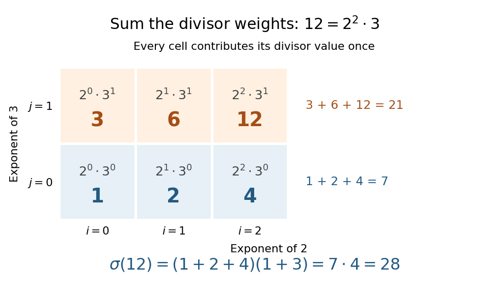
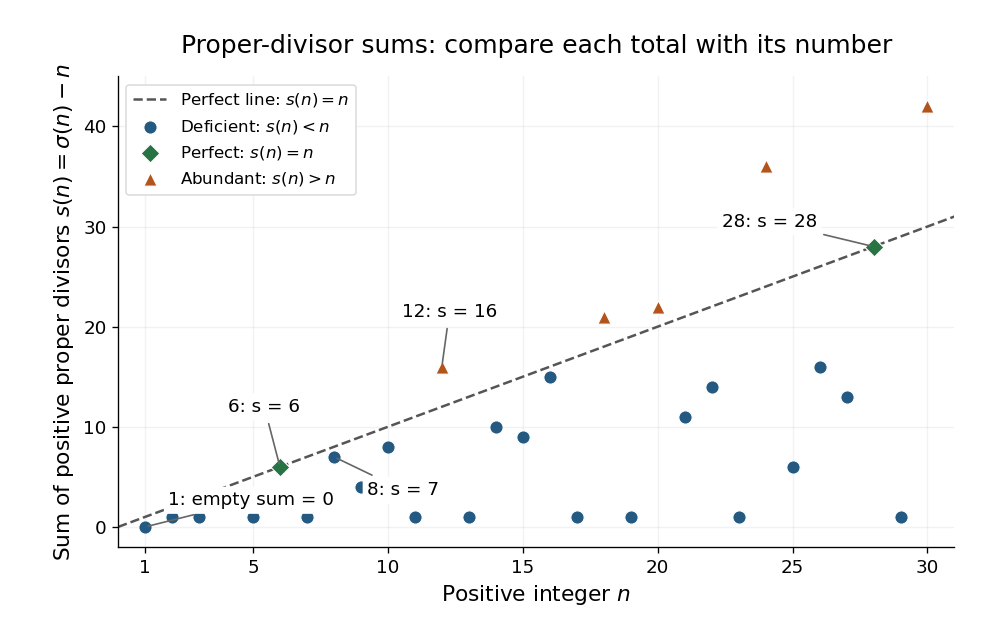

# Sum-of-divisors function

↑ **Parent:** [Divisor sum](divisor-sum.md)

The [sum-of-divisors function](sum-of-divisors-function.md) adds all positive [integer divisors](divisor.md) of a [positive integer](positive-integer.md), including the number itself:

$$
\sigma(n)=\sigma_1(n)=\sum_{d\mid n}d,\qquad \sigma(1)=1.
$$

It is the [divisor sum](divisor-sum.md) of the [identity arithmetic function](identity-arithmetic-function.md) $\operatorname{id}(n)=n$, so $\sigma=\operatorname{id}*\mathbf1$ under [Dirichlet convolution](dirichlet-convolution.md). Both factors are [multiplicative functions](multiplicative-function.md), hence so is the [sum-of-divisors function](sum-of-divisors-function.md). The notation $\sigma_1$ distinguishes it from other weighted [divisor sums](divisor-sum.md). [Darij Grinberg, MIT 18.781 notes, Definition 2.1.2 and Proposition 2.2.2(e)](https://darijgrinberg.gitlab.io/floor.pdf)

For a [prime number](prime-number-split.md) $p$ and a nonnegative exponent $a$, the positive [integer divisors](divisor.md) of the [prime power](prime-power.md) $p^a$ are precisely $1,p,\ldots,p^a$. Their [finite geometric series](finite-geometric-series.md) gives

$$
\sigma(p^a)=1+p+\cdots+p^a=\frac{p^{a+1}-1}{p-1}.
$$

For example, $\sigma(8)=1+2+4+8=15=(2^4-1)/(2-1)$. For a [prime factorization](fundamental-theorem-of-arithmetic.md) $n=\prod_{k=1}^r p_k^{a_k}$ with distinct [prime numbers](prime-number-split.md) $p_k$ and positive exponents $a_k$, [multiplicativity](multiplicativity-of-an-arithmetic-function.md) gives

$$
\sigma(n)=\prod_{k=1}^r(1+p_k+\cdots+p_k^{a_k})=\prod_{k=1}^r\frac{p_k^{a_k+1}-1}{p_k-1}.
$$

For $n=1$, this is an [empty product](empty-product.md), equal to $1$. [Darij Grinberg, MIT 18.781 notes, Theorem 2.1.8 with k equal to one](https://darijgrinberg.gitlab.io/floor.pdf)

The [distributive property](distributive-property.md) makes the formula especially beautiful: choosing one term from each factor produces each positive [integer divisor](divisor.md) exactly once, by the [fundamental theorem of arithmetic](fundamental-theorem-of-arithmetic.md). For $12=4\cdot3=2^2\cdot3$, the choices form a three-by-two grid with entries $2^i3^j$, where $0\le i\le2$ and $0\le j\le1$. Adding its rows gives

$$
\sigma(12)=(1+2+4)+(3+6+12)=(1+2+4)(1+3)=7\cdot4=28.
$$

The [divisor function](divisor-function.md) counts six cells; the [sum-of-divisors function](sum-of-divisors-function.md) adds their six values. Once the [prime factorization](fundamental-theorem-of-arithmetic.md) is known, the product formula avoids testing every candidate [integer divisor](divisor.md). Shared [prime factors](prime-factor.md) require care: $\sigma(4)=7\ne9=\sigma(2)^2$, so the [sum-of-divisors function](sum-of-divisors-function.md) is not a [completely multiplicative function](completely-multiplicative-function.md).

**[Figure 3](#image-the-sum-of-divisors-function-for-12-each-grid-entry-is-a-positive-integer-divisor-and-the-weighted-total-is-1-plus-2-plus-4-1-plus-3-28). The sum-of-divisors function for $12$: each grid entry is a positive integer divisor, and the weighted total is $(1+2+4)(1+3)=28$**.

Subtracting the number itself gives the [proper-divisor sum](proper-divisor-sum.md) $s(n)=\sigma(n)-n$. Comparing $s(n)$ with $n$ distinguishes [perfect numbers](perfect-number.md), [deficient numbers](deficient-number.md), and [abundant numbers](abundant-number.md). For $6$, $s(6)=1+2+3=6$; for $28$, $s(28)=1+2+4+7+14=28$. Both are [perfect numbers](perfect-number.md). The calculation $s(8)=1+2+4=7<8$ makes $8$ a [deficient number](deficient-number.md), while $s(12)=1+2+3+4+6=16>12$ makes $12$ an [abundant number](abundant-number.md). These comparisons turn the sizes of [integer divisors](divisor.md) into a classification of [positive integers](positive-integer.md). [Western Carolina University, Challenge Problem: Perfect Numbers, hosted by MIT OpenCourseWare](https://ocw.mit.edu/courses/ec-s01-internet-technology-in-local-and-global-communities-spring-2005-summer-2005/aac0b504648aff57a83daec957da3a58_MITEC_S01S05_perf_numb.pdf)

**[Figure 4](#image-the-proper-divisor-sum-for-1-le-n-le30-perfect-numbers-lie-on-s-n-n-deficient-numbers-below-it-and-abundant-numbers-above-it). The proper-divisor sum for $1\le n\le30$: perfect numbers lie on $s(n)=n$, deficient numbers below it, and abundant numbers above it**.

This connection is ancient: [Euclid's Elements](euclid-s-elements.md), Book IX, Proposition 36, constructs a [perfect number](perfect-number.md) by multiplying the last term of $1,2,\ldots,2^{k-1}$ by their [sum](sum.md), when that [sum](sum.md) is a [prime number](prime-number-split.md). In modern notation, put $q=2^k-1$ and $N=2^{k-1}q$, with $k\ge2$ and $q$ a [prime number](prime-number-split.md). The [sum-of-divisors function](sum-of-divisors-function.md) proves the construction immediately:

$$
\sigma(N)=(2^k-1)(1+q)=q\,2^k=2N.
$$

Consequently the [proper-divisor sum](proper-divisor-sum.md) is $s(N)=N$. Taking $k=2,3$ produces the [perfect numbers](perfect-number.md) $6,28$. [Euclid, Elements IX.36, translated text and commentary by David Joyce](euclid-s-elements-by-euclid/book-ix-proposition-36.md)

**Table of contents**

- [Proper-divisor sum](proper-divisor-sum.md)

## ↑ Ancestors (7)

1. [Divisor sum](divisor-sum.md)
2. [Multiplicative function](multiplicative-function.md)
3. [Arithmetic function](arithmetic-function-split.md)
4. [Number theory](number-theory-split.md)
5. [Area of mathematics](area-of-mathematics.md)
6. [Mathematics](mathematics-split.md)
7. [Codex Wiki](split.md)

## ← Incoming links (14)

- [Abundant number](abundant-number.md)
- [Arithmetic function](arithmetic-function-split.md)
- [Deficient number](deficient-number.md)
- [Dirichlet convolution](dirichlet-convolution.md)
- [Divisor function](divisor-function.md)
- [Divisor sum](divisor-sum.md)
- [Euclid-Euler theorem](euclid-euler-theorem.md)
- [Identity arithmetic function](identity-arithmetic-function.md)
- [Multiplicativity of Dirichlet convolution](multiplicativity-of-dirichlet-convolution.md)
- [Solution](past-exam-of-the-mathematics-course-of-the-university-of-cambridge/2017/iii/paper-137/3/a/solution.md)
- [Solution](past-exam-of-the-mathematics-course-of-the-university-of-cambridge/2018/ii/paper-3/1g/solution.md)
- [Perfect number](perfect-number.md)
- [Proper-divisor sum](proper-divisor-sum.md)
- [Sum-of-divisors function](sum-of-divisors-function.md)
