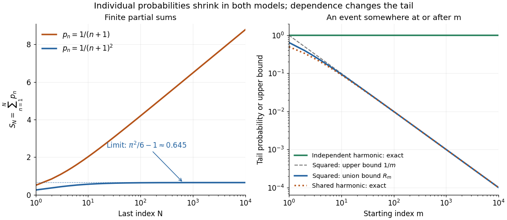

# Summable and harmonic event probabilities

↑ **Parent:** [Borel-Cantelli lemmas](borel-cantelli-lemmas.md)

Take [independent random variables](independent-random-variables.md) $U_n$, each with the [continuous uniform distribution](continuous-uniform-distribution.md) on $[0,1]$, and set $A_n=\{U_n\leq p_n\}$. Then $\mathbb P(A_n)=p_n$, and the [events](event.md) are mutually [independent events](independent-events.md). The [product probability space](product-probability-space.md) supplies a model for the entire infinite sequence; a finite list of simulated values is only an illustration.

For $p_n=1/(n+1)^2$, the [p-series](p-series.md) is [summable](summable-sequence.md):

$$
\sum_{n=1}^{\infty}p_n=\frac{\pi^2}{6}-1,\qquad
\sum_{n=m}^{\infty}p_n\leq\int_m^{\infty}\frac{dx}{x^2}=\frac1m.
$$

The [Basel problem](basel-problem.md) supplies the total sum, and the [integral test for convergence](integral-test-for-convergence.md) gives the displayed tail bound. The [First Borel-Cantelli lemma](borel-cantelli-first-lemma.md) makes the [limsup of events](limsup-of-events.md) have [probability](probability.md) zero. In fact, the tail bound implies that the [probability](probability.md) of even one alarm at or after $m$ is at most $1/m$; for $m=100$, it is at most $0.01$. This bound remains valid for dependent [events](event.md) with the same individual [probabilities](probability.md).

For $p_n=1/(n+1)$, the [harmonic series](harmonic-series.md) diverges, so the [Second Borel-Cantelli lemma](borel-cantelli-second-lemma.md) makes the [limsup of events](limsup-of-events.md) have [probability](probability.md) one. There is also an exact finite-horizon calculation using [independent events](independent-events.md):

$$
\mathbb P\left(\bigcap_{n=m}^{M}A_n^c\right)
=\prod_{n=m}^{M}\frac{n}{n+1}=\frac{m}{M+1}.
$$

For any fixed $m$, this finite [product of numbers](product-of-numbers.md) tends to zero as $M\to\infty$. Every infinite tail therefore contains an alarm [almost surely](almost-sure-convergence.md), even though the individual [probabilities](probability.md) tend to zero.

**[Figure 15](#image-summable-and-harmonic-probabilities-partial-sums-and-the-probability-of-a-later-event). Summable and harmonic probabilities: partial sums and the probability of a later event**. The left panel shows finite [partial sums](partial-sum.md). On the right, the blue curve is the infinite tail of the squared-reciprocal [p-series](p-series.md), bounding the [probability](probability.md) of a later [event](event.md) by the [union bound](boole-s-inequality.md); the gray curve is its $1/m$ upper bound. For harmonic [probabilities](probability.md), mutually [independent events](independent-events.md) have a later occurrence with [probability](probability.md) one, while the [shared-uniform counterexample to the second Borel-Cantelli lemma](shared-uniform-counterexample-to-the-second-borel-cantelli-lemma.md) has tail [probability](probability.md) $1/(m+1)$. The infinite claims follow from the calculations, not from the finite plotted range.

## ↑ Ancestors (6)

1. [Borel-Cantelli lemmas](borel-cantelli-lemmas.md)
2. [Probability theory](probability-theory-split.md)
3. [Probability and statistics](probability-and-statistics-split.md)
4. [Area of mathematics](area-of-mathematics.md)
5. [Mathematics](mathematics-split.md)
6. [Codex Wiki](split.md)

## ← Incoming links (1)

- [Shared-uniform counterexample to the second Borel-Cantelli lemma](shared-uniform-counterexample-to-the-second-borel-cantelli-lemma.md)
