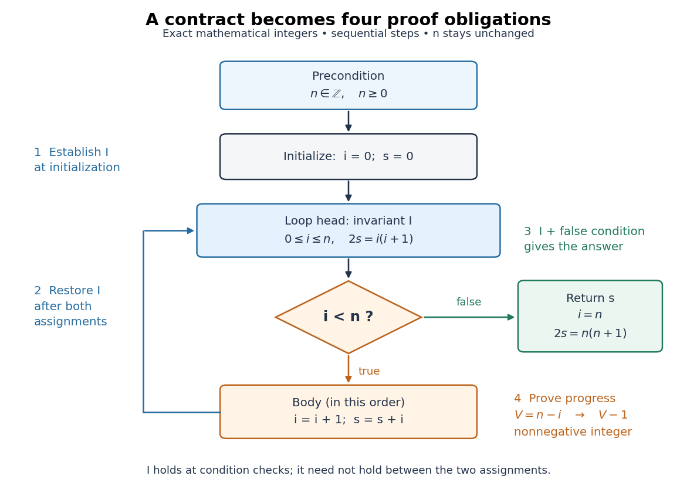
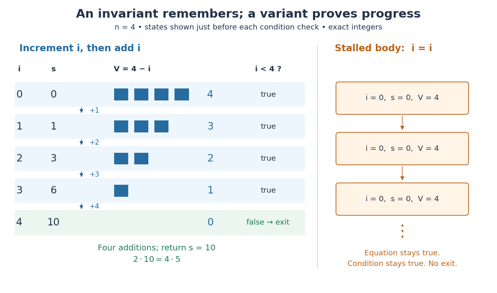

# Summation loop verification

↑ **Parent:** [Formal verification](formal-verification.md)

Compute $1+2+\cdots+n$, the [triangular number](triangular-number.md) $T_n$, for a nonnegative [integer](integer-split.md) $n$. The [empty sum](empty-sum.md) gives zero when $n=0$. Use exact mathematical [integers](integer-split.md) and keep the [input](input-computer-science.md) $n$ unchanged; every comparison and [variable assignment](variable-assignment.md) is a terminating operation. The original sequential procedure is
```
require n is an integer and n >= 0
i = 0
s = 0
while i < n:
    i = i + 1
    s = s + i
return s
```
The order of the two [variable assignments](variable-assignment.md) matters: the [addition](addition.md) uses the newly incremented $i$. For $n=4$, the pairs $(i,s)$ at successive condition checks are $(0,0),(1,1),(2,3),(3,6),(4,10)$. At the last check, $i<n$ is false, and the returned [sum](sum.md) is $10$.

The [precondition](precondition.md) is $n\in\mathbb Z$ with $n\geq0$, under the exact-arithmetic model just stated. The [postcondition](postcondition.md) for returned value $s$ is $2s=n(n+1)$, with $n$ still equal to its starting value. At each condition check use the [loop invariant](loop-invariant.md)

$$
I:\qquad i,s\in\mathbb Z,\qquad 0\leq i\leq n,\qquad 2s=i(i+1),
$$

and the [loop variant](loop-variant.md) $V=n-i$. The equation says that the accumulator is the [triangular number](triangular-number.md) for precisely the processed prefix $1,\ldots,i$; the inequalities connect that prefix to the loop's condition.

<a id="image-the-summation-loop-restores-its-invariant-before-each-condition-check"></a>


**[Figure 6](#image-the-summation-loop-restores-its-invariant-before-each-condition-check). The summation loop restores its invariant before each condition check**. Original sequential control flow for the [summation loop verification](summation-loop-verification.md). The blue loop head carries the [loop invariant](loop-invariant.md); the orange body increments $i$ before adding it to $s$. A false condition leads to the [postcondition](postcondition.md). The [loop variant](loop-variant.md) decreases on the return arrow. All values are mathematical [integers](integer-split.md) and $n$ remains unchanged.

Initialization gives $i=s=0$, so $I$ holds, including when $n=0$. For preservation, let the old values satisfy $I$ and $i<n$. Write $i'=i+1$ and $s'=s+i'$ for the values after both [variable assignments](variable-assignment.md). Since $i,n$ are [integers](integer-split.md), $i<n$ gives $i'\leq n$, and

$$
2s'=2s+2(i+1)=i(i+1)+2(i+1)=(i+1)(i+2)=i'(i'+1).
$$

Thus the completed body restores $I$. Between the two [variable assignments](variable-assignment.md), the equation can be false; the [loop invariant](loop-invariant.md) is required at the loop head. This preservation step is [mathematical induction](mathematical-induction.md) on the number of completed iterations.

At exit, the false condition gives $i\geq n$, while $I$ gives $i\leq n$. Hence $i=n$, so $2s=n(n+1)$: this proves [partial correctness](partial-correctness.md). For [algorithm termination](algorithm-termination.md), $I$ gives the nonnegative [integer](integer-split.md) $V=n-i$. When the condition is true, $V\geq1$; the terminating body gives $V'=n-i'=V-1$. Therefore the loop cannot repeat forever. Together these arguments prove [total correctness](total-correctness.md) for every permitted [input](input-computer-science.md), including $n=0$.

<a id="image-four-additions-finish-the-sum-an-unchanged-index-cannot-make-progress"></a>


**[Figure 7](#image-four-additions-finish-the-sum-an-unchanged-index-cannot-make-progress). Four additions finish the sum; an unchanged index cannot make progress**. Original exact trace for $n=4$: five condition checks and four body executions give $s=10$, while the [loop variant](loop-variant.md) decreases from four to zero. The right panel shows the stalled loop from [partial correctness](partial-correctness.md): the same [program state](program-state.md) repeats and $V=4$ never decreases. Its equation $2s=i(i+1)$ remains true, but it never reaches an exit.

Two changes expose what the proof checks. Swapping the two body instructions computes $0+1+\cdots+(n-1)$, returning $6$ rather than $10$ for $n=4$. Leaving $i$ unchanged can preserve an initial equation forever without producing any answer. The first change breaks the intended [postcondition](postcondition.md); the second breaks [algorithm termination](algorithm-termination.md). A trace can reveal these failures, while the two proof obligations explain them.

The exact-arithmetic assumption has a concrete boundary. In a stipulated unsigned eight-[bit](bit.md) model where each [addition](addition.md) wraps modulo $256$, $n=23$ fits in the [input](input-computer-science.md) representation, but its intended [triangular number](triangular-number.md) is $276$. The stored accumulator instead finishes at $20$, so the mathematical [postcondition](postcondition.md) fails. This is [integer overflow](integer-overflow.md), and the proof above does not apply to that altered model. Restricting the same implementation to $0\leq n\leq22$ prevents overflow in its stored loop values, since $T_{22}=253$; alternatively use a representation supporting the required exact [integer arithmetic](integer-arithmetic.md). The equations in the proof are mathematical statements, not instructions to evaluate products in eight [bits](bit.md).

## ↑ Ancestors (5)

1. [Formal verification](formal-verification.md)
2. [Algorithm correctness](algorithm-correctness.md)
3. [Algorithm](algorithm-split.md)
4. [Computer science](computer-science-split.md)
5. [Codex Wiki](split.md)

## ← Incoming links (9)

- [Algorithm termination](algorithm-termination.md)
- [Formal specification](formal-specification.md)
- [Formal verification](formal-verification.md)
- [Partial correctness](partial-correctness.md)
- [Postcondition](postcondition.md)
- [Precondition](precondition.md)
- [Program state](program-state.md)
- [Summation loop verification](summation-loop-verification.md)
- [Total correctness](total-correctness.md)
