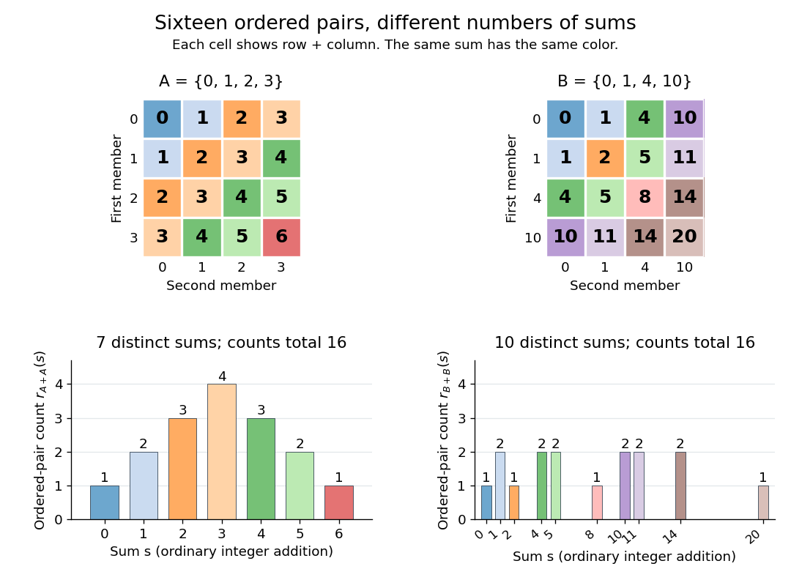

# Sumset representation function

↑ **Parent:** [Sumset](sumset.md)

For [finite sets](finite-set.md) $A,B\subseteq G$ in an [abelian group](abelian-group.md) $G$, the [sumset representation function](sumset-representation-function.md) is

$$
r_{A+B}(s)=\bigl|\{(a,b)\in A\times B:a+b=s\}\bigr|,\qquad s\in G.
$$

It counts [ordered pairs](ordered-pair.md) in the [Cartesian product](cartesian-product.md), so $(a,b)$ and $(b,a)$ are different when $a\ne b$, even though [commutativity](commutativity.md) makes their sums equal. It is zero outside the [sumset](sumset.md), and

$$
\sum_{s\in G}r_{A+B}(s)=|A|\,|B|.
$$

For $A=\{0,1,2,3\}$, its values at $s=0,1,\ldots,6$ are $1,2,3,4,3,2,1$. For $B=\{0,1,4,10\}$, its values at the increasing elements of $B+B$ are $1,2,1,2,2,1,2,2,2,1$. Both lists total sixteen, but the first concentrates more [ordered pairs](ordered-pair.md) on fewer sums. This distinction is what [additive energy](additive-energy.md) quantifies.

**[Figure 1](#image-ordered-pair-sums-and-representation-counts-for-an-arithmetic-progression-and-a-spread-out-integer-set). Ordered-pair sums and representation counts for an arithmetic progression and a spread-out integer set**.

## ↑ Ancestors (6)

1. [Sumset](sumset.md)
2. [Additive combinatorics](additive-combinatorics-split.md)
3. [Combinatorics](combinatorics-split.md)
4. [Area of mathematics](area-of-mathematics.md)
5. [Mathematics](mathematics-split.md)
6. [Codex Wiki](split.md)

## ← Incoming links (3)

- [Additive combinatorics](additive-combinatorics-split.md)
- [Additive energy](additive-energy.md)
- [Sumset representation function](sumset-representation-function.md)
