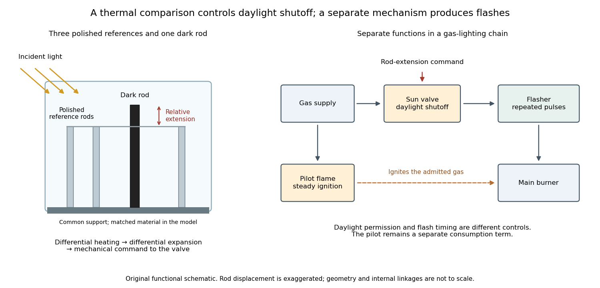

# Sun valve

↑ **Parent:** [Valve](valve.md)  
ⓦ [Wiki](https://en.wikipedia.org/wiki/Sun_valve)

A [sun valve](sun-valve.md) automatically restricts a gas light's supply in daylight and allows it again as illumination falls. In [Gustaf Dalén](gustaf-dalen.md)'s design, a blackened rod and three polished rods respond differently to sunlight. Their relative [thermal expansion](thermal-expansion.md) operates the gas valve through a membrane; a pilot flame permits relighting. The museum dates this design to 1907.[Sun valve: date, black rod, three polished rods, membrane and daylight/night operation](gustaf-dalen-beacon-lighting-by-tekniska-museet.md)

The useful comparison is between two thermal responses. Both kinds of rod expand when warmed; a dark surface can absorb more incident [radiant power](radiant-flux.md), so its [temperature](temperature-split.md) rises more. Comparing their extensions can reject a common ambient-[temperature](temperature-split.md) change while responding to illumination. The mechanism converts [light](light.md) into [heat](heat-split.md), [heat](heat-split.md) into a difference of [length](length.md), and that difference into a change of gas flow. [Differential thermal model of a sun valve](differential-thermal-model-of-a-sun-valve.md) makes those assumptions quantitative.

**[Figure 2](#image-differential-rod-expansion-controls-daylight-shutoff-in-a-gas-lighting-system). Differential rod expansion controls daylight shutoff in a gas-lighting system**. Original functional schematic, not a scale reconstruction or copied patent drawing. The three polished rods supply a mechanical reference for the dark rod. Daylight shutoff, pilot ignition and repeated flashing have separate functions. The linkage is symbolic; no historical rod dimensions or measured displacements are specified.

**Table of contents**

- [Differential thermal model of a sun valve](differential-thermal-model-of-a-sun-valve.md)
- [Testing a differential thermal actuator](testing-a-differential-thermal-actuator.md)

## ↑ Ancestors (4)

1. [Valve](valve.md)
2. [Mechanical engineering](mechanical-engineering.md)
3. [Engineering](engineering-split.md)
4. [Codex Wiki](split.md)

## ← Incoming links (6)

- [Dalén light](dalen-light.md)
- [Differential thermal model of a sun valve](differential-thermal-model-of-a-sun-valve.md)
- [Gas flasher in a Dalén light](gas-flasher-in-a-dalen-light.md)
- [Gustaf Dalén](gustaf-dalen.md)
- [Nobel Prize in Physics in 1912](nobel-prize-in-physics-in-1912.md)
- [Sun valve](sun-valve.md)
