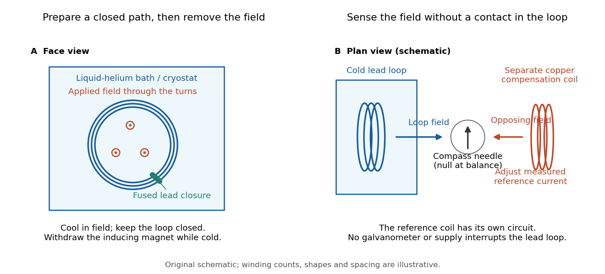
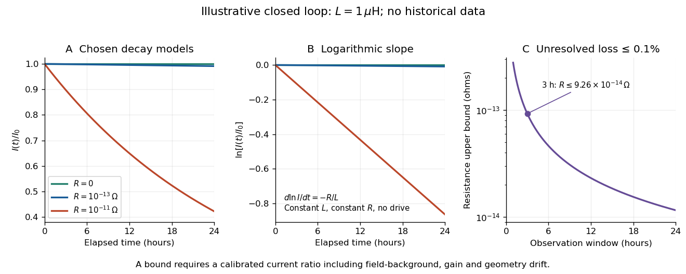
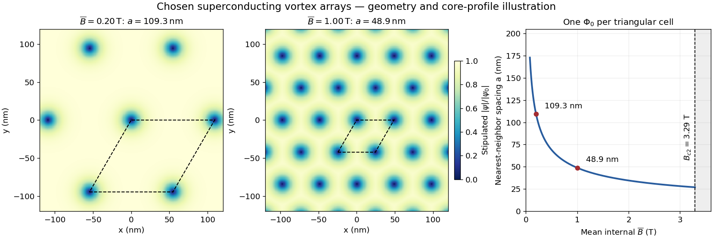
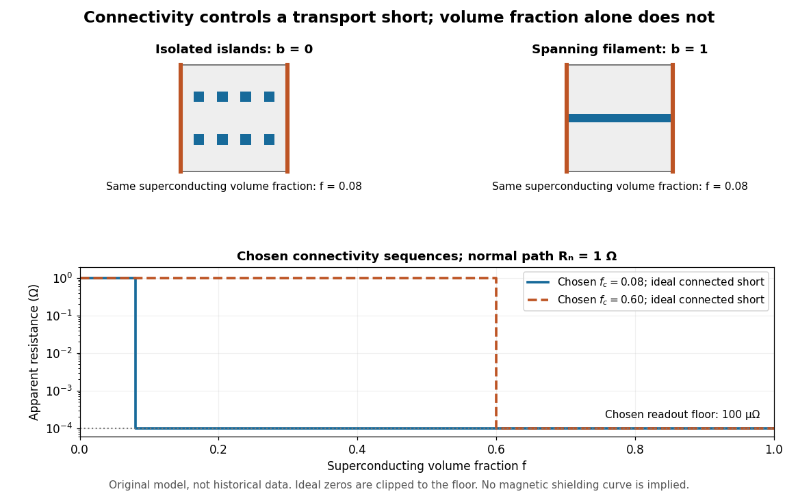

# Superconductivity

↑ **Parent:** [Statistical physics](statistical-physics.md)  
ⓦ [Wiki](https://en.wikipedia.org/wiki/Superconductivity)

[Superconductivity](superconductivity.md) is a phase of matter that supports steady [electric current](electric-charge.md#electric-current) with zero bulk [electrical resistivity](electric-charge.md#electrical-resistivity) and exhibits the [Meissner effect](magnetic-field.md#meissner-effect): equilibrium screening of a sufficiently weak, static [magnetic field](magnetic-field.md) from the interior. It occurs below a material-dependent [superconducting transition temperature](#superconducting-transition-temperature), provided the [electric current](electric-charge.md#electric-current) and applied [magnetic field](magnetic-field.md) are also sufficiently small. [Milind N. Kunchur (2004), limits on dissipation-free superconducting current](https://arxiv.org/abs/cond-mat/0409402) Bulk expulsion means that a sample much thicker than its [London penetration depth](magnetic-field.md#london-penetration-depth) has an almost field-free interior; the [magnetic field](magnetic-field.md) need not vanish at its surface. Conventional [BCS theory](fermi-liquid.md#bcs-theory) explains [superconductivity](superconductivity.md) through correlated [electrons](physics.md#electron) forming [Cooper pairs](fermi-liquid.md#cooper-pair). [Hoffman laboratory, introduction to superconductivity](https://hoffman.physics.harvard.edu/materials/SCintro.php)

The two observations answer different questions. A [resistance-versus-temperature experiment for superconductivity](#resistance-versus-temperature-experiment-for-superconductivity) asks whether a steady [electric current](electric-charge.md#electric-current) requires a measurable [electric potential difference](electric-field.md#electric-potential-difference). A [Field-cooled Meissner experiment](#field-cooled-meissner-experiment) asks whether a [magnetic field](magnetic-field.md) already present in the material is expelled when it enters [superconductivity](superconductivity.md). An ideal [perfect conductor](electromagnetic-wave.md#perfect-conductor) with zero [electrical resistivity](electric-charge.md#electrical-resistivity) can preserve that pre-existing [magnetic field](magnetic-field.md); zero [electrical resistance](electric-charge.md#electrical-resistance) alone therefore does not establish the [Meissner effect](magnetic-field.md#meissner-effect).

The usefulness follows directly from [Joule heating](electric-charge.md#joule-heating), $P=I^2R$: maintaining a steady [electric current](electric-charge.md#electric-current) through a segment with zero [electrical resistance](electric-charge.md#electrical-resistance) produces no resistive heating in that segment. This makes persistent [electric currents](electric-charge.md#electric-current) attractive for producing steady [magnetic fields](magnetic-field.md). The beauty is that one phase has both a transport property and an equilibrium magnetic response, and the second cannot be inferred just by making an ordinary [electrical resistance](electric-charge.md#electrical-resistance) very small. The [London equations](magnetic-field.md#london-equations) encode this extra magnetic response. [F. and H. London (1935), The electromagnetic equations of the supraconductor](https://doi.org/10.1098/rspa.1935.0048)

**Table of contents**

- [Unconventional superconductivity](#unconventional-superconductivity)
  - [D-wave superconductivity](#d-wave-superconductivity)
    - [Nodal quasiparticle power laws](#nodal-quasiparticle-power-laws)
      - [Disorder qualification of nodal power laws](#disorder-qualification-of-nodal-power-laws)
    - [Volovik effect](#volovik-effect)
    - [Nodal quasiparticle density of states in a two-dimensional d-wave superconductor](#nodal-quasiparticle-density-of-states-in-a-two-dimensional-d-wave-superconductor)
    - [D-wave superconductor](#d-wave-superconductor)
    - [D-wave bond order](#d-wave-bond-order)
  - [Unconventional superconductor](#unconventional-superconductor)
- [Superconducting magnet](#superconducting-magnet)
  - [Superconducting quench](#superconducting-quench)
- [Condensation energy of a superconductor](#condensation-energy-of-a-superconductor)
- [Anderson-Higgs mechanism in a superconductor](#anderson-higgs-mechanism-in-a-superconductor)
  - [Superconducting phase-density action](#superconducting-phase-density-action)
- [Superconducting material](#superconducting-material)
  - [Niobium-tin](#niobium-tin)
  - [Niobium-titanium](#niobium-titanium)
- [Superconducting device](#superconducting-device)
- [Persistent current (superconductivity)](#persistent-current-superconductivity)
- [Persistent current in a superconducting loop experiment](#persistent-current-in-a-superconducting-loop-experiment)
  - [Resistance upper bound from persistent-current decay](#resistance-upper-bound-from-persistent-current-decay)
- [Superconducting critical current](#superconducting-critical-current)
  - [Superconducting critical current density](#superconducting-critical-current-density)
    - [Superconducting critical surface](#superconducting-critical-surface)
- [Type-I superconductor](#type-i-superconductor)
- [Type-II superconductor](#type-ii-superconductor)
  - [Superconducting mixed state](#superconducting-mixed-state)
    - [Abrikosov vortex](#abrikosov-vortex)
      - [Abrikosov vortex lattice](#abrikosov-vortex-lattice)
        - [Flux-lattice spacing](#flux-lattice-spacing)
        - [Abrikosov parameter](#abrikosov-parameter)
        - [Magnetic decoration of superconducting vortices](#magnetic-decoration-of-superconducting-vortices)
    - [Flux pinning](#flux-pinning)
      - [Flux creep](#flux-creep)
      - [Vortex depinning](#vortex-depinning)
- [Superconducting transition temperature](#superconducting-transition-temperature)
  - [Pair formation and phase ordering](#pair-formation-and-phase-ordering)
- [Resistance-versus-temperature experiment for superconductivity](#resistance-versus-temperature-experiment-for-superconductivity)
  - [Four-terminal sensing](#four-terminal-sensing)
- [Field-cooled Meissner experiment](#field-cooled-meissner-experiment)
- [Ginzburg-Landau theory of superconductivity](#ginzburg-landau-theory-of-superconductivity)
  - [Time-dependent Ginzburg-Landau equation](#time-dependent-ginzburg-landau-equation)
  - [Microscopic derivation of Ginzburg-Landau theory](#microscopic-derivation-of-ginzburg-landau-theory)
    - [Pair-field effective action of a superconductor](#pair-field-effective-action-of-a-superconductor)
    - [Microscopic Ginzburg-Landau coefficients from BCS theory](#microscopic-ginzburg-landau-coefficients-from-bcs-theory)
  - [Superconducting coherence length](#superconducting-coherence-length)
  - [Ginzburg-Landau parameter](#ginzburg-landau-parameter)
  - [Lower critical magnetic field](#lower-critical-magnetic-field)
  - [Upper critical magnetic field](#upper-critical-magnetic-field)
- [Gauge-coupling sign in Ginzburg-Landau superconductivity](#gauge-coupling-sign-in-ginzburg-landau-superconductivity)
  - [Gauge-invariant condensate momentum](#gauge-invariant-condensate-momentum)
- [Josephson junction](#josephson-junction)
  - [Superconducting weak link](#superconducting-weak-link)
    - [Current-phase relation of a superconducting weak link](#current-phase-relation-of-a-superconducting-weak-link)
  - [Josephson effect](#josephson-effect)
    - [SQUID](#squid)
      - [RF SQUID](#rf-squid)
      - [DC SQUID](#dc-squid)
        - [Jaklevic Josephson interference experiment](#jaklevic-josephson-interference-experiment)
    - [Gauge-invariant Josephson phase](#gauge-invariant-josephson-phase)
    - [Josephson coupling energy](#josephson-coupling-energy)
    - [DC Josephson effect](#dc-josephson-effect)
    - [AC Josephson effect](#ac-josephson-effect)
  - [Current-biased Josephson phase dynamics](#current-biased-josephson-phase-dynamics)
    - [Tilted Josephson washboard potential](#tilted-josephson-washboard-potential)
    - [Quantized phase levels in a Josephson junction](#quantized-phase-levels-in-a-josephson-junction)
    - [Quantum escape of a current-biased Josephson junction](#quantum-escape-of-a-current-biased-josephson-junction)
    - [Martinis-Devoret-Clarke circuit experiments](#martinis-devoret-clarke-circuit-experiments)
      - [Switching-current distribution of a Josephson junction](#switching-current-distribution-of-a-josephson-junction)
- [Single-electron superconducting tunneling](#single-electron-superconducting-tunneling)
  - [Giaever gap experiment](#giaever-gap-experiment)
- [Superconductor](#superconductor)
  - [S-wave superconductor](#s-wave-superconductor)
- [High-temperature superconductivity](#high-temperature-superconductivity)
  - [Cuprate superconductor](#cuprate-superconductor)
    - [Cuprate pseudogap](#cuprate-pseudogap)
    - [Formal hole count in a cuprate](#formal-hole-count-in-a-cuprate)
  - [Bednorz-Müller experiment](#bednorz-muller-experiment)
  - [Transport and magnetic tests of superconducting ceramics](#transport-and-magnetic-tests-of-superconducting-ceramics)
    - [Parallel-path model of a superconducting ceramic](#parallel-path-model-of-a-superconducting-ceramic)

## Unconventional superconductivity

↑ **Parent:** [Superconductivity](superconductivity.md)

Superconducting pairing outside the simple conventional isotropic spin-singlet scenario, with the precise classification depending on the context and evidence. Gap symmetry, pairing mechanism, spin structure and time-reversal behavior are separate questions; a nonstandard gap does not establish every other proposed broken symmetry.

### D-wave superconductivity

↑ **Parent:** [Unconventional superconductivity](#unconventional-superconductivity)

Pairing with d-wave orbital structure, such as a crystal gap proportional to $k_x^2-k_y^2$. Its sign changes under a quarter-turn rotation, but a compensating overall phase change can leave gauge-invariant observables fourfold symmetric. Gap nodes and phase signs therefore do not by themselves establish nematicity or time-reversal breaking. A [phase-sensitive test of d-wave pairing](fermi-liquid.md#phase-sensitive-test-of-d-wave-pairing) probes relative signs through [interference](physical-optics.md#interference-wave-propagation).

#### Nodal quasiparticle power laws

↑ **Parent:** [D-wave superconductivity](#d-wave-superconductivity)

Near clean two-dimensional d-wave nodes, linearized quasiparticle energies form anisotropic cones. Their low-energy density of states is proportional to $|E|$, so electronic heat capacity scales as $T^2$ rather than the activated low-temperature form of a full gap. The clean in-plane penetration-depth increment is linear in T. Disorder, dimensional effects, vortex fields and gap changes can alter these laws, so the assumptions should accompany any proposed diagnostic.

##### Disorder qualification of nodal power laws

↑ **Parent:** [Nodal quasiparticle power laws](#nodal-quasiparticle-power-laws)

#### Volovik effect

↑ **Parent:** [D-wave superconductivity](#d-wave-superconductivity)

[Vortex](critical-phenomenon.md#phase-vortex) superflow Doppler-shifts low-energy [quasiparticles](quantum-mechanics.md#quasiparticle) in a nodal superconductor. For a circular cell of radius $R\propto B^{-1/2}$ and flow magnitude proportional to $1/r$, its spatially averaged magnitude is proportional to $1/R$. A linearly vanishing nodal [density of states](quantum-ideal-gas-statistics.md#density-of-states) then acquires a zero-energy contribution proportional to $\sqrt B$, producing a low-temperature linear heat-capacity coefficient with that scaling. This is a clean semiclassical mixed-state estimate; the vector flow average can be zero, and disorder, screening, core states and other field effects change its range of validity.

#### Nodal quasiparticle density of states in a two-dimensional d-wave superconductor

↑ **Parent:** [D-wave superconductivity](#d-wave-superconductivity)

For four equivalent nodes, two spin [quasiparticles](quantum-mechanics.md#quasiparticle) and local dispersion $E^2=\alpha^2q_1^2+\beta^2q_2^2$, one node encloses momentum area $\pi E^2/(\alpha\beta)$. Counting states with measure $d^2q/(2\pi)^2$ gives the displayed positive-excitation density. The associated clean low-temperature [heat capacity](heat.md#heat-capacity) is $C/\mathcal A=18\zeta(3)k_B^3T^2/(\pi\alpha\beta)$. Electron-addition spectral density alone has a different count because its coherence weights do not count all particle and hole thermal excitations.

#### D-wave superconductor

↑ **Parent:** [D-wave superconductivity](#d-wave-superconductivity)

A [superconductor](#superconductor) whose pairing [order parameter](critical-phenomenon.md#order-parameter) has the angular or crystal-symmetry structure of [d-wave superconductivity](#d-wave-superconductivity). The sign of the gap depends on momentum direction and nodes can permit low-energy [fermionic Bogoliubov quasiparticles](fermi-liquid.md#fermionic-bogoliubov-quasiparticle).

#### D-wave bond order

↑ **Parent:** [D-wave superconductivity](#d-wave-superconductivity)

For nearest-neighbor spin-singlet pairing on a square lattice, opposite signs of the pairing amplitude on the two bond directions give the displayed momentum-dependent [superconducting gap function](fermi-liquid.md#superconducting-gap-function). It changes sign under a quarter-turn and has nodes on the zone diagonals. This sign structure is distinct from a nonnegative gap whose magnitude is merely anisotropic. A real pure $d_{x^2-y^2}$ pattern does not by itself require broken time reversal.

### Unconventional superconductor

↑ **Parent:** [Unconventional superconductivity](#unconventional-superconductivity)

## Superconducting magnet

↑ **Parent:** [Superconductivity](superconductivity.md)  
ⓦ [Wiki](https://en.wikipedia.org/wiki/Superconducting_magnet)

An electromagnet whose winding uses a superconductor, allowing large currents without the normal winding's steady resistive loss in its superconducting state. Refrigeration, strain, field-dependent critical current and [superconducting quench](#superconducting-quench) protection remain practical constraints. Magnetic resonance imaging, nuclear magnetic resonance and particle accelerators are applications.

### Superconducting quench

↑ **Parent:** [Superconducting magnet](#superconducting-magnet)

A transition of part of a current-carrying superconducting system into a resistive state. Joule heating can spread the transition, and the stored magnetic [energy](energy.md) must be handled safely by the system's protection design. Zero steady winding resistance does not remove the finite magnetic [energy](energy.md) or the refrigeration requirement.

## Condensation energy of a superconductor

↑ **Parent:** [Superconductivity](superconductivity.md)

The [condensation energy of a superconductor](#condensation-energy-of-a-superconductor) is the free-energy lowering on entering the superconducting state, with sign convention specified. For a local Landau density $a|\Delta|^2+b|\Delta|^4/2$ and $a<0$, its minimum is $-a^2/(2b)$ relative to the normal-state value. The positive [energy](energy.md) required to destroy the condensate is the opposite sign.

## Anderson-Higgs mechanism in a superconductor

↑ **Parent:** [Superconductivity](superconductivity.md)

Coupling a charged condensate's phase to electromagnetism changes the neutral Goldstone response into electromagnetic collective dynamics. In a bulk long-wavelength regime, the longitudinal phase-density mode has a plasma gap. Its dispersion and damping require a dynamical model; a static Ginzburg-Landau functional alone does not fix the entire excitation spectrum.

### Superconducting phase-density action

↑ **Parent:** [Anderson-Higgs mechanism in a superconductor](#anderson-higgs-mechanism-in-a-superconductor)

A lossless low-energy charged-condensate [action](lagrangian-mechanics.md#action) has a positive compressibility coefficient $\chi_p$, effective pair density $\rho_0$, mass $m_*$ and signed charge $q$. Coupling its phase to the electromagnetic potentials through the displayed combinations preserves [gauge symmetry](relativistic-quantum-field.md#gauge-invariance). Adding the Maxwell action and eliminating the longitudinal electric potential gives $\omega^2=q^2\rho_0/(\epsilon_0m_*)+[\rho_0/(m_*\chi_p)]k^2$ in a simple homogeneous bulk model. Removing the electromagnetic coupling leaves neutral sound. Static [Ginzburg-Landau theory of superconductivity](#ginzburg-landau-theory-of-superconductivity) alone cannot determine these frequencies or their damping. [§2.3, phase effective theory and coupling to electromagnetism](physics-bibliography.md#physics-215c-quantum-field-theory-part-3-by-john-mcgreevy)

## Superconducting material

↑ **Parent:** [Superconductivity](superconductivity.md)

### Niobium-tin

↑ **Parent:** [Superconducting material](#superconducting-material)

The superconducting intermetallic $\mathrm{Nb_3Sn}$ used in high-field conductors. Maintaining current-carrying connectivity and controlling strain are distinct from achieving a large upper critical field.

### Niobium-titanium

↑ **Parent:** [Superconducting material](#superconducting-material)

A superconducting alloy used in magnet conductors. Its useful critical current depends on [flux pinning](#flux-pinning) and processing as well as the equilibrium upper field.

## Superconducting device

↑ **Parent:** [Superconductivity](superconductivity.md)

## Persistent current (superconductivity)

↑ **Parent:** [Superconductivity](superconductivity.md)

A [superconducting persistent current](#persistent-current-superconductivity) is an [electric current](electric-charge.md#electric-current) circulating in a closed path with [superconductivity](superconductivity.md) after the external driving [electromotive force](electric-charge.md#electromotive-force) has ceased. Its associated [magnetic field](magnetic-field.md) makes the circulation observable without inserting a measuring instrument into the path. This article concerns macroscopic circulation in [superconductivity](superconductivity.md). A finite experiment establishes persistence over its observation window with a stated [measurement error](probability-and-statistics.md#measurement-error), rather than directly observing an infinite lifetime.

The ideal circuit connection is [flux conservation in a superconducting loop](mathematical-physics.md#flux-conservation-in-a-superconducting-loop). In a fixed loop with [self-inductance](electromagnetism.md#self-inductance) $L$, a single circulating [electric current](electric-charge.md#electric-current) $I$, and externally imposed linked [magnetic flux](magnetic-field.md#magnetic-flux) $\Phi_{\rm ext}$, the lumped circuit approximation gives

$$
L\frac{dI}{dt}+RI=-\frac{d\Phi_{\rm ext}}{dt}.
$$

When the [electrical resistance](electric-charge.md#electrical-resistance) $R$ vanishes, integrating gives $LI+\Phi_{\rm ext}=\text{constant}$. Removing the external linked [magnetic flux](magnetic-field.md#magnetic-flux) therefore changes the circulating [electric current](electric-charge.md#electric-current); holding it fixed afterwards preserves that [electric current](electric-charge.md#electric-current). This is a circuit approximation with a specified [self-inductance](electromagnetism.md#self-inductance), not a derivation of the microscopic state of [superconductivity](superconductivity.md). For thin paths where the carrier contribution matters, [fluxoid and flux quantization in a superconductor](quantum-theory.md#fluxoid-and-flux-quantization-in-a-superconductor) supplies the more careful description.

For constant $L>0$, constant effective [electrical resistance](electric-charge.md#electrical-resistance) $R\geq0$, and no changing external linked [magnetic flux](magnetic-field.md#magnetic-flux), the [RL circuit](electrical-circuit.md#rl-circuit) instead predicts

$$
I(t)=I_0e^{-Rt/L},\qquad \tau=\frac{L}{R}\quad(R>0).
$$

This [exponential decay](analysis.md#exponential-decay) follows by separating $dI/I=-(R/L)dt$. A long relaxation time tests extremely small [electrical resistance](electric-charge.md#electrical-resistance) without trying to resolve an equally tiny steady [electric potential difference](electric-field.md#electric-potential-difference). The stored [magnetic energy](electromagnetic-wave.md#magnetic-energy) is $U=LI^2/2$, so the same model gives $dU/dt=-RI^2$, exactly the [Joule heating](electric-charge.md#joule-heating) loss. The finite [energy](energy.md) stored in the loop supplies the magnetic readout; the circulating [electric current](electric-charge.md#electric-current) is not a continuously powered source of useful work.

## Persistent current in a superconducting loop experiment

↑ **Parent:** [Superconductivity](superconductivity.md)

The [persistent current in a superconducting loop experiment](#persistent-current-in-a-superconducting-loop-experiment) prepares a closed cold path, changes the externally linked [magnetic flux](magnetic-field.md#magnetic-flux), and follows the resulting [superconducting persistent current](#persistent-current-superconductivity) through its [magnetic field](magnetic-field.md). The essential measurement starts after the inducing [magnetic field](magnetic-field.md) has stopped changing.

**[Figure 1](#image-preparing-a-closed-superconducting-loop-and-sensing-its-magnetic-field-with-a-compass). Preparing a closed superconducting loop and sensing its magnetic field with a compass**. Original schematic of field preparation and magnetic compensation. Shapes, winding counts and distances are illustrative. The [magnetic compass](magnetic-field.md#compass) senses a static [magnetic field](magnetic-field.md); it is not a stationary voltage-reading [pickup coil](maxwell-equations.md#pickup-coil).

[Heike Kamerlingh Onnes](physicist.md#heike-kamerlingh-onnes)'s 1914 Communication 140c describes a [lead](chemical-substance.md#lead) coil closed by fused [lead](chemical-substance.md#lead) connections. Cooling in a [magnetic field](magnetic-field.md) and removing the inducing magnet prepared the circulation. A [magnetic compass](magnetic-field.md#compass) sensed it without contacts; a separate [copper](chemical-substance.md#copper) coil, cooled in liquid air, supplied a measured balancing [magnetic field](magnetic-field.md). Reversing orientation and compensation reduced offsets. [Communication 140c (1914), §5, pp. 278–280; §7, pp. 280–281](physics-bibliography.md#further-experiments-with-liquid-helium-j-continued-by-heike-kamerlingh-onnes)

The liquid-[helium](chemical-substance.md#helium) [cryostat](temperature.md#cryostat) maintained low [temperature](temperature.md), but refilling temporarily warmed the apparatus and changed the inferred [electric current](electric-charge.md#electric-current). A later run used a smaller initial [electric current](electric-charge.md#electric-current). Apparatus deformation and needle-zero drift limited comparison; cutting the closure still left a smaller magnetic signal, warning against assigning every signal to circulation around the whole loop. The report consequently gave an upper bound under a residual [Ohm's law](electric-charge.md#ohm-s-law) hypothesis. [Communication 140c, §5, pp. 279–280; §6, p. 280; §8, pp. 281–283](physics-bibliography.md#further-experiments-with-liquid-helium-j-continued-by-heike-kamerlingh-onnes)

For interpreting such a measurement, write a locally calibrated magnetic signal as

$$
S(t)=k(t)I(t)+b(t).
$$

Here $k$ is the coupling and gain, while $b$ contains the background [magnetic field](magnetic-field.md) and readout offset. Only after establishing stable $k$ and correcting $b$ does a ratio of signals determine a ratio of [electric currents](electric-charge.md#electric-current). A gradual change in geometry, a drifting background [magnetic field](magnetic-field.md), or a change of [temperature](temperature.md) can imitate or conceal a decay. A [pickup coil](maxwell-equations.md#pickup-coil) connected only to a voltage meter obeys [Faraday's law of induction](maxwell-equations.md#faraday-s-law-of-induction) and detects a changing linked [magnetic flux](magnetic-field.md#magnetic-flux); its zero steady output cannot demonstrate that the underlying static [magnetic field](magnetic-field.md) has disappeared. A [magnetic compass](magnetic-field.md#compass) can respond to that static [magnetic field](magnetic-field.md).

Opening the path, reversing the preparation, and repeating with smaller initial [electric current](electric-charge.md#electric-current) are useful controls for separating whole-loop circulation, magnetic background and a [superconducting critical current](#superconducting-critical-current). Keep the [temperature](temperature.md) and external [magnetic field](magnetic-field.md) stable during the interval used to infer [electrical resistance](electric-charge.md#electrical-resistance). A sudden reduction near a [superconducting critical current](#superconducting-critical-current) is not evidence for the constant-$R$ [exponential decay](analysis.md#exponential-decay) model at smaller [electric current](electric-charge.md#electric-current). Persistence also does not replace the [Field-cooled Meissner experiment](#field-cooled-meissner-experiment): transport around a hole and magnetic expulsion from the material test different properties.

### Resistance upper bound from persistent-current decay

↑ **Parent:** [Persistent current in a superconducting loop experiment](#persistent-current-in-a-superconducting-loop-experiment)

Suppose a calibrated measurement bounds the fractional loss of a nonzero [superconducting persistent current](#persistent-current-superconductivity) by $\epsilon$, with $0<\epsilon<1$, over a duration $T>0$. Take $I_0>0$ by choosing the circulation direction. Under the constant-$L$, constant-$R$, undriven [RL circuit](electrical-circuit.md#rl-circuit) model,

$$
\frac{I(T)}{I_0}\geq1-\epsilon
\quad\Longrightarrow\quad
0\leq R\leq-\frac{L}{T}\ln(1-\epsilon)
\simeq\frac{L\epsilon}{T}.
$$

The inequality follows because the [logarithm](calculus.md#logarithm) is increasing. The final approximation requires $\epsilon\ll1$ and slightly understates the exact upper bound. If $L$ is uncertain, an independently established upper bound on $L$ gives the conservative [electrical resistance](electric-charge.md#electrical-resistance) bound. The uncertainty in the initial reading, the final reading, background subtraction and drift must all be included in $\epsilon$; a display resolution alone does not provide it.

**[Figure 2](#image-an-illustrative-exponential-decay-its-logarithmic-slope-and-the-resulting-resistance-bound). An illustrative exponential decay, its logarithmic slope and the resulting resistance bound**. Chosen numerical model, not historical data: fixed [self-inductance](electromagnetism.md#self-inductance) $L=1\,\mathrm{\mu H}$ and no external drive. The final panel assumes a calibrated fractional-loss bound of $0.001$ at each chosen observation duration. Longer observation tightens the bound only while that fractional uncertainty remains controlled.

For an original illustrative example, let $L=1\,\mathrm{\mu H}$ and suppose the corrected [electric current](electric-charge.md#electric-current) ratio after $T=3\,\mathrm h=10800\,\mathrm s$ is at least $0.999$. Then

$$
R\leq9.264\times10^{-14}\,\Omega,\qquad
\tau\geq1.07946\times10^7\,\mathrm s\simeq124.94\,\mathrm{days}.
$$

These are conditional bounds for stipulated parameters, not values attributed to the 1914 apparatus. With the same $L$ but $R=10^{-11}\,\Omega$, the model instead gives $\tau=10^5\,\mathrm s$ and $I(24\,\mathrm h)/I_0=e^{-0.864}\simeq0.42147$: a readily visible loss on the chosen scale.

A resolved decay can be checked using its [logarithm](calculus.md#logarithm):

$$
\ln\frac{I(t)}{I_0}=-\frac{R}{L}t,\qquad
R=-L\frac{d\ln|I|}{dt}.
$$

A straight line supports this constant-parameter model; curvature or jumps demand a different account. If an effective [electrical resistance](electric-charge.md#electrical-resistance) varies with time while $L$ remains fixed and the loop remains undriven, only its time average is constrained:

$$
I(T)=I_0\exp\!\left[-\frac{1}{L}\int_0^T R(t)\,dt\right],\qquad
\frac{1}{T}\int_0^T R(t)\,dt\leq-\frac{L}{T}\ln(1-\epsilon).
$$

This does not bound every instantaneous value of $R(t)$. Changing [self-inductance](electromagnetism.md#self-inductance) or external linked [magnetic flux](magnetic-field.md#magnetic-flux) adds terms to the circuit equation, so an uncorrected magnetic signal cannot simply be substituted for $I(t)$. Nonobservation of decay leaves arbitrarily small positive constant [electrical resistance](electric-charge.md#electrical-resistance) compatible with a finite observation: it is not a logical proof that $R=0$.

## Superconducting critical current

↑ **Parent:** [Superconductivity](superconductivity.md)

A [superconducting critical current](#superconducting-critical-current) $I_c$ is the limiting [electric current](electric-charge.md#electric-current), for a specified sample, [temperature](temperature.md), external [magnetic field](magnetic-field.md) and measurement criterion, beyond which the chosen state of [superconductivity](superconductivity.md) no longer sustains dissipation-free transport. A weak connection can limit a loop before the rest of its material does. A [magnetic field](magnetic-field.md) generated by the [electric current](electric-charge.md#electric-current) itself also contributes to the sample's conditions. A limit on the initial [superconducting persistent current](#persistent-current-superconductivity) and a bound on its subsequent [electrical resistance](electric-charge.md#electrical-resistance) answer different experimental questions.

### Superconducting critical current density

↑ **Parent:** [Superconducting critical current](#superconducting-critical-current)

A limiting transport current per conductor cross-sectional area for specified [temperature](temperature.md), [magnetic field](magnetic-field.md) and dissipation criterion. Local current distribution, flux motion and weak links can make it distinct from an intrinsic depairing limit. Its variation with the operating conditions is summarized by a [superconducting critical surface](#superconducting-critical-surface).

#### Superconducting critical surface

↑ **Parent:** [Superconducting critical current density](#superconducting-critical-current-density)

The boundary of a stated superconducting transport criterion in [temperature](temperature.md), [magnetic field](magnetic-field.md) and current-density space. A value measured under one combination does not specify a winding's usable current at another field or [temperature](temperature.md). Strain and sample geometry can require further parameters.

## Type-I superconductor

↑ **Parent:** [Superconductivity](superconductivity.md)

## Type-II superconductor

↑ **Parent:** [Superconductivity](superconductivity.md)

A [type-II superconductor](#type-ii-superconductor) can admit [magnetic flux](magnetic-field.md#magnetic-flux) through [quantized vortices](critical-phenomenon.md#quantum-vortex) while retaining [superconductivity](superconductivity.md) between their cores. Its [superconducting mixed state](#superconducting-mixed-state) lies between the [lower critical magnetic field](#lower-critical-magnetic-field) and [upper critical magnetic field](#upper-critical-magnetic-field). These are equilibrium bulk distinctions; sample shape, [flux pinning](#flux-pinning) and preparation affect a measured magnetic response.

The motivating thin-film experiments changed an apparently minor preparation detail. [Nikolay Zavaritskii](physicist.md#nikolay-zavaritskii) evaporated metal onto glass; [Alexander Shalnikov](physicist.md#alexander-shalnikov) proposed cooling the substrate to helium [temperatures](temperature.md) to suppress agglomeration. The resulting critical-field behavior no longer matched the small-parameter approximation. [Alexei Alexeyevich Abrikosov](physicist.md#alexei-alexeyevich-abrikosov) found a different regime within the same theory, rather than discarding its equations.[p.975, film preparation and the second group](physics-bibliography.md#nobel-lecture-type-ii-superconductors-and-the-vortex-lattice-by-alexei-alexeyevich-abrikosov)

### Superconducting mixed state

↑ **Parent:** [Type-II superconductor](#type-ii-superconductor)

#### Abrikosov vortex

↑ **Parent:** [Superconducting mixed state](#superconducting-mixed-state)

An [Abrikosov vortex](#abrikosov-vortex) has a core where the superconducting [order parameter](critical-phenomenon.md#order-parameter) is suppressed, surrounding circulating [electric currents](electric-charge.md#electric-current), and a winding of its [quantum phase](quantum-system.md#quantum-phase). A singly wound vortex carries one [superconducting flux quantum](quantum-theory.md#superconducting-flux-quantum) in the appropriate bulk flux-quantization limit. The exact contour statement is [fluxoid and flux quantization in a superconductor](quantum-theory.md#fluxoid-and-flux-quantization-in-a-superconductor); the enclosed [magnetic flux](magnetic-field.md#magnetic-flux) alone need not equal a flux quantum on a contour with appreciable [electric current](electric-charge.md#electric-current).

##### Abrikosov vortex lattice

↑ **Parent:** [Abrikosov vortex](#abrikosov-vortex)

A periodic array of [Abrikosov vortices](#abrikosov-vortex). In the isotropic local theory near the [upper critical magnetic field](#upper-critical-magnetic-field), the triangular array has a lower [Helmholtz free energy](thermodynamic-potential.md#helmholtz-free-energy) than the square array.[p.976, equations3–4 and the two lattice geometries](physics-bibliography.md#nobel-lecture-type-ii-superconductors-and-the-vortex-lattice-by-alexei-alexeyevich-abrikosov)

The useful distinction is between **vortex existence, array geometry, and vortex mobility**. Quantized winding does not force every array to be triangular or defect-free. A stationary array and vortices moving under an applied [electric current](electric-charge.md#electric-current) also have different transport consequences; [flux pinning](#flux-pinning) matters for carrying useful [electric currents](electric-charge.md#electric-current).

###### Flux-lattice spacing

↑ **Parent:** [Abrikosov vortex lattice](#abrikosov-vortex-lattice)

Assume a triangular array of straight, singly quantized [Abrikosov vortices](#abrikosov-vortex) with nearest-neighbor distance $a$. Here $\overline B>0$ is the magnitude of the **spatially averaged internal** [magnetic field](magnetic-field.md), and $\Phi_0=h/(2e)$ is the [superconducting flux quantum](quantum-theory.md#superconducting-flux-quantum); $e>0$ is the [elementary charge](electric-charge.md#elementary-charge). Two lattice vectors of [length](physics.md#length) $a$ meeting at $60^\circ$ span [area](differential-geometry.md#surface-area) $A_c=\sqrt3a^2/2$. One flux quantum per cell gives

$$
\overline B A_c=\Phi_0,\qquad
n_v=\frac{\overline B}{\Phi_0},\qquad
a=\sqrt{\frac{2\Phi_0}{\sqrt3\,\overline B}}.
$$

Thus multiplying $\overline B$ by five decreases $a$ by $\sqrt5$; it does not multiply the flux of each vortex by five. Using the exact SI [Planck constant](quantum-mechanics.md#planck-constant) and [elementary charge](electric-charge.md#elementary-charge), $\Phi_0\simeq2.06783\times10^{-15}\,\mathrm{Wb}$.[2022 CODATA table, exact Planck constant and elementary charge](chemistry-bibliography.md#fundamental-physical-constants-complete-listing-by-national-institute-of-standards-and-technology-and-others)

For chosen internal fields $0.20\,\mathrm T$ and $1.0\,\mathrm T$, the spacings are approximately **$109\,\mathrm{nm}$ and $48.9\,\mathrm{nm}$**. These are geometric model calculations, not measurements from a particular sample. The local [magnetic field](magnetic-field.md) varies within a cell; replacing $\overline B$ by the field at a core would not give this counting relation.

**[Figure 3](#image-more-internal-magnetic-flux-means-more-vortices-per-unit-area). More internal magnetic flux means more vortices per unit area**. Original triangular-array geometry for stipulated $\xi=10\,\mathrm{nm}$ and $\lambda=100\,\mathrm{nm}$. The two core-amplitude maps use a chosen nearest-core hyperbolic-tangent profile, not a solution of the Ginzburg-Landau equations or an experimental image. The spacing curve counts one flux quantum per cell; its endpoint at $B_{c2}$ does not establish that field by geometry alone.

###### Abrikosov parameter

↑ **Parent:** [Abrikosov vortex lattice](#abrikosov-vortex-lattice)

A measure of spatial nonuniformity in the [order parameter](critical-phenomenon.md#order-parameter), with averages taken over one lattice cell. Set $X=|\psi|^2$. Then

$$
\beta_A=1+\frac{\operatorname{Var}(X)}{\langle X\rangle^2}\geq1.
$$

Equality requires uniform $|\psi|^2$, so a nonconstant core pattern costs more in the quartic term than a uniform amplitude with the same mean squared amplitude. This identity alone does not compare two different vortex arrays: their admissible profiles must also satisfy the field equations.

###### Magnetic decoration of superconducting vortices

↑ **Parent:** [Abrikosov vortex lattice](#abrikosov-vortex-lattice)

[U. Essmann](physics-author.md#u-essmann) and [H. Träuble](physics-author.md#h-trauble) reported triangular vortex arrays, including defects, using [electron microscopy](optics.md#electron-microscopy) on lead-indium and [niobium](chemical-substance.md#niobium) samples in the remanent state.[Publisher abstract, materials, electron microscopy and remanent-state lattices](physics-bibliography.md#the-direct-observation-of-individual-flux-lines-in-type-ii-superconductors-by-u-essmann-and-h-trauble) Such a prepared state need not display the equilibrium array at a uniform applied field. Images of regular positions and a proof of unrestricted vortex motion would answer different questions.

#### Flux pinning

↑ **Parent:** [Superconducting mixed state](#superconducting-mixed-state)

##### Flux creep

↑ **Parent:** [Flux pinning](#flux-pinning)

Slow motion of pinned superconducting vortices, commonly through thermally activated escape over energy barriers. It permits magnetic relaxation and a small dissipative voltage even below an ideal static depinning force. The barrier depends on current and pinning structure; a universal sharp transport threshold should not be assumed.

##### Vortex depinning

↑ **Parent:** [Flux pinning](#flux-pinning)

Motion of a previously pinned [Abrikosov vortex](#abrikosov-vortex) when drive, thermal activation or other fluctuations overcome its trapping. The resulting flux motion can generate an [electric field](electric-field.md), so a transport critical current depends on the measurement's voltage and time criteria.

## Superconducting transition temperature

↑ **Parent:** [Superconductivity](superconductivity.md)

The [superconducting transition temperature](#superconducting-transition-temperature) $T_c$ is the [temperature](temperature.md) at which the material enters [superconductivity](superconductivity.md) on cooling in zero applied [magnetic field](magnetic-field.md) and with negligible measuring [electric current](electric-charge.md#electric-current). A measured transition at nonzero [magnetic field](magnetic-field.md) or appreciable [electric current](electric-charge.md#electric-current) need not occur at this zero-field $T_c$. If a [resistance-versus-temperature experiment for superconductivity](#resistance-versus-temperature-experiment-for-superconductivity) gives a transition spread over several [temperatures](temperature.md), report whether its quoted value is the onset, midpoint, or disappearance of detectable [electrical resistance](electric-charge.md#electrical-resistance), together with the experimental conditions. This operational distinction matters when comparing samples. [MIT Junior Lab, superconductivity guide, §3.1](https://ocw.mit.edu/courses/8-13-14-experimental-physics-i-ii-junior-lab-fall-2016-spring-2017/ec45c3030c7ec2ba0f0537ab84d09c17_MIT8_13-14F16-S17exp39.pdf#page=2)

### Pair formation and phase ordering

↑ **Parent:** [Superconducting transition temperature](#superconducting-transition-temperature)

Pairing can establish a local binding or gap scale before a system develops phase-coherent transport. An actual [superconducting transition temperature](#superconducting-transition-temperature) depends on both the pair scale and the [phase stiffness](critical-phenomenon.md#phase-stiffness). Low carrier density or weak interlayer coupling can make phase ordering the lower scale even when the pairing amplitude is appreciable. A minimum or smooth interpolation of two estimated scales is a qualitative guide, not a substitute for a self-consistent theory of the crossover.

## Resistance-versus-temperature experiment for superconductivity

↑ **Parent:** [Superconductivity](superconductivity.md)

The motivating observation is an abrupt disappearance of detectable [electrical resistance](electric-charge.md#electrical-resistance) on cooling, rather than a smooth improvement in conduction. The diagram pairs the measuring arrangement with an idealized transition. Its curves are deliberately synthetic; neither their scales nor their abrupt step are a reconstruction of measured mercury data.

**[Figure 4](#image-separate-current-and-voltage-leads-reveal-a-synthetic-superconducting-resistance-transition). Separate current and voltage leads reveal a synthetic superconducting resistance transition**. The left panel shows [four-terminal sensing](#four-terminal-sensing); the right compares an idealized zero-[electrical resistance](electric-charge.md#electrical-resistance) branch with a stipulated normal-state continuation. All curves and the resolution band are illustrative, not measured data. The dashed vertical segment marks an idealized jump, not a fitted transition width.

In a report communicated in November 1911, Heike Kamerlingh Onnes described a mercury thread in seven connected glass U-tubes immersed in a stirred liquid-helium bath. Expansion spaces kept freezing mercury from breaking the glass or interrupting the thread. Separate leads supplied [electric current](electric-charge.md#electric-current) and sensed [electric potential difference](electric-field.md#electric-potential-difference). He compensated a troublesome [thermoelectric effect](thermoelectric-effect.md) and reversed the main [electric current](electric-charge.md#electric-current) to extract the resistive signal. He reported a rapid fall between $4.21$ and $4.19\,\mathrm K$ on his stated historical [temperature](temperature.md) scale, with [electrical resistance](electric-charge.md#electrical-resistance) disappearing at the lower value. The apparatus and control of spurious [electric potential differences](electric-field.md#electric-potential-difference) are part of the discovery, not incidental details. [Kamerlingh Onnes, Communication 124c (1911), §§2–3, pp. 819–821](https://dwc.knaw.nl/DL/publications/PU00013242.pdf)

A modern version places a contacted sample and a calibrated [thermometer](temperature.md#thermometer) close together in a cooling environment. Use [four-terminal sensing](#four-terminal-sensing), record the small applied [electric current](electric-charge.md#electric-current) $I$, the sensed [electric potential difference](electric-field.md#electric-potential-difference) $V$, and the sample [temperature](temperature.md) $T$, then plot $R(T)=V/I$. Repeat on warming as well as cooling, and allow readings to stabilize near [thermal equilibrium](thermal-equilibrium.md). Disagreement between warming and cooling is a reason to check sample–[thermometer](temperature.md#thermometer) lag and reproducibility before quoting a [superconducting transition temperature](#superconducting-transition-temperature). Mikhailov and Kordosky's undergraduate experiment uses this strategy with liquid-nitrogen cooling. [Mikhailov and Kordosky, Physics 251 superconductivity lab, measurement procedure and discussion](https://physics.wm.edu/~evmik/classes/2021_fall_Experimental_Atomic_Physics_251/lab_descriptions/superconductivity/)

Choose the measuring [electric current](electric-charge.md#electric-current) small enough that [Joule heating](electric-charge.md#joule-heating) does not appreciably change the sample [temperature](temperature.md), and repeat with a smaller [electric current](electric-charge.md#electric-current) to check that the transition persists. Cancel stable offsets using the reversal described in [four-terminal sensing](#four-terminal-sensing). A reading indistinguishable from zero supplies an experimental upper bound, not a proof of exact zero [electrical resistance](electric-charge.md#electrical-resistance). If $\delta V$ bounds the unresolved resistive [electric potential difference](electric-field.md#electric-potential-difference), then

$$
|R|\lesssim\frac{\delta V}{|I|}.
$$

For a stipulated sensitivity $\delta V=20\,\mathrm{nV}$ and $I=1\,\mathrm{mA}$, this is $20\,\mathrm{\mu\Omega}$. The bound applies between the sensing contacts; it is not the [electrical resistance](electric-charge.md#electrical-resistance) of the complete wiring. A conducting path through part of an inhomogeneous sample can also make $V$ negligible, so the [Field-cooled Meissner experiment](#field-cooled-meissner-experiment) adds independent evidence about the material's magnetic response.

### Four-terminal sensing

↑ **Parent:** [Resistance-versus-temperature experiment for superconductivity](#resistance-versus-temperature-experiment-for-superconductivity)  
ⓦ [Wiki](https://en.wikipedia.org/wiki/Four-terminal_sensing)

[Four-terminal sensing](#four-terminal-sensing) uses one pair of contacts to carry [electric current](electric-charge.md#electric-current) and a separate pair to sense [electric potential difference](electric-field.md#electric-potential-difference). The sensing instrument draws negligible [electric current](electric-charge.md#electric-current), so the voltage drops along its own leads are negligible, and the current-contact drops outside the sensing interval are excluded. A measurement using just two shared leads includes their [electrical resistance](electric-charge.md#electrical-resistance) and contact drops, which can overwhelm the small sample signal in a [resistance-versus-temperature experiment for superconductivity](#resistance-versus-temperature-experiment-for-superconductivity). Four contacts do not automatically remove offsets from the [thermoelectric effect](thermoelectric-effect.md). [Tektronix, Low-Voltage Measurement Techniques, four-lead arrangement and thermoelectric offsets](https://www.tek.com/en/documents/technical-article/low-voltage-measurement-techniques)

For a stable offset $V_0$, let $I>0$ denote the magnitude of the reversed [electric current](electric-charge.md#electric-current). The measured [electric potential differences](electric-field.md#electric-potential-difference) are $V(+I)=IR+V_0$ and $V(-I)=-IR+V_0$, so subtraction gives the displayed [electrical resistance](electric-charge.md#electrical-resistance). For example, with stipulated $I=1\,\mathrm{mA}$, $R=0.2\,\mathrm{m\Omega}$ and $V_0=3\,\mathrm{\mu V}$, the two readings are $3.2$ and $2.8\,\mathrm{\mu V}$; their difference correctly recovers $R$. If the offset changes between readings, its change leaves a residual [measurement error](probability-and-statistics.md#measurement-error); the sample and measuring circuit must remain sufficiently stable during reversal.

## Field-cooled Meissner experiment

↑ **Parent:** [Superconductivity](superconductivity.md)

The [Field-cooled Meissner experiment](#field-cooled-meissner-experiment) starts above the [superconducting transition temperature](#superconducting-transition-temperature) with a weak, steady applied [magnetic field](magnetic-field.md) already penetrating a solid sample. Cooling while keeping the applied [magnetic field](magnetic-field.md) fixed tests whether the interior [magnetic flux](magnetic-field.md#magnetic-flux) changes. This is the decisive contrast with cooling in zero [magnetic field](magnetic-field.md) and switching the [magnetic field](magnetic-field.md) on afterwards. The diagram shows the two histories for the same final applied [magnetic field](magnetic-field.md).

**[Figure 5](#image-field-cooling-distinguishes-equilibrium-meissner-screening-from-perfect-conductor-flux-memory). Field cooling distinguishes equilibrium Meissner screening from perfect-conductor flux memory**. Analytic idealizations, not measurements: a tangential [magnetic field](magnetic-field.md) beside a planar half-space. The [perfect conductor](electromagnetic-wave.md#perfect-conductor) preserves its initial interior [magnetic field](magnetic-field.md); equilibrium [London equations](magnetic-field.md#london-equations) instead give exponential screening in both histories. $\lambda_L$ is the [London penetration depth](magnetic-field.md#london-penetration-depth) for [superconductivity](superconductivity.md) and merely a common plotting length for the [perfect conductor](electromagnetic-wave.md#perfect-conductor).

Meissner and Ochsenfeld reported magnetic expulsion in 1933, showing that the transition involves more than vanishing [electrical resistance](electric-charge.md#electrical-resistance). A modern motivating version appears in MIT's lead-sample experiment: surround the sample with a [solenoid](magnetic-field.md#solenoid) supplying a steady [magnetic field](magnetic-field.md) and a separate pickup coil connected to a recording instrument. Apply the [magnetic field](magnetic-field.md) while the lead is still normal, then cool through its transition without changing the [solenoid](magnetic-field.md#solenoid) [electric current](electric-charge.md#electric-current). Expulsion produces a transient pickup-coil [electric potential difference](electric-field.md#electric-potential-difference); warming through the transition produces the opposite sign as [magnetic flux](magnetic-field.md#magnetic-flux) returns. MIT also checks the signal direction by switching off the applied [magnetic field](magnetic-field.md) while the sample is normal. [Hoffman laboratory, magnetic-expulsion discovery](https://hoffman.physics.harvard.edu/materials/SCintro.php) [MIT Junior Lab, §5.2.2: Meissner effect in lead](https://ocw.mit.edu/courses/8-13-14-experimental-physics-i-ii-junior-lab-fall-2016-spring-2017/ec45c3030c7ec2ba0f0537ab84d09c17_MIT8_13-14F16-S17exp39.pdf#page=10)

[Faraday's law of induction](maxwell-equations.md#faraday-s-law-of-induction) explains the readout. For a stationary $N$-turn pickup coil, with the same linked [magnetic flux](magnetic-field.md#magnetic-flux) $\Phi$ per turn and a fixed orientation,

$$
V_{\rm pick}(t)=-N\frac{d\Phi}{dt},\qquad
\int_{t_1}^{t_2}V_{\rm pick}(t)\,dt=-N[\Phi(t_2)-\Phi(t_1)].
$$

Thus a transient measures a change in linked [magnetic flux](magnetic-field.md#magnetic-flux), not directly the static [magnetic field](magnetic-field.md) at every point in the sample. For stipulated $N=100$ and $\Delta\Phi=-2\times10^{-8}\,\mathrm{Wb}$ per turn, the signed pulse area is $+2\times10^{-6}\,\mathrm{V\,s}$. The apparatus geometry determines how a change in interior [magnetic field](magnetic-field.md) contributes to that linked [magnetic flux](magnetic-field.md#magnetic-flux). Keeping the applied [magnetic field](magnetic-field.md) fixed, repeating on warming, and checking a normal-state control make the expulsion interpretation testable; a stationary pickup coil has no sustained signal after the [magnetic flux](magnetic-field.md#magnetic-flux) has stopped changing.

Why does the preparation history matter? In the stationary, ideal [perfect conductor](electromagnetic-wave.md#perfect-conductor) model, the interior [electric field](electric-field.md) is zero. The differential form of [Faraday's law of induction](maxwell-equations.md#faraday-s-law-of-induction) then gives

$$
\frac{\partial\mathbf B}{\partial t}=-\nabla\times\mathbf E=0.
$$

If the interior [magnetic field](magnetic-field.md) was $\mathbf B_0$ when perfect conduction began, it remains $\mathbf B_0$; if it was zero, it stays zero when an external [magnetic field](magnetic-field.md) is subsequently applied. Both a [perfect conductor](electromagnetic-wave.md#perfect-conductor) prepared in zero [magnetic field](magnetic-field.md) and a sample exhibiting the [Meissner effect](magnetic-field.md#meissner-effect) can therefore exclude a newly applied weak [magnetic field](magnetic-field.md). Only the field-cooled comparison tests expulsion of an already present [magnetic field](magnetic-field.md). This argument concerns a stationary sample and the ideal zero-[electric field](electric-field.md) model, not a moving conductor.

The equilibrium [London equations](magnetic-field.md#london-equations) supply the additional constraint. In a homogeneous region without penetrating flux tubes, they imply $\nabla^2\mathbf B=\mathbf B/\lambda_L^2$. For a half-space $z\geq0$ with a [magnetic field](magnetic-field.md) parallel to its flat boundary, fixed surface value $B_s$, and a bounded solution deep inside, this gives

$$
\mathbf B(z)=B_s e^{-z/\lambda_L}\,\widehat{\mathbf x}.
$$

At $z=5\lambda_L$ only $e^{-5}\simeq0.00674$ of the surface [magnetic field](magnetic-field.md) remains. The screening [electric currents](electric-charge.md#electric-current) near the surface produce this reduction. Unlike the frozen interior [magnetic field](magnetic-field.md) of a [perfect conductor](electromagnetic-wave.md#perfect-conductor), this equilibrium profile does not retain an arbitrary initial $\mathbf B_0$. The extra constitutive relation, and not zero [electrical resistance](electric-charge.md#electrical-resistance) by itself, selects the screened state. Expulsion occurs during the transition, when transient [electric fields](electric-field.md) can be present; the steady-state zero-[electric field](electric-field.md) argument does not describe the process of establishing [superconductivity](superconductivity.md). The diagram gives equilibrium end states, not transition kinetics. [F. and H. London (1935), magnetic screening beyond the acceleration equation](https://doi.org/10.1098/rspa.1935.0048)

These ideal comparisons concern a solid sample in equilibrium and a sufficiently weak [magnetic field](magnetic-field.md). Stronger [magnetic fields](magnetic-field.md) can destroy [superconductivity](superconductivity.md) or permit [magnetic flux](magnetic-field.md#magnetic-flux) to penetrate parts of a sample, so complete bulk expulsion is not a claim about every superconducting state. [Terry P. Orlando, Applied Superconductivity, Lecture 1 (2005), mixed-state magnetic penetration](https://www.ocw.mit.edu/courses/6-763-applied-superconductivity-fall-2005/41b2882232b1b43823ec488969c21b6d_lecture1.pdf#page=6) A hole in a superconducting loop can retain [magnetic flux](magnetic-field.md#magnetic-flux) even while the material surrounding it screens its own interior; see [flux conservation in a superconducting loop](mathematical-physics.md#flux-conservation-in-a-superconducting-loop). The hole is not superconducting material, so its retained [magnetic flux](magnetic-field.md#magnetic-flux) does not contradict the [Meissner effect](magnetic-field.md#meissner-effect). [Feynman, Leighton and Sands, III.21.7: field cooling a superconducting ring](https://www.feynmanlectures.caltech.edu/III_21.html#Ch21-S7)

## Ginzburg-Landau theory of superconductivity

↑ **Parent:** [Superconductivity](superconductivity.md)

[Vitaly Lazarevich Ginzburg](physicist.md#vitaly-lazarevich-ginzburg) and [Lev Landau](physicist.md#lev-davidovich-landau) applied an [order parameter](critical-phenomenon.md#order-parameter) description to [superconductivity](superconductivity.md) in 1950. A spatially varying complex amplitude extends the fixed-amplitude description of the [London equations](magnetic-field.md#london-equations). Their initial charge assumption preceded the later identification of the universal pair charge.[pp.983–984, complex order parameter and the charge question](physics-bibliography.md#nobel-lecture-on-superconductivity-and-superfluidity-what-i-have-and-have-not-managed-to-do-as-well-as-on-the-physical-minimum-at-the-beginning-of-the-xxi-century-by-vitaly-lazarevich-ginzburg)

Consider the following isotropic, local SI [Helmholtz free energy](thermodynamic-potential.md#helmholtz-free-energy) model near a continuous [superconducting transition temperature](#superconducting-transition-temperature):

$$
F[\psi,\mathbf A]=\int d^3x\left[
\alpha|\psi|^2+\frac{\beta}{2}|\psi|^4+
\frac{|(-i\hbar\nabla-q\mathbf A)\psi|^2}{2m_*}+
\frac{|\mathbf B|^2}{2\mu_0}\right],\qquad
\mathbf B=\nabla\times\mathbf A.
$$

Here $\beta>0$, $m_*>0$ is a phenomenological mass parameter, and $q=-2e$ fixes the electron-pair convention. The uniform superconducting minimum for $\alpha<0$ has $|\psi_0|^2=-\alpha/\beta$. The gradient term penalizes changes of the amplitude and the gauge-invariant [quantum phase](quantum-system.md#quantum-phase); the magnetic term penalizes [magnetic field](magnetic-field.md) penetration. The [gauge-coupling sign in Ginzburg-Landau superconductivity](#gauge-coupling-sign-in-ginzburg-landau-superconductivity) keeps the [electric current](electric-charge.md#electric-current) and field equation consistent. This model omits material anisotropy, microscopic nonlocality and critical fluctuations.

### Time-dependent Ginzburg-Landau equation

↑ **Parent:** [Ginzburg-Landau theory of superconductivity](#ginzburg-landau-theory-of-superconductivity)

A phenomenological near-transition relaxation equation for a charged complex [order parameter](critical-phenomenon.md#order-parameter), with a positive real relaxation coefficient in its simplest dissipative form. Under $\Psi\mapsto e^{iq\chi/\hbar}\Psi$, $\mathbf A\mapsto\mathbf A+\nabla\chi$ and $\phi\mapsto\phi-\partial_t\chi$, the displayed time derivative transforms covariantly, as does the spatial derivative in the [Ginzburg-Landau theory of superconductivity](#ginzburg-landau-theory-of-superconductivity). Microscopic applicability depends on regime and scattering processes; this equation is distinct from a universal conservative condensate wave equation.

### Microscopic derivation of Ginzburg-Landau theory

↑ **Parent:** [Ginzburg-Landau theory of superconductivity](#ginzburg-landau-theory-of-superconductivity)

Expanding the BCS theory near the transition in small pair amplitude and slow spatial gradients produces a local complex order-parameter free energy. The microscopic theory fixes its normalization and coefficients, including the pair's twice-electron charge. This establishes a controlled near-transition relation rather than an exact all-temperature replacement for BCS theory.[1959 abstract and near-transition reduction](physics-bibliography.md#microscopic-derivation-of-the-ginzburg-landau-equations-in-the-theory-of-superconductivity-by-lev-gor-kov)

#### Pair-field effective action of a superconductor

↑ **Parent:** [Microscopic derivation of Ginzburg-Landau theory](#microscopic-derivation-of-ginzburg-landau-theory)

A pairing-channel [Hubbard–Stratonovich transformation](quantum-field-theory.md#hubbard-stratonovich-transformation) replaces an attractive fermion interaction by a complex [Cooper pair](fermi-liquid.md#cooper-pair) field coupled to fermion pairs. A [Grassmann Gaussian integral](quantum-field-theory.md#grassmann-gaussian-integral) then gives a trace-log effective [action](lagrangian-mechanics.md#action), with its trace convention fixed to avoid doubling independent spin-pair blocks. The uniform stationary equation is the [BCS gap equation](fermi-liquid.md#bcs-gap-equation). A small-field, slow-gradient expansion near the transition yields [Ginzburg-Landau theory of superconductivity](#ginzburg-landau-theory-of-superconductivity); the normalization of the phenomenological field need not equal that of the microscopic gap.

#### Microscopic Ginzburg-Landau coefficients from BCS theory

↑ **Parent:** [Microscopic derivation of Ginzburg-Landau theory](#microscopic-derivation-of-ginzburg-landau-theory)

For a clean isotropic three-dimensional weak-coupling s-wave model, use the energy-valued gap $\Delta$, a [density of states](quantum-ideal-gas-statistics.md#density-of-states) $N(0)$ per spin, and free-energy density $\alpha_\Delta|\Delta|^2+\beta_\Delta|\Delta|^4/2+K_\Delta|D\Delta|^2$. Near $T_c$, $\alpha_\Delta\simeq N(0)(T-T_c)/T_c$. The quartic coefficient follows from

$$
\beta_\Delta=N(0)k_BT_c\sum_{n\in\mathbb Z}\int_{-\infty}^{\infty}
\frac{d\xi}{(\omega_n^2+\xi^2)^2},\qquad\omega_n=(2n+1)\pi k_BT_c.
$$

The integral is $\pi/(2|\omega_n|^3)$ and the positive odd-integer sum is $7\zeta(3)/8$, yielding the displayed coefficient. The isotropic Fermi-velocity average gives $K_\Delta=\beta_\Delta\hbar^2v_F^2/6$. The pair charge is $q=-2e$ in $D=\nabla-iq\mathbf A/\hbar$. These values change under a rescaling of $\Delta$, different density-of-states convention or different material model; the local expansion is a near-transition approximation.[Microscopic near-transition expansion; pair charge](physics-bibliography.md#microscopic-derivation-of-the-ginzburg-landau-equations-in-the-theory-of-superconductivity-by-lev-gor-kov)

### Superconducting coherence length

↑ **Parent:** [Ginzburg-Landau theory of superconductivity](#ginzburg-landau-theory-of-superconductivity)

The gradient and quadratic terms of the stated model balance at the amplitude-variation scale $\xi$. It is a superconducting length scale, distinct from optical [coherence length](physical-optics.md#optical-coherence-length). The weak-field [London penetration depth](magnetic-field.md#london-penetration-depth) in the same normalization obeys

$$
\xi^2=\frac{\hbar^2}{2m_*|\alpha|},\qquad
\lambda^2=\frac{m_*}{\mu_0q^2|\psi_0|^2}.
$$

A core suppresses the pairing amplitude over a scale set by $\xi$; screening [electric currents](electric-charge.md#electric-current) and the [magnetic field](magnetic-field.md) involve $\lambda$. Neither scale is a universal particle size.

### Ginzburg-Landau parameter

↑ **Parent:** [Ginzburg-Landau theory of superconductivity](#ginzburg-landau-theory-of-superconductivity)

In the isotropic single-component model, $\kappa<1/\sqrt2$ gives the type-I regime and $\kappa>1/\sqrt2$ the type-II regime; the interface-energy distinction belongs to the model, rather than a purely geometric test of core overlap.[p.975, interface energy and the type-II regime](physics-bibliography.md#nobel-lecture-type-ii-superconductors-and-the-vortex-lattice-by-alexei-alexeyevich-abrikosov)

### Lower critical magnetic field

↑ **Parent:** [Ginzburg-Landau theory of superconductivity](#ginzburg-landau-theory-of-superconductivity)

The applied bulk [magnetic field](magnetic-field.md) at which introducing a vortex first becomes favorable in the ideal equilibrium type-II problem. Surface barriers, sample shape and [flux pinning](#flux-pinning) can change the apparent entry field.

### Upper critical magnetic field

↑ **Parent:** [Ginzburg-Landau theory of superconductivity](#ginzburg-landau-theory-of-superconductivity)

Linearize the stated model about $\psi=0$ in a uniform [magnetic field](magnetic-field.md). The kinetic operator has the [Landau level](quantum-theory.md#landau-level) ground energy $\hbar|q|B/(2m_*)$. Its cancellation with $\alpha<0$ gives

$$
B_{c2}=\frac{2m_*|\alpha|}{\hbar|q|}
=\frac{\hbar}{|q|\xi^2}=\frac{\Phi_0}{2\pi\xi^2}.
$$

This is the bulk orbital field scale of this model; it excludes spin-polarization limits and uses the normal-state relation $B_{c2}=\mu_0H_{c2}$. For the chosen $\xi=10\,\mathrm{nm}$, it is about **$3.29\,\mathrm T$**. With $\lambda=100\,\mathrm{nm}$, $\kappa=10$. Counting triangular cells at $B_{c2}$ would give $a/\xi=\sqrt{4\pi/\sqrt3}\simeq2.69$, but it is the linearized field equation, rather than disks of an arbitrarily chosen core radius touching, that supplied the transition criterion.

## Gauge-coupling sign in Ginzburg-Landau superconductivity

↑ **Parent:** [Superconductivity](superconductivity.md)

For [energy](energy.md) with kinetic term $\hbar^2|D_\eta\psi|^2/(2m)$, $\eta=\pm1$, variation gives $-\hbar^2D_\eta^2\psi/(2m)+(\alpha+\beta|\psi|^2)\psi=0$ and current $j=\eta q\hbar\,\operatorname{Im}(\psi^*\nabla\psi)/m-q^2|\psi|^2A/m$. Thus changing the sign of the covariant [derivative](calculus.md#derivative) changes the phase-gradient term of the current. The displayed [energy](energy.md), field equation and current must use the same convention.

### Gauge-invariant condensate momentum

↑ **Parent:** [Gauge-coupling sign in Ginzburg-Landau superconductivity](#gauge-coupling-sign-in-ginzburg-landau-superconductivity)

A pair field transforms as $\Psi\mapsto e^{iq\chi/\hbar}\Psi$ when $\mathbf A\mapsto\mathbf A+\nabla\chi$. Its phase gradient alone is gauge dependent; $\mathbf p_s=\hbar\nabla\theta-q\mathbf A$ is invariant. With $\phi\mapsto\phi-\partial_t\chi$, the temporal combination $\hbar\dot\theta+q\phi$ is also invariant. The supercurrent is $\mathbf j=q\rho_s\mathbf p_s/m_*$. A negative electronic pair charge is consistent with either sign of current once this convention is retained throughout.

## Josephson junction

↑ **Parent:** [Superconductivity](superconductivity.md)

A [Josephson junction](#josephson-junction) couples two regions with [superconductivity](superconductivity.md) through a weak link. A tunnel barrier is one implementation.

The remarkable possibility is a steady [electric current](electric-charge.md#electric-current) across an insulating barrier at zero [electric potential difference](electric-field.md#electric-potential-difference). This is the [DC Josephson effect](#dc-josephson-effect), carried by coherent transfer of [Cooper pairs](fermi-liquid.md#cooper-pair). It differs from [single-electron superconducting tunneling](#single-electron-superconducting-tunneling), which probes the [quasiparticle](quantum-mechanics.md#quasiparticle) excitation spectrum and produces a dissipative [current-voltage characteristic](electrical-circuit.md#current-voltage-characteristic). Both contributions can occur in the same superconducting tunnel device. [Brian D. Josephson](physicist.md#brian-d-josephson) predicted the pair contribution in 1962; his paper treats transfer that leaves the [quasiparticle](quantum-mechanics.md#quasiparticle) distribution unchanged. [Josephson (1962), pp. 251–252, opening paragraph and equation (3)](physics-bibliography.md#possible-new-effects-in-superconductive-tunnelling-by-brian-d-josephson)

The [Josephson effect](#josephson-effect) turns a difference of [quantum phases](quantum-system.md#quantum-phase) into a measurable [electric current](electric-charge.md#electric-current), and an applied [electric potential difference](electric-field.md#electric-potential-difference) into a rate of phase advance. The [Giaever gap experiment](#giaever-gap-experiment) instead turns an [electric potential difference](electric-field.md#electric-potential-difference) into an excitation [energy](energy.md) scale. These complementary measurements expose two aspects of [superconductivity](superconductivity.md): its coherent [order parameter](critical-phenomenon.md#order-parameter) and its gapped [quasiparticle](quantum-mechanics.md#quasiparticle) spectrum. The microscopic pairing calculation belongs to [BCS theory](fermi-liquid.md#bcs-theory) and the [BCS gap equation](fermi-liquid.md#bcs-gap-equation). A [tunnel diode](semiconductor.md#tunnel-diode) uses a different device, a semiconductor [p-n junction](semiconductor.md#p-n-junction).

Adding [capacitance](electromagnetism.md#capacitance) and an external bias makes the [Gauge-invariant Josephson phase](#gauge-invariant-josephson-phase) dynamical. [Current-biased Josephson phase dynamics](#current-biased-josephson-phase-dynamics) explains how its trapped [energy levels](quantum-mechanics.md#energy-level) and escape can be measured electrically.

### Superconducting weak link

↑ **Parent:** [Josephson junction](#josephson-junction)

A [superconducting weak link](#superconducting-weak-link) is a connection between regions with [superconductivity](superconductivity.md) whose coupling is weak enough that a substantial difference of [quantum phase](quantum-system.md#quantum-phase) can develop across the connection. An insulating tunnel barrier is one realization; a narrow conducting constriction can also couple the regions. The [current-phase relation of a superconducting weak link](#current-phase-relation-of-a-superconducting-weak-link) depends on the connection. A sinusoid is the leading tunnel-junction approximation, not a universal law for every [superconducting weak link](#superconducting-weak-link). [Josephson, Nobel lecture (12 December 1973), final discussion of weak links and tunnel barriers](physics-bibliography.md#the-discovery-of-tunnelling-supercurrents-by-brian-d-josephson)

#### Current-phase relation of a superconducting weak link

↑ **Parent:** [Superconducting weak link](#superconducting-weak-link)

The [current-phase relation of a superconducting weak link](#current-phase-relation-of-a-superconducting-weak-link) gives its pair [electric current](electric-charge.md#electric-current) $I_s$ as a function of the [Gauge-invariant Josephson phase](#gauge-invariant-josephson-phase) $\phi$, at specified [temperature](temperature.md) and other conditions. For the ideal junction used below, $I_s=I_c\sin\phi$ with $I_c>0$. More general periodic relations can contain higher [Fourier harmonics](fourier-series.md#fourier-harmonic); their maximum magnitude defines the corresponding [superconducting critical current](#superconducting-critical-current).

### Josephson effect

↑ **Parent:** [Josephson junction](#josephson-junction)  
ⓦ [Wiki](https://en.wikipedia.org/wiki/Josephson_effect)

In the ideal sinusoidal [Josephson junction](#josephson-junction), the pair [electric current](electric-charge.md#electric-current) and [quantum phase](quantum-system.md#quantum-phase) obey

$$
I_s=I_c\sin\phi,\qquad \frac{d\phi}{dt}=\frac{2e}{\hbar}V.
$$

Here $e>0$ is the magnitude of the [electron](physics.md#electron) [electric charge](electric-charge.md), $\hbar=h/(2\pi)$ uses the [Planck constant](quantum-mechanics.md#planck-constant), and $I_c$ is the junction's [superconducting critical current](#superconducting-critical-current) under the specified conditions. Define the signs as follows: positive conventional [electric current](electric-charge.md#electric-current) flows from terminal 2 to terminal 1, and $V$ is the voltage of terminal 2 relative to terminal 1. The [Gauge-invariant Josephson phase](#gauge-invariant-josephson-phase) below fixes the matching orientation of $\phi$. The [DC Josephson effect](#dc-josephson-effect) and [AC Josephson effect](#ac-josephson-effect) follow from these relations. [Josephson (1962), p. 252, predictions (i) and (ii): zero-voltage supercurrent and frequency 2eV/h](physics-bibliography.md#possible-new-effects-in-superconductive-tunnelling-by-brian-d-josephson)

**[Figure 6](#image-phase-zero-voltage-current-branch-and-voltage-driven-oscillations-of-an-ideal-josephson-junction). Phase, zero-voltage current branch and voltage-driven oscillations of an ideal Josephson junction**. Original stipulated sinusoidal model, not measured data. The middle panel shows possible static states with adjustable [quantum phase](quantum-system.md#quantum-phase), not a uniquely selected [electric current](electric-charge.md#electric-current) under ideal zero-voltage bias. The last panel shows only the pair [electric current](electric-charge.md#electric-current), with initial phase zero and constant $V=10\,\mathrm{\mu V}$; a quasiparticle contribution is excluded from that panel.

#### SQUID

↑ **Parent:** [Josephson effect](#josephson-effect)  
ⓦ [Wiki](https://en.wikipedia.org/wiki/SQUID)

A [SQUID](#squid) uses [Josephson junctions](#josephson-junction) in a loop made from a [superconductor](#superconductor) to detect changes in [magnetic flux](magnetic-field.md#magnetic-flux).

##### RF SQUID

↑ **Parent:** [SQUID](#squid)

A superconducting loop containing one [Josephson junction](#josephson-junction) and coupled inductively to a radio-frequency resonator. Its flux-dependent nonlinear inductive response changes the resonator signal. A [DC SQUID](#dc-squid) instead uses two junctions and can turn their critical-current [interference](physical-optics.md#interference-wave-propagation) into a voltage modulation under bias. Inductance, junction dynamics, noise and feedback determine the practical transfer function.

##### DC SQUID

↑ **Parent:** [SQUID](#squid)

A [SQUID](#squid) with two [Josephson junctions](#josephson-junction) in a superconducting loop. For equal junctions, negligible self-inductance and no intrinsic phase offset, adding their sinusoidal currents gives the displayed flux-dependent critical current. An rf SQUID instead has one junction and uses loop inductance.

###### Jaklevic Josephson interference experiment

↑ **Parent:** [DC SQUID](#dc-squid)

The 1964 report established quantum [interference](physical-optics.md#interference-wave-propagation) in superconducting tunneling. It is an experimental counterpart to the phase-sensitive current predicted for coupled superconductors.[Primary experimental report, 1964](physics-bibliography.md#quantum-interference-effects-in-josephson-tunneling-by-r-c-jaklevic-and-others)

#### Gauge-invariant Josephson phase

↑ **Parent:** [Josephson effect](#josephson-effect)

Write the superconducting [order parameters](critical-phenomenon.md#order-parameter) as $\psi_j=|\psi_j|e^{i\theta_j}$, using a field of pair [electric charge](electric-charge.md) $q=-2e$. For a specified path across the [superconducting weak link](#superconducting-weak-link), define

$$
\phi=\theta_2-\theta_1-\frac{q}{\hbar}\int_1^2\mathbf A\cdot d\mathbf l
=\theta_2-\theta_1+\frac{2e}{\hbar}\int_1^2\mathbf A\cdot d\mathbf l.
$$

Here $\mathbf A$ is the magnetic [vector potential](multivariable-calculus.md#vector-potential). To check electromagnetic [gauge invariance](relativistic-quantum-field.md#gauge-invariance), use a scalar function $\chi$ and transform

$$
\mathbf A'=\mathbf A+\nabla\chi,\qquad
\psi_j'=e^{iq\chi_j/\hbar}\psi_j.
$$

The change of $\theta_2-\theta_1$ is $q(\chi_2-\chi_1)/\hbar$, exactly cancelled by the change of the [line integral](multivariable-calculus.md#line-integral). Thus $\phi$ is unchanged although each local [quantum phase](quantum-system.md#quantum-phase) changes. This is the same charge/sign bookkeeping discussed in [gauge-coupling sign in Ginzburg-Landau superconductivity](#gauge-coupling-sign-in-ginzburg-landau-superconductivity). Different physical paths can enclose [magnetic flux](magnetic-field.md#magnetic-flux), so fixing the path matters.

For stationary reservoirs with equal internal pair [chemical potentials](chemical-potential.md) and a time-independent [vector potential](multivariable-calculus.md#vector-potential), the local [Schrödinger equation](mathematical-physics.md#schrodinger-equation) gives $\dot\theta_j=-qU_j/\hbar$ after dropping the common internal term. With [electric potentials](electric-field.md#electric-potential) $U_j$ and $V=U_2-U_1$, subtraction gives $\dot\phi=-qV/\hbar=2eV/\hbar$. For a general circuit, $V$ denotes the corresponding measured electrochemical voltage and the electromagnetic contribution must be treated consistently. A bare difference of phases without the [vector potential](multivariable-calculus.md#vector-potential) term is insufficient in an arbitrary gauge.

#### Josephson coupling energy

↑ **Parent:** [Josephson effect](#josephson-effect)

The ideal [Josephson junction](#josephson-junction) has a phase-dependent [energy](energy.md)

$$
U_J(\phi)=-E_J\cos\phi,\qquad E_J=\frac{\hbar I_c}{2e}.
$$

Differentiating and using the voltage–phase relation yields

$$
\frac{dU_J}{dt}=E_J\sin\phi\,\dot\phi=VI_s.
$$

Thus the ideal pair element stores and returns [energy](energy.md). At $V=0$ it carries a static [electric current](electric-charge.md#electric-current) without electrical power loss. Under a nonzero periodic drive its instantaneous power need not vanish, but its [energy](energy.md) returns after a full phase cycle. Real junctions also have a [capacitance](electromagnetism.md#capacitance), [quasiparticle](quantum-mechanics.md#quasiparticle) transport and an external circuit; their total losses cannot be inferred from this conservative pair term alone.

#### DC Josephson effect

↑ **Parent:** [Josephson effect](#josephson-effect)

At zero [electric potential difference](electric-field.md#electric-potential-difference), $\dot\phi=0$ permits a nonzero constant [quantum phase](quantum-system.md#quantum-phase) and hence a steady pair [electric current](electric-charge.md#electric-current). Under an imposed [electric current](electric-charge.md#electric-current) $I_b$ with $|I_b|<I_c$, a static solution satisfies $\sin\phi=I_b/I_c$. The low-energy branch has $\cos\phi>0$. For example, a stipulated $I_b=I_c/2$ gives $\phi=\pi/6$ modulo $2\pi$; it does not require a voltage drop. In the ideal current-biased [energy](energy.md) $-E_J\cos\phi-(\hbar I_b/2e)\phi$, the positive second [derivative](calculus.md#derivative) on that branch explains its local stability.

The [superconducting critical current](#superconducting-critical-current) $I_c$ is a maximum available static pair [electric current](electric-charge.md#electric-current), not the inevitable [electric current](electric-charge.md#electric-current) under a voltage bias. At $V=0$ the initial state and circuit select a phase and a current. Above $I_c$ this sinusoidal model has no static phase solution, but its two relations alone do not predict the complete resistive [current-voltage characteristic](electrical-circuit.md#current-voltage-characteristic), switching dynamics or hysteresis. Those require the circuit and dissipative channels.

#### AC Josephson effect

↑ **Parent:** [Josephson effect](#josephson-effect)

For constant nonzero voltage $V$, direct integration gives

$$
\phi(t)=\phi_0+\frac{2eV}{\hbar}t,\qquad
I_s(t)=I_c\sin\!\left(\phi_0+\frac{2eV}{\hbar}t\right),\qquad
f_J=\frac{2e|V|}{h}.
$$

A constant [electric potential difference](electric-field.md#electric-potential-difference) therefore produces an oscillating pair [electric current](electric-charge.md#electric-current). The average of this ideal sinusoid over a complete cycle is zero; a measured nonzero steady [electric current](electric-charge.md#electric-current) can include [single-electron superconducting tunneling](#single-electron-superconducting-tunneling). Josephson's lecture explicitly separates the ordinary quasiparticle term from the phase-dependent term. [Josephson, Nobel lecture, discussion of I₀(V), the phase-dependent term and Fig. 2](physics-bibliography.md#the-discovery-of-tunnelling-supercurrents-by-brian-d-josephson)

For an original numerical example, use the exact SI values $e=1.602176634\times10^{-19}\,\mathrm C$ and $h=6.62607015\times10^{-34}\,\mathrm{J\,s}$. Then

$$
\frac{2e}{h}=483.5978484\ldots\,\mathrm{MHz/\mu V},\qquad
V=10\,\mathrm{\mu V}\ \Longrightarrow\ f_J=4.835978484\ldots\,\mathrm{GHz}.
$$

The corresponding period is about $0.2067834\,\mathrm{ns}$. These values describe an assumed exact applied voltage, not a historical measurement. The factor $2e$ identifies coherent pair transfer; replacing it by $e$ would halve the predicted [frequency](wave.md#frequency).

### Current-biased Josephson phase dynamics

↑ **Parent:** [Josephson junction](#josephson-junction)

A [Josephson junction](#josephson-junction) can make a collective [quantum phase](quantum-system.md#quantum-phase) behave as a measurable dynamical coordinate. In [current-biased Josephson phase dynamics](#current-biased-josephson-phase-dynamics), the [Gauge-invariant Josephson phase](#gauge-invariant-josephson-phase) $\phi$ moves in a [tilted Josephson washboard potential](#tilted-josephson-washboard-potential); the junction's [capacitance](electromagnetism.md#capacitance) supplies its effective inertia. A trapped phase gives zero mean [electric potential difference](electric-field.md#electric-potential-difference), while sustained phase advance produces a nonzero mean [electric potential difference](electric-field.md#electric-potential-difference). [Quantized phase levels in a Josephson junction](#quantized-phase-levels-in-a-josephson-junction) and [quantum escape of a current-biased Josephson junction](#quantum-escape-of-a-current-biased-josephson-junction) test [quantum mechanics](quantum-mechanics.md) for this collective coordinate.

Begin with a stipulated parallel [electrical circuit](electrical-circuit.md): an ideal sinusoidal [Josephson junction](#josephson-junction), [capacitance](electromagnetism.md#capacitance) $C>0$, and effective [electrical resistance](electric-charge.md#electrical-resistance) $R>0$. The [Kirchhoff node law](random-walk.md#kirchhoff-node-law) and [Josephson effect](#josephson-effect) give

$$
I_b+I_\mu(t)+I_N(t)=I_c\sin\phi+\frac{\hbar}{2eR}\dot\phi+\frac{\hbar C}{2e}\ddot\phi.
$$

Here $I_b$ is the constant bias [electric current](electric-charge.md#electric-current), $I_\mu$ is a deliberately applied [microwave](electromagnetic-radiation.md#microwave) [electric current](electric-charge.md#electric-current), and $I_N$ represents unwanted fluctuating [electric current](electric-charge.md#electric-current). Multiplication by $\hbar/(2e)$ puts the undriven equation into the mechanical form

$$
M_\phi\ddot\phi+\eta\dot\phi+U'(\phi)=0,\qquad
M_\phi=C\left(\frac{\hbar}{2e}\right)^2,\qquad
\eta=\frac{1}{R}\left(\frac{\hbar}{2e}\right)^2.
$$

The effective inertia is a coefficient for a dimensionless [quantum phase](quantum-system.md#quantum-phase), not a literal material [mass](classical-mechanics.md#mass) moving through the insulating layer. The capacitor's [energy](energy.md), $CV^2/2=M_\phi\dot\phi^2/2$, provides a direct check of that identification. The effective $R$ includes loading by the external [electrical circuit](electrical-circuit.md); a constant parallel $R$ is an approximation over the relevant [frequency](wave.md#frequency) range.

The useful design freedom is that $I_b$ changes the confinement while $C$ changes its inertia. The same manufactured device can therefore connect a classical oscillation, discrete [energy levels](quantum-mechanics.md#energy-level), and escape to an electrical readout. The [Martinis-Devoret-Clarke circuit experiments](#martinis-devoret-clarke-circuit-experiments) separate these questions experimentally. [John Clarke](physicist.md#john-clarke), [Michel H. Devoret](physicist.md#michel-h-devoret) and [John M. Martinis](physicist.md#john-m-martinis) shared the 2025 Nobel Prize in Physics for circuit experiments establishing macroscopic [quantum tunnelling](quantum-mechanics.md#quantum-tunnelling) and discrete [energy levels](quantum-mechanics.md#energy-level).[7 October 2025, p.1, award decision](physics-bibliography.md#the-nobel-prize-in-physics-2025-press-release-by-royal-swedish-academy-of-sciences)

#### Tilted Josephson washboard potential

↑ **Parent:** [Current-biased Josephson phase dynamics](#current-biased-josephson-phase-dynamics)

At fixed positive bias ratio $s=I_b/I_c$ with $0<s<1$, the [Josephson coupling energy](#josephson-coupling-energy) and work of the ideal bias source combine into

$$
U(\phi)=-E_J(\cos\phi+s\phi),\qquad E_J=\frac{\hbar I_c}{2e}.
$$

This is the effective [potential energy](energy.md#potential-energy) for an unwrapped [Gauge-invariant Josephson phase](#gauge-invariant-josephson-phase); it includes the bias source and decreases by $2\pi sE_J$ on advancing one period. A local minimum and the adjacent downhill barrier are

$$
\phi_m=\arcsin s,\qquad \phi_b=\pi-\arcsin s,\qquad
\Delta U=U(\phi_b)-U(\phi_m)=2E_J\left[\sqrt{1-s^2}-s\arccos s\right].
$$

To verify the barrier, solve $U'=E_J(\sin\phi-s)=0$, select $U''(\phi_m)>0$ and $U''(\phi_b)<0$, and subtract their [potential energies](energy.md#potential-energy). The small-oscillation angular [frequency](wave.md#frequency) is fixed by the curvature:

$$
U''(\phi_m)=E_J\sqrt{1-s^2},\qquad
\omega_p^2=\frac{U''(\phi_m)}{M_\phi},\qquad
\omega_p=\sqrt{\frac{2eI_c}{\hbar C}}(1-s^2)^{1/4}.
$$

Thus the barrier and oscillation [frequency](wave.md#frequency) both vanish as $s\to1^-$, but with different powers. For $\epsilon=1-s\ll1$, expanding $\arccos(1-\epsilon)$ and $\sqrt{2\epsilon-\epsilon^2}$ gives

$$
\Delta U\simeq\frac{4\sqrt2}{3}E_J\epsilon^{3/2},\qquad
\omega_p\simeq\sqrt{\frac{2eI_c}{\hbar C}}(2\epsilon)^{1/4}.
$$

The first approximation is for a nearly critical bias. At $s=0$ the exact downhill barrier is $2E_J$; at $s\geq1$ there is no confining local minimum in this model.

**[Figure 7](#image-a-tilted-phase-potential-confines-low-energy-levels-and-permits-escape). A tilted phase potential confines low energy levels and permits escape**. Original chosen model with $I_c=1\,\mathrm{\mu A}$, $C=4\,\mathrm{pF}$ and $I_b=0.90I_c$. Three horizontal lines are [quantum harmonic oscillator](quantum-harmonic-oscillator.md) approximations $E_n-U(\phi_m)=(n+1/2)\hbar\omega_p$, for $n=0,1,2$; they are not exact [energy levels](quantum-mechanics.md#energy-level) or measured data. The horizontal axis is a [quantum phase](quantum-system.md#quantum-phase), not distance through an insulator. Arrows distinguish over-barrier [thermal activation](statistical-physics.md#thermal-activation) and below-barrier [quantum tunnelling](quantum-mechanics.md#quantum-tunnelling).

For those stipulated parameters, direct evaluation gives $E_J/h=496.684\,\mathrm{GHz}$, $\Delta U/h=29.7670\,\mathrm{GHz}$, and $\omega_p/(2\pi)=2.89608\,\mathrm{GHz}$. Hence $\Delta U/(\hbar\omega_p)=10.2784$. The nearly critical barrier approximation gives $29.6165\,\mathrm{GHz}$, about $0.51\%$ below the exact result. These are original circuit calculations, not parameters assigned to the historical samples.

#### Quantized phase levels in a Josephson junction

↑ **Parent:** [Current-biased Josephson phase dynamics](#current-biased-josephson-phase-dynamics)

For a weakly damped well, quantizing the conservative part of [current-biased Josephson phase dynamics](#current-biased-josephson-phase-dynamics) gives the local [Hamiltonian operator](quantum-system.md#hamiltonian-quantum-mechanics)

$$
H_\phi=-\frac{\hbar^2}{2M_\phi}\frac{d^2}{d\phi^2}+U(\phi).
$$

The tilted [potential energy](energy.md#potential-energy) is unbounded downhill. Its trapped [energy levels](quantum-mechanics.md#energy-level) are therefore long-lived resonances with escape lifetimes, rather than globally bound stationary states. Close to $\phi_m$, set $x=\phi-\phi_m$ and expand

$$
U(\phi_m+x)=U(\phi_m)+\frac12M_\phi\omega_p^2x^2-\frac{E_Js}{6}x^3+O(x^4).
$$

Keeping only the quadratic term gives the [quantum harmonic oscillator](quantum-harmonic-oscillator.md) result

$$
E_n-U(\phi_m)\simeq\hbar\omega_p\left(n+\frac12\right),\qquad n=0,1,2,\ldots.
$$

It is useful for states localized near the minimum, with [energy](energy.md) well below $\Delta U$. It does not count all the resonances accurately near escape. The omitted terms make successive spacings unequal. For the chosen example, the three plotted reference [energies](energy.md) divided by $h$ are $1.44804$, $4.34412$ and $7.24020\,\mathrm{GHz}$ above the minimum.

A small [microwave](electromagnetic-radiation.md#microwave) bias contributes $\delta U=-(\hbar/2e)I_\mu(t)\phi$. A one-[photon](quantum-mechanics.md#photon) transition between [energy levels](quantum-mechanics.md#energy-level) is resonant when $hf=E_{n+1}-E_n$. Exciting a higher [energy level](quantum-mechanics.md#energy-level) can strongly increase its escape probability. Measuring [microwave](electromagnetic-radiation.md#microwave) absorption indirectly through escape therefore connects an invisible [quantum phase](quantum-system.md#quantum-phase) state to a visible [electric potential difference](electric-field.md#electric-potential-difference). A classical oscillation can also show resonance, so the mere existence of one peak is insufficient: the bias dependence and resolved unequal spacings are the discriminating predictions.

#### Quantum escape of a current-biased Josephson junction

↑ **Parent:** [Current-biased Josephson phase dynamics](#current-biased-josephson-phase-dynamics)

[Quantum escape of a current-biased Josephson junction](#quantum-escape-of-a-current-biased-josephson-junction) is decay of a trapped collective [quantum phase](quantum-system.md#quantum-phase) state through a barrier in the [tilted Josephson washboard potential](#tilted-josephson-washboard-potential). This barrier lies in the [potential energy](energy.md#potential-energy) of an [electrical circuit](electrical-circuit.md) coordinate. Transfer of [Cooper pairs](fermi-liquid.md#cooper-pair) across the physical insulating layer already supplies the [Josephson coupling energy](#josephson-coupling-energy); it does not by itself demonstrate this further collective escape. [Single-electron superconducting tunneling](#single-electron-superconducting-tunneling) is a third, distinct process.

At higher [temperature](temperature.md) $T$, [thermal activation](statistical-physics.md#thermal-activation) instead lifts the coordinate over the barrier. In the rare-escape regime its characteristic form is the [Kramers escape rate](stochastic-calculus.md#kramers-escape-rate)

$$
\Gamma_{\rm th}\simeq a_{\rm th}\frac{\omega_p}{2\pi}\exp\left(-\frac{\Delta U}{k_BT}\right),
$$

where $k_B$ is the [Boltzmann constant](thermodynamics.md#boltzmann-constant) and the prefactor depends on [damping](wave-equation.md#damping) and thermal equilibration. Cooling suppresses this route. For a quasistationary [energy level](quantum-mechanics.md#energy-level) at [energy](energy.md) $E$, the leading conservative [WKB approximation](analysis.md#wkb-approximation) instead has

$$
\Gamma_E\ \propto\ \exp\left[-\frac{2}{\hbar}\int_{\phi_1}^{\phi_2}\sqrt{2M_\phi\left(U(\phi)-E\right)}\,d\phi\right],
$$

with the two turning points bracketing the forbidden barrier. This is an exponential estimate requiring a large action compared with $\hbar$, slow escape compared with intrawell motion, and weak environmental corrections. It is not a complete rate prediction near the barrier top or with substantial [damping](wave-equation.md#damping).

The familiar cubic-barrier exponent can be checked independently. Choose $V(x)=M_\phi\omega_p^2x^2(1-x/a)/2$, with $a>0$. Its top is at $2a/3$ and $\Delta U=2M_\phi\omega_p^2a^2/27$. At the well-bottom reference [energy](energy.md) $E=0$,

$$
B=\frac{2M_\phi\omega_p}{\hbar}\int_0^a x\sqrt{1-x/a}\,dx
=\frac{8M_\phi\omega_pa^2}{15\hbar}
=\frac{36\Delta U}{5\hbar\omega_p}.
$$

Substitution $u=x/a$ reduces the dimensionless [integral](integral.md) to $\int_0^1u\sqrt{1-u}\,du=4/15$. This leading semiclassical action uses a cubic potential and a well-bottom reference; actual ground-state escape also needs the zero-point correction, prefactor and environment. In the chosen washboard example it gives $B\simeq74.0$ after matching the exact barrier and curvature. This matching is an illustrative approximation, not an exact action integral for the cosine potential.

Escape need not yield a sustained voltage: the coordinate can become trapped again. The running-state readout assumes sufficient [underdamping](wave-equation.md#underdamping) and bias to avoid such retrapping. The parallel model has [quality factor](dynamical-systems.md#q-factor) $Q=\omega_pRC$; large $Q$ makes energy loss per oscillation small. Low-temperature rate saturation alone cannot distinguish [quantum tunnelling](quantum-mechanics.md#quantum-tunnelling) from unwanted heating or external noise.

#### Martinis-Devoret-Clarke circuit experiments

↑ **Parent:** [Current-biased Josephson phase dynamics](#current-biased-josephson-phase-dynamics)

The 1985 spectroscopy experiment used [niobium](chemical-substance.md#niobium)-based tunnel [Josephson junctions](#josephson-junction) on [silicon](chemical-substance.md#silicon), thermally anchored with final bias [low-pass filters](electrical-engineering.md#low-pass-filter) to a [dilution refrigerator](thermodynamics.md#dilution-refrigerator). Calibrated [germanium](chemical-substance.md#germanium) and [cobalt](chemical-substance.md#cobalt) thermometers measured [temperature](temperature.md). A filtered [coaxial cable](electrical-engineering.md#coaxial-cable) injected [microwaves](electromagnetic-radiation.md#microwave); repeated switches to nonzero [electric potential difference](electric-field.md#electric-potential-difference) measured escape with irradiation on and off. Bias scans at fixed [microwave](electromagnetic-radiation.md#microwave) [frequency](wave.md#frequency) resolved separate enhancements matching calculated unequal [energy level](quantum-mechanics.md#energy-level) spacings. Raising [temperature](temperature.md) merged the structure toward classical response. Junction parameters were calibrated in the classical regime; reducing the [superconducting critical current](#superconducting-critical-current) with a [magnetic field](magnetic-field.md) checked thermal readout. Parameter uncertainties limited absolute resonance positions.[Original paper, pp.1543–1545, apparatus and Figs.2–4; p.1546, numerical boundary condition](physics-bibliography.md#energy-level-quantization-in-the-zero-voltage-state-of-a-current-biased-josephson-junction-by-john-m-martinis-and-others)

The companion escape experiment mounted a tunnel [Josephson junction](#josephson-junction) on an attenuating [coaxial cable](electrical-engineering.md#coaxial-cable), cold-anchored its bias filters, ramped the [electric current](electric-charge.md#electric-current), and counted switches to nonzero [electric potential difference](electric-field.md#electric-potential-difference). Rapid current shutoff limited heating. Classical escape and [microwave](electromagnetic-radiation.md#microwave) resonance calibrated the [superconducting critical current](#superconducting-critical-current), [capacitance](electromagnetism.md#capacitance) and environmental loading. Low-temperature escape agreed with the quantum prediction using these calibrated parameters. A [magnetic field](magnetic-field.md) reduced the [superconducting critical current](#superconducting-critical-current) to keep the same apparatus thermally activated at lower [temperature](temperature.md), testing excess noise. Frequency-dependent loading contributed uncertainty; the predicted [damping](wave-equation.md#damping) correction was smaller than combined errors, so the experiment did not resolve that correction.[Original paper, pp.1909–1910, calibration, Fig.2 noise control and dissipation limit](physics-bibliography.md#measurements-of-macroscopic-quantum-tunneling-out-of-the-zero-voltage-state-of-a-current-biased-josephson-junction-by-michel-h-devoret-and-others)

Together these tests connect spectral structure and escape of the same kind of collective coordinate. They do not constitute a demonstration of coherent gate operations on a [qubit](quantum-system.md#qubit), or prove that every macroscopic coordinate retains quantum behavior under arbitrary environmental coupling. The attraction is more concrete: a fabricated [electrical circuit](electrical-circuit.md) admits both an independently measurable classical model and quantitative quantum tests of its phase dynamics.

##### Switching-current distribution of a Josephson junction

↑ **Parent:** [Martinis-Devoret-Clarke circuit experiments](#martinis-devoret-clarke-circuit-experiments)

A [switching-current distribution of a Josephson junction](#switching-current-distribution-of-a-josephson-junction) records the bias [electric current](electric-charge.md#electric-current) at the first detected transition to a sustained nonzero [electric potential difference](electric-field.md#electric-potential-difference). Interpret it using a stipulated monotone ramp $dI/dt=r>0$, a reproducible initial trapped state, and an instantaneous escape [hazard function](survival-analysis.md#hazard-function) $\Gamma(I)$. Neglect retrapping and readout delay. The [survival function](survival-analysis.md#survival-function) $S$ obeys $dS/dt=-\Gamma S$, so changing variable from time to [electric current](electric-charge.md#electric-current) gives

$$
S(I)=\exp\left[-\frac1r\int_{I_0}^I\Gamma(u)\,du\right],\qquad
p(I)=-\frac{dS}{dI}=\frac{\Gamma(I)}rS(I),\qquad
\Gamma(I)=\frac{rp(I)}{1-\int_{I_0}^Ip(u)\,du}.
$$

Here $p$ is a [probability density function](continuous-probability-distribution.md#probability-density-function) per unit [electric current](electric-charge.md#electric-current), not a rate per unit time. Division by the surviving population is essential: only trials still trapped can escape. A typical switching current is consequently not identical to the noiseless [superconducting critical current](#superconducting-critical-current).

**[Figure 8](#image-from-trapped-phase-to-a-voltage-event-and-an-escape-probability). From trapped phase to a voltage event and an escape probability**. Original functional readout model and chosen constant-rate calculation. Boxes represent functions rather than historical wiring. The plotted [survival function](survival-analysis.md#survival-function) and switching [probability density function](continuous-probability-distribution.md#probability-density-function) assume $\Gamma=1000\,\mathrm{s^{-1}}$ and $r=1\,\mathrm{\mu A\,s^{-1}}$ with perfect event detection and no retrapping; they are not experimental traces.

For an independent illustrative check, choose constant $\Gamma_0=1000\,\mathrm{s^{-1}}$ and $r=1\,\mathrm{\mu A\,s^{-1}}$. Then

$$
S(I)=e^{-\Gamma_0(I-I_0)/r},\qquad
\langle I-I_0\rangle=\frac r{\Gamma_0}=1\,\mathrm{nA}.
$$

Half the trials have switched after $\ln2/\Gamma_0=0.693147\,\mathrm{ms}$, corresponding to $0.693147\,\mathrm{nA}$ of ramp. Doubling $r$ doubles the mean increment without changing the underlying escape rate. Real junction rates vary sharply with bias; this example isolates the statistical conversion.

Repeating the preparation, measuring the ramp, resolving the voltage onset, and allowing cooling after each dissipative event are prerequisites for this interpretation. Missed events, finite detection delay, changing [temperature](temperature.md) and retrapping alter the measured distribution. Even a correctly reconstructed rate needs the independent thermal and spectral checks before identifying its escape mechanism.

## Single-electron superconducting tunneling

↑ **Parent:** [Superconductivity](superconductivity.md)

[Single-electron superconducting tunneling](#single-electron-superconducting-tunneling) transfers individual [electrons](physics.md#electron) across a barrier into or out of [quasiparticle](quantum-mechanics.md#quasiparticle) states of a material with [superconductivity](superconductivity.md). In a normal-metal–insulator–superconductor junction, abbreviated NIS, only one electrode has [superconductivity](superconductivity.md). Such a junction can reveal a [superconducting energy gap](fermi-liquid.md#superconducting-energy-gap) without supporting a [DC Josephson effect](#dc-josephson-effect) between two superconducting reservoirs.

For an elementary interpretation, assume an opaque barrier, approximately constant normal-electrode [density of states](quantum-ideal-gas-statistics.md#density-of-states), and an energy-independent tunneling matrix element over the range probed. Write the superconducting [density of states](quantum-ideal-gas-statistics.md#density-of-states) divided by its normal-state value as $n_s(E)$, with $E$ measured from its [chemical potential](chemical-potential.md). A signed voltage convention chosen for positive normal-electrode injection gives

$$
I_{\rm qp}(V)=\frac{1}{eR_N}\int_{-\infty}^{\infty}n_s(E)\,[f(E-eV)-f(E)]\,dE,
$$

where $f$ is the [Fermi-Dirac distribution](quantum-ideal-gas-statistics.md#fermi-dirac-distribution) at a common [temperature](temperature.md) and $R_N$ is the normal-state junction [electrical resistance](electric-charge.md#electrical-resistance). This current convention is local to the NIS measurement. The expression counts occupied initial and empty final states; it is a quasiparticle transport model, not a [current-phase relation of a superconducting weak link](#current-phase-relation-of-a-superconducting-weak-link).

An original analytic illustration uses the ideal fully gapped [BCS theory](fermi-liquid.md#bcs-theory) spectrum at zero [temperature](temperature.md), with positive gap edge $\Delta$:

$$
n_s(E)=\begin{cases}0,&|E|<\Delta,\\ |E|/\sqrt{E^2-\Delta^2},&|E|>\Delta.\end{cases}
$$

For positive $V$, the occupation difference restricts the [integral](integral.md) to $0<E<eV$. Since $d\sqrt{E^2-\Delta^2}/dE=E/\sqrt{E^2-\Delta^2}$, integration and odd extension give

$$
I_{\rm qp}(V)=\begin{cases}0,& |eV|\leq\Delta,\\ \displaystyle\frac{\operatorname{sgn}(V)}{eR_N}\sqrt{(eV)^2-\Delta^2},& |eV|>\Delta.\end{cases}
$$

The threshold is $\Delta/e$ for this NIS model. In the corresponding zero-temperature single-electron process between two fully gapped superconductors, creating excitations on both sides instead requires $|eV|\geq\Delta_1+\Delta_2$. That quasiparticle threshold does not forbid coherent pair [electric current](electric-charge.md#electric-current) below it. At finite [temperature](temperature.md), thermally populated [quasiparticles](quantum-mechanics.md#quasiparticle) soften the simple threshold argument.

At zero [temperature](temperature.md) in the NIS approximation, $R_N\,dI_{\rm qp}/dV=n_s(eV)$ away from the singular gap edge. Thus a voltage sweep probes the excitation [density of states](quantum-ideal-gas-statistics.md#density-of-states). The ideal divergence is rounded in real measurements, and at nonzero [temperature](temperature.md) the [derivative](calculus.md#derivative) samples a thermally broadened range of [energies](energy.md). For $|eV|>\Delta$, the model has $VI_{\rm qp}>0$: electrical work creates excitations and is dissipated on relaxation. This distinguishes its steady transport from the conservative [Josephson coupling energy](#josephson-coupling-energy).

### Giaever gap experiment

↑ **Parent:** [Single-electron superconducting tunneling](#single-electron-superconducting-tunneling)

[Ivar Giaever](physicist.md#ivar-giaever)'s gap experiment used a metal–insulator–metal sandwich. His lecture describes evaporating [aluminium](chemical-substance.md#aluminium) onto glass, briefly exposing it to air to form an oxide barrier, then evaporating [lead](chemical-substance.md#lead) cross-strips. Cooling in liquid [helium](chemical-substance.md#helium) made the [lead](chemical-substance.md#lead) superconducting while the [aluminium](chemical-substance.md#aluminium) stayed normal in the measurements compared. A voltmeter and ammeter supplied the junction [electric potential difference](electric-field.md#electric-potential-difference) and [electric current](electric-charge.md#electric-current) readouts. Thick oxides initially gave unmeasurably small [electric currents](electric-charge.md#electric-current); the thinner barrier made the measurement practical. Temperature comparisons and a subsequent controlled [magnetic field](magnetic-field.md) test changed the [current-voltage characteristic](electrical-circuit.md#current-voltage-characteristic) with the superconducting state. [Giaever, Nobel lecture (12 December 1973), Figs. 2–3 and 6–8; preparation and first successful measurement](physics-bibliography.md#electron-tunneling-and-superconductivity-by-ivar-giaever)

The 1960 letter compares measurements at $4.2$ and $1.6\,\mathrm K$. An applied parallel [magnetic field](magnetic-field.md) of $2.7\,\mathrm{kOe}$ kept the [lead](chemical-substance.md#lead) normal; removing the [magnetic field](magnetic-field.md) strongly suppressed the small-voltage [electric current](electric-charge.md#electric-current). Figure 2 divides the superconducting $dI/dV$ by the normal-state slope. The letter calls its gap estimates preliminary and notes a temperature-dependent broadened peak. It also flags a limitation of interpreting tunneling directly through the [density of states](quantum-ideal-gas-statistics.md#density-of-states); the ideal NIS calculation above states additional assumptions explicitly. [Giaever (1960), p. 147, Figs. 1–2; p. 148, concluding paragraph and footnote 2](physics-bibliography.md#energy-gap-in-superconductors-measured-by-electron-tunneling-by-ivar-giaever)

**[Figure 9](#image-functional-nis-gap-measurement-and-an-original-idealized-quasiparticle-current-voltage-curve). Functional NIS gap measurement and an original idealized quasiparticle current-voltage curve**. Left: functional schematic of film preparation, cooling and electrical readout in the [Giaever gap experiment](#giaever-gap-experiment); no historical dimensions or instrument topology are claimed. Right: the derived zero-[temperature](temperature.md) NIS model with a stipulated fixed gap $\Delta$, not digitized data or a fit to [lead](chemical-substance.md#lead). The normal-state line uses the same $R_N$. Neither curve is a [Josephson effect](#josephson-effect) pair current.

The central inference is that the barrier lets [electric current](electric-charge.md#electric-current) interrogate available [quasiparticle](quantum-mechanics.md#quasiparticle) states. Suppression at small [electric potential difference](electric-field.md#electric-potential-difference) and the rise near the gap edge support a gapped spectrum; tracking the superconducting state helps distinguish that feature from an arbitrary nonlinear barrier. A leakage path through a metallic short, imperfect barrier, or an energy-dependent tunneling matrix element limits a literal [density of states](quantum-ideal-gas-statistics.md#density-of-states) interpretation. The preparation and state controls therefore matter as much as seeing a nonlinear [current-voltage characteristic](electrical-circuit.md#current-voltage-characteristic).

## Superconductor

↑ **Parent:** [Superconductivity](superconductivity.md)

### S-wave superconductor

↑ **Parent:** [Superconductor](#superconductor)

A superconductor with an s-wave orbital pairing component: isotropic zero orbital [angular momentum](momentum.md#angular-momentum) in the rotationally invariant model, or the corresponding fully symmetric orbital representation in a crystal. Crystal anisotropy can still make the gap magnitude angle dependent. In the usual centrosymmetric spin-singlet model its orbital parity is even.

## High-temperature superconductivity

↑ **Parent:** [Superconductivity](superconductivity.md)  
ⓦ [Wiki](https://en.wikipedia.org/wiki/High-temperature_superconductivity)

[High-temperature superconductivity](#high-temperature-superconductivity) is a historical name for [superconductivity](superconductivity.md) above earlier metallic benchmarks. The original [Bednorz-Müller experiment](#bednorz-muller-experiment) operated at tens of [kelvins](temperature.md#kelvin), requiring deep cooling; [cuprate superconductors](#cuprate-superconductor) opened a new materials family.[Part 1, p.426, historical comparison](physics-bibliography.md#perovskite-type-oxides-the-new-approach-to-high-tc-superconductivity-by-johannes-georg-bednorz-and-karl-alexander-muller)

A higher [superconducting transition temperature](#superconducting-transition-temperature) enlarges the available operating range, but useful transport also needs a sufficient [superconducting critical current](#superconducting-critical-current) at the operating [temperature](temperature.md) and [magnetic field](magnetic-field.md). In a [ceramic](engineering.md#ceramic), connections between grains can limit the whole specimen even when individual grains support [superconductivity](superconductivity.md). This connects the materials problem to [superconducting weak links](#superconducting-weak-link) and the [Josephson effect](#josephson-effect). The [parallel-path model of a superconducting ceramic](#parallel-path-model-of-a-superconducting-ceramic) below isolates why connectivity matters.

### Cuprate superconductor

↑ **Parent:** [High-temperature superconductivity](#high-temperature-superconductivity)  
ⓦ [Wiki](https://en.wikipedia.org/wiki/Cuprate_superconductor)

A [cuprate superconductor](#cuprate-superconductor) is a [copper](chemical-substance.md#copper)-[oxide](chemical-substance.md#oxide) material exhibiting [superconductivity](superconductivity.md), with layered [copper](chemical-substance.md#copper)-[oxygen](chemical-substance.md#oxygen) units central to its [crystal structure](physical-chemistry.md#crystal-structure). Chemical composition and [oxygen](chemical-substance.md#oxygen) content must accompany a quoted [superconducting transition temperature](#superconducting-transition-temperature); the nominal recipe of a mixed-phase pellet is not the composition of its superconducting constituent. The [formal hole count in a cuprate](#formal-hole-count-in-a-cuprate) illustrates the distinction between composition and electronic interpretation.

#### Cuprate pseudogap

↑ **Parent:** [Cuprate superconductor](#cuprate-superconductor)

A partial, momentum-dependent suppression of low-energy electronic spectral weight observed in underdoped cuprates above the superconducting transition. It is not simply a full insulating band gap, and its observation alone does not establish either preformed pairs or a unique competing order. A spectral suppression and a thermodynamic phase boundary are different pieces of evidence. [2005 perspective: phenomenology and competing interpretations](physics-bibliography.md#the-pseudogap-friend-or-foe-of-high-tc-by-michael-r-norman-and-others)

#### Formal hole count in a cuprate

↑ **Parent:** [Cuprate superconductor](#cuprate-superconductor)

For a chosen homogeneous composition $\mathrm{La}_{2-x}\mathrm{Ba}_x\mathrm{CuO}_{4-\delta}$, assign formal [oxidation states](chemical-reaction.md#oxidation-state) $+3$ to [lanthanum](chemical-substance.md#lanthanum), $+2$ to [barium](chemical-substance.md#barium) and $-2$ to [oxygen](chemical-substance.md#oxygen). If $v$ is the mean formal [copper](chemical-substance.md#copper) [oxidation state](chemical-reaction.md#oxidation-state), [charge neutrality](electric-charge.md#charge-neutrality) requires

$$
3(2-x)+2x+v-2(4-\delta)=0,
\qquad v=2+x-2\delta.
$$

The excess formal positive charge per [copper](chemical-substance.md#copper) relative to $+2$ is therefore $p_{\mathrm{formal}}=x-2\delta$. For stipulated $x=0.12$ and $\delta=0.01$, it is $0.10$; at $\delta=0.06$, it is zero. These are bookkeeping examples, not measurements of mobile carriers. The symbol $x$ here belongs to this declared formula, not the original mixed-phase recipe. A whole-pellet elemental ratio cannot simply be assigned to each constituent phase.

[Charge neutrality](electric-charge.md#charge-neutrality) alone does not locate holes. The lecture reviews [oxygen](chemical-substance.md#oxygen)-related carrier evidence and charge-$2e$ pairing from the [Josephson effect](#josephson-effect) and [fluxoid and flux quantization in a superconductor](quantum-theory.md#fluxoid-and-flux-quantization-in-a-superconductor). Pair charge does not establish [phonon](quantum-ideal-gas-statistics.md#phonon)-mediated [BCS theory](fermi-liquid.md#bcs-theory) for [cuprate superconductors](#cuprate-superconductor).[Part 2, pp.444–446, 450; pairing, carriers and mechanism](physics-bibliography.md#perovskite-type-oxides-the-new-approach-to-high-tc-superconductivity-by-johannes-georg-bednorz-and-karl-alexander-muller)

<h3 id="bednorz-muller-experiment">Bednorz-Müller experiment</h3>

↑ **Parent:** [High-temperature superconductivity](#high-temperature-superconductivity)

In 1986, [Johannes Georg Bednorz](physicist.md#johannes-georg-bednorz) and [Karl Alexander Müller](physicist.md#karl-alexander-muller) precipitated mixed [oxalates](chemical-substance.md#oxalate) from aqueous [barium](chemical-substance.md#barium), [lanthanum](chemical-substance.md#lanthanum) and [copper](chemical-substance.md#copper) [nitrates](chemistry.md#nitrate) using [oxalic acid](chemical-substance.md#oxalic-acid). Heating at $900\,{}^\circ\mathrm C$ for five hours preceded pressing at $4\,\mathrm{kbar}$ and reheating for [sintering](engineering.md#sintering). [X-ray diffraction](quantum-scattering.md#x-ray-diffraction) resolved three phases. Rectangular pieces carried [gold](chemical-substance.md#gold) electrodes and [indium](chemical-substance.md#indium) wires; [four-terminal sensing](#four-terminal-sensing) in a continuous-flow [cryostat](temperature.md#cryostat) measured [electrical resistance](electric-charge.md#electrical-resistance) versus [temperature](temperature.md). Annealing atmosphere and measuring [electric current density](electric-charge.md#current-density) were varied; larger [electric current densities](electric-charge.md#current-density) suppressed the drop. An onset near $35\,\mathrm K$ differed from the much lower [temperature](temperature.md) where the drop approached three orders of magnitude.[§II, pp.190–191; Figs.1–3](physics-bibliography.md#possible-high-tc-superconductivity-in-the-ba-la-cu-o-system-by-johannes-georg-bednorz-and-karl-alexander-muller)

This was evidence for possible granular [superconductivity](superconductivity.md), with phase identification unfinished. The paper deferred [Meissner effect](magnetic-field.md#meissner-effect) and [heat capacity](heat.md#heat-capacity) tests; its proof note corrected bulk [lanthanum](chemical-substance.md#lanthanum)/[barium](chemical-substance.md#barium) ratios. A resistive onset did not establish a uniform bulk [superconducting transition temperature](#superconducting-transition-temperature).[§IV, p.192; proof note, p.193](physics-bibliography.md#possible-high-tc-superconductivity-in-the-ba-la-cu-o-system-by-johannes-georg-bednorz-and-karl-alexander-muller)

Their 1987 authored lecture describes later [magnetometer](electromagnetism.md#magnetometer) checks on [lead](chemical-substance.md#lead), followed by [magnetic susceptibility](statistical-physics.md#magnetic-susceptibility) measurements: samples with a resistive drop developed [diamagnetism](electromagnetism.md#diamagnetism) at somewhat lower [temperatures](temperature.md). Combining magnetic, transport and [X-ray diffraction](quantum-scattering.md#x-ray-diffraction) results identified [barium](chemical-substance.md#barium)-substituted $\mathrm{La_2CuO_4}$ as the superconducting phase. These later results strengthened the case beyond the initial mixed-phase transport evidence.[Part 1, pp.436–438; Figs.1.10–1.11](physics-bibliography.md#perovskite-type-oxides-the-new-approach-to-high-tc-superconductivity-by-johannes-georg-bednorz-and-karl-alexander-muller)

### Transport and magnetic tests of superconducting ceramics

↑ **Parent:** [High-temperature superconductivity](#high-temperature-superconductivity)

[Four-terminal sensing](#four-terminal-sensing) tests a conducting connection between the voltage contacts. A [magnetometer](electromagnetism.md#magnetometer) instead tests the sample's magnetic response. These measurements provide complementary constraints: the first is sensitive to a continuous path, while the second also depends on screening geometry and preparation history.

**[Figure 10](#image-separate-transport-and-magnetic-questions-for-a-superconducting-ceramic). Separate transport and magnetic questions for a superconducting ceramic**. Original functional comparison, not a reconstruction of historical apparatus. Separate drive and sense contacts measure [electrical resistance](electric-charge.md#electrical-resistance); a calibrated magnetic readout tests [magnetization](electromagnetism.md#magnetization). The two preparation histories distinguish shielding after applying a [magnetic field](magnetic-field.md) from expulsion during cooling in an existing [magnetic field](magnetic-field.md).

For transport, define $V_{ab}$ between the inner contacts and use the reversed-[electric current](electric-charge.md#electric-current) estimator from [four-terminal sensing](#four-terminal-sensing). Contact separation excludes drive-contact drops, but does not eliminate a drifting [thermoelectric effect](thermoelectric-effect.md), [Joule heating](electric-charge.md#joule-heating) or an unrepresentative path through part of the specimen. Repeat at smaller [electric currents](electric-charge.md#electric-current) and compare results at the same sample [temperature](temperature.md). A finite-current result refers to that [electric current](electric-charge.md#electric-current) and its relation to the path's [superconducting critical current](#superconducting-critical-current).

For [magnetism](electromagnetism.md#magnetism), distinguish cooling in zero applied [magnetic field](magnetic-field.md) and then applying it from the [Field-cooled Meissner experiment](#field-cooled-meissner-experiment). Record the applied [magnetic field](magnetic-field.md), background and sample geometry when interpreting [magnetization](electromagnetism.md#magnetization) or [magnetic susceptibility](statistical-physics.md#magnetic-susceptibility). A transport short does not establish full [Meissner effect](magnetic-field.md#meissner-effect) screening throughout the specimen. Conversely, [flux pinning](#flux-pinning) in a [type-II superconductor](#type-ii-superconductor) can make the field-cooled magnetic response differ from ideal complete expulsion. Even a large shielding signal is not automatically a direct measure of the superconducting [phase fraction](thermodynamics.md#phase-fraction): a connected outer screening region can surround nonsuperconducting material.

#### Parallel-path model of a superconducting ceramic

↑ **Parent:** [Transport and magnetic tests of superconducting ceramics](#transport-and-magnetic-tests-of-superconducting-ceramics)

Consider an original [electrical circuit](electrical-circuit.md) model between two equipotential cross-sections. A normal path has [electrical resistance](electric-charge.md#electrical-resistance) $R_n>0$. Let $b\in\{0,1\}$ indicate whether an additional path connects those same cross-sections; when connected it has [electrical resistance](electric-charge.md#electrical-resistance) $r\geq0$. Ideal voltage contacts measure those cross-sections. This collapses a spatial network to two parallel branches; it is not a fit to the [Bednorz-Müller experiment](#bednorz-muller-experiment).

For $r>0$, both branches have the same [electric potential difference](electric-field.md#electric-potential-difference) $V$. [Ohm's law](electric-charge.md#ohm-s-law) and the [Kirchhoff node law](random-walk.md#kirchhoff-node-law) give $I=V/R_n+bV/r$, hence

$$
R_{\mathrm{eff}}=\begin{cases}
R_n,&b=0,\\
\dfrac{R_n r}{R_n+r},&b=1,\ r>0,\\
0,&b=1,\ r=0.
\end{cases}
$$

The last case follows directly from the ideal short's constraint $V=0$, provided it can carry the imposed [electric current](electric-charge.md#electric-current) below its [superconducting critical current](#superconducting-critical-current). It does not follow by substituting $r=0$ into $V/r$. A normal bridge in series with otherwise superconducting pieces belongs in $r$; superconducting grains alone need not short the measured interval.

**[Figure 11](#image-equal-superconducting-volume-fractions-can-have-different-transport-connectivity). Equal superconducting volume fractions can have different transport connectivity**. Original chosen geometry and circuit example, not measured data or a historical fit. Top: blue superconducting regions between orange equipotential ends, taken uniform through the thickness, have superconducting [phase fraction](thermodynamics.md#phase-fraction) $f=0.08$. Bottom: two stipulated connectivity thresholds, $f_c=0.08$ and $0.60$, produce different apparent [electrical resistance](electric-charge.md#electrical-resistance) drops. Ideal zero values are displayed at a chosen instrument floor; these curves predict neither [magnetic susceptibility](statistical-physics.md#magnetic-susceptibility) nor a universal [percolation](percolation-theory.md) threshold.

Choose $R_n=1\,\Omega$. A connected bridge with $r=0.01\,\Omega$ gives $R_{\mathrm{eff}}=1/101\,\Omega\simeq9.901\,\mathrm{m\Omega}$, almost a hundredfold drop despite finite [electrical resistance](electric-charge.md#electrical-resistance). An ideal connected superconducting filament instead gives zero in this model even when its volume is a small part of the specimen. Isolated superconducting islands can have the same superconducting [phase fraction](thermodynamics.md#phase-fraction) $f$ while leaving $b=0$. For the illustrative disconnected geometry we stipulate that the normal conducting network retains $R_n$.

To plot a chosen connectivity sequence, set $b(f)=0$ for $f<f_c$ and $b(f)=1$ for $f\geq f_c$, with $r=0$ on the connected branch. The two displayed values of $f_c$ describe different chosen architectures. A real [percolation](percolation-theory.md) calculation would need an explicit network and spatial distribution; the scalar [phase fraction](thermodynamics.md#phase-fraction) $f$ does not determine $b$ by itself.

An instrument with unresolved [electric potential difference](electric-field.md#electric-potential-difference) bounded by $\delta V$ reports only $R_{\mathrm{eff}}\lesssim\delta V/|I|$. For chosen $I=1\,\mathrm{mA}$ and $\delta V=100\,\mathrm{nV}$ this floor is $10^{-4}\,\Omega$, assuming offsets and noise are included in the bound. The figure clips smaller model values to that floor. Increasing $|I|$ improves this formal bound only while [Joule heating](electric-charge.md#joule-heating) and the path's [superconducting critical current](#superconducting-critical-current) remain controlled. None of these transport statements determines the superconducting [phase fraction](thermodynamics.md#phase-fraction) or establishes complete [Meissner effect](magnetic-field.md#meissner-effect) shielding.

## ↑ Ancestors (4)

1. [Statistical physics](statistical-physics.md)
2. [Branches of physics](physics.md#branches-of-physics)
3. [Physics](physics.md)
4. [Codex Wiki](README.md)

## ← Incoming links (43)

- [Alexei Alexeyevich Abrikosov](physicist.md#alexei-alexeyevich-abrikosov)
- [Bednorz-Müller experiment](#bednorz-muller-experiment)
- [Cooper pair](fermi-liquid.md#cooper-pair)
- [Cryogenic radiometer](radiometry.md#cryogenic-radiometer)
- [Cuprate superconductor](#cuprate-superconductor)
- [Current-distance test of vacuum tunnelling](quantum-mechanics.md#current-distance-test-of-vacuum-tunnelling)
- [David James Thouless](physicist.md#david-james-thouless)
- [Debye T-cubed test](heat.md#debye-t-cubed-test)
- [Electronic heat capacity](heat.md#electronic-heat-capacity)
- [Field-cooled Meissner experiment](#field-cooled-meissner-experiment)
- [Ginzburg-Landau theory of superconductivity](#ginzburg-landau-theory-of-superconductivity)
- [Haroche cavity photon nondemolition experiment](quantum-measurement.md#haroche-cavity-photon-nondemolition-experiment)
- [Helium liquefaction](temperature.md#helium-liquefaction)
- [High-temperature superconductivity](#high-temperature-superconductivity)
- [Josephson junction](#josephson-junction)
- [Limits of Meissner screening](magnetic-field.md#limits-of-meissner-screening)
- [London penetration depth](magnetic-field.md#london-penetration-depth)
- [Meissner effect](magnetic-field.md#meissner-effect)
- [Meissner effect and flux history](magnetic-field.md#meissner-effect-and-flux-history)
- [Meissner effect discovery](magnetic-field.md#meissner-effect-discovery)
- [Meissner state](magnetic-field.md#meissner-state)
- [Nambu superconductivity and chiral symmetry analogy](quantum-field-theory.md#nambu-superconductivity-and-chiral-symmetry-analogy)
- [Nobel Prize in Physics in 1972](nobel-prize-in-physics.md#nobel-prize-in-physics-in-1972)
- [Nobel Prize in Physics in 1973](nobel-prize-in-physics.md#nobel-prize-in-physics-in-1973)
- [Nobel Prize in Physics in 1987](nobel-prize-in-physics.md#nobel-prize-in-physics-in-1987)
- [Solution](past-exam-of-the-advanced-quantum-condensed-matter-physics-course-of-the-university-of-cambridge/2015/paper-1.md#2/c/solution)
- [Solution](past-exam-of-the-advanced-quantum-condensed-matter-physics-course-of-the-university-of-cambridge/2016/paper-1.md#2/solution)
- [Solution](past-exam-of-the-physics-a-course-of-the-university-of-cambridge/2016/paper-2.md#section-d/d13/a/solution)
- [Solution](past-exam-of-the-quantum-condensed-matter-course-of-the-university-of-cambridge/2015/paper-1.md#2/a/solution)
- [Solution](past-exam-of-the-quantum-condensed-matter-field-theory-course-of-the-university-of-cambridge/2013/paper-1.md#2/c/solution)
- [Solution](past-exam-of-the-superconductivity-and-quantum-coherence-course-of-the-university-of-cambridge/2013/paper-1.md#1/d/solution)
- [Persistent current (superconductivity)](#persistent-current-superconductivity)
- [Planar London screening](magnetic-field.md#planar-london-screening)
- [Plasmons, Gauge Invariance, and Mass by Philip Warren Anderson](physics-bibliography.md#plasmons-gauge-invariance-and-mass-by-philip-warren-anderson)
- [Quantronium Ramsey interference experiment](quantum-system.md#quantronium-ramsey-interference-experiment)
- [Single-electron superconducting tunneling](#single-electron-superconducting-tunneling)
- [Superconducting critical current](#superconducting-critical-current)
- [Superconducting energy gap](fermi-liquid.md#superconducting-energy-gap)
- [Superconducting isotope effect](fermi-liquid.md#superconducting-isotope-effect)
- [Superconducting transition temperature](#superconducting-transition-temperature)
- [Superconducting weak link](#superconducting-weak-link)
- [Superconductivity](superconductivity.md)
- [Type-II superconductor](#type-ii-superconductor)
