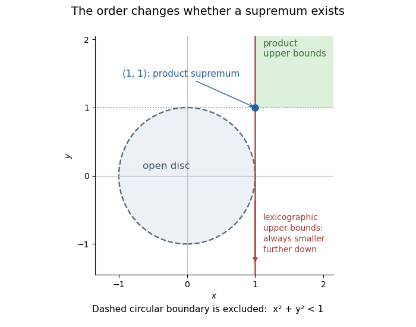

# Supremum of an open disc under product and lexicographic orders

↑ **Parent:** [Least upper bound in a partially ordered set](least-upper-bound-in-a-partially-ordered-set.md)

For $D=\{(x,y):x^2+y^2<1\}$, the [product order](product-order.md) gives [least upper bound](least-upper-bound-in-a-partially-ordered-set.md) $(1,1)$, because each coordinate has [supremum](supremum.md) one. The [lexicographic order](lexicographic-order.md) instead has no [least upper bound](least-upper-bound-in-a-partially-ordered-set.md). Every point $(1,v)$ is an [upper bound](upper-bound-in-a-partially-ordered-set.md), but $(1,v-1)$ is a strictly smaller [upper bound](upper-bound-in-a-partially-ordered-set.md); a point with first coordinate below one cannot bound the disc. The same geometric [set](set-split.md) therefore has different order-completeness behavior under the two [partial orders](partially-ordered-set.md). Neither conclusion is determined by the usual drawing alone.

**[Figure 5](#image-the-open-disc-has-different-upper-bound-geometry-under-two-orders). The open disc has different upper-bound geometry under two orders**.

## ↑ Ancestors (10)

1. [Least upper bound in a partially ordered set](least-upper-bound-in-a-partially-ordered-set.md)
2. [Upper bound in a partially ordered set](upper-bound-in-a-partially-ordered-set.md)
3. [Upper and lower bounds](upper-and-lower-bounds.md)
4. [Partially ordered set](partially-ordered-set.md)
5. [Set](set-split.md)
6. [Set theory](set-theory-split.md)
7. [Foundations of mathematics](foundations-of-mathematics-split.md)
8. [Area of mathematics](area-of-mathematics.md)
9. [Mathematics](mathematics-split.md)
10. [Codex Wiki](split.md)

## ← Incoming links (1)

- [Solution](past-exam-of-the-year-1-of-the-computer-science-course-of-the-university-of-oxford/2018/discrete-mathematics-continuous-mathematics-and-probability/3/d/solution.md)
