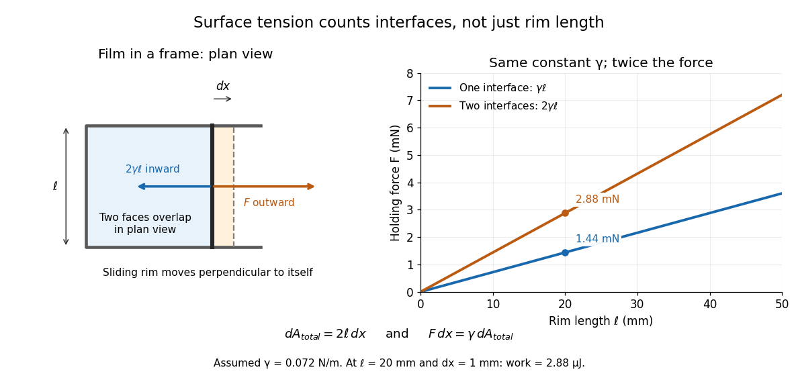

# Surface tension

↑ **Parent:** [Fluid mechanics](fluid-mechanics.md)  
ⓦ [Wiki](https://en.wikipedia.org/wiki/Surface_tension)

[Surface tension](surface-tension.md) $\gamma$ is the tensile [force](force.md) per unit length across a line drawn in a [liquid](thermodynamics.md#liquid) interface. For a clean interface with [isotropy](continuum-mechanics.md#isotropy), it has the same value in every tangential direction: each side pulls the other along the surface, perpendicular to the line. A straight segment of length $\ell$ therefore transmits a [force](force.md) of magnitude $\gamma\ell$ from one interface. Here we assume constant $\gamma>0$, with fixed [temperature](temperature.md) and composition. The same coefficient measures the reversible [work](energy.md#work) required to create [surface area](differential-geometry.md#surface-area):

$$
F_{\text{one interface}}=\gamma\ell,\qquad dE_{\mathrm s}=\gamma\,dA,\qquad
[\gamma]=\mathrm{N\,m^{-1}}=\mathrm{J\,m^{-2}}.
$$

The equality of units follows from $1\,\mathrm J=1\,\mathrm{N\,m}$; the equality of the mechanical coefficients follows from the moving-rim argument below. [OpenStax, College Physics 2e, §11.8: surface tension and the sliding wire](https://openstax.org/books/college-physics-2e/pages/11-8-cohesion-and-adhesion-in-liquids-surface-tension-and-capillary-action) [Tomas Bohr and Bernhard Scheichl, Surface Tension and Energy Conservation in a Moving Fluid, equations (5) and (13)](https://arxiv.org/html/2011.11403v2)

For a concrete example, take an ideal flat soap film spanning a rectangular wire frame with a straight sliding rim of length $\ell$. Pull the rim outwards in the plane of the film, perpendicular to the rim. Each of the film's two [liquid](thermodynamics.md#liquid)–[gas](thermodynamics.md#gas) interfaces pulls the rim back towards the film with [force](force.md) $\gamma\ell$, so the outward holding [force](force.md) is $F=2\gamma\ell$. The two faces are two interfaces, each with its own [surface tension](surface-tension.md). With the assumed toy value $\gamma=0.072\,\mathrm{N\,m^{-1}}$ and $\ell=20\,\mathrm{mm}=0.020\,\mathrm m$, the required [force](force.md) is $2.88\,\mathrm{mN}$; one interface would contribute $1.44\,\mathrm{mN}$. This value of $\gamma$ is a stipulated model parameter, rather than a measured value for a particular soap solution.

**[Figure 1](#image-two-film-faces-double-the-force-on-a-sliding-rim). Two film faces double the force on a sliding rim**. The plan view shows the outward pull and the inward [surface tension](surface-tension.md) [force](force.md) on a sliding rim; the two interfaces overlap in this view. The graph compares one and two interfaces at the same assumed constant $\gamma=0.072\,\mathrm{N\,m^{-1}}$, with rim length in millimetres and [force](force.md) in millinewtons.

Why does an interface resist being enlarged? Its [molecules](molecule.md) have a different environment from those in the bulk [liquid](thermodynamics.md#liquid); changing that environment has an [energy](energy.md) cost. In the constant-[surface tension](surface-tension.md) model, reducing [surface area](differential-geometry.md#surface-area) lowers [surface energy](#surface-energy). This connects an easily measured rim [force](force.md) to the shape of a droplet, the [Young–Laplace equation](#young-laplace-equation) for its [pressure](pressure.md), and the restoring mechanism of [capillary waves](#capillary-wave). It is useful because one coefficient links [forces](force.md), [energy](energy.md) and geometry. [David Tong, Fluid Mechanics, §4.1.3, pp. 121–123](https://davidtong.org/pdfs/teaching/fluid-mechanics/fluids3.pdf)

The moving-rim argument also explains the factor of two without memorizing a special formula. An outward displacement $dx$ creates [surface area](differential-geometry.md#surface-area) $\ell\,dx$ on each face, hence $dA_{\mathrm{total}}=2\ell\,dx$. Slow pulling without [viscous dissipation](stokes-flow.md#viscous-dissipation) requires [work](energy.md#work) $F\,dx=\gamma\,dA_{\mathrm{total}}$, giving $F=2\gamma\ell$. For one interface, the same argument gives $F=\gamma\ell$. A [surface tension](surface-tension.md) gradient instead produces [Marangoni stress](#marangoni-effect); the constant-$\gamma$ assumption excludes that additional effect.

**Table of contents**

- [Critical point drying](#critical-point-drying)
- [Capillary force](#capillary-force)
- [Hamaker estimate of liquid surface tension](#hamaker-estimate-of-liquid-surface-tension)
- [Thermodynamics of a liquid film](#thermodynamics-of-a-liquid-film)
- [Surface energy](#surface-energy)
- [Wetting](#wetting)
  - [Wenzel wetting](#wenzel-wetting)
    - [Wenzel roughness factor](#wenzel-roughness-factor)
  - [Complete wetting](#complete-wetting)
  - [Spreading coefficient](#spreading-coefficient)
  - [Cassie–Baxter state](#cassie-baxter-state)
  - [Contact line](#contact-line)
- [Bond number](#bond-number)
- [Oil lens capillary balance](#oil-lens-capillary-balance)
- [Contact angle](#contact-angle)
  - [Young's contact-angle equation](#young-s-contact-angle-equation)
  - [Contact-angle hysteresis](#contact-angle-hysteresis)
  - [Young's equation](#young-s-equation)
    - [Interfacial-energy difference from two contact angles](#interfacial-energy-difference-from-two-contact-angles)
    - [Young-Dupré equation](#young-dupre-equation)
- [Capillary number](#capillary-number)
- [Capillary pressure](#capillary-pressure)
- [Surfactant](#surfactant)
  - [Cetrimonium bromide](#cetrimonium-bromide)
  - [Sodium dodecyl sulfate](#sodium-dodecyl-sulfate)
  - [Surfactant transport with exchange relaxation](#surfactant-transport-with-exchange-relaxation)
    - [Translating surfactant-coated bubble](#translating-surfactant-coated-bubble)
      - [Normal stress balance on a translating bubble](#normal-stress-balance-on-a-translating-bubble)
      - [Dipolar surfactant distribution](#dipolar-surfactant-distribution)
  - [Surfactant stabilization of film rupture](#surfactant-stabilization-of-film-rupture)
    - [Strong-surfactant long-wave rupture maximum](#strong-surfactant-long-wave-rupture-maximum)
  - [Insoluble surfactant](#insoluble-surfactant)
    - [Surface diffusion](#surface-diffusion)
    - [Conservation of insoluble surfactant on a moving interface](#conservation-of-insoluble-surfactant-on-a-moving-interface)
      - [Quadrupolar surfactant distribution on a spherical interface](#quadrupolar-surfactant-distribution-on-a-spherical-interface)
  - [Soap](#soap)
  - [Detergent](#detergent)
- [Marangoni effect](#marangoni-effect)
  - [Thermocapillary migration of an insulating bubble](#thermocapillary-migration-of-an-insulating-bubble)
  - [Interfacial stress balance with variable surface tension](#interfacial-stress-balance-with-variable-surface-tension)
    - [Marangoni immobilization of a bubble in straining flow](#marangoni-immobilization-of-a-bubble-in-straining-flow)
  - [Chemophoresis](#chemophoresis)
- [Rayleigh–Plateau instability](#rayleigh-plateau-instability)
  - [Capillary instability of an annular liquid lining](#capillary-instability-of-an-annular-liquid-lining)
    - [Surfactant stabilization of an annular liquid lining](#surfactant-stabilization-of-an-annular-liquid-lining)
- [Young–Laplace equation](#young-laplace-equation)
  - [Gibbs--Thomson relation](#gibbs-thomson-relation)
    - [Nanoparticle melting-point depression](#nanoparticle-melting-point-depression)
    - [Curvature-induced melting-temperature depression](#curvature-induced-melting-temperature-depression)
- [Capillary length](#capillary-length)
- [Dynamic meniscus](#dynamic-meniscus)
- [Capillary wave](#capillary-wave)
  - [Thermal roughness of a tension-dominated interface](#thermal-roughness-of-a-tension-dominated-interface)
  - [Gravity-capillary wave](#gravity-capillary-wave)
    - [Minimum phase speed of a gravity-capillary wave](#minimum-phase-speed-of-a-gravity-capillary-wave)
  - [Laser-diffraction measurement of capillary waves](#laser-diffraction-measurement-of-capillary-waves)
  - [Deep-water capillary-wave dispersion relation](#deep-water-capillary-wave-dispersion-relation)
    - [Surface response to a localized impulsive velocity](#surface-response-to-a-localized-impulsive-velocity)
      - [Stationary-phase wake of an impulsive capillary wave](#stationary-phase-wake-of-an-impulsive-capillary-wave)
  - [Diffusion-limited relaxation of an interface](#diffusion-limited-relaxation-of-an-interface)
- [Capillary action](#capillary-action)
  - [Capillary rise between parallel plates](#capillary-rise-between-parallel-plates)
  - [Jurin's law](#jurin-s-law)
    - [Contact-angle change of capillary rise](#contact-angle-change-of-capillary-rise)

## Critical point drying

↑ **Parent:** [Surface tension](surface-tension.md)

Drying through a fluid's [thermodynamic critical point](critical-phenomenon.md#thermodynamic-critical-point) to avoid traversing an ordinary liquid-vapor coexistence interface. Removing the receding meniscus can protect compliant microstructures from [capillary force](#capillary-force) during release. Solvent exchange and compatibility with the structure remain practical constraints.

## Capillary force

↑ **Parent:** [Surface tension](surface-tension.md)

A [force](force.md) caused by an interface through its contact-line [surface tension](surface-tension.md) and the [capillary pressure](#capillary-pressure) it produces. Both contributions must be counted with consistent geometry. For a narrow, completely [wetting](#wetting) [liquid](thermodynamics.md#liquid) bridge between flat plates of wetted radius $a$ and gap $d\ll a$, the leading attractive [force](force.md) is $2\pi a^2\gamma/d$.

## Hamaker estimate of liquid surface tension

↑ **Parent:** [Surface tension](surface-tension.md)

For two liquid half-spaces, integrate the magnitude of a dispersion attraction per area $A_H/(6\pi h^3)$ from a molecular contact cutoff $h_0$ to infinity. The work per area is $A_H/(12\pi h_0^2)$. Because cleavage creates two interfaces, each has the displayed [surface tension](surface-tension.md) in this approximation. The cutoff is essential: a continuum attraction cannot describe atomic overlap and short-range repulsion. This estimate neglects interfacial entropy, detailed density profiles and nonadditive interactions, and it cannot replace the [metallic bonding](chemical-bond.md#metallic-bonding) or [hydrogen bonds](chemical-bond.md#hydrogen-bond) that dominate some liquids' cohesion.

## Thermodynamics of a liquid film

↑ **Parent:** [Surface tension](surface-tension.md)

For a film described by $dU=T\,dS+\gamma\,dA$, with material content fixed, its [Helmholtz free energy](thermodynamic-potential.md#helmholtz-free-energy) obeys $dF=-S\,dT+\gamma\,dA$. Equality of mixed [partial derivatives](multivariable-calculus.md#partial-derivative) gives the [Maxwell relation](thermodynamics.md#maxwell-relations) $(\partial S/\partial A)_T=-(\partial\gamma/\partial T)_A$. If $\gamma$ depends only on [temperature](temperature.md), write $\gamma'=d\gamma/dT$; then

$$
dS=\frac{C_A}{T}\,dT-\gamma'\,dA,
\qquad dU=C_A\,dT+(\gamma-T\gamma')\,dA.
$$

Here $C_A$ is the [heat capacity at constant area](heat.md#heat-capacity-at-constant-area). For $C_A>0$ and $\gamma'<0$, reversible adiabatic stretching cools the film, since $dT/dA=T\gamma'/C_A<0$, although positive mechanical input can increase its total [internal energy](internal-energy.md). If $\gamma=\gamma_0-\beta T$ with constant positive $\beta$ and constant $C_A$, the [isentropic process](first-law-of-thermodynamics.md#isentropic-process) satisfies $C_A\ln(T/T_*)+\beta A=\mathrm{constant}$, where $T_*$ is an arbitrary fixed reference [temperature](temperature.md). The [work](energy.md#work) convention uses the total [area](differential-geometry.md#surface-area) conjugate to $\gamma$; a two-surface film described by projected [area](differential-geometry.md#surface-area) requires the corresponding factor of two consistently throughout.

## Surface energy

↑ **Parent:** [Surface tension](surface-tension.md)

For a [liquid](thermodynamics.md#liquid) interface with constant [surface tension](surface-tension.md) $\gamma$, the mechanical [surface energy](#surface-energy) is the [energy](energy.md) associated with its [surface area](differential-geometry.md#surface-area) $A$:

$$
E_{\mathrm s}=\gamma A+C,\qquad
E_{\mathrm s}(A_2)-E_{\mathrm s}(A_1)=\gamma(A_2-A_1).
$$

The additive constant $C$ does not affect the [work](energy.md#work) needed to change [surface area](differential-geometry.md#surface-area). For several interfaces with the same [surface tension](surface-tension.md), $A$ means their total [surface area](differential-geometry.md#surface-area); the two faces of a thin soap film must both be counted. [Tomas Bohr and Bernhard Scheichl, Surface Tension and Energy Conservation in a Moving Fluid, equation (13)](https://arxiv.org/html/2011.11403v2)

With assumed $\gamma=0.072\,\mathrm{N\,m^{-1}}$, creating $1\,\mathrm{cm^2}=10^{-4}\,\mathrm{m^2}$ of one interface requires $7.2\,\mathrm{\mu J}$ of reversible [work](energy.md#work). In the sliding-rim example illustrated under [surface tension](surface-tension.md), moving a $20\,\mathrm{mm}$ rim outwards by $1\,\mathrm{mm}$ creates $4.0\times10^{-5}\,\mathrm{m^2}$ across the two faces and requires $2.88\,\mathrm{\mu J}$. Independently, multiplying its $2.88\,\mathrm{mN}$ holding [force](force.md) by the displacement gives the same [work](energy.md#work).

This makes the preference for a round isolated droplet precise. At fixed [volume](geometry-and-topology.md#volume) $V$, the three-dimensional [isoperimetric inequality](euclidean-geometry.md#isoperimetric-inequality) gives

$$
A^3\geq36\pi V^2,
$$

with equality for a [sphere](euclidean-geometry.md#sphere). Thus a [sphere](euclidean-geometry.md#sphere) minimizes [surface energy](#surface-energy) among sufficiently regular closed shapes enclosing the same [volume](geometry-and-topology.md#volume), when [surface tension](surface-tension.md) is uniform and other [energy](energy.md) contributions are negligible. This is an application of the [isoperimetric inequality](euclidean-geometry.md#isoperimetric-inequality), rather than a proof of it. Walls, [wetting](#wetting), and [gravity](physics.md#gravity) can change the shape by adding constraints or other [energy](energy.md) contributions. [Francis E. Su et al., Isoperimetric Inequality, Math Fun Facts](https://math.hmc.edu/funfacts/isoperimetric-inequality/)

The differential rule $dE_{\mathrm s}=\gamma\,dA$ integrates directly to $E_{\mathrm s}=\gamma A+C$ because [surface tension](surface-tension.md) is constant. At fixed [liquid](thermodynamics.md#liquid) [volume](geometry-and-topology.md#volume), decreasing [surface area](differential-geometry.md#surface-area) can drive [viscous fluid flow](viscous-fluid-flow.md); the released [surface energy](#surface-energy) can supply [viscous dissipation](stokes-flow.md#viscous-dissipation). This mechanical bookkeeping is useful for predicting which deformations can release [energy](energy.md). If [surface tension](surface-tension.md) depends on [temperature](temperature.md) or composition, distinguish this mechanical area-[work](energy.md#work) relation from the complete interfacial [thermodynamic free energy](thermodynamic-potential.md#thermodynamic-free-energy) and [internal energy](internal-energy.md).

## Wetting

↑ **Parent:** [Surface tension](surface-tension.md)  
ⓦ [Wiki](https://en.wikipedia.org/wiki/Wetting)

### Wenzel wetting

↑ **Parent:** [Wetting](#wetting)

A fully penetrated rough-surface wetting model with $\cos\theta^*=r\cos\theta$, where $r$ is actual wetted solid area divided by projected area. Roughness amplifies the planar surface tendency: it lowers contact angle when $\theta<90^\circ$.

#### Wenzel roughness factor

↑ **Parent:** [Wenzel wetting](#wenzel-wetting)

The area ratio $r=A_{\mathrm{actual}}/A_{\mathrm{projected}}\geq1$, not the projected fraction covered by particles. A hemispherical array of footprint coverage $\phi$ on an exposed flat substrate has $r=1+\phi$.

### Complete wetting

↑ **Parent:** [Wetting](#wetting)

A liquid spreads macroscopically over a solid with zero macroscopic equilibrium [contact angle](#contact-angle). In the simple interfacial-energy model the threshold is $\gamma_{SV}-\gamma_{SL}=\gamma_{LV}$, or zero [spreading coefficient](#spreading-coefficient); positive coefficient favors a spreading film. Extrapolating a concentration-dependent liquid-vapour [surface tension](surface-tension.md) to this threshold assumes the other interfacial energies remain fixed and no intervening adsorption or micellization behavior changes the trend.

### Spreading coefficient

↑ **Parent:** [Wetting](#wetting)

The excess interfacial [free energy](thermodynamic-potential.md#thermodynamic-free-energy) released per newly wetted area when a liquid film replaces a solid-vapour interface is the displayed coefficient. Positive $S$ favors macroscopic spreading in the ideal equilibrium surface-energy model, whereas negative $S$ permits a finite [contact angle](#contact-angle) obeying [Young's equation](#young-s-equation). Surface preparation, chemical composition and adsorption can change all three interfacial energies.

<h3 id="cassie-baxter-state">Cassie–Baxter state</h3>

↑ **Parent:** [Wetting](#wetting)

A [Cassie–Baxter state](#cassie-baxter-state) is a composite wetting state in which a drop contacts solid asperities over area fraction $f_s$ and trapped gas over the remainder. An ideal area-weighted contact-angle model gives the displayed apparent angle from the smooth-solid [Young's equation](#young-s-equation) angle $\theta_Y$. Reducing solid contact can strongly enhance apparent [hydrophobicity](physical-chemistry.md#hydrophobicity). Such a state can be metastable and can collapse when liquid enters the texture; roughness alone does not guarantee it.

### Contact line

↑ **Parent:** [Wetting](#wetting)

The line where the interfaces of three phases meet, for example where a liquid film meets a solid and the surrounding gas. Continuum assumptions at this line can differ from the bulk [lubrication approximation](viscous-fluid-flow.md#lubrication-theory).

## Bond number

↑ **Parent:** [Surface tension](surface-tension.md)  
ⓦ [Wiki](https://en.wikipedia.org/wiki/Bond_number)

The Bond number compares hydrostatic stress over a length $\ell$ with capillary stress. For a gas bubble of radius $a$ and negligible density, $\mathrm{Bo}=\rho ga^2/\gamma$. Small Bond number is the usual sufficient criterion for capillarity to resist gravity-scale deformations. For the clean-bubble terminal speed, the [capillary number](#capillary-number) is $\mathrm{Ca}=\mu U/\gamma=\mathrm{Bo}/3$.

## Oil lens capillary balance

↑ **Parent:** [Surface tension](surface-tension.md)

For a broad, thin oil lens below a flat ice-water interface, define the effective interfacial energy $\Gamma=\gamma_{io}+\gamma_{ow}-\gamma_{iw}$ from the relevant [surface tensions](surface-tension.md). At fixed oil volume $\mathcal V=Ah$, the energy is $E=\Gamma\mathcal V/h+\frac12(\rho_w-\rho_o)g\mathcal Vh$. Setting its [derivative](calculus.md#derivative) to zero gives $h^2=2\Gamma/[(\rho_w-\rho_o)g]$ for $\Gamma>0$, and the positive [second derivative](calculus.md#second-derivative) proves a minimum. A contact angle measured through the oil gives $\Gamma=\gamma_{ow}(1-\cos\vartheta)$. Oil-ice tension alone does not determine this effective quantity. Complete wetting or rough underside pockets invalidate this finite, flat-lens approximation. With densities $1025$ and $850\,\mathrm{kg\,m^{-3}}$, a lens below $1\,\mathrm{cm}$ requires $0<\Gamma<0.08584\,\mathrm{N\,m^{-1}}$.

## Contact angle

↑ **Parent:** [Surface tension](surface-tension.md)

The contact angle is measured through a liquid between its interface and a solid substrate at their contact line. In a gently sloping two-dimensional film on a horizontal substrate, its small-angle value is the limiting magnitude of the height slope. A zero contact angle means a tangential approach to the substrate; it does not imply bounded curvature, as the limiting [zero-flux thermocapillary film profiles](viscous-fluid-flow.md#zero-flux-thermocapillary-film-profiles) illustrate.

<h3 id="young-s-contact-angle-equation">Young's contact-angle equation</h3>

↑ **Parent:** [Contact angle](#contact-angle)

The planar interfacial balance $\gamma_{SV}-\gamma_{SL}=\gamma_{LV}\cos\theta$ for the equilibrium contact angle through the liquid, with interfacial free energies defined per actual area. Roughness and retained air require additional area accounting.

### Contact-angle hysteresis

↑ **Parent:** [Contact angle](#contact-angle)

A contact line can remain pinned while the observed [contact angle](#contact-angle) changes between receding and advancing limits. Surface roughness and chemical heterogeneity can produce this hysteresis. Slowly adding or removing liquid from a sessile drop measures advancing and receding angles separately. An observed pinned angle therefore need not be the single equilibrium angle predicted by [Young's equation](#young-s-equation) for a perfectly homogeneous surface.

<h3 id="young-s-equation">Young's equation</h3>

↑ **Parent:** [Contact angle](#contact-angle)

For a smooth homogeneous solid in [thermodynamic equilibrium](thermodynamics.md#thermodynamic-equilibrium) with a liquid and vapor, [Young's equation](#young-s-equation) relates their three interfacial tensions to the [contact angle](#contact-angle) measured through the liquid. A virtual increase $dA$ of wetted area changes the interfacial [free energy](thermodynamic-potential.md#thermodynamic-free-energy) by $(\gamma_{SL}-\gamma_{SV}+\gamma_{LV}\cos\theta)dA$. Setting this to zero proves the equation. Roughness, pinning and chemical heterogeneity can make an observed apparent angle differ from this ideal equilibrium value. The equation does not determine each solid–liquid [surface energy](#surface-energy) from a contact angle alone, but two liquids on the same unchanged dry substrate allow the solid–vapor term to be eliminated by subtraction.

#### Interfacial-energy difference from two contact angles

↑ **Parent:** [Young's equation](#young-s-equation)

Subtracting [Young's equations](#young-s-equation) for two liquids on the same solid eliminates the unknown solid–vapour [interfacial energy](physical-chemistry.md#interfacial-energy). The result assumes equilibrium angles and an unchanged solid surface. Swelling, contamination or [contact-angle hysteresis](#contact-angle-hysteresis) can invalidate this cancellation as a comparison of equilibrium material properties.

<h4 id="young-dupre-equation">Young-Dupré equation</h4>

↑ **Parent:** [Young's equation](#young-s-equation)

Combining reversible work of adhesion per area, $W=\gamma_{SV}+\gamma_{LV}-\gamma_{SL}$, with [Young's equation](#young-s-equation) gives the displayed relation. It assumes the same smooth equilibrium interfaces; contact-angle hysteresis and dissipation are not included.

## Capillary number

↑ **Parent:** [Surface tension](surface-tension.md)  
ⓦ [Wiki](https://en.wikipedia.org/wiki/Capillary_number)

The capillary number compares viscous stresses with [surface tension](surface-tension.md). Its velocity and viscosity conventions must be specified; a porous-medium displacement can use the [Darcy velocity](porous-media-flow.md#darcy-velocity) and the viscosity of the displaced fluid.

## Capillary pressure

↑ **Parent:** [Surface tension](surface-tension.md)  
ⓦ [Wiki](https://en.wikipedia.org/wiki/Capillary_pressure)

Capillary pressure is the pressure jump produced by a curved interface. For constant surface tension it is proportional to the interface curvature according to the [Young–Laplace equation](#young-laplace-equation).

## Surfactant

↑ **Parent:** [Surface tension](surface-tension.md)  
ⓦ [Wiki](https://en.wikipedia.org/wiki/Surfactant)

A surfactant is an interfacially active substance that changes surface tension. A concentration gradient therefore generates tangential [Marangoni stress](#marangoni-effect).

### Cetrimonium bromide

↑ **Parent:** [Surfactant](#surfactant)  
ⓦ [Wiki](https://en.wikipedia.org/wiki/Cetrimonium_bromide)

A cationic [surfactant](#surfactant) with a sixteen-carbon [hydrocarbon](chemical-substance.md#hydrocarbon) tail and a positively charged trimethylammonium head group, accompanied by a $\mathrm{Br}^-$ [counterion](chemistry.md#counterion). It is an [amphiphile](physical-chemistry.md#amphiphile) that can form aqueous [micelles](physical-chemistry.md#micelle). Its head-group charge has the opposite sign to that of [sodium dodecyl sulfate](#sodium-dodecyl-sulfate).

### Sodium dodecyl sulfate

↑ **Parent:** [Surfactant](#surfactant)  
ⓦ [Wiki](https://en.wikipedia.org/wiki/Sodium_dodecyl_sulfate)

An anionic [surfactant](#surfactant) with a twelve-carbon [hydrocarbon](chemical-substance.md#hydrocarbon) tail and a negatively charged sulfate head group, accompanied by a [sodium](chemical-substance.md#sodium) [counterion](chemistry.md#counterion). This separation of [hydrophobic](physical-chemistry.md#hydrophobicity) and [hydrophilic](physical-chemistry.md#hydrophilicity) regions makes it an [amphiphile](physical-chemistry.md#amphiphile). It forms aqueous [micelles](physical-chemistry.md#micelle) under suitable concentration and temperature conditions and is used in [sodium dodecyl sulfate polyacrylamide gel electrophoresis](biology.md#sds-page).

### Surfactant transport with exchange relaxation

↑ **Parent:** [Surfactant](#surfactant)

The [material derivative](continuum-mechanics.md#material-derivative) of surface concentration combines tangential and normal area change, [surface diffusion](#surface-diffusion), and relaxation towards a reservoir concentration $C_0$. The rate $k$ represents exchange; setting $k=0$ recovers transport without exchange. The concentration is measured per interfacial area, so stretching dilutes it.

#### Translating surfactant-coated bubble

↑ **Parent:** [Surfactant transport with exchange relaxation](#surfactant-transport-with-exchange-relaxation)

A spherical inviscid bubble moving slowly through a viscous liquid has a dipolar [surfactant](#surfactant) perturbation. The associated [Marangoni stress](#marangoni-effect) reduces the tangential velocity from its clean-bubble value towards zero. In the linear regime, with $\mathbf u_s=A(I-\mathbf n\mathbf n)\mathbf U$, the consistent [Newtonian fluid stress tensor](viscous-fluid-flow.md#newtonian-fluid-stress-tensor) gives $A=-1/[2(1+2\lambda)]$.

##### Normal stress balance on a translating bubble

↑ **Parent:** [Translating surfactant-coated bubble](#translating-surfactant-coated-bubble)

The dipolar normal [traction](continuum-mechanics.md#traction) is balanced by buoyant [hydrostatic pressure](fluid-mechanics.md#hydrostatic-pressure) and the concentration-dependent normal capillary stress, in addition to the constant gas pressure and equilibrium Laplace pressure. A degree-one shape perturbation translates a sphere rather than deforming it; the balance fixes the terminal speed. A uniform gas pressure alone cannot balance this mode.

##### Dipolar surfactant distribution

↑ **Parent:** [Translating surfactant-coated bubble](#translating-surfactant-coated-bubble)

Linear steady transport on a translating sphere gives $B=2AC_0a/(ka^2+2D_s)$. The components of its unit [normal vector](differential-geometry.md#normal-vector) are degree-one [spherical harmonics](analysis.md#spherical-harmonic). The condition $2|A|Ua/(ka^2+2D_s)\ll1$ ensures the concentration perturbation is small relative to $C_0$.

### Surfactant stabilization of film rupture

↑ **Parent:** [Surfactant](#surfactant)

Outward interfacial flow from a thinning region dilutes surfactant there and raises its [surface tension](surface-tension.md). The resulting [Marangoni stress](#marangoni-effect) pulls fluid back toward the thinning region, opposes further stretching, and slows rupture.

#### Strong-surfactant long-wave rupture maximum

↑ **Parent:** [Surfactant stabilization of film rupture](#surfactant-stabilization-of-film-rupture)

For strong [Marangoni stress](#marangoni-effect) and large $\Gamma=\gamma h_0^2/(3V)$, the unstable band has $K\ll1$. Its rate is asymptotically $[3V/(\mu h_0^3)]K^2(1-\Gamma K^2)/3$. Maximizing this quadratic in $K^2$ gives the displayed finite-wavelength maximum. The growth timescale is not alone a bubble lifetime: initial disturbance size and thickness evolution also enter.

### Insoluble surfactant

↑ **Parent:** [Surfactant](#surfactant)

An insoluble surfactant remains on an interface. Without surface diffusion, its material concentration changes only through the local surface-area dilation rate.

#### Surface diffusion

↑ **Parent:** [Insoluble surfactant](#insoluble-surfactant)  
ⓦ [Wiki](https://en.wikipedia.org/wiki/Surface_diffusion)

Surface diffusion transports particles along an interface down a [concentration](mathematical-physics.md#concentration) gradient. On an isotropic smooth interface with constant diffusivity $D_s$, its flux is $-D_s\nabla_sC$ and its concentration source is $D_s\Delta_sC$, using the [surface gradient](riemannian-geometry.md#surface-gradient) and [surface Laplacian](differential-geometry.md#surface-laplacian).

#### Conservation of insoluble surfactant on a moving interface

↑ **Parent:** [Insoluble surfactant](#insoluble-surfactant)

For concentration $C$ per unit [surface area](differential-geometry.md#surface-area), conservation on a moving material interface gives

$$
\frac{DC}{Dt}=-C\left[\nabla_s\cdot\mathbf u_s+u_n\nabla_s\cdot\mathbf n\right]+D_s\Delta_sC.
$$

The [material derivative](continuum-mechanics.md#material-derivative) follows the surface particles. The two dilution terms are tangential expansion and curvature-induced area change from normal velocity $u_n$; the last term is [surface diffusion](#surface-diffusion).

##### Quadrupolar surfactant distribution on a spherical interface

↑ **Parent:** [Conservation of insoluble surfactant on a moving interface](#conservation-of-insoluble-surfactant-on-a-moving-interface)

For radius $a$ and tangential velocity $\mathbf u_s=\mathbf I_s\mathbf A\mathbf x$ with symmetric traceless $\mathbf A$, the [surface divergence](riemannian-geometry.md#surface-divergence) is $-3\mathbf n\cdot\mathbf A\mathbf n$. At small surface [Péclet number](fluid-mechanics.md#peclet-number) $a^2|\mathbf A|/D_s$, neglecting advection of the concentration perturbation gives

$$
C-C_0=\frac{C_0a^2}{2D_s}\mathbf n\cdot\mathbf A\mathbf n.
$$

The result follows because this quadratic is a degree-two [spherical harmonic](analysis.md#spherical-harmonic) with [surface Laplacian](differential-geometry.md#surface-laplacian) $-6/a^2$ times itself and zero spherical mean.

### Soap

↑ **Parent:** [Surfactant](#surfactant)  
ⓦ [Wiki](https://en.wikipedia.org/wiki/Soap)

[Soap](#soap) consists of [sodium](chemical-substance.md#sodium) or [potassium](chemical-substance.md#potassium) salts of long-chain [fatty acids](chemical-substance.md#fatty-acid). Its [hydrophilic](physical-chemistry.md#hydrophilicity) [carboxylate](chemical-substance.md#carboxylate) head and [hydrophobic](physical-chemistry.md#hydrophobicity) [hydrocarbon](chemical-substance.md#hydrocarbon) tail make it an [amphiphile](physical-chemistry.md#amphiphile); [saponification](chemical-reaction.md#saponification) of [triglycerides](chemical-substance.md#triglyceride) produces these salts.

### Detergent

↑ **Parent:** [Surfactant](#surfactant)

A [detergent](#detergent) can disrupt a [lipid bilayer](mathematical-biology.md#lipid-bilayer); in a [protease protection assay](protein.md#protease-protection-assay), removing the membrane barrier tests the cause of apparent protection.

## Marangoni effect

↑ **Parent:** [Surface tension](surface-tension.md)  
ⓦ [Wiki](https://en.wikipedia.org/wiki/Marangoni_effect)

The Marangoni effect is interfacial flow driven by a surface-tension gradient. Tangential stress balances the surface gradient $\nabla_s\gamma$.

### Thermocapillary migration of an insulating bubble

↑ **Parent:** [Marangoni effect](#marangoni-effect)

For a clean spherical gas bubble with negligible internal [dynamic viscosity](dynamic-viscosity.md) and [thermal conductivity](heat.md#thermal-conductivity), a weak temperature gradient produces the displayed migration [velocity](classical-mechanics.md#velocity), where $\gamma_T=d\gamma/dT$. The exterior [Papkovich–Neuber representation](stokes-flow.md#papkovich-neuber-representation) can use only the scalar potential $\chi=-a^3\mathbf U\cdot\mathbf r/(2r^3)$. Its surface normal velocity equals $\mathbf U\cdot\mathbf n$, and its tangential [traction](continuum-mechanics.md#traction) balances minus the surface [surface tension](surface-tension.md) gradient from the [temperature dipole around an insulating sphere](heat.md#temperature-dipole-around-an-insulating-sphere). For the usual $\gamma_T<0$ the bubble moves toward warmer liquid. Small [Reynolds number](dynamic-viscosity.md#reynolds-number), [Péclet number](fluid-mechanics.md#peclet-number), [capillary number](#capillary-number), and fractional surface-tension variation justify the approximation; [surfactants](#surfactant) can oppose the temperature-driven [Marangoni stress](#marangoni-effect).

### Interfacial stress balance with variable surface tension

↑ **Parent:** [Marangoni effect](#marangoni-effect)

Across a fluid interface, the jump in normal traction is the surface tension times curvature, while the tangential traction jump is the surface gradient of surface tension. For one common normal convention,

$$
(\boldsymbol\sigma_+-\boldsymbol\sigma_-)\mathbin\cdot\mathbf n
=\gamma\kappa\mathbf n-\nabla_s\gamma.
$$

#### Marangoni immobilization of a bubble in straining flow

↑ **Parent:** [Interfacial stress balance with variable surface tension](#interfacial-stress-balance-with-variable-surface-tension)

For an almost spherical inviscid bubble in exterior [Stokes flow](stokes-flow.md) $\mathbf E\mathbf x$, let $\gamma=\gamma_0-\gamma_1(C-C_0)$ and $K=C_0a^2/(2D_s)$. The [quadrupolar surfactant distribution on a spherical interface](#quadrupolar-surfactant-distribution-on-a-spherical-interface) makes the tangential velocity $\mathbf u_s=\alpha\mathbf I_s\mathbf E\mathbf x$ satisfy

$$
\alpha=\frac5{5+2M},\qquad M=\frac{K\gamma_1}{\mu a}.
$$

The [Marangoni stress](#marangoni-effect) approaches the stress needed to suppress surface motion as $M$ grows. The quadrupolar shape perturbation $r=a(1+\mathbf n\cdot\mathbf D\mathbf n)$ is

$$
\mathbf D=\frac{5\mu a}{\gamma_0}\frac{2+M}{5+2M}\mathbf E.
$$

These expressions require small deformation and small surface [Péclet number](fluid-mechanics.md#peclet-number); large $M$ alone does not justify a small concentration perturbation.

### Chemophoresis

↑ **Parent:** [Marangoni effect](#marangoni-effect)

Chemophoresis is the motion of a particle or droplet driven by a gradient in chemical concentration. For a surfactant-coated bubble, adsorption converts the chemical gradient into a [Marangoni stress](#marangoni-effect).

<h2 id="rayleigh-plateau-instability">Rayleigh–Plateau instability</h2>

↑ **Parent:** [Surface tension](surface-tension.md)  
ⓦ [Wiki](https://en.wikipedia.org/wiki/Rayleigh–Plateau_instability)

The Rayleigh–Plateau instability makes a sufficiently long cylindrical fluid thread unstable to axisymmetric radius perturbations. Surface tension lowers area by amplifying wavelengths longer than the circumference-scale threshold.

### Capillary instability of an annular liquid lining

↑ **Parent:** [Rayleigh–Plateau instability](#rayleigh-plateau-instability)

A thin liquid lining inside a rigid cylindrical tube has [pressure](pressure.md) perturbation $p_1=-\sigma(a^{-2}h_1+h_{1,xx})$ at leading order in $h_0/a$. [Lubrication theory](viscous-fluid-flow.md#lubrication-theory) gives flux $q=-h_0^3p_x/(3\mu)$, so [mass conservation](continuum-mechanics.md#mass-conservation) gives the displayed growth rate. Long waves with $0<k^2a^2<1$ grow, while short waves are stabilized by [curvature](differential-geometry.md#curvature). The maximum occurs at $k^2a^2=1/2$.

#### Surfactant stabilization of an annular liquid lining

↑ **Parent:** [Capillary instability of an annular liquid lining](#capillary-instability-of-an-annular-liquid-lining)

For [insoluble surfactant](#insoluble-surfactant) with $\sigma=\sigma_0-A\Gamma$ and positive base tension, let $q=k^2a^2$, $\lambda=h_0^3(\sigma_0-A\Gamma_0)/(3\mu a^4)$ and $\alpha=h_0A\Gamma_0/(\mu a^2)$. The coupled film-height and advected-[surfactant](#surfactant) amplitudes give the displayed growth equation. The unstable band remains $0<q<1$. Weak [surfactant](#surfactant) elasticity gives $\beta_{\max}=\lambda/4-3\alpha/8+O(\alpha^2/\lambda)$; strong elasticity gives $\beta_{\max}\sim\lambda/16$. The [Marangoni stress](#marangoni-effect) reduces tangential surface motion; strong elasticity reduces lubrication mobility to the value for an effectively immobile interface.

<h2 id="young-laplace-equation">Young–Laplace equation</h2>

↑ **Parent:** [Surface tension](surface-tension.md)  
ⓦ [Wiki](https://en.wikipedia.org/wiki/Young–Laplace_equation)

The [Young–Laplace equation](#young-laplace-equation) relates the [pressure](pressure.md) jump across a stationary interface to its [curvature](differential-geometry.md#curvature) and [surface tension](surface-tension.md). Choose a unit [normal vector](differential-geometry.md#normal-vector) $\mathbf n$ pointing from the inside region to the outside region, and define $\kappa=\nabla_s\cdot\mathbf n$ to be positive for a convex [sphere](euclidean-geometry.md#sphere). In mechanical [equilibrium](dynamical-systems.md#equilibrium-point-of-a-dynamical-system), with constant [surface tension](surface-tension.md) and no additional normal [viscous stresses](dynamic-viscosity.md#viscous-stress-tensor),

$$
\Delta p=p_{\mathrm{in}}-p_{\mathrm{out}}
=\gamma\kappa=\gamma(k_1+k_2).
$$

Here $k_1,k_2$ are the signed [principal curvatures](second-fundamental-form.md#principal-curvature) in this convention. Their sum is twice the corresponding signed [mean curvature](second-fundamental-form.md#mean-curvature); stating the convention prevents a factor-of-two ambiguity. The [Young–Laplace equation](#young-laplace-equation) is a local [normal stress](continuum-mechanics.md#normal-stress) balance for one interface. [Tomas Bohr and Bernhard Scheichl, Surface Tension and Energy Conservation in a Moving Fluid, equations (8)–(9)](https://arxiv.org/html/2011.11403v2)

A spherical [liquid](thermodynamics.md#liquid) droplet of [radius](topology.md#radius) $R$ in a [gas](thermodynamics.md#gas) has one interface, with $k_1=k_2=1/R$. An ideal thin soap bubble has two [liquid](thermodynamics.md#liquid)–[gas](thermodynamics.md#gas) interfaces. Adding their [pressure](pressure.md) jumps gives

$$
\Delta p_{\mathrm{droplet}}=\frac{2\gamma}{R},\qquad
\Delta p_{\mathrm{soap\ bubble}}\simeq\frac{4\gamma}{R}.
$$

For the soap bubble, $\Delta p$ now means the inner [gas](thermodynamics.md#gas) [pressure](pressure.md) minus the outer [gas](thermodynamics.md#gas) [pressure](pressure.md). The second formula assumes equal [surface tensions](surface-tension.md) on both faces and film thickness negligible relative to $R$, so their radii can be identified. Retaining distinct radii gives $2\gamma/R_{\mathrm{inner}}+2\gamma/R_{\mathrm{outer}}$. A [gas](thermodynamics.md#gas) bubble inside bulk [liquid](thermodynamics.md#liquid) has only one interface and therefore uses $2\gamma/R$. [OpenStax, College Physics 2e, §11.8: pressure in a soap bubble](https://openstax.org/books/college-physics-2e/pages/11-8-cohesion-and-adhesion-in-liquids-surface-tension-and-capillary-action)

With the assumed constant toy [surface tension](surface-tension.md) $\gamma=0.072\,\mathrm{N\,m^{-1}}$, a droplet with $R=1\,\mathrm{mm}$ has excess [pressure](pressure.md) $144\,\mathrm{Pa}$; at $R=0.5\,\mathrm{mm}$ it has $288\,\mathrm{Pa}$. A thin soap bubble assigned the same $\gamma$ and $R=1\,\mathrm{mm}$ has excess [pressure](pressure.md) $288\,\mathrm{Pa}$. These are differences from the surrounding [pressure](pressure.md), rather than absolute [pressures](pressure.md). Halving the [radius](topology.md#radius) doubles the [capillary pressure](#capillary-pressure); doubling the interface count also doubles it at fixed [radius](topology.md#radius) and [surface tension](surface-tension.md).

**[Figure 2](#image-smaller-droplets-need-larger-excess-pressure-two-bubble-interfaces-double-it). Smaller droplets need larger excess pressure; two bubble interfaces double it**. Left: a virtual outward displacement $dR$ of a [sphere](euclidean-geometry.md#sphere) balances [pressure](pressure.md) [work](energy.md#work) against increased [surface energy](#surface-energy). Right: excess [pressure](pressure.md) in pascals versus positive [radius](topology.md#radius) in millimetres for one and two interfaces, using the assumed constant toy $\gamma=0.072\,\mathrm{N\,m^{-1}}$.

The spherical case has a short [work](energy.md#work) argument. A virtual increase in [radius](topology.md#radius) gives $dV=4\pi R^2\,dR$ and $dA=8\pi R\,dR$. At mechanical [equilibrium](dynamical-systems.md#equilibrium-point-of-a-dynamical-system), the net [pressure](pressure.md) [work](energy.md#work) balances the increase in [surface energy](#surface-energy):

$$
\underbrace{\Delta p\,4\pi R^2\,dR}_{\text{pressure work}}
=\underbrace{\gamma\,8\pi R\,dR}_{\text{surface energy increase}}
\quad\Longrightarrow\quad \Delta p=\frac{2\gamma}{R}.
$$

For a thin soap bubble, both interfaces gain approximately the same [surface area](differential-geometry.md#surface-area), doubling the right-hand side and giving $4\gamma/R$. This is a virtual [work](energy.md#work) balance between neighboring spherical configurations, rather than an assumption that a fixed-[volume](geometry-and-topology.md#volume) droplet actually expands. The general [Young–Laplace equation](#young-laplace-equation) replaces the spherical area-to-[volume](geometry-and-topology.md#volume) ratio by local [curvature](differential-geometry.md#curvature), making geometry directly measurable through [pressure](pressure.md).

<h3 id="gibbs-thomson-relation">Gibbs--Thomson relation</h3>

↑ **Parent:** [Young–Laplace equation](#young-laplace-equation)  
ⓦ [Wiki](https://en.wikipedia.org/wiki/Gibbs--Thomson_relation)

The Gibbs--Thomson relation shifts the equilibrium chemical potential or composition at a curved interface by an amount proportional to its mean curvature. Small droplets therefore have a larger equilibrium solubility than flat interfaces.

#### Nanoparticle melting-point depression

↑ **Parent:** [Gibbs--Thomson relation](#gibbs-thomson-relation)

For the stipulated spherical solid–liquid capillarity model, $T_m(r)=T_m(\infty)[1-2\gamma/(r\Delta H_V)]$, where $\gamma$ is the interfacial [free energy](thermodynamic-potential.md#thermodynamic-free-energy) and $\Delta H_V$ the [latent heat](thermodynamic-potential.md#latent-heat) density. It follows by matching $g_l-g_s\simeq\Delta H_V[T_m(\infty)-T]/T_m(\infty)$ to $2\gamma/r$. Support contacts, free surfaces, anisotropy, premelting and atomistic structure can modify this relation. A continuum extrapolation to negative [melting](critical-phenomenon.md#melting) temperatures is not physical.

#### Curvature-induced melting-temperature depression

↑ **Parent:** [Gibbs--Thomson relation](#gibbs-thomson-relation)

Curvature depresses the equilibrium [melting](critical-phenomenon.md#melting) [temperature](temperature.md) of solid convex into liquid. Here $\mathcal K$ is the sum of [principal curvatures](second-fundamental-form.md#principal-curvature), equal to twice a common convention for [mean curvature](second-fundamental-form.md#mean-curvature), and $T_m$ is absolute [temperature](temperature.md). The coefficient uses [solid-liquid surface energy](geophysics.md#solid-liquid-surface-energy), [mass density](fluid-mechanics.md#density) and [latent heat](thermodynamic-potential.md#latent-heat). This stabilizes fine corrugations of a [solidification](critical-phenomenon.md#freezing) front.

## Capillary length

↑ **Parent:** [Surface tension](surface-tension.md)  
ⓦ [Wiki](https://en.wikipedia.org/wiki/Capillary_length)

The [capillary length](#capillary-length) measures when [gravity](physics.md#gravity) and [surface tension](surface-tension.md) are comparably important in shaping a [liquid](thermodynamics.md#liquid) interface. For a [liquid](thermodynamics.md#liquid) of uniform [mass density](fluid-mechanics.md#density) $\rho$, beneath a [gas](thermodynamics.md#gas) whose [mass density](fluid-mechanics.md#density) is negligible, with uniform [gravitational acceleration](newton-s-law-of-universal-gravitation.md#gravitational-acceleration) $g>0$ and constant [surface tension](surface-tension.md) $\gamma>0$,

$$
\ell_c=\sqrt{\frac{\gamma}{\rho g}}.
$$

A deformation of height $a$ and horizontal length scale $L$ has [hydrostatic pressure](fluid-mechanics.md#hydrostatic-pressure) variation of order $\rho ga$ and small-slope [capillary pressure](#capillary-pressure) of order $\gamma a/L^2$. Equating these gives $L\sim\ell_c$: [surface tension](surface-tension.md) smooths small features, whereas [gravity](physics.md#gravity) matters for broad ones. For two resting [fluids](fluid-mechanics.md#fluid), replace $\rho$ by their positive [mass density](fluid-mechanics.md#density) difference $\Delta\rho$ in this static balance. This change alone does not give the two-fluid [wave](wave.md) dynamics, because both [fluids](fluid-mechanics.md#fluid) can have inertia. [John W. M. Bush, Interfacial Phenomena, chapters 5–6: curvature and hydrostatic pressure](https://ocw.mit.edu/courses/18-357-interfacial-phenomena-fall-2010/04759cfc15c79928ca9f72a18b3864dd_MIT18_357F10_lec_all.pdf)

With the stipulated illustrative parameters $\gamma=0.072\,\mathrm{N\,m^{-1}}$, $\rho=1000\,\mathrm{kg\,m^{-3}}$, and $g=9.81\,\mathrm{m\,s^{-2}}$, the [capillary length](#capillary-length) is $\ell_c=2.71\,\mathrm{mm}$. These parameters define the ideal calculations below; they are not a measurement of a particular sample.

**[Figure 3](#image-the-gravity-capillary-wave-crossover-occurs-at-wavelength-2-pi-ell-c-where-phase-speed-is-smallest). The gravity-capillary wave crossover occurs at wavelength $2\pi\ell_c$, where phase speed is smallest**. Calculated [phase velocity](dispersion-relation.md#phase-velocity) and [group velocity](dispersion-relation.md#group-velocity) magnitudes, and the ratio of the [surface tension](surface-tension.md) and [gravity](physics.md#gravity) terms in the deep-water [dispersion relation](dispersion-relation.md), for the stipulated $\gamma$, $\rho$ and $g$. The [capillary length](#capillary-length) is $2.71\,\mathrm{mm}$, while the equality [wavelength](wave-equation.md#wavelength) is $17.02\,\mathrm{mm}$. Both panels show ideal theory, without experimental data.

For a [sinusoid](geometry-and-topology.md#sinusoid) with [wavenumber](wave-equation.md#wavenumber) $k>0$, the relevant horizontal scale is $L=1/k$, while its [wavelength](wave-equation.md#wavelength) is $\lambda=2\pi/k$. Thus the [Bond number](#bond-number) for this scale and the reciprocal restoring-term ratio are

$$
\mathrm{Bo}_{1/k}=\frac{\rho g}{\gamma k^2}
=\frac{1}{(k\ell_c)^2}
=\left(\frac{\lambda}{2\pi\ell_c}\right)^2,
\qquad
\frac{\text{capillary term}}{\text{gravity term}}
=(k\ell_c)^2.
$$

Equality is at $k_c=1/\ell_c$, hence $\lambda_c=2\pi\ell_c=17.02\,\mathrm{mm}$ for these parameters. Using $L=\lambda$ instead produces a different numerical [Bond number](#bond-number); state the length convention. The [capillary length](#capillary-length) itself is not the equality [wavelength](wave-equation.md#wavelength). This distinction helps choose whether a measured ripple should be modeled as a [surface gravity wave](fluid-mechanics.md#surface-gravity-wave), a nearly pure [capillary wave](#capillary-wave), or a [gravity-capillary wave](#gravity-capillary-wave). [David Tong, Fluid Mechanics, §4.1.3, equations (4.23)–(4.24) and the wavelength factor $2\pi$](https://davidtong.org/pdfs/teaching/fluid-mechanics/fluids3.pdf)

## Dynamic meniscus

↑ **Parent:** [Surface tension](surface-tension.md)  
ⓦ [Wiki](https://en.wikipedia.org/wiki/Dynamic_meniscus)

A dynamic meniscus is a curved transition region joining a moving thin film to a bulk fluid reservoir.

## Capillary wave

↑ **Parent:** [Surface tension](surface-tension.md)  
ⓦ [Wiki](https://en.wikipedia.org/wiki/Capillary_wave)

A [capillary wave](#capillary-wave) is a [wave](wave.md) along a [fluid](fluid-mechanics.md#fluid) interface whose restoring stress is predominantly supplied by [surface tension](surface-tension.md). A curved [free surface](fluid-mechanics.md#free-surface) requires a [pressure](pressure.md) jump by the [Young–Laplace equation](#young-laplace-equation); increasing its corrugation also costs [surface energy](#surface-energy). In the ideal limit, inertia carries the interface through its flat position and the resulting [oscillation](wave.md#oscillation) propagates. When [gravity](physics.md#gravity) also contributes appreciably, use the combined [gravity-capillary wave](#gravity-capillary-wave) model. Within the [capillary wave](#capillary-wave) regime, shortening a ripple makes it travel faster. [David Tong, Fluid Mechanics, §4.1.3: the capillary restoring pressure](https://davidtong.org/pdfs/teaching/fluid-mechanics/fluids3.pdf)

The [laser-diffraction measurement of capillary waves](#laser-diffraction-measurement-of-capillary-waves) below turns this mechanism into a test: set the [frequency](wave.md#frequency), measure the [wavelength](wave-equation.md#wavelength) independently with [light](optics.md#light), and ask whether the [dispersion relation](dispersion-relation.md) follows. The theory is useful both for predicting how ripple [wave packets](dispersion-relation.md#wave-packet) separate and for inferring [surface tension](surface-tension.md) from their motion.

### Thermal roughness of a tension-dominated interface

↑ **Parent:** [Capillary wave](#capillary-wave)

For a nearly flat interface, the extra [surface energy](#surface-energy) in the small-slope approximation is $(\gamma/2)\int|\nabla h|^2dA$. Each nonzero [Fourier mode](fourier-analysis.md#fourier-mode) therefore has thermal variance $\langle|h_{\boldsymbol q}|^2\rangle=k_BT/(A\gamma q^2)$ in a convention with height reconstructed as the sum of its mode amplitudes. Summing over a two-dimensional annulus of wavevectors gives

$$
\langle h^2\rangle=\frac A{(2\pi)^2}\int_{q_{\min}}^{q_{\max}}2\pi q\,dq\frac{k_BT}{A\gamma q^2}=\frac{k_BT}{2\pi\gamma}\log\frac{q_{\max}}{q_{\min}}.
$$

The smallest wavevector is set by the lateral size or pinning, and the largest by the breakdown of the continuum description, commonly a molecular length. A fixed mean height removes the zero mode. [Gravity](physics.md#gravity) supplies an additional restoring term and changes the long-wavelength cutoff when it is retained. Roughness here means a height variance; its square root is the [root mean square](analysis.md#root-mean-square) amplitude, even when the mean height fluctuation is zero.

### Gravity-capillary wave

↑ **Parent:** [Capillary wave](#capillary-wave)

A [gravity-capillary wave](#gravity-capillary-wave) has restoring contributions from both [gravity](physics.md#gravity) and [surface tension](surface-tension.md). Consider an initially resting, horizontally unbounded [liquid](thermodynamics.md#liquid) layer of constant depth $h$, with uniform [mass density](fluid-mechanics.md#density) $\rho$, [incompressible flow](fluid-mechanics.md#incompressible-flow), [inviscid flow](fluid-mechanics.md#inviscid-flow) and [irrotational flow](vorticity.md#irrotational-flow). The upper [gas](thermodynamics.md#gas) exerts constant [pressure](pressure.md) and has negligible inertia. Assume a clean interface with constant [surface tension](surface-tension.md) $\gamma$: no [surfactant](#surfactant) stresses, imposed current or wind. The [wave amplitude](wave.md#wave-amplitude) $a$ must satisfy $ka\ll1$ and $a\ll h$, so [linearized boundary conditions](fluid-mechanics.md#linearized-boundary-condition) apply. Deep water means $kh\gg1$, rather than a particular depth in metres. [Brenner, Peacock, Stocker, Reis and Dunkel, MIT Nonlinear Dynamics II, §23.1, pp. 105–106](https://www.ocw.mit.edu/courses/18-354j-nonlinear-dynamics-ii-continuum-systems-spring-2015/6163837c5efa5d6ed969e535ec8f890c_MIT18_354JS15_lectureNotes.pdf)

Let $z=0$ be the undisturbed [free surface](fluid-mechanics.md#free-surface), with [liquid](thermodynamics.md#liquid) below it. [Potential flow](fluid-mechanics.md#potential-flow) gives a [velocity potential](fluid-mechanics.md#velocity-potential) $\phi$ with $\mathbf u=\nabla\phi$, and [incompressible flow](fluid-mechanics.md#incompressible-flow) gives the [Laplace equation](partial-differential-equation.md#laplace-equation). The linearized [kinematic boundary condition for a free-surface graph](fluid-mechanics.md#kinematic-boundary-condition-for-a-free-surface-graph) and the [Unsteady Bernoulli equation](euler-equations-for-an-inviscid-fluid.md#unsteady-bernoulli-equation), including [gravity](physics.md#gravity) and the [Young–Laplace equation](#young-laplace-equation), give

$$
\phi_{xx}+\phi_{zz}=0\quad(z<0),
\qquad
\eta_t=\phi_z,
\qquad
\phi_t+g\eta-\frac{\gamma}{\rho}\eta_{xx}=0\quad(z=0).
$$

Here $\eta(x,t)$ is the interface displacement; the signed small-slope [pressure](pressure.md) jump is $p_{\mathrm{liquid}}-p_{\mathrm{gas}}=-\gamma\eta_{xx}$. A [wave crest](dispersion-relation.md#wave-crest) has $\eta_{xx}<0$, so its [capillary pressure](#capillary-pressure) is positive. Choose a right-travelling [Fourier mode](fourier-analysis.md#fourier-mode) of positive [wavenumber](wave-equation.md#wavenumber) $k$ and [angular frequency](lagrangian-mechanics.md#angular-frequency) $\omega$:

$$
\eta=a\cos(kx-\omega t),
\qquad
\phi=\frac{a\omega}{k}e^{kz}\sin(kx-\omega t).
$$

The factor $e^{kz}$ decays into the deep [liquid](thermodynamics.md#liquid), satisfies the [Laplace equation](partial-differential-equation.md#laplace-equation), and makes $\phi_z=\eta_t$ at $z=0$. Substituting in the dynamic [boundary condition](differential-equation.md#boundary-condition) leaves

$$
-\frac{a\omega^2}{k}+ga+\frac{\gamma}{\rho}k^2a=0,
\qquad
\boxed{\omega^2=gk+\frac{\gamma}{\rho}k^3}.
$$

This derivation displays the two restoring contributions with the same sign. [Dimensional analysis](mathematical-physics.md#dimensional-analysis) also checks the result: $\gamma/\rho$ has units $\mathrm{m^3\,s^{-2}}$, so both $gk$ and $(\gamma/\rho)k^3$ have units $\mathrm{s^{-2}}$. [MIT Nonlinear Dynamics II, §23.1, equations (547)–(551): boundary conditions and dispersion](https://www.ocw.mit.edu/courses/18-354j-nonlinear-dynamics-ii-continuum-systems-spring-2015/6163837c5efa5d6ed969e535ec8f890c_MIT18_354JS15_lectureNotes.pdf)

At finite depth, a flat impermeable bottom at $z=-h$ requires $\phi_z=0$. Replacing $e^{kz}$ by the normalized vertical factor $\cosh(k(z+h))/\cosh(kh)$ makes the surface ratio $\phi_z/\phi=k\tanh(kh)$. Eliminating the mode amplitudes then gives

$$
\omega^2=\left(gk+\frac{\gamma}{\rho}k^3\right)\tanh(kh).
$$

Thus the same model supplies its own depth check: use the deep-water formula only when $\tanh(kh)$ is sufficiently close to one for the required accuracy. For example, $kh=3$ reduces $\omega$ by about $0.248\%$ relative to deep water, while $kh=1$ reduces it by about $12.7\%$. These percentages are calculations from this factor. [John W. M. Bush, Interfacial Phenomena, chapter 19, equation (19.4)](https://ocw.mit.edu/courses/18-357-interfacial-phenomena-fall-2010/04759cfc15c79928ca9f72a18b3864dd_MIT18_357F10_lec_all.pdf)

In deep water the [phase velocity](dispersion-relation.md#phase-velocity) magnitude follows a [wave crest](dispersion-relation.md#wave-crest), while the [group velocity](dispersion-relation.md#group-velocity) magnitude follows the [wave envelope](dispersion-relation.md#envelope-waves) of a narrow [wave packet](dispersion-relation.md#wave-packet). Differentiating the positive-frequency [dispersion relation](dispersion-relation.md) gives

$$
c_p=\frac{\omega}{k}=\sqrt{\frac{g}{k}+\frac{\gamma k}{\rho}},
\qquad
c_g=\frac{d\omega}{dk}
=\frac{g+3\gamma k^2/\rho}{2\sqrt{gk+\gamma k^3/\rho}},
\qquad
\frac{c_g}{c_p}=\frac{1+3(k\ell_c)^2}{2\left(1+(k\ell_c)^2\right)}.
$$

For $k\ell_c\ll1$, the [surface gravity wave](fluid-mechanics.md#surface-gravity-wave) limit has $c_g\simeq c_p/2$. For $k\ell_c\gg1$, the [deep-water capillary-wave dispersion relation](#deep-water-capillary-wave-dispersion-relation) has $c_g\simeq3c_p/2$: a [wave crest](dispersion-relation.md#wave-crest) slips backward relative to the faster [wave envelope](dispersion-relation.md#envelope-waves), even while both advance. Neither speed is the oscillating [fluid element](continuum-mechanics.md#fluid-element)'s own [velocity](classical-mechanics.md#velocity). [John W. M. Bush, Interfacial Phenomena, chapter 19, equation (19.5) and the two group-speed limits](https://ocw.mit.edu/courses/18-357-interfacial-phenomena-fall-2010/04759cfc15c79928ca9f72a18b3864dd_MIT18_357F10_lec_all.pdf)

There is a particularly neat coincidence at the crossover. Differentiate $c_p^2=g/k+\gamma k/\rho$: its unique minimum is at $k_c=\sqrt{\rho g/\gamma}=1/\ell_c$, exactly where the restoring terms are equal. Therefore

$$
c_{p,\min}=\left(\frac{4g\gamma}{\rho}\right)^{1/4},
\qquad c_g(k_c)=c_p(k_c).
$$

For the stipulated parameters in [capillary length](#capillary-length), the minimum is $0.231\,\mathrm{m\,s^{-1}}$. At $\lambda=3\,\mathrm{mm}$, direct substitution gives $f=\omega/(2\pi)\simeq131\,\mathrm{Hz}$, $c_p\simeq0.394\,\mathrm{m\,s^{-1}}$ and $c_g\simeq0.580\,\mathrm{m\,s^{-1}}$. This short [wavelength](wave-equation.md#wavelength) is capillary dominated, but its [group velocity](dispersion-relation.md#group-velocity) is still slightly below the pure-capillary ratio $3c_p/2$ because [gravity](physics.md#gravity) has not vanished.

#### Minimum phase speed of a gravity-capillary wave

↑ **Parent:** [Gravity-capillary wave](#gravity-capillary-wave)

For a deep-water [gravity-capillary wave](#gravity-capillary-wave), $c_p^2=g/k+\sigma k/\rho$ for $k>0$. Differentiation gives the unique minimum at $k_*=\sqrt{\rho g/\sigma}$, or [wavelength](wave-equation.md#wavelength) $2\pi\sqrt{\sigma/(\rho g)}$. At this point the gravitational and capillary contributions are equal and $c_{\min}=(4g\sigma/\rho)^{1/4}$. Since $c_g=c_p+k\,dc_p/dk$, the [group velocity](dispersion-relation.md#group-velocity) equals the [phase velocity](dispersion-relation.md#phase-velocity) at this minimum, despite their usual difference in a dispersive wave.

### Laser-diffraction measurement of capillary waves

↑ **Parent:** [Capillary wave](#capillary-wave)

Zhu, Miao, Xu and Cao's 2007 experiment drove a triangular metal frame electromagnetically with a sinusoidal generator. In a roughly $3\,\mathrm{cm}$-deep, temperature-regulated pool, it produced nearly plane [capillary waves](#capillary-wave). A $632.8\,\mathrm{nm}$ [laser](laser.md) illuminated the surface obliquely; the moving ripples acted as a reflection [diffraction grating](physical-optics.md#diffraction-grating). One split beam monitored laser stability, while a [CCD](optical-instrument.md#charge-coupled-device) recorded [diffraction orders](physical-optics.md#diffraction-order) on a screen $6.76\,\mathrm m$ away. An air-supported optical table reduced ambient vibration. [Zhu et al., Measurement of the dispersion relation of capillary waves by laser diffraction, American Journal of Physics 75 (2007), §II.A, p. 896; DOI 10.1119/1.2750379](https://www.eg.bucknell.edu/~phys310/skills/papers/paperX_full.pdf)

**[Figure 4](#image-drive-a-capillary-wave-at-known-frequency-and-measure-its-wavelength-by-laser-diffraction). Drive a capillary wave at known frequency and measure its wavelength by laser diffraction**. An original schematic of excitation and optical detection, with ray angles and surface displacement exaggerated for readability. The right panel calculates the deep-water [dispersion relation](dispersion-relation.md) for the stipulated parameters in [capillary length](#capillary-length); the $100$–$290\,\mathrm{Hz}$ band identifies a drive range to compare with the documented experiment. No diffraction intensities, measured points or fitted [surface tensions](surface-tension.md) are plotted.

The [frequency](wave.md#frequency) sweep was $100$–$290\,\mathrm{Hz}$ in $10\,\mathrm{Hz}$ steps, using distilled [water](chemical-substance.md#water) and kerosene at $20\,{}^\circ\mathrm C$. For each setting they averaged at least three measurements of first-order spot separation. Known optical geometry and the [grating equation](physical-optics.md#grating-equation) yielded $k=2\pi/\lambda$; generator readings yielded $\omega=2\pi f$. Agreement with the predicted log–log slope $3/2$ tests the capillary law, and its intercept gives [surface tension](surface-tension.md) if [mass density](fluid-mechanics.md#density) is known. The authors identify surface contamination as a major error source; noncontact optical detection reduces additional disturbance. [Zhu et al., §§II.B–III, equations (6)–(8), pp. 897–898](https://www.eg.bucknell.edu/~phys310/skills/papers/paperX_full.pdf)

The optical measurement can be understood from the [grating equation](physical-optics.md#grating-equation). Let $\lambda_L$ be the [laser](laser.md) [wavelength](wave-equation.md#wavelength), $\alpha$ the incident grazing [angle](geometry-and-topology.md#angle) above the mean surface, and $\beta_m$ the outgoing grazing [angle](geometry-and-topology.md#angle) of [diffraction order](physical-optics.md#diffraction-order) $m$, with the sign of $m$ chosen so that

$$
\lambda\left(\cos\alpha-\cos\beta_m\right)=m\lambda_L.
$$

Thus calibrated spot positions determine outgoing [angles](geometry-and-topology.md#angle), which determine the ripple [wavelength](wave-equation.md#wavelength) $\lambda$, independently of the mechanical [dispersion relation](dispersion-relation.md). This optical geometry treats the surface as a reflection [diffraction grating](physical-optics.md#diffraction-grating) at the [laser](laser.md) [wavelength](wave-equation.md#wavelength). [MIT Department of Physics, Introductory Optics, §III.1, equation (4), p. 3: grazing-angle reflection grating](https://web.mit.edu/8.13/www/JLExperiments/JLExp001.pdf)

The inferred [surface tension](surface-tension.md) in the full deep-water model is

$$
\gamma=\rho\frac{\omega^2-gk}{k^3}.
$$

This formula makes useful experimental controls explicit. Measure [mass density](fluid-mechanics.md#density) at the sample's [temperature](temperature.md); check depth with $kh$; keep the driven [wave amplitude](wave.md#wave-amplitude) small enough that $ka\ll1$; and distinguish $f$ from [angular frequency](lagrangian-mechanics.md#angular-frequency) $\omega$. For the stipulated parameters, the $100$–$290\,\mathrm{Hz}$ window corresponds to calculated [wavelengths](wave-equation.md#wavelength) about $3.62$–$1.76\,\mathrm{mm}$ and $kh\simeq52$–$107$ at $h=30\,\mathrm{mm}$. Depth corrections are negligible here, but the [gravity](physics.md#gravity) contribution is about $4.5\%$–$1.1\%$ of the capillary contribution. These are ideal predictions, not digitized results from the experiment.

Omitting [gravity](physics.md#gravity) would infer $\gamma_{\mathrm{cap}}=\rho\omega^2/k^3=\gamma+\rho g/k^2$, biasing [surface tension](surface-tension.md) upward. In the capillary limit, the differential estimate $d\gamma/\gamma\simeq d\rho/\rho+2\,d\omega/\omega-3\,dk/k$ also shows why careful spot-spacing calibration matters. A clean surface and weak [viscosity](dynamic-viscosity.md) are modeling assumptions: appreciable [damping](wave-equation.md#damping), [surfactant](#surfactant) stresses or large [wave amplitudes](wave.md#wave-amplitude) call for additional physics. The experiment tests the short-wave regime; its drive window does not establish the crossover or the long-wave [surface gravity wave](fluid-mechanics.md#surface-gravity-wave) limit.

### Deep-water capillary-wave dispersion relation

↑ **Parent:** [Capillary wave](#capillary-wave)

For a capillary wave on deep water with surface tension $T$ and density $\rho$, the dispersion relation is

$$
\omega(k)=S|k|^{3/2},
\qquad
S=\sqrt{T/\rho}.
$$

Its group velocity is $(3S/2)|k|^{1/2}$ in the direction of the wavevector.

#### Surface response to a localized impulsive velocity

↑ **Parent:** [Deep-water capillary-wave dispersion relation](#deep-water-capillary-wave-dispersion-relation)

If an initially flat one-dimensional surface receives velocity $-W$ on $|x|<\epsilon$ and zero velocity elsewhere, its linear capillary-wave response is

$$
\eta(x,t)=-\frac{2W}{\pi S}
\int_0^\infty
\frac{\sin(k\epsilon)\sin(Sk^{3/2}t)\cos(kx)}{k^{5/2}}\,dk.
$$

##### Stationary-phase wake of an impulsive capillary wave

↑ **Parent:** [Surface response to a localized impulsive velocity](#surface-response-to-a-localized-impulsive-velocity)

Along $x=Vt>0$, if $\epsilon V^2/S^2\ll1$, the stationary wavenumber $k_0=4V^2/(9S^2)$ obeys $k_0\epsilon\ll1$. The [one-dimensional stationary-phase formula](analysis.md#one-dimensional-stationary-phase-formula) then gives

$$
\eta(x,t)\sim
\frac{W\epsilon S t^2}{x^{5/2}}
\frac9{2\sqrt\pi}
\sin\left(\frac{4x^3}{27S^2t^2}-\frac\pi4\right).
$$

Only the integrated initial velocity $-2W\epsilon$ survives in this long-wave far field.

### Diffusion-limited relaxation of an interface

↑ **Parent:** [Capillary wave](#capillary-wave)

For a conserved scalar order parameter, a sinusoidal interface perturbation of wavenumber $q$ creates a harmonic chemical-potential field extending a distance $|q|^{-1}$ into each phase. Surface tension then produces a relaxation rate proportional to $-|q|^3$.

## Capillary action

↑ **Parent:** [Surface tension](surface-tension.md)  
ⓦ [Wiki](https://en.wikipedia.org/wiki/Capillary_action)

Motion of a [liquid](thermodynamics.md#liquid) through a narrow space due to [surface tension](surface-tension.md) and contact with the walls; it draws the [chromatographic mobile phase](chromatography.md#chromatographic-mobile-phase) through a [thin-layer chromatography](chromatography.md#thin-layer-chromatography) coating.

### Capillary rise between parallel plates

↑ **Parent:** [Capillary action](#capillary-action)

Two wide vertical plates separated by gap $d$ provide two contact lines per unit width. Upward surface-tension [force](force.md) $2\gamma\cos\theta$ balances column weight $\Delta\rho gdh$. Compared with a circular tube of radius $r$, the height ratio is $r/d$ for the same [fluid](fluid-mechanics.md#fluid) and [contact angle](#contact-angle). Equal plate gap and tube diameter give half the tube rise.

<h3 id="jurin-s-law">Jurin's law</h3>

↑ **Parent:** [Capillary action](#capillary-action)

For a circular capillary of inner radius $r$, balance the vertical force $2\pi r\gamma\cos\theta$ against the hydrostatic column weight $\rho g\pi r^2h$. The displayed signed height follows, neglecting meniscus-volume corrections. A wetting liquid with $\theta<\pi/2$ rises, whereas a nonwetting liquid with $\theta>\pi/2$ is depressed. The [contact angle](#contact-angle) is measured through the liquid. The expression uses radius rather than diameter and presumes equilibrium at the specified wall chemistry.

#### Contact-angle change of capillary rise

↑ **Parent:** [Jurin's law](#jurin-s-law)

For unchanged [fluid](fluid-mechanics.md#fluid), [gravity](physics.md#gravity) and capillary geometry, [equilibrium](dynamical-systems.md#equilibrium-point-of-a-dynamical-system) rise is proportional to the cosine of the [contact angle](#contact-angle) measured through the liquid. Changing from angle $\theta$ to [complete wetting](#complete-wetting) therefore multiplies the height by $1/\cos\theta$. If contamination also changes liquid [surface tension](surface-tension.md) or [density](fluid-mechanics.md#density), the contact-angle ratio alone does not fix the new height.

## ↑ Ancestors (4)

1. [Fluid mechanics](fluid-mechanics.md)
2. [Branches of physics](physics.md#branches-of-physics)
3. [Physics](physics.md)
4. [Codex Wiki](README.md)

## ← Incoming links (152)

- [Archimedes' principle](fluid-mechanics.md#archimedes-principle)
- [Axisymmetric gravitational instability of an incompressible cylinder](astrophysical-fluid-dynamics.md#axisymmetric-gravitational-instability-of-an-incompressible-cylinder)
- [Bubble-chamber nucleation model](particle-detection.md#bubble-chamber-nucleation-model)
- [Buoyancy-modified Darcy fingering dispersion relation](porous-media-flow.md#buoyancy-modified-darcy-fingering-dispersion-relation)
- [Capillary action](#capillary-action)
- [Capillary boundary integral equation for a viscous drop](stokes-flow.md#capillary-boundary-integral-equation-for-a-viscous-drop)
- [Capillary collapse of an annular viscous cylinder](viscous-fluid-flow.md#capillary-collapse-of-an-annular-viscous-cylinder)
- [Capillary force](#capillary-force)
- [Capillary growth of a hole in a viscous sheet](viscous-fluid-flow.md#capillary-growth-of-a-hole-in-a-viscous-sheet)
- [Capillary instability of a thin film on a rigid cylinder](viscous-fluid-flow.md#capillary-instability-of-a-thin-film-on-a-rigid-cylinder)
- [Capillary length](#capillary-length)
- [Capillary number](#capillary-number)
- [Capillary residual trapping](porous-media-flow.md#capillary-residual-trapping)
- [Capillary smoothing of a Marangoni front](viscous-fluid-flow.md#capillary-smoothing-of-a-marangoni-front)
- [Capillary tensile force of a hollow slender thread](viscous-fluid-flow.md#capillary-tensile-force-of-a-hollow-slender-thread)
- [Capillary tensile force of a slender thread](viscous-fluid-flow.md#capillary-tensile-force-of-a-slender-thread)
- [Capillary wave](#capillary-wave)
- [Cloud-chamber expansion model](particle-detection.md#cloud-chamber-expansion-model)
- [Complete wetting](#complete-wetting)
- [Contact-angle change of capillary rise](#contact-angle-change-of-capillary-rise)
- [Discharge measurement in a draining tank](fluid-mechanics.md#discharge-measurement-in-a-draining-tank)
- [Dispersion relation](dispersion-relation.md)
- [Draining tank with constant cross-sectional area](fluid-mechanics.md#draining-tank-with-constant-cross-sectional-area)
- [Extensional equations for a slender Newtonian column](rheology.md#extensional-equations-for-a-slender-newtonian-column)
- [Finite-depth Rayleigh-Taylor dispersion relation](continuum-mechanics.md#finite-depth-rayleigh-taylor-dispersion-relation)
- [Floating equilibrium](fluid-mechanics.md#floating-equilibrium)
- [Gibbs adsorption equation](physical-chemistry.md#gibbs-adsorption-equation)
- [Gravity-capillary wave](#gravity-capillary-wave)
- [Gravity-driven spreading of a planar viscous drop](viscous-fluid-flow.md#gravity-driven-spreading-of-a-planar-viscous-drop)
- [Group velocity](dispersion-relation.md#group-velocity)
- [Hamaker estimate of liquid surface tension](#hamaker-estimate-of-liquid-surface-tension)
- [Helium slit-flow experiment](statistical-physics.md#helium-slit-flow-experiment)
- [Hydrodynamic coarsening crossover scales](critical-phenomenon.md#hydrodynamic-coarsening-crossover-scales)
- [Hydrostatic self-gravitating incompressible cylinder](statistical-physics.md#hydrostatic-self-gravitating-incompressible-cylinder)
- [Icicle ripple](geophysics.md#icicle-ripple)
- [Jump conditions for stratified inviscid shear flow](gravity-wave.md#jump-conditions-for-stratified-inviscid-shear-flow)
- [Kelvin equation](thermodynamic-potential.md#kelvin-equation)
- [Kelvin-Helmholtz dispersion relation with gravity](fluid-mechanics.md#kelvin-helmholtz-dispersion-relation-with-gravity)
- [Köhler theory](chemistry.md#kohler-theory)
- [Laser-diffraction measurement of capillary waves](#laser-diffraction-measurement-of-capillary-waves)
- [Line tension](mathematical-biology.md#line-tension)
- [Linear similarity profiles for surfactant spreading](viscous-fluid-flow.md#linear-similarity-profiles-for-surfactant-spreading)
- [Membrane osmometer](cell-membrane.md#membrane-osmometer)
- [Normal stress](continuum-mechanics.md#normal-stress)
- [Oil lens capillary balance](#oil-lens-capillary-balance)
- [Solution](past-exam-of-the-astrophysical-fluid-dynamics-course-of-the-university-of-cambridge/2012/paper-1.md#2/b/solution)
- [Solution](past-exam-of-the-astrophysical-fluid-dynamics-course-of-the-university-of-cambridge/2014/paper-1.md#2/c/solution)
- [Solution](past-exam-of-the-astrophysical-fluid-dynamics-course-of-the-university-of-cambridge/2016/paper-1.md#2/a/solution)
- [Solution](past-exam-of-the-astrophysical-fluid-dynamics-course-of-the-university-of-cambridge/2019.md#section-a/3/solution)
- [Solution](past-exam-of-the-astrophysical-fluid-dynamics-course-of-the-university-of-cambridge/2021.md#section-a/3/solution)
- [Solution](past-exam-of-the-astrophysical-fluid-dynamics-course-of-the-university-of-cambridge/2022.md#section-b/6/a/solution)
- [Solution](past-exam-of-the-atmospheric-physics-course-of-the-university-of-cambridge/2012/paper-1.md#2/a/solution)
- [Solution](past-exam-of-the-mathematics-course-of-the-university-of-cambridge/2001/iii/paper-44.md#3/solution)
- [Solution](past-exam-of-the-mathematics-course-of-the-university-of-cambridge/2002/ib/paper-1.md#15c/solution)
- [Solution](past-exam-of-the-mathematics-course-of-the-university-of-cambridge/2003/iii/paper-73.md#2/solution)
- [Solution](past-exam-of-the-mathematics-course-of-the-university-of-cambridge/2003/iii/paper-73.md#3/solution)
- [Solution](past-exam-of-the-mathematics-course-of-the-university-of-cambridge/2004/iii/paper-74.md#2/solution)
- [Solution](past-exam-of-the-mathematics-course-of-the-university-of-cambridge/2004/iii/paper-75.md#1/a/solution)
- [Solution](past-exam-of-the-mathematics-course-of-the-university-of-cambridge/2005/ib/paper-1.md#17e/solution)
- [Solution](past-exam-of-the-mathematics-course-of-the-university-of-cambridge/2005/iii/paper-81.md#4/ii/b/solution)
- [Solution](past-exam-of-the-mathematics-course-of-the-university-of-cambridge/2005/iii/paper-81.md#4/ii/d/solution)
- [Solution](past-exam-of-the-mathematics-course-of-the-university-of-cambridge/2005/iii/paper-81.md#4/ii/solution)
- [Solution](past-exam-of-the-mathematics-course-of-the-university-of-cambridge/2006/ii/paper-1.md#36b/solution)
- [Solution](past-exam-of-the-mathematics-course-of-the-university-of-cambridge/2006/iii/paper-78.md#1/a/solution)
- [Solution](past-exam-of-the-mathematics-course-of-the-university-of-cambridge/2007/iii/paper-78.md#2/solution)
- [Solution](past-exam-of-the-mathematics-course-of-the-university-of-cambridge/2007/iii/paper-78.md#3/solution)
- [Solution](past-exam-of-the-mathematics-course-of-the-university-of-cambridge/2007/iii/paper-83.md#1/a/solution)
- [Solution](past-exam-of-the-mathematics-course-of-the-university-of-cambridge/2008/ib/paper-1.md#17b/ii/solution)
- [Solution](past-exam-of-the-mathematics-course-of-the-university-of-cambridge/2008/ib/paper-1.md#17b/solution)
- [Solution](past-exam-of-the-mathematics-course-of-the-university-of-cambridge/2008/ii/paper-1.md#36a/solution)
- [Solution](past-exam-of-the-mathematics-course-of-the-university-of-cambridge/2009/iii/paper-74.md#2/b/solution)
- [Solution](past-exam-of-the-mathematics-course-of-the-university-of-cambridge/2010/iii/paper-66.md#3/solution)
- [Solution](past-exam-of-the-mathematics-course-of-the-university-of-cambridge/2013/ib/paper-2.md#7a/solution)
- [Solution](past-exam-of-the-mathematics-course-of-the-university-of-cambridge/2013/iii/paper-68.md#3/solution)
- [Solution](past-exam-of-the-mathematics-course-of-the-university-of-cambridge/2014/iii/paper-73.md#2/solution)
- [Solution](past-exam-of-the-mathematics-course-of-the-university-of-cambridge/2015/iii/paper-73.md#2/solution)
- [Solution](past-exam-of-the-mathematics-course-of-the-university-of-cambridge/2015/iii/paper-73.md#3/solution)
- [Solution](past-exam-of-the-mathematics-course-of-the-university-of-cambridge/2016/iii/paper-331.md#2/b/solution)
- [Solution](past-exam-of-the-mathematics-course-of-the-university-of-cambridge/2017/ii/paper-3.md#37b/solution)
- [Solution](past-exam-of-the-mathematics-course-of-the-university-of-cambridge/2017/ii/paper-4.md#37b/solution)
- [Solution](past-exam-of-the-mathematics-course-of-the-university-of-cambridge/2017/iii/paper-329.md#2/a/solution)
- [Solution](past-exam-of-the-mathematics-course-of-the-university-of-cambridge/2017/iii/paper-329.md#2/b/solution)
- [Solution](past-exam-of-the-mathematics-course-of-the-university-of-cambridge/2017/iii/paper-329.md#2/c/solution)
- [Solution](past-exam-of-the-mathematics-course-of-the-university-of-cambridge/2017/iii/paper-331.md#1/a/ii/solution)
- [Solution](past-exam-of-the-mathematics-course-of-the-university-of-cambridge/2017/iii/paper-332.md#1/solution)
- [Solution](past-exam-of-the-mathematics-course-of-the-university-of-cambridge/2018/iii/paper-329.md#3/a/solution)
- [Solution](past-exam-of-the-mathematics-course-of-the-university-of-cambridge/2018/iii/paper-331.md#1/a/ii/solution)
- [Solution](past-exam-of-the-mathematics-course-of-the-university-of-cambridge/2018/iii/paper-332.md#1/solution)
- [Solution](past-exam-of-the-mathematics-course-of-the-university-of-cambridge/2019/iii/paper-329.md#2/b/solution)
- [Solution](past-exam-of-the-mathematics-course-of-the-university-of-cambridge/2019/iii/paper-331.md#2/a/solution)
- [Solution](past-exam-of-the-mathematics-course-of-the-university-of-cambridge/2020/ii/paper-4.md#38b/iii/solution)
- [Solution](past-exam-of-the-mathematics-course-of-the-university-of-cambridge/2021/iii/paper-329.md#2/solution)
- [Solution](past-exam-of-the-mathematics-course-of-the-university-of-cambridge/2022/iii/paper-329.md#2/solution)
- [Solution](past-exam-of-the-mathematics-course-of-the-university-of-cambridge/2022/iii/paper-344.md#1/d/solution)
- [Solution](past-exam-of-the-mathematics-course-of-the-university-of-cambridge/2023/iii/paper-329.md#2/a/solution)
- [Solution](past-exam-of-the-mathematics-course-of-the-university-of-cambridge/2023/iii/paper-344.md#1/e/solution)
- [Solution](past-exam-of-the-mathematics-course-of-the-university-of-cambridge/2024/iii/paper-329.md#3/b/solution)
- [Solution](past-exam-of-the-mathematics-course-of-the-university-of-cambridge/2024/iii/paper-332.md#3/i/solution)
- [Solution](past-exam-of-the-mathematics-course-of-the-university-of-cambridge/2024/iii/paper-344.md#2/b/solution)
- [Solution](past-exam-of-the-mathematics-course-of-the-university-of-cambridge/2025/iii/paper-344.md#2/e/solution)
- [Solution](past-exam-of-the-mathematics-course-of-the-university-of-cambridge/2025/iii/paper-352.md#3/a/solution)
- [Solution](past-exam-of-the-mphil-in-micro-and-nanotechnology-enterprise-course-of-the-university-of-cambridge/2017/paper-1.md#section-b/10/iv/b/solution)
- [Solution](past-exam-of-the-mphil-in-micro-and-nanotechnology-enterprise-course-of-the-university-of-cambridge/2020/paper-1.md#section-b/10/ii/solution)
- [Solution](past-exam-of-the-mphil-in-micro-and-nanotechnology-enterprise-course-of-the-university-of-cambridge/2020/paper-2.md#section-a-iii/18/i/solution)
- [Solution](past-exam-of-the-physics-a-course-of-the-university-of-cambridge/2019/paper-2.md#section-d/d12/solution)
- [Solution](past-exam-of-the-physics-b-course-of-the-university-of-cambridge/2016/paper-1.md#section-c/c13/solution)
- [Solution](past-exam-of-the-physics-b-course-of-the-university-of-cambridge/2017/paper-2.md#section-b/b8/d/solution)
- [Solution](past-exam-of-the-physics-b-course-of-the-university-of-cambridge/2018/paper-2.md#section-c/c10/adiabatic-temperature-and-energy-changes/solution)
- [Solution](past-exam-of-the-physics-b-course-of-the-university-of-cambridge/2018/paper-2.md#section-c/c10/free-energy-identity/solution)
- [Solution](past-exam-of-the-physics-b-course-of-the-university-of-cambridge/2018/paper-2.md#section-c/c10/isothermal-work-and-heat/solution)
- [Solution](past-exam-of-the-physics-b-course-of-the-university-of-cambridge/2018/paper-2.md#section-c/c10/reversible-adiabats/solution)
- [Solution](past-exam-of-the-physics-b-course-of-the-university-of-cambridge/2018/paper-2.md#section-c/c12/surface-cooling/solution)
- [Solution](past-exam-of-the-physics-course-of-the-year-1-of-the-natural-sciences-course-of-the-university-of-cambridge/2024/paper-1.md#section-a/1/solution)
- [Solution](past-exam-of-the-physics-of-the-earth-as-a-planet-course-of-the-university-of-cambridge/2013/paper-1.md#2/a/solution)
- [Solution](past-exam-of-the-quantum-condensed-matter-course-of-the-university-of-cambridge/2004.md#section-c/c11/solution)
- [Solution](past-exam-of-the-quantum-condensed-matter-course-of-the-university-of-cambridge/2006.md#section-a/a1/b/solution)
- [Solution](past-exam-of-the-quantum-condensed-matter-course-of-the-university-of-cambridge/2007.md#section-a/a4/a/solution)
- [Solution](past-exam-of-the-quantum-condensed-matter-course-of-the-university-of-cambridge/2007.md#section-a/a4/d/solution)
- [Solution](past-exam-of-the-quantum-condensed-matter-course-of-the-university-of-cambridge/2007.md#section-a/a4/e/solution)
- [Solution](past-exam-of-the-quantum-condensed-matter-course-of-the-university-of-cambridge/2008.md#section-a/a1/a/solution)
- [Solution](past-exam-of-the-soft-condensed-matter-course-of-the-university-of-cambridge/2012/paper-1.md#2/b/solution)
- [Solution](past-exam-of-the-soft-condensed-matter-course-of-the-university-of-cambridge/2015/paper-1.md#4/solution)
- [Solution](past-exam-of-the-soft-condensed-matter-course-of-the-university-of-cambridge/2016/paper-1.md#2/c/solution)
- [Solution](past-exam-of-the-soft-condensed-matter-course-of-the-university-of-cambridge/2017.md#3/a/solution)
- [Solution](past-exam-of-the-soft-condensed-matter-course-of-the-university-of-cambridge/2017.md#3/b/solution)
- [Solution](past-exam-of-the-soft-condensed-matter-course-of-the-university-of-cambridge/2022.md#section-a/1/solution)
- [Solution](past-exam-of-the-thermal-and-statistical-physics-course-of-the-university-of-cambridge/2019.md#section-b/5/solution)
- [Phase velocity](dispersion-relation.md#phase-velocity)
- [Planar viscous-sheet stretching equations](viscous-fluid-flow.md#planar-viscous-sheet-stretching-equations)
- [Pressure continuity](fluid-mechanics.md#pressure-continuity)
- [Pressure equilibrium](thermodynamics.md#pressure-equilibrium)
- [Pressure-work energy balance for a spherical bubble](fluid-mechanics.md#pressure-work-energy-balance-for-a-spherical-bubble)
- [Rayleigh-Plesset equation](fluid-mechanics.md#rayleigh-plesset-equation)
- [Revised Release on Surface Tension of Ordinary Water Substance by International Association for the Properties of Water and Steam](physics-bibliography.md#revised-release-on-surface-tension-of-ordinary-water-substance-by-international-association-for-the-properties-of-water-and-steam)
- [Saffman–Taylor instability](porous-media-flow.md#saffman-taylor-instability)
- [Slender viscous thread](viscous-fluid-flow.md#slender-viscous-thread)
- [Soap film pressure balance](second-fundamental-form.md#soap-film-pressure-balance)
- [Spherical clean bubble without surface tension](stokes-flow.md#spherical-clean-bubble-without-surface-tension)
- [Square-gradient theory of a liquid interface](critical-phenomenon.md#square-gradient-theory-of-a-liquid-interface)
- [Surface energy](#surface-energy)
- [Surface tension](surface-tension.md)
- [Surfactant stabilization of film rupture](#surfactant-stabilization-of-film-rupture)
- [Thermocapillary migration of an insulating bubble](#thermocapillary-migration-of-an-insulating-bubble)
- [Thermocapillary thin-film equation](viscous-fluid-flow.md#thermocapillary-thin-film-equation)
- [Torricelli's law](fluid-mechanics.md#torricelli-s-law)
- [Two-fluid interfacial gravity-shear dispersion relation](fluid-mechanics.md#two-fluid-interfacial-gravity-shear-dispersion-relation)
- [Van der Waals liquid-gas coexistence](pressure.md#van-der-waals-liquid-gas-coexistence)
- [Van der Waals rupture instability of a viscous sheet](viscous-fluid-flow.md#van-der-waals-rupture-instability-of-a-viscous-sheet)
- [Viscous-sheet drawing](viscous-fluid-flow.md#viscous-sheet-drawing)
- [Volume fluctuations of a closed gas bubble](statistical-physics.md#volume-fluctuations-of-a-closed-gas-bubble)
- [Water-column wind-tunnel pressure measurement](fluid-mechanics.md#water-column-wind-tunnel-pressure-measurement)
- [Young–Laplace equation](#young-laplace-equation)
