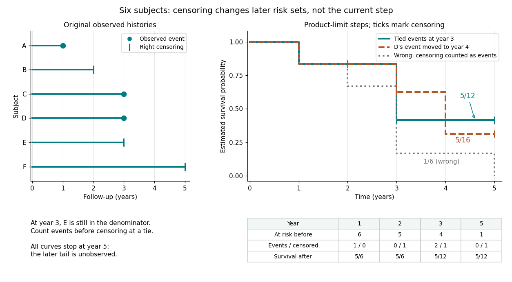

# Survival analysis

↑ **Parent:** [Probability and statistics](probability-and-statistics.md)  
ⓦ [Wiki](https://en.wikipedia.org/wiki/Survival_analysis)

[Survival analysis](survival-analysis.md) studies the [probability distribution](probability-theory.md#probability-distribution) of a [survival time](#survival-time): how long from a specified starting point until a specified occurrence. The occurrence need not be death. It might be a machine's first breakdown, a customer's first renewal, or a person's recovery. The meaning of "survival" is simply that the chosen occurrence has not happened yet. Both the starting point and the outcome must be defined before interpreting a [survival function](#survival-function).

The distinctive difficulty is incomplete observation. A machine still working when observation stops supplies a lower bound on its [survival time](#survival-time), rather than an observed breakdown time. [Right censoring](#right-censoring) lets us retain that information. The [Kaplan–Meier estimator](#kaplan-meier-estimator) estimates a [survival function](#survival-function) using the changing [risk sets](#risk-set), without choosing an [exponential distribution](continuous-probability-distribution.md#exponential-distribution) or another particular [survival distribution](#survival-distribution). A [hazard function](#hazard-function) instead describes the current event rate among those still event-free; its [cumulative hazard](#cumulative-hazard-function) connects those local rates to the whole [survival function](#survival-function).

This framework turns different follow-up lengths into usable evidence about waiting times. It supports questions such as the chance of remaining event-free for another year, or the [restricted mean survival time](#restricted-mean-survival-time) within an observed horizon. Lu Tian's Stanford teaching materials introduce these interpretations in [Survival Distributions, Hazard Functions, Cumulative Hazards, Section 1.1](https://web.stanford.edu/~lutian/coursepdf/unit1.pdf).

**Table of contents**

- [Cure model](#cure-model)
- [Survival data](#survival-data)
- [Relative survival](#relative-survival)
  - [Relative survivor function](#relative-survivor-function)
    - [Risk-set-adjusted relative survivor estimator](#risk-set-adjusted-relative-survivor-estimator)
  - [Excess hazard](#excess-hazard)
  - [Background hazard](#background-hazard)
- [Accelerated failure time model](#accelerated-failure-time-model)
  - [Accelerated life family](#accelerated-life-family)
    - [Negative log-scale counterexample to proportional hazards](#negative-log-scale-counterexample-to-proportional-hazards)
    - [Weibull accelerated-life and proportional-hazards families](#weibull-accelerated-life-and-proportional-hazards-families)
- [Survival prediction calibration](#survival-prediction-calibration)
- [Concordance index](#concordance-index)
- [Within-patient recurrent-event dependence](#within-patient-recurrent-event-dependence)
- [Gap-time recurrent-event model](#gap-time-recurrent-event-model)
- [Start-stop recurrent-event data layout](#start-stop-recurrent-event-data-layout)
  - [Refractory period in recurrent-event analysis](#refractory-period-in-recurrent-event-analysis)
- [Survival time](#survival-time)
  - [Survival distribution](#survival-distribution)
- [Cox–Snell residual](#cox-snell-residual)
  - [Cox–Snell residual survival diagnostic](#cox-snell-residual-survival-diagnostic)
    - [Shared-fit Cox–Snell residuals reproduce the fitted survival curve](#shared-fit-cox-snell-residuals-reproduce-the-fitted-survival-curve)
  - [Modified Cox–Snell residual](#modified-cox-snell-residual)
- [Gompertz distribution](#gompertz-distribution)
- [Survival function](#survival-function)
  - [Mean residual life](#mean-residual-life)
  - [Restricted mean survival time](#restricted-mean-survival-time)
  - [Hazard function](#hazard-function)
    - [Poisson record counts in cumulative hazard coordinates](#poisson-record-counts-in-cumulative-hazard-coordinates)
    - [Discrete hazard](#discrete-hazard)
    - [Population hazard of a survival mixture](#population-hazard-of-a-survival-mixture)
      - [Decreasing population hazard under constant individual hazards](#decreasing-population-hazard-under-constant-individual-hazards)
      - [Survival selection in a heterogeneous population](#survival-selection-in-a-heterogeneous-population)
      - [Hazard derivative for a mixture of exponential distributions](#hazard-derivative-for-a-mixture-of-exponential-distributions)
    - [Cumulative hazard function](#cumulative-hazard-function)
      - [Mean accumulated hazard under independent censoring](#mean-accumulated-hazard-under-independent-censoring)
      - [Mean accumulated hazard before fixed censoring](#mean-accumulated-hazard-before-fixed-censoring)
      - [Cumulative hazard probability transformation](#cumulative-hazard-probability-transformation)
    - [Hazard ratio](#hazard-ratio)
- [Risk set](#risk-set)
  - [At-risk process](#at-risk-process)
- [Survival likelihood](#survival-likelihood)
  - [Additive excess-hazard mixture likelihood](#additive-excess-hazard-mixture-likelihood)
  - [Exponential-rate estimation from censored exposure](#exponential-rate-estimation-from-censored-exposure)
    - [Exponential rate with a small known additive hazard](#exponential-rate-with-a-small-known-additive-hazard)
  - [Likelihood contribution](#likelihood-contribution)
- [Continuous-time multi-state model](#continuous-time-multi-state-model)
  - [Progressive illness-death model](#progressive-illness-death-model)
  - [Aalen–Johansen estimator](#aalen-johansen-estimator)
    - [Cumulative incidence update with tied censoring](#cumulative-incidence-update-with-tied-censoring)
  - [Illness-death model](#illness-death-model)
    - [Expected absorption time in an illness-death model](#expected-absorption-time-in-an-illness-death-model)
  - [Piecewise-constant covariate approximation](#piecewise-constant-covariate-approximation)
  - [Three-state irreversible disease model](#three-state-irreversible-disease-model)
  - [Irreversible three-state disease model](#irreversible-three-state-disease-model)
    - [Frozen-age approximation in a multi-state model](#frozen-age-approximation-in-a-multi-state-model)
  - [Transition intensity](#transition-intensity)
    - [Log-linear transition intensity model](#log-linear-transition-intensity-model)
  - [Semi-Markov multi-state model](#semi-markov-multi-state-model)
  - [Fundamental matrix of an absorbing continuous-time Markov chain](#fundamental-matrix-of-an-absorbing-continuous-time-markov-chain)
  - [Panel-observed multi-state likelihood](#panel-observed-multi-state-likelihood)
    - [Mixed panel and exact-death likelihood](#mixed-panel-and-exact-death-likelihood)
- [Censoring (statistics)](#censoring-statistics)
  - [Informative censoring](#informative-censoring)
    - [Outcome-dependent updating of survival follow-up](#outcome-dependent-updating-of-survival-follow-up)
  - [Right censoring](#right-censoring)
  - [Independent censoring](#independent-censoring)
    - [Random relabelling is not independent right censoring](#random-relabelling-is-not-independent-right-censoring)
    - [Exponential mean imputation under independent censoring](#exponential-mean-imputation-under-independent-censoring)
    - [Administrative censoring](#administrative-censoring)
      - [Cohort pooling under administrative censoring](#cohort-pooling-under-administrative-censoring)
      - [Administrative censoring with uniform entry](#administrative-censoring-with-uniform-entry)
  - [Left censoring](#left-censoring)
  - [Interval censoring](#interval-censoring)
  - [Doubly censored data](#doubly-censored-data)
- [Log-rank test](#log-rank-test)
  - [Log-rank statistic](#log-rank-statistic)
    - [Stratified log-rank statistic](#stratified-log-rank-statistic)
      - [Paired log-rank reduction to a sign test](#paired-log-rank-reduction-to-a-sign-test)
  - [Log-rank weight](#log-rank-weight)
- [Proportional hazards model](#proportional-hazards-model)
  - [Baseline survival function](#baseline-survival-function)
  - [Grouped proportional-hazards model](#grouped-proportional-hazards-model)
  - [Hazard multiplier](#hazard-multiplier)
  - [Baseline hazard](#baseline-hazard)
  - [Proportional hazards family](#proportional-hazards-family)
  - [Poisson surrogate for an uncensored proportional-hazards likelihood](#poisson-surrogate-for-an-uncensored-proportional-hazards-likelihood)
  - [Semiparametric proportional hazards model](#semiparametric-proportional-hazards-model)
- [Immortal time bias](#immortal-time-bias)
- [Landmark analysis](#landmark-analysis)
- [Time-dependent covariate](#time-dependent-covariate)
- [Frailty model](#frailty-model)
  - [Shared frailty model](#shared-frailty-model)
  - [Frailty random variable](#frailty-random-variable)
  - [Proportional frailty model](#proportional-frailty-model)
    - [Gamma frailty hazard ratio](#gamma-frailty-hazard-ratio)
    - [Uniform frailty survival mixture](#uniform-frailty-survival-mixture)
    - [Frailty distribution among survivors](#frailty-distribution-among-survivors)
      - [Population hazard under exponential frailty](#population-hazard-under-exponential-frailty)
- [Person-time](#person-time)
  - [Person-time at risk](#person-time-at-risk)
- [Competing risks](#competing-risks)
  - [Net survival](#net-survival)
  - [Competing risks model](#competing-risks-model)
    - [EM algorithm for a censored lognormal competing-risks mixture](#em-algorithm-for-a-censored-lognormal-competing-risks-mixture)
    - [Competing risks model with transient surgical mortality](#competing-risks-model-with-transient-surgical-mortality)
    - [Event type is independent of first time in exponential competing risks](#event-type-is-independent-of-first-time-in-exponential-competing-risks)
      - [Death-only rate correction under exponential censoring](#death-only-rate-correction-under-exponential-censoring)
    - [Conditional latent event-time density under competing risks](#conditional-latent-event-time-density-under-competing-risks)
    - [Cause-specific hazard](#cause-specific-hazard)
    - [Cumulative incidence function](#cumulative-incidence-function)
      - [Cause-specific hazard to cumulative incidence formula](#cause-specific-hazard-to-cumulative-incidence-formula)
- [Partial likelihood](#partial-likelihood)
  - [Partial likelihood-ratio test](#partial-likelihood-ratio-test)
- [Cox proportional-hazards model](#cox-proportional-hazards-model)
  - [Cox–Snell likelihood pseudo-R-squared](#cox-snell-likelihood-pseudo-r-squared)
  - [Schoenfeld function](#schoenfeld-function)
    - [Schoenfeld function for a three-person binary risk set](#schoenfeld-function-for-a-three-person-binary-risk-set)
  - [Proportional hazards assumption test](#proportional-hazards-assumption-test)
    - [Proportional-hazards time interaction](#proportional-hazards-time-interaction)
  - [Schoenfeld residual](#schoenfeld-residual)
    - [Scaled Schoenfeld residual](#scaled-schoenfeld-residual)
  - [Cox partial likelihood](#cox-partial-likelihood)
    - [Score and information of Cox partial likelihood](#score-and-information-of-cox-partial-likelihood)
    - [Exact tied-set conditional likelihood](#exact-tied-set-conditional-likelihood)
    - [Efron approximation for tied event times](#efron-approximation-for-tied-event-times)
    - [Breslow approximation for tied event times](#breslow-approximation-for-tied-event-times)
    - [Cox rank-likelihood deletion consistency](#cox-rank-likelihood-deletion-consistency)
  - [Breslow estimator](#breslow-estimator)
  - [Stratified Cox model](#stratified-cox-model)
    - [First-event versus recurrent-event baseline stratification](#first-event-versus-recurrent-event-baseline-stratification)
    - [Stratum](#stratum)
- [Truncation (statistics)](#truncation-statistics)
  - [Left truncation](#left-truncation)
- [Kaplan–Meier estimator](#kaplan-meier-estimator)
  - [Kaplan–Meier six-subject cohort](#kaplan-meier-six-subject-cohort)
  - [Kaplan–Meier median survival time](#kaplan-meier-median-survival-time)
  - [Constrained Kaplan–Meier estimator](#constrained-kaplan-meier-estimator)
  - [Kaplan–Meier telescoping across a censor-free interval](#kaplan-meier-telescoping-across-a-censor-free-interval)
  - [Greenwood formula](#greenwood-formula)
  - [Kaplan–Meier estimator with delayed entry](#kaplan-meier-estimator-with-delayed-entry)
  - [Self-consistency of Kaplan–Meier estimation](#self-consistency-of-kaplan-meier-estimation)
  - [Fractional event imputation](#fractional-event-imputation)
  - [Terminal censoring and survival-mean identifiability](#terminal-censoring-and-survival-mean-identifiability)
  - [Potential right-censoring time](#potential-right-censoring-time)
  - [Potential event time](#potential-event-time)
- [Nelson–Aalen estimator](#nelson-aalen-estimator)
  - [Small-jump comparison of cumulative hazard estimators](#small-jump-comparison-of-cumulative-hazard-estimators)
  - [Offset-adjusted cumulative hazard estimator](#offset-adjusted-cumulative-hazard-estimator)
  - [Event-count identity for Nelson–Aalen cumulative hazards](#event-count-identity-for-nelson-aalen-cumulative-hazards)
    - [Grouped Nelson–Aalen event-count identity](#grouped-nelson-aalen-event-count-identity)
  - [Nelson–Aalen variance estimator](#nelson-aalen-variance-estimator)
  - [Finite-sample bias of Nelson–Aalen estimation](#finite-sample-bias-of-nelson-aalen-estimation)
- [Martingale residual](#martingale-residual)
  - [Terminal-observation invariance of Cox martingale residuals](#terminal-observation-invariance-of-cox-martingale-residuals)
  - [Zero sum of Cox martingale residuals](#zero-sum-of-cox-martingale-residuals)
- [Period survival analysis](#period-survival-analysis)
- [Constant hazard survival model](#constant-hazard-survival-model)
  - [Exponential survival risk over an interval](#exponential-survival-risk-over-an-interval)
  - [Events divided by exposure estimator](#events-divided-by-exposure-estimator)
- [Piecewise-exponential survival model](#piecewise-exponential-survival-model)
  - [Piecewise-exponential mortality comparison](#piecewise-exponential-mortality-comparison)

## Cure model

↑ **Parent:** [Survival analysis](survival-analysis.md)

A [cure model](#cure-model) mixes an individual class with identically zero [hazard function](#hazard-function) and a susceptible class with [survivor function](#survival-function) $S_*$. For $0\leq\pi<1$, its representation as a [proportional frailty model](#proportional-frailty-model) with $\mathbb E U=1$ is $U=0$ with probability $\pi$ and $U=1/(1-\pi)$ otherwise, with [baseline hazard](#baseline-hazard) $h_0=(1-\pi)h_*$. The frailty law is a mixture of two [Dirac measures](measure-theory.md#dirac-measure), rather than an ordinary density. Its [Laplace transform](analysis.md#laplace-transform) evaluated at $H_0$ gives the displayed [survivor function](#survival-function). The limiting survival equals $\pi$ when $S_*(t)\to0$; otherwise the plateau also includes susceptible individuals who never experience the event.

## Survival data

↑ **Parent:** [Survival analysis](survival-analysis.md)

[Survival data](#survival-data) describe the time $T$ from a specified origin to an event, together with [covariates](statistical-model.md#covariate) and the observation mechanism. Under [right censoring](#right-censoring), the observed exit time is $Y=\min(T,C)$ and the event indicator is $\delta=\mathbf1_{\{T\le C\}}$. With [left truncation](#left-truncation), an entry time $E$ is also recorded and subjects are observed only if $T>E$. Recording the time origin, entry, exit and event indicator is essential for constructing valid [risk sets](#risk-set).

## Relative survival

↑ **Parent:** [Survival analysis](survival-analysis.md)

[Relative survival](#relative-survival) compares observed survival in a diseased cohort with expected survival derived from a suitable reference population. A useful individual model adds a known background mortality hazard to a common [excess hazard](#excess-hazard). Reference mortality can depend on age, sex and calendar time. The comparison avoids classifying each death by cause, but its interpretation depends on the reference population being appropriate. An excess-survival ratio is not automatically the effect of a causal intervention removing one cause of death.

### Relative survivor function

↑ **Parent:** [Relative survival](#relative-survival)

Under the additive [hazard function](#hazard-function) model $h^{(i)}=h_B^{(i)}+h_E$, the [survivor function](#survival-function) factorization gives $F_E=F^{(i)}/F_B^{(i)}$, independently of $i$. If the [excess hazard](#excess-hazard) is nonnegative, this has a survival-probability interpretation for a hypothetical process with just that hazard. If [excess hazards](#excess-hazard) are negative, [relative survival](#relative-survival) can exceed one and is a comparison ratio rather than an ordinary [survivor function](#survival-function).

#### Risk-set-adjusted relative survivor estimator

↑ **Parent:** [Relative survivor function](#relative-survivor-function)

With a common [excess hazard](#excess-hazard), let $\overline h_B=\sum_iY_i h_B^{(i)}/\sum_iY_i$ be the known [background hazard](#background-hazard) averaged over the current [risk set](#risk-set). Estimate the excess [cumulative hazard](#cumulative-hazard-function) by subtracting $\int\overline h_B$ from the [Nelson–Aalen estimator](#nelson-aalen-estimator). Applying the product-limit construction gives the displayed estimator: the continuous background correction multiplies the ordinary [Kaplan–Meier estimator](#kaplan-meier-estimator). Its event jump is $1-d_j/r_j$, while between events it grows at rate $\overline h_B\widehat F_E$. Hence the unconstrained curve can increase, even if the true [excess hazard](#excess-hazard) is nonnegative. Replacing its jump factor by $\exp(-d_j/r_j)$ gives the alternative exponential cumulative-hazard estimator; these versions are close for small event fractions but are not identical.

### Excess hazard

↑ **Parent:** [Relative survival](#relative-survival)

An [excess hazard](#excess-hazard) measures mortality above the [background hazard](#background-hazard). When it is common across individuals, each observed [survivor function](#survival-function) factors into its individual background [survivor function](#survival-function) and a common [relative survivor function](#relative-survivor-function). A nonnegative [excess hazard](#excess-hazard) gives a nonincreasing [relative survivor function](#relative-survivor-function); a negative [excess hazard](#excess-hazard) can instead reflect better survival than expected in the reference population.

### Background hazard

↑ **Parent:** [Relative survival](#relative-survival)

In [relative survival](#relative-survival), the [background hazard](#background-hazard) is an individual's expected mortality hazard in a suitable reference population. Its dependence on age, sex and calendar time can be obtained from population life tables. In a heterogeneous cohort, estimating a common [excess hazard](#excess-hazard) requires averaging these known [background hazards](#background-hazard) over the current [risk set](#risk-set), rather than over the original cohort.

## Accelerated failure time model

↑ **Parent:** [Survival analysis](survival-analysis.md)  
ⓦ [Wiki](https://en.wikipedia.org/wiki/Accelerated_failure_time_model)

An accelerated failure time model changes the time scale of a common event-time distribution. In a log-location-scale representation, $T_z=e^{\mu(z)}e^{\sigma X}$ with common $X$ and positive scale $\sigma$. An additive change in $\mu(z)$ multiplies all time [quantiles](probability-theory.md#quantile-function) by the same factor. A larger time multiplier indicates longer survival, whereas a larger [hazard multiplier](#hazard-multiplier) in a [proportional hazards model](#proportional-hazards-model) indicates faster failure.

### Accelerated life family

↑ **Parent:** [Accelerated failure time model](#accelerated-failure-time-model)

An accelerated life family consists of [survival distributions](#survival-distribution) related by positive time scaling: $T_z$ has the distribution of $c_zT_0$. Therefore the [survivor function](#survival-function) is $S_z(t)=S_0(t/c_z)$ and, for densities, the [hazard function](#hazard-function) is $h_z(t)=c_z^{-1}h_0(t/c_z)$. This need not be a constant hazard ratio.

#### Negative log-scale counterexample to proportional hazards

↑ **Parent:** [Accelerated life family](#accelerated-life-family)

For $\log T_z=bz-X$, with $e^X$ unit [exponential distribution](continuous-probability-distribution.md#exponential-distribution) and $b=\log2$, the [survivor functions](#survival-function) are $S_z(t)=1-e^{-2^z/t}$ for $t>0$. These are time-scaled [Fréchet distributions](probability-theory.md#frechet-distribution), so they form an [accelerated life family](#accelerated-life-family). However their [hazard ratio](#hazard-ratio) is $2/(e^{1/t}+1)$, tending to zero as $t\downarrow0$ and to one as $t\to\infty$. It is not constant. Thus a positive-scale assumption matters when deriving a [proportional hazards family](#proportional-hazards-family) from the usual log-location-scale model.

#### Weibull accelerated-life and proportional-hazards families

↑ **Parent:** [Accelerated life family](#accelerated-life-family)

[Weibull distributions](probability-theory.md#weibull-distribution) with a common shape $k>0$ form both an [accelerated life family](#accelerated-life-family) and a [proportional hazards family](#proportional-hazards-family). Their [hazard functions](#hazard-function) are $h_z(t)=k\lambda_z t^{k-1}$, whose ratio is $\lambda_z/\lambda_0$. Their time multiplier is $(\lambda_0/\lambda_z)^{1/k}$. In the representation $\log T_z=a+bz+cX$ with $c>0$ and density $e^{x-e^x}$ for $X$, the parameters are $k=1/c$ and $\lambda_z=e^{-(a+bz)/c}$, giving time multiplier $e^{bz}$ and hazard multiplier $e^{-bz/c}$.

## Survival prediction calibration

↑ **Parent:** [Survival analysis](survival-analysis.md)

Calibration compares predicted survival [probabilities](probability-theory.md#probability) with observed survival experience at relevant horizons or over time. Censoring must be handled, for example by suitable survival estimates or inverse-[probability](probability-theory.md#probability) weighting. Calibration should be assessed on validated predictions, because the fitting sample can hide optimism from variable selection and tuning. It is distinct from the risk-ranking information measured by a [concordance index](#concordance-index).

## Concordance index

↑ **Parent:** [Survival analysis](survival-analysis.md)

A survival [concordance index](#concordance-index) measures agreement between predicted risk ordering and observed event ordering over comparable subject pairs, with half credit for prediction ties. A pair is ordinarily comparable when the earlier observed follow-up ends in an event. Censoring-adjusted versions can reduce dependence on follow-up patterns. Good discrimination does not imply good [survival prediction calibration](#survival-prediction-calibration) or correct proportional hazards.

## Within-patient recurrent-event dependence

↑ **Parent:** [Survival analysis](survival-analysis.md)

Repeated episodes from one person share susceptibility, treatment and history, so row-wise [independence](random-variable.md#independent-random-variables) is generally inappropriate. Patient-clustered [sandwich covariance matrices](statistical-inference.md#sandwich-covariance-matrix) estimate uncertainty using whole-patient score contributions under a suitable working model. [Shared frailty models](#shared-frailty-model) instead model persistent latent heterogeneity. These methods require independent sampling units at the patient level and do not necessarily estimate the same marginal versus conditional effect.

## Gap-time recurrent-event model

↑ **Parent:** [Survival analysis](survival-analysis.md)

A gap-time model uses time since the previous recurrence as the episode clock, instead of calendar time since treatment or study entry. Subtract the previous event time from both interval endpoints. Eligibility restrictions become delayed gap entry, and patient/episode labels preserve the actual order of recurrent events. Risk sets on this clock compare eligible episodes of a common gap age, not patients at one common calendar time.

## Start-stop recurrent-event data layout

↑ **Parent:** [Survival analysis](survival-analysis.md)

Represent each person's successive eligible episodes by separate left-open, right-closed intervals, retaining a common patient identifier and event-order information. A recurrence ends an interval and can be followed by another one; administrative censoring ends the final interval without an event. The row's entry time determines [risk set](#risk-set) membership. Multiple rows remain one patient history, with possible [within-patient recurrent-event dependence](#within-patient-recurrent-event-dependence).

### Refractory period in recurrent-event analysis

↑ **Parent:** [Start-stop recurrent-event data layout](#start-stop-recurrent-event-data-layout)

A refractory period makes a patient ineligible for another event for a fixed time $r$ after a recurrence. Exclude this time from exposure and [risk sets](#risk-set) by delaying the next interval's entry to $t_k+r$. In a [gap-time recurrent-event model](#gap-time-recurrent-event-model) measured from the previous event, the next interval enters at gap age $r$, not zero; the clock is not reset at the end of recovery.

## Survival time

↑ **Parent:** [Survival analysis](survival-analysis.md)

A survival time is the elapsed time to an event of interest, which may be death, failure, recovery or completion of a task. Its [survival function](#survival-function) and [hazard function](#hazard-function) describe the event-time law. [Right censoring](#right-censoring) records only that the event time exceeds the observed follow-up time.

### Survival distribution

↑ **Parent:** [Survival time](#survival-time)

A survival distribution is the [probability distribution](probability-theory.md#probability-distribution) of an event or failure time, commonly summarized by its [survivor function](#survival-function), [hazard function](#hazard-function) or [cumulative hazard function](#cumulative-hazard-function). It may contain atoms or a positive probability of an event never occurring; an ordinary density-based hazard therefore need not describe every survival distribution.

<h2 id="cox-snell-residual">Cox–Snell residual</h2>

↑ **Parent:** [Survival analysis](survival-analysis.md)

A [Cox–Snell residual](#cox-snell-residual) is the fitted [cumulative hazard function](#cumulative-hazard-function) evaluated at an observed event or censoring time. Under a correct model, complete transformed event times are unit exponential; censored transformed times retain their event indicators. A logarithmic [Kaplan–Meier estimator](#kaplan-meier-estimator) survivor plot should be close to a line of slope minus one.

<h3 id="cox-snell-residual-survival-diagnostic">Cox–Snell residual survival diagnostic</h3>

↑ **Parent:** [Cox–Snell residual](#cox-snell-residual)

For a correct fitted survival law, complete [Cox–Snell residuals](#cox-snell-residual) are approximately unit exponential. Residuals computed at observed censored times retain their censoring indicators. Fit a [Kaplan–Meier estimator](#kaplan-meier-estimator) to the transformed times and indicators and compare it with $e^{-r}$, or compare their [Nelson–Aalen estimator](#nelson-aalen-estimator) cumulative hazard with $r$. Treating censored transformed times as complete exponential observations gives a distorted Q–Q check.

<h4 id="shared-fit-cox-snell-residuals-reproduce-the-fitted-survival-curve">Shared-fit Cox–Snell residuals reproduce the fitted survival curve</h4>

↑ **Parent:** [Cox–Snell residual survival diagnostic](#cox-snell-residual-survival-diagnostic)

If a common [Kaplan–Meier estimator](#kaplan-meier-estimator) $\widehat S$ is fitted and the same data are transformed to $u_i=-\log\widehat S(x_i)$ with censoring indicators retained, event ordering and risk sets are preserved under compatible tie conventions. At a transformed event time $u_j$, the residual product-limit estimate equals $\widehat S(x_j)=e^{-u_j}$. Consequently agreement of the pooled residual curve with the exponential target is largely built into the construction. Separate group curves or a model fitted with covariates can reveal differences concealed by the pooled fit. Residuals become infinite if the fitted survivor reaches zero.

// Target: survival-analysis.bigb

<h3 id="modified-cox-snell-residual">Modified Cox–Snell residual</h3>

↑ **Parent:** [Cox–Snell residual](#cox-snell-residual)

For an observed transformed time $Y=H(\min(T,C))$ and event indicator $\Delta$, the correction $Y^*=Y+1-\Delta$ has mean one under [independent censoring](#independent-censoring). Its complement $1-Y^*=\Delta-Y$ is the corresponding [martingale residual](#martingale-residual).

## Gompertz distribution

↑ **Parent:** [Survival analysis](survival-analysis.md)  
ⓦ [Wiki](https://en.wikipedia.org/wiki/Gompertz_distribution)

A positive, exponentially increasing [hazard function](#hazard-function) $h(t)=qe^{\beta t}$ gives the [survivor function](#survival-function)

$$
S(t)=\exp\!\left[-\frac q\beta(e^{\beta t}-1)\right],\qquad q,\beta>0.
$$

Its mean is $\beta^{-1}e^{q/\beta}E_1(q/\beta)$, where $E_1$ is the [exponential integral](complex-analysis.md#exponential-integral). Unlike the [exponential distribution](continuous-probability-distribution.md#exponential-distribution), its future mean waiting time is not the reciprocal of its current [hazard function](#hazard-function).

## Survival function

↑ **Parent:** [Survival analysis](survival-analysis.md)  
ⓦ [Wiki](https://en.wikipedia.org/wiki/Survival_function)

For a nonnegative [survival time](#survival-time) $T$, the [survival function](#survival-function) is

$$
S(t)=\mathbb P(T>t)=1-F(t),\qquad F(t)=\mathbb P(T\leq t),
$$

where $F$ is the [cumulative distribution function](probability-theory.md#cumulative-distribution-function). Thus $S(t)$ is the [probability](probability-theory.md#probability) that the chosen occurrence is still in the future at time $t$. We consistently use the strict inequality $T>t$: a [probability mass](probability-theory.md#probability-mass) at $t$ has already left the [survival function](#survival-function) at $t$ itself. With this convention $S$ is a [right-continuous function](calculus.md#right-continuous-function) and a [nonincreasing function](calculus.md#nonincreasing-function) taking values in $[0,1]$. If $\mathbb P(T=0)=0$, then $S(0)=1$; if $T$ is finite with [probability](probability-theory.md#probability) one, then $S(t)\to0$ as $t\to\infty$.

For $S(a)>0$ and $b>a$, [conditional probability](probability-theory.md#conditional-probability) gives

$$
\mathbb P(T>b\mid T>a)=\frac{S(b)}{S(a)},\qquad
\mathbb P(a<T\leq b\mid T>a)=1-\frac{S(b)}{S(a)}.
$$

For example, $S(2)=0.8$ and $S(5)=0.6$ mean that $0.6/0.8=0.75$ of those still event-free at year two remain event-free through year five. Their intervening event [probability](probability-theory.md#probability) is $0.25$, whereas the original population's [probability](probability-theory.md#probability) of an occurrence in $(2,5]$ is $0.8-0.6=0.2$. Conditioning changes the denominator.

The area under the [survival function](#survival-function) up to a horizon gives the [restricted mean survival time](#restricted-mean-survival-time). A positive terminal plateau in a plotted [Kaplan–Meier estimator](#kaplan-meier-estimator) does not establish that the occurrence will never happen: [terminal censoring and survival-mean identifiability](#terminal-censoring-and-survival-mean-identifiability) explains why the unobserved tail remains undetermined.

### Mean residual life

↑ **Parent:** [Survival function](#survival-function)

For a nonnegative [random variable](random-variable.md) with finite [expected value](probability-theory.md#expected-value) and $\mathbb P(X>t)>0$, its mean residual life is the remaining conditional [expected value](probability-theory.md#expected-value) after surviving past $t$. The [tail integral formula for moments](probability-theory.md#tail-integral-formula-for-moments) gives $m_X(t)=\int_t^\infty\mathbb P(X>x)\,dx/\mathbb P(X>t)$. The [exponential distribution](continuous-probability-distribution.md#exponential-distribution) has constant mean residual life, equal to its original mean. In [excess of loss reinsurance](actuarial-statistics.md#excess-of-loss-reinsurance), the [total variance stationary condition for excess of loss](actuarial-statistics.md#total-variance-stationary-condition-for-excess-of-loss) sets a candidate retention equal to this quantity.

### Restricted mean survival time

↑ **Parent:** [Survival function](#survival-function)

The restricted mean survival time to a fixed cutoff $\tau$ is $\mathbb E[\min(T,\tau)]=\int_0^\tau S(t)\,dt$ for a nonnegative event time. This follows by the [tail integral formula for moments](probability-theory.md#tail-integral-formula-for-moments). Unlike the unrestricted mean, it uses no tail beyond $\tau$; under [independent censoring](#independent-censoring) it can be estimated by integrating a [Kaplan–Meier estimator](#kaplan-meier-estimator) over adequately observed follow-up.

### Hazard function

↑ **Parent:** [Survival function](#survival-function)  
ⓦ [Wiki](https://en.wikipedia.org/wiki/Hazard_function)

For a [survival time](#survival-time) with an [absolutely continuous probability distribution](continuous-probability-distribution.md#absolutely-continuous-probability-distribution), [probability density function](continuous-probability-distribution.md#probability-density-function) $f$, and [survival function](#survival-function) $S$, the [hazard function](#hazard-function) is

$$
h(t)=\frac{f(t)}{S(t)}=-\frac{S'(t)}{S(t)}
$$

where $S(t)>0$, with the [derivative](calculus.md#derivative) identity holding [almost everywhere](measure-theory.md#almost-everywhere). At points where the local limit exists, equivalently

$$
h(t)=\lim_{\Delta\downarrow0}\frac{\mathbb P(t<T\leq t+\Delta\mid T>t)}{\Delta}.
$$

The [hazard function](#hazard-function) measures an instantaneous conditional rate. If time is in years, its units are inverse years, and its value can exceed one. A [probability](probability-theory.md#probability) for a short [interval](real-analysis.md#interval-mathematics) is approximately $h(t)\Delta$, not $h(t)$; for an [absolutely continuous probability distribution](continuous-probability-distribution.md#absolutely-continuous-probability-distribution), the [probability](probability-theory.md#probability) of an occurrence at the single exact time $t$ is zero. The [discrete hazard](#discrete-hazard), by contrast, is a conditional [probability](probability-theory.md#probability) at a possible event time.

The factorization $f(t)=h(t)S(t)$ distinguishes a [probability density function](continuous-probability-distribution.md#probability-density-function) for the original population from a [hazard function](#hazard-function) for those still event-free. With an [exponential distribution](continuous-probability-distribution.md#exponential-distribution) of rate $0.2$ per year, $h(5)=0.2$ per year but $f(5)=0.2e^{-1}\approx0.073576$ per year: the latter also accounts for the [probability](probability-theory.md#probability) of reaching year five. The [exponential survival risk over an interval](#exponential-survival-risk-over-an-interval) example computes finite-horizon [probabilities](probability-theory.md#probability) from this rate.

#### Poisson record counts in cumulative hazard coordinates

↑ **Parent:** [Hazard function](#hazard-function)

Upper records of iid observations with a continuous distribution have transition density $f(w)/(1-F(v))$ above the latest record $v$. Consequently the cumulative hazard $\Lambda(v)=-\log(1-F(v))$ transforms consecutive record increments into independent unit exponentials. Record counts below a level $t$ with $F(t)<1$ are therefore Poisson with mean $\Lambda(t)$. Set the count to zero if the first record exceeds the level. At a finite upper endpoint with $F(t)=1$, the count is infinite instead of a finite-mean Poisson variable.

#### Discrete hazard

↑ **Parent:** [Hazard function](#hazard-function)

At ordered possible failure times $t_j$, the [discrete hazard](#discrete-hazard) is $h_j=\mathbb P(T=t_j\mid T>t_{j-1})$. Its [survival function](#survival-function) satisfies $S(t_j)=S(t_{j-1})(1-h_j)$, and hence $S(t)=\prod_{t_j\le t}(1-h_j)$. Estimating $h_j$ by the observed number of failures divided by the [risk set](#risk-set) size under [independent censoring](#independent-censoring) yields the [Kaplan–Meier estimator](#kaplan-meier-estimator). Unlike a continuous-time hazard rate, a [discrete hazard](#discrete-hazard) is a probability between zero and one.

#### Population hazard of a survival mixture

↑ **Parent:** [Hazard function](#hazard-function)

For an equally weighted mixture of individual [survivor functions](#survival-function) $F_i$, the population [hazard function](#hazard-function) is $\overline h(t)=\sum_i F_i(t)h_i(t)/\sum_i F_i(t)$. Thus the weights are the surviving proportions, and the [cumulative hazard function](#cumulative-hazard-function) is $-\log(n^{-1}\sum_i e^{-H_i(t)})$, not generally the mean individual integrated hazard.

##### Decreasing population hazard under constant individual hazards

↑ **Parent:** [Population hazard of a survival mixture](#population-hazard-of-a-survival-mixture)

For a nonnegative random constant individual hazard $\Lambda$, write $M_k(t)=\mathbb E[\Lambda^ke^{-\Lambda t}]$. The population survivor function is $M_0$ and its hazard is $M_1/M_0$. Under the integrability needed to differentiate, $M_k'=-M_{k+1}$, so

$$
\overline h'=\frac{-M_2M_0+M_1^2}{M_0^2}=-\operatorname{Var}(\Lambda\mid T>t).
$$

The conditional distribution is weighted by $e^{-\Lambda t}$. This proves decreasing population hazard without any decrease in individual hazards and explains [survival selection in a heterogeneous population](#survival-selection-in-a-heterogeneous-population).

##### Survival selection in a heterogeneous population

↑ **Parent:** [Population hazard of a survival mixture](#population-hazard-of-a-survival-mixture)

In a population mixture with initial component probabilities $p_i$, conditioning on survival to time $t$ changes them to the displayed probabilities by [Bayes' theorem](probability-theory.md#bayes-theorem). Components with larger [survivor functions](#survival-function) receive greater relative weight among survivors. The population [hazard function](#hazard-function) is the weighted mean of the component hazards with these time-dependent weights. This selection can change the population hazard even when all component hazards are constant, as shown by the [hazard derivative for a mixture of exponential distributions](#hazard-derivative-for-a-mixture-of-exponential-distributions).

##### Hazard derivative for a mixture of exponential distributions

↑ **Parent:** [Population hazard of a survival mixture](#population-hazard-of-a-survival-mixture)

For a finite mixture with positive weights $p_i$ and rates $\lambda_i>0$, the [survivor function](#survival-function) is $S(t)=\sum_i p_i e^{-\lambda_i t}$ and the [hazard function](#hazard-function) is the surviving-population mean of the component rates. Write $w_i(t)=p_i e^{-\lambda_i t}/S(t)$. Differentiation gives $w_i'=w_i(h-\lambda_i)$ and therefore $h'=h^2-\sum_iw_i\lambda_i^2=-\operatorname{Var}(\Lambda\mid T>t)$. The hazard is decreasing, strictly so when distinct rates have positive weights. For finitely many rates it tends to the smallest rate with positive weight. This is [survival selection](#survival-selection-in-a-heterogeneous-population) even though each individual component has a constant hazard.

#### Cumulative hazard function

↑ **Parent:** [Hazard function](#hazard-function)

Suppose $T\geq0$ has an [absolutely continuous probability distribution](continuous-probability-distribution.md#absolutely-continuous-probability-distribution), with [survival function](#survival-function) $S(0)=1$. On an [interval](real-analysis.md#interval-mathematics) where $S(t)>0$, its [cumulative hazard](#cumulative-hazard-function) is

$$
H(t)=\int_0^t h(u)\,du=-\log S(t),\qquad
S(t)=e^{-H(t)}.
$$

Here $h$ is the [hazard function](#hazard-function); its [integral](calculus.md#integral) is dimensionless because the units of rate and time cancel. The identity follows by integrating the [derivative](calculus.md#derivative) of $\log S$, so mere [continuity](calculus.md#continuous-function) of the [survival function](#survival-function) is not enough: the [absolute continuity](sobolev-space.md#absolutely-continuous-function) assumption supplies a [probability density function](continuous-probability-distribution.md#probability-density-function). If $S$ reaches zero, interpret $-\log S$ as $+\infty$. The normalization $S(0)=1$ also matters; an initial [probability mass](probability-theory.md#probability-mass) at zero would require an initial term $-\log S(0)$.

Accumulating [hazard functions](#hazard-function) adds on the $H$ scale and multiplies survival factors on the $S$ scale. For $S(a)>0$ and $b>a$,

$$
\mathbb P(a<T\leq b\mid T>a)=1-e^{-[H(b)-H(a)]}.
$$

For instance, a [cumulative hazard](#cumulative-hazard-function) increment of $2$ gives event [probability](probability-theory.md#probability) $1-e^{-2}\approx0.864665$, rather than a [probability](probability-theory.md#probability) of $2$. With $h(t)=0.2$ per year, $H(5)=1$ and $S(5)=e^{-1}\approx0.367879$. With the increasing [hazard function](#hazard-function) $h(t)=0.04t$ per year when $t$ is expressed in years, $H(t)=0.02t^2$, so $H(5)=0.5$ gives $S(5)=e^{-0.5}\approx0.606531$. Its coefficient has units of inverse years squared.

**[Figure 1](#image-constant-and-increasing-hazard-functions-their-cumulative-hazards-and-their-survival-functions). Constant and increasing hazard functions, their cumulative hazards, and their survival functions**.

The constant [hazard function](#hazard-function) produces an [exponential distribution](continuous-probability-distribution.md#exponential-distribution); the increasing example is a [Weibull distribution](probability-theory.md#weibull-distribution). Their [survival functions](#survival-function) both decrease, although one [hazard function](#hazard-function) stays constant and the other increases. At year ten both have $H(10)=2$ and $S(10)=e^{-2}$ despite different earlier histories. The accumulation identity is described in [Lu Tian's Stanford notes, Section 1.1](https://web.stanford.edu/~lutian/coursepdf/unit1.pdf).

For a [discrete hazard](#discrete-hazard) $q_j$ at each possible event time $t_j$, the exact counterpart is $S(t)=\prod_{t_j\leq t}(1-q_j)$. Taking its negative [logarithm](calculus.md#logarithm) sums $-\log(1-q_j)$, rather than $q_j$. Therefore exponentiating a [Nelson–Aalen estimator](#nelson-aalen-estimator) does not give exactly the [Kaplan–Meier estimator](#kaplan-meier-estimator); [small-jump comparison of cumulative hazard estimators](#small-jump-comparison-of-cumulative-hazard-estimators) quantifies the difference.

##### Mean accumulated hazard under independent censoring

↑ **Parent:** [Cumulative hazard function](#cumulative-hazard-function)

Let $X=\min(T,C)$, $V=\mathbf1_{\{T\leq C\}}$, and suppose $T$ and $C$ are independent, with continuous failure density $f=hS$. Then the [Tonelli theorem](measure-theory.md#tonelli-theorem) gives

$$
\mathbb E H(X)=\int_0^\infty h(t)S(t)\mathbb P(C\geq t)dt=\mathbb P(T\leq C)=\mathbb EV.
$$

Thus $V-H(X)$ has mean zero. The identity also holds conditionally on covariates when censoring is independent conditionally on them. For an estimated hazard, the mean error is controlled by $\mathbb E|\widehat H(X)-H(X)|$, not by pointwise fit alone.

// Target: survival-analysis.bigb

##### Mean accumulated hazard before fixed censoring

↑ **Parent:** [Cumulative hazard function](#cumulative-hazard-function)

For a nonnegative continuous event time with [survival function](#survival-function) S, [hazard function](#hazard-function) h and H the [cumulative hazard](#cumulative-hazard-function), split the expectation at c. The censored contribution is S(c)H(c). The event contribution is $\int_0^cH(t)f(t)dt=1-S(c)-S(c)H(c)$ by [integration by parts](calculus.md#integration-by-parts), since $dH=hdt$ and $f=hS$. Adding gives the displayed identity. Linearity extends it to the expected observed event count in a cohort, without requiring independence between subjects.

##### Cumulative hazard probability transformation

↑ **Parent:** [Cumulative hazard function](#cumulative-hazard-function)

For a proper continuous event time and invertible [cumulative hazard function](#cumulative-hazard-function) $H$, the [survivor function](#survival-function) identity $F(t)=e^{-H(t)}$ gives $H(T)\sim\operatorname{Exp}(1)$.

#### Hazard ratio

↑ **Parent:** [Hazard function](#hazard-function)  
ⓦ [Wiki](https://en.wikipedia.org/wiki/Hazard_ratio)

A hazard ratio compares two hazard functions at the same time. Under proportional hazards it is constant in time.

## Risk set

↑ **Parent:** [Survival analysis](survival-analysis.md)

The [risk set](#risk-set) immediately before an event time contains the individuals who remain observed, event-free, and eligible to experience the event. For a cohort observed from time zero, with exit times $Y_i=\min(T_i,C_i)$ under [right censoring](#right-censoring), write $R_j=\{i:Y_i\geq t_j\}$ and $n_j=|R_j|$. Individuals with an event or [right censoring](#right-censoring) exactly at $t_j$ are included in this denominator; process events before removing subjects [right-censored](#right-censoring) at that same recorded time. Earlier [right censoring](#right-censoring) removes subjects from later [risk sets](#risk-set). With [delayed entry](#left-truncation), use the entry times too, as in the [Kaplan–Meier estimator with delayed entry](#kaplan-meier-estimator-with-delayed-entry).

### At-risk process

↑ **Parent:** [Risk set](#risk-set)

An at-risk process indicates or counts which individuals belong to the [risk set](#risk-set) at each time.

## Survival likelihood

↑ **Parent:** [Survival analysis](survival-analysis.md)

With independent right censoring, an exact event at $t$ contributes $h(t)S(t)$ to a survival likelihood, while right censoring at $t$ contributes $S(t)$.

### Additive excess-hazard mixture likelihood

↑ **Parent:** [Survival likelihood](#survival-likelihood)

Suppose an unobserved class has probabilities $\pi$ and $1-\pi$, with [hazard functions](#hazard-function) $q$ and $q+r$, and set $Q(t)=\int_0^tq$, $R(t)=\int_0^tr$. For an independently right-censored observation $(x,v)$, its survival-parameter likelihood contribution is

$$
L=e^{-Q(x)}\{\pi q(x)^v+(1-\pi)[q(x)+r(x)]^ve^{-R(x)}\}.
$$

This sums the two class-specific likelihoods before taking a logarithm. All hazards must be nonnegative. A common parameter-free censoring mechanism factors out; class-specific censoring instead alters the mixture weights and cannot silently be discarded.

// Target: probability-and-statistics.bigb

### Exponential-rate estimation from censored exposure

↑ **Parent:** [Survival likelihood](#survival-likelihood)

Under [independent censoring](#independent-censoring) and a constant event rate, $d$ observed events over total observed [person-time](#person-time) $X$ give likelihood proportional to $\lambda^d e^{-\lambda X}$ and estimate $d/X$ for $d,X>0$. Censored observations belong in $X$. With no events the positive-rate likelihood has a boundary supremum.

#### Exponential rate with a small known additive hazard

↑ **Parent:** [Exponential-rate estimation from censored exposure](#exponential-rate-estimation-from-censored-exposure)

Under [independent censoring](#independent-censoring), a model $H_i(t)=\lambda t+G_i(t)$ with known $G_i$ has score $\sum_i v_i/(\lambda+G_i'(x_i))-X$, where $X=\sum_i x_i$ and $d=\sum_i v_i$. Expanding about the ordinary exponential estimate $d/X$ gives the displayed first-order correction when every added event-time hazard is small compared with $d/X$. The integrated offsets contribute constants to the [log-likelihood](statistical-modelling.md#log-likelihood). If all $G_i'(x_i)=g$, the positive interior estimate is exactly $d/X-g$.

### Likelihood contribution

↑ **Parent:** [Survival likelihood](#survival-likelihood)

A likelihood contribution is the probability mass or density assigned by a statistical model to one observation's recorded information.

## Continuous-time multi-state model

↑ **Parent:** [Survival analysis](survival-analysis.md)

A continuous-time multi-state model represents an individual's evolving status by states and transition intensities, with event times determined by transitions between states.

### Progressive illness-death model

↑ **Parent:** [Continuous-time multi-state model](#continuous-time-multi-state-model)

This [continuous-time multi-state model](#continuous-time-multi-state-model) permits progression $1\to2$, direct death $1\to3$, and death after progression $2\to3$, with no recovery and death an [absorbing state](markov-process.md#absorbing-state). For constant positive rates $a,b,c$, write $\lambda=a+b$. Integrating over the time of the progression arrow gives

$$
p_{12}(t)=\int_0^t e^{-\lambda u}a e^{-c(t-u)}\,du
=\frac{a(e^{-ct}-e^{-\lambda t})}{\lambda-c}.
$$

Use $at e^{-ct}$ when $\lambda=c$. The other [transition probabilities](markov-process.md#transition-probability) are $p_{11}=e^{-\lambda t}$, $p_{13}=1-p_{11}-p_{12}$, $p_{22}=e^{-ct}$, $p_{23}=1-e^{-ct}$ and $p_{33}=1$. Unlike a purely sequential [irreversible three-state disease model](#irreversible-three-state-disease-model), the direct-death rate contributes to the first-state exit rate. A [mixed panel and exact-death likelihood](#mixed-panel-and-exact-death-likelihood) accounts for panel visits and exact death times with different kinds of factors.

<h3 id="aalen-johansen-estimator">Aalen–Johansen estimator</h3>

↑ **Parent:** [Continuous-time multi-state model](#continuous-time-multi-state-model)

The Aalen–Johansen estimator is a product of empirical state-transition matrices over event times. In [competing risks](#competing-risks), the estimated [cumulative incidence function](#cumulative-incidence-function) for cause $j$ jumps by $\widehat S(t-)d_j(t)/Y(t)$, while overall survival is updated using all event causes. [Right censoring](#right-censoring) changes subsequent [risk sets](#risk-set) but does not itself create a [probability](probability-theory.md#probability) jump.

#### Cumulative incidence update with tied censoring

↑ **Parent:** [Aalen–Johansen estimator](#aalen-johansen-estimator)

For [competing risks](#competing-risks), a [cumulative incidence function](#cumulative-incidence-function) jumps by the displayed [Aalen–Johansen estimator](#aalen-johansen-estimator) increment. A person [right-censored](#right-censoring) at exactly the event time remains in the immediately preceding [risk set](#risk-set) under the usual events-before-censoring tie convention. Censoring changes the next risk set, not the current event numerator or survival jump.

### Illness-death model

↑ **Parent:** [Continuous-time multi-state model](#continuous-time-multi-state-model)

An irreversible three-state illness-death model allows progression $1\to2$ and death $1\to3$ or $2\to3$, with state 3 absorbing. A constant-rate [transition intensity matrix](markov-process.md#transition-intensity-matrix) uses three free rates $a,b,c$ and rows $(-(a+b),a,b)$, $(0,-c,c)$ and $(0,0,0)$. The labels can represent disease severity rather than literal health versus illness.

#### Expected absorption time in an illness-death model

↑ **Parent:** [Illness-death model](#illness-death-model)

With initial exit rates $a$ to the advanced living state and $b$ directly to death, and death rate $c>0$ from the advanced state, the expected time to death from state 1 is $1/(a+b)+a/((a+b)c)$. The first term is initial [holding time](markov-process.md#holding-time); the second weights the advanced-state [holding time](markov-process.md#holding-time) by the [probability](probability-theory.md#probability) of reaching it.

### Piecewise-constant covariate approximation

↑ **Parent:** [Continuous-time multi-state model](#continuous-time-multi-state-model)

Approximate changing [covariates](statistical-model.md#covariate) by constant values on observation intervals. The [generator matrix](coding-theory.md#generator-matrix) is then constant on each interval, with [transition matrix](markov-process.md#stochastic-matrix) $\exp(Q_j\Delta t_j)$. Multiplying the relevant entries gives a conditional [likelihood function](statistical-modelling.md#likelihood-function) for discretely observed states.

### Three-state irreversible disease model

↑ **Parent:** [Continuous-time multi-state model](#continuous-time-multi-state-model)

A sequential [continuous-time Markov chain](markov-process.md#continuous-time-markov-chain) has transitions $1\to2\to3$ with rates $\lambda,\nu$ and an [absorbing state](markov-process.md#absorbing-state) $3$. Its probability of ever leaving state $1$ by time $t$ is $1-e^{-\lambda t}$; its probability of occupying state $2$ is $\lambda(e^{-\lambda t}-e^{-\nu t})/(\nu-\lambda)$ for unequal rates.

### Irreversible three-state disease model

↑ **Parent:** [Continuous-time multi-state model](#continuous-time-multi-state-model)

An irreversible three-state [continuous-time multi-state model](#continuous-time-multi-state-model) permits only $1\to2\to3$, with state 3 absorbing. For constant rates $\lambda=q_{12}$ and $\mu=q_{23}$,

$$
p_{11}(t)=e^{-\lambda t},\qquad
p_{12}(t)=\frac{\lambda(e^{-\lambda t}-e^{-\mu t})}{\mu-\lambda},\qquad
p_{13}(t)=1-p_{11}(t)-p_{12}(t).
$$

At equal rates use $p_{12}(t)=\lambda t e^{-\lambda t}$. A [panel-observed multi-state likelihood](#panel-observed-multi-state-likelihood) uses these [transition probabilities](markov-process.md#transition-probability), allowing unobserved intermediate visits between examinations.

#### Frozen-age approximation in a multi-state model

↑ **Parent:** [Irreversible three-state disease model](#irreversible-three-state-disease-model)

A frozen-age approximation holds an age covariate constant at the start of each observation interval, allowing homogeneous [transition probabilities](markov-process.md#transition-probability) to enter a [panel-observed multi-state likelihood](#panel-observed-multi-state-likelihood). It approximates a model with continuously changing age. Reciprocal rate calibration of mean waiting times is exact for a fixed-age [exponential distribution](continuous-probability-distribution.md#exponential-distribution), but not for a continuously ageing [Gompertz distribution](#gompertz-distribution).

### Transition intensity

↑ **Parent:** [Continuous-time multi-state model](#continuous-time-multi-state-model)

The transition intensity $q_{rs}(t)$ is the instantaneous rate of moving from state $r$ to state $s$, conditional on occupying state $r$ immediately before time $t$.

#### Log-linear transition intensity model

↑ **Parent:** [Transition intensity](#transition-intensity)

A positive [transition intensity](#transition-intensity) can be modeled as $q_{rs}(t\mid z)=\exp(\theta_0+\theta^Tz(t))$. A unit increase in a fixed [covariate](statistical-model.md#covariate) multiplies the intensity by $e^{\theta_j}$. A changing [covariate](statistical-model.md#covariate) generally gives a time-dependent [generator matrix](coding-theory.md#generator-matrix).

### Semi-Markov multi-state model

↑ **Parent:** [Continuous-time multi-state model](#continuous-time-multi-state-model)

A Semi-Markov multi-state model allows transition intensities to depend on the time since entry into the current state, rather than only on the current state and calendar time.

### Fundamental matrix of an absorbing continuous-time Markov chain

↑ **Parent:** [Continuous-time multi-state model](#continuous-time-multi-state-model)

For a finite absorbing continuous-time Markov chain with transient subgenerator $Q_T$, the entry $(-Q_T)^{-1}_{ij}$ is the expected time spent in transient state $j$ before absorption when starting from state $i$.

### Panel-observed multi-state likelihood

↑ **Parent:** [Continuous-time multi-state model](#continuous-time-multi-state-model)

When a multi-state process is observed only at clinic times, an observed interval from state $r$ to state $s$ over duration $u$ contributes the transition probability $P_{rs}(u)$. An exactly observed transition $r\to s$ at the interval endpoint additionally contributes its transition intensity $q_{rs}$.

#### Mixed panel and exact-death likelihood

↑ **Parent:** [Panel-observed multi-state likelihood](#panel-observed-multi-state-likelihood)

A clinic-observed interval ending in a recorded state contributes a [transition probability](markov-process.md#transition-probability). If the next observation is exact entry into an [absorbing state](markov-process.md#absorbing-state) but the preceding state is unobserved, its [statistical probability density](continuous-probability-distribution.md#probability-density-function) is $\sum_{s\text{ living}}p_{rs}(t)q_{sD}$, not $p_{rD}(t)$. Multiplying these conditional contributions yields a [likelihood](statistical-modelling.md#likelihood-function) for mixed panel and exact-event observations.

## Censoring (statistics)

↑ **Parent:** [Survival analysis](survival-analysis.md)  
ⓦ [Wiki](https://en.wikipedia.org/wiki/Censoring_(statistics))

Censoring records that an observation lies in a known set without revealing its exact value. In survival analysis, it commonly bounds an unobserved event time.

### Informative censoring

↑ **Parent:** [Censoring (statistics)](#censoring-statistics)

[Informative censoring](#informative-censoring) occurs when censoring carries information about the future event time beyond the variables conditioned on in the analysis. It can invalidate ordinary [Kaplan–Meier estimator](#kaplan-meier-estimator) and survival-model residual interpretations.

#### Outcome-dependent updating of survival follow-up

↑ **Parent:** [Informative censoring](#informative-censoring)

If a cohort is periodically confirmed event-free but exact event reports update only those who fail, censoring the remaining subjects at their last scheduled confirmation creates [informative censoring](#informative-censoring). Between confirmations the nominal [risk set](#risk-set) retains future observed failures and removes nonfailures. An apparent final failure may therefore empty the recorded risk set even though other cohort members remain event-free. Use a common verified cutoff or a complete event register with a common [administrative censoring](#administrative-censoring) date.

### Right censoring

↑ **Parent:** [Censoring (statistics)](#censoring-statistics)

An unobserved [survival time](#survival-time) is [right-censored](#right-censoring) when it is known to exceed the last event-free follow-up time. For a potential [survival time](#survival-time) $T$ and potential observation-ending time $C$, record

$$
Y=\min(T,C),\qquad \delta=\mathbf1_{\{T\leq C\}}.
$$

When $\delta=1$, the occurrence was observed at $Y$; when $\delta=0$, only $T>Y=C$ is known. An intact machine at the study's closing date and an event-free subject who stops attending follow-up can both yield [right censoring](#right-censoring), but the reasons for stopping matter for [independent censoring](#independent-censoring). A subject [right-censored](#right-censoring) at year two has contributed two years to [person-time at risk](#person-time-at-risk) and belongs to earlier [risk sets](#risk-set). Neither recording a failure at year two nor discarding that subject preserves this information.

Under [independent censoring](#independent-censoring) and separate parameters for the observation mechanism, the part of the [survival likelihood](#survival-likelihood) involving an [absolutely continuous probability distribution](continuous-probability-distribution.md#absolutely-continuous-probability-distribution) for $T$ is $f(Y)^\delta S(Y)^{1-\delta}$. Thus a [right-censored](#right-censoring) observation contributes the [survival function](#survival-function) $S(Y)$, rather than the event [probability density function](continuous-probability-distribution.md#probability-density-function) $f(Y)$. See [Lu Tian's Stanford notes, Section 2.1, equations (2.1)–(2.2)](https://web.stanford.edu/~lutian/coursepdf/unit2.pdf). The [Kaplan–Meier six-subject cohort](#kaplan-meier-six-subject-cohort) shows exactly how this distinction changes the calculation.

### Independent censoring

↑ **Parent:** [Censoring (statistics)](#censoring-statistics)

A simple sufficient [independent censoring](#independent-censoring) assumption is that the potential observation-ending time $C$ and [survival time](#survival-time) $T$ are [independent random variables](random-variable.md#independent-random-variables). More generally, appropriate [conditional independence](random-variable.md#conditional-independence) given the [covariates](statistical-model.md#covariate) used in the analysis can suffice for analysis within those conditions. The requirement concerns the potential times, rather than [independence](random-variable.md#independent-random-variables) of the observed duration $Y=\min(T,C)$ and event indicator $\delta$: those recorded quantities ordinarily depend on each other.

For an ordinary pooled [Kaplan–Meier estimator](#kaplan-meier-estimator), the observed [risk set](#risk-set) must represent the future event experience of everyone still event-free at each time. [Conditional independence](random-variable.md#conditional-independence) given a [covariate](statistical-model.md#covariate) does not alone justify ignoring that [covariate](statistical-model.md#covariate) in a pooled calculation. Also, there must be a positive [probability](probability-theory.md#probability) of remaining observed through the horizons being estimated. If follow-up ends at a common closing time, it supplies no observations to identify the later [survival function](#survival-function). Independent subjects with a common [survival distribution](#survival-distribution) and [independent censoring](#independent-censoring) form the basic model in [Lu Tian's STAT331 notes, Unit 3, pages 1–4](https://web.stanford.edu/~lutian/coursepdf/STAT331unit3.pdf).

For example, subjects who stop attending because their condition is deteriorating can produce [informative censoring](#informative-censoring). A predetermined common closing date can instead give [administrative censoring](#administrative-censoring), provided calendar entry and other relevant conditions do not select future [survival times](#survival-time). The reason for stopping observation must be justified from study design and context; the recorded event indicators alone cannot verify [independent censoring](#independent-censoring).

#### Random relabelling is not independent right censoring

↑ **Parent:** [Independent censoring](#independent-censoring)

Suppose the recorded durations retain an [exponential distribution](continuous-probability-distribution.md#exponential-distribution) of rate $\theta$, but an independent fraction $q$ are relabelled as failures and the rest as [right-censored](#right-censoring). Applying the ordinary [survival likelihood](#survival-likelihood) gives $\widehat\theta=d/\sum_i y_i\to q\theta$, rather than $\theta$. A censoring flag chosen independently of the recorded duration does not establish [independent censoring](#independent-censoring) of a latent failure time. Genuine simulation instead draws an event time and an independent censoring time and records their minimum.

#### Exponential mean imputation under independent censoring

↑ **Parent:** [Independent censoring](#independent-censoring)

For an event time with an [exponential distribution](continuous-probability-distribution.md#exponential-distribution) of mean $\mu$ and an independent censoring time, let $X$ be their minimum. [Memorylessness of the exponential distribution](continuous-probability-distribution.md#memorylessness-of-the-exponential-distribution) makes $X+\mu$ the conditional mean of the latent event time when it is censored. Keeping $X$ when the event is observed gives an unbiased imputed event time by the [tower property of conditional expectation](measure-theory.md#law-of-total-expectation).

#### Administrative censoring

↑ **Parent:** [Independent censoring](#independent-censoring)

Administrative censoring ends follow-up at a fixed study or data-cutoff date. It is independently censoring when that cutoff and the resulting follow-up duration are unrelated to prognosis after conditioning on modeled variables.

##### Cohort pooling under administrative censoring

↑ **Parent:** [Administrative censoring](#administrative-censoring)

When cohorts share one time-since-entry [survival distribution](#survival-distribution), their observations can be pooled using the [Kaplan–Meier estimator](#kaplan-meier-estimator), even when later cohorts have shorter administrative follow-up. A short-follow-up cohort still improves estimation of early survival, which is a factor in survival at later times. Pooling requires comparable survival across cohorts and [independent censoring](#independent-censoring); calendar-period or cohort effects can invalidate that assumption.

##### Administrative censoring with uniform entry

↑ **Parent:** [Administrative censoring](#administrative-censoring)

If entry is uniform on calendar interval $[\tau_a,\tau_b]$ and follow-up stops at $\tau_c$, the censoring duration is uniform on $[\tau_c-\tau_b,\tau_c-\tau_a]$. Its [hazard function](#hazard-function) diverges at the longest possible follow-up. It is [independent censoring](#independent-censoring) when entry date is independent of prognosis after the required conditioning.

### Left censoring

↑ **Parent:** [Censoring (statistics)](#censoring-statistics)

An event time is left-censored when it is known only to be no greater than the first observation time.

### Interval censoring

↑ **Parent:** [Censoring (statistics)](#censoring-statistics)

An event is interval-censored when it is known only to have occurred between two observation times.

### Doubly censored data

↑ **Parent:** [Censoring (statistics)](#censoring-statistics)

Doubly censored data leave an event known only to lie outside an observation interval, without revealing whether it occurred before observation began or after observation ended.

## Log-rank test

↑ **Parent:** [Survival analysis](survival-analysis.md)  
ⓦ [Wiki](https://en.wikipedia.org/wiki/Log-rank_test)

The log-rank test compares observed and null-expected event counts across groups at each event time, conditional on the current risk sets. It is especially sensitive to proportional-hazards alternatives.

### Log-rank statistic

↑ **Parent:** [Log-rank test](#log-rank-test)

The unstandardized log-rank statistic sums, over event times, the observed number of events in one group minus its conditional null expectation given the risk sets.

#### Stratified log-rank statistic

↑ **Parent:** [Log-rank statistic](#log-rank-statistic)

Compute observed-minus-expected event contributions within each stratum's [risk set](#risk-set), then add them across independent strata. Under the null, the corresponding conditional [variances](variance.md) add. Standardizing gives an approximate [normal distribution](probability-theory.md#normal-distribution) test, or its square gives a one-degree-of-freedom [chi-squared distribution](probability-theory.md#chi-squared-distribution) test. The comparison requires the usual exchangeability and [independent censoring](#independent-censoring) assumptions within strata.

##### Paired log-rank reduction to a sign test

↑ **Parent:** [Stratified log-rank statistic](#stratified-log-rank-statistic)

With one A and one B observation per stratum and no ties, the [stratified log-rank statistic](#stratified-log-rank-statistic) receives a nonzero contribution only when the earlier observation is a failure while both remain at risk. It is $+1/2$ if A fails first and $-1/2$ if B fails first. After the first observation, only one member remains and every further observed-minus-expected contribution is zero. Under an exchangeable null with [independent censoring](#independent-censoring), conditional on being informative the two signs have equal probability, with mean zero and [variance](variance.md) $1/4$. Thus standardization is the normal approximation to a [sign test](probability-and-statistics.md#sign-test) on informative pairs. Failure-time distances do not affect this statistic.

### Log-rank weight

↑ **Parent:** [Log-rank test](#log-rank-test)

A log-rank weight multiplies a group difference in estimated hazard increments. The ordinary log-rank test uses the harmonic-mean risk-set weight $r_0r_1/(r_0+r_1)$.

## Proportional hazards model

↑ **Parent:** [Survival analysis](survival-analysis.md)  
ⓦ [Wiki](https://en.wikipedia.org/wiki/Proportional_hazards_model)

A proportional hazards model writes $h(t\mid z)=h_0(t)r(z)$, so covariates multiply the baseline hazard by a ratio that does not depend on time.

### Baseline survival function

↑ **Parent:** [Proportional hazards model](#proportional-hazards-model)

In a [proportional hazards model](#proportional-hazards-model) $h(t\mid z)=h_0(t)e^{\beta^Tz}$, the [baseline survival function](#baseline-survival-function) is $S_0(t)=\exp\{-\int_0^t h_0(u)\,du\}$, corresponding to the reference covariate vector $z=0$. Integrating the [hazard function](#hazard-function) gives $S(t\mid z)=S_0(t)^{e^{\beta^Tz}}$. Estimated [hazard ratios](#hazard-ratio) alone therefore do not determine absolute survival probabilities: the [baseline hazard](#baseline-hazard) or [baseline survival function](#baseline-survival-function) must also be estimated.

### Grouped proportional-hazards model

↑ **Parent:** [Proportional hazards model](#proportional-hazards-model)

When event times are observed only in intervals and the [covariate](statistical-model.md#covariate) vector is constant within an interval, a [proportional hazards model](#proportional-hazards-model) gives $p_{ij}=1-\exp[-\Delta H_{0j}\exp(\beta^Tz_i)]$. Thus the interval event probability has a complementary log-log link, with $\alpha_j=\log\Delta H_{0j}$ an interval-specific intercept. The person-period Bernoulli [likelihood](statistical-modelling.md#likelihood-function) models several events in one interval directly, without inventing their order. It needs appropriate [independent censoring](#independent-censoring) assumptions and a consistent account of interval entry and observation.

### Hazard multiplier

↑ **Parent:** [Proportional hazards model](#proportional-hazards-model)

In a [proportional hazards model](#proportional-hazards-model) $h_i(t)=h_0(t)\phi_i$, the [hazard multiplier](#hazard-multiplier) $\phi_i>0$ is the relative hazard against the reference multiplier one. In a [Cox proportional-hazards model](#cox-proportional-hazards-model) it is $e^{x_i^T\beta}$. Ratios of two time-constant multipliers give constant [hazard ratios](#hazard-ratio); time-dependent multipliers require a corresponding extension.

### Baseline hazard

↑ **Parent:** [Proportional hazards model](#proportional-hazards-model)

The baseline hazard is the hazard for the reference covariate value whose hazard multiplier equals one. In a semiparametric Cox model it is left unspecified and estimated after the regression coefficients.

### Proportional hazards family

↑ **Parent:** [Proportional hazards model](#proportional-hazards-model)

A proportional hazards family consists of event-time distributions whose hazard functions are constant multiples of a common baseline hazard.

### Poisson surrogate for an uncensored proportional-hazards likelihood

↑ **Parent:** [Proportional hazards model](#proportional-hazards-model)

For independent uncensored event times $Y_i$ with $h_i(t)=\lambda(t)e^{\beta^Tx_i}$ and baseline cumulative hazard $\Lambda(t)=\int_0^t\lambda(s)\,ds$, maximizing the survival log likelihood over $\beta$ is equivalent to fitting a [Poisson regression](statistical-modelling.md#poisson-regression) with unit responses and means

$$
\mu_i=\Lambda(Y_i)e^{\beta^Tx_i}.
$$

Thus a log-link [generalized linear model](statistical-modelling.md#generalized-linear-model) with response $1$, linear predictor $\beta^Tx_i$, and offset $\log\Lambda(Y_i)$ gives the same estimate of $\beta$.

### Semiparametric proportional hazards model

↑ **Parent:** [Proportional hazards model](#proportional-hazards-model)

A semiparametric proportional hazards model specifies a finite-dimensional hazard ratio while leaving the baseline hazard function unspecified.

## Immortal time bias

↑ **Parent:** [Survival analysis](survival-analysis.md)  
ⓦ [Wiki](https://en.wikipedia.org/wiki/Immortal_time_bias)

Immortal time bias occurs when exposure classification requires an individual to remain event-free for a period that is then incorrectly credited to the exposed group.

## Landmark analysis

↑ **Parent:** [Survival analysis](survival-analysis.md)  
ⓦ [Wiki](https://en.wikipedia.org/wiki/Landmark_analysis)

A landmark analysis fixes a time, restricts analysis to individuals still at risk then, classifies exposure using information available by that time, and analyzes subsequent outcomes.

## Time-dependent covariate

↑ **Parent:** [Survival analysis](survival-analysis.md)  
ⓦ [Wiki](https://en.wikipedia.org/wiki/Time-dependent_covariate)

A time-dependent covariate may change during follow-up and enters a survival model through its current or past value rather than a future exposure classification.

## Frailty model

↑ **Parent:** [Survival analysis](survival-analysis.md)  
ⓦ [Wiki](https://en.wikipedia.org/wiki/Frailty_model)

A frailty model uses an unobserved positive random effect to represent individual heterogeneity in event hazards. Conditioning on survival progressively selects smaller frailties.

### Shared frailty model

↑ **Parent:** [Frailty model](#frailty-model)

A [shared frailty model](#shared-frailty-model) assigns the same latent positive hazard multiplier $V_i$ to correlated event histories or group members. Gamma or lognormal frailty distributions are common examples. Modeling dependence through this latent effect yields conditional covariate effects; integrating out frailty can change the form of marginal hazards. Eligibility and event history still have to be encoded in the at-risk indicator.

### Frailty random variable

↑ **Parent:** [Frailty model](#frailty-model)

A frailty random variable is the positive latent multiplier applied to an individual's hazard. Its scale is conventionally normalized, often by setting $\mathbb E U=1$, because it is confounded with the scale of the baseline hazard.

### Proportional frailty model

↑ **Parent:** [Frailty model](#frailty-model)

A proportional frailty model has conditional hazard $h(t\mid U=u)=u h_0(t)$. Its conditional survival function is $e^{-uH_0(t)}$, so its population survival function is the [Laplace transform](analysis.md#laplace-transform) of the frailty distribution evaluated at $H_0(t)$.

#### Gamma frailty hazard ratio

↑ **Parent:** [Proportional frailty model](#proportional-frailty-model)

Let a [frailty random variable](#frailty-random-variable) have a [gamma distribution](continuous-probability-distribution.md#gamma-distribution) with mean one and [variance](variance.md) $v>0$. Its shape and rate are both $1/v$. For conditional [hazard function](#hazard-function) $Ua^zh_0(t)$, $z\in\{0,1\}$, averaging the conditional [survivor function](#survival-function) gives $(1+va^zH_0(t))^{-1/v}$. Differentiating its logarithm yields the population [hazard function](#hazard-function) $a^zh_0(t)/(1+va^zH_0(t))$ and hence the displayed [hazard ratio](#hazard-ratio). Writing $x=vH_0(t)$ gives $r-1=(a-1)/(1+ax)$. Therefore the population [hazard ratio](#hazard-ratio) moves monotonically from $a$ towards one as exposure $x$ increases, even though the individual conditional [hazard ratio](#hazard-ratio) remains $a$. The limit one requires $H_0(t)\to\infty$ for fixed positive $v$, or $v\to\infty$ for fixed positive $H_0(t)$; it is not a consequence of elapsed time alone. This is [survival selection](#survival-selection-in-a-heterogeneous-population) through preferential removal of larger frailties.

#### Uniform frailty survival mixture

↑ **Parent:** [Proportional frailty model](#proportional-frailty-model)

Let the [frailty random variable](#frailty-random-variable) be uniform on $[a,b]$ with $0<a<b$, and let the conditional individual [hazard function](#hazard-function) be the constant $U\theta$, $\theta>0$. Averaging conditional exponential survivor functions gives the displayed population [survivor function](#survival-function) for $t>0$, with value one at zero. Its [population hazard of a survival mixture](#population-hazard-of-a-survival-mixture) is

$$
\overline h(t)=a\theta+\frac1t-\frac{(b-a)\theta}{e^{(b-a)\theta t}-1}.
$$

It starts at $\theta(a+b)/2$ and tends to $a\theta$: the [frailty distribution among survivors](#frailty-distribution-among-survivors) progressively concentrates near its smallest frailty. Although each individual's hazard is constant, the population hazard decreases through survival selection.

#### Frailty distribution among survivors

↑ **Parent:** [Proportional frailty model](#proportional-frailty-model)

In a [proportional frailty model](#proportional-frailty-model), [Bayes' theorem](probability-theory.md#bayes-theorem) tilts the original density $g(u)$ among subjects surviving to $t$ to

$$
g(u\mid T>t)=\frac{e^{-uH_0(t)}g(u)}{\int_0^\infty e^{-vH_0(t)}g(v)\,dv}.
$$

This survival selection progressively favors smaller frailties.

##### Population hazard under exponential frailty

↑ **Parent:** [Frailty distribution among survivors](#frailty-distribution-among-survivors)

For unit-rate [exponential distribution](continuous-probability-distribution.md#exponential-distribution) frailty, the population survival and hazard in a [proportional frailty model](#proportional-frailty-model) are

$$
\overline S(t)=\frac1{1+H_0(t)},
\qquad
\overline h(t)=\frac{h_0(t)}{1+H_0(t)}.
$$

The surviving frailty distribution is exponential with rate $1+H_0(t)$.

## Person-time

↑ **Parent:** [Survival analysis](survival-analysis.md)  
ⓦ [Wiki](https://en.wikipedia.org/wiki/Person-time)

Person-time sums the durations contributed by individuals while they satisfy a specified observation condition.

### Person-time at risk

↑ **Parent:** [Person-time](#person-time)

Person-time at risk sums durations during which individuals are observed and susceptible to the event.

## Competing risks

↑ **Parent:** [Survival analysis](survival-analysis.md)  
ⓦ [Wiki](https://en.wikipedia.org/wiki/Competing_risks)

Competing risks are mutually exclusive event types for which occurrence of one type prevents observation of the others as the first event.

### Net survival

↑ **Parent:** [Competing risks](#competing-risks)

For [cause-specific hazard](#cause-specific-hazard) $\lambda_k$, the [net survival](#net-survival) is $S_k^{\rm net}(t)=\exp[-\int_0^t\lambda_k(u)\,du]$. Censoring all competing events in a cause-specific [Kaplan–Meier estimator](#kaplan-meier-estimator) targets this quantity under appropriate observation-censoring assumptions. Its complement generally exceeds the actual [cumulative incidence function](#cumulative-incidence-function) $\int_0^tS(u)\lambda_k(u)\,du$, because all-cause survival $S(u)$ also includes the other hazards. Identifying [net survival](#net-survival) with survival after a hypothetical elimination of competing events requires extra causal assumptions.

### Competing risks model

↑ **Parent:** [Competing risks](#competing-risks)

A competing risks model assigns cause-specific hazards to mutually exclusive event types.

#### EM algorithm for a censored lognormal competing-risks mixture

↑ **Parent:** [Competing risks model](#competing-risks-model)

Let eventual outcome $I=j$ have probability $\pi_j$, with $\log T\mid I=j\sim N(\mu_j,\sigma_j^2)$. An observed outcome at time $t$ contributes $\pi_j f_j(t)$ to the [likelihood](statistical-modelling.md#likelihood-function), while [right censoring](#right-censoring) at $c$ contributes $\sum_j\pi_j S_j(c)$. The [expectation-maximization algorithm](statistical-modelling.md#expectation-maximization-algorithm) imputes both the censored outcome and its latent log event time. Its E-step uses the displayed conditional weights and the first two moments of a [truncated normal distribution](probability-theory.md#truncated-normal-distribution) above $\log c$. With $z=(\log c-\mu_j)/\sigma_j$ and [Inverse Mills ratio](probability-theory.md#inverse-mills-ratio) $\psi(z)$, these moments are $m=\mu_j+\sigma_j\psi(z)$ and $s=m^2+\sigma_j^2[1-\psi(z)(\psi(z)-z)]$. Observed outcomes use deterministic class weights and moments $\log t,(\log t)^2$. The M-step updates each class probability to its average weight, its mean to the weighted first moment, and its variance to the weighted second moment minus the squared new mean. Outcome-specific cumulative probabilities are [cumulative incidence functions](#cumulative-incidence-function), not the conditional distributions $F(t\mid I=j)$ themselves.

#### Competing risks model with transient surgical mortality

↑ **Parent:** [Competing risks model](#competing-risks-model)

If one [cause-specific hazard](#cause-specific-hazard) acts at constant rate $a$ only until time $\tau$, and another acts at constant rate $b>0$ indefinitely, overall survival is $S(t)=e^{-a\min(t,\tau)-bt}$. The first cause has ultimate [cumulative incidence function](#cumulative-incidence-function) $a(1-e^{-(a+b)\tau})/(a+b)$; the second accounts for all remaining eventual failures. This illustrates how a transient competing hazard modifies a persistent cause's cumulative risk.

#### Event type is independent of first time in exponential competing risks

↑ **Parent:** [Competing risks model](#competing-risks-model)

For independent exponential competing times with rates $\lambda,\gamma$, the observed first time has rate $s=\lambda+\gamma$, while death-type probability is $\lambda/s$. The joint density factors as $\lambda e^{-st}=(\lambda/s)se^{-st}$. Thus the conditional observed time given type still has rate $s$. Independence of type and time generally fails for time-varying hazard ratios.

##### Death-only rate correction under exponential censoring

↑ **Parent:** [Event type is independent of first time in exponential competing risks](#event-type-is-independent-of-first-time-in-exponential-competing-risks)

Under independent exponential death and censoring, a rate fit using only observed-death times estimates $s=\lambda+\gamma$. Multiplying by the observed death fraction consistently estimates $\lambda$. This plug-in correction generally differs in a finite sample from the full maximum-likelihood estimate, which uses observed exposure from both deaths and censored subjects.

#### Conditional latent event-time density under competing risks

↑ **Parent:** [Competing risks model](#competing-risks-model)

For independent continuous event times, conditioning on $T_A<T_B$ weights the density of $T_A$ by the [survivor function](#survival-function) of $T_B$. Conditioning on $T_B<T_A$ instead weights it by one minus that [survivor function](#survival-function). These are distributions of the latent $T_A$, not the distribution of the observed first event in every case.

#### Cause-specific hazard

↑ **Parent:** [Competing risks model](#competing-risks-model)

The cause-specific hazard $h_k(t)$ is the instantaneous rate of event type $k$ among individuals who have not yet experienced any competing event.

#### Cumulative incidence function

↑ **Parent:** [Competing risks model](#competing-risks-model)  
ⓦ [Wiki](https://en.wikipedia.org/wiki/Cumulative_incidence_function)

For event time $T$ and event type $J$, the cumulative incidence function is $F_k(t)=\mathbb P(T\leq t,J=k)$. It is the absolute probability that cause $k$ occurs by time $t$ before any competing cause.

##### Cause-specific hazard to cumulative incidence formula

↑ **Parent:** [Cumulative incidence function](#cumulative-incidence-function)

For absolutely continuous first-event time $T$ with event type $J$, the event-free [survivor function](#survival-function) satisfies $S(t)=\exp(-\int_0^t\sum_jh_j(u)\,du)$. The [cause-specific hazard](#cause-specific-hazard) definition gives unconditional event-type density $S(t)h_j(t)$, so $F_j(t)=\int_0^tS(u)h_j(u)\,du$. Consequently $\sum_jF_j(t)=1-S(t)$ for exhaustive disjoint causes. [Independent](random-variable.md#independent-random-variables) latent cause times are unnecessary. Substituting $1-e^{-\int h_j}$ instead estimates a hypothetical net risk and generally overstates observed incidence.

## Partial likelihood

↑ **Parent:** [Survival analysis](survival-analysis.md)  
ⓦ [Wiki](https://en.wikipedia.org/wiki/Partial_likelihood)

A partial likelihood retains likelihood factors that identify parameters of interest while eliminating an infinite-dimensional or otherwise inconvenient nuisance parameter.

### Partial likelihood-ratio test

↑ **Parent:** [Partial likelihood](#partial-likelihood)

A partial likelihood-ratio test compares the maximized partial likelihood under nested parameter restrictions and uses its asymptotic chi-squared calibration.

## Cox proportional-hazards model

↑ **Parent:** [Survival analysis](survival-analysis.md)

The Cox model writes $h(t\mid z)=h_0(t)e^{\beta^Tz}$ with an unspecified baseline hazard.

<h3 id="cox-snell-likelihood-pseudo-r-squared">Cox–Snell likelihood pseudo-R-squared</h3>

↑ **Parent:** [Cox proportional-hazards model](#cox-proportional-hazards-model)

A likelihood-based analogue of the [coefficient of determination](linear-regression.md#coefficient-of-determination) compares the fitted and intercept-only [log-likelihoods](statistical-modelling.md#log-likelihood) $\ell_1$ and $\ell_0$:

$$
R^2_{\mathrm{CS}}=1-\exp\left\{-\frac{2(\ell_1-\ell_0)}n\right\}.
$$

For a [Cox proportional-hazards model](#cox-proportional-hazards-model), these are maximized [partial likelihood](#partial-likelihood) logarithms with and without the [covariates](statistical-model.md#covariate). The expression measures improvement in fit, rather than the fraction of variation in event times explained. Its attainable maximum can be below one. It does not test the [proportional hazards](#proportional-hazards-model) assumption or establish predictive calibration.

### Schoenfeld function

↑ **Parent:** [Cox proportional-hazards model](#cox-proportional-hazards-model)

At a distinct event time, the Schoenfeld function is the event subject's covariate minus the hazard-weighted covariate mean over the [risk set](#risk-set), as a function of a trial coefficient $\beta$. Its evaluation at the fitted coefficient is a [Schoenfeld residual](#schoenfeld-residual). The sum of these functions is the [Cox partial likelihood](#cox-partial-likelihood) [score function](statistical-modelling.md#informant-function), and each is conditionally centered at zero at the true proportional-hazards coefficient.

#### Schoenfeld function for a three-person binary risk set

↑ **Parent:** [Schoenfeld function](#schoenfeld-function)

If the [risk set](#risk-set) has two subjects with covariate zero and one with covariate one, its hazard-weighted mean is $e^\beta/(2+e^\beta)$. A zero-covariate event has [Schoenfeld function](#schoenfeld-function) $-e^\beta/(2+e^\beta)$, while a one-covariate event has function $2/(2+e^\beta)$. At the true coefficient their [probabilities](probability-theory.md#probability) are $2/(2+e^\beta)$ and $e^\beta/(2+e^\beta)$, so the conditional expected function is zero.

### Proportional hazards assumption test

↑ **Parent:** [Cox proportional-hazards model](#cox-proportional-hazards-model)

A proportional hazards assumption test assesses whether fitted covariate coefficients remain constant over time. A common implementation uses trends in [scaled Schoenfeld residuals](#scaled-schoenfeld-residual), with separate covariate tests and a joint global test. Failure to reject is compatible with proportional hazards, but does not establish the correct covariate functional form or [independent censoring](#independent-censoring).

#### Proportional-hazards time interaction

↑ **Parent:** [Proportional hazards assumption test](#proportional-hazards-assumption-test)

A time interaction extends a constant-coefficient [Cox proportional-hazards model](#cox-proportional-hazards-model) by a covariate term $z_kg(t)$ and tests whether its coefficient is zero. The time function is evaluated at the current event/risk-set time, not each person's eventual outcome time. [Scaled Schoenfeld residuals](#scaled-schoenfeld-residual) provide related graphical and score-test diagnostics for coefficient trends.

### Schoenfeld residual

↑ **Parent:** [Cox proportional-hazards model](#cox-proportional-hazards-model)

At an untied event time, a Schoenfeld residual is the event subject's covariate vector minus its fitted risk-weighted average over the [risk set](#risk-set). Under a correctly specified [Cox proportional-hazards model](#cox-proportional-hazards-model), these residuals have no systematic mean trend with event time. They are defined at event times, unlike [Cox–Snell residuals](#cox-snell-residual) which can be evaluated at both events and censoring times.

#### Scaled Schoenfeld residual

↑ **Parent:** [Schoenfeld residual](#schoenfeld-residual)

A scaled Schoenfeld residual rescales a [Schoenfeld residual](#schoenfeld-residual) using fitted information so that its trend can diagnose departures from a constant coefficient in a [Cox proportional-hazards model](#cox-proportional-hazards-model). A smooth trend against transformed event time estimates a time-dependent coefficient pattern; a flat trend supports the working [proportional hazards assumption test](#proportional-hazards-assumption-test).

### Cox partial likelihood

↑ **Parent:** [Cox proportional-hazards model](#cox-proportional-hazards-model)

The Cox partial likelihood conditions each event on its risk set, eliminating the baseline hazard.

#### Score and information of Cox partial likelihood

↑ **Parent:** [Cox partial likelihood](#cox-partial-likelihood)

At an untied event time, the [Cox partial likelihood](#cox-partial-likelihood) weights the current [risk set](#risk-set) by $w_{jk}=e^{\beta^Tz_k}/\sum_{\ell\in R_j}e^{\beta^Tz_\ell}$. Differentiation gives the displayed [score function](statistical-modelling.md#informant-function) and the negative Hessian as a sum of weighted covariances. The score is the sum of [Schoenfeld functions](#schoenfeld-function), so [Schoenfeld residuals](#schoenfeld-residual) sum to zero at a finite interior unpenalized fit. At arbitrary trial coefficients or boundary fits, a zero sum is not a general identity.

#### Exact tied-set conditional likelihood

↑ **Parent:** [Cox partial likelihood](#cox-partial-likelihood)

In a discrete-time model with independent event indicators whose odds are $a u_i$, condition on exactly $d$ events in the [risk set](#risk-set) $R$. The common factor $a^d$ cancels and the conditional probability of the event set $D$ is the displayed ratio. The denominator is an [elementary symmetric polynomial](polynomial.md#elementary-symmetric-polynomial) and can be evaluated by recursion rather than enumerating every subset. This conditional model is distinct from summing a continuous-time rank [likelihood](statistical-modelling.md#likelihood-function) over all unobserved within-tie orders.

#### Efron approximation for tied event times

↑ **Parent:** [Cox partial likelihood](#cox-partial-likelihood)

For $d$ events tied within a [risk set](#risk-set), put $u_i=\exp(\beta^Tz_i)$, $S=\sum_{i\in R}u_i$ and $U_D=\sum_{i\in D}u_i$. The Efron approximation to [Cox partial likelihood](#cox-partial-likelihood) removes the average tied-event [hazard multiplier](#hazard-multiplier) from the denominator at each successive event. Unlike the [Breslow approximation for tied event times](#breslow-approximation-for-tied-event-times), it accounts approximately for depletion of the [risk set](#risk-set) within the group. Factors independent of $\beta$ can be dropped for estimation. This is an approximation for coarsened continuous event times, not a full interval-observation [likelihood](statistical-modelling.md#likelihood-function).

#### Breslow approximation for tied event times

↑ **Parent:** [Cox partial likelihood](#cox-partial-likelihood)

When $d_j$ events occur at the same recorded time, the Breslow approximation to [Cox partial likelihood](#cox-partial-likelihood) uses the factor $\exp(\sum_{i\in D_j}x_i^T\beta)/(\sum_{i\in R_j}e^{x_i^T\beta})^{d_j}$, where $R_j$ is the [risk set](#risk-set) and $D_j$ the event set. It approximates the ordering of tied events rather than treating their within-tie order as known.

#### Cox rank-likelihood deletion consistency

↑ **Parent:** [Cox partial likelihood](#cox-partial-likelihood)

Assume [independent](random-variable.md#independent-random-variables) individual event times with positive time-constant [hazard multipliers](#hazard-multiplier) and a common [baseline hazard](#baseline-hazard) whose cumulative hazard tends to infinity. Transforming each event time by that cumulative hazard then gives [independent](random-variable.md#independent-random-variables) exponential event times with corresponding rates, so all event orders exist. Their complete-order [probabilities](probability-theory.md#probability) select each next label proportionally to its remaining multiplier. Marginalizing over the position of a deleted label leaves the order law of the other exponential times, hence the same sequential formula without that label. This proves the deletion identity used when unobserved ranks are summed out. It does not supply a [likelihood function](statistical-modelling.md#likelihood-function) for censoring times; ignoring censoring in observed survival analysis still needs [independent censoring](#independent-censoring).

### Breslow estimator

↑ **Parent:** [Cox proportional-hazards model](#cox-proportional-hazards-model)

The Breslow estimator of the baseline cumulative hazard in a [Cox proportional-hazards model](#cox-proportional-hazards-model) adds the observed number of events at each event time divided by the sum of fitted relative risks in its [risk set](#risk-set).

### Stratified Cox model

↑ **Parent:** [Cox proportional-hazards model](#cox-proportional-hazards-model)

A stratified Cox model gives each stratum its own baseline hazard while sharing regression coefficients.

#### First-event versus recurrent-event baseline stratification

↑ **Parent:** [Stratified Cox model](#stratified-cox-model)

Separate first-event episodes from all later episodes with a stratum indicator. A [Stratified Cox model](#stratified-cox-model) permits one [baseline hazard](#baseline-hazard) for first events and another for recurrent events while retaining a common treatment coefficient. Later episodes can share their baseline; stratifying each recurrence number separately is a stronger model than the first-versus-later distinction alone.

#### Stratum

↑ **Parent:** [Stratified Cox model](#stratified-cox-model)

A stratum is a subgroup assigned its own nuisance baseline.

## Truncation (statistics)

↑ **Parent:** [Survival analysis](survival-analysis.md)  
ⓦ [Wiki](https://en.wikipedia.org/wiki/Truncation_(statistics))

Truncation omits observations outside a specified range, so the analyst does not observe that those population members were sampled.

### Left truncation

↑ **Parent:** [Truncation (statistics)](#truncation-statistics)

Left truncation includes an individual only after survival to a delayed entry time.

<h2 id="kaplan-meier-estimator">Kaplan–Meier estimator</h2>

↑ **Parent:** [Survival analysis](survival-analysis.md)  
ⓦ [Wiki](https://en.wikipedia.org/wiki/Kaplan–Meier_estimator)

At distinct observed event times $t_1<t_2<\cdots$, let $n_j$ be the [risk set](#risk-set) size immediately before $t_j$, and let $d_j$ count events at $t_j$. The [Kaplan–Meier estimator](#kaplan-meier-estimator) of the [survival function](#survival-function) is

$$
\widehat S(t)=\prod_{t_j\leq t}\left(1-\frac{d_j}{n_j}\right).
$$

The empty product is one. Each factor estimates a conditional survival [probability](probability-theory.md#probability) among those still observed and event-free; their product joins the successive steps. This is [nonparametric statistics](nonparametric-statistics.md): no specified shape for the [survival distribution](#survival-distribution) is imposed. Use [independent censoring](#independent-censoring) and the appropriate [risk sets](#risk-set) to interpret the result as an estimate for the intended population.

The [Kaplan–Meier estimator](#kaplan-meier-estimator) is a [right-continuous function](calculus.md#right-continuous-function) with downward jumps at event times. [Right censoring](#right-censoring) changes later denominators without causing a jump. A tick on the curve marks [right censoring](#right-censoring), rather than a failure. For a tied group of $d_j$ events, use the one factor $(n_j-d_j)/n_j$; subjects [right-censored](#right-censoring) at that recorded time remain in $n_j$ for this factor. The fraction $d_j/n_j$ estimates a [discrete hazard](#discrete-hazard), not a continuous [hazard function](#hazard-function) in inverse-time units. With no [censoring](#censoring-statistics), the factors telescope to the fraction of the original cohort whose observed [survival times](#survival-time) exceed $t$, the complement of its [empirical distribution function](probability-theory.md#empirical-distribution-function).

Edward L. Kaplan and Paul Meier published [Nonparametric Estimation from Incomplete Observations, Journal of the American Statistical Association 53(282), 457–481 (1958)](https://doi.org/10.1080/01621459.1958.10501452). Their paper addresses lifetime estimation when observation ends before failure and explicitly calls attention to the assumption of [independence](random-variable.md#independent-random-variables) between lifetime and potential observation loss. The date 1958 is the original publication year; the publisher's later online-posting date is not the discovery date.

In his [1983 Citation Classic recollection](https://garfield.library.upenn.edu/classics1983/A1983QS51100001.pdf), Kaplan traces Meier's interest to cancer-duration data in 1952 and his own to the lifetimes of vacuum tubes in undersea telephone-cable equipment a year later. The journal encouraged them to combine their manuscripts. The shared mathematical question was how to estimate a [survival function](#survival-function) when some lifetimes are still running or disappear from observation.

<h3 id="kaplan-meier-six-subject-cohort">Kaplan–Meier six-subject cohort</h3>

↑ **Parent:** [Kaplan–Meier estimator](#kaplan-meier-estimator)

Consider six subjects observed from time zero. Recorded [survival data](#survival-data) are $A:(1,1)$, $B:(2,0)$, $C:(3,1)$, $D:(3,1)$, $E:(3,0)$, and $F:(5,0)$, with each pair giving $(Y,\delta)$ in years. Thus $A,C,D$ have observed events, while $B,E,F$ are [right-censored](#right-censoring). The letters label subjects, not treatment groups. Here are all exit times, including rows without events:

| Time $t$ (years) | [Risk set](#risk-set) just before $t$ | At risk $n$ | Events $d$ | [Right censoring](#right-censoring) count $c$ | Survival factor $1-d/n$ | [Kaplan–Meier estimator](#kaplan-meier-estimator) $\widehat S(t)$ |
| --- | --- | --- | --- | --- | --- | --- |
| $1$ | $A,B,C,D,E,F$ | $6$ | $1$ | $0$ | $5/6$ | $5/6$ |
| $2$ | $B,C,D,E,F$ | $5$ | $0$ | $1$ | $1$ | $5/6$ |
| $3$ | $C,D,E,F$ | $4$ | $2$ | $1$ | $1/2$ | $5/12$ |
| $5$ | $F$ | $1$ | $0$ | $1$ | $1$ | $5/12$ |

At year one, $\widehat S(1)=1(1-1/6)=5/6$. Removing $B$ at year two leaves the [Kaplan–Meier estimator](#kaplan-meier-estimator) unchanged. Immediately before year three, $C,D,E,F$ are still in the [risk set](#risk-set): the two events give $\widehat S(3)=(5/6)(1-2/4)=5/12\approx0.416667$. Only afterwards do $C,D,E$ leave, leaving $F$ alone. Removing $E$ before counting the tied events would incorrectly use $n=3$ and give $(5/6)(1-2/3)=5/18$. The event-first convention is part of the recorded-time interpretation; coarsely rounded timestamps do not reveal a hidden ordering within that time bin.

The exact [Kaplan–Meier estimator](#kaplan-meier-estimator) is $1$ on $[0,1)$, $5/6$ on $[1,3)$, and $5/12$ on $[3,5]$. The three [right censoring](#right-censoring) ticks are $(2,5/6)$, $(3,5/12)$, and $(5,5/12)$; at a shared event time the tick is on the post-event step. Beyond year five the [risk set](#risk-set) is empty, so the horizontal endpoint does not determine later survival. The [Kaplan–Meier median survival time](#kaplan-meier-median-survival-time) is three years, since this is the first step at or below $1/2$.

Now separate the tied events by changing only $D$'s recorded event time from year three to year four. At year three the [risk set](#risk-set) still has four subjects, but $d=1$, so $\widehat S(3)=(5/6)(3/4)=5/8$. After the event and $E$'s [right censoring](#right-censoring), only $D,F$ remain. At year four $n=2,d=1$, giving $\widehat S(4)=(5/8)(1/2)=5/16=0.3125$. The intervening [right censoring](#right-censoring) prevents the factors from telescoping to the original tied-event factor. If $E$ instead remained observed past year four, the factors would be $(3/4)(2/3)=1/2$, giving the original $5/12$ after both events. This is [Kaplan–Meier telescoping across a censor-free interval](#kaplan-meier-telescoping-across-a-censor-free-interval) in numbers.

Incorrectly counting every [right-censored](#right-censoring) exit as an event estimates the distribution of observation-ending times $Y$, rather than [survival times](#survival-time) $T$. For the original tied cohort, the spurious curve is $5/6$ at year one, $(5/6)(4/5)=2/3$ at year two, $(2/3)(1-3/4)=1/6$ at year three, and zero at year five. That zero asserts a failure for $F$, whose only known information is $T_F>5$.

**[Figure 2](#image-six-observed-histories-and-the-effect-of-ties-and-right-censoring-on-kaplan-meier-steps). Six observed histories and the effect of ties and right censoring on Kaplan–Meier steps**.

The computation uses the [risk set](#risk-set) and event-before-[censoring](#censoring-statistics) convention in [Lu Tian's STAT331 notes, Unit 3, pages 2–6](https://web.stanford.edu/~lutian/coursepdf/STAT331unit3.pdf); this six-subject example supplies its own exact counts.

<h3 id="kaplan-meier-median-survival-time">Kaplan–Meier median survival time</h3>

↑ **Parent:** [Kaplan–Meier estimator](#kaplan-meier-estimator)

The median survival estimate is the first event time at which the [Kaplan–Meier estimator](#kaplan-meier-estimator) reaches or falls below one half. It is not identified beyond the observed follow-up if the curve never reaches that level. A few reported survival probabilities bound the crossing time but do not determine an exact median. [Confidence intervals](statistical-inference.md#confidence-interval) can be constructed by inverting confidence bands for the [survivor function](#survival-function).

<h3 id="constrained-kaplan-meier-estimator">Constrained Kaplan–Meier estimator</h3>

↑ **Parent:** [Kaplan–Meier estimator](#kaplan-meier-estimator)

The [Kaplan–Meier estimator](#kaplan-meier-estimator) constrained to have [survivor function](#survival-function) value $p\in(0,1)$ at $t$ maximizes the right-[censoring](#censoring-statistics) [log-likelihood](statistical-modelling.md#log-likelihood) $\sum_j[d_j\log q_j+(n_j-d_j)\log(1-q_j)]$ subject to the displayed constraint. Here $q_j$ is the [discrete hazard](#discrete-hazard), $d_j$ the event count and $n_j$ the [risk set](#risk-set) size. In an interior event-time solution, a [Lagrange multiplier](mathematical-optimization.md#lagrange-multiplier) gives $q_j=d_j/(n_j+\lambda)$ before the constrained time, with $q_j=d_j/n_j$ afterwards. The multiplier is chosen to satisfy the product constraint. It is essential to allow a zero-event jump at the constrained time or another relevant cell boundary: a constraint can require mass outside observed event times. A general implementation instead maximizes the concave probability-mass [log-likelihood](statistical-modelling.md#log-likelihood) with total mass one and mass above $t$ equal to $p$, allowing all relevant cells and a terminal tail. This also handles unobserved tails and boundary solutions without imposing unjustified event-only support.

<h3 id="kaplan-meier-telescoping-across-a-censor-free-interval">Kaplan–Meier telescoping across a censor-free interval</h3>

↑ **Parent:** [Kaplan–Meier estimator](#kaplan-meier-estimator)

For a fixed cohort with $r$ individuals at risk just after $a$, no censoring or entry inside $(a,b)$, and $d$ events in $(a,b]$, the [Kaplan–Meier estimator](#kaplan-meier-estimator) factors telescope to the displayed ratio. A tied group of $d_j$ events contributes $(r_j-d_j)/r_j$, the same product as any sequential ordering without intervening censoring. Events at $b$ are counted before censoring at the same time under the usual convention.

### Greenwood formula

↑ **Parent:** [Kaplan–Meier estimator](#kaplan-meier-estimator)

For the [Kaplan–Meier estimator](#kaplan-meier-estimator), the estimated [variance](variance.md) is

$$
\widehat{\operatorname{Var}}(\widehat S(t))=\widehat S(t)^2\sum_{t_j\le t}\frac{d_j}{r_j(r_j-d_j)}.
$$

The formula follows by summing approximate variances of the logarithms of the conditional survival factors and applying the [delta method](statistical-inference.md#delta-method) to their product. Its square root is the estimated [standard error](statistical-inference.md#standard-error). The same expression uses the actual delayed-entry [risk sets](#risk-set) for the [Kaplan–Meier estimator with delayed entry](#kaplan-meier-estimator-with-delayed-entry). When $0<\widehat S(t)<1$ and every contributing $r_j>d_j$, an approximate log-scale [confidence interval](statistical-inference.md#confidence-interval) is $\exp\{\log\widehat S(t)\pm z_{1-\alpha/2}\widehat{\operatorname{se}}(\widehat S(t))/\widehat S(t)\}$, with the upper endpoint capped at one. This interval can be inaccurate with very small [risk sets](#risk-set).

<h3 id="kaplan-meier-estimator-with-delayed-entry">Kaplan–Meier estimator with delayed entry</h3>

↑ **Parent:** [Kaplan–Meier estimator](#kaplan-meier-estimator)

For independently [left-truncated](#left-truncation) and [right-censored](#right-censoring) [survival data](#survival-data), let $E_i$ and $Y_i$ be entry and exit times on the same clock. At each distinct event time $t_j$, the [risk set](#risk-set) is $R_j=\{i:E_i<t_j\le Y_i\}$, with size $r_j$, and $d_j$ events occur. The [Kaplan–Meier estimator](#kaplan-meier-estimator) is

$$
\widehat S(t)=\prod_{t_j\le t}\left(1-\frac{d_j}{r_j}\right).
$$

Before entry a subject contributes neither an event nor time at risk. Thus adding observed entrants can increase successive [risk sets](#risk-set); pretending that all subjects were observed from time zero distorts the estimated [hazard function](#hazard-function). The estimator identifies the [survival function](#survival-function) over ages covered by observation; normalization from birth requires observation arbitrarily close to time zero or additional knowledge of earlier survival.

<h3 id="self-consistency-of-kaplan-meier-estimation">Self-consistency of Kaplan–Meier estimation</h3>

↑ **Parent:** [Kaplan–Meier estimator](#kaplan-meier-estimator)

The [Kaplan–Meier estimator](#kaplan-meier-estimator) is self-consistent under fractional allocation of censored event times according to its own conditional fitted event distribution. Adding the corresponding fractional event counts and [risk set](#risk-set) weights leaves the estimator unchanged.

### Fractional event imputation

↑ **Parent:** [Kaplan–Meier estimator](#kaplan-meier-estimator)

If a censored individual is allocated event weights $q_j$ over later event times, its event-count contribution at time $t_j$ is $q_j$ and its [risk set](#risk-set) contribution is $\sum_{k\ge j}q_k$. These fractional counts can be used in the [Kaplan–Meier estimator](#kaplan-meier-estimator).

### Terminal censoring and survival-mean identifiability

↑ **Parent:** [Kaplan–Meier estimator](#kaplan-meier-estimator)

If the last observed follow-up is a censoring time and the [Kaplan–Meier estimator](#kaplan-meier-estimator) remains positive there, the observed curve does not determine the remaining tail area. Many possible completions give different full means, including finite and infinite ones. A horizontal plotting extension is not proof that the true mean is infinite. If the final [risk set](#risk-set) is exhausted by events, its [Kaplan–Meier estimator](#kaplan-meier-estimator) factor is zero and the conventional fitted curve has finite area. This includes a unique last individual having an event, but an event tied with terminal censoring can leave a positive fitted survivor value when events are processed before censoring. The random endpoint still does not establish a population support bound. A [restricted mean survival time](#restricted-mean-survival-time) avoids unsupported tail completion.

### Potential right-censoring time

↑ **Parent:** [Kaplan–Meier estimator](#kaplan-meier-estimator)

A grid of potential [right censoring](#right-censoring) times includes every observed censoring time. Intervals between consecutive grid points have no internal censoring, so their [Kaplan–Meier estimator](#kaplan-meier-estimator) factors telescope to a single ratio of event-free survivors to individuals observed across the interval. This gives the same estimator when endpoint [risk sets](#risk-set) are counted consistently.

### Potential event time

↑ **Parent:** [Kaplan–Meier estimator](#kaplan-meier-estimator)

A potential event time is a support point permitted in the discrete event-time distribution used to derive the [Kaplan–Meier estimator](#kaplan-meier-estimator) by [maximum likelihood estimation](statistical-modelling.md#maximum-likelihood-estimation). The support must include every observed exact event time. Additional points with a nonempty [risk set](#risk-set) but no observed event receive zero fitted event mass.

<h2 id="nelson-aalen-estimator">Nelson–Aalen estimator</h2>

↑ **Parent:** [Survival analysis](survival-analysis.md)  
ⓦ [Wiki](https://en.wikipedia.org/wiki/Nelson–Aalen_estimator)

The Nelson–Aalen estimator of the cumulative hazard is $\widehat H(t)=\sum_{t_j\leq t}d_j/r_j$, where $d_j$ events occur among $r_j$ individuals at risk at event time $t_j$.

### Small-jump comparison of cumulative hazard estimators

↑ **Parent:** [Nelson–Aalen estimator](#nelson-aalen-estimator)

At a failure time with $d$ events among $r$ at risk, the [Nelson–Aalen estimator](#nelson-aalen-estimator) adds $u=d/r$, whereas minus the logarithm of the [Kaplan–Meier estimator](#kaplan-meier-estimator) adds $-\log(1-u)$. For $0\le u<1$,

$$
0\le-\log(1-u)-u=\sum_{m=2}^{\infty}\frac{u^m}{m}\le\frac{u^2}{2(1-u)}.
$$

Thus small event fractions give close [cumulative hazard](#cumulative-hazard-function) estimates. Large [risk sets](#risk-set) alone do not suffice when a large fraction fail together. If all remaining individuals fail, the logarithmic estimate becomes infinite while the Nelson–Aalen jump is one.

### Offset-adjusted cumulative hazard estimator

↑ **Parent:** [Nelson–Aalen estimator](#nelson-aalen-estimator)

Suppose individual event hazards have the additive form $h_i=h_{0i}+h_1$, where $h_{0i}$ is known and $h_1$ is common. The aggregate [counting-process intensity in survival analysis](stochastic-process.md#counting-process-intensity-in-survival-analysis) is $\lambda=\sum_iY_ih_{0i}+Yh_1$, with $Y=\sum_iY_i$ the current [risk set](#risk-set) size. Writing $dN=\lambda\,dt+dM$ and dividing by $Y$ gives

$$
\widehat H_1(t)=\int_0^t\frac{\mathbf1_{\{Y>0\}}}{Y}\,dN-\int_0^t\mathbf1_{\{Y>0\}}\frac{\sum_iY_ih_{0i}}{Y}\,du
=\int_0^t\mathbf1_{\{Y>0\}}h_1\,du+\int_0^t\frac{\mathbf1_{\{Y>0\}}}{Y}\,dM.
$$

The last term is a [counting-process martingale](stochastic-process.md#counting-process-martingale) integral. This establishes the cumulative common-hazard target on the observed at-risk time range. The known offset must be averaged over the current [risk set](#risk-set), not the initial sample. Between event jumps, its subtraction can make the unconstrained estimate decrease. If all known hazards equal $h_0$ and $Y>0$ up to $t$, the estimate reduces to the [Nelson–Aalen estimator](#nelson-aalen-estimator) minus $H_0(t)$.

<h3 id="event-count-identity-for-nelson-aalen-cumulative-hazards">Event-count identity for Nelson–Aalen cumulative hazards</h3>

↑ **Parent:** [Nelson–Aalen estimator](#nelson-aalen-estimator)

With all subjects entering at time zero and no tied observation times, the [Nelson–Aalen estimator](#nelson-aalen-estimator) satisfies $\sum_i\widehat H(x_i)=d$. Exchanging sums makes each event increment $1/Y(t_j)$ appear in exactly $Y(t_j)$ subject hazards. The identity relies on the risk-set count equalling the number of observation times at least $t_j$, and generally needs modification for delayed entry.

<h4 id="grouped-nelson-aalen-event-count-identity">Grouped Nelson–Aalen event-count identity</h4>

↑ **Parent:** [Event-count identity for Nelson–Aalen cumulative hazards](#event-count-identity-for-nelson-aalen-cumulative-hazards)

Suppose everyone enters observation at zero and has one event or [censoring](#censoring-statistics) time. At distinct recorded time $t_j$, let $n_j$ observations terminate, of which $d_j$ are events, and use the pre-time [risk set](#risk-set) size $r_j=\sum_{k\geq j}n_k$. For the grouped [Nelson–Aalen estimator](#nelson-aalen-estimator), $\widehat H(t_j)=\sum_{k\leq j}d_k/r_k$. Exchanging sums gives $\sum_j n_j\widehat H(t_j)=\sum_k(d_k/r_k)\sum_{j\geq k}n_j=\sum_kd_k$. The unweighted sum over distinct times generally does not have this property. Processing each observation separately after breaking ties also restores the corresponding unweighted identity on the resulting artificial time grid.

<h3 id="nelson-aalen-variance-estimator">Nelson–Aalen variance estimator</h3>

↑ **Parent:** [Nelson–Aalen estimator](#nelson-aalen-estimator)

For untied events at $a_j$ with predictable [risk set](#risk-set) size $Y_j$, the estimated predictable variation of the [Nelson–Aalen estimator](#nelson-aalen-estimator) is $\sum_{a_j\leq t}Y_j^{-2}$. It comes from the martingale event increment variance $Y\,dH$ and the estimator increment $dN/Y$. It applies on the range with individuals at risk; it is not an exact finite-sample unbiasedness statement.

<h3 id="finite-sample-bias-of-nelson-aalen-estimation">Finite-sample bias of Nelson–Aalen estimation</h3>

↑ **Parent:** [Nelson–Aalen estimator](#nelson-aalen-estimator)

Even with a common event hazard, the exact [expectation](probability-theory.md#expected-value) of the [Nelson–Aalen estimator](#nelson-aalen-estimator) is $\int_0^t\mathbb P(Y(u)>0)h(u)\,du$, because no increments can be observed after the [risk set](#risk-set) is empty. Replacing ratios by ratios of expectations gives an approximate target and does not prove finite-sample unbiasedness. For one uncensored exponential event time, the estimator has mean $1-e^{-\lambda t}$ rather than $\lambda t$.

## Martingale residual

↑ **Parent:** [Survival analysis](survival-analysis.md)

A martingale residual is the observed event count minus its fitted cumulative intensity. In a survival model, $\widehat M_i=N_i(\tau)-\widehat\Lambda_i(\tau)$ compares whether individual $i$ experienced an event with the event count predicted over that individual's follow-up.

### Terminal-observation invariance of Cox martingale residuals

↑ **Parent:** [Martingale residual](#martingale-residual)

In an untied [Cox proportional-hazards model](#cox-proportional-hazards-model) with a single subject remaining after all other observed exit times, that subject's event contributes the constant factor one to [Cox partial likelihood](#cox-partial-likelihood). Replacing its terminal censoring time by a later event therefore preserves the fitted coefficients and every earlier [Breslow estimator](#breslow-estimator) increment. At its new event, the subject's fitted cumulative hazard increases by one, cancelling the increase of one in its event indicator. Every [martingale residual](#martingale-residual) is unchanged. This property relies on the subject being alone in the terminal [risk set](#risk-set) and the same covariate history being retained.

### Zero sum of Cox martingale residuals

↑ **Parent:** [Martingale residual](#martingale-residual)

When a [Cox proportional-hazards model](#cox-proportional-hazards-model) uses the [Breslow estimator](#breslow-estimator), the sum of fitted [martingale residuals](#martingale-residual) is zero. Each estimated [baseline hazard](#baseline-hazard) jump redistributes one observed event across its [risk set](#risk-set), so summing cumulative fitted intensities equals summing observed event counts. The identity holds for any finite regression coefficient used consistently in both calculations.

## Period survival analysis

↑ **Parent:** [Survival analysis](survival-analysis.md)

Period survival analysis estimates survival under the event hazards operating during a recent calendar period by combining appropriately left-truncated and right-censored portions of several follow-up cohorts.

## Constant hazard survival model

↑ **Parent:** [Survival analysis](survival-analysis.md)

A constant hazard survival model takes $h(t)=\lambda$, giving survivor function $S(t)=e^{-\lambda t}$ and an exponential event-time distribution.

### Exponential survival risk over an interval

↑ **Parent:** [Constant hazard survival model](#constant-hazard-survival-model)

Let the [survival time](#survival-time) $T$ have an [exponential distribution](continuous-probability-distribution.md#exponential-distribution) with rate $\lambda=0.2$ per year. Its [hazard function](#hazard-function) is $h(t)=0.2$ per year, its [cumulative hazard](#cumulative-hazard-function) is $H(t)=0.2t$ for $t$ in years, and its [survival function](#survival-function) is $S(t)=e^{-0.2t}$. For a subject still event-free after five years, the [conditional probability](probability-theory.md#conditional-probability) of an occurrence within the next two years is

$$
\begin{aligned}
\mathbb P(5<T\leq7\mid T>5)
&=1-\frac{S(7)}{S(5)}=1-e^{-0.4}\\
&\approx0.329680.
\end{aligned}
$$

The original population's [probability](probability-theory.md#probability) of an occurrence between those same endpoints is instead $S(5)-S(7)=e^{-1}-e^{-1.4}\approx0.121282$. Dividing by $S(5)\approx0.367879$ recovers the conditional answer. The [memoryless property](continuous-probability-distribution.md#memorylessness-of-the-exponential-distribution) makes the two-year conditional answer independent of the preceding five years.

For just $\Delta=0.01$ year, the exact conditional event [probability](probability-theory.md#probability) is $1-e^{-0.002}\approx0.001998$, close to the instantaneous approximation $h(5)\Delta=0.002$. For two years that approximation gives $0.4$, whereas the exact answer is about $0.329680$. At the single exact time five, the event [probability](probability-theory.md#probability) is zero. These are three different quantities: an instantaneous [hazard function](#hazard-function) with inverse-time units, a short-[interval](real-analysis.md#interval-mathematics) approximation, and an exact finite-[interval](real-analysis.md#interval-mathematics) [probability](probability-theory.md#probability).

### Events divided by exposure estimator

↑ **Parent:** [Constant hazard survival model](#constant-hazard-survival-model)

For independent exponentially distributed failure times subject to independent [right censoring](#right-censoring), let $d$ be observed failures and $E=\sum_i x_i$ total follow-up exposure. The parameter-dependent [likelihood](statistical-modelling.md#likelihood-function) is $\theta^d e^{-\theta E}$, giving [maximum-likelihood estimator](statistical-modelling.md#maximum-likelihood-estimator) $\widehat\theta=d/E$. The fitted individual [cumulative hazards](#cumulative-hazard-function) sum to $d$, but this estimating identity alone does not establish that a constant hazard model fits.

## Piecewise-exponential survival model

↑ **Parent:** [Survival analysis](survival-analysis.md)

A piecewise-exponential model takes the hazard to be constant on fixed time intervals.

### Piecewise-exponential mortality comparison

↑ **Parent:** [Piecewise-exponential survival model](#piecewise-exponential-survival-model)

For specified exposure periods with constant death [hazard functions](#hazard-function) $h_k$, the [integrated hazard](#cumulative-hazard-function) through the endpoint is $\sum_kh_k\Delta t_k$. The displayed event [probability](probability-theory.md#probability) follows from the [survivor function](#survival-function) identity. For different latent exposure schedules mixed with probabilities $w_j$, average the schedule-specific probabilities, $\sum_jw_j(1-e^{-H_j})$, rather than exponentiating the average [integrated hazard](#cumulative-hazard-function). When the hazards are small, $1-e^{-H_j}\simeq H_j$ gives a [person-time](#person-time) approximation. A comparison must specify the entire custody or treatment schedule; later changes to exposure cannot be inferred from an endpoint rate alone.

## ↑ Ancestors (4)

1. [Probability and statistics](probability-and-statistics.md)
2. [Area of mathematics](mathematics.md#area-of-mathematics)
3. [Mathematics](mathematics.md)
4. [Codex Wiki](README.md)

## ← Incoming links (5)

- [Counting-process intensity](stochastic-process.md#counting-process-intensity)
- [Counting-process martingale](stochastic-process.md#counting-process-martingale)
- [Solution](past-exam-of-the-mathematics-course-of-the-university-of-cambridge/2008/iii/paper-41.md#5/a/ii/solution)
- [Solution](past-exam-of-the-mathematics-course-of-the-university-of-cambridge/2014/iii/paper-32.md#4/solution)
- [Survival analysis](survival-analysis.md)
