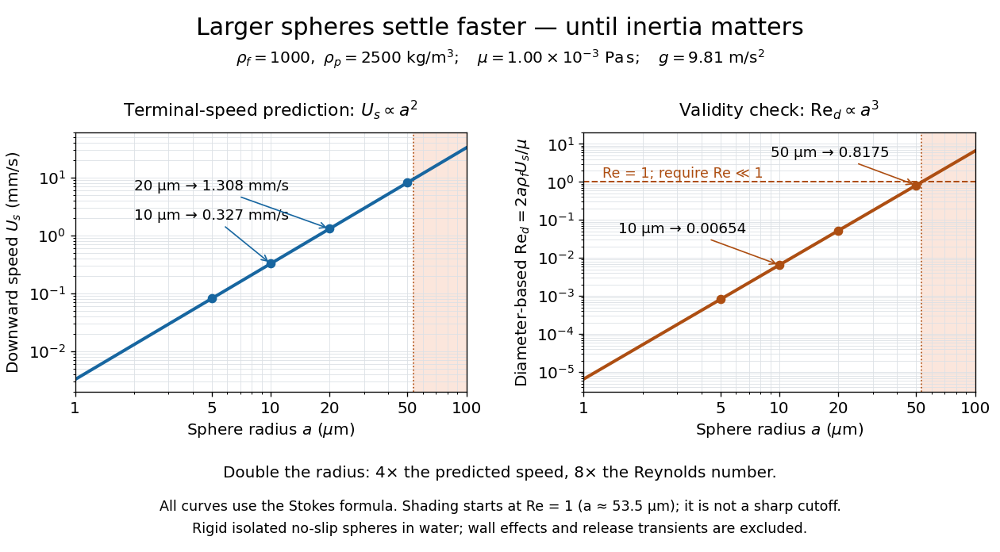

# Suspension (chemistry)

↑ **Parent:** [Fluid mechanics](fluid-mechanics.md)  
ⓦ [Wiki](https://en.wikipedia.org/wiki/Suspension_(chemistry))

A particle suspension is a dispersed population of solid particles carried by a fluid. Its dynamics couple particle transport, [drag force](fluid-mechanics.md#drag-physics), gravity, and the compensating motion of the carrier fluid.

**Table of contents**

- [Sedimentation](#sedimentation)
  - [Sedimentation equilibrium](#sedimentation-equilibrium)
- [Monodisperse](#monodisperse)
- [Density inversion in a settling suspension](#density-inversion-in-a-settling-suspension)
- [Heated particle-laden layer](#heated-particle-laden-layer)
- [Particle volume fraction](#particle-volume-fraction)
- [Bidisperse particle suspension](#bidisperse-particle-suspension)
  - [Composition wave in a bidisperse suspension](#composition-wave-in-a-bidisperse-suspension)
- [Settling velocity](#settling-velocity)
  - [Settling-velocity radius scaling](#settling-velocity-radius-scaling)
  - [Particle Reynolds number](#particle-reynolds-number)
  - [Particle deposition flux](#particle-deposition-flux)
  - [Stokes settling velocity](#stokes-settling-velocity)
  - [Hindered settling](#hindered-settling)
    - [Kinematic sedimentation](#kinematic-sedimentation)
      - [Hindered-settling flux inflection](#hindered-settling-flux-inflection)
      - [Bidisperse kinematic sedimentation](#bidisperse-kinematic-sedimentation)
        - [Two-stage bidisperse batch sedimentation](#two-stage-bidisperse-batch-sedimentation)
        - [Deposit composition from sedimentation jump conditions](#deposit-composition-from-sedimentation-jump-conditions)
      - [Sedimentation shock](#sedimentation-shock)
      - [Sediment mass determines final deposit thickness](#sediment-mass-determines-final-deposit-thickness)
      - [Two-layer sedimentation with a compression shock](#two-layer-sedimentation-with-a-compression-shock)
        - [Triple-shock sedimentation point](#triple-shock-sedimentation-point)
      - [Quadratic hindered-settling flux](#quadratic-hindered-settling-flux)
        - [Parabolic-profile sedimentation shock](#parabolic-profile-sedimentation-shock)
        - [Settling rarefaction fan](#settling-rarefaction-fan)
          - [Early extinction of a settling rarefaction fan](#early-extinction-of-a-settling-rarefaction-fan)
          - [Curved settling fronts within a rarefaction fan](#curved-settling-fronts-within-a-rarefaction-fan)
            - [Last surviving characteristic of a settling fan](#last-surviving-characteristic-of-a-settling-fan)
        - [Settling shock speed](#settling-shock-speed)

## Sedimentation

↑ **Parent:** [Suspension (chemistry)](suspension-chemistry.md)  
ⓦ [Wiki](https://en.wikipedia.org/wiki/Sedimentation)

Sedimentation is separation of suspended particles through a body-force-driven relative motion. In the [Perrin sedimentation experiment](brownian-motion.md#perrin-sedimentation-experiment), [diffusion](thermodynamics.md#diffusion) balances gravitational settling to produce a stationary height profile.

### Sedimentation equilibrium

↑ **Parent:** [Sedimentation](#sedimentation)

## Monodisperse

↑ **Parent:** [Suspension (chemistry)](suspension-chemistry.md)

A [monodisperse](#monodisperse) [particle suspension](suspension-chemistry.md) has a narrow distribution of particle sizes. Treating its particles as having a single [radius](topology.md#radius) simplifies the [Perrin sedimentation experiment](brownian-motion.md#perrin-sedimentation-experiment) model; residual size variation can still affect the inferred [Avogadro constant](physics.md#avogadro-constant).

## Density inversion in a settling suspension

↑ **Parent:** [Suspension (chemistry)](suspension-chemistry.md)

More suspended heavy particles above fewer particles puts denser fluid above lighter fluid. Such a [particle suspension](suspension-chemistry.md) may develop [Rayleigh-Taylor instability](continuum-mechanics.md#rayleigh-taylor-instability) and overturning in addition to one-dimensional [kinematic sedimentation](#kinematic-sedimentation). A rarefaction solution alone does not establish hydrodynamic stability.

## Heated particle-laden layer

↑ **Parent:** [Suspension (chemistry)](suspension-chemistry.md)

A dilute [particle suspension](suspension-chemistry.md) can supply both excess [mass density](fluid-mechanics.md#density) and heat. To first order its [equation of state](pressure.md#equation-of-state) is $\rho/\rho_0=1+\gamma\phi-\theta$, where $\phi$ is the [particle volume fraction](#particle-volume-fraction) and $\theta$ is fractional [thermal expansion](thermodynamics.md#thermal-expansion). [Particle deposition flux](#particle-deposition-flux) reduces $\phi$, while particle heating increases $\theta$. The competition can reverse the [reduced gravity](reduced-gravity.md) and create [unstable density stratification](gravity-wave.md#unstable-density-stratification).

## Particle volume fraction

↑ **Parent:** [Suspension (chemistry)](suspension-chemistry.md)

The particle volume fraction is the fraction of a representative mixture volume occupied by particles. Several particle species have fractions $\phi_i$, while the carrier-fluid fraction is $1-\sum_i\phi_i$.

## Bidisperse particle suspension

↑ **Parent:** [Suspension (chemistry)](suspension-chemistry.md)

A bidisperse particle suspension contains two distinguishable particle populations, commonly with different sizes, densities, or [settling velocities](#settling-velocity).

### Composition wave in a bidisperse suspension

↑ **Parent:** [Bidisperse particle suspension](#bidisperse-particle-suspension)

When two species share the same local settling velocity, their total [particle volume fraction](#particle-volume-fraction) supports a nonlinear [kinematic wave](transport-equation.md#kinematic-wave), while their relative composition is transported as a contact-like wave at the common particle speed.

## Settling velocity

↑ **Parent:** [Suspension (chemistry)](suspension-chemistry.md)

The settling velocity is a particle's vertical velocity relative to a stated frame. With height increasing upward, a sedimenting particle has $W<0$.

### Settling-velocity radius scaling

↑ **Parent:** [Settling velocity](#settling-velocity)

For spheres with the same density contrast, balance submerged weight, proportional to $r^3$, against [Stokes drag law](stokes-flow.md#stokes-s-law), proportional to $rW_s$, to obtain $W_s\propto r^2$. With constant [drag coefficient](fluid-mechanics.md#drag-coefficient), [quadratic drag](fluid-mechanics.md#quadratic-drag) is proportional to $r^2W_s^2$, giving $W_s\propto r^{1/2}$. The two radius laws require their corresponding [particle Reynolds number](#particle-reynolds-number) limits.

### Particle Reynolds number

↑ **Parent:** [Settling velocity](#settling-velocity)

A [Reynolds number](dynamic-viscosity.md#reynolds-number) based on particle diameter and relative speed in the carrier fluid. Small values justify [Stokes drag law](stokes-flow.md#stokes-s-law); a high-Reynolds-number regime with nearly constant [drag coefficient](fluid-mechanics.md#drag-coefficient) instead gives [quadratic drag](fluid-mechanics.md#quadratic-drag). The drag law must be evaluated in the appropriate regime for every species.

### Particle deposition flux

↑ **Parent:** [Settling velocity](#settling-velocity)

For downward [settling velocity](#settling-velocity) magnitude $W_s$ and near-bed [particle volume fraction](#particle-volume-fraction) $\phi_b$, a horizontal absorbing bed receives particle volume per area per time $J_s=W_s\phi_b$. A bed inclined at angle $\vartheta$ to the horizontal receives $W_s\phi_b\cos\vartheta$ per unit actual area, in the absence of resuspension or additional normal fluid motion.

### Stokes settling velocity

↑ **Parent:** [Settling velocity](#settling-velocity)

**[Figure 1](#image-sphere-settling-in-water-terminal-speed-grows-as-radius-squared-while-reynolds-number-grows-as-radius-cubed). Sphere settling in water: terminal speed grows as radius squared while Reynolds number grows as radius cubed**.

Take downward as positive and let [gravity](physics.md#gravity) have magnitude $g$. For a rigid [sphere](euclidean-geometry.md#sphere) of [density](fluid-mechanics.md#density) $\rho_p$ in otherwise stationary [fluid](fluid-mechanics.md#fluid) of [density](fluid-mechanics.md#density) $\rho_f$, its weight minus [buoyancy](fluid-mechanics.md#buoyancy) is $\tfrac43\pi a^3(\rho_p-\rho_f)g$. At [terminal velocity](classical-mechanics.md#terminal-velocity), this balances the [Stokes drag law](stokes-flow.md#stokes-s-law):

$$
6\pi\mu aU_s=\frac43\pi a^3(\rho_p-\rho_f)g,\qquad
U_s=\frac{2(\rho_p-\rho_f)ga^2}{9\mu}.
$$

This signed downward [settling velocity](#settling-velocity) is negative for a buoyantly rising [sphere](euclidean-geometry.md#sphere) and zero for equal [densities](fluid-mechanics.md#density). For fixed [density](fluid-mechanics.md#density) contrast and [dynamic viscosity](dynamic-viscosity.md), the submerged weight grows as $a^3$ while [linear drag](fluid-mechanics.md#linear-drag) at fixed [speed](classical-mechanics.md#speed) grows as $a$; their balance gives the [settling-velocity radius scaling](#settling-velocity-radius-scaling) $U_s\propto a^2$. Meanwhile,

$$
\mathrm{Re}_d=\frac{2a\rho_f|U_s|}{\mu}
=\frac{4\rho_f|\rho_p-\rho_f|ga^3}{9\mu^2}.
$$

Thus doubling the radius multiplies the predicted [Stokes settling speed](#stokes-settling-velocity) by four and the [particle Reynolds number](#particle-reynolds-number) by eight. This makes the formula useful for separating particles by size, while also providing its own check against extrapolation to large particles.

For a computed water example, take $\rho_f=1000\ \mathrm{kg\,m^{-3}}$, $\mu=1.00\times10^{-3}\ \mathrm{Pa\,s}$, $\rho_p=2500\ \mathrm{kg\,m^{-3}}$, $g=9.81\ \mathrm{m\,s^{-2}}$, and $a=10.0\ \mathrm{\mu m}$. These are specified rounded inputs rather than a claim of exact water properties at every [temperature](temperature.md). They give

$$
U_s=3.27\times10^{-4}\ \mathrm{m\,s^{-1}}=0.327\ \mathrm{mm\,s^{-1}},\qquad
\mathrm{Re}_d=\frac{1000(3.27\times10^{-4})(20.0\times10^{-6})}{10^{-3}}=0.00654.
$$

The diameter is $20.0\ \mathrm{\mu m}$, and both the net downward weight and the upward [drag force](fluid-mechanics.md#drag-physics) are $6.16\times10^{-11}\ \mathrm N$. At this [terminal velocity](classical-mechanics.md#terminal-velocity), falling $1.00\ \mathrm{mm}$ takes $3.06\ \mathrm s$. At $a=20.0\ \mathrm{\mu m}$ the prediction is $1.308\ \mathrm{mm\,s^{-1}}$ with $\mathrm{Re}_d=0.05232$; at $a=50.0\ \mathrm{\mu m}$ it is $8.175\ \mathrm{mm\,s^{-1}}$ with $\mathrm{Re}_d=0.8175$, which is no longer a convincing small-[Reynolds number](dynamic-viscosity.md#reynolds-number) case. The figure labels these as predictions of the [Stokes settling velocity](#stokes-settling-velocity) formula and shows where its [inertia](classical-mechanics.md#inertia) check fails.

The calculation describes the eventual [terminal velocity](classical-mechanics.md#terminal-velocity), not the release transient governed by particle [acceleration](classical-mechanics.md#acceleration) and possibly the [Unsteady Stokes equation](stokes-flow.md#unsteady-stokes-equation). Walls, [hydrodynamic interactions](stokes-flow.md#hydrodynamic-interaction), departures from a rigid [sphere](euclidean-geometry.md#sphere), or a different surface condition require a different resistance. For sufficiently small particles, [Brownian motion](brownian-motion.md) can obscure individual settling trajectories; the formula still specifies the gravitational drift within its assumptions. The balancing argument already appears in article 43 of [Stokes's original investigation, collected-paper reprint](https://mural.uv.es/daroig/documentos/stokes1850.pdf).

### Hindered settling

↑ **Parent:** [Settling velocity](#settling-velocity)

Hindered settling is the reduction or modification of particle settling by the displaced carrier-fluid backflow and by interactions with other particles. A simple dilute mixture model gives every species the same volume-averaged backflow.

#### Kinematic sedimentation

↑ **Parent:** [Hindered settling](#hindered-settling)

A one-dimensional [particle suspension](suspension-chemistry.md) settling without particle diffusion or overturning obeys the [scalar conservation law](transport-equation.md#scalar-conservation-law) $\phi_t+\partial_zj(\phi)=0$. The upward flux is negative for downward settling. [Characteristic curves](transport-equation.md#characteristic-curve), compressive [shocks](transport-equation.md#shock-wave) and [rarefaction waves](transport-equation.md#rarefaction-wave) describe concentration transport rather than individual particle paths.

##### Hindered-settling flux inflection

↑ **Parent:** [Kinematic sedimentation](#kinematic-sedimentation)

For [hindered settling](#hindered-settling) with normalized [particle volume fraction](#particle-volume-fraction) $s$, upward coordinate and downward isolated [settling velocity](#settling-velocity) magnitude $V_0$, the [scalar conservation law](transport-equation.md#scalar-conservation-law) has [conservation law flux](transport-equation.md#conservation-law-flux) $f(s)=-V_0s(1-s)^\alpha$. For $\alpha>0$, its [convexity](real-analysis.md#convex-function) changes at $s=2/(\alpha+1)$ when this lies in the physical interval. This change distinguishes spreading [rarefaction waves](transport-equation.md#rarefaction-wave) from compressing [characteristic curves](transport-equation.md#characteristic-curve); a flux with an inflection can produce both a [shock wave](transport-equation.md#shock-wave) and a [rarefaction wave](transport-equation.md#rarefaction-wave) in one transition. At $\alpha=0$ the flux is linear and the profile simply translates.

##### Bidisperse kinematic sedimentation

↑ **Parent:** [Kinematic sedimentation](#kinematic-sedimentation)

A [particle suspension](suspension-chemistry.md) contains two particle species with separate [particle volume fractions](#particle-volume-fraction). In an independent-settling model, each species obeys its own flux conservation equation, while a shared stationary deposit can couple the jump conditions through its maximum total [packing fraction](euclidean-geometry.md#packing-fraction). Such independence is an imposed model; general [hindered settling](#hindered-settling) need not decouple species.

###### Two-stage bidisperse batch sedimentation

↑ **Parent:** [Bidisperse kinematic sedimentation](#bidisperse-kinematic-sedimentation)

Initially, separate clearing fronts of fast and slow species coexist with a mixed deposition front. After the fast clearing front meets that deposit, the remaining suspension contains only the slow species. Its later [sedimentation shock](#sedimentation-shock) builds a pure-slow layer above the earlier mixed deposit. Final layer thicknesses and composition follow from separate particle-volume conservation.

###### Deposit composition from sedimentation jump conditions

↑ **Parent:** [Bidisperse kinematic sedimentation](#bidisperse-kinematic-sedimentation)

For a [bidisperse kinematic sedimentation](#bidisperse-kinematic-sedimentation) model with normalized suspension concentrations $q_i$, isolated speeds $W_i$, and a stationary deposit with $p_1+p_2=1$, the upward deposit-front speed magnitude obeys $s(p_i-q_i)=W_iq_i(1-q_i)$. Adding gives $s=\sum_iW_iq_i(1-q_i)/(1-\sum_iq_i)$; substitution determines each deposited fraction. These are [Rankine-Hugoniot conditions](transport-equation.md#rankine-hugoniot-conditions) with a stationary compacted branch.

##### Sedimentation shock

↑ **Parent:** [Kinematic sedimentation](#kinematic-sedimentation)

A moving discontinuity of [particle volume fraction](#particle-volume-fraction) in [kinematic sedimentation](#kinematic-sedimentation). Conservation of particle [volume](geometry-and-topology.md#volume) gives the [Rankine-Hugoniot condition](transport-equation.md#rankine-hugoniot-conditions) $U[\phi]=[j]$ in a consistently oriented coordinate. A clearing front and a deposit front can both be [sedimentation shocks](#sedimentation-shock). A stationary deposit uses zero particle flux; its compacted branch need not obey the suspension flux law.

##### Sediment mass determines final deposit thickness

↑ **Parent:** [Kinematic sedimentation](#kinematic-sedimentation)

Particle [mass conservation](continuum-mechanics.md#mass-conservation) gives $h_c=[\phi_1(H-z_m)+\phi_2z_m]/\phi_{\max}$. Averaging concentration over the entire original container gives $\bar\phi=\phi_{\max}h_c/H$. This average differs from the concentration inside the deposit itself.

##### Two-layer sedimentation with a compression shock

↑ **Parent:** [Kinematic sedimentation](#kinematic-sedimentation)

With upper concentration $a$ and lower concentration $2a$, the clearing, internal and deposit fronts have speeds $-u_s(1-a)$, $-u_s(1-3a)$ and $2u_sa$. If the lower two merge, the resulting deposit/upper-suspension front has speed $u_sa$. Final deposit thickness is $a(H+z_m)$ by [mass conservation](continuum-mechanics.md#mass-conservation).

###### Triple-shock sedimentation point

↑ **Parent:** [Two-layer sedimentation with a compression shock](#two-layer-sedimentation-with-a-compression-shock)

For initial concentrations $a$ above $z_m$ and $2a$ below it, all three straight [shocks](transport-equation.md#shock-wave) meet when $z_m=H(1-a)/(1+a)$. The common time is $H/[u_s(1+a)]$ and height is $2aH/(1+a)$. Afterwards only a stationary deposit/clear-fluid boundary remains.

##### Quadratic hindered-settling flux

↑ **Parent:** [Kinematic sedimentation](#kinematic-sedimentation)

For downward settling speed $u_s(1-\phi)$ in upward coordinate $z$, particle flux is $j=-u_s\phi(1-\phi)$. The concentration-characteristic speed is $j^{\prime}=u_s(2\phi-1)$ and differs from particle speed. Since $j^{\prime\prime}=2u_s>0$, decreasing concentration with height creates a compressive [shock](transport-equation.md#shock-wave), while increasing concentration creates a [rarefaction wave](transport-equation.md#rarefaction-wave).

###### Parabolic-profile sedimentation shock

↑ **Parent:** [Quadratic hindered-settling flux](#quadratic-hindered-settling-flux)

For $\phi_0(z)=\phi_{\max}(1-z^2/h^2)/3$ on $0\le z\le h$, with clear fluid above and no imposed bed discontinuity, the first compression of the smooth profile occurs at $t=3h/(4V_s)$ and $z=h/4$. The nascent shock enters clear fluid with initial signed speed $-V_s$. Its downward speed subsequently decreases as the state behind it becomes more concentrated, until a boundary interaction changes the problem. This is characteristic breaking, not the time of initiation of a separately imposed packed-bed front.

###### Settling rarefaction fan

↑ **Parent:** [Quadratic hindered-settling flux](#quadratic-hindered-settling-flux)

If lower initial concentration $b$ is less than upper concentration $a$, the [entropy solution](transport-equation.md#entropy-solution) expands into a fan with $\phi=[1+(z-z_m)/(u_st)]/2$. Its characteristic speeds range from $u_s(2b-1)$ to $u_s(2a-1)$. The fan can be clipped by a clearing or deposition [shock](transport-equation.md#shock-wave).

###### Early extinction of a settling rarefaction fan

↑ **Parent:** [Settling rarefaction fan](#settling-rarefaction-fan)

For upper concentration $a$, lower $a/2$ and interface height $4H/5$, both curved fronts meet inside the fan only if $a\geq1-\sqrt{2/3}$. At smaller $a$, the deposition front reaches the fan upper edge first, then advances through uniform concentration $a$. The clearing front remains straight and final time is $H(1-3a/5)/[u_s(1-a)]$.

###### Curved settling fronts within a rarefaction fan

↑ **Parent:** [Settling rarefaction fan](#settling-rarefaction-fan)

For upper concentration $a$, lower concentration $b<a$ and $L=H-z_m$, define $A=aL$ and $D=(1-b)z_m$. Once inside the [settling rarefaction fan](#settling-rarefaction-fan), clearing and deposition [shocks](transport-equation.md#shock-wave) obey $z_u=z_m-u_st+2\sqrt{u_sAt}$ and $z_d=z_m+u_st-2\sqrt{u_sDt}$. These curves apply only while their neighboring concentration remains within the fan.

###### Last surviving characteristic of a settling fan

↑ **Parent:** [Curved settling fronts within a rarefaction fan](#curved-settling-fronts-within-a-rarefaction-fan)

If both [shocks](transport-equation.md#shock-wave) meet inside a [settling rarefaction fan](#settling-rarefaction-fan), $t_c=(\sqrt A+\sqrt D)^2/u_s$ and the last characteristic has concentration $\phi_*=\sqrt A/(\sqrt A+\sqrt D)$. It runs from the initial internal interface to the final deposit point. This construction requires $b\leq\phi_*\leq a$; otherwise a front exits the fan before final deposition.

###### Settling shock speed

↑ **Parent:** [Quadratic hindered-settling flux](#quadratic-hindered-settling-flux)

The [Rankine-Hugoniot condition](transport-equation.md#rankine-hugoniot-conditions) for the [quadratic hindered-settling flux](#quadratic-hindered-settling-flux) gives $V=u_s(\phi_L+\phi_R-1)$, with lower and upper states labelled $L,R$. It includes a downward clearing front ($\phi_R=0$), an upward deposition front ($\phi_L=1$), and a stationary final deposit/clear-fluid interface.

## ↑ Ancestors (4)

1. [Fluid mechanics](fluid-mechanics.md)
2. [Branches of physics](physics.md#branches-of-physics)
3. [Physics](physics.md)
4. [Codex Wiki](README.md)
