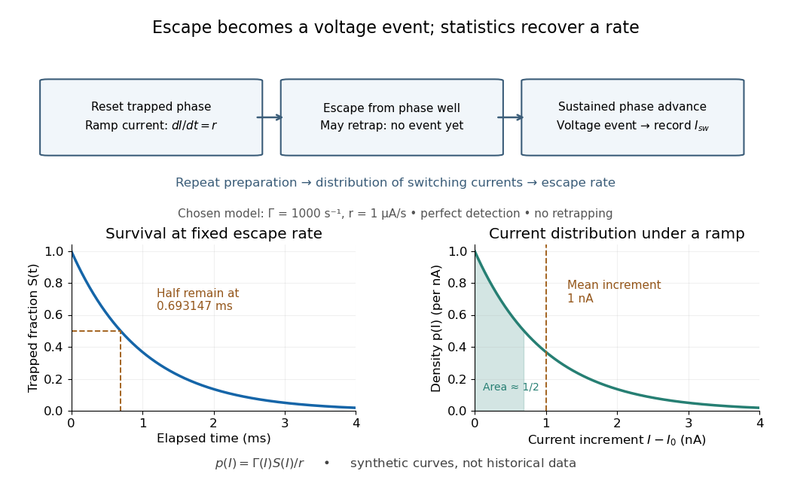

# Switching-current distribution of a Josephson junction

↑ **Parent:** [Martinis-Devoret-Clarke circuit experiments](martinis-devoret-clarke-circuit-experiments.md)

A [switching-current distribution of a Josephson junction](switching-current-distribution-of-a-josephson-junction.md) records the bias [electric current](electric-current.md) at the first detected transition to a sustained nonzero [electric potential difference](electric-potential-difference.md). Interpret it using a stipulated monotone ramp $dI/dt=r>0$, a reproducible initial trapped state, and an instantaneous escape [hazard function](hazard-function.md) $\Gamma(I)$. Neglect retrapping and readout delay. The [survival function](survival-function.md) $S$ obeys $dS/dt=-\Gamma S$, so changing variable from time to [electric current](electric-current.md) gives

$$
S(I)=\exp\left[-\frac1r\int_{I_0}^I\Gamma(u)\,du\right],\qquad
p(I)=-\frac{dS}{dI}=\frac{\Gamma(I)}rS(I),\qquad
\Gamma(I)=\frac{rp(I)}{1-\int_{I_0}^Ip(u)\,du}.
$$

Here $p$ is a [probability density function](probability-density-function.md) per unit [electric current](electric-current.md), not a rate per unit time. Division by the surviving population is essential: only trials still trapped can escape. A typical switching current is consequently not identical to the noiseless [superconducting critical current](superconducting-critical-current.md).

**[Figure 8](#image-from-trapped-phase-to-a-voltage-event-and-an-escape-probability). From trapped phase to a voltage event and an escape probability**. Original functional readout model and chosen constant-rate calculation. Boxes represent functions rather than historical wiring. The plotted [survival function](survival-function.md) and switching [probability density function](probability-density-function.md) assume $\Gamma=1000\,\mathrm{s^{-1}}$ and $r=1\,\mathrm{\mu A\,s^{-1}}$ with perfect event detection and no retrapping; they are not experimental traces.

For an independent illustrative check, choose constant $\Gamma_0=1000\,\mathrm{s^{-1}}$ and $r=1\,\mathrm{\mu A\,s^{-1}}$. Then

$$
S(I)=e^{-\Gamma_0(I-I_0)/r},\qquad
\langle I-I_0\rangle=\frac r{\Gamma_0}=1\,\mathrm{nA}.
$$

Half the trials have switched after $\ln2/\Gamma_0=0.693147\,\mathrm{ms}$, corresponding to $0.693147\,\mathrm{nA}$ of ramp. Doubling $r$ doubles the mean increment without changing the underlying escape rate. Real junction rates vary sharply with bias; this example isolates the statistical conversion.

Repeating the preparation, measuring the ramp, resolving the voltage onset, and allowing cooling after each dissipative event are prerequisites for this interpretation. Missed events, finite detection delay, changing [temperature](temperature-split.md) and retrapping alter the measured distribution. Even a correctly reconstructed rate needs the independent thermal and spectral checks before identifying its escape mechanism.

## ↑ Ancestors (8)

1. [Martinis-Devoret-Clarke circuit experiments](martinis-devoret-clarke-circuit-experiments.md)
2. [Current-biased Josephson phase dynamics](current-biased-josephson-phase-dynamics.md)
3. [Josephson junction](josephson-junction.md)
4. [Superconductivity](superconductivity-split.md)
5. [Statistical physics](statistical-physics-split.md)
6. [Branches of physics](branches-of-physics.md)
7. [Physics](physics-split.md)
8. [Codex Wiki](split.md)

## ← Incoming links (1)

- [Switching-current distribution of a Josephson junction](switching-current-distribution-of-a-josephson-junction.md)
