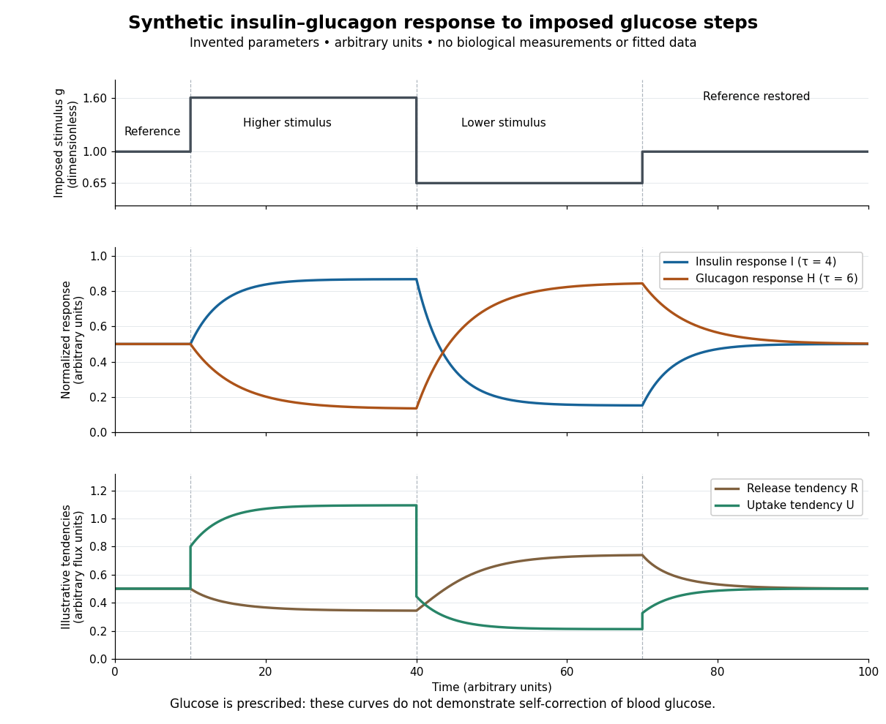

# Synthetic insulin-glucagon response model

↑ **Parent:** [Homeostasis](homeostasis.md)

This deliberately synthetic [differential equation](differential-equation-split.md) model illustrates response direction and lag. Every plotted number is chosen for teaching; none is a biological measurement or a fitted human parameter. Let externally prescribed, [dimensionless](dimensionless-quantity.md) $g>0$ represent a [glucose](glucose.md) stimulus relative to a reference. Let $I$ and $H$ be normalized [insulin](insulin.md) and [glucagon](glucagon.md) response variables, with independently chosen [time constants](time-constant.md) $\tau_I=4$ and $\tau_H=6$ in arbitrary time units:

$$
I_\infty(g)=\frac{g^4}{1+g^4},\qquad H_\infty(g)=\frac{1}{1+g^4},\qquad \tau_I\dot I=I_\infty(g)-I,\qquad \tau_H\dot H=H_\infty(g)-H.
$$

Here $I_\infty$ rises and $H_\infty$ falls with $g$. Their targets add to one by construction; the evolving $I+H$ need not equal one because their [time constants](time-constant.md) differ. Start with $g=1$ and $I=H=1/2$. Set $g=1.6$ from $t=10$ to $40$, $g=0.65$ from $t=40$ to $70$, and $g=1$ otherwise. Within a constant-input interval beginning at $t_0$, the [exponential decay](exponential-decay.md) solution is

$$
I(t)=I_\infty+[I(t_0)-I_\infty]e^{-(t-t_0)/\tau_I},\qquad H(t)=H_\infty+[H(t_0)-H_\infty]e^{-(t-t_0)/\tau_H}.
$$

Each response is a [continuous function](continuous-function.md) of time even when the imposed stimulus jumps. The chosen starting values stay between zero and one, since each solution is a [weighted arithmetic mean](weighted-arithmetic-mean.md) of its interval's starting value and target.

**[Figure 3](#image-synthetic-insulin-and-glucagon-responses-to-imposed-glucose-steps). Synthetic insulin and glucagon responses to imposed glucose steps**. Original illustration of the [synthetic insulin-glucagon response model](synthetic-insulin-glucagon-response-model.md). All curves are constructed examples in arbitrary units. Top: imposed [dimensionless](dimensionless-quantity.md) stimulus. Middle: responses with unequal [time constants](time-constant.md). Bottom: illustrative [liver](liver.md) release and tissue uptake tendencies, which do not determine the imposed stimulus. No experimental data or clinical ranges are represented.

For an illustrative downstream comparison, define release tendency $R=0.3+0.6H/(1+I)$ and uptake tendency $U=(0.25+0.5I)g$, in the same arbitrary flux units. At the reference target, $R=U=0.5$. At the high-stimulus targets, $R\approx0.343$ and $U\approx1.094$; at the low-stimulus targets, $R\approx0.742$ and $U\approx0.212$. These chosen functions encode greater uptake with [insulin](insulin.md) and greater release with [glucagon](glucagon.md), moderated by [insulin](insulin.md); they are not established [enzyme kinetics](enzyme-kinetics.md). The $g$ trace is imposed externally, so the figure does not demonstrate self-correction of [blood glucose](blood-sugar.md). A closed model would also need a [conservation of mass](mass-conservation.md) equation, nutrient input, finite [glycogen](glycogen.md) stores, and additional tissue interactions. The qualitative restoring loops are shown separately in the [insulin](insulin.md) circuit.

## ↑ Ancestors (4)

1. [Homeostasis](homeostasis.md)
2. [Physiology](physiology-split.md)
3. [Biology](biology-split.md)
4. [Codex Wiki](split.md)

## ← Incoming links (1)

- [Synthetic insulin-glucagon response model](synthetic-insulin-glucagon-response-model.md)
