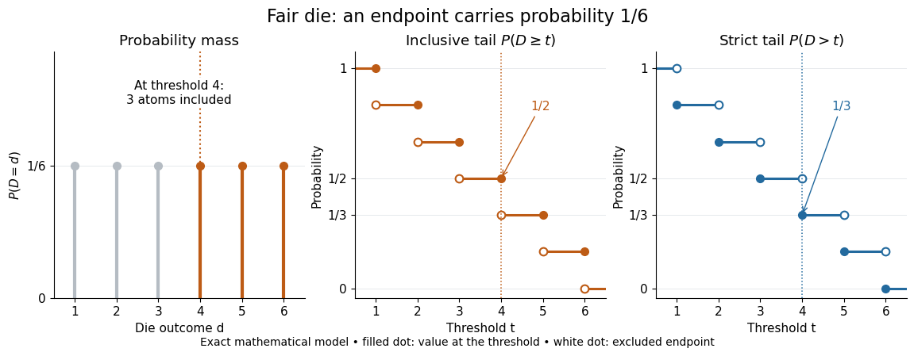
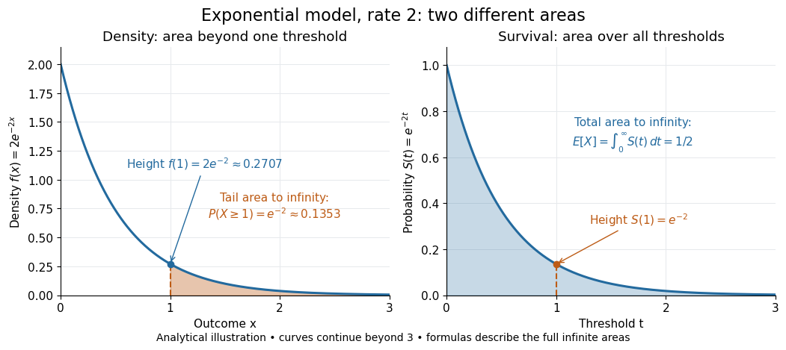

# Tail probability

↑ **Parent:** [Probability](probability.md)

For a real [random variable](random-variable-split.md) $X$, an upper-tail [probability](probability.md) has the form $\mathbb P(X\geq t)$ and a lower-tail [probability](probability.md) has the form $\mathbb P(X\leq t)$. Each is the [probability](probability.md) of an [event](event.md) lying beyond a chosen threshold in one direction. A [tail probability](tail-probability.md) need not be small: the threshold determines how much of the [probability distribution](probability-distribution.md) it includes. A [concentration inequality](concentration-inequality.md) bounds such [probabilities](probability.md), often for deviations from an [expected value](expected-value.md).

Endpoint conventions matter. Write $F(t)=\mathbb P(X\leq t)$ for the [cumulative distribution function](cumulative-distribution-function.md) and $F(t^-)=\lim_{s\uparrow t}F(s)=\mathbb P(X<t)$. The [complement rule of probability](complement-rule-of-probability.md) gives four distinct formulas:

$$
\begin{aligned}
\mathbb P(X\geq t)&=1-F(t^-),&\mathbb P(X>t)&=1-F(t),\\
\mathbb P(X\leq t)&=F(t),&\mathbb P(X<t)&=F(t^-).
\end{aligned}
$$

The strict upper-tail convention is the [survival function](survival-function.md) $S(t)=\mathbb P(X>t)$. Its value differs from the inclusive upper [tail probability](tail-probability.md) by exactly the [probability mass](probability-mass.md) at the threshold:

$$
\mathbb P(X\geq t)-\mathbb P(X>t)=\mathbb P(X=t)=F(t)-F(t^-).
$$

A [singleton](singleton-mathematics.md) with positive [probability mass](probability-mass.md) is an [atom of a measure](atom-measure-theory.md). Thus $1-F(t)$ excludes an [atom of a measure](atom-measure-theory.md) at $t$, whereas $1-F(t^-)$ includes it. These endpoint identities follow directly from the [cumulative distribution function](cumulative-distribution-function.md) properties in [Kyle Siegrist, Distribution and Quantile Functions: endpoint probabilities and right tails](https://www.randomservices.org/random/dist/CDF.html).

As the threshold increases, both upper [tail probabilities](tail-probability.md) are [nonincreasing functions](nonincreasing-function.md). The strict [survival function](survival-function.md) is a [right-continuous function](right-continuous-function.md); the inclusive upper [tail probability](tail-probability.md) takes the upper endpoint value at a downward jump, equal to the left [limit](limit-of-a-function.md) of the [survival function](survival-function.md). Both tend to zero as $t\to\infty$ for a real [random variable](random-variable-split.md), but the speed of that decay differs across [probability distributions](probability-distribution.md). The [cumulative distribution function](cumulative-distribution-function.md) properties and their proof from continuity of [probability measures](probability-measure.md) are given in [MIT 6.436J, Lecture 4: random variables and cumulative distribution function properties](https://ocw.mit.edu/courses/6-436j-fundamentals-of-probability-fall-2018/9797310bed4c7f5b5d40d007783eec8d_MIT6_436JF18_lec04.pdf).

For a fair six-sided die $D$, the [discrete uniform distribution](discrete-uniform-distribution.md) assigns [probability mass](probability-mass.md) $1/6$ to each of $1,\ldots,6$. At threshold four,

$$
\mathbb P(D\geq4)=\frac36=\frac12,\qquad \mathbb P(D>4)=\frac26=\frac13,\qquad F_D(4)=\frac46,\qquad F_D(4^-)=\frac36.
$$

Between four and five, both upper [tail probabilities](tail-probability.md) equal $1/3$. At the largest possible outcome the distinction is especially visible: $\mathbb P(D\geq6)=1/6$, but $\mathbb P(D>6)=0$. The diagram shows exact [probabilities](probability.md) for this mathematical model; its dots specify which endpoints belong to each [step function](step-function.md).

**[Figure 9](#image-exact-fair-die-probabilities-including-or-excluding-a-threshold-changes-the-tail-by-one-atom). Exact fair-die probabilities: including or excluding a threshold changes the tail by one atom**.

If a [probability distribution](probability-distribution.md) has a [probability density function](probability-density-function.md) $f$, then every [singleton](singleton-mathematics.md) has zero [probability mass](probability-mass.md) and

$$
\mathbb P(X\geq t)=\mathbb P(X>t)=\int_t^\infty f(x)\,dx.
$$

For an [exponential distribution](exponential-distribution.md) of rate two, $f(x)=2e^{-2x}$ for $x\geq0$ and zero otherwise, so $S(t)=e^{-2t}$ for $t\geq0$ and $S(t)=1$ for $t<0$. Hence $\mathbb P(X\geq1)=e^{-2}\approx0.135335$. This [tail probability](tail-probability.md) is an [integral](integral.md) of the [probability density function](probability-density-function.md), not its height $f(1)=2e^{-2}\approx0.270671$. A [mixed probability distribution](mixed-probability-distribution.md) retains endpoint jumps even with a smooth component: give zero [probability mass](probability-mass.md) $1/4$ and choose this [exponential distribution](exponential-distribution.md) with [probability](probability.md) $3/4$. Then $\mathbb P(X\geq0)=1$, $\mathbb P(X>0)=3/4$, and $S(t)=(3/4)e^{-2t}$ for $t\geq0$.

A two-sided [tail probability](tail-probability.md) can measure the [absolute value](absolute-value.md) of displacement from a specified center $c$. For $a>0$, the two extreme [events](event.md) are [disjoint events](disjoint-events.md), so

$$
\mathbb P(|X-c|\geq a)=\mathbb P(X\leq c-a)+\mathbb P(X\geq c+a)=F(c-a)+1-F((c+a)^-).
$$

For strict displacement $|X-c|>a$, replace the last expression by $F((c-a)^-)+1-F(c+a)$. The condition $a>0$ prevents overlap; at $a=0$ adding inclusive tails double-counts any [probability mass](probability-mass.md) at $c$. For a [uniform distribution](continuous-uniform-distribution.md) on $[-2,2]$, take $c=0$ and $a=1$: the two [tail probabilities](tail-probability.md) are $1/4$ each and their sum is $1/2$. Equal tails follow from this [symmetric probability distribution](symmetric-probability-distribution.md), not from the phrase two-sided alone; for a [uniform distribution](continuous-uniform-distribution.md) on $[0,4]$ with $c=1,a=1$, the two [tail probabilities](tail-probability.md) are zero and $1/2$.

The [tail-sum formula for expectation](tail-sum-formula-for-expectation.md) turns a whole curve of [tail probabilities](tail-probability.md) into an [expected value](expected-value.md). For any nonnegative [random variable](random-variable-split.md) $Y$, without assuming a [probability density function](probability-density-function.md) or a finite [expected value](expected-value.md),

$$
\mathbb E Y=\int_0^\infty\mathbb P(Y>t)\,dt=\int_0^\infty\mathbb P(Y\geq t)\,dt\quad\text{in }[0,\infty].
$$

For a proof outline, write $Y=\int_0^\infty\mathbf1_{\{Y>t\}}\,dt$ pointwise and exchange the [expected value](expected-value.md) and [Lebesgue integral](lebesgue-integral.md) using [Tonelli theorem](tonelli-theorem.md); $\mathbf1$ is an [indicator function](indicator-function.md). The inclusive version has the same [Lebesgue integral](lebesgue-integral.md): positive [probability masses](probability-mass.md) occur at only a [countable set](countable-set.md) of thresholds, which has [Lebesgue measure](lebesgue-measure.md) zero. For a nonnegative [integer](integer.md)-valued [random variable](random-variable-split.md) $N$, the [tail-sum formula](tail-sum-formula.md) instead gives $\mathbb E N=\sum_{k=1}^\infty\mathbb P(N\geq k)=\sum_{k=0}^\infty\mathbb P(N>k)$. The integer hypothesis is essential for these sums. The integral identity, its [indicator function](indicator-function.md) proof, and the integer version appear in [Kyle Siegrist, Additional Properties of Expected Value: integration and summation of right tails](https://www.randomservices.org/random/expect/Properties2.html).

For the fair die, this [tail-sum formula](tail-sum-formula.md) yields $(6+5+4+3+2+1)/6=7/2$, equal to the direct [weighted arithmetic mean](weighted-arithmetic-mean.md) $(1+2+3+4+5+6)/6$. For the rate-two [exponential distribution](exponential-distribution.md), the area under the [survival function](survival-function.md) is $\int_0^\infty e^{-2t}\,dt=1/2$, its [expected value](expected-value.md). The first panel below shades an [integral](integral.md) of the [probability density function](probability-density-function.md) for a single threshold; the second shades an [integral](integral.md) of the [survival function](survival-function.md) across all nonnegative thresholds. These are analytical illustrations, with the displayed curves truncated at three; their exact total areas use an infinite integration range.

**[Figure 10](#image-exponential-model-one-tail-probability-is-density-area-while-expectation-is-total-survival-area). Exponential model: one tail probability is density area, while expectation is total survival area**.

Nonnegativity is essential to interpreting the upper [tail probability](tail-probability.md) area as $\mathbb E Y$: for a general real [random variable](random-variable-split.md) that area equals the [expected value](expected-value.md) of its [positive part](positive-part-of-a-real-valued-function.md). An [integrable random variable](integrable-random-variable.md) satisfies $\mathbb E X=\mathbb E X^+-\mathbb E X^-$, subtracting the [expected value](expected-value.md) of its [negative part](negative-part-of-a-real-valued-function.md); infinite terms cannot be canceled. Even when $Y$ is finite [almost surely](almost-sure-convergence.md), its [expected value](expected-value.md) can be infinite. For the shape-one [Pareto distribution](pareto-distribution.md) on $[1,\infty)$, $S(t)=1$ on $[0,1)$ and $S(t)=1/t$ for $t\geq1$, so the area is $1+\int_1^\infty dt/t=\infty$. The finite versus infinite [expected value](expected-value.md) distinction is illustrated in [Kyle Siegrist, Definitions and Basic Properties: exponential and Pareto expected values](https://www.randomservices.org/random/expect/Properties.html).

Why are [tail probabilities](tail-probability.md) useful? They answer threshold questions directly, and a [concentration inequality](concentration-inequality.md) can bound them without knowing the full [probability distribution](probability-distribution.md). For nonnegative $Y$ with finite [expected value](expected-value.md), [Markov inequality](markov-s-inequality.md) gives $\mathbb P(Y\geq t)\leq\mathbb E Y/t$ for $t>0$: a large threshold relative to the [expected value](expected-value.md) forces rarity. The [quantile function](quantile-function.md) reverses the question by choosing a threshold for a prescribed cumulative level. If $q=Q(1-\alpha)$ with $0<\alpha<1$, then $\mathbb P(X>q)\leq\alpha\leq\mathbb P(X\geq q)$; an [atom of a measure](atom-measure-theory.md) may prevent equality. For the die, $Q(0.9)=6$, with strict upper [tail probability](tail-probability.md) zero and inclusive upper [tail probability](tail-probability.md) $1/6$.

A [tail probability](tail-probability.md) describes rarity under a specified [probability distribution](probability-distribution.md); it is not automatically a [conditional probability](conditional-probability.md) after extra information. For $u\geq t$ with $\mathbb P(X\geq t)>0$,

$$
\mathbb P(X\geq u\mid X\geq t)=\frac{\mathbb P(X\geq u)}{\mathbb P(X\geq t)},
$$

because the threshold [events](event.md) are nested. Thus the die has $\mathbb P(D\geq5)=1/3$ but $\mathbb P(D\geq5\mid D\geq4)=2/3$. Conditioning changes the [sample space](sample-space.md) and renormalizes its [probability measure](probability-measure.md); the same extreme outcomes can become common in that restricted population.

## ↑ Ancestors (6)

1. [Probability](probability.md)
2. [Probability theory](probability-theory-split.md)
3. [Probability and statistics](probability-and-statistics-split.md)
4. [Area of mathematics](area-of-mathematics.md)
5. [Mathematics](mathematics-split.md)
6. [Codex Wiki](split.md)

## ← Incoming links (18)

- [Cantelli inequality](cantelli-inequality.md)
- [Chebyshev's inequality](chebyshev-s-inequality.md)
- [Continuity of probability](continuity-of-probability.md)
- [Ellenberg–Gijswijt cap-set bound](ellenberg-gijswijt-cap-set-bound.md)
- [Equality in Cantelli's inequality](equality-in-cantelli-s-inequality.md)
- [Equality in Chebyshev's inequality](equality-in-chebyshev-s-inequality.md)
- [Exponential Markov bound](exponential-markov-bound.md)
- [Hoeffding inequality](hoeffding-inequality.md)
- [Hoeffding sample size for Bernoulli frequencies](hoeffding-sample-size-for-bernoulli-frequencies.md)
- [Markov's inequality](markov-s-inequality.md)
- [Normal Q-Q plot](normal-q-q-plot.md)
- [Solution](past-exam-of-the-mathematics-course-of-the-university-of-cambridge/2007/iii/paper-9/2/solution.md)
- [Solution](past-exam-of-the-mathematics-course-of-the-university-of-cambridge/2010/ia/paper-2/10f/d/solution.md)
- [Solution](past-exam-of-the-mathematics-course-of-the-university-of-cambridge/2019/iii/paper-147/4/solution.md)
- [Power law](power-law.md)
- [Power-law distribution](power-law-distribution.md)
- [Regular variation](regular-variation.md)
- [Tail probability](tail-probability.md)
