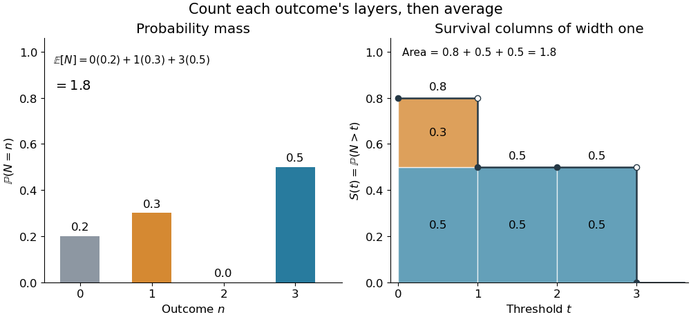
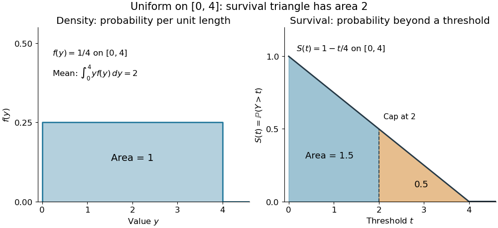

# Tail-sum formula

↑ **Parent:** [Expected value](expected-value-split.md)

The [tail-sum formula](tail-sum-formula.md) expresses an [expected value](expected-value-split.md) as the [area](surface-area.md) under a [survival function](survival-function.md). For every nonnegative [random variable](random-variable-split.md) $Y$,

$$
\boxed{\mathbb E[Y]=\int_0^\infty\mathbb P(Y>t)\,dt.}
$$

This [Lebesgue integral](lebesgue-integral.md) and the [expected value](expected-value-split.md) may both be $+\infty$; a [probability density function](probability-density-function.md) is unnecessary. For a [random variable](random-variable-split.md) $N$ taking values in the [nonnegative integers](natural-number.md), the corresponding [sum](sum.md) is

$$
\boxed{\mathbb E[N]=\sum_{k=1}^\infty\mathbb P(N\geq k)=\sum_{k=0}^\infty\mathbb P(N>k).}
$$

The [events](event.md) $\{N>k\}$ and $\{N\geq k+1\}$ coincide because $N$ takes [integer](integer-split.md) values. Thus the strict [sum](sum.md) starts at zero, while the inclusive [sum](sum.md) starts at one.[Expected Value, §2 Additional Properties, Right Distribution Function: nonnegative tail integral and integer-valued tail sums](random-probability-mathematical-statistics-stochastic-processes-by-kyle-siegrist.md)

For an original example, let the [probability mass function](probability-mass-function.md) of $N$ be

$$
\mathbb P(N=0)=\frac15,\qquad\mathbb P(N=1)=\frac3{10},\qquad\mathbb P(N=3)=\frac12.
$$

Its [expected value](expected-value-split.md) computed directly is $0(1/5)+1(3/10)+3(1/2)=9/5=1.8$. The strict [tail probabilities](tail-probability.md) at thresholds $0,1,2,3$ are $4/5,1/2,1/2,0$: their [sum](sum.md) is again $1.8$. There is no [probability mass](probability-mass.md) at two, yet the [event](event.md) $\{N>2\}$ still has [probability](probability.md) $1/2$. The [survival function](survival-function.md) has heights $4/5,1/2,1/2$ on the successive [intervals](interval-mathematics.md) $[0,1),[1,2),[2,3)$; each [interval](interval-mathematics.md) has length one, so its [integral](integral-split.md) is the same [sum](sum.md).

**[Figure 2](#image-the-same-expected-value-from-probability-masses-and-survival-columns). The same expected value from probability masses and survival columns**. The exact constructed [probability mass function](probability-mass-function.md) assigns $1/5,3/10,1/2$ to $0,1,3$. The $3/10$ contribution appears in one survival column, while the $1/2$ contribution appears in three. Filled endpoints give the strict [survival function](survival-function.md) at its jumps; open endpoints show the preceding height. The shaded [area](surface-area.md) is $3/10+3(1/2)=1.8$.

The indexing matters numerically. Starting the inclusive [sum](sum.md) at zero adds $\mathbb P(N\geq0)=1$, giving $2.8$ for this example. Starting the strict [sum](sum.md) at one omits $\mathbb P(N>0)=4/5$, giving $1$. For a general nonnegative [random variable](random-variable-split.md), replacing $>$ with $\geq$ inside the [integral](integral-split.md) is harmless: the difference is $\mathbb P(Y=t)$, nonzero at only a [countable set](countable-set.md) of thresholds. For each positive [integer](integer-split.md) $m$, at most $m$ thresholds can have [probability mass](probability-mass.md) at least $1/m$; their [countable union](countable-union.md) contains all thresholds with positive [probability mass](probability-mass.md) and has [Lebesgue measure](lebesgue-measure.md) zero. This reasoning concerns an [integral](integral-split.md), not equality of the two [survival function](survival-function.md) conventions at every [point](point-geometry.md).

For a continuous original example, take the [uniform distribution](continuous-uniform-distribution.md) on the [interval](interval-mathematics.md) $[0,4]$. Its [survival function](survival-function.md) is $S(t)=1-t/4$ for $0\leq t\leq4$ and zero for $t>4$. The [area](surface-area.md) is a [triangle](triangle.md) of base four and height one:

$$
\mathbb E[Y]=\int_0^4\left(1-\frac t4\right)dt=2.
$$

Directly integrating against the [probability density function](probability-density-function.md) gives the same [expected value](expected-value-split.md), $\int_0^4 y(1/4)\,dy=2$. The [integral](integral-split.md) of the [probability density function](probability-density-function.md) alone is one; it is the [survival function](survival-function.md) whose [area](surface-area.md) is the [expected value](expected-value-split.md).

**[Figure 3](#image-a-uniform-density-has-total-probability-one-and-survival-area-two). A uniform density has total probability one and survival area two**. Exact curves for the [uniform distribution](continuous-uniform-distribution.md) on $[0,4]$. The [probability density function](probability-density-function.md) has [integral](integral-split.md) one, while the [survival function](survival-function.md) has [integral](integral-split.md) two. Splitting the survival [area](surface-area.md) at $t=2$ gives $1.5$ before the cap and $0.5$ beyond it, the [expected values](expected-value-split.md) of $\min(Y,2)$ and the [positive part](positive-part-of-a-real-valued-function.md) $(Y-2)_+$, respectively.

The proof counts layers of each outcome. For a realized value $y\geq0$, the [indicator function](indicator-function.md) $\mathbf1_{\{y>t\}}$ equals one over an [interval](interval-mathematics.md) of length $y$, so

$$
Y=\int_0^\infty\mathbf1_{\{Y>t\}}\,dt,\qquad
\mathbb E[Y]=\int_0^\infty\mathbb E[\mathbf1_{\{Y>t\}}]dt=\int_0^\infty\mathbb P(Y>t)dt.
$$

[Tonelli theorem](tonelli-theorem.md) permits the interchange because the [indicator function](indicator-function.md) is nonnegative; no finite [expected value](expected-value-split.md) is assumed. Similarly, an outcome $N=n$ contributes one [indicator random variable](indicator-random-variable.md) for each of the $n$ [events](event.md) $\{N\geq k\}$ that occur:

$$
N=\sum_{k=1}^\infty\mathbf1_{\{N\geq k\}},\qquad
\mathbb E[N]=\sum_{k=1}^\infty\mathbb E[\mathbf1_{\{N\geq k\}}]=\sum_{k=1}^\infty\mathbb P(N\geq k).
$$

Again [Tonelli theorem](tonelli-theorem.md) applies to the nonnegative [sum](sum.md), or equivalently the [monotone convergence theorem](monotone-convergence-theorem.md) applies to its [partial sums](partial-sum.md). This exchanges counting layers within each outcome with averaging across outcomes. The existing [integer-valued hypothesis in the tail-sum formula](integer-valued-hypothesis-in-the-tail-sum-formula.md) explains what changes when the values are not [integers](integer-split.md); the [tail integral formula for moments](tail-integral-formula-for-moments.md) weights the layers to obtain higher [moments](moment.md).

For an [integrable random variable](integrable-random-variable.md) $X$ that can have either sign, apply the nonnegative formula separately to its [positive part](positive-part-of-a-real-valued-function.md) $X_+=\max(X,0)$ and [negative part](negative-part-of-a-real-valued-function.md) $X_-=\max(-X,0)$:

$$
\mathbb E[X]=\int_0^\infty\mathbb P(X>t)dt-\int_0^\infty\mathbb P(X<-t)dt.
$$

[Integrability](integrability.md) makes both [integrals](integral-split.md) finite. More generally the difference defines an extended [expected value](expected-value-split.md) when at least one is finite; if both are infinite, subtraction does not define an [expected value](expected-value-split.md).[Expected Value, §2 Additional Properties, A General Definition: positive and negative parts and the condition on their expectations](random-probability-mathematical-statistics-stochastic-processes-by-kyle-siegrist.md)

[Tail probabilities](tail-probability.md) are often easier to measure or bound than a whole [probability density function](probability-density-function.md). For a device's [survival time](survival-time.md), the [survival function](survival-function.md) records the [probability](probability.md) of still operating at each threshold; its [integral](integral-split.md) gives the mean operating time. A finite observation window naturally gives the [expected value of a capped nonnegative random variable](expected-value-of-a-capped-nonnegative-random-variable.md). For a mathematical bound, $\mathbb P(Y>t)\leq e^{-t/2}$ for all $t\geq0$ implies $\mathbb E[Y]\leq\int_0^\infty e^{-t/2}dt=2$. The [tail-sum formula](tail-sum-formula.md) turns control of a whole family of [events](event.md) into control of an average.

**Table of contents**

- [Integer-valued hypothesis in the tail-sum formula](integer-valued-hypothesis-in-the-tail-sum-formula.md)
- [Expected value of a capped nonnegative random variable](expected-value-of-a-capped-nonnegative-random-variable.md)

## ↑ Ancestors (6)

1. [Expected value](expected-value-split.md)
2. [Probability theory](probability-theory-split.md)
3. [Probability and statistics](probability-and-statistics-split.md)
4. [Area of mathematics](area-of-mathematics.md)
5. [Mathematics](mathematics-split.md)
6. [Codex Wiki](split.md)

## ← Incoming links (12)

- [Discrete random variable](discrete-random-variable.md)
- [Expected value of a capped nonnegative random variable](expected-value-of-a-capped-nonnegative-random-variable.md)
- [Integer-valued hypothesis in the tail-sum formula](integer-valued-hypothesis-in-the-tail-sum-formula.md)
- [Solution](past-exam-of-the-mathematics-course-of-the-university-of-cambridge/2014/ia/paper-2/11f/solution.md)
- [Solution](past-exam-of-the-mathematics-course-of-the-university-of-cambridge/2014/ia/paper-2/4f/solution.md)
- [Solution](past-exam-of-the-mathematics-course-of-the-university-of-cambridge/2018/ii/paper-4/27j/solution.md)
- [Solution](past-exam-of-the-mathematics-course-of-the-university-of-cambridge/2020/ii/paper-3/27k/solution.md)
- [Solution](past-exam-of-the-mathematics-course-of-the-university-of-cambridge/2026/iii/paper-212/2/c/i/solution.md)
- [Solution](past-exam-of-the-mathematics-course-of-the-university-of-cambridge/2026/iii/paper-218/2/d/solution.md)
- [Tail probability](tail-probability.md)
- [Tail-sum formula](tail-sum-formula.md)
- [Uniform-sum crossing time below one](uniform-sum-crossing-time-below-one.md)
