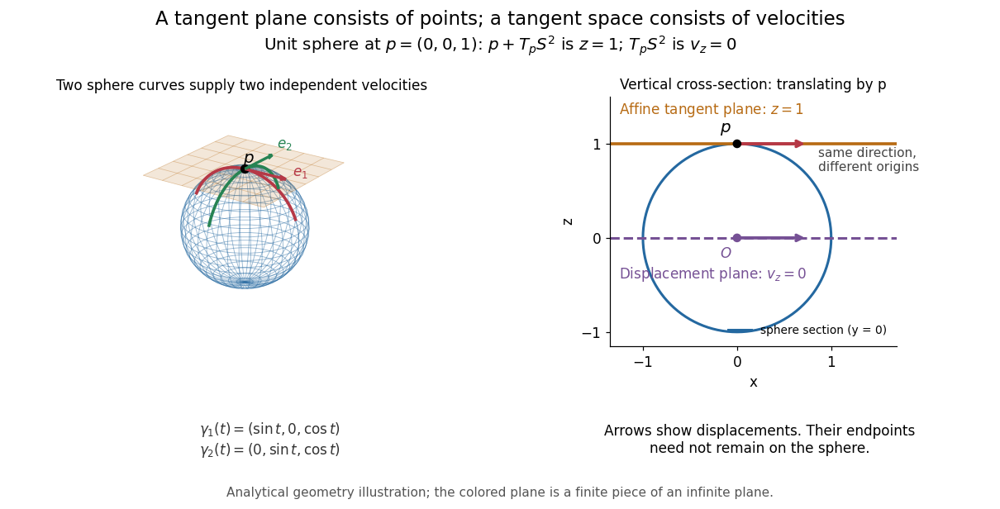

# Tangent plane

↑ **Parent:** [Tangent space](tangent-space.md)

For an embedded [regular surface](smooth-surface.md) $M\subseteq\mathbb R^3$ and $p\in M$, the affine [tangent plane](tangent-plane.md) is

$$
p+T_pM=\{p+v:v\in T_pM\}.
$$

It is a set of points through $p$, whereas the [tangent space](tangent-space.md) $T_pM$ is a [vector space](vector-space-split.md) of displacements with [zero vector](zero-vector.md). Some texts also call that two-dimensional [tangent space](tangent-space.md) the [tangent plane](tangent-plane.md); here the translation by $p$ distinguishes the two uses. For a regular [parametric surface](parametric-surface.md) $X(u,v)$ with $p=X(u_0,v_0)$,

$$
T_pM=\operatorname{span}\{X_u,X_v\},\qquad
p+T_pM=\{p+aX_u+bX_v:a,b\in\mathbb R\},
$$

where the [partial derivatives](partial-derivative.md) are evaluated at $(u_0,v_0)$. Regularity means that these [tangent vectors](tangent-vector.md) are [linearly independent](linear-independence.md), equivalently $X_u\times X_v\ne0$. Their [cross product](cross-product.md) is a [normal vector](normal-vector.md). [Theodore Shifrin, Differential Geometry: A First Course in Curves and Surfaces, Chapter 2, §1: regular parametrizations and tangent planes](https://www.math.uga.edu/sites/default/files/inline-files/ShifrinDiffGeo.pdf)

For an implicit [regular surface](smooth-surface.md) $F(x,y,z)=0$, require a [smooth function](smooth-function.md) $F$ with $\nabla F(p)\ne0$. Then

$$
T_pM=\ker DF_p=\{v:\nabla F(p)\cdot v=0\},\qquad
p+T_pM=\{r:\nabla F(p)\cdot(r-p)=0\}.
$$

Differentiating $F(\gamma(t))=0$ proves that every surface [velocity](velocity.md) lies in the displayed [kernel of a linear map](kernel-of-a-linear-map.md); the [implicit function theorem](implicit-function-theorem.md) gives a local graph with two independent coordinates, proving equality. The [gradient](gradient.md) is the [normal vector](normal-vector.md) with respect to the ambient [dot product](dot-product.md). [Eckhard Meinrenken, Differentiable Manifolds, Theorem 1.15: regular level sets](https://www.math.toronto.edu/mein/teaching/LectureNotes/Man.pdf)

For the [sphere](sphere.md) $F(r)=r\cdot r-R^2$, $\nabla F(p)=2p\ne0$, and the affine [tangent plane](tangent-plane.md) has equation $p\cdot r=R^2$. At the unit [sphere](sphere.md)'s north pole $p=(0,0,1)$, compare the plane $z=1$ with the displacement [tangent space](tangent-space.md) $v_z=0$. The regular [parametric surface](parametric-surface.md) $X(u,v)=(u,v,\sqrt{1-u^2-v^2})$, for $u^2+v^2<1$, gives $X_u(0,0)=(1,0,0)$ and $X_v(0,0)=(0,1,0)$, confirming the same answer.

**[Figure 6](#image-the-sphere-s-tangent-plane-passes-through-the-base-point-its-tangent-space-contains-displacements). The sphere's tangent plane passes through the base point; its tangent space contains displacements**.

This analytical illustration shows a unit [sphere](sphere.md) and a vertical cross-section. The [smooth curves](smooth-curve.md) $\gamma_1(t)=(\sin t,0,\cos t)$ and $\gamma_2(t)=(0,\sin t,\cos t)$ give the two displayed [tangent vectors](tangent-vector.md) at $p$. The straight point $p+tv$ for any nonzero $v\in T_pS^2$ is outside the [sphere](sphere.md) when $t\ne0$, since $\|p+tv\|^2=1+t^2\|v\|^2$. A [tangent plane](tangent-plane.md) therefore captures first-order motion, not an exact patch of the [regular surface](smooth-surface.md).

The same idea makes local approximation useful. For the [graph of a function](graph-of-a-function.md) $z=f(x,y)$ with $f$ a [smooth function](smooth-function.md), the affine [tangent plane](tangent-plane.md) is $z=f(a,b)+f_x(a,b)(x-a)+f_y(a,b)(y-b)$. [Gilbert Strang and Edwin Herman, OpenStax Calculus Volume 3, §4.4: tangent planes and linear approximations](https://openstax.org/books/calculus-volume-3/pages/4-4-tangent-planes-and-linear-approximations) With continuous second [partial derivatives](partial-derivative.md), the vertical error is $O((x-a)^2+(y-b)^2)$ in [Big O notation](big-o-notation.md). On the unit [sphere](sphere.md) near its north pole, $\sqrt{1-u^2-v^2}=1-\tfrac12(u^2+v^2)+O((u^2+v^2)^2)$: the [tangent plane](tangent-plane.md) loses quadratic bending while preserving all first-order [velocities](velocity.md).

A failed regularity test needs interpretation. Replacing the [sphere](sphere.md) equation by $G(r)=(r\cdot r-1)^2=0$ makes $\nabla G=0$ everywhere on the same perfectly regular [sphere](sphere.md), so this defining [smooth function](smooth-function.md) cannot recover its [tangent plane](tangent-plane.md). Similarly, the usual spherical [parametric surface](parametric-surface.md) loses [matrix rank](matrix-rank.md) at the poles, while the graph parametrization above remains regular there. A vanishing [gradient](gradient.md) or degenerate parametrization invalidates that calculation; it alone does not prove that the underlying geometry has no [tangent plane](tangent-plane.md).

## ↑ Ancestors (7)

1. [Tangent space](tangent-space.md)
2. [Tangent vector](tangent-vector.md)
3. [Differential geometry](differential-geometry-split.md)
4. [Geometry and topology](geometry-and-topology-split.md)
5. [Area of mathematics](area-of-mathematics.md)
6. [Mathematics](mathematics-split.md)
7. [Codex Wiki](split.md)

## ← Incoming links (11)

- [Parametric surface interrogation](parametric-surface-interrogation.md)
- [Solution](past-exam-of-the-mathematics-course-of-the-university-of-cambridge/2001/iii/paper-56/4/solution.md)
- [Solution](past-exam-of-the-mathematics-course-of-the-university-of-cambridge/2005/ia/paper-1/6b/solution.md)
- [Solution](past-exam-of-the-mathematics-course-of-the-university-of-cambridge/2005/iii/paper-66/5/ii/solution.md)
- [Solution](past-exam-of-the-mathematics-course-of-the-university-of-cambridge/2005/iii/paper-66/6/ii/solution.md)
- [Solution](past-exam-of-the-mathematics-course-of-the-university-of-cambridge/2006/ib/paper-2/12h/solution.md)
- [Principal curvature](principal-curvature.md)
- [Shape operator](shape-operator.md)
- [Spherical law of cosines](spherical-law-of-cosines.md)
- [Tangent plane](tangent-plane.md)
- [Tangent space](tangent-space.md)
