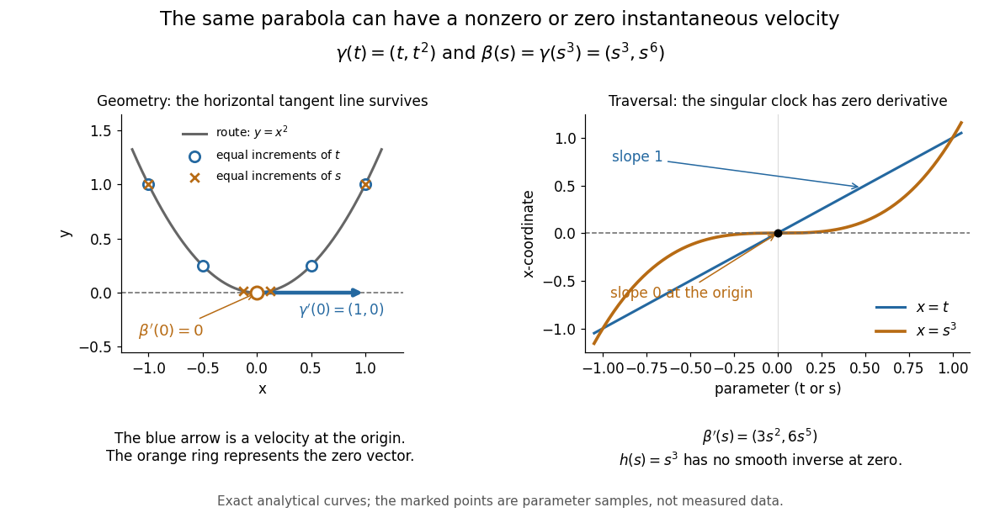

# Tangent vector

↑ **Parent:** [Differential geometry](differential-geometry-split.md)  
ⓦ [Wiki](https://en.wikipedia.org/wiki/Tangent_vector)

A [tangent vector](tangent-vector.md) at a point $p$ of a [smooth manifold](smooth-manifold.md) without boundary records an instantaneous [velocity](velocity.md) through $p$. Its base point is part of the data; measuring its length additionally requires a [Riemannian metric](riemannian-metric.md). Intrinsically, a [smooth curve](smooth-curve.md) $\gamma$ with $\gamma(0)=p$ defines its [tangent vector](tangent-vector.md) by how every local [smooth function](smooth-function.md) changes along it:

$$
v(f)=\left.\frac{d}{dt}f(\gamma(t))\right|_{t=0}.
$$

This is a [derivation at a point](derivation-at-a-point.md). Two [smooth curves](smooth-curve.md) through $p$ represent the same [tangent vector](tangent-vector.md) if these [derivatives](derivative.md) agree for every such [smooth function](smooth-function.md); equivalently, their coordinate [velocity vectors](velocity-vector.md) agree in one [manifold chart](manifold-chart.md). The [chain rule](chain-rule.md) makes that agreement independent of the chosen [manifold chart](manifold-chart.md). [Loring W. Tu, An Introduction to Manifolds, §8.6: curves and intrinsic velocity](https://www.math.toronto.edu/~jeffrey/matd67/tu.pdf)

For an [embedded submanifold](embedded-submanifold.md) of [Euclidean space](euclidean-norm.md), the intrinsic [tangent vector](tangent-vector.md) is represented by the ordinary [derivative](derivative.md) $\gamma'(0)$, with its base point $p$ retained. A drawn arrow starting at $p$ represents that [tangent vector](tangent-vector.md); its endpoint $p+\gamma'(0)$ need not lie on the [embedded submanifold](embedded-submanifold.md). Nor is a [tangent vector](tangent-vector.md) required to be a [unit tangent vector](unit-tangent-vector.md): a stationary [smooth curve](smooth-curve.md) gives the [zero vector](zero-vector.md), which belongs to the [tangent space](tangent-space.md) but has no direction to normalize.

Here are explicit calculations. In $\mathbb R^2$, $\gamma(t)=(t,t^2)$ and $\eta(t)=(t,2t^2)$ have different routes but the same [tangent vector](tangent-vector.md) $(1,0)$ at $(0,0)$. For $f(x,y)=3x+y$, both give $v(f)=3$. For a [circle](circle.md) of [radius](radius.md) $R$, $c(t)=(R\cos(\omega t),R\sin(\omega t))$ has [tangent vector](tangent-vector.md) $(0,R\omega)$ at $(R,0)$: changing $\omega$ changes the [speed](speed.md) or reverses travel without changing the [circle](circle.md).

A [reparametrization](reparametrization.md) $\beta(s)=\gamma(h(s))$ with $h(0)=0$ gives, by the [chain rule](chain-rule.md), $\beta'(0)=h'(0)\gamma'(0)$. A regular change of [curve parameter](curve-parameter.md) has $h'(0)\ne0$. The singular choice $h(s)=s^3$ instead gives

$$
\gamma(t)=(t,t^2),\qquad \beta(s)=(s^3,s^6),\qquad \gamma'(0)=(1,0),\qquad \beta'(0)=(0,0).
$$

Both describe the same [parabola](parabola.md), whose [tangent line](tangent-line.md) at the origin is still the horizontal axis. The zero [velocity](velocity.md) diagnoses this singular change of [curve parameter](curve-parameter.md), whose inverse is not differentiable at zero; it does not show that the geometric [tangent line](tangent-line.md) is absent. The [regular curve](regular-curve.md) $\gamma$ supplies its nonzero direction.

**[Figure 5](#image-one-parabola-different-velocities-a-singular-parameter-change-can-stop-the-arrow). One parabola, different velocities: a singular parameter change can stop the arrow**.

The diagram is an analytical illustration of these exact [parametric curves](parametric-curve.md), with equal parameter increments marked on each route. It separates geometry from traversal: the [tangent line](tangent-line.md) depends on the route, while a [velocity vector](velocity-vector.md) also depends on how the [curve parameter](curve-parameter.md) advances.

**Table of contents**

- [Derivation at a point](derivation-at-a-point.md)
- [Tangent space](tangent-space.md)
  - [Tangent plane](tangent-plane.md)
  - [Tangent space by point derivations](tangent-space-by-point-derivations.md)
  - [Cotangent space](cotangent-space.md)
    - [Inner product on exterior powers of a cotangent space](inner-product-on-exterior-powers-of-a-cotangent-space.md)
  - [Tangent space from a local parametrization](tangent-space-from-a-local-parametrization.md)
  - [Closedness of tangent spaces under convergent base points](closedness-of-tangent-spaces-under-convergent-base-points.md)
  - [Coordinate basis](coordinate-basis.md)
- [Unit tangent vector](unit-tangent-vector.md)
- [Velocity vector](velocity-vector.md)

## ↑ Ancestors (5)

1. [Differential geometry](differential-geometry-split.md)
2. [Geometry and topology](geometry-and-topology-split.md)
3. [Area of mathematics](area-of-mathematics.md)
4. [Mathematics](mathematics-split.md)
5. [Codex Wiki](split.md)

## ← Incoming links (87)

- [Bézier curve](bezier-curve.md)
- [Chaikin subdivision](chaikin-subdivision.md)
- [Closest-point search on a subdivision curve](closest-point-search-on-a-subdivision-curve.md)
- [Coordinate basis](coordinate-basis.md)
- [Covector](covector.md)
- [Derivation at a point](derivation-at-a-point.md)
- [Differential form](differential-form-split.md)
- [Differential geometry of surfaces](differential-geometry-of-surfaces.md)
- [Differential of a smooth function](differential-of-a-smooth-function.md)
- [Differentiating left-invariant matrix fields](differentiating-left-invariant-matrix-fields.md)
- [Exponential map of a Lie group](exponential-map-of-a-lie-group.md)
- [First fundamental form](first-fundamental-form.md)
- [Geodesic](geodesic.md)
- [Geodesic conserved quantity from a Killing vector](geodesic-conserved-quantity-from-a-killing-vector.md)
- [Holonomy around circular fibres](holonomy-around-circular-fibres.md)
- [Induced metric](induced-metric.md)
- [Isocline](isocline.md)
- [Isometric immersion](isometric-immersion.md)
- [Killing equation](killing-equation.md)
- [Killing vector field](killing-vector-field.md)
- [Knot](knot.md)
- [Knot diagram](knot-diagram.md)
- [Mean curvature of a catenoid](mean-curvature-of-a-catenoid.md)
- [Normal reversal around the Möbius core](normal-reversal-around-the-mobius-core.md)
- [Normal vector](normal-vector.md)
- [One-form](one-form.md)
- [One-parameter subgroup](one-parameter-subgroup.md)
- [Outward conormal of a surface boundary](outward-conormal-of-a-surface-boundary.md)
- [Parametric curve](parametric-curve.md)
- [Solution](past-exam-of-the-mathematics-course-of-the-university-of-cambridge/2001/iii/paper-56/4/solution.md)
- [Solution](past-exam-of-the-mathematics-course-of-the-university-of-cambridge/2002/iii/paper-59/2/solution.md)
- [Solution](past-exam-of-the-mathematics-course-of-the-university-of-cambridge/2002/iii/paper-59/6/solution.md)
- [Solution](past-exam-of-the-mathematics-course-of-the-university-of-cambridge/2003/iii/paper-14/1/solution.md)
- [Solution](past-exam-of-the-mathematics-course-of-the-university-of-cambridge/2003/iii/paper-68/2/solution.md)
- [Solution](past-exam-of-the-mathematics-course-of-the-university-of-cambridge/2003/iii/paper-68/3/solution.md)
- [Solution](past-exam-of-the-mathematics-course-of-the-university-of-cambridge/2004/iii/paper-70/2/i/solution.md)
- [Solution](past-exam-of-the-mathematics-course-of-the-university-of-cambridge/2004/iii/paper-70/5/i/solution.md)
- [Solution](past-exam-of-the-mathematics-course-of-the-university-of-cambridge/2005/iii/paper-60/1/solution.md)
- [Solution](past-exam-of-the-mathematics-course-of-the-university-of-cambridge/2006/ii/paper-2/24h/c/solution.md)
- [Solution](past-exam-of-the-mathematics-course-of-the-university-of-cambridge/2006/iii/paper-66/2/solution.md)
- [Solution](past-exam-of-the-mathematics-course-of-the-university-of-cambridge/2006/iii/paper-66/3/b/solution.md)
- [Solution](past-exam-of-the-mathematics-course-of-the-university-of-cambridge/2006/iii/paper-66/4/a/solution.md)
- [Solution](past-exam-of-the-mathematics-course-of-the-university-of-cambridge/2006/iii/paper-76/1/solution.md)
- [Solution](past-exam-of-the-mathematics-course-of-the-university-of-cambridge/2008/iii/paper-77/3/iii/solution.md)
- [Solution](past-exam-of-the-mathematics-course-of-the-university-of-cambridge/2008/iii/paper-77/4/iii/solution.md)
- [Solution](past-exam-of-the-mathematics-course-of-the-university-of-cambridge/2008/iii/paper-77/6/solution.md)
- [Solution](past-exam-of-the-mathematics-course-of-the-university-of-cambridge/2008/iii/paper-86/2/solution.md)
- [Solution](past-exam-of-the-mathematics-course-of-the-university-of-cambridge/2009/iii/paper-17/3/c/solution.md)
- [Solution](past-exam-of-the-mathematics-course-of-the-university-of-cambridge/2009/iii/paper-58/1/solution.md)
- [Solution](past-exam-of-the-mathematics-course-of-the-university-of-cambridge/2012/iii/paper-56/1/c/i/solution.md)
- [Solution](past-exam-of-the-mathematics-course-of-the-university-of-cambridge/2012/iii/paper-56/2/a/solution.md)
- [Solution](past-exam-of-the-mathematics-course-of-the-university-of-cambridge/2012/iii/paper-56/4/a/ii/solution.md)
- [Solution](past-exam-of-the-mathematics-course-of-the-university-of-cambridge/2014/iii/paper-50/1/a/solution.md)
- [Solution](past-exam-of-the-mathematics-course-of-the-university-of-cambridge/2015/iii/paper-17/1/solution.md)
- [Solution](past-exam-of-the-mathematics-course-of-the-university-of-cambridge/2015/iii/paper-17/4/solution.md)
- [Solution](past-exam-of-the-mathematics-course-of-the-university-of-cambridge/2016/ia/paper-3/3c/solution.md)
- [Solution](past-exam-of-the-mathematics-course-of-the-university-of-cambridge/2017/ii/paper-3/36d/ii/solution.md)
- [Solution](past-exam-of-the-mathematics-course-of-the-university-of-cambridge/2017/ii/paper-3/36d/iv/solution.md)
- [Solution](past-exam-of-the-mathematics-course-of-the-university-of-cambridge/2017/iii/paper-309/1/b/solution.md)
- [Solution](past-exam-of-the-mathematics-course-of-the-university-of-cambridge/2018/iii/paper-140/5/a/solution.md)
- [Solution](past-exam-of-the-mathematics-course-of-the-university-of-cambridge/2023/ib/paper-1/11f/solution.md)
- [Solution](past-exam-of-the-mathematics-course-of-the-university-of-cambridge/2023/ib/paper-2/11f/solution.md)
- [Solution](past-exam-of-the-mathematics-course-of-the-university-of-cambridge/2023/ib/paper-3/12e/iii/solution.md)
- [Solution](past-exam-of-the-mathematics-course-of-the-university-of-cambridge/2023/ib/paper-3/12e/solution.md)
- [Solution](past-exam-of-the-mathematics-course-of-the-university-of-cambridge/2024/ib/paper-3/2g/solution.md)
- [Solution](past-exam-of-the-mathematics-course-of-the-university-of-cambridge/2024/ii/paper-1/26j/c/solution.md)
- [Solution](past-exam-of-the-mathematics-course-of-the-university-of-cambridge/2025/ib/paper-1/4c/solution.md)
- [Solution](past-exam-of-the-mathematics-course-of-the-university-of-cambridge/2026/iii/paper-105/1/c/solution.md)
- [Solution](past-exam-of-the-mathematics-course-of-the-university-of-cambridge/2026/iii/paper-332/4/b/solution.md)
- [Principal curvature](principal-curvature.md)
- [Pullback of a differential form](pullback-of-a-differential-form.md)
- [Riemannian distance](riemannian-distance.md)
- [Riemannian metric](riemannian-metric.md)
- [Shape operator](shape-operator.md)
- [Spherical geometry](spherical-geometry.md)
- [Spherical law of cosines](spherical-law-of-cosines.md)
- [Spherical law of sines](spherical-law-of-sines.md)
- [Spherical triangle](spherical-triangle.md)
- [Subdivision surface](subdivision-surface.md)
- [Tangent plane](tangent-plane.md)
- [Tangent space](tangent-space.md)
- [Tangent vector](tangent-vector.md)
- [Tangential boundary derivative](tangential-boundary-derivative.md)
- [Theorema Egregium](theorema-egregium.md)
- [Timelike curve](timelike-curve.md)
- [Transversal surface intersection tracing](transversal-surface-intersection-tracing.md)
- [Unit tangent vector](unit-tangent-vector.md)
