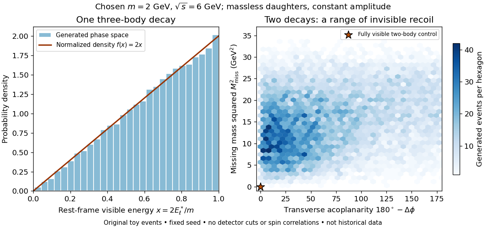

# Tau-pair missing-mass teaching model

↑ **Parent:** [Three-body leptonic tau-decay kinematic bounds](three-body-leptonic-tau-decay-kinematic-bounds.md)

Choose $m_\tau=2\,\mathrm{GeV}$ and $\sqrt{s}=6\,\mathrm{GeV}$ purely for illustration. Then each parent has $E_\tau=3\,\mathrm{GeV}$, $|\mathbf p_\tau|=\sqrt5\,\mathrm{GeV}$ and $\beta=\sqrt5/3$. Treat all six daughters as massless, including the charged [electron](electron.md) and [antimuon](antimuon.md), and generate each three-body [particle decay](particle-decay.md) with constant squared [decay amplitude](decay-amplitude.md). Choose the parent direction isotropically and the two decays independently; this omits the physical production angular law and [spin](spin.md) correlations.

The [Lorentz-invariant phase space](lorentz-invariant-phase-space.md) factorizes through $t=q^2$ into a two-body decay to $\ell+q$, followed by a two-body decay of $q$:

$$
d\Phi_3=\frac{dt}{2\pi}\,d\Phi_2(P_\tau;p_\ell,q)\,d\Phi_2(q;q_1,q_2).
$$

After angular integration the first factor contributes $1-t/m_\tau^2=x$, while the massless second factor is constant. Since $|dt|=m_\tau^2dx$, the normalized chosen density is $f(x)=2x$. Drawing $x=\sqrt U$ with $U$ uniform on $[0,1]$ implements this density. Isotropic directions, followed by a [Lorentz boost](lorentz-boost.md) for the invisible pair and another for the parent, conserve the complete [four-momentum](four-momentum.md) of each generated event.

**[Figure 10](#image-three-body-phase-space-spreads-visible-energies-and-invisible-recoil). Three-body phase space spreads visible energies and invisible recoil**. Original fixed-seed teaching sample with chosen masses, massless daughters and a constant decay amplitude. The two-body control has all outgoing four-momentum visible. The transverse acoplanarity convention is $180^\circ-\Delta\phi$; this is a geometric diagnostic, without the historical selection cuts. These are not historical data or a true weak-decay spectrum.

Define transverse acoplanarity by $\alpha=\pi-\Delta\phi$, where $\Delta\phi\in[0,\pi]$ is the angle between the two visible [momentum](momentum-split.md) projections perpendicular to the beam. A fully visible two-body event with zero initial transverse [momentum](momentum-split.md) has $\alpha=0$ and $M_{\rm miss}^2=0$. The toy [tau lepton](tau-particle.md) events spread away from that point. These observables are complementary: an angular imbalance asks about directions, while the [missing invariant mass](missing-invariant-mass.md) also uses the visible [energies](energy-split.md) and longitudinal [momenta](momentum-split.md).

A [Lorentz-invariant phase space](lorentz-invariant-phase-space.md) density supplies allowed configurations and their geometric measure. A physical [weak interaction](weak-interaction.md) [decay amplitude](decay-amplitude.md) reweights them and correlates [spins](spin.md). Consequently the plotted density is a lesson about conservation and available configurations, not a predicted experimental rate or a fit to the discovery sample. The massless charged-daughter approximation is also unsuitable near the [muon](muon.md) rest-energy threshold.

## ↑ Ancestors (11)

1. [Three-body leptonic tau-decay kinematic bounds](three-body-leptonic-tau-decay-kinematic-bounds.md)
2. [Tau-pair electron-muon missing-energy signature](tau-pair-electron-muon-missing-energy-signature.md)
3. [SPEAR Mark I tau discovery experiment](spear-mark-i-tau-discovery-experiment.md)
4. [Tau (particle)](tau-particle.md)
5. [Lepton](lepton.md)
6. [Standard Model fermion](standard-model-fermion.md)
7. [Standard Model](standard-model-split.md)
8. [Quantum field theory](quantum-field-theory-split.md)
9. [Branches of physics](branches-of-physics.md)
10. [Physics](physics-split.md)
11. [Codex Wiki](split.md)
