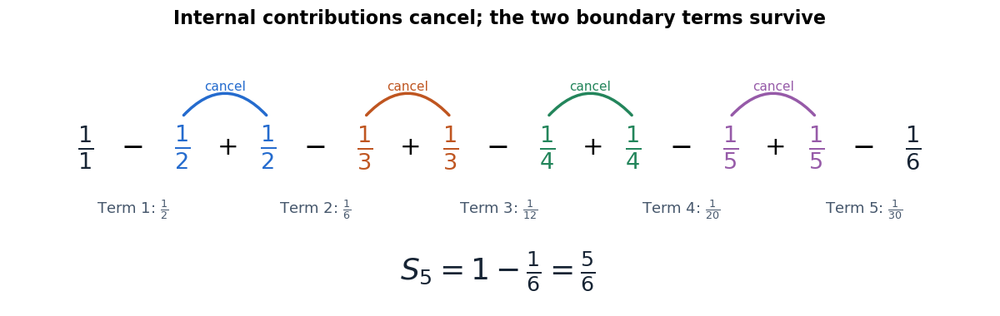

# Telescoping series

↑ **Parent:** [Series (mathematics)](series-mathematics.md)  
ⓦ [Wiki](https://en.wikipedia.org/wiki/Telescoping_series)

A [telescoping series](telescoping-series.md) has [partial sums](partial-sum.md) in which internal contributions cancel. The basic pattern is $a_n=b_n-b_{n+1}$, for which finite [summation](summation.md) gives

$$
\sum_{n=1}^{N}(b_n-b_{n+1})
=(b_1-b_2)+(b_2-b_3)+\cdots+(b_N-b_{N+1})
=b_1-b_{N+1}.
$$

Only the two boundary terms survive. If $b_n$ tends to a finite [limit of a sequence](limit-of-a-sequence.md) $L$, the [series](series-mathematics.md) consequently sums to $b_1-L$. The cancellation is exact for each finite $N$; the infinite result then follows by a [limit of a sequence](limit-of-a-sequence.md).

For example, [partial fraction decomposition](partial-fraction-decomposition.md) gives

$$
\frac1{n(n+1)}=\frac1n-\frac1{n+1},\qquad
\sum_{n=1}^{N}\frac1{n(n+1)}=1-\frac1{N+1}.
$$

The first three terms are $1/2,1/6,1/12$, with [partial sum](partial-sum.md) $3/4$. The first five have [partial sum](partial-sum.md) $5/6$. Taking the [limit of a sequence](limit-of-a-sequence.md) gives the concise answer

$$
\boxed{\sum_{n=1}^{\infty}\frac1{n(n+1)}=1}.
$$

**[Figure 22](#image-five-reciprocal-product-terms-cancel-internally-leaving-only-the-first-and-last-boundary-contributions). Five reciprocal-product terms cancel internally, leaving only the first and last boundary contributions**. Matching colors pair the negative $1/(n+1)$ in one term with the positive $1/(n+1)$ in the next. The cancellation leaves $1-1/6=5/6$, the fifth [partial sum](partial-sum.md), rather than the full infinite sum.

The appeal is that a long calculation becomes a boundary calculation. It works whenever the summand is a successive difference, not only for [rational functions](rational-function.md). For instance, $a_n=\log((n+1)/n)=\log(n+1)-\log n$ gives [partial sum](partial-sum.md) $\log(N+1)$, so its [series](series-mathematics.md) diverges despite the cancellation. A [telescoping series](telescoping-series.md) therefore need not be a [convergent series](convergent-series.md): one must still examine the surviving boundary term.

**Table of contents**

- [Tail of a telescoping reciprocal series](tail-of-a-telescoping-reciprocal-series.md)

## ↑ Ancestors (7)

1. [Series (mathematics)](series-mathematics.md)
2. [Sequence and series](sequence-and-series.md)
3. [Real analysis](real-analysis-split.md)
4. [Analysis](analysis-split.md)
5. [Area of mathematics](area-of-mathematics.md)
6. [Mathematics](mathematics-split.md)
7. [Codex Wiki](split.md)

## ← Incoming links (19)

- [Benford law](benford-law.md)
- [Bounded partial sums need not be Cesàro summable](bounded-partial-sums-need-not-be-cesaro-summable.md)
- [Chain rule for mutual information](chain-rule-for-mutual-information.md)
- [Discrete integrating factor](discrete-integrating-factor.md)
- [Factorial series](factorial-series.md)
- [Harmonic series](harmonic-series.md)
- [Partial sum](partial-sum.md)
- [Solution](past-exam-of-the-mathematics-course-of-the-university-of-cambridge/2008/ia/paper-4/8d/solution.md)
- [Solution](past-exam-of-the-mathematics-course-of-the-university-of-cambridge/2008/ii/paper-3/1h/solution.md)
- [Solution](past-exam-of-the-mathematics-course-of-the-university-of-cambridge/2014/ia/paper-4/5e/solution.md)
- [Solution](past-exam-of-the-mathematics-course-of-the-university-of-cambridge/2017/ia/paper-2/1c/a/solution.md)
- [Solution](past-exam-of-the-mathematics-course-of-the-university-of-cambridge/2017/ia/paper-2/1c/b/solution.md)
- [Solution](past-exam-of-the-mathematics-course-of-the-university-of-cambridge/2017/ii/paper-4/1g/solution.md)
- [Solution](past-exam-of-the-mathematics-course-of-the-university-of-cambridge/2019/ia/paper-4/2e/solution.md)
- [Series (mathematics)](series-mathematics.md)
- [Tail of a telescoping reciprocal series](tail-of-a-telescoping-reciprocal-series.md)
- [Telescoping series](telescoping-series.md)
- [Term test for divergence](term-test-for-divergence.md)
- [Variable-coefficient affine recurrence](variable-coefficient-affine-recurrence.md)
