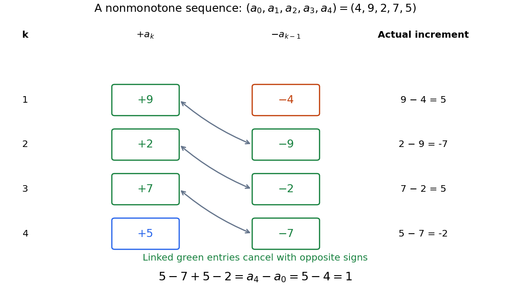

# Telescoping sum

↑ **Parent:** [Summation](summation.md)

A [telescoping sum](telescoping-sum.md) cancels intermediate [sequence terms](sequence-term.md), leaving [boundary terms](boundary-term.md). For a finite [sequence](sequence.md) of [real numbers](real-number.md) $a_0,\ldots,a_n$, the displayed identity follows because every $a_1,\ldots,a_{n-1}$ occurs once with each sign. Applying it to an infinite [series](series-mathematics.md) also requires checking the [limit](limit-of-a-function.md) of the [boundary terms](boundary-term.md); finite cancellation alone does not prove that the [series](series-mathematics.md) is a [convergent series](convergent-series.md).[Calculus Volume 2, §5.2 Infinite Series: Telescoping Series definition and successive partial-sum identities](calculus-volume-2-by-gilbert-strang-and-others/5-2-infinite-series.md)

For $n\geq1$, expanding the finite [sum](sum.md) gives

$$
\sum_{k=1}^n(a_k-a_{k-1})
=(a_1-a_0)+(a_2-a_1)+\cdots+(a_n-a_{n-1})
=a_n-a_0.
$$

No [monotone sequence](monotone-sequence.md) assumption is required. Consider the original [sequence](sequence.md) $4,9,2,7,5$. Its successive [finite differences](finite-difference-split.md) are $5,-7,5,-2$, so

$$
5-7+5-2=1=5-4.
$$

The large intermediate rise and fall disappear from the net change. This is useful whenever one knows successive changes rather than every absolute value: adding the changes reconstructs the final value from the initial one. It also checks a cumulative-update calculation without requiring all increments to be positive.

**[Figure 5](#image-opposite-signs-cancel-the-intermediate-sequence-terms-leaving-the-final-value-minus-the-initial-value). Opposite signs cancel the intermediate sequence terms, leaving the final value minus the initial value**. Original nonmonotone [sequence](sequence.md) $4,9,2,7,5$. Linked green entries have the same magnitude and opposite signs; the unmatched entries are $+5$ and $-4$. The increments are $5,-7,5,-2$, whose [sum](sum.md) is one.

A [finite difference](finite-difference-split.md) $\Delta a_{k-1}=a_k-a_{k-1}$ measures one discrete change. The identity $\sum_{k=1}^n\Delta a_{k-1}=a_n-a_0$ is the discrete counterpart of the [fundamental theorem of calculus](fundamental-theorem-of-calculus.md): accumulation of changes returns the endpoint difference. The related [summation by parts](abel-s-summation-formula.md) transfers a [finite difference](finite-difference-split.md) from one factor of a product to another, with explicit [boundary terms](boundary-term.md).

**Table of contents**

- [Meromorphic telescoping cancellation](meromorphic-telescoping-cancellation.md)
- [Partial fraction telescoping](partial-fraction-telescoping.md)
- [Boundary limits of telescoping series](boundary-limits-of-telescoping-series.md)

## ↑ Ancestors (6)

1. [Summation](summation.md)
2. [Addition](addition.md)
3. [Arithmetic](arithmetic-split.md)
4. [Area of mathematics](area-of-mathematics.md)
5. [Mathematics](mathematics-split.md)
6. [Codex Wiki](split.md)

## ← Incoming links (32)

- [Averaged stationarity bound for stochastic gradient descent](averaged-stationarity-bound-for-stochastic-gradient-descent.md)
- [Chain lower bound for a submodular set function](chain-lower-bound-for-a-submodular-set-function.md)
- [Chaining](chaining.md)
- [Convergence of the Stirling sequence](convergence-of-the-stirling-sequence.md)
- [Diminishing returns characterization of submodularity](diminishing-returns-characterization-of-submodularity.md)
- [Empty-coalition normalization](empty-coalition-normalization.md)
- [Martingale proof of the integral representation of a Lipschitz function](martingale-proof-of-the-integral-representation-of-a-lipschitz-function.md)
- [Meromorphic telescoping cancellation](meromorphic-telescoping-cancellation.md)
- [Nicomachus's theorem](nicomachus-s-theorem.md)
- [Solution](past-exam-of-the-algorithmic-foundations-of-learning-course-of-the-university-of-oxford/2025/1/c/ii/solution.md)
- [Solution](past-exam-of-the-algorithmic-foundations-of-learning-course-of-the-university-of-oxford/2025/2/a/i/solution.md)
- [Solution](past-exam-of-the-computer-science-course-of-the-university-of-oxford/2023/combinatorial-optimisation/1/b/solution.md)
- [Solution](past-exam-of-the-continuous-optimisation-course-of-the-university-of-oxford/2025/1/c/iii/solution.md)
- [Solution](past-exam-of-the-mathematics-course-of-the-university-of-oxford/2021/prelims/mathematics-ii/5/a/ii/solution.md)
- [Solution](past-exam-of-the-mathematics-course-of-the-year-1-of-the-natural-sciences-course-of-the-university-of-cambridge/2008/paper-1/10/i/solution.md)
- [Solution](past-exam-of-the-mathematics-course-of-the-year-1-of-the-natural-sciences-course-of-the-university-of-cambridge/2020/paper-1/11/a/iv/solution.md)
- [Solution](past-exam-of-the-mathematics-course-of-the-year-1-of-the-natural-sciences-course-of-the-university-of-cambridge/2025/paper-1/19/a/solution.md)
- [Solution](past-exam-of-the-msc-in-advanced-computer-science-course-of-the-university-of-oxford/2022/computational-game-theory/3/b/solution.md)
- [Solution](past-exam-of-the-msc-in-advanced-computer-science-course-of-the-university-of-oxford/2022/computational-game-theory/4/b/solution.md)
- [Solution](past-exam-of-the-msc-in-advanced-computer-science-course-of-the-university-of-oxford/2023/computational-game-theory/4/c/solution.md)
- [Solution](past-exam-of-the-optimisation-for-data-science-course-of-the-university-of-oxford/2023/1/c/solution.md)
- [Solution](past-exam-of-the-optimisation-for-data-science-course-of-the-university-of-oxford/2023/2/c/solution.md)
- [Solution](past-exam-of-the-optimisation-for-data-science-course-of-the-university-of-oxford/2023/2/f/solution.md)
- [Solution](past-exam-of-the-probability-measure-and-martingales-course-of-the-university-of-oxford/2023/2/c/iii/solution.md)
- [Solution](past-exam-of-the-year-1-of-the-computer-science-course-of-the-university-of-oxford/2005/calculus-linear-algebra-discrete-mathematics-logic-and-proof-and-models-of-computation/5/b/iv/solution.md)
- [Solution](past-exam-of-the-year-1-of-the-computer-science-course-of-the-university-of-oxford/2021/discrete-mathematics-continuous-mathematics-and-probability/2/a/ii/solution.md)
- [Solution](past-exam-of-the-year-1-of-the-computer-science-course-of-the-university-of-oxford/2023/functional-programming-design-and-analysis-of-algorithms/8/a/solution.md)
- [Potential method](potential-method.md)
- [Proximal gradient objective error bound](proximal-gradient-objective-error-bound.md)
- [Stationarity from uniformly bounded quasi-Newton matrices](stationarity-from-uniformly-bounded-quasi-newton-matrices.md)
- [Telescoping sum](telescoping-sum.md)
- [Uniform payoff bound against Tit for tat](uniform-payoff-bound-against-tit-for-tat.md)
