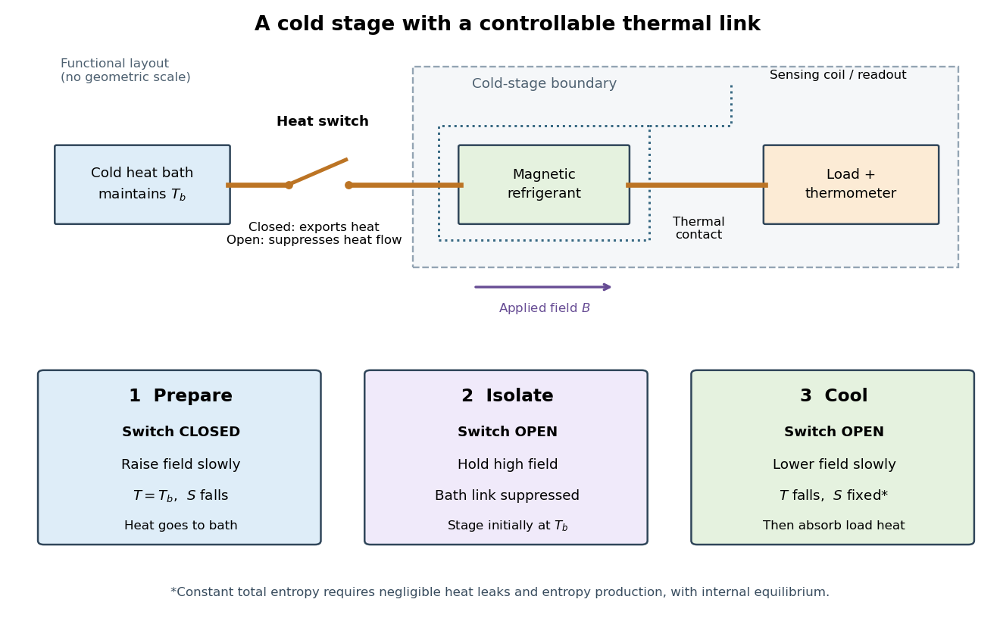
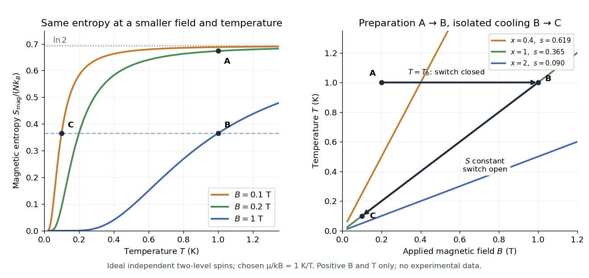
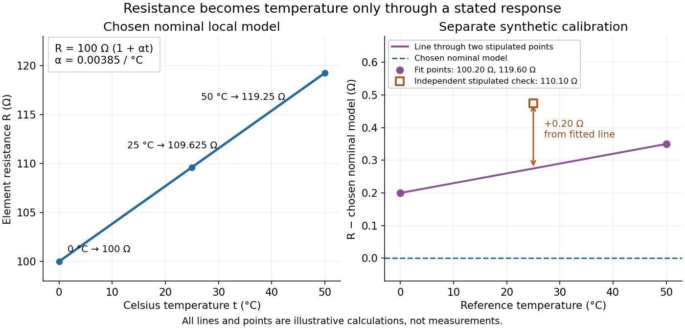
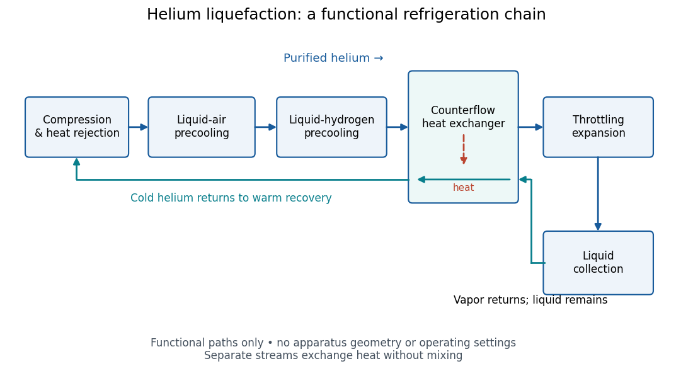
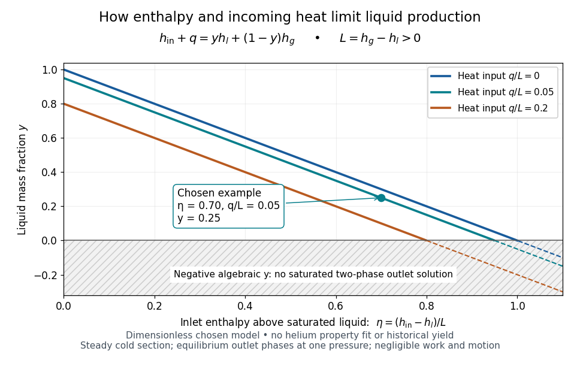
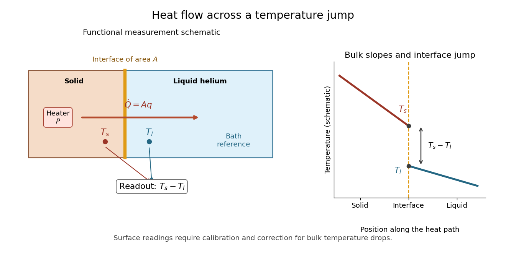
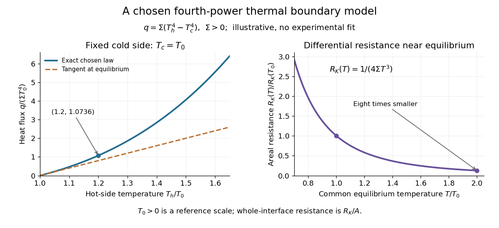

# Temperature

↑ **Parent:** [Thermodynamics](thermodynamics.md)  
ⓦ [Wiki](https://en.wikipedia.org/wiki/Temperature)

Temperature labels [thermal equilibrium](thermal-equilibrium.md): two internally equilibrated bodies have the same [temperature](temperature.md) when contact permitting only [heat](heat.md) exchange produces no net [heat transfer](heat.md#heat-transfer). The [zeroth law of thermodynamics](thermodynamics.md#zeroth-law-of-thermodynamics) makes the comparison transitive. If bodies A and B separately reach [thermal equilibrium](thermal-equilibrium.md) with the same [thermometer](#thermometer) without appreciably disturbing either body, they agree with each other. This is what lets a [gas thermometer](#gas-thermometer) compare a metal block with [water](chemical-substance.md#water), despite their different [internal energies](internal-energy.md) and [heat capacities](heat.md#heat-capacity). Insulation alone makes no such comparison: it can prevent [heat transfer](heat.md#heat-transfer) between bodies at different [temperatures](temperature.md). [Ling, Moebs and Sanny, University Physics Volume 2, section 1.1: temperature and the zeroth law](physics-bibliography.md#university-physics-volume-2-by-samuel-j-ling-and-others/1-1-temperature-and-thermal-equilibrium)

The [zeroth law of thermodynamics](thermodynamics.md#zeroth-law-of-thermodynamics) establishes equality comparisons, but does not choose a numerical scale. [Thermodynamic temperature](second-law-of-thermodynamics.md#thermodynamic-temperature) supplies an absolute scale consistent with [Carnot's theorem](second-law-of-thermodynamics.md#carnot-s-theorem) and [entropy](entropy.md). For a [simple compressible system](thermodynamics.md#simple-compressible-system) at [thermodynamic equilibrium](thermodynamics.md#thermodynamic-equilibrium) with fixed particle number $N$ and composition,

$$
T=\left(\frac{\partial U}{\partial S}\right)_{V,N},\qquad
\frac1T=\left(\frac{\partial S}{\partial U}\right)_{V,N}.
$$

Here $U$ is [internal energy](internal-energy.md), $S$ is [entropy](entropy.md), and $V$ is [volume](thermodynamics.md#volume-thermodynamics); the second equality assumes the derivative can be inverted. Temperature is a [thermodynamic conjugate variable](thermodynamics.md#conjugate-variables-thermodynamics) to [entropy](entropy.md) and belongs to the [intensive and extensive thermodynamic quantities](thermodynamics.md#intensive-and-extensive-thermodynamic-quantities) as an intensive quantity. Its [partial derivative](multivariable-calculus.md#partial-derivative) tells us how much [internal energy](internal-energy.md) must change per unit change of [entropy](entropy.md) under the stated constraints. More general systems require their other mechanical and material variables to be held fixed too. [David Tong, Statistical Physics, section 1.2.2: temperature from the entropy derivative](https://davidtong.org/teaching/statistical-physics/statmechhtml/S1#S1.SS2.SSS2)

For an infinitesimal quantity $\delta Q>0$ of [heat](heat.md) transferred from A to B, with no [work](energy.md#work) or matter exchange, the equilibrium [entropy](entropy.md) changes give

$$
dS_{\rm total}=\delta Q\left(\frac1{T_B}-\frac1{T_A}\right).
$$

For ordinary positive [temperatures](temperature.md), spontaneous [heat transfer](heat.md#heat-transfer) from $T_A>T_B$ increases total [entropy](entropy.md); [thermal equilibrium](thermal-equilibrium.md) has $T_A=T_B$. This comparison uses changes in [entropy](entropy.md), rather than the total [internal energy](internal-energy.md) contained in either body. A small hot object can have less [internal energy](internal-energy.md) than a large cool one. See [entropy maximization under thermal contact](thermal-equilibrium.md#entropy-maximization-under-thermal-contact) for the equilibrium criterion and [negative temperature](canonical-ensemble.md#negative-temperature) for the special case of bounded [energy](energy.md) spectra.

Express absolute [thermodynamic temperature](second-law-of-thermodynamics.md#thermodynamic-temperature) $T$ in [kelvin](#kelvin), and a Celsius reading $t_C$ in [degree Celsius](#degree-celsius):

$$
\frac{t_C}{{}^\circ\mathrm C}=\frac{T}{\mathrm K}-273.15,\qquad
\frac{\Delta t_C}{{}^\circ\mathrm C}=\frac{\Delta T}{\mathrm K}.
$$

The offset is exact: $300\,\mathrm K$ corresponds to $26.85\,{}^\circ\mathrm C$, and $400\,\mathrm K$ to $126.85\,{}^\circ\mathrm C$. Their absolute [temperature](temperature.md) ratio is $4/3$; dividing their Celsius readings gives a different number. Thus [gas thermometer](#gas-thermometer) pressure ratios and [Carnot's theorem](second-law-of-thermodynamics.md#carnot-s-theorem) require [thermodynamic temperature](second-law-of-thermodynamics.md#thermodynamic-temperature). The modern [SI](physics.md#international-system-of-units) definition of the [kelvin](#kelvin) fixes the [Boltzmann constant](thermodynamics.md#boltzmann-constant) $k_B=1.380649\times10^{-23}\,\mathrm{J\,K^{-1}}$; a reference bath realizes or transfers the scale rather than defining that constant.[section 2.3.1: kelvin and Celsius temperature](physics-bibliography.md#the-international-system-of-units-si-ninth-edition-si-brochure)

Temperature is not universally the [mean](expected-value.md) [kinetic energy](energy.md#kinetic-energy) of a particle. In a classical, nonrelativistic [ideal gas](ideal-gas.md) at [thermal equilibrium](thermal-equilibrium.md), the [equipartition theorem](canonical-ensemble.md#equipartition-theorem) gives the mean translational [kinetic energy](energy.md#kinetic-energy) relative to the gas's bulk motion:

$$
\left\langle\frac12m|\mathbf v-\mathbf u|^2\right\rangle=\frac32k_BT.
$$

Here $m$ is particle [mass](classical-mechanics.md#mass), $\mathbf v$ its [velocity](classical-mechanics.md#velocity), and $\mathbf u$ the mean flow [velocity](classical-mechanics.md#velocity). In this regime, different particle [masses](classical-mechanics.md#mass) at the same [temperature](temperature.md) have equal mean translational [kinetic energies](energy.md#kinetic-energy) but different characteristic speeds. A moving gas can also carry bulk [kinetic energy](energy.md#kinetic-energy) without being hotter in its rest frame. Internal molecular modes and [quantum statistics](quantum-ideal-gas-statistics.md) require further care; the [equipartition theorem](canonical-ensemble.md#equipartition-theorem) has classical assumptions, whereas the equilibrium [entropy](entropy.md) definition applies more widely. [Tong, Statistical Physics, section 2.2.1: classical equipartition and its limits](https://davidtong.org/teaching/statistical-physics/statmechhtml/S2#S2.SS2.SSS1)

**Table of contents**

- [Absolute zero](#absolute-zero)
- [Adiabatic demagnetization](#adiabatic-demagnetization)
  - [Demagnetization with a linear-heat-capacity load](#demagnetization-with-a-linear-heat-capacity-load)
  - [Magnetic-entropy demagnetization adiabat](#magnetic-entropy-demagnetization-adiabat)
  - [Magnetic entropy](#magnetic-entropy)
    - [Magnetic entropy deficit](#magnetic-entropy-deficit)
    - [Entropy of a finite magnetic multiplet](#entropy-of-a-finite-magnetic-multiplet)
    - [Two-level paramagnetic cooling model](#two-level-paramagnetic-cooling-model)
      - [Constant-entropy magnetic cooling example](#constant-entropy-magnetic-cooling-example)
  - [Giauque-MacDougall magnetic cooling experiment](#giauque-macdougall-magnetic-cooling-experiment)
  - [Limits of adiabatic demagnetization](#limits-of-adiabatic-demagnetization)
- [International Temperature Scale of 1990](#international-temperature-scale-of-1990)
- [Thermometer](#thermometer)
  - [Resistance thermometer](#resistance-thermometer)
    - [Platinum resistance thermometer](#platinum-resistance-thermometer)
      - [Standard platinum resistance thermometer](#standard-platinum-resistance-thermometer)
      - [Industrial platinum resistance thermometer](#industrial-platinum-resistance-thermometer)
        - [Pt100](#pt100)
          - [Pt100 local linear model](#pt100-local-linear-model)
      - [Platinum resistance thermometer comparison calibration](#platinum-resistance-thermometer-comparison-calibration)
      - [Platinum resistance thermometer lead resistance error](#platinum-resistance-thermometer-lead-resistance-error)
    - [Resistance thermometer self-heating](#resistance-thermometer-self-heating)
    - [Resistance thermometer immersion test](#resistance-thermometer-immersion-test)
    - [Thermistor](#thermistor)
  - [Gas thermometer](#gas-thermometer)
    - [Gas thermometer dead-space correction](#gas-thermometer-dead-space-correction)
  - [Thermometer calibration](#thermometer-calibration)
- [Kelvin](#kelvin)
- [Degree Celsius](#degree-celsius)
- [Inverse temperature](#inverse-temperature)
- [Cryogenics](#cryogenics)
  - [Thermal anchoring](#thermal-anchoring)
  - [Cryostat](#cryostat)
  - [Helium liquefaction](#helium-liquefaction)
    - [Kamerlingh Onnes's 1908 helium liquefaction experiment](#kamerlingh-onnes-s-1908-helium-liquefaction-experiment)
    - [Liquefaction enthalpy budget](#liquefaction-enthalpy-budget)
      - [Liquefaction yield with separate warm-gas and liquid outlets](#liquefaction-yield-with-separate-warm-gas-and-liquid-outlets)
  - [Thermal boundary resistance](#thermal-boundary-resistance)
    - [Kapitza resistance](#kapitza-resistance)
      - [Kapitza thermal boundary experiment](#kapitza-thermal-boundary-experiment)
      - [Fourth-power thermal boundary model](#fourth-power-thermal-boundary-model)

## Absolute zero

↑ **Parent:** [Temperature](temperature.md)  
ⓦ [Wiki](https://en.wikipedia.org/wiki/Absolute_zero)

[Absolute zero](#absolute-zero) is the zero of [thermodynamic temperature](second-law-of-thermodynamics.md#thermodynamic-temperature), corresponding to $-273.15\,{}^\circ\mathrm C$. For a system with a nondegenerate [ground state](quantum-mechanics.md#ground-state), equilibrium [entropy](entropy.md) approaches zero as [temperature](temperature.md) approaches [absolute zero](#absolute-zero). This does not mean that every quantum [degree of freedom](classical-mechanics.md#degree-of-freedom) loses its [zero-point energy](quantum-harmonic-oscillator.md#zero-point-energy). The [entropy](entropy.md) statement and the operational [unattainability of absolute zero](thermodynamics.md#unattainability-of-absolute-zero) require their respective physical assumptions.

## Adiabatic demagnetization

↑ **Parent:** [Temperature](temperature.md)

A cooling method that reduces an applied [magnetic field](magnetic-field.md) while suppressing [heat transfer](heat.md#heat-transfer) to or from the material. For a suitable material exhibiting [paramagnetism](electromagnetism.md#paramagnetism), an approximately reversible field reduction can lower its [temperature](temperature.md) at approximately constant [entropy](entropy.md).

The preparation matters as much as the field reduction. First establish [thermal equilibrium](thermal-equilibrium.md) with a cold [heat bath](thermal-equilibrium.md#heat-bath), then raise the [magnetic field](magnetic-field.md) while maintaining the bath [temperature](temperature.md): this is [magnetization](electromagnetism.md#magnetization) in an [isothermal process](second-law-of-thermodynamics.md#isothermal-process). The bath accepts [heat](heat.md) and the material loses [magnetic entropy](#magnetic-entropy). Next open a [heat switch](heat.md#heat-switch), thermally isolating the working material, and lower the [magnetic field](magnetic-field.md). If the sweep maintains internal [thermal equilibrium](thermal-equilibrium.md) with negligible [entropy production](stochastic-thermodynamics.md#entropy-production), this second leg is an [isentropic process](first-law-of-thermodynamics.md#isentropic-process). An [adiabatic process](first-law-of-thermodynamics.md#adiabatic-process) alone does not guarantee constant [entropy](entropy.md).

The attraction is a controllable [energy](energy.md) scale: changing the [magnetic field](magnetic-field.md) changes the separation of magnetic [energy levels](quantum-mechanics.md#energy-level), even across a thermally insulating gap. This lets an already cold solid become colder without needing a colder contacting [heat bath](thermal-equilibrium.md#heat-bath). A practical [refrigerator](thermodynamics.md#refrigerator) also needs a load, a period of absorbing its [heat](heat.md), and a reset that rejects accumulated [entropy](entropy.md) to the bath. A single field sweep has finite cooling capacity.

**[Figure 1](#adiabatic-demagnetization-cold-stage-sequence). Functional cold stage and heat switch sequence for adiabatic demagnetization**. [Source](adiabatic-demagnetization-cold-stage-sequence.py). Original functional schematic. The controlled thermal link closes during [magnetization](electromagnetism.md#magnetization) in an [isothermal process](second-law-of-thermodynamics.md#isothermal-process) and opens before the [magnetic field](magnetic-field.md) falls. The sensing coil is a readout, not a thermal connection. This is a functional diagram rather than a reconstruction of historical geometry.

### Demagnetization with a linear-heat-capacity load

↑ **Parent:** [Adiabatic demagnetization](#adiabatic-demagnetization)

Let $N$ independent spin-$J$ moments and a load with [heat capacity](heat.md#heat-capacity) $C_L=Mk_BT/\theta$ remain in equilibrium during reversible isolated demagnetization. Then $S_L(T)=S_L(0)+Mk_BT/\theta$. Fully removing the field raises each spin [entropy](entropy.md) by its initial [magnetic entropy deficit](#magnetic-entropy-deficit). Total [entropy](entropy.md) conservation gives $N\Delta s_{\rm mag}=Mk_B(T_i-T_f)/\theta$, yielding the title result. The formula assumes positive final [temperature](temperature.md), validity of the load law throughout the interval, negligible additional [entropy](entropy.md) contributions and an attainable equilibrated low-field endpoint. Interactions require an actual many-body [entropy](entropy.md) instead of the independent-spin expression.

### Magnetic-entropy demagnetization adiabat

↑ **Parent:** [Adiabatic demagnetization](#adiabatic-demagnetization)

When the [entropy](entropy.md) of independent magnetic moments dominates, a reversible isolated change fixes $B/T$. Lowering the field therefore lowers [temperature](temperature.md) as $T_f/T_i=B_f/B_i$. Other [heat capacities](heat.md#heat-capacity), internal interactions and residual fields limit this ideal relation.

### Magnetic entropy

↑ **Parent:** [Adiabatic demagnetization](#adiabatic-demagnetization)

[Magnetic entropy](#magnetic-entropy) counts the uncertainty in the occupied magnetic [microstates](statistical-physics.md#microstate). For independent localized [magnetic moments](electromagnetism.md#magnetic-dipole-moment) with one-site [probabilities](probability-theory.md#probability) $p_j$,

$$
S_{\rm mag}=-Nk_B\sum_j p_j\ln p_j,
$$

where $N$ counts sites and $k_B$ is the [Boltzmann constant](thermodynamics.md#boltzmann-constant). This is the [Gibbs entropy](statistical-physics.md#gibbs-entropy) for the magnetic degrees of freedom. Equal occupation of two states gives $Nk_B\ln2$; certain occupation of one state gives zero. Calling this disorder is useful only if the relevant states and their [probabilities](probability-theory.md#probability) are specified. In an interacting material, correlations generally prevent replacing the many-body [Gibbs entropy](statistical-physics.md#gibbs-entropy) by this sum of independent one-site contributions.

Increasing the [magnetic field](magnetic-field.md) at fixed positive [temperature](temperature.md) favors lower magnetic [energy levels](quantum-mechanics.md#energy-level), reducing [magnetic entropy](#magnetic-entropy). During ideal isolated demagnetization, both the level separation and [temperature](temperature.md) fall together, leaving the occupation [probabilities](probability-theory.md#probability) unchanged. Thus the independent-spin idealization cools without increasing spin disorder along the isolated leg. When a real crystal's vibrating lattice also cools, its lost [entropy](entropy.md) can instead be taken up by the magnetic degrees of freedom. The conserved quantity is the total [entropy](entropy.md) of the thermally isolated stage, including any attached load in [thermal equilibrium](thermal-equilibrium.md).

#### Magnetic entropy deficit

↑ **Parent:** [Magnetic entropy](#magnetic-entropy)

The [magnetic entropy deficit](#magnetic-entropy-deficit) is the [entropy](entropy.md) increase still available to independent moments as their field [polarization](wave.md#polarization-waves) is removed. For a spin-$J$ multiplet, $s_{\max}=k_B\ln(2J+1)$ and the high-temperature deficit is $k_BJ(J+1)[g\mu_BB/(k_BT)]^2/6$. Isothermal [magnetization](electromagnetism.md#magnetization) creates this deficit while rejecting heat to a bath. Subsequent reversible demagnetization can absorb [entropy](entropy.md) from a cooling load. The deficit, not the initial absolute [magnetic entropy](#magnetic-entropy), measures that capacity.

#### Entropy of a finite magnetic multiplet

↑ **Parent:** [Magnetic entropy](#magnetic-entropy)

For magnetic quantum numbers $m=-J,\ldots,J$, energies $E_m=-mg\mu_BB$ and $x=g\mu_BB/(k_BT)$, the [partition function](canonical-ensemble.md#canonical-partition-function) is $Z_J=\sum_m e^{mx}=\sinh[(2J+1)x/2]/\sinh(x/2)$. Its [entropy](entropy.md) is the title expression, a function of $B/T$ alone. At small $J|x|$, $s_J/k_B=\ln(2J+1)-J(J+1)x^2/6+O(x^4)$. The maximal [entropy](entropy.md) is $k_B\ln(2J+1)$ at zero splitting. A fixed independent-spin [entropy](entropy.md) consequently fixes $B/T$; an attached heat load changes the combined isentropic path.

#### Two-level paramagnetic cooling model

↑ **Parent:** [Magnetic entropy](#magnetic-entropy)

Use the [independent spin-one-half two-level system](canonical-ensemble.md#independent-spin-one-half-two-level-system) with fixed $N$ distinguishable sites and [Hamiltonian](hamiltonian-mechanics.md#hamiltonian) levels $E_\pm=\pm\mu B$, where $\mu>0$ is the magnitude of the field-axis [magnetic moment](electromagnetism.md#magnetic-dipole-moment) and $B>0$ is a uniform externally controlled [magnetic field](magnetic-field.md). Assume positive [temperature](temperature.md), no interactions between sites, and no appreciable lattice or load [entropy](entropy.md). The two levels differ by $2\mu B$. With [inverse temperature](#inverse-temperature) $\beta$, the [canonical ensemble](canonical-ensemble.md) gives the one-site and total [partition functions](canonical-ensemble.md#canonical-partition-function)

$$
\beta=\frac1{k_BT},\qquad x=\beta\mu B,\qquad
z=e^x+e^{-x}=2\cosh x,\qquad Z=z^N,
\qquad p_-=\frac{e^x}{2\cosh x},\quad p_+=\frac{e^{-x}}{2\cosh x}.
$$

Here the minus subscript denotes the lower [energy](energy.md) $-\mu B$. Factorization of the [partition function](canonical-ensemble.md#canonical-partition-function) requires additive [energy](energy.md) and independent sites; there is no particle-exchange factor $N!$ for these fixed distinguishable sites.

Differentiate the [partition function](canonical-ensemble.md#canonical-partition-function), holding $B$ fixed when differentiating with respect to $\beta$. The [internal energy](internal-energy.md), [Helmholtz free energy](thermodynamic-potential.md#helmholtz-free-energy), total field-axis [magnetic moment](electromagnetism.md#magnetic-dipole-moment) $m$, and [magnetic entropy](#magnetic-entropy) are

$$
U_{\rm mag}=-\partial_\beta\ln Z=-N\mu B\tanh x,\qquad
F=-Nk_BT\ln(2\cosh x),
$$

$$
m=-\left(\frac{\partial F}{\partial B}\right)_T=N\mu\tanh x,\qquad
\frac{S_{\rm mag}}{Nk_B}=\frac{\ln Z+\beta U_{\rm mag}}N
=\ln(2\cosh x)-x\tanh x=:s(x).
$$

The extensive moment $m$ is distinct from [magnetization](electromagnetism.md#magnetization), the moment per unit [volume](thermodynamics.md#volume-thermodynamics). Direct substitution of $p_\pm$ into the [Gibbs entropy](statistical-physics.md#gibbs-entropy) gives the same $s(x)$ independently of the free-energy [derivative](calculus.md#derivative).

At fixed $B$, the magnetic [heat capacity](heat.md#heat-capacity) is

$$
C_{B,{\rm mag}}=\left(\frac{\partial U_{\rm mag}}{\partial T}\right)_B
=Nk_Bx^2\operatorname{sech}^2x\geq0,\qquad
\frac{ds}{dx}=-x\operatorname{sech}^2x<0\quad(x>0).
$$

Strict decrease makes $s$ invertible on $x>0$. Constant [magnetic entropy](#magnetic-entropy) therefore fixes $x$, not $B$ or $T$ separately:

$$
\frac{B}{T}=\text{constant},\qquad
\frac{T_f}{T_i}=\frac{B_f}{B_i}\quad(B_i,B_f,T_i,T_f>0).
$$

The [partition function](canonical-ensemble.md#canonical-partition-function) may be used to label these equilibrium states even though the isolated cooling leg has no external [heat bath](thermal-equilibrium.md#heat-bath). Actual thermalization of the lattice and load additionally requires a sufficiently fast [spin-lattice relaxation](angular-momentum-operator.md#spin-lattice-relaxation); perfectly uncoupled spins by themselves cannot refrigerate an attached object.

The limiting cases are instructive. For $x\ll1$, $s(x)=\ln2-x^2/2+O(x^4)$, $m\simeq N\mu^2B/(k_BT)$, and $C_{B,{\rm mag}}\simeq Nk_Bx^2$. The moment response reproduces [Curie's law](statistical-physics.md#curie-s-law). For $x\gg1$, $s(x)\simeq(1+2x)e^{-2x}$ and the upper-state occupation is exponentially small. Taking $B\to0$ at fixed $T>0$ gives $s\to\ln2$; taking $T\to0$ at fixed $B>0$ gives $s\to0$. The origin has a path-dependent limit. Extrapolating a line of constant $x$ to $B=T=0$ does not construct a usable zero-[temperature](temperature.md) state or prove that a real material retains independent degenerate spins there.

##### Constant-entropy magnetic cooling example

↑ **Parent:** [Two-level paramagnetic cooling model](#two-level-paramagnetic-cooling-model)

Choose a fictional two-level refrigerant with $\mu/k_B=1\,\mathrm{K\,T^{-1}}$, where the upright $\mathrm T$ denotes [tesla](magnetic-field.md#tesla-unit). This chosen moment is a convenient model parameter, not a fitted property of the historical salt. At bath [temperature](temperature.md) $T_b=1\,\mathrm K$, raise $B$ from $0.20\,\mathrm T$ to $1.00\,\mathrm T$. Then $x$ increases from $0.20$ to $1.00$, so

$$
s(0.20)=0.673540\ldots,\qquad s(1)=0.365334\ldots,
\qquad \frac{Q_{\rm in}}{Nk_BT_b}=s(1)-s(0.20)=-0.308206\ldots.
$$

The last equality assumes a reversible [isothermal process](second-law-of-thermodynamics.md#isothermal-process) of [magnetization](electromagnetism.md#magnetization); negative $Q_{\rm in}$ means the refrigerant rejects [heat](heat.md). The bath gains $0.308206\ldots Nk_B$ of [entropy](entropy.md), balancing the stage's loss in this reversible limit. An appreciable [temperature](temperature.md) difference during real [heat transfer](heat.md#heat-transfer) adds [entropy production](stochastic-thermodynamics.md#entropy-production).

Now open the [heat switch](heat.md#heat-switch) and reduce $B$ from $1.00\,\mathrm T$ to $0.10\,\mathrm T$. Constant $x=1$ gives $T_f=0.10\,\mathrm K$. Throughout this ideal cooling leg, $p_-=0.880797\ldots$, $p_+=0.119203\ldots$, and $S_{\rm mag}=0.365334\ldots Nk_B$. Neither state becomes more probable. Field reduction shrinks the [energy](energy.md) gap by ten while preserving the [Boltzmann distribution](thermodynamics.md#boltzmann-distribution)'s dimensionless ratio of gap to [temperature](temperature.md).

**[Figure 2](#paramagnetic-entropy-cooling-curves). Magnetic entropy curves and an original isothermal process followed by cooling**. [Source](paramagnetic-entropy-cooling-curves.py). Left: the calculated two-level [magnetic entropy](#magnetic-entropy) at three chosen [magnetic fields](magnetic-field.md). Right: constant-[entropy](entropy.md) curves in the positive field–[temperature](temperature.md) plane. A to B exports [entropy](entropy.md) to a bath at $1\,\mathrm K$; B to C keeps $x=1$. All curves are ideal-model calculations, with no experimental points.

There is a subtle [energy](energy.md) check. For the spin [Hamiltonian](hamiltonian-mechanics.md#hamiltonian) convention used here, external-field interaction [energy](energy.md) belongs to $U_{\rm mag}$, so reversible [work](energy.md#work) done on the spin subsystem is $\delta W_{\rm on}=-m\,dB$ and

$$
dU_{\rm mag}=T\,dS_{\rm mag}-m\,dB.
$$

On the isolated leg, $Q=0$ but $U_{\rm mag}$ increases from $-0.761594\ldots Nk_B\,\mathrm K$ to $-0.0761594\ldots Nk_B\,\mathrm K$, becoming less negative as the gap shrinks. Integrating $-m\,dB$ at constant $x=1$ supplies exactly $+0.685435\ldots Nk_B\,\mathrm K$. Cooling therefore need not decrease this chosen spin [internal energy](internal-energy.md). An account of [work](energy.md#work) exchanged with a magnet circuit must specify where field interaction [energy](energy.md) is assigned before comparing signs. The occupation ratio and [temperature](temperature.md) prediction do not depend on that bookkeeping choice.

For the isothermal preparation, direct integration gives $W_{\rm on}/(Nk_BT_b)=-\ln[\cosh(1)/\cosh(0.20)]=-0.413913\ldots$. The endpoint [internal energy](internal-energy.md) difference is $-0.722119\ldots Nk_BT_b$, equal to $Q_{\rm in}+W_{\rm on}$. This independently checks both the rejected [heat](heat.md) and the magnetic-work sign in the chosen convention.

### Giauque-MacDougall magnetic cooling experiment

↑ **Parent:** [Adiabatic demagnetization](#adiabatic-demagnetization)

[William Francis Giauque](chemistry.md#william-francis-giauque)'s 1949 lecture, Some Consequences of Low Temperature Research in Chemical Thermodynamics, credits [Peter Debye](physicist.md#peter-debye) with an independent proposal. It describes [gadolinium sulfate octahydrate](chemical-substance.md#gadolinium-sulfate-octahydrate) in a jacket immersed in liquid [helium](chemical-substance.md#helium), with an external [solenoid](magnetic-field.md#solenoid). Exchange gas conducts away [heat](heat.md) during [magnetization](electromagnetism.md#magnetization); evacuation isolates the sample before field reduction. A liquid-[nitrogen](chemical-substance.md#nitrogen) shield reduces radiative [heat transfer](heat.md#heat-transfer). Its photograph identifies the 1933 apparatus operated with [Duncan Peck MacDougall](chemistry.md#duncan-peck-macdougall). An [inductance](electromagnetism.md#inductance) bridge reads the sample's [magnetic susceptibility](statistical-physics.md#magnetic-susceptibility); measuring coils remain outside the evacuated jacket in liquid [helium](chemical-substance.md#helium). Increasing [magnetic susceptibility](statistical-physics.md#magnetic-susceptibility) indicates cooling, but converting it to [temperature](temperature.md) using [Curie's law](statistical-physics.md#curie-s-law) becomes approximate as that law fails.[Giauque, Nobel lecture, pp. 237–245, Figs. 16–20 and 23–25](chemistry-bibliography.md#some-consequences-of-low-temperature-research-in-chemical-thermodynamics-by-william-francis-giauque)

The measurement logic deserves a separate check. A changed [inductance](electromagnetism.md#inductance) alone is not an absolute [temperature](temperature.md) calibration: the sample geometry, applied measuring [magnetic field](magnetic-field.md), and constitutive response enter the inference. A modern control would compare the susceptibility-based [thermometer](#thermometer) with an independently calibrated [thermometer](#thermometer) over their common range, check recovery after repeated sweeps, and measure subsequent warming to bound incoming [heat](heat.md). These are proposed controls derived from the readout principle, rather than additional procedures attributed to the 1933 experiment. The historical working salt has a richer magnetic level structure than the illustrative [two-level paramagnetic cooling model](#two-level-paramagnetic-cooling-model).

### Limits of adiabatic demagnetization

↑ **Parent:** [Adiabatic demagnetization](#adiabatic-demagnetization)

Three distinct effects spoil indefinite $T\propto B$ cooling: extra [entropy](entropy.md) outside the spin subsystem, additional magnetic [energy](energy.md) scales, and irreversible [heat](heat.md) or [work](energy.md#work) input. They can be distinguished with a thermodynamic [derivative](calculus.md#derivative). For a smooth equilibrium [Helmholtz free energy](thermodynamic-potential.md#helmholtz-free-energy) obeying $dF=-S\,dT-m\,dB$, a [Maxwell relation](thermodynamics.md#maxwell-relations) gives

$$
dS=\frac{C_B}{T}\,dT+\left(\frac{\partial m}{\partial T}\right)_B dB,\qquad
\left(\frac{dT}{dB}\right)_S=-\frac{T}{C_B}\left(\frac{\partial m}{\partial T}\right)_B.
$$

Here $C_B$ is the total [heat capacity](heat.md#heat-capacity) participating in the stage's [thermal equilibrium](thermal-equilibrium.md). The ideal model has $(\partial m/\partial T)_B=-C_{B,{\rm mag}}/B$. If its spins share [temperature](temperature.md) with a field-independent lattice and load of combined [heat capacity](heat.md#heat-capacity) $C_{\rm other}>0$, then

$$
\left(\frac{dT}{dB}\right)_{S_{\rm total}}
=\frac{T}{B}\frac{C_{B,{\rm mag}}}{C_{B,{\rm mag}}+C_{\rm other}}.
$$

The positive slope still means cooling when $dB<0$, but its smaller magnitude gives less cooling per fractional field reduction. For example, a low-[temperature](temperature.md) [Debye model](quantum-ideal-gas-statistics.md#debye-model) gives a lattice [entropy](entropy.md) proportional to $T^3$. As that lattice [entropy](entropy.md) falls, the spins take up the released [entropy](entropy.md); $x$ can no longer remain constant. A weak enough coupling to neglect its equilibrium interaction [energy](energy.md) can still be strong enough to exchange [heat](heat.md) on the sweep timescale.

Interactions between [magnetic moments](electromagnetism.md#magnetic-dipole-moment), including [exchange interaction](electromagnetism.md#exchange-interaction) and the fields of neighboring [magnetic dipole moments](electromagnetism.md#magnetic-dipole-moment), introduce [energy](energy.md) scales that do not vanish with the applied $B$. Once they compete with $k_BT$ or $\mu B$, the independent-site [partition function](canonical-ensemble.md#canonical-partition-function) fails. Correlations and possible magnetic ordering alter the available [magnetic entropy](#magnetic-entropy) and the cooling curve. Simply setting the external [magnetic field](magnetic-field.md) to zero does not eliminate those interactions. Different refrigerants therefore need their own measured equilibrium properties; there is no universal final [temperature](temperature.md) from the applied-field ratio alone.

Finally, a real open [heat switch](heat.md#heat-switch) has residual [thermal conductance](heat.md#thermal-conductance); supports, wires and radiation carry incoming [heat](heat.md). Field changes may also dissipate [energy](energy.md). Locally near [thermal equilibrium](thermal-equilibrium.md), with incoming [heat](heat.md) rate $\dot Q_{\rm leak}$ and internal [entropy production](stochastic-thermodynamics.md#entropy-production) rate $\dot S_{\rm prod}$, the stage balance becomes

$$
\frac{dS}{dt}=\frac{\dot Q_{\rm leak}}T+\dot S_{\rm prod},\qquad
C_B\dot T=-T\left(\frac{\partial m}{\partial T}\right)_B\dot B
+\dot Q_{\rm leak}+T\dot S_{\rm prod}.
$$

This uses a common stage [temperature](temperature.md); a non-equilibrated load requires separate balances. The sweep must allow [spin-lattice relaxation](angular-momentum-operator.md#spin-lattice-relaxation) while remaining fast enough to limit accumulated parasitic [heat](heat.md). At fixed $B$, the same balance explains warming and finite hold time. Useful refrigeration is the controlled absorption of a load's [heat](heat.md) during that finite interval, followed by a renewed [isothermal process](second-law-of-thermodynamics.md#isothermal-process) of [magnetization](electromagnetism.md#magnetization) to export its [entropy](entropy.md).

## International Temperature Scale of 1990

↑ **Parent:** [Temperature](temperature.md)

The [International Temperature Scale of 1990](#international-temperature-scale-of-1990) is a practical scale for reproducible [temperature](temperature.md) measurements. Its assigned reference points and interpolation procedures approximate [thermodynamic temperature](second-law-of-thermodynamics.md#thermodynamic-temperature). A calibrated [standard platinum resistance thermometer](#standard-platinum-resistance-thermometer) transfers this scale over specified intervals; it does not define the modern [kelvin](#kelvin).[§2.3.1: practical temperature scales, ITS-90, and thermodynamic temperature](physics-bibliography.md#the-international-system-of-units-si-ninth-edition-si-brochure)

## Thermometer

↑ **Parent:** [Temperature](temperature.md)  
ⓦ [Wiki](https://en.wikipedia.org/wiki/Thermometer)

A thermometer measures [temperature](temperature.md) through a physical response whose relation to [temperature](temperature.md) is known. Examples include the length change from [thermal expansion](thermodynamics.md#thermal-expansion), a change in [electrical resistance](electric-charge.md#electrical-resistance), and the [pressure](pressure.md) of a [gas thermometer](#gas-thermometer). If the response [function](function.md) $X=f(T)$ is an [injective function](algebra.md#injective-function) over the working range, its measured value determines $T=f^{-1}(X)$ through the [inverse function](function.md#inverse-function). [Thermometer calibration](#thermometer-calibration) establishes that relation for the particular instrument and measurement conditions. Two matching readings are meaningful only after calibration to a common scale and with the probes sampling comparable equilibrium states. [Ling, Moebs and Sanny, University Physics Volume 2, section 1.2: physical responses used in thermometers](https://openstax.org/books/university-physics-volume-2/pages/1-2-thermometers-and-temperature-scales)

For a contact thermometer, the sensing part must reach [thermal equilibrium](thermal-equilibrium.md) with the region being measured. That region may differ from the rest of the object: an immersed probe near a heater can read a local [temperature](temperature.md) while the surrounding [water](chemical-substance.md#water) remains cooler. A stable reading can also be a [steady state](dynamical-systems.md#steady-state) set by competing [heat transfer](heat.md#heat-transfer) paths to the sample and the room. Good contact, adequate immersion, mixing where appropriate, and checks for spatial differences help establish which [temperature](temperature.md) the reading represents. These are measurement controls inferred from the [thermal equilibrium](thermal-equilibrium.md) requirement, not a guarantee that every flat trace is equilibrium.

A thermometer also changes the sample it touches. Consider an original toy calculation with an initially uniform sample at $T_o=350\,\mathrm K$, a probe at $T_p=300\,\mathrm K$, and constant whole-body [heat capacities](heat.md#heat-capacity) $C_o=100\,\mathrm{J\,K^{-1}}$ and $C_p=1\,\mathrm{J\,K^{-1}}$. Suppose together they form an [isolated system](thermodynamics.md#isolated-system), with no [work](energy.md#work) or [phase transition](critical-phenomenon.md#phase-transition) and negligible contact [energy](energy.md). The [first law of thermodynamics](first-law-of-thermodynamics.md) and [thermal equilibrium](thermal-equilibrium.md) give

$$
T_f=\frac{C_oT_o+C_pT_p}{C_o+C_p}=349.50495\ldots\,\mathrm K,\qquad
T_f-T_o=\frac{C_p}{C_o+C_p}(T_p-T_o).
$$

The final [thermometer](#thermometer) reading underestimates the sample's original [temperature](temperature.md) by about $0.495\,\mathrm K$, although it correctly measures their new common [temperature](temperature.md). The disturbance becomes small when the participating probe [heat capacity](heat.md#heat-capacity) is small compared with the sample's. A large controlled [heat bath](thermal-equilibrium.md#heat-bath) is a different limit: it supplies or removes [heat](heat.md) while approximately maintaining its own [temperature](temperature.md).

Waiting time is a separate issue from disturbance. Under a toy [Newton's law of cooling](linear-ordinary-differential-equation.md#newton-s-law-of-cooling) model for a uniform probe in a maintained [heat bath](thermal-equilibrium.md#heat-bath), a constant contact conductance $G$ gives

$$
C_p\frac{dT_p}{dt}=G(T_b-T_p),\qquad
T_p(t)=T_b+[T_p(0)-T_b]e^{-t/\tau},\qquad \tau=\frac{C_p}{G}.
$$

The [time constant](analysis.md#time-constant) $\tau$ controls this [exponential decay](analysis.md#exponential-decay). For stipulated values $T_b=350\,\mathrm K$, $T_p(0)=300\,\mathrm K$ and $\tau=5\,\mathrm s$, the probe reads about $331.61\,\mathrm K$ after one [time constant](analysis.md#time-constant) and $347.51\,\mathrm K$ after three. These are calculated values, not an instrument specification or measured data. Real probes may have multiple relaxation times and additional [heat transfer](heat.md#heat-transfer) paths; choose an equilibration criterion from the required accuracy, rather than assuming that a fixed waiting time works universally.

### Resistance thermometer

↑ **Parent:** [Thermometer](#thermometer)  
ⓦ [Wiki](https://en.wikipedia.org/wiki/Resistance_thermometer)

A [thermometer](#thermometer) that infers [temperature](temperature.md) from a calibrated [electrical resistance](electric-charge.md#electrical-resistance). Measuring current can heat its sensing element; extrapolation toward zero current controls that bias in the [saturation-pressure equilibrium measurement](thermodynamic-potential.md#saturation-pressure-equilibrium-measurement).

#### Platinum resistance thermometer

↑ **Parent:** [Resistance thermometer](#resistance-thermometer)

A [resistance thermometer](#resistance-thermometer) using [platinum](chemical-substance.md#platinum) as its sensing material. It provides the [temperature](temperature.md) readout in the [saturation-pressure equilibrium measurement](thermodynamic-potential.md#saturation-pressure-equilibrium-measurement).

Transduction turns [electrical resistance](electric-charge.md#electrical-resistance) into a [temperature](temperature.md) indication. A uniform wire has $R=\rho_{\rm el}\ell/A$, with [electrical resistivity](electric-charge.md#electrical-resistivity) $\rho_{\rm el}$, [length](physics.md#length) $\ell$, and cross-sectional [area](differential-geometry.md#surface-area) $A$. Stronger atomic vibrations at higher [temperature](temperature.md) scatter [electrons](physics.md#electron) more, increasing [platinum](chemical-substance.md#platinum)'s [electrical resistivity](electric-charge.md#electrical-resistivity); impurities and [crystallographic defects](physical-chemistry.md#crystallographic-defect) also contribute.[Guide on Secondary Thermometry: Industrial Platinum Resistance Thermometers, §2.1, printed pp. 6–7: resistivity, electron scattering, and impurities](physics-bibliography.md#guide-on-secondary-thermometry-industrial-platinum-resistance-thermometers-by-jonathan-pearce-and-others)

A small known [electric current](electric-charge.md#electric-current) $I$ and measured [electric potential difference](electric-field.md#electric-potential-difference) $V$ give $R=V/I$ through [Ohm's law](electric-charge.md#ohm-s-law); a [resistance bridge](electrical-engineering.md#resistance-bridge) can instead compare the element with a reference [resistor](electric-charge.md#resistor). Inverting the calibrated response then gives the sensing element's [temperature](temperature.md). This makes electrical readout convenient, but the [platinum resistance thermometer lead resistance error](#platinum-resistance-thermometer-lead-resistance-error), [resistance thermometer self-heating](#resistance-thermometer-self-heating), and [resistance thermometer immersion test](#resistance-thermometer-immersion-test) explain why a stable display alone is insufficient. The [gas thermometer](#gas-thermometer) supplies a contrasting route through an [equation of state](pressure.md#equation-of-state); the [saturation-pressure equilibrium measurement](thermodynamic-potential.md#saturation-pressure-equilibrium-measurement) shows why a trustworthy independent [temperature](temperature.md) readout matters.

##### Standard platinum resistance thermometer

↑ **Parent:** [Platinum resistance thermometer](#platinum-resistance-thermometer)

A [standard platinum resistance thermometer](#standard-platinum-resistance-thermometer) uses very pure, annealed [platinum](chemical-substance.md#platinum) with strain-limiting construction. An [industrial platinum resistance thermometer](#industrial-platinum-resistance-thermometer) commonly uses supported wire or a film. Their response curves differ.[§§1–2.2, printed pp. 5–11: industrial elements versus SPRTs and wire/film construction](physics-bibliography.md#guide-on-secondary-thermometry-industrial-platinum-resistance-thermometers-by-jonathan-pearce-and-others)

The word standard describes the instrument's metrological role. Calibrated [SPRTs](#standard-platinum-resistance-thermometer) realize specified interpolation intervals of the [International Temperature Scale of 1990](#international-temperature-scale-of-1990) and transfer reference [temperatures](temperature.md) to other [thermometers](#thermometer).[Platinum Resistance Thermometers, opening explanation: SPRTs as ITS-90 interpolation tools](physics-bibliography.md#mercury-thermometer-alternatives-platinum-resistance-thermometers-prts-by-national-institute-of-standards-and-technology) They are primary standards for realizing that practical scale, but their [electrical resistance](electric-charge.md#electrical-resistance) alone does not determine absolute [thermodynamic temperature](second-law-of-thermodynamics.md#thermodynamic-temperature) without calibration. Primary thermometry such as the corrected [gas thermometer](#gas-thermometer) obtains [thermodynamic temperature](second-law-of-thermodynamics.md#thermodynamic-temperature) from a physical law. A reference in a comparison bath may be an [SPRT](#standard-platinum-resistance-thermometer); an individually calibrated [industrial platinum resistance thermometer](#industrial-platinum-resistance-thermometer) can also serve as a working reference with an appropriate uncertainty.

##### Industrial platinum resistance thermometer

↑ **Parent:** [Platinum resistance thermometer](#platinum-resistance-thermometer)

An [industrial platinum resistance thermometer](#industrial-platinum-resistance-thermometer) is a [platinum resistance thermometer](#platinum-resistance-thermometer) built for practical measurement conditions. The label [Pt100](#pt100) specifies a nominal reference [electrical resistance](electric-charge.md#electrical-resistance), not an [SPRT](#standard-platinum-resistance-thermometer), a calibration certificate, or a universal accuracy. Calibrate the probe together with its readout when the desired result is the performance of the complete indicating system.

###### Pt100

↑ **Parent:** [Industrial platinum resistance thermometer](#industrial-platinum-resistance-thermometer)

A [Pt100](#pt100) has nominal [electrical resistance](electric-charge.md#electrical-resistance) $100\,\Omega$ at $0\,{}^\circ\mathrm C$.[Platinum Resistance Thermometers, opening explanation: conventional 100-ohm element at 0 °C](physics-bibliography.md#mercury-thermometer-alternatives-platinum-resistance-thermometers-prts-by-national-institute-of-standards-and-technology) Here $0\,{}^\circ\mathrm C$ is the reference for the nominal element designation; it is distinct from the $0.01\,{}^\circ\mathrm C$ water [triple point](thermodynamic-potential.md#triple-point) used in [SPRT](#standard-platinum-resistance-thermometer) calibration. The following [Pt100 local linear model](#pt100-local-linear-model) deliberately stipulates one approximate response for calculations.

###### Pt100 local linear model

↑ **Parent:** [Pt100](#pt100)

Choose the illustrative local model

$$
R(t)=R_0(1+\alpha t),\qquad
R_0=100\,\Omega,\qquad
\alpha=0.00385\,({}^\circ\mathrm C)^{-1}.
$$

Here $t$ is the Celsius [temperature](temperature.md), measured relative to $0\,{}^\circ\mathrm C$, so $\alpha t$ is dimensionless. For this chosen [affine function](vector-space.md#affine-function), the [derivative](calculus.md#derivative) and inverse relation are

$$
\frac{dR}{dt}=R_0\alpha=0.385\,\Omega/{}^\circ\mathrm C,\qquad
t=\frac{R/R_0-1}{\alpha},\qquad
\Delta t=\frac{\Delta R}{0.385\,\Omega/{}^\circ\mathrm C}.
$$

Calculated values are $R(0\,{}^\circ\mathrm C)=100\,\Omega$, $R(20\,{}^\circ\mathrm C)=107.70\,\Omega$, $R(25\,{}^\circ\mathrm C)=109.625\,\Omega$, and $R(50\,{}^\circ\mathrm C)=119.25\,\Omega$. These are model outputs, not measurements or an assertion that any real [Pt100](#pt100) follows this line exactly. The number $0.00385$ here is the chosen slope parameter; it is not a universal local [derivative](calculus.md#derivative) for all [platinum resistance thermometers](#platinum-resistance-thermometer). Curvature, manufacturing differences, and the fitted calibration interval matter. A wider-range calibration uses a validated response curve rather than extrapolating this line indefinitely.

**[Figure 3](#platinum-resistance-temperature-calibration). Chosen Pt100 line and an illustrative calibration with an independent check**. [Source](platinum-resistance-temperature-calibration.py). The left panel plots the [Pt100 local linear model](#pt100-local-linear-model). The right panel uses stipulated values for a different illustrative element: two points set a line, while a third point tests it. Every point is synthetic; none is measured calibration data or a tolerance band.

For a separate synthetic [thermometer calibration](#thermometer-calibration), stipulate $R_a=100.20\,\Omega$ at $t_a=0\,{}^\circ\mathrm C$ and $R_b=119.60\,\Omega$ at $t_b=50\,{}^\circ\mathrm C$. A two-point [affine function](vector-space.md#affine-function) has slope $0.388\,\Omega/{}^\circ\mathrm C$ and gives

$$
t=\frac{R-100.20\,\Omega}{0.388\,\Omega/{}^\circ\mathrm C}.
$$

Thus $R=109.90\,\Omega$ would indicate $25\,{}^\circ\mathrm C$. If an additional synthetic check at reference $25\,{}^\circ\mathrm C$ instead supplied $110.10\,\Omega$, the line would indicate $25.515\ldots\,{}^\circ\mathrm C$. The $0.20\,\Omega$ residual exposes disagreement that two fitted points cannot reveal. This separate example changes both offset and slope; it is not a replacement specification for the nominal [Pt100 local linear model](#pt100-local-linear-model).

##### Platinum resistance thermometer comparison calibration

↑ **Parent:** [Platinum resistance thermometer](#platinum-resistance-thermometer)

A 1998 NIST account describes stirred comparison baths, a reference [SPRT](#standard-platinum-resistance-thermometer) with a 30 Hz [resistance bridge](electrical-engineering.md#resistance-bridge), and a temperature-controlled $100\,\Omega$ reference [resistor](electric-charge.md#resistor). The test [IPRTs](#industrial-platinum-resistance-thermometer) used a $1\,\mathrm{mA}$ [current source](electrical-engineering.md#current-source), a scanner, and an 8½-digit [voltmeter](electric-field.md#voltmeter). Separate current and voltage leads made each test probe a four-terminal device; readings in both current directions supplied voltage ratios to the reference [resistor](electric-charge.md#resistor).[A New NIST Automated Calibration System for Industrial-Grade Platinum Resistance Thermometers, §§3.1, 3.3 and 4.2, printed pp. 2–6: baths, readout, four-terminal devices and reversed current](physics-bibliography.md#a-new-nist-automated-calibration-system-for-industrial-grade-platinum-resistance-thermometers-by-gregory-f-strouse-and-others)

Its program bracketed test readings with reference [SPRT](#standard-platinum-resistance-thermometer) readings and repeated a block if bath drift was excessive. A check [SPRT](#standard-platinum-resistance-thermometer) monitored the system; reference water-[triple point](thermodynamic-potential.md#triple-point) measurements checked stability. Sensor depths were matched, and unfamiliar probes underwent immersion tests. Ice and water-[triple point](thermodynamic-potential.md#triple-point) readings before and after calibration checked changes. Additional points could test the fitted curve. Reported calibration uncertainties excluded transport, subsequent drift, [hysteresis](critical-phenomenon.md#hysteresis), and the user's measurement system. These are controls and limits of that documented apparatus, not an accuracy promise for all [platinum resistance thermometers](#platinum-resistance-thermometer).[§1, printed p. 2; §4.2, printed pp. 5–6; §5.4, printed p. 9: excluded effects, drift rejection, check thermometer, immersion and extra fit checks](physics-bibliography.md#a-new-nist-automated-calibration-system-for-industrial-grade-platinum-resistance-thermometers-by-gregory-f-strouse-and-others)

The inference is a pair: reference [temperature](temperature.md) from the [SPRT](#standard-platinum-resistance-thermometer), test [electrical resistance](electric-charge.md#electrical-resistance) from the electrical readout. Record measuring [electric current](electric-charge.md#electric-current), wiring, immersion, and the stated reference scale with each pair. A bath controller's setpoint is not itself the calibrated reference [temperature](temperature.md). Returning to a reference and checking intermediate points distinguishes a fitted relation from a reproducible calibration over the intended interval.

##### Platinum resistance thermometer lead resistance error

↑ **Parent:** [Platinum resistance thermometer](#platinum-resistance-thermometer)

With two shared leads of [electrical resistances](electric-charge.md#electrical-resistance) $r_1,r_2$, [Ohm's law](electric-charge.md#ohm-s-law) gives

$$
V_{\rm two}=I[R(t)+r_1+r_2],\qquad
R_{\rm indicated}=R(t)+r_1+r_2.
$$

Using the [Pt100 local linear model](#pt100-local-linear-model), positive lead [electrical resistance](electric-charge.md#electrical-resistance) appears as a warmer [temperature](temperature.md). At true $25\,{}^\circ\mathrm C$, stipulated leads of $0.50\,\Omega$ each change $109.625\,\Omega$ into $110.625\,\Omega$, producing $27.597\ldots\,{}^\circ\mathrm C$: a calculated bias of about $2.60\,{}^\circ\mathrm C$. Subtracting a measured $1.00\,\Omega$ loop correction works only while that loop [electrical resistance](electric-charge.md#electrical-resistance) remains appropriate; cable [temperature](temperature.md) changes can invalidate it.

**[Figure 4](#platinum-resistance-two-wire-four-wire-sensing). Two shared leads include cable voltage drops; four leads sense at the platinum element**. [Source](platinum-resistance-two-wire-four-wire-sensing.py). Red paths carry [electric current](electric-charge.md#electric-current); blue paths connect an ideal high-input-[electrical resistance](electric-charge.md#electrical-resistance) [voltmeter](electric-field.md#voltmeter). In the two-wire circuit the sensing terminals span both leads and the element. In [four-terminal sensing](superconductivity.md#four-terminal-sensing) they span the element alone. The stated lead values and [temperature](temperature.md) bias are illustrative calculations.

[Four-terminal sensing](superconductivity.md#four-terminal-sensing) separates the [electric current](electric-charge.md#electric-current) and [electric potential difference](electric-field.md#electric-potential-difference) leads. Negligible sensing [electric current](electric-charge.md#electric-current) suppresses sensing-lead drops; force-lead drops lie outside the interval. Real [voltmeter loading](electric-field.md#voltmeter-loading), connections, and leakage still need checking.[§§4.4.1 and 4.4.3, printed pp. 30 and 32–33: two-wire inclusion of leads and four-wire exclusion](physics-bibliography.md#guide-on-secondary-thermometry-industrial-platinum-resistance-thermometers-by-jonathan-pearce-and-others)

For a stable offset $E$ from the [thermoelectric effect](thermoelectric-effect.md), two signed [electric potential differences](electric-field.md#electric-potential-difference) obey $V_+=IR+E$ and $V_-=-IR+E$. The current-reversal calculation in [four-terminal sensing](superconductivity.md#four-terminal-sensing) yields

$$
R=\frac{V_+-V_-}{2I}.
$$

At stipulated $I=1\,\mathrm{mA}$, $R=109.625\,\Omega$ and $E=3\,\mathrm{\mu V}$, $V_+=109.628\,\mathrm{mV}$ and $V_-=-109.622\,\mathrm{mV}$ recover $R$ exactly in this model. If the offset or sample [temperature](temperature.md) changes between readings, cancellation is incomplete. Reversal also leaves [Joule heating](electric-charge.md#joule-heating) unchanged because it depends on $I^2$.

#### Resistance thermometer self-heating

↑ **Parent:** [Resistance thermometer](#resistance-thermometer)

Measuring [electric current](electric-charge.md#electric-current) creates [Joule heating](electric-charge.md#joule-heating), raising the sensing [temperature](temperature.md). At fixed bath [temperature](temperature.md), compare settled readings at $I$ and $\sqrt2I$ and extrapolate the approximately linear $I^2$ dependence toward zero current.[§4.1, printed pp. 24–26, equation (4.1.1): self-heating, two-current extrapolation, and medium dependence](physics-bibliography.md#guide-on-secondary-thermometry-industrial-platinum-resistance-thermometers-by-jonathan-pearce-and-others)

Under the local model $R(I)=R_{\rm zero}+kI^2$,

$$
R_{\rm zero}=2R(I)-R(\sqrt2I).
$$

For synthetic readings $109.629\,\Omega$ at $1\,\mathrm{mA}$ and $109.633\,\Omega$ at $\sqrt2\,\mathrm{mA}$, the extrapolated value is $109.625\,\Omega$. The lower-current excess $0.004\,\Omega$ corresponds to $0.01039\ldots\,{}^\circ\mathrm C$ in the [Pt100 local linear model](#pt100-local-linear-model). At $109.625\,\Omega$, $1\,\mathrm{mA}$ dissipates $109.625\,\mathrm{\mu W}$; power alone does not specify a [temperature](temperature.md) rise without a thermal coupling model. These stipulated values are not measurements.

Repeat the comparison after settling and test the $I^2$ approximation if necessary. Changing from liquid to air changes [heat transfer](heat.md#heat-transfer); a self-heating correction need not transfer unchanged. The [saturation-pressure equilibrium measurement](thermodynamic-potential.md#saturation-pressure-equilibrium-measurement) provides an existing example of controlling this disturbance in resistance thermometry.

#### Resistance thermometer immersion test

↑ **Parent:** [Resistance thermometer](#resistance-thermometer)

A probe's sheath and leads carry [heat](heat.md) between the sensing region and the surroundings through [thermal conduction](heat.md#thermal-conduction). In a stable, sufficiently uniform [heat bath](thermal-equilibrium.md#heat-bath), compare the indicated [temperature](temperature.md) as insertion depth increases, allowing settling each time. A plateau supports adequate immersion for that apparatus and required uncertainty; it does not prove that every depth or medium works. Keep the sensing element and reference [thermometer](#thermometer) at comparable depths, and check bath gradients independently, so moving the probe does not merely sample a different [temperature](temperature.md). The documented [platinum resistance thermometer comparison calibration](#platinum-resistance-thermometer-comparison-calibration) includes these controls.

#### Thermistor

↑ **Parent:** [Resistance thermometer](#resistance-thermometer)  
ⓦ [Wiki](https://en.wikipedia.org/wiki/Thermistor)

A [thermistor](#thermistor) is a [temperature](temperature.md)-sensitive [resistor](electric-charge.md#resistor) used as a [resistance thermometer](#resistance-thermometer). Its calibrated [electrical resistance](electric-charge.md#electrical-resistance) supplies a [temperature](temperature.md) indication; probe [heat capacity](heat.md#heat-capacity) and unwanted [thermal conduction](heat.md#thermal-conduction) can affect its response and immersion error.

### Gas thermometer

↑ **Parent:** [Thermometer](#thermometer)

A gas thermometer infers [temperature](temperature.md) from the [equation of state](pressure.md#equation-of-state) of a confined [gas](thermodynamics.md#gas). The constant-[volume](thermodynamics.md#volume-thermodynamics) version measures [pressure](pressure.md); the constant-[pressure](pressure.md) version measures [volume](thermodynamics.md#volume-thermodynamics). For an [ideal gas](ideal-gas.md),

$$
PV=Nk_BT=nRT,\qquad
\frac{T}{T_0}=\frac{P}{P_0}\quad(N,V\text{ fixed}),\qquad
\frac{T}{T_0}=\frac{V}{V_0}\quad(N,P\text{ fixed}).
$$

Here $N$ is particle number, $n$ is [amount of substance](physics.md#amount-of-substance), $k_B$ is the [Boltzmann constant](thermodynamics.md#boltzmann-constant), and $R$ is the [molar gas constant](ideal-gas.md#molar-gas-constant). The reference and test states must be internally equilibrated, and $T_0$ must be known on the absolute [thermodynamic temperature](second-law-of-thermodynamics.md#thermodynamic-temperature) scale. A pressure ratio cancels the unknown gas inventory and bulb size in the ideal constant-volume limit. This cancellation is the method's appeal: a mechanical measurement transfers an absolute [temperature](temperature.md) scale between different materials. The [Maxwell speed distribution](quantum-ideal-gas-statistics.md#maxwell-speed-distribution) and [ideal gas pressure from wall collisions](ideal-gas.md#ideal-gas-pressure-from-wall-collisions) explain the microscopic origin of the response. [OpenStax, University Physics Volume 2, section 2.1: the ideal gas law](physics-bibliography.md#university-physics-volume-2-by-samuel-j-ling-and-others/2-1-molecular-model-of-an-ideal-gas)

For an original ideal-model calculation, choose $T_0=300\,\mathrm K$, $P_0=120\,\mathrm{kPa}$ and $P=160\,\mathrm{kPa}$. Then $T=400\,\mathrm K$. These are stipulated values, not observations. Both [pressures](pressure.md) must be absolute, referred to vacuum. If the surrounding [atmospheric pressure](pressure.md#atmospheric-pressure) were $100\,\mathrm{kPa}$, the corresponding [gauge pressures](fluid-mechanics.md#gauge-pressure) would be $20$ and $60\,\mathrm{kPa}$; their ratio is three, which would incorrectly predict $900\,\mathrm K$. A pressure difference from the atmosphere cannot be substituted into the [ideal gas law](ideal-gas.md#ideal-gas-law).

**[Figure 5](#image-an-original-schematic-of-constant-volume-gas-thermometer-measurements). An original schematic of constant-volume gas thermometer measurements**. Simplified measurement layout inspired by the NBS apparatus, not a replica or a report of measurements. A controlled bath thermalizes the bulb, separate calibrated [thermometers](#thermometer) check its surroundings, and a diaphragm transmits [pressure](pressure.md) to an absolute-pressure standard without mixing gases. The connecting tube contains gas at other [temperatures](temperature.md); its inventory belongs in the [gas thermometer dead-space correction](#gas-thermometer-dead-space-correction).

**A motivating calibration experiment.** Schooley's account of the NBS/NIST work describes a [helium](chemical-substance.md#helium)-filled metal bulb, a capillary, a [capacitance diaphragm gauge](kinetic-theory.md#capacitance-diaphragm-gauge), and a mercury pressure standard. Circulating bath liquid passed the bulb assembly and platinum resistance [thermometers](#thermometer). The resistance probes checked the surrounding [temperature](temperature.md); gas [pressure](pressure.md) supplied the independent thermodynamic comparison. In an early series, workers filled the cleaned bulb with purified [helium](chemical-substance.md#helium) at the highest test [temperature](temperature.md), checked [pressure](pressure.md) over three hours, then measured at lower [temperatures](temperature.md) and near a reference at $0\,{}^\circ\mathrm C$. Six filling pressures allowed extrapolation toward zero pressure. [J. F. Schooley (1990), NBS/NIST Gas Thermometry From 0 to 660 °C, sections 4–5](https://nvlpubs.nist.gov/nistpubs/jres/095/jresv95n3p255_A1b.pdf)

To turn this principle into a readable measurement protocol, use the following controls. These steps are a proposed teaching interpretation of the cited apparatus, rather than additional reported NBS observations:
- **Define the inventory.** Evacuate and clean the bulb and connecting tube, fill with a known pure [gas](thermodynamics.md#gas), close the filling valve, and keep the same total particle number during each reference/test comparison. Monitor [pressure](pressure.md) at a maintained [temperature](temperature.md) before and after a run. A leak changes $N$; a slow drift can also reflect contamination, sorption, or imperfect equilibration, so pressure stability alone does not identify its cause.
- **Measure the reference.** Place the bulb in a controlled environment with independently assigned $T_0$. Record $P_0$ after thermalization, together with the independent [thermometer](#thermometer) readings and their spread. A reference near $0\,{}^\circ\mathrm C$ has an absolute [temperature](temperature.md) near $273.15\,\mathrm K$, rather than zero [temperature](temperature.md). Repeating reference readings tests whether the inventory or apparatus changed during the comparison.
- **Measure the test state.** Change the bath setting, allow the bulb and [gas](thermodynamics.md#gas) to settle, and record $P$ only when the surrounding [thermometers](#thermometer) and [pressure](pressure.md) are sufficiently stable for the intended accuracy. Compare readings at different positions and vary the settling time. Record the connecting tube's [temperature](temperature.md) profile too: uniform bath [temperature](temperature.md) does not make the entire connecting tube isothermal.
- **Measure the volume changes.** Determine the bulb's [thermal expansion](thermodynamics.md#thermal-expansion) and its deformation from differences between inside and outside [pressure](pressure.md). Measure the connecting tube's dimensions and the effective valve volume. “Constant volume” is the ideal model; a real vessel expands. These measurements supply corrections, even though the absolute bulb volume cancels in the simplest pressure ratio.
- **Measure pressure against a reference.** For a liquid-column pressure standard, measure the vertical column height, the liquid's [temperature](temperature.md)-dependent [mass density](fluid-mechanics.md#density), local gravitational acceleration, and the reference-side [pressure](pressure.md). Include diaphragm offsets and the gas's [hydrostatic pressure](fluid-mechanics.md#hydrostatic-pressure) change between the sensor and bulb. The pressure needed in the [equation of state](pressure.md#equation-of-state) is at the bulb, not automatically at the remote gauge.

The corresponding NBS apparatus used a protective case with an outer [helium](chemical-substance.md#helium) layer held close to the bulb [pressure](pressure.md), reducing pressure deformation while aiding thermal contact. [Thermal expansion](thermodynamics.md#thermal-expansion) was measured on bulb material. Gas in the capillary remained partly outside the hot region, requiring a measured tube [temperature](temperature.md) profile and geometry. Pure working [gas](thermodynamics.md#gas) also mattered: contaminants that sorb on surfaces can change the freely circulating inventory. These are physical effects to measure or bound, rather than scatter that disappears by averaging. [J. F. Schooley, Thermometry, NBS IR 85-3133, chapter V, gas thermometry and the NBS experiment](https://nvlpubs.nist.gov/nistpubs/Legacy/IR/nbsir85-3133.pdf)

For illustration, neglect connecting-tube gas and describe a uniform bulb with a dilute [virial expansion](statistical-physics.md#virial-expansion) in particle [number density](statistical-physics.md#number-density) $\rho_N=N/V$:

$$
PV=Nk_BT\left[1+B_2(T)\rho_N+O(\rho_N^2)\right],\qquad
\frac{T}{T_0}=\frac{P}{P_0}\frac{V(T)}{V(T_0)}\frac{Z(T_0)}{Z(T)}.
$$

Here $Z=PV/(Nk_BT)$ and $B_2$ is the [second virial coefficient](statistical-physics.md#second-virial-coefficient) in the particle-density convention; a molar-density convention rescales the coefficient. The second relation follows exactly from the definition of $Z$ for the same $N$, and shows the signs of the corrections. If the bulb expands by $0.1\%$ and $Z=1$ at both states, the toy pressure ratio above gives $400.4\,\mathrm K$, rather than $400\,\mathrm K$. Improved expansion and [helium](chemical-substance.md#helium) nonideality models really changed the temperatures inferred from the 1989 NIST data: Harvey's 2023 reanalysis found expansion updates of roughly $1$–$3\,\mathrm{mK}$ and nonideality updates of roughly $-0.1$ to $-0.5\,\mathrm{mK}$. Those are reported corrections to historical results, not the much larger illustrative correction just calculated. [Allan H. Harvey (2023), Small Corrections to 1989 NIST Constant-Volume Gas Thermometry Data, sections 2–3](https://tsapps.nist.gov/publication/get_pdf.cfm?pub_id=956523)

With equal corrected bulb [volumes](geometry-and-topology.md#volume), negligible or corrected connecting-tube gas, fixed reference and test [temperatures](temperature.md), and a dilute classical single gas phase,

$$
\frac{P}{P_0}=\frac{T}{T_0}\left[1+\bigl(B_2(T)-B_2(T_0)\bigr)\rho_N+O(\rho_N^2)\right],\qquad
\lim_{\rho_N\to0}\frac{P}{P_0}=\frac{T}{T_0}.
$$

Repeat the reference/test comparison for several sealed fills, reducing $N$ between comparisons but keeping it fixed within each pair. The extrapolation varies density at fixed endpoint [temperatures](temperature.md); it does not cool one fill toward zero [temperature](temperature.md). Real gases have different finite-density corrections but share the classical [ideal gas](ideal-gas.md) intercept under these assumptions. The limit does not remove leaks, bulb expansion, gauge offsets, or the [gas thermometer dead-space correction](#gas-thermometer-dead-space-correction). At very low [pressures](pressure.md), [thermal transpiration](kinetic-theory.md#thermal-transpiration) can make remote sensor and bulb [pressures](pressure.md) differ through a nonisothermal capillary; this must be corrected too. The NBS work measured this pressure correction using a separate comparison of narrow and wider tubes. [Schooley (1990), sections 7.3–7.6: pressure, volume, dead space and gas nonideality](https://nvlpubs.nist.gov/nistpubs/jres/095/jresv95n3p255_A1b.pdf)

**[Figure 6](#image-ideal-pressure-ratios-and-a-dilute-limit-gas-thermometer-comparison-in-two-toy-gas-models). Ideal pressure ratios and a dilute-limit gas thermometer comparison in two toy gas models**. Left: the stipulated ideal constant-volume calibration $P=0.4\,\mathrm{kPa\,K^{-1}}T$. Right: apparent [temperature](temperature.md) $T_{\rm app}=300\,\mathrm K\,P/P_0$ for invented dimensionless fill $x=\rho_N/\rho_*$, with $P/P_0=(4/3)(1+0.03x)/(1+0.01x)$ for model A and $(4/3)(1-0.02x)/(1+0.01x)$ for model B. Both approach the stipulated $400\,\mathrm K$ intercept; neither curve represents a named gas or measured data.

At $x=1$, the toy models give $T_{\rm app}=407.92\,\mathrm K$ and $388.12\,\mathrm K$, respectively, although their imposed true test [temperature](temperature.md) is the same. Their zero-density intercept is the reusable quantity. Measuring several low-density points permits a fit and a check for curvature; asserting a straight line from one finite-density point supplies neither. A practical fit must balance nonideality against increasing relative pressure error and the capillary corrections, and keep its extrapolation uncertainty.

#### Gas thermometer dead-space correction

↑ **Parent:** [Gas thermometer](#gas-thermometer)

Gas outside the uniform-temperature bulb of a [gas thermometer](#gas-thermometer) contributes to its conserved particle inventory. An idealized calculation divides the connecting tube into small regions with [volumes](geometry-and-topology.md#volume) $V_j$ and local [temperatures](temperature.md) $T_j$. Neglect [hydrostatic pressure](fluid-mechanics.md#hydrostatic-pressure) offsets and [thermal transpiration](kinetic-theory.md#thermal-transpiration), assume a common [pressure](pressure.md) $P$ and a local [ideal gas law](ideal-gas.md#ideal-gas-law) in each region, and let the bulb have [volume](thermodynamics.md#volume-thermodynamics) $V_b$ and [temperature](temperature.md) $T_b$. Adding the particle inventories gives

$$
N=\frac{P}{k_B}\left(\frac{V_b}{T_b}+\sum_j\frac{V_j}{T_j}\right).
$$

Thus even an [ideal gas](ideal-gas.md) in a perfectly rigid sealed apparatus need not obey $P\propto T_b$: some of its particles remain in regions with other [temperatures](temperature.md). For a stipulated bulb of $100\,\mathrm{cm^3}$, a connecting volume of $1\,\mathrm{cm^3}$ maintained at $300\,\mathrm K$, and bulb reference and test [temperatures](temperature.md) of $300$ and $400\,\mathrm K$, conservation of $N$ gives

$$
\frac{P}{P_0}=\frac{100/300+1/300}{100/400+1/300}
=\frac{101}{76}\approx1.328947,\qquad
T_{\rm app}=300\,\mathrm K\frac{P}{P_0}\approx398.684\,\mathrm K.
$$

These are toy dimensions and a calculated bias, not measured data. Reducing $N$ reduces both [pressures](pressure.md) proportionally and leaves this ratio unchanged: extrapolating away gas nonideality does not eliminate the connecting-volume error. Actual apparatus also requires the tube's [thermal expansion](thermodynamics.md#thermal-expansion), a measured [temperature](temperature.md) profile, and the pressure corrections omitted in this model.

### Thermometer calibration

↑ **Parent:** [Thermometer](#thermometer)

[Thermometer](#thermometer) calibration compares an instrument's response with assigned reference [temperatures](temperature.md) under specified conditions. In a proposed two-reference procedure, thermalize the sensing part at $T_0$ and $T_1$, record responses $X_0$ and $X_1$, and, only if a linear response is justified over that interval, use

$$
T(X)=T_0+(T_1-T_0)\frac{X-X_0}{X_1-X_0}.
$$

Additional reference [temperatures](temperature.md) test curvature; returning to the first reference tests drift. A [gas thermometer](#gas-thermometer) instead obtains its response from an [equation of state](pressure.md#equation-of-state), with a reference and corrections for its apparatus. In either case, uncertainty in the reference propagates to the inferred [temperature](temperature.md). Calibration determines the response relation; it cannot by itself remove the finite-sample disturbance or incomplete [thermal equilibrium](thermal-equilibrium.md) described in [thermometer](#thermometer). A reference established on a practical scale can also differ slightly from true [thermodynamic temperature](second-law-of-thermodynamics.md#thermodynamic-temperature); the BIPM distinguishes the International Temperature Scale of 1990 readings from their thermodynamic counterparts.[section 2.3.1: practical and thermodynamic temperature](physics-bibliography.md#the-international-system-of-units-si-ninth-edition-si-brochure)

## Kelvin

↑ **Parent:** [Temperature](temperature.md)

The kelvin is the SI unit of [thermodynamic temperature](second-law-of-thermodynamics.md#thermodynamic-temperature), with symbol $\mathrm K$. Its definition fixes the numerical value of the [Boltzmann constant](thermodynamics.md#boltzmann-constant); it is written without a degree sign.[BIPM, SI unit kelvin](https://www.bipm.org/en/si-base-units/kelvin)

## Degree Celsius

↑ **Parent:** [Temperature](temperature.md)

The degree Celsius has the same size as the [kelvin](#kelvin), with a shifted temperature origin: $t/{}^\circ\mathrm C=T/\mathrm K-273.15$. Thus a change of one degree Celsius is a change of one [kelvin](#kelvin), but temperature ratios in [Carnot's theorem](second-law-of-thermodynamics.md#carnot-s-theorem) must use absolute [thermodynamic temperature](second-law-of-thermodynamics.md#thermodynamic-temperature).[The International System of Units (SI), ninth edition, SI Brochure](physics-bibliography.md#the-international-system-of-units-si-ninth-edition-si-brochure)

## Inverse temperature

↑ **Parent:** [Temperature](temperature.md)

[Inverse temperature](#inverse-temperature) is $\beta=1/(k_BT)$, where $k_B$ is the [Boltzmann constant](thermodynamics.md#boltzmann-constant) and $T$ is the absolute [temperature](temperature.md). A [canonical ensemble](canonical-ensemble.md) weights an energy $E$ by its [Boltzmann factor](canonical-ensemble.md#boltzmann-factor) $e^{-\beta E}$. Calling couplings dimensionless means absorbing this factor $\beta$ into their energy coefficients. The alternative convention $k_B=1$ makes [inverse temperature](#inverse-temperature) $1/T$; physical and dimensionless couplings must not be mixed.

In a thermal [Euclidean worldline path integral](quantum-field-theory.md#euclidean-worldline-path-integral) with $\hbar=1$, $\beta$ is also the circumference of the imaginary-time circle.

## Cryogenics

↑ **Parent:** [Temperature](temperature.md)  
ⓦ [Wiki](https://en.wikipedia.org/wiki/Cryogenics)

[Cryogenics](#cryogenics) studies the production and use of very low [temperatures](temperature.md). Its experimental challenge is a balance of rates: a [refrigerator](thermodynamics.md#refrigerator) must remove [energy](energy.md) from a cold region faster than unwanted [heat transfer](heat.md#heat-transfer) supplies it. A low [temperature](temperature.md) reading alone does not establish a useful cooling capacity. A maintained cold [liquid](thermodynamics.md#liquid) bath is especially valuable because [latent heat](thermodynamic-potential.md#latent-heat) allows it to absorb [heat](heat.md) while its [phase fraction](thermodynamics.md#phase-fraction) changes at nearly fixed [temperature](temperature.md) and [pressure](pressure.md).

[Helium liquefaction](#helium-liquefaction) illustrates why staged cooling and recovery of a returning stream's cooling capacity matter. A [counterflow heat exchanger](heat.md#counterflow-heat-exchanger) transfers [heat](heat.md) from the incoming stream to the colder returning stream without mixing them. This reduces the incoming [specific enthalpy](enthalpy.md#specific-enthalpy) before expansion. The [heat exchanger](heat.md#heat-exchanger) recovers cooling already produced; the surrounding [refrigerator](thermodynamics.md#refrigerator) still requires input [work](energy.md#work) and rejection of [heat](heat.md) to a warmer environment.

### Thermal anchoring

↑ **Parent:** [Cryogenics](#cryogenics)

A thermal connection to a controlled cold stage reduces the [temperature](temperature.md) difference caused by heat leaking through measurement leads or supports. [Johnson-Nyquist noise](electrical-engineering.md#thermal-electrical-noise) still remains at the maintained [temperature](temperature.md); reducing drift and reducing the noise amplitude are separate aims.

### Cryostat

↑ **Parent:** [Cryogenics](#cryogenics)  
ⓦ [Wiki](https://en.wikipedia.org/wiki/Cryostat)

A [cryostat](#cryostat) maintains an apparatus at low [temperature](temperature.md); a liquid-[helium](chemical-substance.md#helium) bath is one implementation.

### Helium liquefaction

↑ **Parent:** [Cryogenics](#cryogenics)

[Helium liquefaction](#helium-liquefaction) converts [helium](chemical-substance.md#helium) [gas](thermodynamics.md#gas) into a collectable [liquid](thermodynamics.md#liquid). It creates a bath for investigating material properties at very low [temperatures](temperature.md), including [superconductivity](superconductivity.md). The central question is how the incoming [specific enthalpy](enthalpy.md#specific-enthalpy) compares with the [specific enthalpies](enthalpy.md#specific-enthalpy) of the outgoing [liquid](thermodynamics.md#liquid) and [vapor](thermodynamics.md#vapor). The [liquefaction enthalpy budget](#liquefaction-enthalpy-budget) makes that comparison explicit; a [temperature](temperature.md) decrease by itself does not specify a liquid yield.

In a [Joule-Thomson effect](enthalpy.md#joule-thomson-effect) cooling stage, a throttling [pressure](pressure.md) drop approximately preserves [enthalpy](enthalpy.md) under the assumptions of the [steady-flow energy balance](enthalpy.md#steady-flow-energy-balance). For an [ideal gas](ideal-gas.md), [specific enthalpy](enthalpy.md#specific-enthalpy) depends only on [temperature](temperature.md): with positive [specific heat capacity at constant pressure](heat.md#specific-heat-capacity-at-constant-pressure), equal [specific enthalpy](enthalpy.md#specific-enthalpy) means equal [temperature](temperature.md). Thus its [Joule-Thomson coefficient](enthalpy.md#joule-thomson-coefficient) is zero. An [ideal gas](ideal-gas.md) also supplies no [liquid](thermodynamics.md#liquid) branch. Cooling by throttling depends on [real gas](thermodynamics.md#real-gas) properties; expansion is not an automatic source of refrigeration.

For a local drop $dp<0$, $dT=\mu_{\rm JT}dp$ cools only where the [Joule-Thomson coefficient](enthalpy.md#joule-thomson-coefficient) is positive. Precooling must bring the [real gas](thermodynamics.md#real-gas) into a useful cooling region, with enough cooling to overcome unwanted [heat transfer](heat.md#heat-transfer). A finite expansion can cross a [Joule-Thomson inversion curve](enthalpy.md#joule-thomson-inversion-curve); its final state requires the full [enthalpy](enthalpy.md) balance, including [phase coexistence](critical-phenomenon.md#phase-coexistence) if [liquid](thermodynamics.md#liquid) forms. [Kamerlingh Onnes's 1908 helium liquefaction experiment](#kamerlingh-onnes-s-1908-helium-liquefaction-experiment) combined external precooling with regeneration to reach that regime. The [Joule-Thomson effect](enthalpy.md#joule-thomson-effect) article develops the throttling identities and their assumptions.

<h4 id="kamerlingh-onnes-s-1908-helium-liquefaction-experiment">Kamerlingh Onnes's 1908 helium liquefaction experiment</h4>

↑ **Parent:** [Helium liquefaction](#helium-liquefaction)

On 10 July 1908, [Heike Kamerlingh Onnes](physicist.md#heike-kamerlingh-onnes)'s Leiden laboratory circulated purified [helium](chemical-substance.md#helium) through [liquid air](chemical-substance.md#liquid-air) and evaporatively cooled liquid-[hydrogen](chemical-substance.md#hydrogen) precooling, a regenerative [heat exchanger](heat.md#heat-exchanger), and an expansion valve. Returning [helium](chemical-substance.md#helium) cooled incoming [helium](chemical-substance.md#helium); [liquid](thermodynamics.md#liquid) collected in a transparent vacuum vessel. Reflected light revealed its [liquid meniscus](mixture.md#meniscus-liquid-surface), crossed by [thermocouple](thermoelectric-effect.md#thermocouple) wires. Subsequent [mass density](fluid-mechanics.md#density) and [spectroscopy](physics.md#spectroscopy) checks tested contamination.[Communication 108, §§2, 4–5, pp. 175–183](physics-bibliography.md#the-liquefaction-of-helium-by-heike-kamerlingh-onnes)

**[Figure 7](#helium-liquefaction-refrigeration-chain). Functional stages of helium liquefaction**. [Source](helium-liquefaction-refrigeration-chain.py). Original functional diagram of the reported sequence. Arrows show stream direction and [heat transfer](heat.md#heat-transfer); positions do not represent the apparatus geometry. Compression and [heat](heat.md) rejection close the refrigeration cycle.

A constant-[volume](thermodynamics.md#volume-thermodynamics) [helium](chemical-substance.md#helium) [gas thermometer](#gas-thermometer) below the valve supplied the [temperature](temperature.md) indication. An [oxygen](chemical-substance.md#oxygen) [boiling](critical-phenomenon.md#boiling) reference check disagreed with its expected reading; the [real gas](thermodynamics.md#real-gas) correction to [thermodynamic temperature](second-law-of-thermodynamics.md#thermodynamic-temperature) remained provisional. A [temperature](temperature.md) plateau suggested immersion before the [liquid meniscus](mixture.md#meniscus-liquid-surface) was recognized.[§4, pp. 180–181; §§5–6, pp. 183–184](physics-bibliography.md#the-liquefaction-of-helium-by-heike-kamerlingh-onnes)

The measurement principles separate two questions. A visible [liquid meniscus](mixture.md#meniscus-liquid-surface) establishes an interface; a [gas thermometer](#gas-thermometer) estimates [temperature](temperature.md) through an [equation of state](pressure.md#equation-of-state). A stationary [temperature](temperature.md) trace can also result from a [steady state](dynamical-systems.md#steady-state) without [phase coexistence](critical-phenomenon.md#phase-coexistence), so it cannot replace the interface observation. Conversely, seeing a [liquid](thermodynamics.md#liquid) does not calibrate a [thermometer](#thermometer). [Thermometer calibration](#thermometer-calibration), the [gas thermometer dead-space correction](#gas-thermometer-dead-space-correction), departures from the [ideal gas](ideal-gas.md) law and incomplete [thermal equilibrium](thermal-equilibrium.md) all matter when assigning an absolute [temperature](temperature.md). A check far from the intended measurement range tests the instrument but does not by itself bound every low-[temperature](temperature.md) error.

#### Liquefaction enthalpy budget

↑ **Parent:** [Helium liquefaction](#helium-liquefaction)

Consider an original model of a cold section enclosing a throttle and collecting region, with the precooling [heat exchanger](heat.md#heat-exchanger) outside its boundary. The inlet has [mass flow rate](fluid-mechanics.md#mass-flow-rate) $\dot m>0$ and [specific enthalpy](enthalpy.md#specific-enthalpy) $h_{\rm in}$. The outlets are equilibrium [liquid](thermodynamics.md#liquid) and [vapor](thermodynamics.md#vapor) at one fixed [pressure](pressure.md), with [specific enthalpies](enthalpy.md#specific-enthalpy) $h_l$ and $h_g$. Let $y$ be the outlet [liquid](thermodynamics.md#liquid) [mass fraction](mixture.md#mass-fraction), and let $q=\dot Q/\dot m\geq0$ be incoming unwanted [heat](heat.md) per unit incoming [mass](classical-mechanics.md#mass). Assume [steady flow](fluid-mechanics.md#steady-flow), no shaft [work](energy.md#work), and negligible bulk [kinetic energy](energy.md#kinetic-energy) and [gravitational potential energy](energy.md#gravitational-energy) changes. The [steady-flow energy balance](enthalpy.md#steady-flow-energy-balance) gives

$$
h_{\rm in}+q=yh_l+(1-y)h_g,\qquad
L=h_g-h_l>0,\qquad
y=\frac{h_g-h_{\rm in}-q}{L}.
$$

Here $L$ is the [latent heat](thermodynamic-potential.md#latent-heat) per unit [mass](classical-mechanics.md#mass) at the chosen outlet [pressure](pressure.md). The [mass flow rates](fluid-mechanics.md#mass-flow-rate) of the outlets are $y\dot m$ and $(1-y)\dot m$. The formula describes a flowing cold section; a filling vessel with appreciable [energy](energy.md) or [mass](classical-mechanics.md#mass) accumulation requires storage terms.

For a deliberately dimensionless example, choose

$$
\eta=\frac{h_{\rm in}-h_l}{L}=0.70,\qquad
\ell=\frac qL=0.05,\qquad y=1-\eta-\ell=0.25.
$$

Per unit incoming [mass](classical-mechanics.md#mass), one quarter leaves as [liquid](thermodynamics.md#liquid) and three quarters as [vapor](thermodynamics.md#vapor). With zero incoming [heat](heat.md), the same inlet would give $y=0.30$. Increasing $q/L$ to $0.20$ reduces $y$ to $0.10$, and $q/L=0.30$ reaches the no-[liquid](thermodynamics.md#liquid) boundary. These are chosen model values, not [helium](chemical-substance.md#helium) property data or a historical yield. In normalized [enthalpy](enthalpy.md) units with $h_l=0$ and $h_g=1$, conservation checks directly: $0.70+0.05=0.25\times0+0.75\times1$.

**[Figure 8](#liquefaction-enthalpy-fraction-model). An original normalized liquefaction enthalpy budget**. [Source](liquefaction-enthalpy-fraction-model.py). Each solid segment satisfies the stipulated equilibrium two-outlet model. Dashed negative continuations are algebra only: they do not describe a negative [liquid](thermodynamics.md#liquid) [mass fraction](mixture.md#mass-fraction). No [helium](chemical-substance.md#helium) properties or experimental measurements were fitted.

The admissible interval is $h_l\leq h_{\rm in}+q\leq h_g$, or $0\leq y\leq1$. Outside it, the assumed equilibrium two-phase outlet fails: an [enthalpy](enthalpy.md) above $h_g$ requires a hotter single-[vapor](thermodynamics.md#vapor) outlet under these assumptions, rather than a negative amount of [liquid](thermodynamics.md#liquid). Below $h_l$, a colder [liquid](thermodynamics.md#liquid) or a different [thermodynamic phase](thermodynamics.md#thermodynamic-phase) must be considered. The balance does not predict its own outlet [pressure](pressure.md), [temperature](temperature.md) or [helium](chemical-substance.md#helium) property functions.

At fixed outlet [pressure](pressure.md), hence fixed $L$, the [derivatives](calculus.md#derivative) are $\partial y/\partial h_{\rm in}=-1/L$ and $\partial y/\partial q=-1/L$. Lowering inlet [specific enthalpy](enthalpy.md#specific-enthalpy) by regeneration and reducing incoming [heat](heat.md) therefore buy the same increase in [liquid](thermodynamics.md#liquid) [mass fraction](mixture.md#mass-fraction) per unit [energy](energy.md) per unit [mass](classical-mechanics.md#mass) in this model. Adding any constant to all three [specific enthalpies](enthalpy.md#specific-enthalpy) leaves $y$ unchanged. This independence of the arbitrary [enthalpy](enthalpy.md) reference makes the balance useful even when property tables choose different zero points.

##### Liquefaction yield with separate warm-gas and liquid outlets

↑ **Parent:** [Liquefaction enthalpy budget](#liquefaction-enthalpy-budget)

Apply the [steady-flow energy balance](enthalpy.md#steady-flow-energy-balance) to an entire [liquefaction](critical-phenomenon.md#liquefaction-of-gases) apparatus, allowing a warm [gas](thermodynamics.md#gas) outlet and a separate cold [liquid](thermodynamics.md#liquid) outlet. With incoming [heat](heat.md) $q$ per unit feed [mass](classical-mechanics.md#mass), no shaft [work](energy.md#work), and negligible changes in bulk [kinetic energy](energy.md#kinetic-energy) and gravitational [potential energy](energy.md#potential-energy), [conservation of mass](continuum-mechanics.md#mass-conservation) and [conservation of energy](mathematical-physics.md#conservation-of-energy) give $h_{\rm in}+q=yh_l+(1-y)h_g$. Solving this equation gives the displayed liquid [mass fraction](mixture.md#mass-fraction).

The two outlet streams need not share a [temperature](temperature.md). For example, a [counterflow heat exchanger](heat.md#counterflow-heat-exchanger) can warm returning [gas](thermodynamics.md#gas) before it crosses the overall [control volume](fluid-mechanics.md#control-volume) boundary, while collected [liquid](thermodynamics.md#liquid) leaves at the cold end. When the outlet temperatures differ, $h_g-h_l$ includes sensible heating as well as phase change; it is not simply a [latent heat](thermodynamic-potential.md#latent-heat). A colder two-phase separator nested inside the apparatus has its own boundary states and a different local enthalpy balance.

### Thermal boundary resistance

↑ **Parent:** [Cryogenics](#cryogenics)  
ⓦ [Wiki](https://en.wikipedia.org/wiki/Interfacial_thermal_resistance)

[Thermal boundary resistance](#thermal-boundary-resistance) describes a [temperature](temperature.md) drop between the two sides of a material interface carrying [heat flux](heat.md#heat-flux-density). Efficient [thermal conduction](heat.md#thermal-conduction) within each material does not guarantee efficient [heat transfer](heat.md#heat-transfer) between them. The solid–[helium](chemical-substance.md#helium) case is [Kapitza resistance](#kapitza-resistance); the broader concept also includes solid–solid interfaces. [Swartz and Pohl (1989), abstract: helium–solid and solid–solid interfaces](physics-bibliography.md#thermal-boundary-resistance-by-e-t-swartz-and-robert-otto-pohl)

Let $T_s$ and $T_l$ be the [temperatures](temperature.md) extrapolated to the interface from its solid and liquid sides, each treated as internally in [thermal equilibrium](thermal-equilibrium.md). For uniform normal [heat flux](heat.md#heat-flux-density) $q>0$ through [area](differential-geometry.md#surface-area) $A$, define the finite-drop, area-specific [thermal resistance](heat.md#thermal-resistance) and the resistance of the whole interface by

$$
\Delta T=T_s-T_l,\qquad \dot Q=Aq,\qquad
r_B=\frac{\Delta T}{q}\quad[\mathrm{K\,m^2\,W^{-1}}],\qquad
\mathcal R_B=\frac{\Delta T}{\dot Q}=\frac{r_B}{A}\quad[\mathrm{K\,W^{-1}}].
$$

The macroscopic jump represents an unresolved interfacial region; it is not a claim that one point has two equilibrium [temperatures](temperature.md). At nonzero [heat flux](heat.md#heat-flux-density), the two sides are outside mutual [thermal equilibrium](thermal-equilibrium.md). A measured difference between distant [thermometers](#thermometer) also contains bulk [temperature gradients](heat.md#temperature-gradient), which must be measured or bounded before assigning all of it to the interface.

An [energy](energy.md) balance explains why a [temperature](temperature.md) jump can coexist with continuous [heat flux](heat.md#heat-flux-density). For a stationary interfacial region with no local [work](energy.md#work) or [heat](heat.md) source,

$$
\frac{dU_{\rm int}}{dt}=Aq_{\rm in}-Aq_{\rm out}.
$$

The [first law of thermodynamics](first-law-of-thermodynamics.md) therefore requires $q_{\rm in}=q_{\rm out}=q$ in a [steady state](dynamical-systems.md#steady-state). It does not require $T_s=T_l$. For a heated sample with electrical [power](energy.md#power) $P=VI$, an independently determined outward parasitic loss $P_{\rm leak}$ and no other inputs,

$$
\frac{dU_s}{dt}=P-P_{\rm leak}-Aq,\qquad
q=\frac{P-P_{\rm leak}}{A}\quad\text{in a steady state}.
$$

Here $V$ is the heater's [electric potential difference](electric-field.md#electric-potential-difference) and $I$ its [electric current](electric-charge.md#electric-current). Subtracting a lead loss means subtracting [power](energy.md#power) before dividing by [area](differential-geometry.md#surface-area); $q$ is not the total heating [power](energy.md#power). Unknown losses and stored [internal energy](internal-energy.md) prevent that simple steady inference.

For a one-dimensional comparison, put an interface between two slabs with the same [area](differential-geometry.md#surface-area) $A$, positive constant [thermal conductivities](heat.md#thermal-conductivity) $k_s,k_l$ and [lengths](physics.md#length) $L_s,L_l$. Neglect side losses. Integrating [Fourier's law](heat.md#fourier-s-law) across each slab gives

$$
T_H-T_s=q\frac{L_s}{k_s},\qquad
T_l-T_C=q\frac{L_l}{k_l},\qquad
T_H-T_C=q\left(\frac{L_s}{k_s}+\frac{L_l}{k_l}\right)+(T_s-T_l).
$$

Thus, for a linear interface with constant $r_B$, the series result is

$$
q=\frac{T_H-T_C}{L_s/k_s+r_B+L_l/k_l},\qquad
\mathcal R_{\rm total}=\frac1A\left(\frac{L_s}{k_s}+r_B+\frac{L_l}{k_l}\right).
$$

These slab formulas are a chosen [thermal conduction](heat.md#thermal-conduction) model, not a bulk transport law for moving liquid [helium](chemical-substance.md#helium). If the interface law is nonlinear, substitute its own relation between $q$ and $T_s-T_l$ into the preceding balance; a single constant resistance cannot describe every load. Increasing bulk [thermal conductivity](heat.md#thermal-conductivity) has diminishing benefit when the interfacial drop dominates. Increasing usable contact [area](differential-geometry.md#surface-area) reduces the whole-interface [thermal resistance](heat.md#thermal-resistance) if the local interface law and the other conditions remain fixed.

#### Kapitza resistance

↑ **Parent:** [Thermal boundary resistance](#thermal-boundary-resistance)

[Kapitza resistance](#kapitza-resistance) is the [thermal boundary resistance](#thermal-boundary-resistance) encountered between a solid and [helium](chemical-substance.md#helium) in [cryogenics](#cryogenics). A cold [helium](chemical-substance.md#helium) [heat bath](thermal-equilibrium.md#heat-bath) can coexist with a warmer immersed component under continuous heating. The bath's [temperature](temperature.md) alone therefore does not establish the component's [temperature](temperature.md). [Kapitza thermal boundary experiment](#kapitza-thermal-boundary-experiment) supplied an early direct demonstration of the obstacle at the solid–liquid boundary.

A microscopic route to interfacial [heat transfer](heat.md#heat-transfer) is transmission of [phonons](quantum-ideal-gas-statistics.md#phonon). Transmission depends on the two materials and their interface; scattering and the condition of the surface matter. [Swartz and Pohl (1989), abstract: phonon transmission, scattering and surface sensitivity](physics-bibliography.md#thermal-boundary-resistance-by-e-t-swartz-and-robert-otto-pohl) The [fourth-power thermal boundary model](#fourth-power-thermal-boundary-model) isolates one useful low-[temperature](temperature.md) limiting law without assigning an empirical coefficient to a particular sample.

##### Kapitza thermal boundary experiment

↑ **Parent:** [Kapitza resistance](#kapitza-resistance)

[Pyotr Leonidovich Kapitza](physicist.md#pyotr-leonidovich-kapitza)'s 1941 study suspended cleaned, annealed [copper](chemical-substance.md#copper) blocks in liquid [helium](chemical-substance.md#helium). Sealed, gas-filled cavities held a heater and a [bronze](chemical-substance.md#bronze) [resistance thermometer](#resistance-thermometer). Electrical readout tracked the heating-induced [temperature](temperature.md) rise; the earlier readout method assumed a stable bath without a separate bath [thermometer](#thermometer). A nearby unheated block warmed much less, localizing the drop near the heated surface. Gold plating and coatings tested surface effects; tight cavities prevented liquid ingress. These were solid-body readings, not probes resolving the microscopic interfacial layer. [The Study of Heat Transfer in Helium II, chapter 38, §2 pp. 584–585; §6 pp. 616–621, Figs. 25–29](physics-bibliography.md#the-study-of-heat-transfer-in-helium-ii-by-pyotr-leonidovich-kapitza)

**[Figure 9](#kapitza-interface-heat-flow-readout). Heat flux crossing a thermal boundary resistance**. [Source](kapitza-interface-heat-flow-readout.py). Original functional schematic and invented [temperature](temperature.md) profile. $T_s-T_l$ denotes the interface drop after bulk corrections; no apparatus geometry, microscopic probe placement or measured trace is reconstructed. The liquid-side reference in this operational diagram is distinct from a claim that Kapitza installed a probe immediately next to the surface.

The measurement logic suggests a modern control sequence: calibrate both [temperature](temperature.md) readouts, establish their zero-load difference, increase heater [power](energy.md#power), wait for a [steady state](dynamical-systems.md#steady-state), and repeat while monitoring the bath. Determine lead losses and the bulk [temperature gradients](heat.md#temperature-gradient) before using $r_B=(T_s-T_l)/q$. These are proposed controls derived from the [energy](energy.md) balance, rather than additional reported steps in the 1941 apparatus. A nearby unheated solid also has its own interface: its reading need not equal the liquid's local [temperature](temperature.md) exactly. The experiment supports a drop concentrated near the surface, while a microscopic thickness and a universal interfacial law require further evidence.

##### Fourth-power thermal boundary model

↑ **Parent:** [Kapitza resistance](#kapitza-resistance)

Choose a positive constant $\Sigma$ and the illustrative interface law

$$
q=\Sigma(T_h^4-T_c^4),\qquad
[\Sigma]=\mathrm{W\,m^{-2}\,K^{-4}},\qquad T_h\geq T_c>0.
$$

Here $T_h$ and $T_c$ are the hot and cold interface-side [temperatures](temperature.md), not distant [thermometer](#thermometer) readings. This is a low-[temperature](temperature.md) [phonon](quantum-ideal-gas-statistics.md#phonon) model under restrictive assumptions, not a universal fit to Kapitza's measured exponent or a material-property table. Its coefficient $\Sigma$ is not the [Stefan-Boltzmann constant](heat.md#stefan-boltzmann-constant): the carriers in this model are [phonons](quantum-ideal-gas-statistics.md#phonon), rather than [photons](quantum-mechanics.md#photon) crossing a vacuum.

The fourth power has a simple counting explanation. In the three-dimensional low-[temperature](temperature.md) [Debye model](quantum-ideal-gas-statistics.md#debye-model), a linear [phonon dispersion relation](quantum-ideal-gas-statistics.md#phonon-dispersion-relation) gives a [density of states](quantum-ideal-gas-statistics.md#density-of-states) proportional to $\omega^2$. A [phonon](quantum-ideal-gas-statistics.md#phonon) has [energy](energy.md) $\hbar\omega$ and [Bose-Einstein distribution](quantum-ideal-gas-statistics.md#bose-einstein-distribution) occupation $[\exp(\hbar\omega/k_BT)-1]^{-1}$. If propagation speeds and the angle-averaged transmission introduce no additional frequency scale over the occupied modes, the outgoing [energy](energy.md) flux has the form

$$
J(T)\propto\int_0^\infty\frac{\omega^3\,d\omega}{e^{\hbar\omega/(k_BT)}-1}
=\left(\frac{k_BT}{\hbar}\right)^4\int_0^\infty\frac{x^3\,dx}{e^x-1}\propto T^4.
$$

Extending the upper integration limit assumes occupied modes lie well below the cutoff. Balancing the two outgoing fluxes, with coefficients satisfying zero net [heat flux](heat.md#heat-flux-density) at equal [temperatures](temperature.md), gives the chosen difference of fourth powers. Frequency-dependent transmission, different excitations or additional transport channels can change this conclusion.

The finite-drop area-specific [thermal resistance](heat.md#thermal-resistance) follows by factoring a difference of powers:

$$
r_{K,\rm sec}=\frac{T_h-T_c}{q}
=\frac{1}{\Sigma(T_h+T_c)(T_h^2+T_c^2)}.
$$

Near [thermal equilibrium](thermal-equilibrium.md), write $T_h=T+\delta T$ and $T_c=T$. Expansion gives $q=4\Sigma T^3\delta T+O((\delta T)^2)$, so the differential area-specific [Kapitza resistance](#kapitza-resistance) is

$$
R_K(T)=\lim_{\delta T\to0}\frac{\delta T}{q(T+\delta T,T)}
=\frac{1}{4\Sigma T^3}\quad[\mathrm{K\,m^2\,W^{-1}}],\qquad
\mathcal R_K(T)=\frac{R_K(T)}{A}\quad[\mathrm{K\,W^{-1}}].
$$

At a finite bias, varying only the hot side gives $(\partial q/\partial T_h)^{-1}=1/(4\Sigma T_h^3)$; this is generally different from $r_{K,\rm sec}$. Stating what is held fixed makes a differential resistance reproducible.

**[Figure 10](#kapitza-fourth-power-boundary-model). A chosen fourth-power thermal boundary model and its differential Kapitza resistance**. [Source](kapitza-fourth-power-boundary-model.py). Original dimensionless calculations. The left curve fixes $T_c=T_0$ and compares exact [heat flux](heat.md#heat-flux-density) with its equilibrium tangent. The right curve varies the common equilibrium [temperature](temperature.md) used to define $R_K$. Neither panel contains experimental measurements or fitted [helium](chemical-substance.md#helium) properties.

For an original normalized example, choose reference scales $T_0>0$ and $A_0>0$, and set

$$
\theta_h=\frac{T_h}{T_0}=1.2,\qquad \theta_c=\frac{T_c}{T_0}=1,\qquad
j=\frac{q}{\Sigma T_0^4}=1.2^4-1=1.0736.
$$

For contact [area](differential-geometry.md#surface-area) $A=2A_0$, the total [heat transfer](heat.md#heat-transfer) rate is $\dot Q=2.1472A_0\Sigma T_0^4$. The finite-drop resistance satisfies $\Sigma T_0^3r_{K,\rm sec}=0.2/1.0736=125/671\approx0.18629$. Using the equilibrium tangent at $T_0$ instead would predict $j=4(0.2)=0.8$, illustrating why a substantial [temperature](temperature.md) rise requires the nonlinear law. Doubling the common equilibrium [temperature](temperature.md) reduces $R_K$ by eight in this chosen model.

A series check can be done without guessing any material properties. Stipulate a hot-side slab with dimensionless areal bulk resistance $b_s=\Sigma T_0^3L_s/k_s=0.10$, and neglect the cold-side bulk drop. At the same $j=1.0736$, the hot reservoir must have $T_H/T_0=1.2+b_sj=1.30736$. The imposed reservoir drop splits into $0.10736$ in the bulk and $0.20$ at the interface. Applying the fourth-power law directly to $T_H$ would assign the bulk drop to the interface and overestimate the [heat flux](heat.md#heat-flux-density).

Finally, transfer [heat](heat.md) at rate $Aq$ between maintained interface-side [temperatures](temperature.md) $T_h>T_c>0$. The hot side loses [entropy](entropy.md) at rate $Aq/T_h$, and the cold side gains it at rate $Aq/T_c$. With no interface [entropy](entropy.md) accumulation, the [entropy production](stochastic-thermodynamics.md#entropy-production) per unit [area](differential-geometry.md#surface-area) is

$$
\frac{\dot S_{\rm prod}}{A}=q\left(\frac1{T_c}-\frac1{T_h}\right)
=\Sigma\frac{(T_h-T_c)^2(T_h+T_c)(T_h^2+T_c^2)}{T_hT_c}>0.
$$

For the normalized example it is $\dot S_{\rm prod}/(A\Sigma T_0^3)=1.0736(1-1/1.2)=0.178933\ldots$. The same [energy](energy.md) crosses both sides in a [steady state](dynamical-systems.md#steady-state), while total [entropy](entropy.md) increases, consistently with the [Second law of thermodynamics](second-law-of-thermodynamics.md). A finite [temperature](temperature.md) jump during [heat transfer](heat.md#heat-transfer) therefore expresses dissipation, not a failure of [energy](energy.md) conservation.

## ↑ Ancestors (5)

1. [Thermodynamics](thermodynamics.md)
2. [Statistical physics](statistical-physics.md)
3. [Branches of physics](physics.md#branches-of-physics)
4. [Physics](physics.md)
5. [Codex Wiki](README.md)

## ← Incoming links (2029)

- [ABBA measurement sequence](physics.md#abba-measurement-sequence)
- [Abel-Anderson-Wheatley zero-sound experiment](fermi-liquid.md#abel-anderson-wheatley-zero-sound-experiment)
- [Absolute zero](#absolute-zero)
- [Absorption line](stellar-astrophysics.md#absorption-line)
- [Accretion-disk thermal S-curve](astrophysical-disk.md#accretion-disk-thermal-s-curve)
- [Accretion-powered effective-temperature scaling](stellar-astrophysics.md#accretion-powered-effective-temperature-scaling)
- [Acetone iodination rate-law experiment](chemical-kinetics.md#acetone-iodination-rate-law-experiment)
- [Acid dissociation constant](acid-base-chemistry.md#acid-dissociation-constant)
- [Acoustic time-of-flight speed measurement](wave-equation.md#acoustic-time-of-flight-speed-measurement)
- [Acoustic wavelength measurement](wave-equation.md#acoustic-wavelength-measurement)
- [Activation energy](chemical-kinetics.md#activation-energy)
- [Adenosine triphosphate](molecule.md#adenosine-triphosphate)
- [Adiabatic compression](first-law-of-thermodynamics.md#adiabatic-compression)
- [Adiabatic demagnetization](#adiabatic-demagnetization)
- [Adiabatic expansion](first-law-of-thermodynamics.md#adiabatic-expansion)
- [Adiabatic process](first-law-of-thermodynamics.md#adiabatic-process)
- [Adsorption confinement free energy](physical-chemistry.md#adsorption-confinement-free-energy)
- [Adsorption isotherm](physical-chemistry.md#adsorption-isotherm)
- [Altitude](astrophysics.md#altitude)
- [Aluminium and gallium trihalide adducts of 2,4,6-triorganylborazines and the synthesis of triorganylborazinium tetrabromoaluminates by B. Gemünd and others](chemistry-bibliography.md#aluminium-and-gallium-trihalide-adducts-of-2-4-6-triorganylborazines-and-the-synthesis-of-triorganylborazinium-tetrabromoaluminates-by-b-gemund-and-others)
- [Ammonia inversion transition](maser.md#ammonia-inversion-transition)
- [Analyticity of the one-dimensional Ising free energy](spin-model.md#analyticity-of-the-one-dimensional-ising-free-energy)
- [Anderson localization](wave.md#anderson-localization)
- [Andrews's carbon dioxide experiment](pressure.md#andrews-s-carbon-dioxide-experiment)
- [Ångström method with linear heat loss](heat.md#angstrom-method-with-linear-heat-loss)
- [Ångström method worked example](heat.md#angstrom-method-worked-example)
- [Ångström periodic heating method](heat.md#angstrom-periodic-heating-method)
- [Annealing (materials science)](engineering.md#annealing-materials-science)
- [Annual ground-temperature wave](diffusion-equation.md#annual-ground-temperature-wave)
- [Antenna temperature](electrical-engineering.md#antenna-temperature)
- [Anti-Stokes Raman scattering](optics.md#anti-stokes-raman-scattering)
- [Antibody affinity](protein.md#antibody-affinity)
- [Antibody equilibrium occupancy](protein.md#antibody-equilibrium-occupancy)
- [Antidot resonance conductance bounds](relativistic-electromagnetism.md#antidot-resonance-conductance-bounds)
- [Antiferromagnetism](electromagnetism.md#antiferromagnetism)
- [Apparent activation energy](chemical-kinetics.md#apparent-activation-energy)
- [Argon detection in a binary gas mixture](chemical-substance.md#argon-detection-in-a-binary-gas-mixture)
- [Arrhenius equation](chemical-kinetics.md#arrhenius-equation)
- [Astrophysics](astrophysics.md)
- [Atkinson cycle](thermodynamics.md#atkinson-cycle)
- [Atmospheric boundary layer](planetary-science.md#atmospheric-boundary-layer)
- [Atmospheric supersaturation](critical-phenomenon.md#atmospheric-supersaturation)
- [ATP-driven sugar phosphorylation](biochemistry.md#atp-driven-sugar-phosphorylation)
- [ATP synthase energy and proton budget](enzyme.md#atp-synthase-energy-and-proton-budget)
- [Austenitic steel](chemical-substance.md#austenitic-steel)
- [Azeotrope](chemistry.md#azeotrope)
- [Ballistic conductance quantization](quantum-mechanics.md#ballistic-conductance-quantization)
- [Band-gap extraction from intrinsic carrier activation](semiconductor.md#band-gap-extraction-from-intrinsic-carrier-activation)
- [Bardeen-Brattain point-contact transistor experiment](semiconductor.md#bardeen-brattain-point-contact-transistor-experiment)
- [Barnett rotation magnetometry experiment](electromagnetism.md#barnett-rotation-magnetometry-experiment)
- [Barotropic energy density](fluid-mechanics.md#barotropic-energy-density)
- [Base dissociation constant](acid-base-chemistry.md#base-dissociation-constant)
- [Base pairing](polymer.md#base-pairing)
- [Battery internal resistance](electrical-circuit.md#battery-internal-resistance)
- [Battery voltage measurement experiment](electrical-circuit.md#battery-voltage-measurement-experiment)
- [BCS coherence factors](fermi-liquid.md#bcs-coherence-factors)
- [BCS dimensionless coupling](fermi-liquid.md#bcs-dimensionless-coupling)
- [BCS quasiparticle](fermi-liquid.md#bcs-quasiparticle)
- [Bednorz-Müller experiment](superconductivity.md#bednorz-muller-experiment)
- [Beer-Lambert measurement controls](physical-chemistry.md#beer-lambert-measurement-controls)
- [Berezinskii–Kosterlitz–Thouless transition](critical-phenomenon.md#berezinskii-kosterlitz-thouless-transition)
- [Bethe stellar energy-production theory](stellar-astrophysics.md#bethe-stellar-energy-production-theory)
- [Bilinear map](multilinear-algebra.md#bilinear-map)
- [Binary activity-coefficient consistency](thermodynamics.md#binary-activity-coefficient-consistency)
- [Black-body radiation](statistical-physics.md#black-body-radiation)
- [Blackbody](astrophysics.md#blackbody)
- [Blackbody dust sublimation radius](critical-phenomenon.md#blackbody-dust-sublimation-radius)
- [Blackbody peak and detector response](astrophysics.md#blackbody-peak-and-detector-response)
- [Bloch nuclear induction experiment](nuclear-magnetic-resonance.md#bloch-nuclear-induction-experiment)
- [Blue light-emitting diode](electrical-circuit.md#blue-light-emitting-diode)
- [Bolometer](optical-instrument.md#bolometer)
- [Boltzmann distribution](thermodynamics.md#boltzmann-distribution)
- [Boltzmann distribution in a four-state system](thermodynamics.md#boltzmann-distribution-in-a-four-state-system)
- [Boltzmann distribution ratios and energy reference](thermodynamics.md#boltzmann-distribution-ratios-and-energy-reference)
- [Boltzmann distribution temperature limits in a finite system](thermodynamics.md#boltzmann-distribution-temperature-limits-in-a-finite-system)
- [Boltzmann machine](statistical-learning.md#boltzmann-machine)
- [Boltzmann's entropy formula](entropy.md#boltzmann-s-entropy-formula)
- [Bond-dissociation energy](chemical-bond.md#bond-dissociation-energy)
- [Bond-dissociation enthalpy](chemical-bond.md#bond-dissociation-enthalpy)
- [BOOMERANG acoustic-peak measurement](cosmology.md#boomerang-acoustic-peak-measurement)
- [Borsuk-Ulam theorem](algebraic-topology.md#borsuk-ulam-theorem)
- [Boundary-pressure correction to the virial theorem](classical-mechanics.md#boundary-pressure-correction-to-the-virial-theorem)
- [Boyle's law](second-law-of-thermodynamics.md#boyle-s-law)
- [Boyle temperature](statistical-physics.md#boyle-temperature)
- [Brayton-Carnot efficiency comparison](thermodynamics.md#brayton-carnot-efficiency-comparison)
- [Bubble-chamber nucleation model](particle-detection.md#bubble-chamber-nucleation-model)
- [Bubble-chamber pressure cycle](particle-detection.md#bubble-chamber-pressure-cycle)
- [Buffer capacity](acid-base-chemistry.md#buffer-capacity)
- [Buffer capacity measurement](acid-base-chemistry.md#buffer-capacity-measurement)
- [Buoyancy displacement variable](fluid-mechanics.md#buoyancy-displacement-variable)
- [Calibrated radiant-flux measurement](radiometry.md#calibrated-radiant-flux-measurement)
- [Caloric closure of the van der Waals equation](pressure.md#caloric-closure-of-the-van-der-waals-equation)
- [Calorimeter](calorimetry.md#calorimeter)
- [Calorimeter addenda](heat.md#calorimeter-addenda)
- [Calorimeter calibration](calorimetry.md#calorimeter-calibration)
- [Calorimeter heat-loss correction](calorimetry.md#calorimeter-heat-loss-correction)
- [Calorimetry](calorimetry.md)
- [Canonical energy variance](canonical-ensemble.md#canonical-energy-variance)
- [Canonical ensemble](canonical-ensemble.md)
- [Canonical oscillator coordinate variance](quantum-harmonic-oscillator.md#canonical-oscillator-coordinate-variance)
- [Canonical partition function](canonical-ensemble.md#canonical-partition-function)
- [Capacitance diaphragm gauge](kinetic-theory.md#capacitance-diaphragm-gauge)
- [Carbon-dioxide viewing-cell phase-transition experiment](statistical-physics.md#carbon-dioxide-viewing-cell-phase-transition-experiment)
- [Carnot cycle](second-law-of-thermodynamics.md#carnot-cycle)
- [Carnot's theorem](second-law-of-thermodynamics.md#carnot-s-theorem)
- [Carrier density in a graphene cone](chemical-substance.md#carrier-density-in-a-graphene-cone)
- [Casimir force](statistical-physics.md#casimir-force)
- [Catalysed peroxide comparison](chemical-kinetics.md#catalysed-peroxide-comparison)
- [Catalysis](chemical-kinetics.md#catalysis)
- [Catalyst](chemical-kinetics.md#catalyst)
- [Catalyst deactivation](chemical-kinetics.md#catalyst-deactivation)
- [Catalytic barriers and reaction free energy](chemical-kinetics.md#catalytic-barriers-and-reaction-free-energy)
- [Catalytic cycle](chemical-kinetics.md#catalytic-cycle)
- [Cavendish torsion balance](newton-s-law-of-universal-gravitation.md#cavendish-torsion-balance)
- [Central stellar temperature](stellar-structure.md#central-stellar-temperature)
- [Charge-transfer efficiency](optical-instrument.md#charge-transfer-efficiency)
- [Charpy impact test](engineering.md#charpy-impact-test)
- [Chemical equilibrium](chemical-potential.md#chemical-equilibrium)
- [Chemical kinetics](chemical-kinetics.md)
- [Chemical potential](chemical-potential.md)
- [Chemical potential and Helmholtz free energy](chemical-potential.md#chemical-potential-and-helmholtz-free-energy)
- [Chemical potential equality for particle exchange](chemical-potential.md#chemical-potential-equality-for-particle-exchange)
- [Chemical potential of a two-dimensional ideal Fermi gas](quantum-ideal-gas-statistics.md#chemical-potential-of-a-two-dimensional-ideal-fermi-gas)
- [Chemical potential of an ideal gas](chemical-potential.md#chemical-potential-of-an-ideal-gas)
- [Chemiosmosis](biochemistry.md#chemiosmosis)
- [Chlorine monoxide](chemistry.md#chlorine-monoxide)
- [Chlorine monoxide dimer cycle](chemistry.md#chlorine-monoxide-dimer-cycle)
- [Chloroplast dye-reduction experiment](biological-cell.md#chloroplast-dye-reduction-experiment)
- [Chromatographic partition coefficient](chromatography.md#chromatographic-partition-coefficient)
- [Chromatography](chromatography.md)
- [Chromosphere](stellar-astrophysics.md#chromosphere)
- [Clapeyron pressure relation for equal-density phases](geophysics.md#clapeyron-pressure-relation-for-equal-density-phases)
- [Classical ideal-gas entropy limits](ideal-gas.md#classical-ideal-gas-entropy-limits)
- [Clausius-Clapeyron relation](thermodynamic-potential.md#clausius-clapeyron-relation)
- [Climate and Earth's Energy Budget by NASA Earth Observatory](physics-bibliography.md#climate-and-earth-s-energy-budget-by-nasa-earth-observatory)
- [Climate-methane chemical-lifetime feedback](chemistry.md#climate-methane-chemical-lifetime-feedback)
- [Climate model](geophysics.md#climate-model)
- [Climate sensitivity](geophysics.md#climate-sensitivity)
- [Cloud-chamber expansion model](particle-detection.md#cloud-chamber-expansion-model)
- [Cluster distance from Sunyaev-Zeldovich and X-ray signals](cosmic-microwave-background.md#cluster-distance-from-sunyaev-zeldovich-and-x-ray-signals)
- [COBE FIRAS blackbody spectrum experiment](cosmic-microwave-background.md#cobe-firas-blackbody-spectrum-experiment)
- [Coblentz's cavity-radiation spectrum measurement](astrophysics.md#coblentz-s-cavity-radiation-spectrum-measurement)
- [Coefficient of kinetic friction](newtonian-mechanics.md#coefficient-of-kinetic-friction)
- [Coefficient of performance](thermodynamics.md#coefficient-of-performance)
- [Coefficient of thermal expansion](thermodynamics.md#coefficient-of-thermal-expansion)
- [Cold-junction compensation](thermoelectric-effect.md#cold-junction-compensation)
- [Cold neutral medium](galaxy.md#cold-neutral-medium)
- [Collisionless preservation of a Planck spectrum](cosmology.md#collisionless-preservation-of-a-planck-spectrum)
- [Common-pressure melting-point slope](thermodynamic-potential.md#common-pressure-melting-point-slope)
- [Compact phase sectors](critical-phenomenon.md#compact-phase-sectors)
- [Comparing surface emission at equal temperature](heat.md#comparing-surface-emission-at-equal-temperature)
- [Composition-dependent temperature selection of hydrogen burning](stellar-astrophysics.md#composition-dependent-temperature-selection-of-hydrogen-burning)
- [Compressibility](thermodynamics.md#compressibility)
- [Compton y parameter](mathematical-physics.md#compton-y-parameter)
- [Condensate density in a shifted-parabola triplon model](quantum-ideal-gas-statistics.md#condensate-density-in-a-shifted-parabola-triplon-model)
- [Conducting-square Darcy convection](porous-media-flow.md#conducting-square-darcy-convection)
- [Conductive state of Rayleigh-Bénard convection](viscous-fluid-flow.md#conductive-state-of-rayleigh-benard-convection)
- [Conductivity experiment on salt solutions](ionic-bonding.md#conductivity-experiment-on-salt-solutions)
- [Conductometric determination of activation energy](chemical-kinetics.md#conductometric-determination-of-activation-energy)
- [Conductometric saponification assay](chemical-kinetics.md#conductometric-saponification-assay)
- [Consecutive first-order reaction mechanism](chemical-kinetics.md#consecutive-first-order-reaction-mechanism)
- [Constant-entropy magnetic cooling example](#constant-entropy-magnetic-cooling-example)
- [Constant-temperature lava-crust growth law](geophysics.md#constant-temperature-lava-crust-growth-law)
- [Constitutional supercooling](geophysics.md#constitutional-supercooling)
- [Constitutional superheating](critical-phenomenon.md#constitutional-superheating)
- [Constrained Gibbs minimization for chemical equilibrium](thermodynamic-potential.md#constrained-gibbs-minimization-for-chemical-equilibrium)
- [Continuous double heterostructure laser experiment](semiconductor.md#continuous-double-heterostructure-laser-experiment)
- [Convection roll](convection.md#convection-roll)
- [Cooper problem](fermi-liquid.md#cooper-problem)
- [Core body temperature](physiology.md#core-body-temperature)
- [Cosmic Background Explorer](cosmic-microwave-background.md#cosmic-background-explorer)
- [Cosmic microwave background temperature in energy units](cosmic-microwave-background.md#cosmic-microwave-background-temperature-in-energy-units)
- [Coupled thermal histories of layered mantle convection](geophysics.md#coupled-thermal-histories-of-layered-mantle-convection)
- [Critical Casimir force](statistical-physics.md#critical-casimir-force)
- [Critical micelle concentration](physical-chemistry.md#critical-micelle-concentration)
- [Critical Rayleigh number for an isothermal layer](viscous-fluid-flow.md#critical-rayleigh-number-for-an-isothermal-layer)
- [Crooks fluctuation theorem](stochastic-thermodynamics.md#crooks-fluctuation-theorem)
- [Cryo-electron microscopy](optics.md#cryo-electron-microscopy)
- [Cryogenic laser-power substitution experiment](radiometry.md#cryogenic-laser-power-substitution-experiment)
- [Cryogenic NMR probe](nuclear-magnetic-resonance.md#cryogenic-nmr-probe)
- [Cryogenic radiometer](radiometry.md#cryogenic-radiometer)
- [Cryogenics](#cryogenics)
- [Cryostat](#cryostat)
- [Crystal X-ray spectrometer](electromagnetic-radiation.md#crystal-x-ray-spectrometer)
- [Cubic saturation of quasistatic magnetoconvection](magnetohydrodynamics.md#cubic-saturation-of-quasistatic-magnetoconvection)
- [Curie response of an arbitrary independent spin](electromagnetism.md#curie-response-of-an-arbitrary-independent-spin)
- [Current-phase relation of a superconducting weak link](superconductivity.md#current-phase-relation-of-a-superconducting-weak-link)
- [Curvature-induced melting-temperature depression](surface-tension.md#curvature-induced-melting-temperature-depression)
- [Cyclotron mass in a graphene cone](chemical-substance.md#cyclotron-mass-in-a-graphene-cone)
- [Damped Lyman-alpha system](mathematical-physics.md#damped-lyman-alpha-system)
- [Damped pendulum](simple-pendulum.md#damped-pendulum)
- [Daniell cell](electrochemistry.md#daniell-cell)
- [Daniell cell voltage and load experiment](electrochemistry.md#daniell-cell-voltage-and-load-experiment)
- [Debye T-cubed test](heat.md#debye-t-cubed-test)
- [Degeneracy onset from thermal wavelength](canonical-ensemble.md#degeneracy-onset-from-thermal-wavelength)
- [Degeneracy-pressure bulk modulus](quantum-ideal-gas-statistics.md#degeneracy-pressure-bulk-modulus)
- [Degenerate-electron pressure crossover](stellar-astrophysics.md#degenerate-electron-pressure-crossover)
- [Degree of ionization](atomic-physics.md#degree-of-ionization)
- [Delayed-pumping model of Sisyphus friction](atomic-physics.md#delayed-pumping-model-of-sisyphus-friction)
- [Demagnetization with a linear-heat-capacity load](#demagnetization-with-a-linear-heat-capacity-load)
- [Denaturation (biochemistry)](protein.md#denaturation-biochemistry)
- [Density-depth degeneracy of free-free radiation](astrophysics.md#density-depth-degeneracy-of-free-free-radiation)
- [Density of a composite system](thermodynamics.md#density-of-a-composite-system)
- [Derivation of Wien's displacement law](astrophysics.md#derivation-of-wien-s-displacement-law)
- [Deuterium equilibrium abundance](cosmology.md#deuterium-equilibrium-abundance)
- [Dialysis salt-removal and protein-retention experiments](biochemistry.md#dialysis-salt-removal-and-protein-retention-experiments)
- [Dielectric capacitance measurement](permittivity.md#dielectric-capacitance-measurement)
- [Differential length comparator](physics.md#differential-length-comparator)
- [Differential magnetic susceptibility](statistical-physics.md#differential-magnetic-susceptibility)
- [Differential sky map monopole degeneracy](cosmic-microwave-background-anisotropy.md#differential-sky-map-monopole-degeneracy)
- [Differential thermal model of a sun valve](engineering.md#differential-thermal-model-of-a-sun-valve)
- [Diffuse-layer differential capacitance](electrostatics.md#diffuse-layer-differential-capacitance)
- [Diffusion](thermodynamics.md#diffusion)
- [Diffusive steadily pulled equilibrium mush](geophysics.md#diffusive-steadily-pulled-equilibrium-mush)
- [Dilute-gas Bose-Einstein condensation](quantum-ideal-gas-statistics.md#dilute-gas-bose-einstein-condensation)
- [Dimensional crossover of thermal cavity radiation](statistical-physics.md#dimensional-crossover-of-thermal-cavity-radiation)
- [Diode characteristic measurement](electrical-circuit.md#diode-characteristic-measurement)
- [Diode minority-carrier diffusion current](electrical-circuit.md#diode-minority-carrier-diffusion-current)
- [Direction field](differential-equation.md#direction-field)
- [Directional derivative](multivariable-calculus.md#directional-derivative)
- [Directional emissivity](heat.md#directional-emissivity)
- [Discharge measurement in a draining tank](fluid-mechanics.md#discharge-measurement-in-a-draining-tank)
- [Disk flaring](astrophysical-disk.md#disk-flaring)
- [Dissociating isothermal shock](compressible-flow.md#dissociating-isothermal-shock)
- [Dissociation fraction versus conserved density](chemical-potential.md#dissociation-fraction-versus-conserved-density)
- [Distillation material balance](chemistry.md#distillation-material-balance)
- [Disulfide bond](covalent-bond.md#disulfide-bond)
- [Domain-wall scaling coordinate of an Ising chain](critical-phenomenon.md#domain-wall-scaling-coordinate-of-an-ising-chain)
- [Dopant freeze-out](semiconductor.md#dopant-freeze-out)
- [Doppler cooling limit](atomic-physics.md#doppler-cooling-limit)
- [Double-diffusive convection](convection.md#double-diffusive-convection)
- [Drude conductivity and Hall experiment](electric-charge.md#drude-conductivity-and-hall-experiment)
- [Ductile-to-brittle transition](elasticity-physics.md#ductile-to-brittle-transition)
- [Dulong-Petit law](heat.md#dulong-petit-law)
- [Dynamic pressure](lift-force.md#dynamic-pressure)
- [Ecology](ecology.md)
- [Ectothermy](physiology.md#ectothermy)
- [Effective mechanical temperature of released rough balls](canonical-ensemble.md#effective-mechanical-temperature-of-released-rough-balls)
- [Effector saturation](physiology.md#effector-saturation)
- [Effusive beam speed distribution](physics.md#effusive-beam-speed-distribution)
- [Einstein solid](heat.md#einstein-solid)
- [Electric dipole](electrostatics.md#electric-dipole)
- [Electrical calorimetry of a resistor](electric-charge.md#electrical-calorimetry-of-a-resistor)
- [Electrical insulator](permittivity.md#electrical-insulator)
- [Electrical resistance](electric-charge.md#electrical-resistance)
- [Electrical substitution heat balance](radiometry.md#electrical-substitution-heat-balance)
- [Electrical substitution radiometer](radiometry.md#electrical-substitution-radiometer)
- [Electrochemical potential](chemical-potential.md#electrochemical-potential)
- [Electrolysis](electrochemistry.md#electrolysis)
- [Electron attachment enthalpy](electronegativity.md#electron-attachment-enthalpy)
- [Electron heat capacity](heat.md#electron-heat-capacity)
- [Electron-positron thermal pair abundance](quantum-ideal-gas-statistics.md#electron-positron-thermal-pair-abundance)
- [Elementary charge](electric-charge.md#elementary-charge)
- [Emission-limited thermionic current](thermionic-emission.md#emission-limited-thermionic-current)
- [Emissivity](heat.md#emissivity)
- [Enantiomeric excess](stereochemistry.md#enantiomeric-excess)
- [Endothermy](biology.md#endothermy)
- [Energy selectivity for evaporation to increase phase-space density](atomic-physics.md#energy-selectivity-for-evaporation-to-increase-phase-space-density)
- [Enthalpy](enthalpy.md)
- [Enthalpy change of solution](chemistry.md#enthalpy-change-of-solution)
- [Enthalpy cycle](chemistry.md#enthalpy-cycle)
- [Enthalpy of activation](chemical-kinetics.md#enthalpy-of-activation)
- [Enthalpy of mixing](enthalpy.md#enthalpy-of-mixing)
- [Entropic force](force.md#entropic-force)
- [Entropic spring](mathematical-biology.md#entropic-spring)
- [Entropy](entropy.md)
- [Entropy balance of a thermostatted resistor](electric-charge.md#entropy-balance-of-a-thermostatted-resistor)
- [Entropy change in free expansion](thermodynamics.md#entropy-change-in-free-expansion)
- [Entropy concavity and positive heat capacity](heat.md#entropy-concavity-and-positive-heat-capacity)
- [Entropy degrees of freedom](cosmology.md#entropy-degrees-of-freedom)
- [Entropy density of a photon gas](statistical-physics.md#entropy-density-of-a-photon-gas)
- [Entropy gain from impact and thermal equilibration](stochastic-thermodynamics.md#entropy-gain-from-impact-and-thermal-equilibration)
- [Entropy generation by mixing equal thermal masses](second-law-of-thermodynamics.md#entropy-generation-by-mixing-equal-thermal-masses)
- [Entropy generation in finite-temperature heat transfer](second-law-of-thermodynamics.md#entropy-generation-in-finite-temperature-heat-transfer)
- [Entropy maximization under thermal contact](thermal-equilibrium.md#entropy-maximization-under-thermal-contact)
- [Entropy of activation](chemical-kinetics.md#entropy-of-activation)
- [Entropy of mixing](mixture.md#entropy-of-mixing)
- [Entropy production in a perfect-gas shock](compressible-flow.md#entropy-production-in-a-perfect-gas-shock)
- [Enzyme](enzyme.md)
- [Equal-degeneracy two-level energy and heat capacity](canonical-ensemble.md#equal-degeneracy-two-level-energy-and-heat-capacity)
- [Equilibrium constant](chemical-potential.md#equilibrium-constant)
- [Equilibrium stage](chemistry.md#equilibrium-stage)
- [Equilibrium temperature of a circumbinary planet](exoplanet.md#equilibrium-temperature-of-a-circumbinary-planet)
- [Equipartition theorem](canonical-ensemble.md#equipartition-theorem)
- [Equivalence point](acid-base-chemistry.md#equivalence-point)
- [Error-function diffusion front](integral.md#error-function-diffusion-front)
- [Error-function isobaric cooling front](heat.md#error-function-isobaric-cooling-front)
- [Esaki tunnel-diode experiment](semiconductor.md#esaki-tunnel-diode-experiment)
- [Eutectic solidification](thermodynamic-potential.md#eutectic-solidification)
- [Evaporation truncation parameter](atomic-physics.md#evaporation-truncation-parameter)
- [Exchange current density](electrochemistry.md#exchange-current-density)
- [Excluded-volume ideal gas](statistical-physics.md#excluded-volume-ideal-gas)
- [Exergonic reaction](chemical-reaction.md#exergonic-reaction)
- [Exergy](thermodynamic-potential.md#exergy)
- [Extent of reaction](chemical-reaction.md#extent-of-reaction)
- [Faraday effect](electromagnetic-wave.md#faraday-effect)
- [Faraday rotation in a glass-rod experiment](electromagnetic-wave.md#faraday-rotation-in-a-glass-rod-experiment)
- [Fermi contour](fermi-liquid.md#fermi-contour)
- [Fermi contours of an isotropic Rashba band](atomic-physics.md#fermi-contours-of-an-isotropic-rashba-band)
- [Fermi-edge heat-capacity counting](heat.md#fermi-edge-heat-capacity-counting)
- [Fermi energy](quantum-ideal-gas-statistics.md#fermi-energy)
- [Fermi energy of a model electron gas](quantum-ideal-gas-statistics.md#fermi-energy-of-a-model-electron-gas)
- [Fermi-energy oscillations in a two-dimensional electron gas](quantum-theory.md#fermi-energy-oscillations-in-a-two-dimensional-electron-gas)
- [Fermi motion](quantum-ideal-gas-statistics.md#fermi-motion)
- [Fermi sea](quantum-ideal-gas-statistics.md#fermi-sea)
- [Fermi temperature](quantum-ideal-gas-statistics.md#fermi-temperature)
- [Fermi window](quantum-ideal-gas-statistics.md#fermi-window)
- [Fermionic atom antibunching](tensor-product-of-quantum-systems.md#fermionic-atom-antibunching)
- [Filling fraction of an independent cosine band](bloch-s-theorem.md#filling-fraction-of-an-independent-cosine-band)
- [Finite battery charge reservoir](electrical-circuit.md#finite-battery-charge-reservoir)
- [Finite-end correction for periodic rod heating](heat.md#finite-end-correction-for-periodic-rod-heating)
- [Finite heat bath](thermal-equilibrium.md#finite-heat-bath)
- [Finite-rate isothermal piston model](second-law-of-thermodynamics.md#finite-rate-isothermal-piston-model)
- [Finite-size rounding](statistical-physics.md#finite-size-rounding)
- [Finite-system analyticity](statistical-physics.md#finite-system-analyticity)
- [Finite-temperature electron equation of state](quantum-ideal-gas-statistics.md#finite-temperature-electron-equation-of-state)
- [Finite trajectory entropy production](stochastic-thermodynamics.md#finite-trajectory-entropy-production)
- [Finite-volume angular source selection](quantum-field-theory.md#finite-volume-angular-source-selection)
- [First law of thermodynamics](first-law-of-thermodynamics.md)
- [First-order thermal isolation](heat.md#first-order-thermal-isolation)
- [Fixed-charge Reissner-Nordstrom temperature maximum](black-hole.md#fixed-charge-reissner-nordstrom-temperature-maximum)
- [Fixed-chemical-potential Sommerfeld density increase](quantum-ideal-gas-statistics.md#fixed-chemical-potential-sommerfeld-density-increase)
- [Fixed-particle-number Gibbs minimum](thermodynamic-potential.md#fixed-particle-number-gibbs-minimum)
- [Fixed-temperature and fixed-flux heat equation on an interval](diffusion-equation.md#fixed-temperature-and-fixed-flux-heat-equation-on-an-interval)
- [Fixed-temperature electrical substitution example](radiometry.md#fixed-temperature-electrical-substitution-example)
- [Fizeau experiment](special-relativity.md#fizeau-experiment)
- [Fizeau experiment worked example](special-relativity.md#fizeau-experiment-worked-example)
- [Flat-plate boundary-layer traverse experiment](continuum-mechanics.md#flat-plate-boundary-layer-traverse-experiment)
- [Flux-driven convective layer cooling](geophysics.md#flux-driven-convective-layer-cooling)
- [Forced evaporative cooling](atomic-physics.md#forced-evaporative-cooling)
- [Formation redshift from halo mean density](large-scale-structure-of-the-universe.md#formation-redshift-from-halo-mean-density)
- [Forward glass dissolution rate](engineering.md#forward-glass-dissolution-rate)
- [Fourier's law](heat.md#fourier-s-law)
- [Fourth-power thermal boundary model](#fourth-power-thermal-boundary-model)
- [Free expansion](thermodynamics.md#free-expansion)
- [Free-slip convection neutral curve](viscous-fluid-flow.md#free-slip-convection-neutral-curve)
- [Freezing](critical-phenomenon.md#freezing)
- [Frequency and wavelength peaks of Planck's law](statistical-physics.md#frequency-and-wavelength-peaks-of-planck-s-law)
- [Frictional heating](newtonian-mechanics.md#frictional-heating)
- [Full thermal stability of a travelling solidification front](geophysics.md#full-thermal-stability-of-a-travelling-solidification-front)
- [GaN blue LED development](electrical-circuit.md#gan-blue-led-development)
- [Gas clumping factor](fluid-mechanics.md#gas-clumping-factor)
- [Gas density](fluid-mechanics.md#gas-density)
- [Gas-globe density measurement](fluid-mechanics.md#gas-globe-density-measurement)
- [Gas-syringe dead-volume correction](second-law-of-thermodynamics.md#gas-syringe-dead-volume-correction)
- [Gas-syringe measurement of Boyle's law](second-law-of-thermodynamics.md#gas-syringe-measurement-of-boyle-s-law)
- [Gas thermometer](#gas-thermometer)
- [Gas thermometer dead-space correction](#gas-thermometer-dead-space-correction)
- [Gate control of graphene carrier density](chemical-substance.md#gate-control-of-graphene-carrier-density)
- [Geothermal gradient](geophysics.md#geothermal-gradient)
- [Germination](organism.md#germination)
- [Germination assay](organism.md#germination-assay)
- [Giaever gap experiment](superconductivity.md#giaever-gap-experiment)
- [Giauque-MacDougall magnetic cooling experiment](#giauque-macdougall-magnetic-cooling-experiment)
- [Gibbs-Duhem equation](thermodynamics.md#gibbs-duhem-equation)
- [Gibbs energy of reaction](chemical-potential.md#gibbs-energy-of-reaction)
- [Gibbs free energy](thermodynamic-potential.md#gibbs-free-energy)
- [Gibbs free-energy change for a pressure-linear gas correction](thermodynamic-potential.md#gibbs-free-energy-change-for-a-pressure-linear-gas-correction)
- [Gibbs free energy of an ideal-gas mixture](thermodynamic-potential.md#gibbs-free-energy-of-an-ideal-gas-mixture)
- [Gibbs free energy of mixing](mixture.md#gibbs-free-energy-of-mixing)
- [Glucose mutarotation experiment](chemical-substance.md#glucose-mutarotation-experiment)
- [Glycine protonation](chemical-substance.md#glycine-protonation)
- [Glycine titration](chemical-substance.md#glycine-titration)
- [Glycine titration experiment](chemical-substance.md#glycine-titration-experiment)
- [Good solvent](mixture.md#good-solvent)
- [Gouy balance](statistical-physics.md#gouy-balance)
- [Gradient](multivariable-calculus.md#gradient)
- [Grain boundary strengthening](physical-chemistry.md#grain-boundary-strengthening)
- [Grand-canonical spin susceptibility of a half-filled single level](statistical-physics.md#grand-canonical-spin-susceptibility-of-a-half-filled-single-level)
- [Grand-potential particle-number variance](statistical-physics.md#grand-potential-particle-number-variance)
- [Graphene exfoliation and field-effect experiments](chemical-substance.md#graphene-exfoliation-and-field-effect-experiments)
- [Gravitational constant measurement sensitivity](newton-s-law-of-universal-gravitation.md#gravitational-constant-measurement-sensitivity)
- [Gravity deflection of an atomic beam](physics.md#gravity-deflection-of-an-atomic-beam)
- [Greenhouse-gas spectral overlap](exoplanet.md#greenhouse-gas-spectral-overlap)
- [Grey body](heat.md#grey-body)
- [Guillaume thermal expansion experiment](physics.md#guillaume-thermal-expansion-experiment)
- [Hard-sphere gas](statistical-physics.md#hard-sphere-gas)
- [Hasselmann stochastic climate model](geophysics.md#hasselmann-stochastic-climate-model)
- [Hayashi relation with thirteenth-power opacity](stellar-astrophysics.md#hayashi-relation-with-thirteenth-power-opacity)
- [Heat](heat.md)
- [Heat bath](thermal-equilibrium.md#heat-bath)
- [Heat bath relaxation with finite capacity](thermal-equilibrium.md#heat-bath-relaxation-with-finite-capacity)
- [Heat capacity](heat.md#heat-capacity)
- [Heat capacity at constant pressure](enthalpy.md#heat-capacity-at-constant-pressure)
- [Heat-capacity difference and mechanical stability](enthalpy.md#heat-capacity-difference-and-mechanical-stability)
- [Heat capacity of a classical magnetic dipole](statistical-physics.md#heat-capacity-of-a-classical-magnetic-dipole)
- [Heat capacity ratio](ideal-gas.md#heat-capacity-ratio)
- [Heat engine](thermodynamics.md#heat-engine)
- [Heat-engine calorimetry](thermodynamics.md#heat-engine-calorimetry)
- [Heat exchanger](heat.md#heat-exchanger)
- [Heat flow from a triangular initial temperature](diffusion-equation.md#heat-flow-from-a-triangular-initial-temperature)
- [Heat flow from a triangular initial temperature with insulated endpoints](diffusion-equation.md#heat-flow-from-a-triangular-initial-temperature-with-insulated-endpoints)
- [Heat-flow reversal along a thermodynamic path](first-law-of-thermodynamics.md#heat-flow-reversal-along-a-thermodynamic-path)
- [Heat pump](thermodynamics.md#heat-pump)
- [Heat-pump calorimetry](thermodynamics.md#heat-pump-calorimetry)
- [Heat released by hydrogen spin conversion](molecule.md#heat-released-by-hydrogen-spin-conversion)
- [Heat transfer](heat.md#heat-transfer)
- [Heating and cooling balance in the interstellar medium](galaxy.md#heating-and-cooling-balance-in-the-interstellar-medium)
- [Heating curve](heat.md#heating-curve)
- [Hebel-Slichter coherence peak](fermi-liquid.md#hebel-slichter-coherence-peak)
- [Heike Kamerlingh Onnes](physicist.md#heike-kamerlingh-onnes)
- [HeLa culture viability experiment](biological-cell.md#hela-culture-viability-experiment)
- [Helium-3 equilibrium abundance](stellar-astrophysics.md#helium-3-equilibrium-abundance)
- [Helium-3 relaxation time](stellar-astrophysics.md#helium-3-relaxation-time)
- [Helium-3 superfluid discovery experiment](statistical-physics.md#helium-3-superfluid-discovery-experiment)
- [Helium embrittlement](engineering.md#helium-embrittlement)
- [Helium liquefaction](#helium-liquefaction)
- [Helium slit-flow experiment](statistical-physics.md#helium-slit-flow-experiment)
- [Helmholtz free energy](thermodynamic-potential.md#helmholtz-free-energy)
- [Henderson-Hasselbalch equation](acid-base-chemistry.md#henderson-hasselbalch-equation)
- [Hertzsprung-Russell slope of a stellar homology sequence](stellar-structure.md#hertzsprung-russell-slope-of-a-stellar-homology-sequence)
- [Hess cosmic-ray balloon experiment](galaxy.md#hess-cosmic-ray-balloon-experiment)
- [Hess's law](chemistry.md#hess-s-law)
- [Hess's law calorimetry experiment](chemistry.md#hess-s-law-calorimetry-experiment)
- [Heterothermy](physiology.md#heterothermy)
- [Hexagonal ice crystal anisotropy](geophysics.md#hexagonal-ice-crystal-anisotropy)
- [High-density two-level radiative cooling](atomic-physics.md#high-density-two-level-radiative-cooling)
- [High-pressure experimental metrology](pressure.md#high-pressure-experimental-metrology)
- [High-temperature superconductivity](superconductivity.md#high-temperature-superconductivity)
- [Histone H1 kinase assay](signal-transduction.md#histone-h1-kinase-assay)
- [Homeostasis](physiology.md#homeostasis)
- [Homeostatic temperature model](physiology.md#homeostatic-temperature-model)
- [Homeothermy](physiology.md#homeothermy)
- [Homeoviscous adaptation](cell-membrane.md#homeoviscous-adaptation)
- [Homologous isothermal mass-radius relation](statistical-physics.md#homologous-isothermal-mass-radius-relation)
- [Homologous polytropes at fixed central temperature](stellar-structure.md#homologous-polytropes-at-fixed-central-temperature)
- [Homologous temperature](engineering.md#homologous-temperature)
- [Horizontal convection](convection.md#horizontal-convection)
- [Hot ionized medium](galaxy.md#hot-ionized-medium)
- [Hot isostatic pressing](engineering.md#hot-isostatic-pressing)
- [Hydraulic control of frost heave](geophysics.md#hydraulic-control-of-frost-heave)
- [Hydrodynamic radius](mixture.md#hydrodynamic-radius)
- [Hydrogen-ionization disk instability](astrophysical-disk.md#hydrogen-ionization-disk-instability)
- [Hydrogen rotational heat capacity](molecule.md#hydrogen-rotational-heat-capacity)
- [Hydrophobic effect](physical-chemistry.md#hydrophobic-effect)
- [Hydrostatic stress](pressure.md#hydrostatic-stress)
- [Ice-melting calorimetry](statistical-physics.md#ice-melting-calorimetry)
- [Ice-ocean albedo feedback](geophysics.md#ice-ocean-albedo-feedback)
- [Ideal binary Gibbs-Duhem cancellation](thermodynamics.md#ideal-binary-gibbs-duhem-cancellation)
- [Ideal binary vapor composition](mixture.md#ideal-binary-vapor-composition)
- [Ideal chain](mathematical-biology.md#ideal-chain)
- [Ideal gas](ideal-gas.md)
- [Ideal gas law](ideal-gas.md#ideal-gas-law)
- [Ideal solution](mixture.md#ideal-solution)
- [Ideal-solution vapor-liquid equilibrium test](mixture.md#ideal-solution-vapor-liquid-equilibrium-test)
- [Ideal weak electrolyte dilution law](electrochemistry.md#ideal-weak-electrolyte-dilution-law)
- [Illumination of a synchronously rotating moon](planetary-science.md#illumination-of-a-synchronously-rotating-moon)
- [Independent-moment magnetic response](statistical-physics.md#independent-moment-magnetic-response)
- [Independent spin Barnett response](electromagnetism.md#independent-spin-barnett-response)
- [Index of Semiconductor Process Gases - Helium by National Institute of Standards and Technology](physics-bibliography.md#index-of-semiconductor-process-gases-helium-by-national-institute-of-standards-and-technology)
- [Infinite-Prandtl-number convection](viscous-fluid-flow.md#infinite-prandtl-number-convection)
- [Infrared](optics.md#infrared)
- [Initial and boundary data for evolution equations](partial-differential-equation.md#initial-and-boundary-data-for-evolution-equations)
- [Initial value problem](differential-equation.md#initial-value-problem)
- [Instantaneous interface kinetics](geophysics.md#instantaneous-interface-kinetics)
- [Integral exponential profile for porous wall convection](porous-media-flow.md#integral-exponential-profile-for-porous-wall-convection)
- [Integrated Clausius-Clapeyron relation](thermodynamic-potential.md#integrated-clausius-clapeyron-relation)
- [Integrated Compton parameter](mathematical-physics.md#integrated-compton-parameter)
- [Intensive and extensive thermodynamic quantities](thermodynamics.md#intensive-and-extensive-thermodynamic-quantities)
- [Intensive quantity](thermodynamics.md#intensive-quantity)
- [Interaction-dominated ground state with nearly ideal condensation temperature](quantum-ideal-gas-statistics.md#interaction-dominated-ground-state-with-nearly-ideal-condensation-temperature)
- [Interfacial energy](physical-chemistry.md#interfacial-energy)
- [Internal energy](internal-energy.md)
- [Internal energy at constant temperature](internal-energy.md#internal-energy-at-constant-temperature)
- [Internal energy of an ideal gas](ideal-gas.md#internal-energy-of-an-ideal-gas)
- [Internal variable](continuum-mechanics.md#internal-variable)
- [International Temperature Scale of 1990](#international-temperature-scale-of-1990)
- [Intracluster medium](large-scale-structure-of-the-universe.md#intracluster-medium)
- [Invar](chemical-substance.md#invar)
- [Inverse temperature](#inverse-temperature)
- [Investigating the origins of the CMB-XRB cross correlation by Stephen Boughn and Robert Crittenden](physics-bibliography.md#investigating-the-origins-of-the-cmb-xrb-cross-correlation-by-stephen-boughn-and-robert-crittenden)
- [Ion-dipole attraction](ionic-bonding.md#ion-dipole-attraction)
- [Ionization-chamber charge-loss model](galaxy.md#ionization-chamber-charge-loss-model)
- [Ionized gas density from an absorption distribution](mathematical-physics.md#ionized-gas-density-from-an-absorption-distribution)
- [Isenthalpic process](enthalpy.md#isenthalpic-process)
- [Ising-chain domain-wall energy convention](spin-model.md#ising-chain-domain-wall-energy-convention)
- [Ising model](spin-model.md#ising-model)
- [Ising ring bond correlation](spin-model.md#ising-ring-bond-correlation)
- [Ising ring magnetization fluctuations](spin-model.md#ising-ring-magnetization-fluctuations)
- [Isobaric ideal-gas internal-energy density](ideal-gas.md#isobaric-ideal-gas-internal-energy-density)
- [Isobaric thermal stability of a two-level coolant](atomic-physics.md#isobaric-thermal-stability-of-a-two-level-coolant)
- [Isochoric thermal stability of a collisionally excited line](atomic-physics.md#isochoric-thermal-stability-of-a-collisionally-excited-line)
- [Isolated system](thermodynamics.md#isolated-system)
- [Isotherm](second-law-of-thermodynamics.md#isotherm)
- [Isothermal compressibility](thermodynamics.md#isothermal-compressibility)
- [Isothermal compressibility from chemical-potential response](thermodynamics.md#isothermal-compressibility-from-chemical-potential-response)
- [Isothermal compression](second-law-of-thermodynamics.md#isothermal-compression)
- [Isothermal expansion](second-law-of-thermodynamics.md#isothermal-expansion)
- [Isothermal flow through molecular hydrogen formation](compressible-flow.md#isothermal-flow-through-molecular-hydrogen-formation)
- [Isothermal gas syringe experiment](second-law-of-thermodynamics.md#isothermal-gas-syringe-experiment)
- [Isothermal ideal-gas work](second-law-of-thermodynamics.md#isothermal-ideal-gas-work)
- [Isothermal-isobaric ensemble](statistical-physics.md#isothermal-isobaric-ensemble)
- [Isothermal Parker wind](astrophysical-fluid-dynamics.md#isothermal-parker-wind)
- [Isothermal pressure support during gravitational collapse](astrophysical-fluid-dynamics.md#isothermal-pressure-support-during-gravitational-collapse)
- [Isothermal process](second-law-of-thermodynamics.md#isothermal-process)
- [Isothermal shock](compressible-flow.md#isothermal-shock)
- [Isothermal stellar and gas density equivalence](galaxy.md#isothermal-stellar-and-gas-density-equivalence)
- [Isothermal terminal block](thermoelectric-effect.md#isothermal-terminal-block)
- [James Prescott Joule](physicist.md#james-prescott-joule)
- [Joule-heated cylindrical wire](electric-charge.md#joule-heated-cylindrical-wire)
- [Joule heating](electric-charge.md#joule-heating)
- [Joule's free-expansion experiment](thermodynamics.md#joule-s-free-expansion-experiment)
- [Joule's paddle-wheel experiment](internal-energy.md#joule-s-paddle-wheel-experiment)
- [Joule-Thomson coefficient](enthalpy.md#joule-thomson-coefficient)
- [Joule-Thomson effect](enthalpy.md#joule-thomson-effect)
- [Joule-Thomson inversion curve](enthalpy.md#joule-thomson-inversion-curve)
- [Joule-Thomson inversion temperature](enthalpy.md#joule-thomson-inversion-temperature)
- [Kamerlingh Onnes's 1908 helium liquefaction experiment](#kamerlingh-onnes-s-1908-helium-liquefaction-experiment)
- [Kapitza resistance](#kapitza-resistance)
- [Kapitza thermal boundary experiment](#kapitza-thermal-boundary-experiment)
- [Keller four-roller polymer experiment](polymer.md#keller-four-roller-polymer-experiment)
- [Kelvin equation](thermodynamic-potential.md#kelvin-equation)
- [Kelvin-Planck statement of the second law](second-law-of-thermodynamics.md#kelvin-planck-statement-of-the-second-law)
- [Kelvin thermoelectric relation](thermoelectric-effect.md#kelvin-thermoelectric-relation)
- [KHP standardization protocol](acid-base-chemistry.md#khp-standardization-protocol)
- [Kinetic decoupling](cosmology.md#kinetic-decoupling)
- [Kinetic equilibrium](thermal-equilibrium.md#kinetic-equilibrium)
- [Kinetic Sunyaev-Zeldovich effect](cosmic-microwave-background.md#kinetic-sunyaev-zeldovich-effect)
- [Kirchhoff's law of thermochemistry](chemistry.md#kirchhoff-s-law-of-thermochemistry)
- [Knudsen number](kinetic-theory.md#knudsen-number)
- [Kondo-lattice coherence temperature](physics.md#kondo-lattice-coherence-temperature)
- [Kramers radiative-zero envelope around a stellar core](stellar-structure.md#kramers-radiative-zero-envelope-around-a-stellar-core)
- [Kundt tube experiment](linear-acoustics.md#kundt-tube-experiment)
- [Lagrangian entropy inequality](continuum-mechanics.md#lagrangian-entropy-inequality)
- [Lamb-Mössbauer factor](mossbauer-effect.md#lamb-mossbauer-factor)
- [Lambda point](statistical-physics.md#lambda-point)
- [Landau criterion](statistical-physics.md#landau-criterion)
- [Landau quasiparticle](fermi-liquid.md#landau-quasiparticle)
- [Langevin dynamics](stochastic-process.md#langevin-dynamics)
- [Langmuir adsorption model](physical-chemistry.md#langmuir-adsorption-model)
- [Langmuir mica adsorption experiment](physical-chemistry.md#langmuir-mica-adsorption-experiment)
- [Laser cooling](atomic-physics.md#laser-cooling)
- [Laser-diffraction measurement of capillary waves](surface-tension.md#laser-diffraction-measurement-of-capillary-waves)
- [Laser flash analysis](heat.md#laser-flash-analysis)
- [Late-time CMB-matter cross correlation](cosmic-microwave-background-anisotropy.md#late-time-cmb-matter-cross-correlation)
- [Latent heat](thermodynamic-potential.md#latent-heat)
- [Latent heat of fusion](statistical-physics.md#latent-heat-of-fusion)
- [Lattice enthalpy from solution calorimetry](ionic-bonding.md#lattice-enthalpy-from-solution-calorimetry)
- [Lattice gas](statistical-physics.md#lattice-gas)
- [Length standard](physics.md#length-standard)
- [Lift (force)](lift-force.md)
- [Limb darkening](radiometry.md#limb-darkening)
- [Limb-darkening coefficient](radiometry.md#limb-darkening-coefficient)
- [Limits of adiabatic demagnetization](#limits-of-adiabatic-demagnetization)
- [Linear thermal expansion coefficient](thermodynamics.md#linear-thermal-expansion-coefficient)
- [Liquefaction enthalpy budget](#liquefaction-enthalpy-budget)
- [Liquefaction yield with separate warm-gas and liquid outlets](#liquefaction-yield-with-separate-warm-gas-and-liquid-outlets)
- [Liquid-disordered phase](mathematical-biology.md#liquid-disordered-phase)
- [Local temperature exponent of a thermonuclear reaction](stellar-astrophysics.md#local-temperature-exponent-of-a-thermonuclear-reaction)
- [Logarithmic energy gain from a Peierls distortion](quantum-ideal-gas-statistics.md#logarithmic-energy-gain-from-a-peierls-distortion)
- [Low-energy Fermi-liquid quasiparticle lifetime](fermi-liquid.md#low-energy-fermi-liquid-quasiparticle-lifetime)
- [Low-temperature Gibbs free-energy expansion](thermodynamics.md#low-temperature-gibbs-free-energy-expansion)
- [Low-temperature heat capacity measurement](heat.md#low-temperature-heat-capacity-measurement)
- [Luminescence](optics.md#luminescence)
- [Lumped thermal model](heat.md#lumped-thermal-model)
- [Lunar laser ranging](energy.md#lunar-laser-ranging)
- [Lyman-alpha forest](astrophysics.md#lyman-alpha-forest)
- [Mach angle](compressible-flow.md#mach-angle)
- [Mach number](compressible-flow.md#mach-number)
- [Macrostate](statistical-physics.md#macrostate)
- [Magnetic blocking temperature](electromagnetism.md#magnetic-blocking-temperature)
- [Magnetic buoyancy](fluid-mechanics.md#magnetic-buoyancy)
- [Magnetic compensation temperature](electromagnetism.md#magnetic-compensation-temperature)
- [Magnetic entropy](#magnetic-entropy)
- [Magnetic-entropy demagnetization adiabat](#magnetic-entropy-demagnetization-adiabat)
- [Magnetic-field-dependent Langmuir adsorption](physical-chemistry.md#magnetic-field-dependent-langmuir-adsorption)
- [Magnetic neutron diffraction](electromagnetism.md#magnetic-neutron-diffraction)
- [Magnetic reversal measurement of Faraday rotation](electromagnetic-wave.md#magnetic-reversal-measurement-of-faraday-rotation)
- [Magnetic susceptibility](statistical-physics.md#magnetic-susceptibility)
- [Magnetization of the quantum XX chain](statistical-physics.md#magnetization-of-the-quantum-xx-chain)
- [Magnetoresistance](electric-charge.md#magnetoresistance)
- [Manganese dioxide peroxide contact demonstration](chemical-kinetics.md#manganese-dioxide-peroxide-contact-demonstration)
- [Manganese monoxide neutron diffraction experiment](electromagnetism.md#manganese-monoxide-neutron-diffraction-experiment)
- [Manometer height-to-pressure calibration](fluid-mechanics.md#manometer-height-to-pressure-calibration)
- [Mantle viscosity](planetary-science.md#mantle-viscosity)
- [Marginal-stability thermal boundary-layer scaling](geophysics.md#marginal-stability-thermal-boundary-layer-scaling)
- [Martinis-Devoret-Clarke circuit experiments](superconductivity.md#martinis-devoret-clarke-circuit-experiments)
- [Matching of a white-dwarf envelope to a degenerate core](stellar-astrophysics.md#matching-of-a-white-dwarf-envelope-to-a-degenerate-core)
- [Maximum work from two finite heat reservoirs](second-law-of-thermodynamics.md#maximum-work-from-two-finite-heat-reservoirs)
- [Maxwell-Boltzmann distribution](quantum-ideal-gas-statistics.md#maxwell-boltzmann-distribution)
- [Maxwell construction](thermodynamic-potential.md#maxwell-construction)
- [Maxwell relations](thermodynamics.md#maxwell-relations)
- [Maxwell speed distribution](quantum-ideal-gas-statistics.md#maxwell-speed-distribution)
- [Mayer's relation](ideal-gas.md#mayer-s-relation)
- [Mean energy of a two-dimensional Fermi gas](quantum-ideal-gas-statistics.md#mean-energy-of-a-two-dimensional-fermi-gas)
- [Measuring a solar cell's current-voltage characteristic](quantum-mechanics.md#measuring-a-solar-cell-s-current-voltage-characteristic)
- [Measuring the Joule-Thomson effect with a porous plug](enthalpy.md#measuring-the-joule-thomson-effect-with-a-porous-plug)
- [Mechanical input and thermal storage in a calorimeter](thermodynamics.md#mechanical-input-and-thermal-storage-in-a-calorimeter)
- [Mechanical stability](thermodynamics.md#mechanical-stability)
- [Meissner effect and flux history](magnetic-field.md#meissner-effect-and-flux-history)
- [Meissner effect discovery](magnetic-field.md#meissner-effect-discovery)
- [Melting pressure inferred from flotation and latent heats](thermodynamic-potential.md#melting-pressure-inferred-from-flotation-and-latent-heats)
- [Membrane osmometer](cell-membrane.md#membrane-osmometer)
- [Membrane transport](cell-membrane.md#membrane-transport)
- [Mesosphere](planetary-science.md#mesosphere)
- [Metal-insulator transition](critical-phenomenon.md#metal-insulator-transition)
- [Metalorganic vapour-phase epitaxy](engineering.md#metalorganic-vapour-phase-epitaxy)
- [Michelson measurement of length in cadmium wavelengths](physical-optics.md#michelson-measurement-of-length-in-cadmium-wavelengths)
- [Microscopic dielectric polarization](permittivity.md#microscopic-dielectric-polarization)
- [Microstate multiplier from photon absorption](entropy.md#microstate-multiplier-from-photon-absorption)
- [Microwave radiometer calibration example](cosmic-microwave-background.md#microwave-radiometer-calibration-example)
- [Mixing calorimetry](calorimetry.md#mixing-calorimetry)
- [Mixture measurements and the Gibbs-Duhem constraint](thermodynamics.md#mixture-measurements-and-the-gibbs-duhem-constraint)
- [Mobility edge](wave.md#mobility-edge)
- [Moist adiabatic lapse rate](exoplanet.md#moist-adiabatic-lapse-rate)
- [Molar enthalpy](enthalpy.md#molar-enthalpy)
- [Molecular diffusion](thermodynamics.md#molecular-diffusion)
- [Molecular escape-speed temperature estimate](energy.md#molecular-escape-speed-temperature-estimate)
- [Monotonic density at fixed chemical potential in a square-root density of states](quantum-ideal-gas-statistics.md#monotonic-density-at-fixed-chemical-potential-in-a-square-root-density-of-states)
- [Monovalent atom](physics.md#monovalent-atom)
- [Mössbauer velocity scan](mossbauer-effect.md#mossbauer-velocity-scan)
- [Mouse-human heterokaryon membrane-mixing experiment](cell-membrane.md#mouse-human-heterokaryon-membrane-mixing-experiment)
- [Multicritical even Landau potential](critical-phenomenon.md#multicritical-even-landau-potential)
- [Multivalent-electrolyte screening-length ratio](mathematical-biology.md#multivalent-electrolyte-screening-length-ratio)
- [Negative heat capacity of a virialized gravitational system](classical-mechanics.md#negative-heat-capacity-of-a-virialized-gravitational-system)
- [Negative melting-point slope of water](thermodynamic-potential.md#negative-melting-point-slope-of-water)
- [Nernst equilibrium potential](membrane-potential.md#nernst-equilibrium-potential)
- [Net radiative heat exchange](heat.md#net-radiative-heat-exchange)
- [Neuronal paired-pulse recovery](neuroscience.md#neuronal-paired-pulse-recovery)
- [Neuronal refractory period](neuroscience.md#neuronal-refractory-period)
- [Newton cooling of a Joule-heated wire](electric-charge.md#newton-cooling-of-a-joule-heated-wire)
- [Newton's law of cooling](linear-ordinary-differential-equation.md#newton-s-law-of-cooling)
- [Nickel–iron nuclear equilibrium ratio](physics.md#nickel-iron-nuclear-equilibrium-ratio)
- [Nitrogen dissociation threshold from fragment images](chemical-bond.md#nitrogen-dissociation-threshold-from-fragment-images)
- [Nobel Prize in Physics in 1911](nobel-prize-in-physics.md#nobel-prize-in-physics-in-1911)
- [Nobel Prize in Physics in 1913](nobel-prize-in-physics.md#nobel-prize-in-physics-in-1913)
- [Noise temperature](radiometry.md#noise-temperature)
- [Non-LTE stellar atmosphere](stellar-astrophysics.md#non-lte-stellar-atmosphere)
- [Nonhydrostatic stress in ruby pressure measurement](pressure.md#nonhydrostatic-stress-in-ruby-pressure-measurement)
- [Nonlinear conductance of a quantum point contact](quantum-ideal-gas-statistics.md#nonlinear-conductance-of-a-quantum-point-contact)
- [Normal hydrogen](molecule.md#normal-hydrogen)
- [Normal Shock Wave Equations by NASA Glenn Research Center](physics-bibliography.md#normal-shock-wave-equations-by-nasa-glenn-research-center)
- [Nuclear magnetic resonance](nuclear-magnetic-resonance.md)
- [Nuclear S-factor variation across a Gamow window](stellar-astrophysics.md#nuclear-s-factor-variation-across-a-gamow-window)
- [Observation of Fermi pressure in trapped lithium](quantum-ideal-gas-statistics.md#observation-of-fermi-pressure-in-trapped-lithium)
- [Occultation spectroscopy](exoplanet.md#occultation-spectroscopy)
- [Occupation of an interacting localized electron level](bloch-s-theorem.md#occupation-of-an-interacting-localized-electron-level)
- [Ocean heat content](geophysics.md#ocean-heat-content)
- [Ocean mixed layer](gravity-wave.md#ocean-mixed-layer)
- [Oceanic plate cooling model](geophysics.md#oceanic-plate-cooling-model)
- [Ohm's law](electric-charge.md#ohm-s-law)
- [One-dimensional acoustic phonon heat capacity](quantum-ideal-gas-statistics.md#one-dimensional-acoustic-phonon-heat-capacity)
- [One-dimensional photon-gas thermodynamics](statistical-physics.md#one-dimensional-photon-gas-thermodynamics)
- [One-electron defect plateau](statistical-physics.md#one-electron-defect-plateau)
- [One-layer spectral contrast](astrophysics.md#one-layer-spectral-contrast)
- [One-mode Raman spectrum example](optics.md#one-mode-raman-spectrum-example)
- [Open-system equilibrium contacts](chemical-potential.md#open-system-equilibrium-contacts)
- [Opposing-wind ventilation bistability](fluid-mechanics.md#opposing-wind-ventilation-bistability)
- [Optical activity](stereochemistry.md#optical-activity)
- [Optical-electrical heating non-equivalence](radiometry.md#optical-electrical-heating-non-equivalence)
- [Optical molasses experiment of 1985](atomic-physics.md#optical-molasses-experiment-of-1985)
- [Optical path length](physical-optics.md#optical-path-length)
- [Optical rotation](stereochemistry.md#optical-rotation)
- [Optical trap Langevin calibration](optics.md#optical-trap-langevin-calibration)
- [Optical trap position readout](optics.md#optical-trap-position-readout)
- [Ordinary differential equation](differential-equation.md#ordinary-differential-equation)
- [Ortho-para conversion](molecule.md#ortho-para-conversion)
- [Orthohydrogen](molecule.md#orthohydrogen)
- [Oscillatory thermal-change amplitude ratio](quantum-ideal-gas-statistics.md#oscillatory-thermal-change-amplitude-ratio)
- [Osmometry](cell-membrane.md#osmometry)
- [Osmosis](cell-membrane.md#osmosis)
- [Osmotic pressure](cell-membrane.md#osmotic-pressure)
- [Paddle-wheel calorimetry energy balance](internal-energy.md#paddle-wheel-calorimetry-energy-balance)
- [Paired simple and fractional distillation experiment](chemistry.md#paired-simple-and-fractional-distillation-experiment)
- [Parallel first-order reaction mechanism](chemical-kinetics.md#parallel-first-order-reaction-mechanism)
- [Partial pressure](ideal-gas.md#partial-pressure)
- [Particle saturation in a homogeneous Bose gas](quantum-ideal-gas-statistics.md#particle-saturation-in-a-homogeneous-bose-gas)
- [Passive transport](cell-membrane.md#passive-transport)
- [Solution](past-exam-of-the-advanced-quantum-condensed-matter-physics-course-of-the-university-of-cambridge/2012/paper-1.md#1/solution)
- [Solution](past-exam-of-the-advanced-quantum-condensed-matter-physics-course-of-the-university-of-cambridge/2015/paper-1.md#2/a/solution)
- [Solution](past-exam-of-the-advanced-quantum-condensed-matter-physics-course-of-the-university-of-cambridge/2015/paper-1.md#2/c/solution)
- [Solution](past-exam-of-the-advanced-quantum-condensed-matter-physics-course-of-the-university-of-cambridge/2016/paper-1.md#1/solution)
- [Solution](past-exam-of-the-advanced-quantum-condensed-matter-physics-course-of-the-university-of-cambridge/2016/paper-1.md#2/solution)
- [Solution](past-exam-of-the-advanced-quantum-condensed-matter-physics-course-of-the-university-of-cambridge/2016/paper-1.md#3/b/solution)
- [Solution](past-exam-of-the-astrophysical-fluid-dynamics-course-of-the-university-of-cambridge/2012/paper-1.md#1/b/solution)
- [Solution](past-exam-of-the-astrophysical-fluid-dynamics-course-of-the-university-of-cambridge/2013/paper-1.md#1/c/solution)
- [Solution](past-exam-of-the-astrophysical-fluid-dynamics-course-of-the-university-of-cambridge/2013/paper-1.md#2/c/solution)
- [Solution](past-exam-of-the-astrophysical-fluid-dynamics-course-of-the-university-of-cambridge/2013/paper-1.md#4/solution)
- [Solution](past-exam-of-the-astrophysical-fluid-dynamics-course-of-the-university-of-cambridge/2014/paper-1.md#1/a/solution)
- [Solution](past-exam-of-the-astrophysical-fluid-dynamics-course-of-the-university-of-cambridge/2014/paper-1.md#2/a/solution)
- [Solution](past-exam-of-the-astrophysical-fluid-dynamics-course-of-the-university-of-cambridge/2014/paper-1.md#2/b/solution)
- [Solution](past-exam-of-the-astrophysical-fluid-dynamics-course-of-the-university-of-cambridge/2014/paper-1.md#2/c/solution)
- [Solution](past-exam-of-the-astrophysical-fluid-dynamics-course-of-the-university-of-cambridge/2014/paper-1.md#3/solution)
- [Solution](past-exam-of-the-astrophysical-fluid-dynamics-course-of-the-university-of-cambridge/2014/paper-1.md#4/solution)
- [Solution](past-exam-of-the-astrophysical-fluid-dynamics-course-of-the-university-of-cambridge/2016/paper-1.md#1/c/solution)
- [Solution](past-exam-of-the-astrophysical-fluid-dynamics-course-of-the-university-of-cambridge/2016/paper-1.md#2/b/solution)
- [Solution](past-exam-of-the-astrophysical-fluid-dynamics-course-of-the-university-of-cambridge/2016/paper-1.md#4/a/solution)
- [Solution](past-exam-of-the-astrophysical-fluid-dynamics-course-of-the-university-of-cambridge/2016/paper-1.md#4/b/solution)
- [Solution](past-exam-of-the-astrophysical-fluid-dynamics-course-of-the-university-of-cambridge/2017.md#1/a/solution)
- [Solution](past-exam-of-the-astrophysical-fluid-dynamics-course-of-the-university-of-cambridge/2017.md#1/b/solution)
- [Solution](past-exam-of-the-astrophysical-fluid-dynamics-course-of-the-university-of-cambridge/2017.md#2/a/solution)
- [Solution](past-exam-of-the-astrophysical-fluid-dynamics-course-of-the-university-of-cambridge/2017.md#2/b/solution)
- [Solution](past-exam-of-the-astrophysical-fluid-dynamics-course-of-the-university-of-cambridge/2017.md#3/b/solution)
- [Solution](past-exam-of-the-astrophysical-fluid-dynamics-course-of-the-university-of-cambridge/2017.md#4/c/solution)
- [Solution](past-exam-of-the-astrophysical-fluid-dynamics-course-of-the-university-of-cambridge/2017.md#4/e/solution)
- [Solution](past-exam-of-the-astrophysical-fluid-dynamics-course-of-the-university-of-cambridge/2019.md#section-a/1/solution)
- [Solution](past-exam-of-the-astrophysical-fluid-dynamics-course-of-the-university-of-cambridge/2019.md#section-a/2/solution)
- [Solution](past-exam-of-the-astrophysical-fluid-dynamics-course-of-the-university-of-cambridge/2019.md#section-b/6/solution)
- [Solution](past-exam-of-the-atomic-and-optical-physics-course-of-the-university-of-cambridge/2012/paper-1.md#3/a/solution)
- [Solution](past-exam-of-the-atomic-and-optical-physics-course-of-the-university-of-cambridge/2012/paper-1.md#3/c/solution)
- [Solution](past-exam-of-the-atomic-and-optical-physics-course-of-the-university-of-cambridge/2014/paper-1.md#2/solution)
- [Solution](past-exam-of-the-atomic-and-optical-physics-course-of-the-university-of-cambridge/2014/paper-1.md#3/b/solution)
- [Solution](past-exam-of-the-atomic-and-optical-physics-course-of-the-university-of-cambridge/2015/paper-1.md#2/solution)
- [Solution](past-exam-of-the-atomic-and-optical-physics-course-of-the-university-of-cambridge/2016/paper-1.md#2/a/solution)
- [Solution](past-exam-of-the-atomic-and-optical-physics-course-of-the-university-of-cambridge/2016/paper-1.md#2/b/solution)
- [Solution](past-exam-of-the-biochemistry-and-molecular-biology-course-of-the-university-of-cambridge/2024/paper-1.md#section-c/8/solution)
- [Solution](past-exam-of-the-biochemistry-and-molecular-biology-course-of-the-university-of-cambridge/2025/paper-1.md#section-a/1/solution)
- [Solution](past-exam-of-the-biochemistry-and-molecular-biology-course-of-the-university-of-cambridge/2025/paper-1.md#section-b/4/solution)
- [Solution](past-exam-of-the-biochemistry-course-of-the-university-of-cambridge/2025/paper-1.md#section-i/2/solution)
- [Solution](past-exam-of-the-biochemistry-course-of-the-university-of-cambridge/2025/paper-1.md#section-ii/7/solution)
- [Solution](past-exam-of-the-biochemistry-course-of-the-university-of-cambridge/2025/paper-4.md#section-iii/6/solution)
- [Solution](past-exam-of-the-biochemistry-course-of-the-university-of-cambridge/2025/paper-4.md#section-iii/7/solution)
- [Solution](past-exam-of-the-chemistry-a-course-of-the-university-of-cambridge/2021/paper-1.md#a3/b/iii/solution)
- [Solution](past-exam-of-the-chemistry-a-course-of-the-university-of-cambridge/2021/paper-2.md#a10/a/ii/solution)
- [Solution](past-exam-of-the-chemistry-a-course-of-the-university-of-cambridge/2021/paper-2.md#a10/a/iii/solution)
- [Solution](past-exam-of-the-chemistry-a-course-of-the-university-of-cambridge/2021/paper-2.md#a6/c/solution)
- [Solution](past-exam-of-the-chemistry-a-course-of-the-university-of-cambridge/2021/paper-2.md#a6/e/solution)
- [Solution](past-exam-of-the-chemistry-a-course-of-the-university-of-cambridge/2021/paper-2.md#a7/b/solution)
- [Solution](past-exam-of-the-chemistry-a-course-of-the-university-of-cambridge/2021/paper-2.md#a8/a/ii/solution)
- [Solution](past-exam-of-the-chemistry-a-course-of-the-university-of-cambridge/2021/paper-2.md#a8/c/i/solution)
- [Solution](past-exam-of-the-chemistry-a-course-of-the-university-of-cambridge/2021/paper-2.md#a8/c/ii/solution)
- [Solution](past-exam-of-the-chemistry-a-course-of-the-university-of-cambridge/2021/paper-2.md#a9/a/i/solution)
- [Solution](past-exam-of-the-chemistry-a-course-of-the-university-of-cambridge/2021/paper-2.md#a9/a/ii/solution)
- [Solution](past-exam-of-the-chemistry-a-course-of-the-university-of-cambridge/2021/paper-2.md#a9/c/iii/solution)
- [Solution](past-exam-of-the-chemistry-a-course-of-the-university-of-cambridge/2022/paper-2.md#a10/a/i/solution)
- [Solution](past-exam-of-the-chemistry-a-course-of-the-university-of-cambridge/2022/paper-2.md#a10/a/ii/solution)
- [Solution](past-exam-of-the-chemistry-a-course-of-the-university-of-cambridge/2022/paper-2.md#a10/b/i/solution)
- [Solution](past-exam-of-the-chemistry-a-course-of-the-university-of-cambridge/2022/paper-2.md#a10/b/ii/solution)
- [Solution](past-exam-of-the-chemistry-a-course-of-the-university-of-cambridge/2022/paper-2.md#a10/b/iii/solution)
- [Solution](past-exam-of-the-chemistry-a-course-of-the-university-of-cambridge/2022/paper-2.md#a10/b/iv/solution)
- [Solution](past-exam-of-the-chemistry-a-course-of-the-university-of-cambridge/2022/paper-2.md#a10/c/solution)
- [Solution](past-exam-of-the-chemistry-a-course-of-the-university-of-cambridge/2022/paper-2.md#a6/f/solution)
- [Solution](past-exam-of-the-chemistry-a-course-of-the-university-of-cambridge/2022/paper-2.md#a7/c/solution)
- [Solution](past-exam-of-the-chemistry-a-course-of-the-university-of-cambridge/2022/paper-2.md#a8/b/iii/solution)
- [Solution](past-exam-of-the-chemistry-a-course-of-the-university-of-cambridge/2025/paper-2.md#a10/a/i/solution)
- [Solution](past-exam-of-the-chemistry-a-course-of-the-university-of-cambridge/2025/paper-2.md#a10/a/iii/solution)
- [Solution](past-exam-of-the-chemistry-a-course-of-the-university-of-cambridge/2025/paper-2.md#a10/d/i/solution)
- [Solution](past-exam-of-the-chemistry-a-course-of-the-university-of-cambridge/2025/paper-2.md#a10/d/ii/solution)
- [Solution](past-exam-of-the-chemistry-a-course-of-the-university-of-cambridge/2025/paper-2.md#a10/e/solution)
- [Solution](past-exam-of-the-chemistry-a-course-of-the-university-of-cambridge/2025/paper-2.md#a6/b/ii/solution)
- [Solution](past-exam-of-the-chemistry-a-course-of-the-university-of-cambridge/2025/paper-2.md#a6/c/iii/solution)
- [Solution](past-exam-of-the-chemistry-a-course-of-the-university-of-cambridge/2025/paper-2.md#a7/b/ii/solution)
- [Solution](past-exam-of-the-chemistry-a-course-of-the-university-of-cambridge/2025/paper-2.md#a9/f/solution)
- [Solution](past-exam-of-the-chemistry-b-course-of-the-university-of-cambridge/2022/paper-1.md#b5/a/iii/solution)
- [Solution](past-exam-of-the-chemistry-b-course-of-the-university-of-cambridge/2023/paper-1.md#b3/b/solution)
- [Solution](past-exam-of-the-chemistry-b-course-of-the-university-of-cambridge/2023/paper-1.md#b5/a/ii/solution)
- [Solution](past-exam-of-the-chemistry-b-course-of-the-university-of-cambridge/2024/paper-2.md#b8/a/ii/solution)
- [Solution](past-exam-of-the-chemistry-b-course-of-the-university-of-cambridge/2024/paper-2.md#b9/b/ii/solution)
- [Solution](past-exam-of-the-chemistry-b-course-of-the-university-of-cambridge/2025/paper-2.md#b6/b/ii/solution)
- [Solution](past-exam-of-the-chemistry-course-of-the-year-1-of-the-natural-sciences-course-of-the-university-of-cambridge/2022/paper-1.md#3/a/solution)
- [Solution](past-exam-of-the-chemistry-course-of-the-year-1-of-the-natural-sciences-course-of-the-university-of-cambridge/2022/paper-1.md#4/a/iii/solution)
- [Solution](past-exam-of-the-chemistry-course-of-the-year-1-of-the-natural-sciences-course-of-the-university-of-cambridge/2022/paper-1.md#4/b/i/solution)
- [Solution](past-exam-of-the-chemistry-course-of-the-year-1-of-the-natural-sciences-course-of-the-university-of-cambridge/2022/paper-1.md#4/b/ii/solution)
- [Solution](past-exam-of-the-chemistry-course-of-the-year-1-of-the-natural-sciences-course-of-the-university-of-cambridge/2022/paper-1.md#5/c/i/solution)
- [Solution](past-exam-of-the-chemistry-course-of-the-year-1-of-the-natural-sciences-course-of-the-university-of-cambridge/2022/paper-1.md#5/c/ii/solution)
- [Solution](past-exam-of-the-chemistry-course-of-the-year-1-of-the-natural-sciences-course-of-the-university-of-cambridge/2022/paper-1.md#6/a/iii/solution)
- [Solution](past-exam-of-the-chemistry-course-of-the-year-1-of-the-natural-sciences-course-of-the-university-of-cambridge/2022/paper-1.md#6/a/iv/solution)
- [Solution](past-exam-of-the-chemistry-course-of-the-year-1-of-the-natural-sciences-course-of-the-university-of-cambridge/2022/paper-1.md#6/b/ii/solution)
- [Solution](past-exam-of-the-chemistry-course-of-the-year-1-of-the-natural-sciences-course-of-the-university-of-cambridge/2022/paper-1.md#6/c/solution)
- [Solution](past-exam-of-the-chemistry-course-of-the-year-1-of-the-natural-sciences-course-of-the-university-of-cambridge/2023/paper-1.md#4/a/solution)
- [Solution](past-exam-of-the-chemistry-course-of-the-year-1-of-the-natural-sciences-course-of-the-university-of-cambridge/2023/paper-1.md#4/d/solution)
- [Solution](past-exam-of-the-chemistry-course-of-the-year-1-of-the-natural-sciences-course-of-the-university-of-cambridge/2023/paper-1.md#5/a/ii/solution)
- [Solution](past-exam-of-the-chemistry-course-of-the-year-1-of-the-natural-sciences-course-of-the-university-of-cambridge/2023/paper-1.md#5/c/v/solution)
- [Solution](past-exam-of-the-chemistry-course-of-the-year-1-of-the-natural-sciences-course-of-the-university-of-cambridge/2023/paper-1.md#6/d/solution)
- [Solution](past-exam-of-the-chemistry-course-of-the-year-1-of-the-natural-sciences-course-of-the-university-of-cambridge/2023/paper-1.md#6/e/solution)
- [Solution](past-exam-of-the-chemistry-course-of-the-year-1-of-the-natural-sciences-course-of-the-university-of-cambridge/2025.md#5/a/solution)
- [Solution](past-exam-of-the-chemistry-course-of-the-year-1-of-the-natural-sciences-course-of-the-university-of-cambridge/2025.md#5/g/solution)
- [Solution](past-exam-of-the-chemistry-course-of-the-year-1-of-the-natural-sciences-course-of-the-university-of-cambridge/2025.md#6/b/ii/solution)
- [Solution](past-exam-of-the-chemistry-course-of-the-year-3-of-the-natural-sciences-course-of-the-university-of-cambridge/2022/paper-1.md#10/b/ii/solution)
- [Solution](past-exam-of-the-chemistry-course-of-the-year-3-of-the-natural-sciences-course-of-the-university-of-cambridge/2022/paper-1.md#6/solution)
- [Solution](past-exam-of-the-chemistry-course-of-the-year-3-of-the-natural-sciences-course-of-the-university-of-cambridge/2022/paper-1.md#9/b/solution)
- [Solution](past-exam-of-the-chemistry-course-of-the-year-3-of-the-natural-sciences-course-of-the-university-of-cambridge/2022/paper-3.md#42/a/solution)
- [Solution](past-exam-of-the-chemistry-course-of-the-year-3-of-the-natural-sciences-course-of-the-university-of-cambridge/2022/paper-3.md#43/a/solution)
- [Solution](past-exam-of-the-chemistry-course-of-the-year-3-of-the-natural-sciences-course-of-the-university-of-cambridge/2022/paper-3.md#47/a/solution)
- [Solution](past-exam-of-the-chemistry-course-of-the-year-4-of-the-natural-sciences-course-of-the-university-of-cambridge/2021/paper-id.md#1/a/ii/solution)
- [Solution](past-exam-of-the-chemistry-course-of-the-year-4-of-the-natural-sciences-course-of-the-university-of-cambridge/2021/paper-id.md#1/d/i/solution)
- [Solution](past-exam-of-the-chemistry-course-of-the-year-4-of-the-natural-sciences-course-of-the-university-of-cambridge/2021/paper-id.md#2/c/solution)
- [Solution](past-exam-of-the-chemistry-course-of-the-year-4-of-the-natural-sciences-course-of-the-university-of-cambridge/2021/paper-id.md#3/b/iv/solution)
- [Solution](past-exam-of-the-chemistry-course-of-the-year-4-of-the-natural-sciences-course-of-the-university-of-cambridge/2021/paper-id.md#3/b/v/solution)
- [Solution](past-exam-of-the-chemistry-course-of-the-year-4-of-the-natural-sciences-course-of-the-university-of-cambridge/2021/paper-id.md#3/e/1/solution)
- [Solution](past-exam-of-the-chemistry-course-of-the-year-4-of-the-natural-sciences-course-of-the-university-of-cambridge/2022/paper-1.md#1/b/solution)
- [Solution](past-exam-of-the-chemistry-course-of-the-year-4-of-the-natural-sciences-course-of-the-university-of-cambridge/2022/paper-1.md#10/b/solution)
- [Solution](past-exam-of-the-chemistry-course-of-the-year-4-of-the-natural-sciences-course-of-the-university-of-cambridge/2022/paper-1.md#13/b/solution)
- [Solution](past-exam-of-the-chemistry-course-of-the-year-4-of-the-natural-sciences-course-of-the-university-of-cambridge/2022/paper-1.md#2/a/ii/solution)
- [Solution](past-exam-of-the-chemistry-course-of-the-year-4-of-the-natural-sciences-course-of-the-university-of-cambridge/2022/paper-1.md#4/b/solution)
- [Solution](past-exam-of-the-chemistry-course-of-the-year-4-of-the-natural-sciences-course-of-the-university-of-cambridge/2022/paper-id.md#1/e/solution)
- [Solution](past-exam-of-the-chemistry-course-of-the-year-4-of-the-natural-sciences-course-of-the-university-of-cambridge/2022/paper-id.md#2/a/solution)
- [Solution](past-exam-of-the-chemistry-course-of-the-year-4-of-the-natural-sciences-course-of-the-university-of-cambridge/2022/paper-id.md#2/b/solution)
- [Solution](past-exam-of-the-chemistry-course-of-the-year-4-of-the-natural-sciences-course-of-the-university-of-cambridge/2022/paper-id.md#2/c/solution)
- [Solution](past-exam-of-the-chemistry-course-of-the-year-4-of-the-natural-sciences-course-of-the-university-of-cambridge/2022/paper-id.md#2/d/i/solution)
- [Solution](past-exam-of-the-chemistry-course-of-the-year-4-of-the-natural-sciences-course-of-the-university-of-cambridge/2022/paper-id.md#2/d/iii/solution)
- [Solution](past-exam-of-the-chemistry-course-of-the-year-4-of-the-natural-sciences-course-of-the-university-of-cambridge/2022/paper-id.md#2/e/solution)
- [Solution](past-exam-of-the-exoplanets-and-planetary-systems-course-of-the-university-of-cambridge/2015/paper-1.md#1/solution)
- [Solution](past-exam-of-the-exoplanets-and-planetary-systems-course-of-the-university-of-cambridge/2015/paper-1.md#3/d/solution)
- [Solution](past-exam-of-the-exoplanets-and-planetary-systems-course-of-the-university-of-cambridge/2016/paper-1.md#2/solution)
- [Solution](past-exam-of-the-exoplanets-and-planetary-systems-course-of-the-university-of-cambridge/2016/paper-1.md#3/a/solution)
- [Paper 1](past-exam-of-the-formation-of-structure-in-the-universe-course-of-the-university-of-cambridge/2012/paper-1.md)
- [Solution](past-exam-of-the-formation-of-structure-in-the-universe-course-of-the-university-of-cambridge/2012/paper-1.md#1/a/solution)
- [Solution](past-exam-of-the-formation-of-structure-in-the-universe-course-of-the-university-of-cambridge/2012/paper-1.md#1/c/solution)
- [Solution](past-exam-of-the-formation-of-structure-in-the-universe-course-of-the-university-of-cambridge/2013/paper-1.md#1/a/solution)
- [Solution](past-exam-of-the-formation-of-structure-in-the-universe-course-of-the-university-of-cambridge/2013/paper-1.md#2/solution)
- [Solution](past-exam-of-the-formation-of-structure-in-the-universe-course-of-the-university-of-cambridge/2013/paper-1.md#3/solution)
- [Solution](past-exam-of-the-formation-of-structure-in-the-universe-course-of-the-university-of-cambridge/2014/paper-1.md#3/a/solution)
- [Solution](past-exam-of-the-formation-of-structure-in-the-universe-course-of-the-university-of-cambridge/2015/paper-1.md#2/b/solution)
- [Solution](past-exam-of-the-formation-of-structure-in-the-universe-course-of-the-university-of-cambridge/2015/paper-1.md#2/c/solution)
- [Solution](past-exam-of-the-formation-of-structure-in-the-universe-course-of-the-university-of-cambridge/2015/paper-1.md#2/d/solution)
- [Solution](past-exam-of-the-formation-of-structure-in-the-universe-course-of-the-university-of-cambridge/2015/paper-1.md#2/e/solution)
- [Solution](past-exam-of-the-frontiers-of-experimental-condensed-matter-physics-course-of-the-university-of-cambridge/2012/paper-1.md#2/solution)
- [Solution](past-exam-of-the-frontiers-of-experimental-condensed-matter-physics-course-of-the-university-of-cambridge/2013/paper-1.md#1/b/solution)
- [Solution](past-exam-of-the-frontiers-of-experimental-condensed-matter-physics-course-of-the-university-of-cambridge/2013/paper-1.md#1/c/solution)
- [Solution](past-exam-of-the-frontiers-of-observational-astrophysics-course-of-the-university-of-cambridge/2012/paper-1.md#3/a/solution)
- [Solution](past-exam-of-the-frontiers-of-observational-astrophysics-course-of-the-university-of-cambridge/2013/paper-1.md#3/a/solution)
- [Solution](past-exam-of-the-frontiers-of-observational-astrophysics-course-of-the-university-of-cambridge/2013/paper-1.md#3/b/solution)
- [Solution](past-exam-of-the-frontiers-of-observational-astrophysics-course-of-the-university-of-cambridge/2014/paper-1.md#3/a/solution)
- [Solution](past-exam-of-the-frontiers-of-observational-astrophysics-course-of-the-university-of-cambridge/2014/paper-1.md#3/c/solution)
- [Solution](past-exam-of-the-frontiers-of-observational-astrophysics-course-of-the-university-of-cambridge/2014/paper-1.md#3/d/solution)
- [Solution](past-exam-of-the-frontiers-of-observational-astrophysics-course-of-the-university-of-cambridge/2016/paper-1.md#1/solution)
- [Solution](past-exam-of-the-frontiers-of-observational-astrophysics-course-of-the-university-of-cambridge/2016/paper-1.md#2/a/solution)
- [Solution](past-exam-of-the-frontiers-of-observational-astrophysics-course-of-the-university-of-cambridge/2016/paper-1.md#2/b/solution)
- [Solution](past-exam-of-the-frontiers-of-observational-astrophysics-course-of-the-university-of-cambridge/2016/paper-1.md#2/c/solution)
- [Solution](past-exam-of-the-materials-science-course-of-the-university-of-cambridge/2016/paper-1.md#1/c/solution)
- [Solution](past-exam-of-the-materials-science-course-of-the-university-of-cambridge/2016/paper-1.md#2/a/solution)
- [Solution](past-exam-of-the-materials-science-course-of-the-university-of-cambridge/2016/paper-1.md#4/a/solution)
- [Solution](past-exam-of-the-materials-science-course-of-the-university-of-cambridge/2016/paper-1.md#4/b/solution)
- [Solution](past-exam-of-the-materials-science-course-of-the-university-of-cambridge/2016/paper-1.md#4/d/solution)
- [Solution](past-exam-of-the-materials-science-course-of-the-university-of-cambridge/2016/paper-1.md#4/e/solution)
- [Solution](past-exam-of-the-materials-science-course-of-the-university-of-cambridge/2016/paper-1.md#5/d/solution)
- [Solution](past-exam-of-the-materials-science-course-of-the-university-of-cambridge/2016/paper-1.md#6/a/solution)
- [Solution](past-exam-of-the-materials-science-course-of-the-university-of-cambridge/2016/paper-1.md#7/a/solution)
- [Solution](past-exam-of-the-materials-science-course-of-the-university-of-cambridge/2016/paper-1.md#7/b/solution)
- [Solution](past-exam-of-the-materials-science-course-of-the-university-of-cambridge/2016/paper-1.md#7/c/solution)
- [Solution](past-exam-of-the-materials-science-course-of-the-university-of-cambridge/2017/paper-1.md#1/e/solution)
- [Solution](past-exam-of-the-materials-science-course-of-the-university-of-cambridge/2017/paper-1.md#2/d/solution)
- [Solution](past-exam-of-the-materials-science-course-of-the-university-of-cambridge/2017/paper-1.md#7/a/solution)
- [Solution](past-exam-of-the-materials-science-course-of-the-university-of-cambridge/2017/paper-1.md#7/b/solution)
- [Solution](past-exam-of-the-materials-science-course-of-the-university-of-cambridge/2017/paper-1.md#7/d/solution)
- [Solution](past-exam-of-the-materials-science-course-of-the-university-of-cambridge/2018/paper-1.md#1/c/solution)
- [Solution](past-exam-of-the-materials-science-course-of-the-university-of-cambridge/2018/paper-1.md#3/b/solution)
- [Solution](past-exam-of-the-materials-science-course-of-the-university-of-cambridge/2018/paper-1.md#3/c/solution)
- [Solution](past-exam-of-the-materials-science-course-of-the-university-of-cambridge/2018/paper-1.md#4/b/ii/solution)
- [Solution](past-exam-of-the-materials-science-course-of-the-university-of-cambridge/2018/paper-1.md#4/b/iii/solution)
- [Solution](past-exam-of-the-materials-science-course-of-the-university-of-cambridge/2018/paper-1.md#5/d/i/solution)
- [Solution](past-exam-of-the-materials-science-course-of-the-university-of-cambridge/2018/paper-1.md#5/d/iii/solution)
- [Solution](past-exam-of-the-materials-science-course-of-the-university-of-cambridge/2018/paper-1.md#6/d/solution)
- [Solution](past-exam-of-the-materials-science-course-of-the-university-of-cambridge/2018/paper-1.md#7/c/solution)
- [Solution](past-exam-of-the-materials-science-course-of-the-university-of-cambridge/2019/paper-1.md#1/a/ii/solution)
- [Solution](past-exam-of-the-materials-science-course-of-the-university-of-cambridge/2019/paper-1.md#3/d/solution)
- [Solution](past-exam-of-the-materials-science-course-of-the-university-of-cambridge/2019/paper-1.md#4/b/ii/solution)
- [Solution](past-exam-of-the-materials-science-course-of-the-university-of-cambridge/2019/paper-1.md#6/c/solution)
- [Solution](past-exam-of-the-materials-science-course-of-the-university-of-cambridge/2022/paper-1.md#4/b/i/solution)
- [Solution](past-exam-of-the-materials-science-course-of-the-university-of-cambridge/2022/paper-1.md#4/b/ii/solution)
- [Solution](past-exam-of-the-materials-science-course-of-the-university-of-cambridge/2022/paper-1.md#6/d/solution)
- [Solution](past-exam-of-the-materials-science-course-of-the-university-of-cambridge/2022/paper-1.md#7/a/solution)
- [Solution](past-exam-of-the-mathematics-course-of-the-university-of-cambridge/2001/iii/paper-39.md#1/solution)
- [Solution](past-exam-of-the-mathematics-course-of-the-university-of-cambridge/2001/iii/paper-39.md#2/solution)
- [Solution](past-exam-of-the-mathematics-course-of-the-university-of-cambridge/2001/iii/paper-39.md#3/solution)
- [Solution](past-exam-of-the-mathematics-course-of-the-university-of-cambridge/2001/iii/paper-41.md#4/ii/solution)
- [Solution](past-exam-of-the-mathematics-course-of-the-university-of-cambridge/2001/iii/paper-44.md#3/solution)
- [Solution](past-exam-of-the-mathematics-course-of-the-university-of-cambridge/2001/iii/paper-67.md#2/i/solution)
- [Solution](past-exam-of-the-mathematics-course-of-the-university-of-cambridge/2001/iii/paper-67.md#2/iii/solution)
- [Solution](past-exam-of-the-mathematics-course-of-the-university-of-cambridge/2001/iii/paper-67.md#4/i/solution)
- [Solution](past-exam-of-the-mathematics-course-of-the-university-of-cambridge/2001/iii/paper-67.md#5/i/solution)
- [Solution](past-exam-of-the-mathematics-course-of-the-university-of-cambridge/2001/iii/paper-69.md#1/solution)
- [Solution](past-exam-of-the-mathematics-course-of-the-university-of-cambridge/2001/iii/paper-69.md#4/solution)
- [Solution](past-exam-of-the-mathematics-course-of-the-university-of-cambridge/2002/iii/paper-42.md#1/solution)
- [Solution](past-exam-of-the-mathematics-course-of-the-university-of-cambridge/2002/iii/paper-42.md#4/solution)
- [Solution](past-exam-of-the-mathematics-course-of-the-university-of-cambridge/2002/iii/paper-43.md#1/solution)
- [Solution](past-exam-of-the-mathematics-course-of-the-university-of-cambridge/2002/iii/paper-43.md#3/solution)
- [Solution](past-exam-of-the-mathematics-course-of-the-university-of-cambridge/2002/iii/paper-46.md#2/i/solution)
- [Solution](past-exam-of-the-mathematics-course-of-the-university-of-cambridge/2002/iii/paper-46.md#2/iii/solution)
- [Solution](past-exam-of-the-mathematics-course-of-the-university-of-cambridge/2002/iii/paper-52.md#2/solution)
- [Solution](past-exam-of-the-mathematics-course-of-the-university-of-cambridge/2002/iii/paper-52.md#5/a/solution)
- [Solution](past-exam-of-the-mathematics-course-of-the-university-of-cambridge/2002/iii/paper-52.md#5/c/solution)
- [Solution](past-exam-of-the-mathematics-course-of-the-university-of-cambridge/2002/iii/paper-52.md#5/d/solution)
- [Solution](past-exam-of-the-mathematics-course-of-the-university-of-cambridge/2002/iii/paper-55.md#1/solution)
- [Solution](past-exam-of-the-mathematics-course-of-the-university-of-cambridge/2002/iii/paper-55.md#2/solution)
- [Solution](past-exam-of-the-mathematics-course-of-the-university-of-cambridge/2002/iii/paper-55.md#3/solution)
- [Solution](past-exam-of-the-mathematics-course-of-the-university-of-cambridge/2002/iii/paper-71.md#2/b/solution)
- [Solution](past-exam-of-the-mathematics-course-of-the-university-of-cambridge/2002/iii/paper-71.md#2/c/solution)
- [Solution](past-exam-of-the-mathematics-course-of-the-university-of-cambridge/2002/iii/paper-71.md#7/b/solution)
- [Solution](past-exam-of-the-mathematics-course-of-the-university-of-cambridge/2003/iii/paper-50.md#5/a/solution)
- [Solution](past-exam-of-the-mathematics-course-of-the-university-of-cambridge/2003/iii/paper-63.md#2/solution)
- [Solution](past-exam-of-the-mathematics-course-of-the-university-of-cambridge/2003/iii/paper-71.md#4/a/solution)
- [Solution](past-exam-of-the-mathematics-course-of-the-university-of-cambridge/2003/iii/paper-73.md#2/solution)
- [Solution](past-exam-of-the-mathematics-course-of-the-university-of-cambridge/2003/iii/paper-77.md#1/solution)
- [Solution](past-exam-of-the-mathematics-course-of-the-university-of-cambridge/2003/iii/paper-77.md#2/solution)
- [Solution](past-exam-of-the-mathematics-course-of-the-university-of-cambridge/2003/iii/paper-77.md#3/solution)
- [Solution](past-exam-of-the-mathematics-course-of-the-university-of-cambridge/2004/iii/paper-57.md#1/solution)
- [Solution](past-exam-of-the-mathematics-course-of-the-university-of-cambridge/2004/iii/paper-57.md#4/vi/solution)
- [Solution](past-exam-of-the-mathematics-course-of-the-university-of-cambridge/2004/iii/paper-60.md#3/a/solution)
- [Solution](past-exam-of-the-mathematics-course-of-the-university-of-cambridge/2004/iii/paper-60.md#3/c/solution)
- [Solution](past-exam-of-the-mathematics-course-of-the-university-of-cambridge/2004/iii/paper-67.md#3/c/solution)
- [Solution](past-exam-of-the-mathematics-course-of-the-university-of-cambridge/2004/iii/paper-67.md#4/c/solution)
- [Solution](past-exam-of-the-mathematics-course-of-the-university-of-cambridge/2004/iii/paper-67.md#4/d/solution)
- [Solution](past-exam-of-the-mathematics-course-of-the-university-of-cambridge/2005/iii/paper-61.md#2/solution)
- [Solution](past-exam-of-the-mathematics-course-of-the-university-of-cambridge/2005/iii/paper-61.md#4/solution)
- [Solution](past-exam-of-the-mathematics-course-of-the-university-of-cambridge/2005/iii/paper-70.md#1/solution)
- [Solution](past-exam-of-the-mathematics-course-of-the-university-of-cambridge/2005/iii/paper-70.md#2/solution)
- [Solution](past-exam-of-the-mathematics-course-of-the-university-of-cambridge/2005/iii/paper-70.md#3/solution)
- [Solution](past-exam-of-the-mathematics-course-of-the-university-of-cambridge/2005/iii/paper-71.md#3/solution)
- [Solution](past-exam-of-the-mathematics-course-of-the-university-of-cambridge/2005/iii/paper-72.md#1/2/solution)
- [Solution](past-exam-of-the-mathematics-course-of-the-university-of-cambridge/2005/iii/paper-73.md#1/i/solution)
- [Solution](past-exam-of-the-mathematics-course-of-the-university-of-cambridge/2005/iii/paper-73.md#1/ii/solution)
- [Solution](past-exam-of-the-mathematics-course-of-the-university-of-cambridge/2005/iii/paper-73.md#1/iii/solution)
- [Solution](past-exam-of-the-mathematics-course-of-the-university-of-cambridge/2005/iii/paper-74.md#2/e/solution)
- [Solution](past-exam-of-the-mathematics-course-of-the-university-of-cambridge/2005/iii/paper-74.md#2/f/solution)
- [Solution](past-exam-of-the-mathematics-course-of-the-university-of-cambridge/2005/iii/paper-74.md#4/ii/solution)
- [Solution](past-exam-of-the-mathematics-course-of-the-university-of-cambridge/2005/iii/paper-74.md#4/iii/b/solution)
- [Solution](past-exam-of-the-mathematics-course-of-the-university-of-cambridge/2005/iii/paper-78.md#3/solution)
- [Solution](past-exam-of-the-mathematics-course-of-the-university-of-cambridge/2006/ii/paper-2.md#34d/solution)
- [Solution](past-exam-of-the-mathematics-course-of-the-university-of-cambridge/2006/ii/paper-4.md#34d/solution)
- [Solution](past-exam-of-the-mathematics-course-of-the-university-of-cambridge/2006/ii/paper-4.md#5i/solution)
- [Solution](past-exam-of-the-mathematics-course-of-the-university-of-cambridge/2006/iii/paper-51.md#1/d/solution)
- [Solution](past-exam-of-the-mathematics-course-of-the-university-of-cambridge/2006/iii/paper-51.md#1/e/solution)
- [Solution](past-exam-of-the-mathematics-course-of-the-university-of-cambridge/2006/iii/paper-51.md#1/f/solution)
- [Solution](past-exam-of-the-mathematics-course-of-the-university-of-cambridge/2006/iii/paper-62.md#1/d/solution)
- [Solution](past-exam-of-the-mathematics-course-of-the-university-of-cambridge/2006/iii/paper-62.md#3/c/solution)
- [Solution](past-exam-of-the-mathematics-course-of-the-university-of-cambridge/2006/iii/paper-71.md#1/solution)
- [Solution](past-exam-of-the-mathematics-course-of-the-university-of-cambridge/2006/iii/paper-71.md#3/b/solution)
- [Solution](past-exam-of-the-mathematics-course-of-the-university-of-cambridge/2006/iii/paper-72.md#4/i/solution)
- [Solution](past-exam-of-the-mathematics-course-of-the-university-of-cambridge/2006/iii/paper-75.md#1/solution)
- [Solution](past-exam-of-the-mathematics-course-of-the-university-of-cambridge/2006/iii/paper-75.md#3/solution)
- [Solution](past-exam-of-the-mathematics-course-of-the-university-of-cambridge/2006/iii/paper-76.md#2/solution)
- [Solution](past-exam-of-the-mathematics-course-of-the-university-of-cambridge/2006/iii/paper-80.md#1/i/solution)
- [Solution](past-exam-of-the-mathematics-course-of-the-university-of-cambridge/2006/iii/paper-80.md#2/i/solution)
- [Solution](past-exam-of-the-mathematics-course-of-the-university-of-cambridge/2006/iii/paper-83.md#1/solution)
- [Solution](past-exam-of-the-mathematics-course-of-the-university-of-cambridge/2006/iii/paper-83.md#3/solution)
- [Solution](past-exam-of-the-mathematics-course-of-the-university-of-cambridge/2006/iii/paper-83.md#4/solution)
- [Solution](past-exam-of-the-mathematics-course-of-the-university-of-cambridge/2007/iii/paper-64.md#3/i/solution)
- [Solution](past-exam-of-the-mathematics-course-of-the-university-of-cambridge/2007/iii/paper-64.md#3/ii/solution)
- [Solution](past-exam-of-the-mathematics-course-of-the-university-of-cambridge/2007/iii/paper-64.md#3/iii/solution)
- [Solution](past-exam-of-the-mathematics-course-of-the-university-of-cambridge/2007/iii/paper-66.md#2/solution)
- [Solution](past-exam-of-the-mathematics-course-of-the-university-of-cambridge/2007/iii/paper-66.md#3/b/solution)
- [Solution](past-exam-of-the-mathematics-course-of-the-university-of-cambridge/2007/iii/paper-75.md#3/b/solution)
- [Solution](past-exam-of-the-mathematics-course-of-the-university-of-cambridge/2007/iii/paper-76.md#4/a/solution)
- [Solution](past-exam-of-the-mathematics-course-of-the-university-of-cambridge/2008/ii/paper-3.md#10e/solution)
- [Solution](past-exam-of-the-mathematics-course-of-the-university-of-cambridge/2008/iii/paper-62.md#3/i/solution)
- [Solution](past-exam-of-the-mathematics-course-of-the-university-of-cambridge/2008/iii/paper-62.md#3/ii/solution)
- [Solution](past-exam-of-the-mathematics-course-of-the-university-of-cambridge/2008/iii/paper-62.md#3/iii/solution)
- [Solution](past-exam-of-the-mathematics-course-of-the-university-of-cambridge/2008/iii/paper-62.md#3/v/a/solution)
- [Solution](past-exam-of-the-mathematics-course-of-the-university-of-cambridge/2008/iii/paper-62.md#3/v/c/solution)
- [Solution](past-exam-of-the-mathematics-course-of-the-university-of-cambridge/2008/iii/paper-69.md#2/a/solution)
- [Solution](past-exam-of-the-mathematics-course-of-the-university-of-cambridge/2008/iii/paper-71.md#2/a/solution)
- [Solution](past-exam-of-the-mathematics-course-of-the-university-of-cambridge/2008/iii/paper-73.md#1/vi/a/solution)
- [Solution](past-exam-of-the-mathematics-course-of-the-university-of-cambridge/2008/iii/paper-73.md#1/vi/b/solution)
- [Solution](past-exam-of-the-mathematics-course-of-the-university-of-cambridge/2008/iii/paper-73.md#3/i/solution)
- [Solution](past-exam-of-the-mathematics-course-of-the-university-of-cambridge/2008/iii/paper-73.md#3/iv/solution)
- [Solution](past-exam-of-the-mathematics-course-of-the-university-of-cambridge/2008/iii/paper-73.md#4/iii/a/solution)
- [Solution](past-exam-of-the-mathematics-course-of-the-university-of-cambridge/2008/iii/paper-73.md#4/iii/c/solution)
- [Solution](past-exam-of-the-mathematics-course-of-the-university-of-cambridge/2008/iii/paper-74.md#1/solution)
- [Solution](past-exam-of-the-mathematics-course-of-the-university-of-cambridge/2009/iii/paper-62.md#3/a/solution)
- [Solution](past-exam-of-the-mathematics-course-of-the-university-of-cambridge/2009/iii/paper-62.md#3/b/solution)
- [Solution](past-exam-of-the-mathematics-course-of-the-university-of-cambridge/2009/iii/paper-63.md#1/solution)
- [Solution](past-exam-of-the-mathematics-course-of-the-university-of-cambridge/2009/iii/paper-63.md#2/solution)
- [Solution](past-exam-of-the-mathematics-course-of-the-university-of-cambridge/2009/iii/paper-63.md#3/a/solution)
- [Solution](past-exam-of-the-mathematics-course-of-the-university-of-cambridge/2009/iii/paper-63.md#3/b/solution)
- [Solution](past-exam-of-the-mathematics-course-of-the-university-of-cambridge/2009/iii/paper-68.md#2/solution)
- [Solution](past-exam-of-the-mathematics-course-of-the-university-of-cambridge/2009/iii/paper-80.md#1/solution)
- [Solution](past-exam-of-the-mathematics-course-of-the-university-of-cambridge/2009/iii/paper-80.md#4/solution)
- [Solution](past-exam-of-the-mathematics-course-of-the-university-of-cambridge/2010/ii/paper-3.md#15d/solution)
- [Solution](past-exam-of-the-mathematics-course-of-the-university-of-cambridge/2010/iii/paper-60.md#4/iii/solution)
- [Solution](past-exam-of-the-mathematics-course-of-the-university-of-cambridge/2010/iii/paper-67.md#2/solution)
- [Solution](past-exam-of-the-mathematics-course-of-the-university-of-cambridge/2010/iii/paper-72.md#1/solution)
- [Solution](past-exam-of-the-mathematics-course-of-the-university-of-cambridge/2010/iii/paper-72.md#2/solution)
- [Solution](past-exam-of-the-mathematics-course-of-the-university-of-cambridge/2010/iii/paper-72.md#4/solution)
- [Solution](past-exam-of-the-mathematics-course-of-the-university-of-cambridge/2012/iii/paper-61.md#1/i/solution)
- [Solution](past-exam-of-the-mathematics-course-of-the-university-of-cambridge/2012/iii/paper-63.md#1/c/solution)
- [Solution](past-exam-of-the-mathematics-course-of-the-university-of-cambridge/2013/iii/paper-48.md#2/c/solution)
- [Solution](past-exam-of-the-mathematics-course-of-the-university-of-cambridge/2013/iii/paper-53.md#2/a/solution)
- [Solution](past-exam-of-the-mathematics-course-of-the-university-of-cambridge/2013/iii/paper-53.md#2/b/solution)
- [Solution](past-exam-of-the-mathematics-course-of-the-university-of-cambridge/2013/iii/paper-53.md#3/solution)
- [Solution](past-exam-of-the-mathematics-course-of-the-university-of-cambridge/2013/iii/paper-66.md#1/c/solution)
- [Solution](past-exam-of-the-mathematics-course-of-the-university-of-cambridge/2013/iii/paper-69.md#5/solution)
- [Solution](past-exam-of-the-mathematics-course-of-the-university-of-cambridge/2013/iii/paper-71.md#1/solution)
- [Solution](past-exam-of-the-mathematics-course-of-the-university-of-cambridge/2013/iii/paper-71.md#2/solution)
- [Solution](past-exam-of-the-mathematics-course-of-the-university-of-cambridge/2013/iii/paper-71.md#3/solution)
- [Solution](past-exam-of-the-mathematics-course-of-the-university-of-cambridge/2013/iii/paper-72.md#4/b/i/solution)
- [Solution](past-exam-of-the-mathematics-course-of-the-university-of-cambridge/2014/iii/paper-55.md#2/solution)
- [A](past-exam-of-the-mathematics-course-of-the-university-of-cambridge/2014/iii/paper-55.md#3/a)
- [Solution](past-exam-of-the-mathematics-course-of-the-university-of-cambridge/2014/iii/paper-55.md#4/solution)
- [Solution](past-exam-of-the-mathematics-course-of-the-university-of-cambridge/2014/iii/paper-71.md#2/solution)
- [Solution](past-exam-of-the-mathematics-course-of-the-university-of-cambridge/2015/iii/paper-58.md#1/a/solution)
- [Solution](past-exam-of-the-mathematics-course-of-the-university-of-cambridge/2015/iii/paper-58.md#1/c/solution)
- [Solution](past-exam-of-the-mathematics-course-of-the-university-of-cambridge/2015/iii/paper-58.md#2/a/solution)
- [Solution](past-exam-of-the-mathematics-course-of-the-university-of-cambridge/2015/iii/paper-58.md#3/b/solution)
- [Solution](past-exam-of-the-mathematics-course-of-the-university-of-cambridge/2015/iii/paper-64.md#1/b/solution)
- [Solution](past-exam-of-the-mathematics-course-of-the-university-of-cambridge/2015/iii/paper-64.md#1/e/solution)
- [Solution](past-exam-of-the-mathematics-course-of-the-university-of-cambridge/2015/iii/paper-78.md#1/solution)
- [Solution](past-exam-of-the-mathematics-course-of-the-university-of-cambridge/2015/iii/paper-78.md#3/solution)
- [Solution](past-exam-of-the-mathematics-course-of-the-university-of-cambridge/2016/iii/paper-310.md#3/a/solution)
- [Solution](past-exam-of-the-mathematics-course-of-the-university-of-cambridge/2016/iii/paper-310.md#3/b/solution)
- [Solution](past-exam-of-the-mathematics-course-of-the-university-of-cambridge/2016/iii/paper-317.md#1/a/solution)
- [Solution](past-exam-of-the-mathematics-course-of-the-university-of-cambridge/2016/iii/paper-317.md#1/b/solution)
- [Solution](past-exam-of-the-mathematics-course-of-the-university-of-cambridge/2016/iii/paper-317.md#1/c/solution)
- [Solution](past-exam-of-the-mathematics-course-of-the-university-of-cambridge/2016/iii/paper-317.md#2/b/solution)
- [Solution](past-exam-of-the-mathematics-course-of-the-university-of-cambridge/2016/iii/paper-317.md#2/c/solution)
- [Solution](past-exam-of-the-mathematics-course-of-the-university-of-cambridge/2016/iii/paper-317.md#4/solution)
- [Solution](past-exam-of-the-mathematics-course-of-the-university-of-cambridge/2016/iii/paper-332.md#1/solution)
- [Solution](past-exam-of-the-mathematics-course-of-the-university-of-cambridge/2017/ii/paper-3.md#34d/a/solution)
- [Solution](past-exam-of-the-mathematics-course-of-the-university-of-cambridge/2017/ii/paper-3.md#9c/a/solution)
- [Solution](past-exam-of-the-mathematics-course-of-the-university-of-cambridge/2017/ii/paper-3.md#9c/b/solution)
- [Solution](past-exam-of-the-mathematics-course-of-the-university-of-cambridge/2017/ii/paper-4.md#34d/i/solution)
- [Solution](past-exam-of-the-mathematics-course-of-the-university-of-cambridge/2017/iii/paper-303.md#1/c/solution)
- [Solution](past-exam-of-the-mathematics-course-of-the-university-of-cambridge/2017/iii/paper-303.md#1/e/solution)
- [Solution](past-exam-of-the-mathematics-course-of-the-university-of-cambridge/2017/iii/paper-310.md#3/b/solution)
- [Solution](past-exam-of-the-mathematics-course-of-the-university-of-cambridge/2017/iii/paper-310.md#3/c/solution)
- [Solution](past-exam-of-the-mathematics-course-of-the-university-of-cambridge/2017/iii/paper-311.md#4/solution)
- [Solution](past-exam-of-the-mathematics-course-of-the-university-of-cambridge/2017/iii/paper-314.md#1/a/solution)
- [Solution](past-exam-of-the-mathematics-course-of-the-university-of-cambridge/2017/iii/paper-315.md#1/a/i/solution)
- [Solution](past-exam-of-the-mathematics-course-of-the-university-of-cambridge/2017/iii/paper-315.md#1/a/ii/solution)
- [Solution](past-exam-of-the-mathematics-course-of-the-university-of-cambridge/2017/iii/paper-315.md#1/a/iii/solution)
- [Solution](past-exam-of-the-mathematics-course-of-the-university-of-cambridge/2017/iii/paper-315.md#1/a/iv/solution)
- [Solution](past-exam-of-the-mathematics-course-of-the-university-of-cambridge/2017/iii/paper-315.md#1/c/solution)
- [Solution](past-exam-of-the-mathematics-course-of-the-university-of-cambridge/2017/iii/paper-315.md#2/a/ii/solution)
- [Solution](past-exam-of-the-mathematics-course-of-the-university-of-cambridge/2017/iii/paper-315.md#2/b/i/solution)
- [Solution](past-exam-of-the-mathematics-course-of-the-university-of-cambridge/2017/iii/paper-315.md#2/b/ii/solution)
- [Solution](past-exam-of-the-mathematics-course-of-the-university-of-cambridge/2017/iii/paper-315.md#2/c/ii/solution)
- [Solution](past-exam-of-the-mathematics-course-of-the-university-of-cambridge/2017/iii/paper-315.md#2/c/iii/solution)
- [Solution](past-exam-of-the-mathematics-course-of-the-university-of-cambridge/2017/iii/paper-315.md#4/a/solution)
- [Solution](past-exam-of-the-mathematics-course-of-the-university-of-cambridge/2017/iii/paper-315.md#4/b/solution)
- [Solution](past-exam-of-the-mathematics-course-of-the-university-of-cambridge/2017/iii/paper-315.md#4/d/solution)
- [Solution](past-exam-of-the-mathematics-course-of-the-university-of-cambridge/2017/iii/paper-315.md#4/f/solution)
- [Solution](past-exam-of-the-mathematics-course-of-the-university-of-cambridge/2017/iii/paper-317.md#1/solution)
- [Solution](past-exam-of-the-mathematics-course-of-the-university-of-cambridge/2017/iii/paper-317.md#2/solution)
- [Solution](past-exam-of-the-mathematics-course-of-the-university-of-cambridge/2017/iii/paper-317.md#3/solution)
- [Solution](past-exam-of-the-mathematics-course-of-the-university-of-cambridge/2017/iii/paper-317.md#4/solution)
- [Solution](past-exam-of-the-mathematics-course-of-the-university-of-cambridge/2017/iii/paper-321.md#1/b/i/solution)
- [Solution](past-exam-of-the-mathematics-course-of-the-university-of-cambridge/2017/iii/paper-321.md#1/b/iv/solution)
- [Solution](past-exam-of-the-mathematics-course-of-the-university-of-cambridge/2017/iii/paper-332.md#2/i/solution)
- [Solution](past-exam-of-the-mathematics-course-of-the-university-of-cambridge/2017/iii/paper-332.md#2/ii/solution)
- [Solution](past-exam-of-the-mathematics-course-of-the-university-of-cambridge/2017/iii/paper-332.md#2/solution)
- [Solution](past-exam-of-the-mathematics-course-of-the-university-of-cambridge/2017/iii/paper-332.md#3/solution)
- [Solution](past-exam-of-the-mathematics-course-of-the-university-of-cambridge/2017/iii/paper-337.md#1/i/solution)
- [Solution](past-exam-of-the-mathematics-course-of-the-university-of-cambridge/2017/iii/paper-337.md#1/ii/solution)
- [Solution](past-exam-of-the-mathematics-course-of-the-university-of-cambridge/2017/iii/paper-337.md#1/iii/solution)
- [Solution](past-exam-of-the-mathematics-course-of-the-university-of-cambridge/2017/iii/paper-337.md#3/a/solution)
- [Solution](past-exam-of-the-mathematics-course-of-the-university-of-cambridge/2017/iii/paper-337.md#3/b/solution)
- [Solution](past-exam-of-the-mathematics-course-of-the-university-of-cambridge/2017/iii/paper-344.md#3/a/solution)
- [Solution](past-exam-of-the-mathematics-course-of-the-university-of-cambridge/2018/ii/paper-3.md#36a/b/ii/solution)
- [Solution](past-exam-of-the-mathematics-course-of-the-university-of-cambridge/2018/ii/paper-4.md#35a/a/solution)
- [Solution](past-exam-of-the-mathematics-course-of-the-university-of-cambridge/2018/iii/paper-303.md#1/solution)
- [Solution](past-exam-of-the-mathematics-course-of-the-university-of-cambridge/2018/iii/paper-303.md#3/c/solution)
- [Solution](past-exam-of-the-mathematics-course-of-the-university-of-cambridge/2018/iii/paper-315.md#1/b/solution)
- [Solution](past-exam-of-the-mathematics-course-of-the-university-of-cambridge/2018/iii/paper-315.md#2/a/i/solution)
- [Solution](past-exam-of-the-mathematics-course-of-the-university-of-cambridge/2018/iii/paper-315.md#2/a/ii/solution)
- [Solution](past-exam-of-the-mathematics-course-of-the-university-of-cambridge/2018/iii/paper-315.md#2/a/iii/solution)
- [Solution](past-exam-of-the-mathematics-course-of-the-university-of-cambridge/2018/iii/paper-315.md#2/b/solution)
- [Solution](past-exam-of-the-mathematics-course-of-the-university-of-cambridge/2018/iii/paper-315.md#3/a/solution)
- [Solution](past-exam-of-the-mathematics-course-of-the-university-of-cambridge/2018/iii/paper-315.md#3/b/i/solution)
- [Solution](past-exam-of-the-mathematics-course-of-the-university-of-cambridge/2018/iii/paper-315.md#3/b/ii/solution)
- [Solution](past-exam-of-the-mathematics-course-of-the-university-of-cambridge/2018/iii/paper-315.md#3/b/iv/solution)
- [Solution](past-exam-of-the-mathematics-course-of-the-university-of-cambridge/2018/iii/paper-315.md#3/c/solution)
- [Solution](past-exam-of-the-mathematics-course-of-the-university-of-cambridge/2018/iii/paper-315.md#4/c/solution)
- [Solution](past-exam-of-the-mathematics-course-of-the-university-of-cambridge/2018/iii/paper-316.md#3/viii/solution)
- [Solution](past-exam-of-the-mathematics-course-of-the-university-of-cambridge/2018/iii/paper-317.md#2/iii/solution)
- [Solution](past-exam-of-the-mathematics-course-of-the-university-of-cambridge/2018/iii/paper-317.md#2/iv/solution)
- [Solution](past-exam-of-the-mathematics-course-of-the-university-of-cambridge/2018/iii/paper-321.md#2/b/solution)
- [Solution](past-exam-of-the-mathematics-course-of-the-university-of-cambridge/2018/iii/paper-321.md#2/e/solution)
- [Solution](past-exam-of-the-mathematics-course-of-the-university-of-cambridge/2018/iii/paper-344.md#1/c/solution)
- [Solution](past-exam-of-the-mathematics-course-of-the-university-of-cambridge/2019/ii/paper-3.md#35d/solution)
- [Solution](past-exam-of-the-mathematics-course-of-the-university-of-cambridge/2019/iii/paper-303.md#2/a/solution)
- [Solution](past-exam-of-the-mathematics-course-of-the-university-of-cambridge/2019/iii/paper-303.md#3/i/solution)
- [Solution](past-exam-of-the-mathematics-course-of-the-university-of-cambridge/2019/iii/paper-311.md#4/b/solution)
- [Solution](past-exam-of-the-mathematics-course-of-the-university-of-cambridge/2019/iii/paper-314.md#1/b/solution)
- [Solution](past-exam-of-the-mathematics-course-of-the-university-of-cambridge/2019/iii/paper-315.md#2/a/solution)
- [Solution](past-exam-of-the-mathematics-course-of-the-university-of-cambridge/2019/iii/paper-315.md#2/c/solution)
- [Solution](past-exam-of-the-mathematics-course-of-the-university-of-cambridge/2019/iii/paper-315.md#3/c/solution)
- [Solution](past-exam-of-the-mathematics-course-of-the-university-of-cambridge/2019/iii/paper-346.md#1/a/solution)
- [Solution](past-exam-of-the-mathematics-course-of-the-university-of-cambridge/2022/ii/paper-3.md#35a/a/solution)
- [Solution](past-exam-of-the-mathematics-course-of-the-university-of-cambridge/2023/ii/paper-2.md#37a/f/solution)
- [Solution](past-exam-of-the-mathematics-course-of-the-university-of-cambridge/2024/ii/paper-1.md#36b/a/solution)
- [Solution](past-exam-of-the-mathematics-course-of-the-university-of-cambridge/2024/ii/paper-2.md#37b/a/solution)
- [Solution](past-exam-of-the-mathematics-course-of-the-university-of-cambridge/2024/ii/paper-2.md#9d/b/solution)
- [Solution](past-exam-of-the-mathematics-course-of-the-university-of-cambridge/2024/ii/paper-2.md#9d/c/solution)
- [Solution](past-exam-of-the-mathematics-course-of-the-university-of-cambridge/2024/ii/paper-3.md#35b/b/solution)
- [Solution](past-exam-of-the-mathematics-course-of-the-university-of-cambridge/2024/iii/paper-332.md#3/ii/solution)
- [Solution](past-exam-of-the-mathematics-course-of-the-university-of-cambridge/2025/ii/paper-1.md#36c/b/iii/solution)
- [Solution](past-exam-of-the-mathematics-course-of-the-university-of-cambridge/2025/ii/paper-2.md#9e/d/solution)
- [Solution](past-exam-of-the-mathematics-course-of-the-university-of-cambridge/2026/ii/paper-1.md#36e/a/i/solution)
- [Solution](past-exam-of-the-mathematics-course-of-the-university-of-cambridge/2026/ii/paper-3.md#35e/d/solution)
- [Solution](past-exam-of-the-mathematics-course-of-the-year-1-of-the-natural-sciences-course-of-the-university-of-cambridge/2001/paper-2.md#10/solution)
- [Solution](past-exam-of-the-mathematics-course-of-the-year-1-of-the-natural-sciences-course-of-the-university-of-cambridge/2012/paper-2.md#20/c/solution)
- [Solution](past-exam-of-the-mathematics-course-of-the-year-1-of-the-natural-sciences-course-of-the-university-of-cambridge/2013/paper-2.md#17/b/solution)
- [Solution](past-exam-of-the-mathematics-course-of-the-year-1-of-the-natural-sciences-course-of-the-university-of-cambridge/2025/paper-1.md#20/a/solution)
- [Solution](past-exam-of-the-mathematics-course-of-the-year-1-of-the-natural-sciences-course-of-the-university-of-cambridge/2025/paper-1.md#20/b/solution)
- [Solution](past-exam-of-the-mathematics-course-of-the-year-1-of-the-natural-sciences-course-of-the-university-of-cambridge/2025/paper-1.md#20/c/solution)
- [Solution](past-exam-of-the-mathematics-course-of-the-year-2-of-the-natural-sciences-course-of-the-university-of-cambridge/2002/paper-1.md#2/solution)
- [Solution](past-exam-of-the-mathematics-course-of-the-year-2-of-the-natural-sciences-course-of-the-university-of-cambridge/2003/paper-1.md#2/i/solution)
- [Solution](past-exam-of-the-mathematics-course-of-the-year-2-of-the-natural-sciences-course-of-the-university-of-cambridge/2003/paper-1.md#2/iii/solution)
- [Solution](past-exam-of-the-mathematics-course-of-the-year-2-of-the-natural-sciences-course-of-the-university-of-cambridge/2007/paper-2.md#1/solution)
- [Solution](past-exam-of-the-mphil-in-micro-and-nanotechnology-enterprise-course-of-the-university-of-cambridge/2017/paper-1.md#section-a-ii/3/ii/solution)
- [Solution](past-exam-of-the-mphil-in-micro-and-nanotechnology-enterprise-course-of-the-university-of-cambridge/2017/paper-1.md#section-a-iii/6/i/solution)
- [Solution](past-exam-of-the-mphil-in-micro-and-nanotechnology-enterprise-course-of-the-university-of-cambridge/2017/paper-1.md#section-a-iii/6/ii/solution)
- [Solution](past-exam-of-the-mphil-in-micro-and-nanotechnology-enterprise-course-of-the-university-of-cambridge/2017/paper-1.md#section-a-iii/7/solution)
- [Solution](past-exam-of-the-mphil-in-micro-and-nanotechnology-enterprise-course-of-the-university-of-cambridge/2017/paper-1.md#section-b/10/i/solution)
- [Solution](past-exam-of-the-mphil-in-micro-and-nanotechnology-enterprise-course-of-the-university-of-cambridge/2017/paper-1.md#section-b/10/iv/a/solution)
- [Solution](past-exam-of-the-mphil-in-micro-and-nanotechnology-enterprise-course-of-the-university-of-cambridge/2017/paper-1.md#section-b/10/iv/c/solution)
- [Solution](past-exam-of-the-mphil-in-micro-and-nanotechnology-enterprise-course-of-the-university-of-cambridge/2017/paper-2.md#section-a-i/13/iii/solution)
- [Solution](past-exam-of-the-mphil-in-micro-and-nanotechnology-enterprise-course-of-the-university-of-cambridge/2017/paper-2.md#section-a-ii/15/iii/solution)
- [Solution](past-exam-of-the-mphil-in-micro-and-nanotechnology-enterprise-course-of-the-university-of-cambridge/2017/paper-2.md#section-b/23a/ii/solution)
- [Solution](past-exam-of-the-mphil-in-micro-and-nanotechnology-enterprise-course-of-the-university-of-cambridge/2018/paper-1.md#section-a-ii/4/i/a/3/solution)
- [Solution](past-exam-of-the-mphil-in-micro-and-nanotechnology-enterprise-course-of-the-university-of-cambridge/2018/paper-1.md#section-a-iii/6/i/solution)
- [Solution](past-exam-of-the-mphil-in-micro-and-nanotechnology-enterprise-course-of-the-university-of-cambridge/2018/paper-1.md#section-a-iii/6/iii/solution)
- [Solution](past-exam-of-the-mphil-in-micro-and-nanotechnology-enterprise-course-of-the-university-of-cambridge/2018/paper-1.md#section-b/10/i/a/solution)
- [Solution](past-exam-of-the-mphil-in-micro-and-nanotechnology-enterprise-course-of-the-university-of-cambridge/2018/paper-1.md#section-b/10/ii/b/solution)
- [Solution](past-exam-of-the-mphil-in-micro-and-nanotechnology-enterprise-course-of-the-university-of-cambridge/2018/paper-1.md#section-b/9/vi-second-occurrence/solution)
- [Solution](past-exam-of-the-mphil-in-micro-and-nanotechnology-enterprise-course-of-the-university-of-cambridge/2018/paper-2.md#section-a-i/12/ii/solution)
- [Solution](past-exam-of-the-mphil-in-micro-and-nanotechnology-enterprise-course-of-the-university-of-cambridge/2018/paper-2.md#section-a-ii/13/ii/solution)
- [Solution](past-exam-of-the-mphil-in-micro-and-nanotechnology-enterprise-course-of-the-university-of-cambridge/2018/paper-2.md#section-a-ii/13/iv/solution)
- [Solution](past-exam-of-the-mphil-in-micro-and-nanotechnology-enterprise-course-of-the-university-of-cambridge/2018/paper-2.md#section-a-iii/16/i/solution)
- [Solution](past-exam-of-the-mphil-in-micro-and-nanotechnology-enterprise-course-of-the-university-of-cambridge/2018/paper-2.md#section-a-iii/16/ii/solution)
- [Solution](past-exam-of-the-mphil-in-micro-and-nanotechnology-enterprise-course-of-the-university-of-cambridge/2018/paper-2.md#section-a-iii/17/ii/solution)
- [Solution](past-exam-of-the-mphil-in-micro-and-nanotechnology-enterprise-course-of-the-university-of-cambridge/2018/paper-2.md#section-b/19/ii/solution)
- [Solution](past-exam-of-the-mphil-in-micro-and-nanotechnology-enterprise-course-of-the-university-of-cambridge/2018/paper-2.md#section-b/19/iii/solution)
- [Solution](past-exam-of-the-mphil-in-micro-and-nanotechnology-enterprise-course-of-the-university-of-cambridge/2018/paper-2.md#section-b/21b/i/solution)
- [Solution](past-exam-of-the-mphil-in-micro-and-nanotechnology-enterprise-course-of-the-university-of-cambridge/2019/paper-1.md#section-a-iii/5/i/solution)
- [Solution](past-exam-of-the-mphil-in-micro-and-nanotechnology-enterprise-course-of-the-university-of-cambridge/2019/paper-1.md#section-b/10/iv/a/solution)
- [Solution](past-exam-of-the-mphil-in-micro-and-nanotechnology-enterprise-course-of-the-university-of-cambridge/2019/paper-1.md#section-b/10/iv/c/solution)
- [Solution](past-exam-of-the-mphil-in-micro-and-nanotechnology-enterprise-course-of-the-university-of-cambridge/2019/paper-1.md#section-b/12/i/solution)
- [Solution](past-exam-of-the-mphil-in-micro-and-nanotechnology-enterprise-course-of-the-university-of-cambridge/2019/paper-1.md#section-b/12/ii/solution)
- [Solution](past-exam-of-the-mphil-in-micro-and-nanotechnology-enterprise-course-of-the-university-of-cambridge/2019/paper-2.md#section-a-i/13/ii/solution)
- [Solution](past-exam-of-the-mphil-in-micro-and-nanotechnology-enterprise-course-of-the-university-of-cambridge/2019/paper-2.md#section-a-i/13/iii/solution)
- [Solution](past-exam-of-the-mphil-in-micro-and-nanotechnology-enterprise-course-of-the-university-of-cambridge/2019/paper-2.md#section-b/20/iii/solution)
- [Solution](past-exam-of-the-mphil-in-micro-and-nanotechnology-enterprise-course-of-the-university-of-cambridge/2019/paper-2.md#section-b/21/i/solution)
- [Solution](past-exam-of-the-mphil-in-micro-and-nanotechnology-enterprise-course-of-the-university-of-cambridge/2019/paper-2.md#section-b/21/iv/c/solution)
- [Solution](past-exam-of-the-mphil-in-micro-and-nanotechnology-enterprise-course-of-the-university-of-cambridge/2020/paper-2.md#section-a-i/14/i/solution)
- [Solution](past-exam-of-the-mphil-in-micro-and-nanotechnology-enterprise-course-of-the-university-of-cambridge/2020/paper-2.md#section-a-ii/15/ii/solution)
- [Solution](past-exam-of-the-mphil-in-micro-and-nanotechnology-enterprise-course-of-the-university-of-cambridge/2020/paper-2.md#section-b/20/ii/solution)
- [Solution](past-exam-of-the-mphil-in-micro-and-nanotechnology-enterprise-course-of-the-university-of-cambridge/2020/paper-2.md#section-b/20/iii/solution)
- [Solution](past-exam-of-the-mphil-in-micro-and-nanotechnology-enterprise-course-of-the-university-of-cambridge/2021/paper-1.md#10/i/solution)
- [Solution](past-exam-of-the-mphil-in-micro-and-nanotechnology-enterprise-course-of-the-university-of-cambridge/2021/paper-1.md#12/i/b/solution)
- [Solution](past-exam-of-the-mphil-in-micro-and-nanotechnology-enterprise-course-of-the-university-of-cambridge/2021/paper-1.md#6/ii/solution)
- [Solution](past-exam-of-the-mphil-in-micro-and-nanotechnology-enterprise-course-of-the-university-of-cambridge/2021/paper-1.md#7/ii/solution)
- [Solution](past-exam-of-the-mphil-in-micro-and-nanotechnology-enterprise-course-of-the-university-of-cambridge/2021/paper-1.md#7/iii/a/solution)
- [Solution](past-exam-of-the-mphil-in-micro-and-nanotechnology-enterprise-course-of-the-university-of-cambridge/2021/paper-1.md#9/ii/c/solution)
- [Solution](past-exam-of-the-mphil-in-micro-and-nanotechnology-enterprise-course-of-the-university-of-cambridge/2021/paper-2.md#section-a-i/13/i/solution)
- [Solution](past-exam-of-the-mphil-in-micro-and-nanotechnology-enterprise-course-of-the-university-of-cambridge/2021/paper-2.md#section-a-i/14/i/solution)
- [Solution](past-exam-of-the-mphil-in-micro-and-nanotechnology-enterprise-course-of-the-university-of-cambridge/2021/paper-2.md#section-a-i/14/ii/solution)
- [Solution](past-exam-of-the-mphil-in-micro-and-nanotechnology-enterprise-course-of-the-university-of-cambridge/2021/paper-2.md#section-a-i/14/iv/solution)
- [Solution](past-exam-of-the-mphil-in-micro-and-nanotechnology-enterprise-course-of-the-university-of-cambridge/2021/paper-2.md#section-a-ii/15/i/solution)
- [Solution](past-exam-of-the-mphil-in-micro-and-nanotechnology-enterprise-course-of-the-university-of-cambridge/2021/paper-2.md#section-a-ii/16/iii/solution)
- [Solution](past-exam-of-the-mphil-in-micro-and-nanotechnology-enterprise-course-of-the-university-of-cambridge/2021/paper-2.md#section-a-iii/18/i/solution)
- [Solution](past-exam-of-the-mphil-in-micro-and-nanotechnology-enterprise-course-of-the-university-of-cambridge/2021/paper-2.md#section-a-iii/18/iii/solution)
- [Solution](past-exam-of-the-mphil-in-micro-and-nanotechnology-enterprise-course-of-the-university-of-cambridge/2021/paper-2.md#section-b/19/ii/solution)
- [Solution](past-exam-of-the-mphil-in-micro-and-nanotechnology-enterprise-course-of-the-university-of-cambridge/2021/paper-2.md#section-b/19/iii/c/solution)
- [Solution](past-exam-of-the-mphil-in-micro-and-nanotechnology-enterprise-course-of-the-university-of-cambridge/2021/paper-2.md#section-b/22/ii/solution)
- [Solution](past-exam-of-the-mphil-in-micro-and-nanotechnology-enterprise-course-of-the-university-of-cambridge/2021/paper-2.md#section-b/22/vi/solution)
- [Solution](past-exam-of-the-mphil-in-micro-and-nanotechnology-enterprise-course-of-the-university-of-cambridge/2023/paper-2.md#section-a-ii/15/iii/solution)
- [Solution](past-exam-of-the-mphil-in-micro-and-nanotechnology-enterprise-course-of-the-university-of-cambridge/2023/paper-2.md#section-a-iii/19/iv/solution)
- [Module NE4](past-exam-of-the-mphil-in-nuclear-energy-course-of-the-university-of-cambridge/2019/paper-ne4.md)
- [Solution](past-exam-of-the-mphil-in-nuclear-energy-course-of-the-university-of-cambridge/2019/paper-ne4.md#1/a/solution)
- [Solution](past-exam-of-the-mphil-in-nuclear-energy-course-of-the-university-of-cambridge/2019/paper-ne4.md#2/a/solution)
- [Solution](past-exam-of-the-mphil-in-nuclear-energy-course-of-the-university-of-cambridge/2019/paper-ne4.md#2/b/solution)
- [Solution](past-exam-of-the-mphil-in-nuclear-energy-course-of-the-university-of-cambridge/2019/paper-ne4.md#2/c/solution)
- [Solution](past-exam-of-the-mphil-in-nuclear-energy-course-of-the-university-of-cambridge/2019/paper-ne4.md#2/d/solution)
- [Solution](past-exam-of-the-mphil-in-nuclear-energy-course-of-the-university-of-cambridge/2019/paper-ne4.md#3/b/solution)
- [Solution](past-exam-of-the-mphil-in-nuclear-energy-course-of-the-university-of-cambridge/2019/paper-ne4.md#3/c/solution)
- [Solution](past-exam-of-the-mphil-in-nuclear-energy-course-of-the-university-of-cambridge/2019/paper-ne4.md#4/a/solution)
- [Solution](past-exam-of-the-mphil-in-nuclear-energy-course-of-the-university-of-cambridge/2019/paper-ne4.md#4/b/solution)
- [Solution](past-exam-of-the-mphil-in-nuclear-energy-course-of-the-university-of-cambridge/2019/paper-ne4.md#4/c/solution)
- [Solution](past-exam-of-the-mphil-in-nuclear-energy-course-of-the-university-of-cambridge/2020/paper-ne2.md#1/b/solution)
- [Solution](past-exam-of-the-mphil-in-nuclear-energy-course-of-the-university-of-cambridge/2020/paper-ne2.md#1/d/solution)
- [Solution](past-exam-of-the-mphil-in-nuclear-energy-course-of-the-university-of-cambridge/2020/paper-ne2.md#2/a/solution)
- [Solution](past-exam-of-the-mphil-in-nuclear-energy-course-of-the-university-of-cambridge/2020/paper-ne2.md#2/b/solution)
- [Solution](past-exam-of-the-mphil-in-nuclear-energy-course-of-the-university-of-cambridge/2020/paper-ne2.md#2/c/solution)
- [Solution](past-exam-of-the-mphil-in-nuclear-energy-course-of-the-university-of-cambridge/2020/paper-ne3.md#1/a/solution)
- [Solution](past-exam-of-the-mphil-in-nuclear-energy-course-of-the-university-of-cambridge/2020/paper-ne3.md#1/b/solution)
- [Solution](past-exam-of-the-mphil-in-nuclear-energy-course-of-the-university-of-cambridge/2020/paper-ne3.md#1/d/solution)
- [Solution](past-exam-of-the-mphil-in-nuclear-energy-course-of-the-university-of-cambridge/2020/paper-ne3.md#2/a/solution)
- [Solution](past-exam-of-the-mphil-in-nuclear-energy-course-of-the-university-of-cambridge/2020/paper-ne3.md#2/b/solution)
- [Solution](past-exam-of-the-mphil-in-nuclear-energy-course-of-the-university-of-cambridge/2021/paper-ne1.md#1/e/solution)
- [Solution](past-exam-of-the-mphil-in-nuclear-energy-course-of-the-university-of-cambridge/2021/paper-ne3.md#1/a/solution)
- [Solution](past-exam-of-the-mphil-in-nuclear-energy-course-of-the-university-of-cambridge/2021/paper-ne3.md#1/b/solution)
- [Solution](past-exam-of-the-mphil-in-nuclear-energy-course-of-the-university-of-cambridge/2021/paper-ne3.md#1/c/solution)
- [Solution](past-exam-of-the-mphil-in-nuclear-energy-course-of-the-university-of-cambridge/2021/paper-ne3.md#2/b/solution)
- [Solution](past-exam-of-the-mphil-in-nuclear-energy-course-of-the-university-of-cambridge/2021/paper-ne3.md#2/c/solution)
- [Solution](past-exam-of-the-mphil-in-nuclear-energy-course-of-the-university-of-cambridge/2021/paper-ne3.md#3/b/solution)
- [Solution](past-exam-of-the-mphil-in-nuclear-energy-course-of-the-university-of-cambridge/2021/paper-ne3.md#4/a/solution)
- [Solution](past-exam-of-the-mphil-in-nuclear-energy-course-of-the-university-of-cambridge/2021/paper-ne3.md#4/b/solution)
- [Solution](past-exam-of-the-mphil-in-nuclear-energy-course-of-the-university-of-cambridge/2021/paper-ne3.md#4/c/solution)
- [Solution](past-exam-of-the-mphil-in-nuclear-energy-course-of-the-university-of-cambridge/2021/paper-ne4.md#4/c/solution)
- [Solution](past-exam-of-the-mphil-in-nuclear-energy-course-of-the-university-of-cambridge/2021/paper-ne4.md#4/d/solution)
- [Solution](past-exam-of-the-optics-and-electrodynamics-course-of-the-university-of-cambridge/2018.md#1/a/solution)
- [Longitudinal coherence estimate](past-exam-of-the-optics-and-electrodynamics-course-of-the-university-of-cambridge/2019.md#section-a/a3/longitudinal-coherence-estimate)
- [Solution](past-exam-of-the-optics-and-electrodynamics-course-of-the-university-of-cambridge/2022.md#section-a/2/solution)
- [Solution](past-exam-of-the-particle-and-nuclear-physics-course-of-the-university-of-cambridge/2016/paper-1.md#2/b/solution)
- [Solution](past-exam-of-the-particle-astrophysics-course-of-the-university-of-cambridge/2012/paper-1.md#1/solution)
- [Solution](past-exam-of-the-particle-astrophysics-course-of-the-university-of-cambridge/2012/paper-1.md#2/solution)
- [Solution](past-exam-of-the-particle-astrophysics-course-of-the-university-of-cambridge/2013/paper-1.md#2/d/solution)
- [Solution](past-exam-of-the-particle-astrophysics-course-of-the-university-of-cambridge/2013/paper-1.md#3/solution)
- [Solution](past-exam-of-the-particle-astrophysics-course-of-the-university-of-cambridge/2015/paper-1.md#2/solution)
- [Solution](past-exam-of-the-particle-astrophysics-course-of-the-university-of-cambridge/2016/paper-1.md#1/solution)
- [Solution](past-exam-of-the-particle-astrophysics-course-of-the-university-of-cambridge/2016/paper-1.md#2/solution)
- [Solution](past-exam-of-the-particle-astrophysics-course-of-the-university-of-cambridge/2016/paper-1.md#3/c/solution)
- [Solution](past-exam-of-the-phase-transitions-and-collective-phenomena-course-of-the-university-of-cambridge/2012/paper-1.md#2/b/solution)
- [Solution](past-exam-of-the-phase-transitions-and-collective-phenomena-course-of-the-university-of-cambridge/2012/paper-1.md#2/c/solution)
- [Solution](past-exam-of-the-phase-transitions-and-collective-phenomena-course-of-the-university-of-cambridge/2012/paper-1.md#3/c/solution)
- [Solution](past-exam-of-the-physics-a-course-of-the-university-of-cambridge/2010/paper-2.md#section-d/d12/b/solution)
- [Solution](past-exam-of-the-physics-a-course-of-the-university-of-cambridge/2010/paper-2.md#section-d/d12/c/solution)
- [Solution](past-exam-of-the-physics-a-course-of-the-university-of-cambridge/2011/paper-1.md#section-c/c10/solution)
- [Solution](past-exam-of-the-physics-a-course-of-the-university-of-cambridge/2011/paper-1.md#section-c/c11/a-heat-capacity/solution)
- [Solution](past-exam-of-the-physics-a-course-of-the-university-of-cambridge/2011/paper-2.md#section-c/c10/solution)
- [Solution](past-exam-of-the-physics-a-course-of-the-university-of-cambridge/2011/paper-2.md#section-d/d12/c/solution)
- [Solution](past-exam-of-the-physics-a-course-of-the-university-of-cambridge/2012/paper-1.md#section-d/d12/b/solution)
- [Solution](past-exam-of-the-physics-a-course-of-the-university-of-cambridge/2012/paper-2.md#section-c/c10/solution)
- [Solution](past-exam-of-the-physics-a-course-of-the-university-of-cambridge/2012/paper-2.md#section-c/c11/solution)
- [Solution](past-exam-of-the-physics-a-course-of-the-university-of-cambridge/2012/paper-2.md#section-d/d13/a/solution)
- [Solution](past-exam-of-the-physics-a-course-of-the-university-of-cambridge/2012/paper-2.md#section-d/d13/b/solution)
- [Solution](past-exam-of-the-physics-a-course-of-the-university-of-cambridge/2013/paper-1.md#section-c/c11/b/solution)
- [Solution](past-exam-of-the-physics-a-course-of-the-university-of-cambridge/2013/paper-1.md#section-c/c11/c/solution)
- [Solution](past-exam-of-the-physics-a-course-of-the-university-of-cambridge/2013/paper-1.md#section-d/d13/c/solution)
- [Solution](past-exam-of-the-physics-a-course-of-the-university-of-cambridge/2013/paper-2.md#section-c/c10/solution)
- [Solution](past-exam-of-the-physics-a-course-of-the-university-of-cambridge/2013/paper-2.md#section-d/d12/solution)
- [Solution](past-exam-of-the-physics-a-course-of-the-university-of-cambridge/2014/paper-1.md#section-a/5/solution)
- [Solution](past-exam-of-the-physics-a-course-of-the-university-of-cambridge/2014/paper-1.md#section-c/c10/solution)
- [Solution](past-exam-of-the-physics-a-course-of-the-university-of-cambridge/2014/paper-2.md#section-a/4/solution)
- [Solution](past-exam-of-the-physics-a-course-of-the-university-of-cambridge/2014/paper-2.md#section-c/c10/solution)
- [Solution](past-exam-of-the-physics-a-course-of-the-university-of-cambridge/2015/paper-2.md#section-a/4/solution)
- [Solution](past-exam-of-the-physics-a-course-of-the-university-of-cambridge/2015/paper-2.md#section-c/c10/solution)
- [Solution](past-exam-of-the-physics-a-course-of-the-university-of-cambridge/2015/paper-2.md#section-d/d12/solution)
- [Solution](past-exam-of-the-physics-a-course-of-the-university-of-cambridge/2015/paper-2.md#section-d/d13/a/solution)
- [Solution](past-exam-of-the-physics-a-course-of-the-university-of-cambridge/2016/paper-1.md#section-c/c10/solution)
- [Solution](past-exam-of-the-physics-a-course-of-the-university-of-cambridge/2016/paper-1.md#section-d/d13/b/solution)
- [Solution](past-exam-of-the-physics-a-course-of-the-university-of-cambridge/2016/paper-2.md#section-d/d13/a/solution)
- [Solution](past-exam-of-the-physics-a-course-of-the-university-of-cambridge/2016/paper-2.md#section-d/d13/b/solution)
- [Solution](past-exam-of-the-physics-a-course-of-the-university-of-cambridge/2016/paper-2.md#section-d/d13/c/solution)
- [Solution](past-exam-of-the-physics-a-course-of-the-university-of-cambridge/2017/paper-1.md#section-a/5/solution)
- [Solution](past-exam-of-the-physics-a-course-of-the-university-of-cambridge/2017/paper-1.md#section-d/d13/a/solution)
- [Solution](past-exam-of-the-physics-a-course-of-the-university-of-cambridge/2017/paper-2.md#section-a/5/solution)
- [Semiconductor bands and efficient light emission](past-exam-of-the-physics-a-course-of-the-university-of-cambridge/2017/paper-2.md#section-c/c11/semiconductor-bands-and-efficient-light-emission)
- [Solution](past-exam-of-the-physics-a-course-of-the-university-of-cambridge/2017/paper-2.md#section-d/d13/a/solution)
- [Solution](past-exam-of-the-physics-a-course-of-the-university-of-cambridge/2018/paper-1.md#section-c/c11/a/solution)
- [Solution](past-exam-of-the-physics-a-course-of-the-university-of-cambridge/2018/paper-1.md#section-d/d13/b/solution)
- [Solution](past-exam-of-the-physics-a-course-of-the-university-of-cambridge/2018/paper-1.md#section-d/d13/c/solution)
- [Solution](past-exam-of-the-physics-a-course-of-the-university-of-cambridge/2018/paper-2.md#section-c/c10/b/solution)
- [Solution](past-exam-of-the-physics-a-course-of-the-university-of-cambridge/2018/paper-2.md#section-c/c10/c/solution)
- [Solution](past-exam-of-the-physics-a-course-of-the-university-of-cambridge/2018/paper-2.md#section-c/c10/d/solution)
- [Solution](past-exam-of-the-physics-a-course-of-the-university-of-cambridge/2018/paper-2.md#section-c/c10/e/solution)
- [Solution](past-exam-of-the-physics-a-course-of-the-university-of-cambridge/2018/paper-2.md#section-d/d12/solution)
- [Solution](past-exam-of-the-physics-a-course-of-the-university-of-cambridge/2019/paper-1.md#section-a/4/solution)
- [Solution](past-exam-of-the-physics-a-course-of-the-university-of-cambridge/2019/paper-1.md#section-d/d12/d/solution)
- [Solution](past-exam-of-the-physics-a-course-of-the-university-of-cambridge/2019/paper-1.md#section-d/d13/b/solution)
- [Solution](past-exam-of-the-physics-a-course-of-the-university-of-cambridge/2019/paper-2.md#section-d/d13/b/solution)
- [Solution](past-exam-of-the-physics-a-course-of-the-university-of-cambridge/2019/paper-2.md#section-d/d13/c/solution)
- [Solution](past-exam-of-the-physics-a-course-of-the-university-of-cambridge/2021/paper-1.md#section-d/d9/solution)
- [Solution](past-exam-of-the-physics-a-course-of-the-university-of-cambridge/2021/paper-2.md#section-d/d9/a/solution)
- [Solution](past-exam-of-the-physics-a-course-of-the-university-of-cambridge/2021/paper-2.md#section-d/d9/b/solution)
- [Solution](past-exam-of-the-physics-a-course-of-the-university-of-cambridge/2022/paper-2.md#section-a/5/solution)
- [Solution](past-exam-of-the-physics-a-course-of-the-university-of-cambridge/2022/paper-2.md#section-c/c8/c/solution)
- [Solution](past-exam-of-the-physics-a-course-of-the-university-of-cambridge/2022/paper-2.md#section-c/c8/f/solution)
- [Solution](past-exam-of-the-physics-b-course-of-the-university-of-cambridge/2010/paper-1.md#section-a/3/solution)
- [Solution](past-exam-of-the-physics-b-course-of-the-university-of-cambridge/2010/paper-1.md#section-b/b6/c/solution)
- [Solution](past-exam-of-the-physics-b-course-of-the-university-of-cambridge/2010/paper-1.md#section-b/b7/solution)
- [Solution](past-exam-of-the-physics-b-course-of-the-university-of-cambridge/2010/paper-1.md#section-b/b8/d/solution)
- [Solution](past-exam-of-the-physics-b-course-of-the-university-of-cambridge/2010/paper-1.md#section-b/b9/solution)
- [Solution](past-exam-of-the-physics-b-course-of-the-university-of-cambridge/2010/paper-1.md#section-c/c10/b/solution)
- [Solution](past-exam-of-the-physics-b-course-of-the-university-of-cambridge/2010/paper-1.md#section-c/c12/solution)
- [Solution](past-exam-of-the-physics-b-course-of-the-university-of-cambridge/2010/paper-1.md#section-c/c13/solution)
- [Solution](past-exam-of-the-physics-b-course-of-the-university-of-cambridge/2010/paper-2a.md#section-a/1/solution)
- [Solution](past-exam-of-the-physics-b-course-of-the-university-of-cambridge/2011/paper-1.md#section-a/a3/solution)
- [Solution](past-exam-of-the-physics-b-course-of-the-university-of-cambridge/2011/paper-1.md#section-b/b7/solution)
- [Solution](past-exam-of-the-physics-b-course-of-the-university-of-cambridge/2011/paper-1.md#section-b/b9/solution)
- [Solution](past-exam-of-the-physics-b-course-of-the-university-of-cambridge/2011/paper-1.md#section-c/c10/solution)
- [Solution](past-exam-of-the-physics-b-course-of-the-university-of-cambridge/2011/paper-1.md#section-c/c11/solution)
- [Solution](past-exam-of-the-physics-b-course-of-the-university-of-cambridge/2011/paper-1.md#section-c/c12/solution)
- [Solution](past-exam-of-the-physics-b-course-of-the-university-of-cambridge/2011/paper-1.md#section-c/c13/solution)
- [Solution](past-exam-of-the-physics-b-course-of-the-university-of-cambridge/2011/paper-2.md#section-a/a1/solution)
- [Solution](past-exam-of-the-physics-b-course-of-the-university-of-cambridge/2011/paper-2.md#section-a/a4/solution)
- [Solution](past-exam-of-the-physics-b-course-of-the-university-of-cambridge/2012/paper-1.md#section-a/a1/solution)
- [Solution](past-exam-of-the-physics-b-course-of-the-university-of-cambridge/2012/paper-1.md#section-a/a4/solution)
- [Solution](past-exam-of-the-physics-b-course-of-the-university-of-cambridge/2012/paper-2.md#section-b/b6/b/solution)
- [Solution](past-exam-of-the-physics-b-course-of-the-university-of-cambridge/2012/paper-2.md#section-b/b6/c/solution)
- [Solution](past-exam-of-the-physics-b-course-of-the-university-of-cambridge/2012/paper-2.md#section-c/c10/solution)
- [Solution](past-exam-of-the-physics-b-course-of-the-university-of-cambridge/2012/paper-2.md#section-c/c11/solution)
- [Solution](past-exam-of-the-physics-b-course-of-the-university-of-cambridge/2012/paper-2.md#section-c/c12/solution)
- [Solution](past-exam-of-the-physics-b-course-of-the-university-of-cambridge/2013/paper-1.md#section-a/a3/solution)
- [Solution](past-exam-of-the-physics-b-course-of-the-university-of-cambridge/2013/paper-1.md#section-a/a4/solution)
- [Solution](past-exam-of-the-physics-b-course-of-the-university-of-cambridge/2013/paper-2.md#section-a/a4/solution)
- [Solution](past-exam-of-the-physics-b-course-of-the-university-of-cambridge/2013/paper-2.md#section-b/b7/solution)
- [Solution](past-exam-of-the-physics-b-course-of-the-university-of-cambridge/2013/paper-2.md#section-c/c10/solution)
- [Solution](past-exam-of-the-physics-b-course-of-the-university-of-cambridge/2013/paper-2.md#section-c/c11/solution)
- [Solution](past-exam-of-the-physics-b-course-of-the-university-of-cambridge/2013/paper-2.md#section-c/c12/i/solution)
- [Solution](past-exam-of-the-physics-b-course-of-the-university-of-cambridge/2013/paper-2.md#section-c/c12/solution)
- [Solution](past-exam-of-the-physics-b-course-of-the-university-of-cambridge/2013/paper-2.md#section-c/c13/solution)
- [Solution (cycle calculations)](past-exam-of-the-physics-b-course-of-the-university-of-cambridge/2014/paper-2.md#section-c/c10/solution-cycle-calculations)
- [Solution (film calculations)](past-exam-of-the-physics-b-course-of-the-university-of-cambridge/2014/paper-2.md#section-c/c11/solution-film-calculations)
- [Solution](past-exam-of-the-physics-b-course-of-the-university-of-cambridge/2014/paper-2.md#section-c/c12/solution)
- [Solution](past-exam-of-the-physics-b-course-of-the-university-of-cambridge/2014/paper-2.md#section-c/c13/solution)
- [Solution](past-exam-of-the-physics-b-course-of-the-university-of-cambridge/2015/paper-1.md#section-a/a3/solution)
- [Solution](past-exam-of-the-physics-b-course-of-the-university-of-cambridge/2015/paper-1.md#section-a/a5/solution)
- [Solution](past-exam-of-the-physics-b-course-of-the-university-of-cambridge/2015/paper-2.md#section-a/a1/solution)
- [Solution](past-exam-of-the-physics-b-course-of-the-university-of-cambridge/2015/paper-2.md#section-c/c10/solution)
- [Solution](past-exam-of-the-physics-b-course-of-the-university-of-cambridge/2015/paper-2.md#section-c/c11/solution)
- [Solution](past-exam-of-the-physics-b-course-of-the-university-of-cambridge/2015/paper-2.md#section-c/c13/solution)
- [Solution](past-exam-of-the-physics-b-course-of-the-university-of-cambridge/2016/paper-1.md#section-a/a4/solution)
- [Solution](past-exam-of-the-physics-b-course-of-the-university-of-cambridge/2016/paper-1.md#section-b/b6/solution)
- [Solution](past-exam-of-the-physics-b-course-of-the-university-of-cambridge/2016/paper-2.md#section-a/a1/solution)
- [Solution](past-exam-of-the-physics-b-course-of-the-university-of-cambridge/2016/paper-2.md#section-a/a5/solution)
- [Solution](past-exam-of-the-physics-b-course-of-the-university-of-cambridge/2016/paper-2.md#section-c/c10/solution)
- [Solution](past-exam-of-the-physics-b-course-of-the-university-of-cambridge/2016/paper-2.md#section-c/c11/solution)
- [Solution](past-exam-of-the-physics-b-course-of-the-university-of-cambridge/2016/paper-2.md#section-c/c12/solution)
- [Solution](past-exam-of-the-physics-b-course-of-the-university-of-cambridge/2016/paper-2.md#section-c/c13/solution)
- [Solution](past-exam-of-the-physics-b-course-of-the-university-of-cambridge/2017/paper-1.md#section-a/a5/solution)
- [Solution](past-exam-of-the-physics-b-course-of-the-university-of-cambridge/2017/paper-2.md#section-a/a2/solution)
- [Solution](past-exam-of-the-physics-b-course-of-the-university-of-cambridge/2017/paper-2.md#section-b/b6/b/solution)
- [Solution](past-exam-of-the-physics-b-course-of-the-university-of-cambridge/2017/paper-2.md#section-b/b6/c/solution)
- [Solution](past-exam-of-the-physics-b-course-of-the-university-of-cambridge/2017/paper-2.md#section-c/c10/heat-exchanges-and-efficiency/solution)
- [Solution](past-exam-of-the-physics-b-course-of-the-university-of-cambridge/2017/paper-2.md#section-c/c10/limit-of-vanishing-heat-addition/solution)
- [Solution](past-exam-of-the-physics-b-course-of-the-university-of-cambridge/2017/paper-2.md#section-c/c10/solution)
- [Solution](past-exam-of-the-physics-b-course-of-the-university-of-cambridge/2017/paper-2.md#section-c/c10/state-temperatures/solution)
- [Solution](past-exam-of-the-physics-b-course-of-the-university-of-cambridge/2017/paper-2.md#section-c/c11/a/solution)
- [Solution](past-exam-of-the-physics-b-course-of-the-university-of-cambridge/2017/paper-2.md#section-c/c11/b/solution)
- [Solution](past-exam-of-the-physics-b-course-of-the-university-of-cambridge/2017/paper-2.md#section-c/c11/equations-of-state-and-transitions/solution)
- [Solution](past-exam-of-the-physics-b-course-of-the-university-of-cambridge/2017/paper-2.md#section-c/c11/isotherms-and-excluded-volume/solution)
- [Solution](past-exam-of-the-physics-b-course-of-the-university-of-cambridge/2017/paper-2.md#section-c/c12/mixing-by-effusion/solution)
- [Solution](past-exam-of-the-physics-b-course-of-the-university-of-cambridge/2017/paper-2.md#section-c/c12/pressures-in-heated-connected-vessels/solution)
- [Solution](past-exam-of-the-physics-b-course-of-the-university-of-cambridge/2017/paper-2.md#section-c/c13/solution)
- [Solution](past-exam-of-the-physics-b-course-of-the-university-of-cambridge/2018/paper-2.md#section-a/a2/solution)
- [Solution](past-exam-of-the-physics-b-course-of-the-university-of-cambridge/2018/paper-2.md#section-a/a5/solution)
- [Solution](past-exam-of-the-physics-b-course-of-the-university-of-cambridge/2018/paper-2.md#section-c/c10/a/solution)
- [Solution](past-exam-of-the-physics-b-course-of-the-university-of-cambridge/2018/paper-2.md#section-c/c10/adiabatic-temperature-and-energy-changes/solution)
- [Solution](past-exam-of-the-physics-b-course-of-the-university-of-cambridge/2018/paper-2.md#section-c/c10/b/solution)
- [Solution](past-exam-of-the-physics-b-course-of-the-university-of-cambridge/2018/paper-2.md#section-c/c10/c/solution)
- [Solution](past-exam-of-the-physics-b-course-of-the-university-of-cambridge/2018/paper-2.md#section-c/c10/isothermal-work-and-heat/solution)
- [Solution](past-exam-of-the-physics-b-course-of-the-university-of-cambridge/2018/paper-2.md#section-c/c10/reversible-adiabats/solution)
- [Solution](past-exam-of-the-physics-b-course-of-the-university-of-cambridge/2018/paper-2.md#section-c/c11/solution)
- [Solution](past-exam-of-the-physics-b-course-of-the-university-of-cambridge/2018/paper-2.md#section-c/c12/b/solution)
- [Solution](past-exam-of-the-physics-b-course-of-the-university-of-cambridge/2018/paper-2.md#section-c/c12/diffusion-with-a-heat-source/solution)
- [Solution](past-exam-of-the-physics-b-course-of-the-university-of-cambridge/2018/paper-2.md#section-c/c12/surface-cooling/solution)
- [Solution](past-exam-of-the-physics-b-course-of-the-university-of-cambridge/2018/paper-2.md#section-c/c13/solution)
- [Solution](past-exam-of-the-physics-b-course-of-the-university-of-cambridge/2019/paper-1.md#section-a/a5/solution)
- [Solution](past-exam-of-the-physics-b-course-of-the-university-of-cambridge/2019/paper-2.md#section-a/a1/a/solution)
- [Solution](past-exam-of-the-physics-b-course-of-the-university-of-cambridge/2019/paper-2.md#section-a/a1/b/solution)
- [Solution](past-exam-of-the-physics-b-course-of-the-university-of-cambridge/2019/paper-2.md#section-a/a2/solution)
- [Solution](past-exam-of-the-physics-b-course-of-the-university-of-cambridge/2019/paper-2.md#section-b/b6/b/solution)
- [Solution](past-exam-of-the-physics-b-course-of-the-university-of-cambridge/2019/paper-2.md#section-b/b7/solution)
- [Solution](past-exam-of-the-physics-b-course-of-the-university-of-cambridge/2019/paper-2.md#section-c/c10/solution)
- [Solution](past-exam-of-the-physics-b-course-of-the-university-of-cambridge/2019/paper-2.md#section-c/c11/solution)
- [Solution](past-exam-of-the-physics-b-course-of-the-university-of-cambridge/2019/paper-2.md#section-c/c12/solution)
- [Solution](past-exam-of-the-physics-b-course-of-the-university-of-cambridge/2019/paper-2.md#section-c/c13/solution)
- [Solution](past-exam-of-the-physics-b-course-of-the-university-of-cambridge/2021/paper-1.md#section-a/a5/solution)
- [Solution](past-exam-of-the-physics-b-course-of-the-university-of-cambridge/2021/paper-2.md#section-a/a1/solution)
- [Solution](past-exam-of-the-physics-b-course-of-the-university-of-cambridge/2021/paper-2.md#section-a/a2/solution)
- [Solution](past-exam-of-the-physics-b-course-of-the-university-of-cambridge/2021/paper-2.md#section-c/c8/a/solution)
- [Solution](past-exam-of-the-physics-b-course-of-the-university-of-cambridge/2021/paper-2.md#section-c/c8/b/solution)
- [Solution](past-exam-of-the-physics-b-course-of-the-university-of-cambridge/2021/paper-2.md#section-c/c8/c/solution)
- [Solution](past-exam-of-the-physics-b-course-of-the-university-of-cambridge/2021/paper-2.md#section-c/c8/d/solution)
- [Solution](past-exam-of-the-physics-b-course-of-the-university-of-cambridge/2021/paper-2.md#section-c/c8/e/solution)
- [Solution](past-exam-of-the-physics-b-course-of-the-university-of-cambridge/2021/paper-2.md#section-c/c9/a/solution)
- [Solution](past-exam-of-the-physics-b-course-of-the-university-of-cambridge/2021/paper-2.md#section-c/c9/d/solution)
- [Solution](past-exam-of-the-physics-b-course-of-the-university-of-cambridge/2021/paper-2.md#section-c/c9/e/solution)
- [Solution](past-exam-of-the-physics-b-course-of-the-university-of-cambridge/2022/paper-2.md#section-a/a3/solution)
- [Solution](past-exam-of-the-physics-b-course-of-the-university-of-cambridge/2022/paper-2.md#section-c/c8/a/solution)
- [Solution](past-exam-of-the-physics-b-course-of-the-university-of-cambridge/2022/paper-2.md#section-c/c8/b/solution)
- [Solution](past-exam-of-the-physics-b-course-of-the-university-of-cambridge/2022/paper-2.md#section-c/c8/c/solution)
- [Solution](past-exam-of-the-physics-b-course-of-the-university-of-cambridge/2022/paper-2.md#section-c/c8/d/solution)
- [Solution](past-exam-of-the-physics-b-course-of-the-university-of-cambridge/2022/paper-2.md#section-c/c8/f/solution)
- [Solution](past-exam-of-the-physics-b-course-of-the-university-of-cambridge/2022/paper-2.md#section-c/c9/c/solution)
- [Solution](past-exam-of-the-physics-b-course-of-the-university-of-cambridge/2022/paper-2.md#section-c/c9/d/solution)
- [Solution](past-exam-of-the-physics-b-course-of-the-university-of-cambridge/2022/paper-2.md#section-c/c9/e/solution)
- [Solution](past-exam-of-the-physics-course-of-the-year-1-of-the-natural-sciences-course-of-the-university-of-cambridge/2010/paper-1.md#section-a/6/solution)
- [Solution](past-exam-of-the-physics-course-of-the-year-4-of-the-natural-sciences-course-of-the-university-of-cambridge/2012/paper-1.md#section-b/b3/solution)
- [Solution](past-exam-of-the-physics-course-of-the-year-4-of-the-natural-sciences-course-of-the-university-of-cambridge/2012/paper-1.md#section-b/b8/solution)
- [Solution](past-exam-of-the-physics-course-of-the-year-4-of-the-natural-sciences-course-of-the-university-of-cambridge/2013/paper-1.md#section-a/a3/solution)
- [Solution](past-exam-of-the-physics-course-of-the-year-4-of-the-natural-sciences-course-of-the-university-of-cambridge/2013/paper-1.md#section-a/a4/solution)
- [Solution](past-exam-of-the-physics-course-of-the-year-4-of-the-natural-sciences-course-of-the-university-of-cambridge/2013/paper-1.md#section-b/b4/solution)
- [Solution](past-exam-of-the-physics-course-of-the-year-4-of-the-natural-sciences-course-of-the-university-of-cambridge/2014/paper-1.md#a1/solution)
- [Solution](past-exam-of-the-physics-course-of-the-year-4-of-the-natural-sciences-course-of-the-university-of-cambridge/2014/paper-1.md#a6/solution)
- [Solution](past-exam-of-the-physics-course-of-the-year-4-of-the-natural-sciences-course-of-the-university-of-cambridge/2014/paper-1.md#b1/solution)
- [Solution](past-exam-of-the-physics-course-of-the-year-4-of-the-natural-sciences-course-of-the-university-of-cambridge/2014/paper-1.md#b3/solution)
- [Solution](past-exam-of-the-physics-course-of-the-year-4-of-the-natural-sciences-course-of-the-university-of-cambridge/2015/paper-1.md#section-a/a4/solution)
- [Solution](past-exam-of-the-physics-course-of-the-year-4-of-the-natural-sciences-course-of-the-university-of-cambridge/2015/paper-1.md#section-a/a5/solution)
- [Solution](past-exam-of-the-physics-course-of-the-year-4-of-the-natural-sciences-course-of-the-university-of-cambridge/2015/paper-1.md#section-b/b2/a/solution)
- [Solution](past-exam-of-the-physics-course-of-the-year-4-of-the-natural-sciences-course-of-the-university-of-cambridge/2015/paper-1.md#section-b/b2/b/solution)
- [Solution](past-exam-of-the-physics-course-of-the-year-4-of-the-natural-sciences-course-of-the-university-of-cambridge/2015/paper-1.md#section-b/b2/solution)
- [Solution](past-exam-of-the-physics-course-of-the-year-4-of-the-natural-sciences-course-of-the-university-of-cambridge/2015/paper-1.md#section-b/b3/b/solution)
- [Solution](past-exam-of-the-physics-course-of-the-year-4-of-the-natural-sciences-course-of-the-university-of-cambridge/2015/paper-1.md#section-b/b3/c/solution)
- [Solution](past-exam-of-the-physics-course-of-the-year-4-of-the-natural-sciences-course-of-the-university-of-cambridge/2016/paper-1.md#section-a/a1/solution)
- [Solution](past-exam-of-the-physics-course-of-the-year-4-of-the-natural-sciences-course-of-the-university-of-cambridge/2016/paper-1.md#section-a/a2/solution)
- [Solution](past-exam-of-the-physics-course-of-the-year-4-of-the-natural-sciences-course-of-the-university-of-cambridge/2016/paper-1.md#section-b/b1/c/solution)
- [Solution](past-exam-of-the-physics-course-of-the-year-4-of-the-natural-sciences-course-of-the-university-of-cambridge/2016/paper-1.md#section-b/b2/b/solution)
- [Solution](past-exam-of-the-physics-course-of-the-year-4-of-the-natural-sciences-course-of-the-university-of-cambridge/2016/paper-1.md#section-b/b2/c/solution)
- [Solution](past-exam-of-the-physics-course-of-the-year-4-of-the-natural-sciences-course-of-the-university-of-cambridge/2016/paper-1.md#section-b/b2/d/solution)
- [Solution](past-exam-of-the-physics-of-nanoelectronic-systems-course-of-the-university-of-cambridge/2012/paper-1.md#1/solution)
- [Solution](past-exam-of-the-physics-of-nanoelectronic-systems-course-of-the-university-of-cambridge/2012/paper-1.md#2/solution)
- [Solution](past-exam-of-the-physics-of-nanoelectronic-systems-course-of-the-university-of-cambridge/2012/paper-1.md#3/a/solution)
- [Solution](past-exam-of-the-physics-of-nanoelectronic-systems-course-of-the-university-of-cambridge/2013/paper-1.md#1/solution)
- [Solution](past-exam-of-the-physics-of-nanoelectronic-systems-course-of-the-university-of-cambridge/2013/paper-1.md#2/solution)
- [Solution](past-exam-of-the-physics-of-nanoelectronic-systems-course-of-the-university-of-cambridge/2016/paper-1.md#1/solution)
- [Solution](past-exam-of-the-physics-of-nanoelectronic-systems-course-of-the-university-of-cambridge/2016/paper-1.md#2/solution)
- [Solution](past-exam-of-the-physics-of-nanoelectronic-systems-course-of-the-university-of-cambridge/2016/paper-1.md#3/b/solution)
- [Solution](past-exam-of-the-physics-of-the-earth-as-a-planet-course-of-the-university-of-cambridge/2012/paper-1.md#1/a/solution)
- [Solution](past-exam-of-the-physics-of-the-earth-as-a-planet-course-of-the-university-of-cambridge/2012/paper-1.md#1/b/solution)
- [Solution](past-exam-of-the-physics-of-the-earth-as-a-planet-course-of-the-university-of-cambridge/2012/paper-1.md#1/c/solution)
- [Solution](past-exam-of-the-physics-of-the-earth-as-a-planet-course-of-the-university-of-cambridge/2012/paper-1.md#1/d/solution)
- [Solution](past-exam-of-the-physics-of-the-earth-as-a-planet-course-of-the-university-of-cambridge/2013/paper-1.md#1/a/i/solution)
- [Solution](past-exam-of-the-physics-of-the-earth-as-a-planet-course-of-the-university-of-cambridge/2013/paper-1.md#1/a/iii/solution)
- [Solution](past-exam-of-the-physics-of-the-earth-as-a-planet-course-of-the-university-of-cambridge/2013/paper-1.md#1/a/solution)
- [Solution](past-exam-of-the-physics-of-the-earth-as-a-planet-course-of-the-university-of-cambridge/2013/paper-1.md#2/a/solution)
- [Solution](past-exam-of-the-physics-of-the-earth-as-a-planet-course-of-the-university-of-cambridge/2015/paper-1.md#2/c/solution)
- [Solution](past-exam-of-the-physics-of-the-earth-as-a-planet-course-of-the-university-of-cambridge/2015/paper-1.md#2/d/solution)
- [Solution](past-exam-of-the-physics-of-the-earth-as-a-planet-course-of-the-university-of-cambridge/2015/paper-1.md#3/b/solution)
- [Solution](past-exam-of-the-physics-of-the-earth-as-a-planet-course-of-the-university-of-cambridge/2016/paper-1.md#2/a/solution)
- [Solution](past-exam-of-the-quantum-condensed-matter-course-of-the-university-of-cambridge/2004.md#section-a/2/solution)
- [Solution](past-exam-of-the-quantum-condensed-matter-course-of-the-university-of-cambridge/2004.md#section-a/4/solution)
- [Solution](past-exam-of-the-quantum-condensed-matter-course-of-the-university-of-cambridge/2004.md#section-b/b10/solution)
- [Solution](past-exam-of-the-quantum-condensed-matter-course-of-the-university-of-cambridge/2004.md#section-b/b7/a/solution)
- [Solution](past-exam-of-the-quantum-condensed-matter-course-of-the-university-of-cambridge/2004.md#section-b/b7/b/solution)
- [Solution](past-exam-of-the-quantum-condensed-matter-course-of-the-university-of-cambridge/2004.md#section-b/b7/c/solution)
- [Solution](past-exam-of-the-quantum-condensed-matter-course-of-the-university-of-cambridge/2004.md#section-b/b8/solution)
- [Solution](past-exam-of-the-quantum-condensed-matter-course-of-the-university-of-cambridge/2004.md#section-b/b9/a/solution)
- [Solution](past-exam-of-the-quantum-condensed-matter-course-of-the-university-of-cambridge/2004.md#section-c/c11/solution)
- [Solution](past-exam-of-the-quantum-condensed-matter-course-of-the-university-of-cambridge/2004.md#section-c/c12/solution)
- [Solution](past-exam-of-the-quantum-condensed-matter-course-of-the-university-of-cambridge/2004.md#section-c/c13/solution)
- [Solution](past-exam-of-the-quantum-condensed-matter-course-of-the-university-of-cambridge/2004.md#section-c/c14/solution)
- [Solution](past-exam-of-the-quantum-condensed-matter-course-of-the-university-of-cambridge/2008.md#section-a/a2/a/solution)
- [Solution](past-exam-of-the-quantum-condensed-matter-course-of-the-university-of-cambridge/2008.md#section-a/a2/b/solution)
- [Solution](past-exam-of-the-quantum-condensed-matter-course-of-the-university-of-cambridge/2008.md#section-b/b1/b/solution)
- [Solution](past-exam-of-the-quantum-condensed-matter-course-of-the-university-of-cambridge/2008.md#section-b/b4/solution)
- [Solution](past-exam-of-the-quantum-condensed-matter-course-of-the-university-of-cambridge/2009.md#section-a/a1/a/solution)
- [Solution](past-exam-of-the-quantum-condensed-matter-course-of-the-university-of-cambridge/2009.md#section-a/a1/c/solution)
- [Solution](past-exam-of-the-quantum-condensed-matter-course-of-the-university-of-cambridge/2009.md#section-a/a2/a/solution)
- [Solution](past-exam-of-the-quantum-condensed-matter-course-of-the-university-of-cambridge/2012.md#2/a/solution)
- [Solution](past-exam-of-the-quantum-condensed-matter-course-of-the-university-of-cambridge/2012.md#2/b/solution)
- [Solution](past-exam-of-the-quantum-condensed-matter-course-of-the-university-of-cambridge/2012.md#2/c/solution)
- [Solution](past-exam-of-the-quantum-condensed-matter-course-of-the-university-of-cambridge/2013.md#2/a/solution)
- [Solution](past-exam-of-the-quantum-condensed-matter-course-of-the-university-of-cambridge/2013.md#2/b/solution)
- [Solution](past-exam-of-the-quantum-condensed-matter-course-of-the-university-of-cambridge/2013.md#2/c/solution)
- [Solution](past-exam-of-the-quantum-condensed-matter-course-of-the-university-of-cambridge/2013.md#4/solution)
- [Solution](past-exam-of-the-quantum-condensed-matter-course-of-the-university-of-cambridge/2014.md#3/solution)
- [Solution](past-exam-of-the-quantum-condensed-matter-course-of-the-university-of-cambridge/2014.md#4/solution)
- [Solution](past-exam-of-the-quantum-condensed-matter-course-of-the-university-of-cambridge/2015/paper-1.md#2/a/solution)
- [Solution](past-exam-of-the-quantum-condensed-matter-course-of-the-university-of-cambridge/2015/paper-1.md#4/solution)
- [Solution](past-exam-of-the-quantum-condensed-matter-course-of-the-university-of-cambridge/2016.md#1/a/solution)
- [Solution](past-exam-of-the-quantum-condensed-matter-course-of-the-university-of-cambridge/2016.md#1/c/solution)
- [Solution](past-exam-of-the-quantum-condensed-matter-course-of-the-university-of-cambridge/2016.md#2/c/solution)
- [Solution](past-exam-of-the-quantum-condensed-matter-course-of-the-university-of-cambridge/2016.md#4/solution)
- [Solution](past-exam-of-the-quantum-condensed-matter-course-of-the-university-of-cambridge/2017.md#2/a/solution)
- [Solution](past-exam-of-the-quantum-condensed-matter-course-of-the-university-of-cambridge/2017.md#2/c/solution)
- [Solution](past-exam-of-the-quantum-condensed-matter-course-of-the-university-of-cambridge/2017.md#3/solution)
- [Solution](past-exam-of-the-quantum-condensed-matter-course-of-the-university-of-cambridge/2017.md#4/solution)
- [Solution](past-exam-of-the-quantum-condensed-matter-course-of-the-university-of-cambridge/2022.md#section-a/2/solution)
- [Solution](past-exam-of-the-quantum-condensed-matter-course-of-the-university-of-cambridge/2022.md#section-b/6/c/solution)
- [Solution](past-exam-of-the-quantum-condensed-matter-course-of-the-university-of-cambridge/2022.md#section-b/6/e/solution)
- [Solution](past-exam-of-the-quantum-condensed-matter-field-theory-course-of-the-university-of-cambridge/2013/paper-1.md#1/a/solution)
- [Solution](past-exam-of-the-quantum-condensed-matter-field-theory-course-of-the-university-of-cambridge/2013/paper-1.md#1/c/solution)
- [Solution](past-exam-of-the-quantum-condensed-matter-field-theory-course-of-the-university-of-cambridge/2013/paper-1.md#2/a/solution)
- [Solution](past-exam-of-the-quantum-condensed-matter-field-theory-course-of-the-university-of-cambridge/2015/paper-1.md#2/a/solution)
- [Solution](past-exam-of-the-quantum-condensed-matter-field-theory-course-of-the-university-of-cambridge/2015/paper-1.md#2/b/solution)
- [Solution](past-exam-of-the-quantum-condensed-matter-field-theory-course-of-the-university-of-cambridge/2015/paper-1.md#3/b/solution)
- [Solution](past-exam-of-the-quantum-condensed-matter-field-theory-course-of-the-university-of-cambridge/2015/paper-1.md#3/d/solution)
- [Solution](past-exam-of-the-quantum-condensed-matter-field-theory-course-of-the-university-of-cambridge/2016/paper-1.md#2/a/solution)
- [Solution](past-exam-of-the-quantum-condensed-matter-field-theory-course-of-the-university-of-cambridge/2016/paper-1.md#2/c/solution)
- [Solution](past-exam-of-the-quantum-condensed-matter-field-theory-course-of-the-university-of-cambridge/2016/paper-1.md#3/d/solution)
- [Solution](past-exam-of-the-relativistic-astrophysics-and-cosmology-course-of-the-university-of-cambridge/2012/paper-1.md#2/solution)
- [Solution](past-exam-of-the-relativistic-astrophysics-and-cosmology-course-of-the-university-of-cambridge/2013/paper-1.md#3/b/solution)
- [Solution](past-exam-of-the-relativistic-astrophysics-and-cosmology-course-of-the-university-of-cambridge/2013/paper-1.md#3/c/solution)
- [Solution](past-exam-of-the-relativistic-astrophysics-and-cosmology-course-of-the-university-of-cambridge/2014/paper-1.md#2/solution)
- [Solution](past-exam-of-the-relativistic-astrophysics-and-cosmology-course-of-the-university-of-cambridge/2015/paper-1.md#3/a/solution)
- [Solution](past-exam-of-the-relativistic-astrophysics-and-cosmology-course-of-the-university-of-cambridge/2015/paper-1.md#3/b/solution)
- [Solution](past-exam-of-the-relativistic-astrophysics-and-cosmology-course-of-the-university-of-cambridge/2015/paper-1.md#3/d/solution)
- [Solution](past-exam-of-the-relativity-course-of-the-university-of-cambridge/2016/paper-1.md#2/a/solution)
- [Solution](past-exam-of-the-soft-condensed-matter-course-of-the-university-of-cambridge/2012/paper-1.md#1/a/solution)
- [Solution](past-exam-of-the-soft-condensed-matter-course-of-the-university-of-cambridge/2012/paper-1.md#1/b/solution)
- [Solution](past-exam-of-the-soft-condensed-matter-course-of-the-university-of-cambridge/2012/paper-1.md#1/c/solution)
- [Solution](past-exam-of-the-soft-condensed-matter-course-of-the-university-of-cambridge/2012/paper-1.md#2/b/solution)
- [Solution](past-exam-of-the-soft-condensed-matter-course-of-the-university-of-cambridge/2012/paper-1.md#3/b/solution)
- [Solution](past-exam-of-the-soft-condensed-matter-course-of-the-university-of-cambridge/2012/paper-1.md#4/e/solution)
- [Solution](past-exam-of-the-soft-condensed-matter-course-of-the-university-of-cambridge/2013/paper-1.md#1/b/solution)
- [Solution](past-exam-of-the-soft-condensed-matter-course-of-the-university-of-cambridge/2013/paper-1.md#1/c/solution)
- [Solution](past-exam-of-the-soft-condensed-matter-course-of-the-university-of-cambridge/2013/paper-1.md#2/a/solution)
- [Solution](past-exam-of-the-soft-condensed-matter-course-of-the-university-of-cambridge/2013/paper-1.md#2/b/solution)
- [Solution](past-exam-of-the-soft-condensed-matter-course-of-the-university-of-cambridge/2013/paper-1.md#2/c/solution)
- [Solution](past-exam-of-the-soft-condensed-matter-course-of-the-university-of-cambridge/2014/paper-1.md#2/a/solution)
- [Solution](past-exam-of-the-soft-condensed-matter-course-of-the-university-of-cambridge/2014/paper-1.md#2/c/solution)
- [Solution](past-exam-of-the-soft-condensed-matter-course-of-the-university-of-cambridge/2014/paper-1.md#3/solution)
- [Solution](past-exam-of-the-soft-condensed-matter-course-of-the-university-of-cambridge/2015/paper-1.md#1/a/solution)
- [Solution](past-exam-of-the-soft-condensed-matter-course-of-the-university-of-cambridge/2015/paper-1.md#1/b/solution)
- [Solution](past-exam-of-the-soft-condensed-matter-course-of-the-university-of-cambridge/2015/paper-1.md#2/a/solution)
- [Solution](past-exam-of-the-soft-condensed-matter-course-of-the-university-of-cambridge/2015/paper-1.md#2/c/solution)
- [Solution](past-exam-of-the-soft-condensed-matter-course-of-the-university-of-cambridge/2015/paper-1.md#3/solution)
- [Solution](past-exam-of-the-soft-condensed-matter-course-of-the-university-of-cambridge/2015/paper-1.md#4/solution)
- [Solution](past-exam-of-the-soft-condensed-matter-course-of-the-university-of-cambridge/2016/paper-1.md#2/b/solution)
- [Solution](past-exam-of-the-soft-condensed-matter-course-of-the-university-of-cambridge/2016/paper-1.md#2/c/solution)
- [Solution](past-exam-of-the-soft-condensed-matter-course-of-the-university-of-cambridge/2017.md#1/a/solution)
- [Solution](past-exam-of-the-soft-condensed-matter-course-of-the-university-of-cambridge/2017.md#1/b/solution)
- [Solution](past-exam-of-the-soft-condensed-matter-course-of-the-university-of-cambridge/2017.md#1/c/solution)
- [Solution](past-exam-of-the-soft-condensed-matter-course-of-the-university-of-cambridge/2017.md#3/a/solution)
- [Solution](past-exam-of-the-soft-condensed-matter-course-of-the-university-of-cambridge/2017.md#4/solution)
- [Solution](past-exam-of-the-soft-condensed-matter-course-of-the-university-of-cambridge/2018.md#section-b/b2/solution)
- [Solution](past-exam-of-the-soft-condensed-matter-course-of-the-university-of-cambridge/2019.md#section-a/2/solution)
- [Solution](past-exam-of-the-soft-condensed-matter-course-of-the-university-of-cambridge/2019.md#section-b/b4/solution)
- [Solution](past-exam-of-the-soft-condensed-matter-course-of-the-university-of-cambridge/2019.md#section-b/b6/solution)
- [Solution](past-exam-of-the-soft-condensed-matter-course-of-the-university-of-cambridge/2021.md#section-b/4/a/solution)
- [Solution](past-exam-of-the-soft-condensed-matter-course-of-the-university-of-cambridge/2021.md#section-b/6/b/solution)
- [Solution](past-exam-of-the-soft-condensed-matter-course-of-the-university-of-cambridge/2021.md#section-b/6/c/solution)
- [Solution](past-exam-of-the-soft-condensed-matter-course-of-the-university-of-cambridge/2021.md#section-b/6/e/solution)
- [Solution](past-exam-of-the-soft-condensed-matter-course-of-the-university-of-cambridge/2022.md#section-b/4/b/solution)
- [Solution](past-exam-of-the-soft-condensed-matter-course-of-the-university-of-cambridge/2022.md#section-b/6/d/solution)
- [Solution](past-exam-of-the-soft-matter-and-biological-physics-course-of-the-university-of-cambridge/2012/paper-1.md#3/a/solution)
- [Solution](past-exam-of-the-soft-matter-and-biological-physics-course-of-the-university-of-cambridge/2013/paper-1.md#2/solution)
- [Solution](past-exam-of-the-soft-matter-and-biological-physics-course-of-the-university-of-cambridge/2013/paper-1.md#3/a/solution)
- [Solution](past-exam-of-the-soft-matter-and-biological-physics-course-of-the-university-of-cambridge/2014/paper-1.md#2/b/solution)
- [Solution](past-exam-of-the-soft-matter-and-biological-physics-course-of-the-university-of-cambridge/2015/paper-1.md#2/b/solution)
- [Solution](past-exam-of-the-superconductivity-and-quantum-coherence-course-of-the-university-of-cambridge/2012/paper-1.md#2/solution)
- [Solution](past-exam-of-the-superconductivity-and-quantum-coherence-course-of-the-university-of-cambridge/2012/paper-1.md#3/solution)
- [Solution](past-exam-of-the-superconductivity-and-quantum-coherence-course-of-the-university-of-cambridge/2013/paper-1.md#1/b/solution)
- [Solution](past-exam-of-the-superconductivity-and-quantum-coherence-course-of-the-university-of-cambridge/2013/paper-1.md#1/d/solution)
- [Solution](past-exam-of-the-superconductivity-and-quantum-coherence-course-of-the-university-of-cambridge/2013/paper-1.md#2/solution)
- [Solution](past-exam-of-the-superconductivity-and-quantum-coherence-course-of-the-university-of-cambridge/2014/paper-1.md#2/solution)
- [Solution](past-exam-of-the-superconductivity-and-quantum-coherence-course-of-the-university-of-cambridge/2014/paper-1.md#3/solution)
- [Solution](past-exam-of-the-superconductivity-and-quantum-coherence-course-of-the-university-of-cambridge/2015/paper-1.md#1/b/solution)
- [Solution](past-exam-of-the-superconductivity-and-quantum-coherence-course-of-the-university-of-cambridge/2015/paper-1.md#2/solution)
- [Solution](past-exam-of-the-theoretical-physics-i-course-of-the-university-of-cambridge/2012/paper-1.md#6/a/solution)
- [Solution](past-exam-of-the-theoretical-physics-i-course-of-the-university-of-cambridge/2012/paper-1.md#6/b/solution)
- [Solution](past-exam-of-the-theoretical-physics-i-course-of-the-university-of-cambridge/2013/paper-1.md#6/a/solution)
- [Solution](past-exam-of-the-theoretical-physics-i-course-of-the-university-of-cambridge/2013/paper-1.md#6/c/solution)
- [Solution](past-exam-of-the-theoretical-physics-i-course-of-the-university-of-cambridge/2016/paper-1.md#4/a/solution)
- [Solution](past-exam-of-the-theoretical-physics-i-course-of-the-university-of-cambridge/2016/paper-1.md#4/b/solution)
- [Solution](past-exam-of-the-theoretical-physics-ii-course-of-the-university-of-cambridge/2014/paper-1.md#4/b/solution)
- [Solution](past-exam-of-the-theoretical-physics-ii-course-of-the-university-of-cambridge/2014/paper-1.md#4/c/solution)
- [Solution](past-exam-of-the-theoretical-physics-ii-course-of-the-university-of-cambridge/2015/paper-1.md#4/a/solution)
- [Solution](past-exam-of-the-theoretical-physics-ii-course-of-the-university-of-cambridge/2017.md#2/d/solution)
- [Solution](past-exam-of-the-theoretical-physics-ii-course-of-the-university-of-cambridge/2017.md#2/e/solution)
- [Solution](past-exam-of-the-theoretical-physics-ii-course-of-the-university-of-cambridge/2018.md#3/b/solution)
- [Solution](past-exam-of-the-theoretical-physics-ii-course-of-the-university-of-cambridge/2019.md#4/f/solution)
- [Solution](past-exam-of-the-thermal-and-statistical-physics-course-of-the-university-of-cambridge/2012/paper-1.md#1/a/solution)
- [Solution](past-exam-of-the-thermal-and-statistical-physics-course-of-the-university-of-cambridge/2012/paper-1.md#3/solution)
- [Solution](past-exam-of-the-thermal-and-statistical-physics-course-of-the-university-of-cambridge/2012/paper-1.md#4/solution)
- [Solution](past-exam-of-the-thermal-and-statistical-physics-course-of-the-university-of-cambridge/2013/paper-1.md#1/b/solution)
- [Solution](past-exam-of-the-thermal-and-statistical-physics-course-of-the-university-of-cambridge/2013/paper-1.md#1/c/solution)
- [Solution](past-exam-of-the-thermal-and-statistical-physics-course-of-the-university-of-cambridge/2013/paper-1.md#2/a/solution)
- [Solution](past-exam-of-the-thermal-and-statistical-physics-course-of-the-university-of-cambridge/2013/paper-1.md#2/b/solution)
- [Solution](past-exam-of-the-thermal-and-statistical-physics-course-of-the-university-of-cambridge/2013/paper-1.md#2/c/solution)
- [Solution](past-exam-of-the-thermal-and-statistical-physics-course-of-the-university-of-cambridge/2013/paper-1.md#3/solution)
- [Solution](past-exam-of-the-thermal-and-statistical-physics-course-of-the-university-of-cambridge/2014/paper-1.md#1/a/solution)
- [Solution](past-exam-of-the-thermal-and-statistical-physics-course-of-the-university-of-cambridge/2014/paper-1.md#1/b/solution)
- [Solution](past-exam-of-the-thermal-and-statistical-physics-course-of-the-university-of-cambridge/2014/paper-1.md#2/c/solution)
- [Solution](past-exam-of-the-thermal-and-statistical-physics-course-of-the-university-of-cambridge/2014/paper-1.md#3/solution)
- [Solution](past-exam-of-the-thermal-and-statistical-physics-course-of-the-university-of-cambridge/2014/paper-1.md#4/solution)
- [Solution](past-exam-of-the-thermal-and-statistical-physics-course-of-the-university-of-cambridge/2015/paper-1.md#1/b/solution)
- [Solution](past-exam-of-the-thermal-and-statistical-physics-course-of-the-university-of-cambridge/2015/paper-1.md#1/c/solution)
- [Solution](past-exam-of-the-thermal-and-statistical-physics-course-of-the-university-of-cambridge/2015/paper-1.md#2/a/solution)
- [Solution](past-exam-of-the-thermal-and-statistical-physics-course-of-the-university-of-cambridge/2015/paper-1.md#2/b/solution)
- [Solution](past-exam-of-the-thermal-and-statistical-physics-course-of-the-university-of-cambridge/2015/paper-1.md#2/c/solution)
- [Solution](past-exam-of-the-thermal-and-statistical-physics-course-of-the-university-of-cambridge/2015/paper-1.md#3/solution)
- [Solution](past-exam-of-the-thermal-and-statistical-physics-course-of-the-university-of-cambridge/2015/paper-1.md#4/solution)
- [Solution](past-exam-of-the-thermal-and-statistical-physics-course-of-the-university-of-cambridge/2016/paper-1.md#1/a/solution)
- [Solution](past-exam-of-the-thermal-and-statistical-physics-course-of-the-university-of-cambridge/2016/paper-1.md#1/b/solution)
- [Solution](past-exam-of-the-thermal-and-statistical-physics-course-of-the-university-of-cambridge/2016/paper-1.md#1/c/solution)
- [Solution](past-exam-of-the-thermal-and-statistical-physics-course-of-the-university-of-cambridge/2016/paper-1.md#3/solution)
- [Solution](past-exam-of-the-thermal-and-statistical-physics-course-of-the-university-of-cambridge/2016/paper-1.md#4/solution)
- [Solution](past-exam-of-the-thermal-and-statistical-physics-course-of-the-university-of-cambridge/2017.md#1/c/solution)
- [Solution](past-exam-of-the-thermal-and-statistical-physics-course-of-the-university-of-cambridge/2017.md#2/b/solution)
- [Solution](past-exam-of-the-thermal-and-statistical-physics-course-of-the-university-of-cambridge/2017.md#3/a/solution)
- [Solution](past-exam-of-the-thermal-and-statistical-physics-course-of-the-university-of-cambridge/2017.md#3/b/solution)
- [Solution](past-exam-of-the-thermal-and-statistical-physics-course-of-the-university-of-cambridge/2017.md#4/solution)
- [Solution](past-exam-of-the-thermal-and-statistical-physics-course-of-the-university-of-cambridge/2018.md#section-a/a1/a/solution)
- [Solution](past-exam-of-the-thermal-and-statistical-physics-course-of-the-university-of-cambridge/2018.md#section-a/a1/b/solution)
- [Solution](past-exam-of-the-thermal-and-statistical-physics-course-of-the-university-of-cambridge/2018.md#section-a/a1/c/solution)
- [Solution](past-exam-of-the-thermal-and-statistical-physics-course-of-the-university-of-cambridge/2018.md#section-b/b2/solution)
- [Solution](past-exam-of-the-thermal-and-statistical-physics-course-of-the-university-of-cambridge/2018.md#section-b/b3/solution)
- [Solution](past-exam-of-the-thermal-and-statistical-physics-course-of-the-university-of-cambridge/2018.md#section-b/b4/solution)
- [Solution](past-exam-of-the-thermal-and-statistical-physics-course-of-the-university-of-cambridge/2019.md#section-a/1/solution)
- [Solution](past-exam-of-the-thermal-and-statistical-physics-course-of-the-university-of-cambridge/2019.md#section-a/2/solution)
- [Solution](past-exam-of-the-thermal-and-statistical-physics-course-of-the-university-of-cambridge/2019.md#section-a/3/solution)
- [Solution](past-exam-of-the-thermal-and-statistical-physics-course-of-the-university-of-cambridge/2019.md#section-b/4/solution)
- [Solution](past-exam-of-the-thermal-and-statistical-physics-course-of-the-university-of-cambridge/2019.md#section-b/5/solution)
- [Solution](past-exam-of-the-thermal-and-statistical-physics-course-of-the-university-of-cambridge/2019.md#section-b/6/solution)
- [Solution](past-exam-of-the-thermal-and-statistical-physics-course-of-the-university-of-cambridge/2021.md#section-a/1/solution)
- [Solution](past-exam-of-the-thermal-and-statistical-physics-course-of-the-university-of-cambridge/2021.md#section-a/3/solution)
- [Solution](past-exam-of-the-thermal-and-statistical-physics-course-of-the-university-of-cambridge/2021.md#section-b/4/b/solution)
- [Solution](past-exam-of-the-thermal-and-statistical-physics-course-of-the-university-of-cambridge/2021.md#section-b/4/c/solution)
- [Solution](past-exam-of-the-thermal-and-statistical-physics-course-of-the-university-of-cambridge/2021.md#section-b/4/d/solution)
- [Solution](past-exam-of-the-thermal-and-statistical-physics-course-of-the-university-of-cambridge/2021.md#section-b/4/e/solution)
- [Solution](past-exam-of-the-thermal-and-statistical-physics-course-of-the-university-of-cambridge/2021.md#section-b/5/a/solution)
- [Solution](past-exam-of-the-zoology-course-of-the-university-of-cambridge/2024/paper-zl1.md#2/solution)
- [Solution](past-exam-of-the-zoology-course-of-the-university-of-cambridge/2025/paper-zm1.md#1/solution)
- [Solution](past-exam-of-the-zoology-course-of-the-university-of-cambridge/2025/paper-zm1.md#4/solution)
- [Pauli reduction of the pinned-edge mass-action product](semiconductor.md#pauli-reduction-of-the-pinned-edge-mass-action-product)
- [PCR annealing](molecular-genetics.md#pcr-annealing)
- [PCR denaturation](molecular-genetics.md#pcr-denaturation)
- [PCR extension](molecular-genetics.md#pcr-extension)
- [PCR specificity](molecular-genetics.md#pcr-specificity)
- [PCR thermal cycle](molecular-genetics.md#pcr-thermal-cycle)
- [Pea seed respirometry](biology.md#pea-seed-respirometry)
- [Peierls transition](quantum-ideal-gas-statistics.md#peierls-transition)
- [Peltier coefficient](thermoelectric-effect.md#peltier-coefficient)
- [Peltier current-reversal experiment](thermoelectric-effect.md#peltier-current-reversal-experiment)
- [Peltier effect](thermoelectric-effect.md#peltier-effect)
- [Perfectly conducting thermal boundary condition](differential-equation.md#perfectly-conducting-thermal-boundary-condition)
- [Periodic heat and transport comparison](transport-equation.md#periodic-heat-and-transport-comparison)
- [Permittivity](permittivity.md)
- [Perrin sedimentation experiment](brownian-motion.md#perrin-sedimentation-experiment)
- [Persistent current in a superconducting loop experiment](superconductivity.md#persistent-current-in-a-superconducting-loop-experiment)
- [pH](acid-base-chemistry.md#ph)
- [Phase diagram](thermodynamic-potential.md#phase-diagram)
- [Phase equilibrium](thermodynamics.md#phase-equilibrium)
- [Phase rule](thermodynamic-potential.md#phase-rule)
- [Phospholipid](chemical-substance.md#phospholipid)
- [Photodiode responsivity measurement](optical-instrument.md#photodiode-responsivity-measurement)
- [Photometric calibration](optics.md#photometric-calibration)
- [Photon gas](statistical-physics.md#photon-gas)
- [Photon-only matter-radiation equality](cosmology.md#photon-only-matter-radiation-equality)
- [Physical properties of salts](ionic-bonding.md#physical-properties-of-salts)
- [Physiological effector](physiology.md#physiological-effector)
- [Physiological sensor](physiology.md#physiological-sensor)
- [Physiological set point](physiology.md#physiological-set-point)
- [pKa](acid-base-chemistry.md#pka)
- [Planar London screening](magnetic-field.md#planar-london-screening)
- [Planck 2013 results. XVI. Cosmological parameters by Planck Collaboration](physics-bibliography.md#planck-2013-results-xvi-cosmological-parameters-by-planck-collaboration)
- [Planck photon distribution](statistical-physics.md#planck-photon-distribution)
- [Planck's law](statistical-physics.md#planck-s-law)
- [Planet-star radius estimate in the Rayleigh-Jeans limit](exoplanet.md#planet-star-radius-estimate-in-the-rayleigh-jeans-limit)
- [Platinum resistance thermometer](#platinum-resistance-thermometer)
- [Platinum resistance thermometer comparison calibration](#platinum-resistance-thermometer-comparison-calibration)
- [Platinum resistance thermometer lead resistance error](#platinum-resistance-thermometer-lead-resistance-error)
- [Polarimetry](stereochemistry.md#polarimetry)
- [Pollen tube germination assay](biology.md#pollen-tube-germination-assay)
- [Polymorphism (materials science)](thermodynamics.md#polymorphism-materials-science)
- [Polyol process](engineering.md#polyol-process)
- [Polytropic vertical structure in stellar gravity](astrophysical-disk.md#polytropic-vertical-structure-in-stellar-gravity)
- [Pomeranchuk cooling](statistical-physics.md#pomeranchuk-cooling)
- [Pomeranchuk entropy-balance model](statistical-physics.md#pomeranchuk-entropy-balance-model)
- [Poor solvent](mixture.md#poor-solvent)
- [Prandtl number](heat.md#prandtl-number)
- [Precipitation after equal-volume mixing](chemical-reaction.md#precipitation-after-equal-volume-mixing)
- [Precision displacement measurement with a Michelson interferometer](physical-optics.md#precision-displacement-measurement-with-a-michelson-interferometer)
- [Premelted-film lifting of a disk](geophysics.md#premelted-film-lifting-of-a-disk)
- [Premelting](geophysics.md#premelting)
- [Pressure calibration](pressure.md#pressure-calibration)
- [Pressure coefficient](lift-force.md#pressure-coefficient)
- [Pressure equilibrium](thermodynamics.md#pressure-equilibrium)
- [Pressure sensor](pressure.md#pressure-sensor)
- [Pressure-temperature path-work identity](thermodynamics.md#pressure-temperature-path-work-identity)
- [Primary pyroelectric effect](electromagnetism.md#primary-pyroelectric-effect)
- [Prism minimum-deviation index measurement](electromagnetic-wave.md#prism-minimum-deviation-index-measurement)
- [Pt100 local linear model](#pt100-local-linear-model)
- [Pulsed-field optical magnetostriction experiment](elasticity-physics.md#pulsed-field-optical-magnetostriction-experiment)
- [Purcell nuclear resonance absorption experiment](nuclear-magnetic-resonance.md#purcell-nuclear-resonance-absorption-experiment)
- [Pure-radiation constant-pressure heat-capacity singularity](heat.md#pure-radiation-constant-pressure-heat-capacity-singularity)
- [Pycnometer density measurement](thermodynamics.md#pycnometer-density-measurement)
- [Pyroelectric coefficient](electromagnetism.md#pyroelectric-coefficient)
- [Pyroelectric generator](electromagnetism.md#pyroelectric-generator)
- [Pyroelectricity](electromagnetism.md#pyroelectricity)
- [Quadratic-boson heat-capacity coefficient](quantum-ideal-gas-statistics.md#quadratic-boson-heat-capacity-coefficient)
- [Quantum capacitance](electromagnetism.md#quantum-capacitance)
- [Quantum capacitance of a graphene cone](chemical-substance.md#quantum-capacitance-of-a-graphene-cone)
- [Quantum escape of a current-biased Josephson junction](superconductivity.md#quantum-escape-of-a-current-biased-josephson-junction)
- [Quantum Gibbs state](canonical-ensemble.md#quantum-gibbs-state)
- [Quantum oscillation](quantum-theory.md#quantum-oscillation)
- [Quantum-oscillator energy and heat capacity](quantum-harmonic-oscillator.md#quantum-oscillator-energy-and-heat-capacity)
- [Quantum-to-classical imaginary-time mapping](quantum-field-theory.md#quantum-to-classical-imaginary-time-mapping)
- [Quasiparticle residue](fermi-liquid.md#quasiparticle-residue)
- [Quasistatic process](thermodynamics.md#quasistatic-process)
- [Radiation pressure](pressure.md#radiation-pressure)
- [Radiation-to-gas pressure boundary](stellar-structure.md#radiation-to-gas-pressure-boundary)
- [Radiative conductivity](stellar-structure.md#radiative-conductivity)
- [Radiative-convective climate column](geophysics.md#radiative-convective-climate-column)
- [Radiative-envelope convection matching](stellar-structure.md#radiative-envelope-convection-matching)
- [Radiative relaxation time in a planetary atmosphere](exoplanet.md#radiative-relaxation-time-in-a-planetary-atmosphere)
- [Radiative shock](transport-equation.md#radiative-shock)
- [Radiative temperature uncertainty after background subtraction](optical-instrument.md#radiative-temperature-uncertainty-after-background-subtraction)
- [Radiative-zero disk surface](astrophysical-disk.md#radiative-zero-disk-surface)
- [Radiometer](radiometry.md#radiometer)
- [Radiometer thermal link](radiometry.md#radiometer-thermal-link)
- [Radiometric absorptance](radiometry.md#radiometric-absorptance)
- [Radius sensitivity in the Perrin sedimentation experiment](brownian-motion.md#radius-sensitivity-in-the-perrin-sedimentation-experiment)
- [Raman spectroscopy](optics.md#raman-spectroscopy)
- [Raoult's law](mixture.md#raoult-s-law)
- [Rarefied gas flow approximations](kinetic-theory.md#rarefied-gas-flow-approximations)
- [Rate constant](chemical-kinetics.md#rate-constant)
- [Rayleigh optical gradient force](optics.md#rayleigh-optical-gradient-force)
- [Rayleigh-Ramsay argon density experiment](chemical-substance.md#rayleigh-ramsay-argon-density-experiment)
- [Rectangular electromagnetic cavity](electromagnetic-wave.md#rectangular-electromagnetic-cavity)
- [Reduced osmotic-pressure intercept](cell-membrane.md#reduced-osmotic-pressure-intercept)
- [Reference-bath thermometer comparison](thermodynamics.md#reference-bath-thermometer-comparison)
- [Reference signal](control-theory.md#reference-signal)
- [Regulated calibration bath](thermal-equilibrium.md#regulated-calibration-bath)
- [Regulated physiological variable](physiology.md#regulated-physiological-variable)
- [Reissner-Nordstrom Hawking temperature](black-hole.md#reissner-nordstrom-hawking-temperature)
- [Relative humidity](physiology.md#relative-humidity)
- [Relative volatility](chemistry.md#relative-volatility)
- [Relative X-ray wavelength calibration](electromagnetic-radiation.md#relative-x-ray-wavelength-calibration)
- [Release-expansion thermometry](atomic-physics.md#release-expansion-thermometry)
- [Renormalization group](critical-phenomenon.md#renormalization-group)
- [Repeated ideal-stage enrichment](chemistry.md#repeated-ideal-stage-enrichment)
- [Residual-group monitoring of polyurethane formation](polymer.md#residual-group-monitoring-of-polyurethane-formation)
- [Residual resistivity](electric-charge.md#residual-resistivity)
- [Resistance pressure gauge](pressure.md#resistance-pressure-gauge)
- [Resistance thermometer](#resistance-thermometer)
- [Resistance thermometer immersion test](#resistance-thermometer-immersion-test)
- [Resistance thermometer self-heating](#resistance-thermometer-self-heating)
- [Resistance-versus-temperature experiment for superconductivity](superconductivity.md#resistance-versus-temperature-experiment-for-superconductivity)
- [Resistor-capacitor equilibrium noise](electrical-engineering.md#resistor-capacitor-equilibrium-noise)
- [Resistor power under fixed drive](electric-charge.md#resistor-power-under-fixed-drive)
- [Resonant triple-alpha temperature sensitivity](stellar-astrophysics.md#resonant-triple-alpha-temperature-sensitivity)
- [Respirometer gas balance](biology.md#respirometer-gas-balance)
- [Reversible catalytic relaxation](chemical-kinetics.md#reversible-catalytic-relaxation)
- [Reversible heat engine](thermodynamics.md#reversible-heat-engine)
- [Reversible isothermal expansion of a photon gas](statistical-physics.md#reversible-isothermal-expansion-of-a-photon-gas)
- [Reynolds pipe-and-dye experiment](fluid-mechanics.md#reynolds-pipe-and-dye-experiment)
- [Rheometry](rheology.md#rheometry)
- [Ribonuclease A refolding experiment](protein.md#ribonuclease-a-refolding-experiment)
- [Ribonucleic acid](polymer.md#ribonucleic-acid)
- [Ribozyme](enzyme.md#ribozyme)
- [Richardson-Dushman law](thermionic-emission.md#richardson-dushman-law)
- [Richardson hot-wire emission experiment](thermionic-emission.md#richardson-hot-wire-emission-experiment)
- [Richardson plot](thermionic-emission.md#richardson-plot)
- [RMS spread versus raw root mean square](analysis.md#rms-spread-versus-raw-root-mean-square)
- [Rogue planet](planetary-science.md#rogue-planet)
- [Rotating-convection growth-rate polynomial](viscous-fluid-flow.md#rotating-convection-growth-rate-polynomial)
- [Rotating-wheel molecular velocity selector](physics.md#rotating-wheel-molecular-velocity-selector)
- [Rotational diffusion of a sphere](thermodynamics.md#rotational-diffusion-of-a-sphere)
- [Rotational entropy](canonical-ensemble.md#rotational-entropy)
- [Rotational monitoring of deuterium exchange](molecule.md#rotational-monitoring-of-deuterium-exchange)
- [Rotational partition functions of hydrogen](molecule.md#rotational-partition-functions-of-hydrogen)
- [Rotational spectral line assignment](molecule.md#rotational-spectral-line-assignment)
- [Rotational state populations](molecule.md#rotational-state-populations)
- [Rotational temperature](molecule.md#rotational-temperature)
- [Rubber elasticity](polymer.md#rubber-elasticity)
- [Ruby pressure scale](pressure.md#ruby-pressure-scale)
- [Ruby pressure uncertainty worked example](pressure.md#ruby-pressure-uncertainty-worked-example)
- [Rüchardt experiment](ideal-gas.md#ruchardt-experiment)
- [Sagnac rotating-ring experiment](special-relativity.md#sagnac-rotating-ring-experiment)
- [Saponification](chemical-reaction.md#saponification)
- [Satellite test of greenhouse spectral change](geophysics.md#satellite-test-of-greenhouse-spectral-change)
- [Saturated isotropic magnetostrictive strain](elasticity-physics.md#saturated-isotropic-magnetostrictive-strain)
- [Saturation criterion for precipitation](chemical-reaction.md#saturation-criterion-for-precipitation)
- [Saturation-pressure equilibrium measurement](thermodynamic-potential.md#saturation-pressure-equilibrium-measurement)
- [Scale height](statistical-physics.md#scale-height)
- [Scanning Fabry–Pérot measurement](optical-instrument.md#scanning-fabry-perot-measurement)
- [Schottky anomaly](heat.md#schottky-anomaly)
- [Schottky anomaly with unequal degeneracies](heat.md#schottky-anomaly-with-unequal-degeneracies)
- [Screened Coulomb pair potential](mixture.md#screened-coulomb-pair-potential)
- [Seasonal source depth for a reversible heat pump](thermodynamics.md#seasonal-source-depth-for-a-reversible-heat-pump)
- [SEC molar mass calibration](chromatography.md#sec-molar-mass-calibration)
- [SEC protein conformation experiment](chromatography.md#sec-protein-conformation-experiment)
- [Second law of thermodynamics](second-law-of-thermodynamics.md)
- [Second-order reaction](chemical-kinetics.md#second-order-reaction)
- [Second sound](statistical-physics.md#second-sound)
- [Second virial coefficient](statistical-physics.md#second-virial-coefficient)
- [Second virial coefficient of a bounded cubic repulsion](statistical-physics.md#second-virial-coefficient-of-a-bounded-cubic-repulsion)
- [Sedimentation scale height](brownian-motion.md#sedimentation-scale-height)
- [Seebeck coefficient](thermoelectric-effect.md#seebeck-coefficient)
- [Seebeck effect](thermoelectric-effect.md#seebeck-effect)
- [Seed dormancy](organism.md#seed-dormancy)
- [Seismic tomography](inverse-problem.md#seismic-tomography)
- [Selective potassium equilibrium](membrane-potential.md#selective-potassium-equilibrium)
- [Self-gravitating Kramers power-law envelope](stellar-structure.md#self-gravitating-kramers-power-law-envelope)
- [Semiconductor](semiconductor.md)
- [Semiconductor carrier freeze-out](semiconductor.md#semiconductor-carrier-freeze-out)
- [Semiconductor doping](semiconductor.md#semiconductor-doping)
- [Semiconductor transport evidence for localization](wave.md#semiconductor-transport-evidence-for-localization)
- [Sensible heat](heat.md#sensible-heat)
- [Sensor bias](control-theory.md#sensor-bias)
- [Separable differential equation](differential-equation.md#separable-differential-equation)
- [Separately conserved visible and dark entropy](cosmology.md#separately-conserved-visible-and-dark-entropy)
- [Sequential bond-dissociation energies](chemical-bond.md#sequential-bond-dissociation-energies)
- [Shock cooling length](transport-equation.md#shock-cooling-length)
- [Shockley diode equation](electrical-circuit.md#shockley-diode-equation)
- [Shockley-Queisser limit](quantum-mechanics.md#shockley-queisser-limit)
- [Shot noise photocurrent measurement](electrical-engineering.md#shot-noise-photocurrent-measurement)
- [Simulated annealing](mathematical-optimization.md#simulated-annealing)
- [Single-electron superconducting tunneling](superconductivity.md#single-electron-superconducting-tunneling)
- [Single-phonon neutron scattering model](neutron.md#single-phonon-neutron-scattering-model)
- [Single-vortex energy-entropy balance](critical-phenomenon.md#single-vortex-energy-entropy-balance)
- [Sisyphus cooling](atomic-physics.md#sisyphus-cooling)
- [Skin-temperature perturbation experiment](physiology.md#skin-temperature-perturbation-experiment)
- [Slab conduction with exponentially decaying heat generation](heat.md#slab-conduction-with-exponentially-decaying-heat-generation)
- [Slide-wire resistance bridge experiment](electrical-engineering.md#slide-wire-resistance-bridge-experiment)
- [Small baryon abundance delays hydrogen recombination](cosmology.md#small-baryon-abundance-delays-hydrogen-recombination)
- [Small-wavelength thermal approximation for a solidification front](geophysics.md#small-wavelength-thermal-approximation-for-a-solidification-front)
- [Smoluchowski equation](probability-theory.md#smoluchowski-equation)
- [Snow line](astrophysical-disk.md#snow-line)
- [Snowflake](chemical-substance.md#snowflake)
- [Soft-core high-temperature second virial coefficient](statistical-physics.md#soft-core-high-temperature-second-virial-coefficient)
- [Solar limb-darkening drift-scan experiment](radiometry.md#solar-limb-darkening-drift-scan-experiment)
- [Solid-liquid surface energy](geophysics.md#solid-liquid-surface-energy)
- [Solubility product](chemical-reaction.md#solubility-product)
- [Solubility product and material balance](chemical-reaction.md#solubility-product-and-material-balance)
- [Solubility product measurement by titration](chemical-reaction.md#solubility-product-measurement-by-titration)
- [Solution preparation and volumetric calibration](mixture.md#solution-preparation-and-volumetric-calibration)
- [Solvation free energy](ionic-bonding.md#solvation-free-energy)
- [Solvation thermodynamic balance](ionic-bonding.md#solvation-thermodynamic-balance)
- [Source term in a partial differential equation](partial-differential-equation.md#source-term-in-a-partial-differential-equation)
- [Space-charge-limited thermionic current](thermionic-emission.md#space-charge-limited-thermionic-current)
- [Specific enthalpy](enthalpy.md#specific-enthalpy)
- [Specific heat capacity](heat.md#specific-heat-capacity)
- [Specific rotation](stereochemistry.md#specific-rotation)
- [Spectral emissivity](heat.md#spectral-emissivity)
- [Spectral radiance](radiometry.md#spectral-radiance)
- [Spectroscopic measurement of hydration dynamics](ionic-bonding.md#spectroscopic-measurement-of-hydration-dynamics)
- [Spin crossover](chemistry.md#spin-crossover)
- [Spin-lattice relaxation](angular-momentum-operator.md#spin-lattice-relaxation)
- [Spin overlap](spin-model.md#spin-overlap)
- [Spin polarization](angular-momentum-operator.md#spin-polarization)
- [Spin-triplet p-wave pairing](statistical-physics.md#spin-triplet-p-wave-pairing)
- [Split-off valence band](quantum-mechanics.md#split-off-valence-band)
- [Stagnation temperature](compressible-flow.md#stagnation-temperature)
- [Standard enthalpy of formation](chemistry.md#standard-enthalpy-of-formation)
- [Standard platinum resistance thermometer](#standard-platinum-resistance-thermometer)
- [Standard Reference Materials: Critical current measurements on an NbTi superconducting wire standard reference material by A. F. Clark and others](physics-bibliography.md#standard-reference-materials-critical-current-measurements-on-an-nbti-superconducting-wire-standard-reference-material-by-a-f-clark-and-others)
- [Standard state](chemical-potential.md#standard-state)
- [State function](thermodynamics.md#state-function)
- [State of matter](thermodynamics.md#state-of-matter)
- [Stationary convection](convection.md#stationary-convection)
- [Statistical ensemble](thermodynamics.md#statistical-ensemble)
- [Statistical mechanics](statistical-physics.md#statistical-mechanics)
- [Steady-flow energy balance](enthalpy.md#steady-flow-energy-balance)
- [Steady periodic thermal state](heat.md#steady-periodic-thermal-state)
- [Steady-state creep rate](engineering.md#steady-state-creep-rate)
- [Steady-state tracking error](control-theory.md#steady-state-tracking-error)
- [Stefan-Boltzmann constant](heat.md#stefan-boltzmann-constant)
- [Stefan–Boltzmann law](heat.md#stefan-boltzmann-law)
- [Stellar equation-of-state regime diagram](stellar-structure.md#stellar-equation-of-state-regime-diagram)
- [Stipulated vapor-pressure calculation](thermodynamic-potential.md#stipulated-vapor-pressure-calculation)
- [Stirling engine](thermodynamics.md#stirling-engine)
- [Stokes-Einstein experimental consistency test](stokes-flow.md#stokes-einstein-experimental-consistency-test)
- [Stokes settling velocity](suspension-chemistry.md#stokes-settling-velocity)
- [Stokes temperature-slaving operator](viscous-fluid-flow.md#stokes-temperature-slaving-operator)
- [Stratospheric aerosol injection](geophysics.md#stratospheric-aerosol-injection)
- [Stratospheric chlorine activation](planetary-science.md#stratospheric-chlorine-activation)
- [Strong acid titration model](acid-base-chemistry.md#strong-acid-titration-model)
- [Strong electrolyte](electrochemistry.md#strong-electrolyte)
- [Sub-Doppler cooling](atomic-physics.md#sub-doppler-cooling)
- [Sun valve](engineering.md#sun-valve)
- [Sunyaev-Zeldovich effect](cosmic-microwave-background.md#sunyaev-zeldovich-effect)
- [Superalloy](chemical-substance.md#superalloy)
- [Superconducting carrier density from London screening](magnetic-field.md#superconducting-carrier-density-from-london-screening)
- [Superconducting critical current](superconductivity.md#superconducting-critical-current)
- [Superconducting critical current density](superconductivity.md#superconducting-critical-current-density)
- [Superconducting critical surface](superconductivity.md#superconducting-critical-surface)
- [Superconducting energy gap](fermi-liquid.md#superconducting-energy-gap)
- [Superconducting transition temperature](superconductivity.md#superconducting-transition-temperature)
- [Superheated liquid](critical-phenomenon.md#superheated-liquid)
- [Superleak](statistical-physics.md#superleak)
- [Supersaturated vapor](critical-phenomenon.md#supersaturated-vapor)
- [Surface-catalysed hydrogen spin conversion experiment](molecule.md#surface-catalysed-hydrogen-spin-conversion-experiment)
- [Surface correction to thermodynamic free energy](statistical-physics.md#surface-correction-to-thermodynamic-free-energy)
- [Surface energy](surface-tension.md#surface-energy)
- [Surface tension](surface-tension.md)
- [Switching-current distribution of a Josephson junction](superconductivity.md#switching-current-distribution-of-a-josephson-junction)
- [Synthetic bimodal profile of a Bose gas](quantum-ideal-gas-statistics.md#synthetic-bimodal-profile-of-a-bose-gas)
- [System-equivalent flux density](astrophysics.md#system-equivalent-flux-density)
- [System temperature](astrophysics.md#system-temperature)
- [Tafel slope](electrochemistry.md#tafel-slope)
- [Temperature](temperature.md)
- [Temperature coefficient of reactivity](physics.md#temperature-coefficient-of-reactivity)
- [Temperature-density relation of photoionized intergalactic gas](astrophysics.md#temperature-density-relation-of-photoionized-intergalactic-gas)
- [Temperature-dependent cubic-quartic Landau free energy](critical-phenomenon.md#temperature-dependent-cubic-quartic-landau-free-energy)
- [Temperature dipole around an insulating sphere](heat.md#temperature-dipole-around-an-insulating-sphere)
- [Temperature for helium-3 freeze-out](stellar-astrophysics.md#temperature-for-helium-3-freeze-out)
- [Temperature gradient](heat.md#temperature-gradient)
- [Temperature jump](chemical-kinetics.md#temperature-jump)
- [Temperature-linear pressure and volume-independent heat capacity](heat.md#temperature-linear-pressure-and-volume-independent-heat-capacity)
- [Temperature perturbation of a Planck spectrum](cosmic-microwave-background.md#temperature-perturbation-of-a-planck-spectrum)
- [Temperature-programmed desorption](physical-chemistry.md#temperature-programmed-desorption)
- [Temperature sensitivity of a free-expansion experiment](thermodynamics.md#temperature-sensitivity-of-a-free-expansion-experiment)
- [Tensile modulus experiment](elasticity-physics.md#tensile-modulus-experiment)
- [Testing a differential thermal actuator](engineering.md#testing-a-differential-thermal-actuator)
- [The Cosmic Microwave Background Spectrum from the Full COBE/FIRAS Data Set by Dale J. Fixsen and others](physics-bibliography.md#the-cosmic-microwave-background-spectrum-from-the-full-cobe-firas-data-set-by-dale-j-fixsen-and-others)
- [The Temperature of the Cosmic Microwave Background by Dale J. Fixsen](physics-bibliography.md#the-temperature-of-the-cosmic-microwave-background-by-dale-j-fixsen)
- [Thermal activation](statistical-physics.md#thermal-activation)
- [Thermal anchoring](#thermal-anchoring)
- [Thermal boundary layer](continuum-mechanics.md#thermal-boundary-layer)
- [Thermal boundary resistance](#thermal-boundary-resistance)
- [Thermal broadening](quantum-mechanics.md#thermal-broadening)
- [Thermal calibration of an optical trap](optics.md#thermal-calibration-of-an-optical-trap)
- [Thermal conductance](heat.md#thermal-conductance)
- [Thermal conductance of an animal](physiology.md#thermal-conductance-of-an-animal)
- [Thermal conduction](heat.md#thermal-conduction)
- [Thermal conductivity](heat.md#thermal-conductivity)
- [Thermal contact](thermodynamics.md#thermal-contact)
- [Thermal covariance of an elastic filament](elasticity-physics.md#thermal-covariance-of-an-elastic-filament)
- [Thermal cycler](molecular-genetics.md#thermal-cycler)
- [Thermal cycling growth](engineering.md#thermal-cycling-growth)
- [Thermal damping of a sinusoidal density of states](quantum-ideal-gas-statistics.md#thermal-damping-of-a-sinusoidal-density-of-states)
- [Thermal diffusion length](heat.md#thermal-diffusion-length)
- [Thermal diffusion rate of a Fourier mode](heat.md#thermal-diffusion-rate-of-a-fourier-mode)
- [Thermal diffusion time](heat.md#thermal-diffusion-time)
- [Thermal diffusion wave](heat.md#thermal-diffusion-wave)
- [Thermal diffusivity](heat.md#thermal-diffusivity)
- [Thermal electrical noise](electrical-engineering.md#thermal-electrical-noise)
- [Thermal electron relativistic threshold](stellar-structure.md#thermal-electron-relativistic-threshold)
- [Thermal equilibration of two finite bodies](thermal-equilibrium.md#thermal-equilibration-of-two-finite-bodies)
- [Thermal equilibrium](thermal-equilibrium.md)
- [Thermal expansion](thermodynamics.md#thermal-expansion)
- [Thermal expansion tensor](thermodynamics.md#thermal-expansion-tensor)
- [Thermal free-free emissivity](astrophysics.md#thermal-free-free-emissivity)
- [Thermal instability from negative hydrogen ion opacity](astrophysical-disk.md#thermal-instability-from-negative-hydrogen-ion-opacity)
- [Thermal insulation](heat.md#thermal-insulation)
- [Thermal motion](kinetic-theory.md#thermal-motion)
- [Thermal noise](electrical-engineering.md#thermal-noise)
- [Thermal noise loading](electrical-engineering.md#thermal-noise-loading)
- [Thermal noise measurement](electrical-engineering.md#thermal-noise-measurement)
- [Thermal noise spectral convention](electrical-engineering.md#thermal-noise-spectral-convention)
- [Thermal occupation of a quantum well](semiconductor.md#thermal-occupation-of-a-quantum-well)
- [Thermal radiation shield](electromagnetic-radiation.md#thermal-radiation-shield)
- [Thermal Raman line ratio](optics.md#thermal-raman-line-ratio)
- [Thermal resistance](heat.md#thermal-resistance)
- [Thermal shield](heat.md#thermal-shield)
- [Thermal stability of externally heated blackbody dust](critical-phenomenon.md#thermal-stability-of-externally-heated-blackbody-dust)
- [Thermal Sunyaev-Zeldovich effect](cosmic-microwave-background.md#thermal-sunyaev-zeldovich-effect)
- [Thermal symmetry nonrestoration in a cubic-quartic model](critical-phenomenon.md#thermal-symmetry-nonrestoration-in-a-cubic-quartic-model)
- [Thermal transpiration](kinetic-theory.md#thermal-transpiration)
- [Thermal transpiration experiment with a glass microtube](kinetic-theory.md#thermal-transpiration-experiment-with-a-glass-microtube)
- [Thermal winding instability of a closed bosonic string](string-theory.md#thermal-winding-instability-of-a-closed-bosonic-string)
- [Thermionic emission](thermionic-emission.md)
- [Thermionic Richardson constant](thermionic-emission.md#thermionic-richardson-constant)
- [Thermistor](#thermistor)
- [Thermocouple](thermoelectric-effect.md#thermocouple)
- [Thermocouple measuring junction](thermoelectric-effect.md#thermocouple-measuring-junction)
- [Thermocouple reference function](thermoelectric-effect.md#thermocouple-reference-function)
- [Thermocouple reference junction](thermoelectric-effect.md#thermocouple-reference-junction)
- [Thermocouple voltage calibration](thermoelectric-effect.md#thermocouple-voltage-calibration)
- [Thermodynamic and Rayleigh-Jeans antenna temperatures](cosmic-microwave-background.md#thermodynamic-and-rayleigh-jeans-antenna-temperatures)
- [Thermodynamic entropy flux](stochastic-thermodynamics.md#thermodynamic-entropy-flux)
- [Thermodynamic equilibrium](thermodynamics.md#thermodynamic-equilibrium)
- [Thermodynamic force conjugate to an internal variable](continuum-mechanics.md#thermodynamic-force-conjugate-to-an-internal-variable)
- [Thermodynamic free energy](thermodynamic-potential.md#thermodynamic-free-energy)
- [Thermodynamic internal pressure](internal-energy.md#thermodynamic-internal-pressure)
- [Thermodynamic limit](statistical-physics.md#thermodynamic-limit)
- [Thermodynamic process](thermodynamics.md#thermodynamic-process)
- [Thermodynamic state](thermodynamics.md#thermodynamic-state)
- [Thermodynamics](thermodynamics.md)
- [Thermodynamics of a liquid film](surface-tension.md#thermodynamics-of-a-liquid-film)
- [Thermoelasticity](continuum-mechanics.md#thermoelasticity)
- [Thermoelectric cooler energy balance](thermoelectric-effect.md#thermoelectric-cooler-energy-balance)
- [Thermoelectric cooling](thermoelectric-effect.md#thermoelectric-cooling)
- [Thermoelectric cooling current limit](thermoelectric-effect.md#thermoelectric-cooling-current-limit)
- [Thermoelectric effect](thermoelectric-effect.md)
- [Thermoelectric generator](thermoelectric-effect.md#thermoelectric-generator)
- [Thermomechanical effect](statistical-physics.md#thermomechanical-effect)
- [Thermometer](#thermometer)
- [Thermometer calibration](#thermometer-calibration)
- [Thermomolecular pressure](geophysics.md#thermomolecular-pressure)
- [Thermopile](thermoelectric-effect.md#thermopile)
- [Thermopile absorber](thermoelectric-effect.md#thermopile-absorber)
- [Thermopile radiative measurement](thermoelectric-effect.md#thermopile-radiative-measurement)
- [Thermopile series voltage](thermoelectric-effect.md#thermopile-series-voltage)
- [Thermopile thermal response](thermoelectric-effect.md#thermopile-thermal-response)
- [Thermoregulation](physiology.md#thermoregulation)
- [Thermoremanent magnetization](geophysics.md#thermoremanent-magnetization)
- [Thermosphere](planetary-science.md#thermosphere)
- [Thermostat](thermal-equilibrium.md#thermostat)
- [Thin-layer chromatography](chromatography.md#thin-layer-chromatography)
- [Thomson decoupling rate criterion](cosmology.md#thomson-decoupling-rate-criterion)
- [Three-dimensional free-electron density of states](quantum-ideal-gas-statistics.md#three-dimensional-free-electron-density-of-states)
- [Three-sublevel optical pumping model](atomic-physics.md#three-sublevel-optical-pumping-model)
- [TLC retardation factor](chromatography.md#tlc-retardation-factor)
- [Torsion balance](classical-mechanics.md#torsion-balance)
- [Torsion constant](classical-mechanics.md#torsion-constant)
- [Total hemispherical emissivity](heat.md#total-hemispherical-emissivity)
- [Tracking error](control-theory.md#tracking-error)
- [Transit-radius contribution of a gaseous envelope](exoplanet.md#transit-radius-contribution-of-a-gaseous-envelope)
- [Transition state theory](chemical-kinetics.md#transition-state-theory)
- [Translational and two-level energy variance](canonical-ensemble.md#translational-and-two-level-energy-variance)
- [Transport and magnetic tests of superconducting ceramics](superconductivity.md#transport-and-magnetic-tests-of-superconducting-ceramics)
- [Travelling solidification front in a pure supercooled melt](geophysics.md#travelling-solidification-front-in-a-pure-supercooled-melt)
- [Tricritical heat-capacity amplitude in a sextic Landau expansion](critical-phenomenon.md#tricritical-heat-capacity-amplitude-in-a-sextic-landau-expansion)
- [Triple point](thermodynamic-potential.md#triple-point)
- [Triple-point cell](thermodynamic-potential.md#triple-point-cell)
- [Troposphere](planetary-science.md#troposphere)
- [Tsui-Störmer-Gossard fractional Hall experiment](relativistic-electromagnetism.md#tsui-stormer-gossard-fractional-hall-experiment)
- [Tunnel diode](semiconductor.md#tunnel-diode)
- [Two-level donor occupancy](semiconductor.md#two-level-donor-occupancy)
- [Two-level paramagnetic cooling model](#two-level-paramagnetic-cooling-model)
- [Two-load radiometer calibration](radiometry.md#two-load-radiometer-calibration)
- [Two-point thermometer calibration example](thermodynamics.md#two-point-thermometer-calibration-example)
- [Two reversible ideal-gas paths between the same states](thermodynamics.md#two-reversible-ideal-gas-paths-between-the-same-states)
- [Two-spin quenched and annealed free energies](spin-model.md#two-spin-quenched-and-annealed-free-energies)
- [Two-temperature Arrhenius extrapolation](chemical-kinetics.md#two-temperature-arrhenius-extrapolation)
- [Two-vessel effusive mixing](kinetic-theory.md#two-vessel-effusive-mixing)
- [Type-II superconductor](superconductivity.md#type-ii-superconductor)
- [Ultraviolet](optics.md#ultraviolet)
- [Umklapp scattering](quantum-ideal-gas-statistics.md#umklapp-scattering)
- [Unattainability of absolute zero](thermodynamics.md#unattainability-of-absolute-zero)
- [Uniform-density stellar model](stellar-structure.md#uniform-density-stellar-model)
- [Uniform-sphere pressure-work collapse criterion](stellar-astrophysics.md#uniform-sphere-pressure-work-collapse-criterion)
- [Upper atmosphere](geophysics.md#upper-atmosphere)
- [Valence band](quantum-mechanics.md#valence-band)
- [Van der Waals equation](pressure.md#van-der-waals-equation)
- [Van der Waals isotherm](pressure.md#van-der-waals-isotherm)
- [Van der Waals law of corresponding states](pressure.md#van-der-waals-law-of-corresponding-states)
- [Van der Waals liquid-gas coexistence](pressure.md#van-der-waals-liquid-gas-coexistence)
- [Van der Waals molar equation](pressure.md#van-der-waals-molar-equation)
- [Van der Waals throttling model](enthalpy.md#van-der-waals-throttling-model)
- [Vanishing-cutoff limit of the Diesel cycle](thermodynamics.md#vanishing-cutoff-limit-of-the-diesel-cycle)
- [Vanishing two-to-one forcing coefficient for Stokes convection](bifurcation-theory.md#vanishing-two-to-one-forcing-coefficient-for-stokes-convection)
- [Vapor-compression refrigeration](thermodynamics.md#vapor-compression-refrigeration)
- [Vapor-density molar mass measurement](chemistry.md#vapor-density-molar-mass-measurement)
- [Vapor pressure](thermodynamic-potential.md#vapor-pressure)
- [Ventilation switching under wind and heating changes](fluid-mechanics.md#ventilation-switching-under-wind-and-heating-changes)
- [Verdet constant](electromagnetic-wave.md#verdet-constant)
- [View factor](heat.md#view-factor)
- [Virial expansion](statistical-physics.md#virial-expansion)
- [Voigt profile](stellar-astrophysics.md#voigt-profile)
- [Voltage divider teaching experiment](electrical-engineering.md#voltage-divider-teaching-experiment)
- [Volume fluctuations of a closed gas bubble](statistical-physics.md#volume-fluctuations-of-a-closed-gas-bubble)
- [Volumetric heat capacity](heat.md#volumetric-heat-capacity)
- [Wall hindrance in Brownian diffusion](brownian-motion.md#wall-hindrance-in-brownian-diffusion)
- [Warm ionized medium](galaxy.md#warm-ionized-medium)
- [Warm neutral medium](galaxy.md#warm-neutral-medium)
- [Water-column wind-tunnel pressure measurement](fluid-mechanics.md#water-column-wind-tunnel-pressure-measurement)
- [Water potential](cell-membrane.md#water-potential)
- [Water-vapor feedback](geophysics.md#water-vapor-feedback)
- [Water weakening of rocks](engineering.md#water-weakening-of-rocks)
- [Weak acid](acid-base-chemistry.md#weak-acid)
- [Weak acid dissociation fraction](acid-base-chemistry.md#weak-acid-dissociation-fraction)
- [Weak acid dissociation measurement](acid-base-chemistry.md#weak-acid-dissociation-measurement)
- [Weak acid mass and charge balances](acid-base-chemistry.md#weak-acid-mass-and-charge-balances)
- [Weak electrolyte](electrochemistry.md#weak-electrolyte)
- [Well-mixed ventilation temperature balance](fluid-mechanics.md#well-mixed-ventilation-temperature-balance)
- [Wheatstone bridge](electrical-engineering.md#wheatstone-bridge)
- [Why microscopic differences fade near criticality](critical-phenomenon.md#why-microscopic-differences-fade-near-criticality)
- [Wien's displacement law](astrophysics.md#wien-s-displacement-law)
- [Wilhelm Wien](physicist.md#wilhelm-wien)
- [Wu experiment](standard-model.md#wu-experiment)
- [Young's modulus](elasticity-physics.md#young-s-modulus)
- [Yttria-stabilized zirconia](ionic-bonding.md#yttria-stabilized-zirconia)
- [Zeeman discovery experiment of 1896](atomic-physics.md#zeeman-discovery-experiment-of-1896)
- [Zeeman slower resonance tracking](atomic-physics.md#zeeman-slower-resonance-tracking)
- [Zero-dimensional planetary energy balance](geophysics.md#zero-dimensional-planetary-energy-balance)
- [Zero-point motion](quantum-harmonic-oscillator.md#zero-point-motion)
- [Zero-radiative-flux obstruction for a polytropic ideal gas](astrophysical-disk.md#zero-radiative-flux-obstruction-for-a-polytropic-ideal-gas)
- [Zero-temperature filling of finite fermion levels](tensor-product-of-quantum-systems.md#zero-temperature-filling-of-finite-fermion-levels)
- [Zeroth law of thermodynamics](thermodynamics.md#zeroth-law-of-thermodynamics)
- [Zeroth-law thermometer comparison](thermodynamics.md#zeroth-law-thermometer-comparison)
