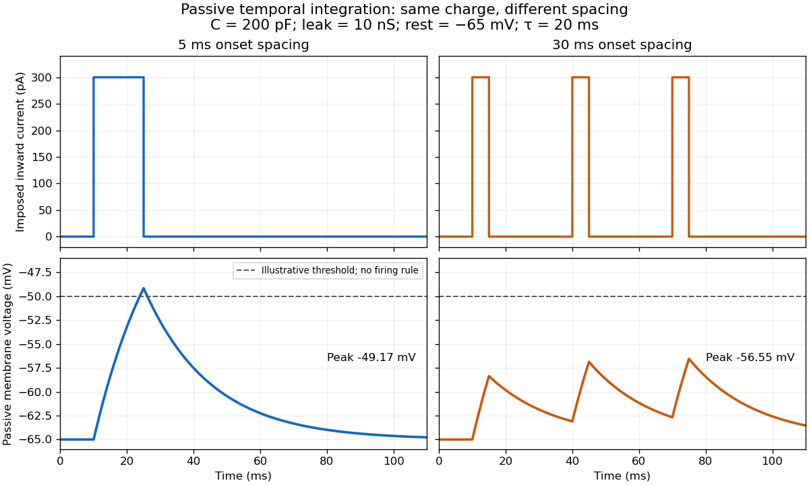

# Temporal summation

↑ **Parent:** [Synaptic integration](synaptic-integration.md)

[Temporal summation](temporal-summation.md) is overlap of responses to inputs arriving at different times. It can occur at one repeatedly activated [synapse](synapse.md) or across several [synapses](synapse.md); it is not defined by reuse of a particular contact. For prescribed [electric current](electric-current.md) inputs in a passive compartment, residual [depolarization](depolarization.md) from earlier pulses changes the voltage reached by later pulses. The [membrane time constant](membrane-time-constant.md) sets how rapidly that residual decays, while the duration of [synaptic conductance](synaptic-conductance.md) and spatial filtering by a [passive dendritic cable](passive-dendritic-cable.md) can add other timescales.

**[Figure 50](#image-equal-charge-inputs-with-different-spacing-in-a-passive-model-of-temporal-summation). Equal-charge inputs with different spacing in a passive model of temporal summation**. Original passive [current clamp](current-clamp.md) calculations with $C=200\,\mathrm{pF}$, $g_L=10\,\mathrm{nS}$ and rest $-65\,\mathrm{mV}$. Three equal $300\,\mathrm{pA}$ pulses, each $5\,\mathrm{ms}$ long, start at $10,15,20\,\mathrm{ms}$ or at $10,40,70\,\mathrm{ms}$. The first train consists of adjacent pulses and the second allows decay between pulses. The dashed $-50\,\mathrm{mV}$ line is an illustrative [neuronal firing threshold](neuronal-firing-threshold.md); trajectories continue passively through it, with no [action potential](action-potential.md) or reset. The same total injected [electric charge](electric-charge.md) produces different peak voltages.

For the diagram, write $v=V-E_L$, choose inward-positive imposed [electric current](electric-current.md) $I$, and use the [ordinary differential equation](ordinary-differential-equation.md)

$$
C\dot v=-g_Lv+I(t),\qquad \tau_m=\frac{C}{g_L}=20\,\mathrm{ms}.
$$

A rectangular pulse of amplitude $I_0=300\,\mathrm{pA}$ and duration $d=5\,\mathrm{ms}$, starting from rest, ends with

$$
A=\frac{I_0}{g_L}(1-e^{-d/\tau_m})=30(1-e^{-1/4})\,\mathrm{mV}\approx6.636\,\mathrm{mV}.
$$

Afterwards its contribution decays as $Ae^{-(t-d)/\tau_m}$. The [superposition principle](superposition-principle.md) therefore gives, at the end of the third pulse with onset spacing $\Delta\geq d$,

$$
v_{\mathrm{peak}}=A\left(1+e^{-\Delta/\tau_m}+e^{-2\Delta/\tau_m}\right).
$$

For $\Delta=5\,\mathrm{ms}$ this is $15.829\,\mathrm{mV}$, so the peak [membrane potential](membrane-potential.md) is $-49.171\,\mathrm{mV}$. For $\Delta=30\,\mathrm{ms}$ it is $8.447\,\mathrm{mV}$, giving $-56.553\,\mathrm{mV}$. Both protocols inject $3I_0d=4.5\,\mathrm{pC}$ of [electric charge](electric-charge.md); equal charge does not imply equal peak voltage because the leak drains charge while it is delivered.

In the adjacent-pulse case, the illustrative [neuronal firing threshold](neuronal-firing-threshold.md) $-50\,\mathrm{mV}$ is crossed at $10+20\log 2\approx23.863\,\mathrm{ms}$. A [leaky integrate-and-fire model](leaky-integrate-and-fire-model.md) would emit its first event there and reset, so its later trajectory would differ from the passive diagram. The widely spaced train never reaches that threshold. Thus changing input timing alone can change whether an event occurs. A real [neuron](neuron.md)'s [neuronal firing threshold](neuronal-firing-threshold.md) is also state-dependent, and [synaptic conductance](synaptic-conductance.md) pulses are not prescribed [electric current](electric-current.md) pulses.[Opening equations (1.31)–(1.32) and §1.4.3: ideal threshold/reset and dependence on preceding activity](neuronal-dynamics-from-single-neurons-to-networks-and-models-of-cognition-by-wulfram-gerstner-and-others/1-4-limitations-of-the-leaky-integrate-and-fire-model.md)

Measured responses to repeated presynaptic [action potentials](action-potential.md) may also change through [synaptic plasticity](synaptic-plasticity.md). A larger second response can therefore reflect a stronger second input as well as residual postsynaptic voltage. To isolate passive [temporal summation](temporal-summation.md), compare known injected [electric current](electric-current.md) waveforms with their single-pulse responses under stable recording conditions; to test actual [synapses](synapse.md), measure whether input efficacy changes. These are proposed discriminating comparisons, not additional controls claimed for the slice experiment.[§3.1.3: rapid synaptic dynamics, facilitation and depression](neuronal-dynamics-from-single-neurons-to-networks-and-models-of-cognition-by-wulfram-gerstner-and-others/3-1-synapses.md)

**Table of contents**

- [Membrane time constant](membrane-time-constant.md)

## ↑ Ancestors (5)

1. [Synaptic integration](synaptic-integration.md)
2. [Neuron](neuron.md)
3. [Neuroscience](neuroscience.md)
4. [Biology](biology-split.md)
5. [Codex Wiki](split.md)

## ← Incoming links (3)

- [Neuron](neuron.md)
- [Synaptic integration](synaptic-integration.md)
- [Temporal summation](temporal-summation.md)
