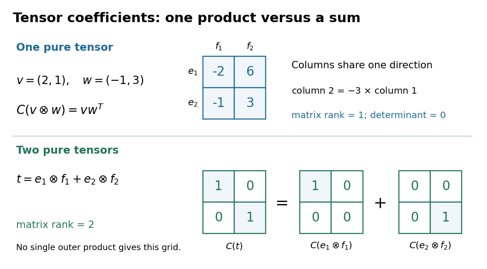

# Tensor-product coefficient matrix

↑ **Parent:** [Tensor-product basis](tensor-product-basis.md)

After choosing [ordered bases](ordered-basis.md), identify a [tensor](tensor.md) $t=\sum_{i,j}c_{ij}e_i\otimes f_j$ with its [matrix](matrix.md) $C(t)=(c_{ij})$. This is a [linear isomorphism](linear-isomorphism.md) between $V\otimes_F W$ and the [vector space](vector-space-split.md) of $m$-by-$n$ [matrices](matrix.md): each [tensor-product basis](tensor-product-basis.md) element becomes the [matrix](matrix.md) with one entry equal to one and all others zero. In particular, a [pure tensor](pure-tensor.md) has the [outer product](outer-product.md) coefficient formula

$$
C(v\otimes w)=vw^T,\qquad C\bigl((2,1)\otimes(-1,3)\bigr)=\begin{pmatrix}-2&6\\-1&3\end{pmatrix}.
$$

Here $v,w$ on the right denote column [coordinate vectors](coordinate-vector.md). The identification depends on the chosen [bases](basis.md), while the [tensor](tensor.md) itself does not. Over the [complex numbers](complex-number.md), the same formula uses the ordinary [transpose](transpose.md) $w^T$, with no [complex conjugation](complex-conjugation.md); replacing it by the [conjugate transpose](conjugate-transpose.md) $w^*$ would conjugate the [scalar](scalar.md) in the second input, violating [bilinearity](bilinearity.md).

**[Figure 2](#image-a-pure-tensor-has-an-outer-product-coefficient-grid-while-the-identity-grid-needs-two-pure-tensors). A pure tensor has an outer-product coefficient grid, while the identity grid needs two pure tensors**.

## ↑ Ancestors (8)

1. [Tensor-product basis](tensor-product-basis.md)
2. [Tensor product](tensor-product.md)
3. [Multilinear algebra](multilinear-algebra-split.md)
4. [Linear algebra](linear-algebra-split.md)
5. [Algebra](algebra-split.md)
6. [Area of mathematics](area-of-mathematics.md)
7. [Mathematics](mathematics-split.md)
8. [Codex Wiki](split.md)

## ← Incoming links (3)

- [Separability of a tensor](separability-of-a-tensor.md)
- [Tensor product](tensor-product.md)
- [Two-factor tensor rank](two-factor-tensor-rank.md)
