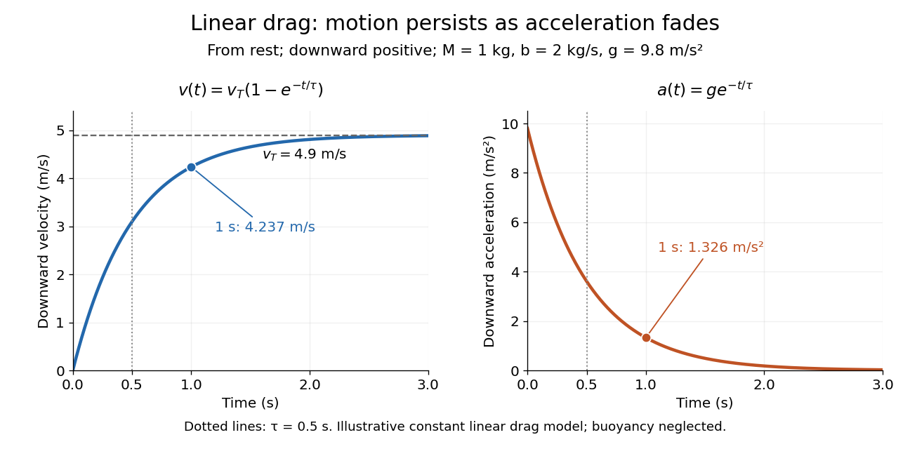

# Terminal velocity under linear drag

↑ **Parent:** [Terminal velocity](terminal-velocity.md)

Consider a [point mass](point-mass.md) of fixed [mass](mass.md) $M>0$ released from rest in a stationary medium. Choose downward as positive, assume constant [gravitational acceleration](gravitational-acceleration.md) $g>0$, neglect [buoyancy](buoyancy.md), and impose [linear drag](linear-drag.md) $F_d=-bv$ with constant [linear friction coefficient](linear-friction-coefficient.md) $b>0$. Here $v$ is the signed downward [velocity](velocity.md) component; it equals [speed](speed.md) during this descent. [Newton's second law](newton-s-second-law.md) becomes

$$
M\frac{dv}{dt}=Mg-bv,\qquad v(0)=0,\qquad v_T=\frac{Mg}{b},\quad\tau=\frac{M}{b}.
$$

The [terminal velocity](terminal-velocity.md) balances the two [forces](force-split.md), and the [time constant](time-constant.md) $\tau$ controls how quickly that balance is approached:

$$
v(t)=v_T(1-e^{-t/\tau}),\qquad a(t)=\frac{dv}{dt}=ge^{-t/\tau},\qquad t\ge0.
$$

For the illustrative parameters $M=1\,\mathrm{kg}$, $b=2\,\mathrm{kg/s}$ and $g=9.8\,\mathrm{m/s^2}$, the [time constant](time-constant.md) is $0.5\,\mathrm s$ and the [terminal velocity](terminal-velocity.md) is $4.9\,\mathrm{m/s}$ downward. At $t=1\,\mathrm s=2\tau$, the downward [velocity](velocity.md) is $4.9(1-e^{-2})\,\mathrm{m/s}\simeq4.23686\,\mathrm{m/s}$ and the downward [acceleration](acceleration.md) is $9.8e^{-2}\,\mathrm{m/s^2}\simeq1.32629\,\mathrm{m/s^2}$. This is a toy [linear drag](linear-drag.md) model, not a claim that every $1\,\mathrm{kg}$ falling object has this resistance law.

**[Figure 6](#image-exponential-approach-to-terminal-velocity-and-decay-of-acceleration-in-an-illustrative-linear-drag-model). Exponential approach to terminal velocity and decay of acceleration in an illustrative linear drag model**.

For a proof outline, subtract the equilibrium value: $u=v-v_T$ obeys $du/dt=-u/\tau$. The [exponential decay](exponential-decay.md) solution and the initial condition give $u=-v_Te^{-t/\tau}$; one [derivative](derivative.md) gives the [acceleration](acceleration.md). Every [time constant](time-constant.md) multiplies the remaining gap $v_T-v$ by $e^{-1}$. The exact limit is reached only as $t\to\infty$. This makes the model useful for estimating a settling duration without mistaking vanishing [acceleration](acceleration.md) for vanishing [velocity](velocity.md).

Newton already analyzed vertical motion under uniform [gravity](gravity.md) and resistance proportional to [velocity](velocity.md) in Book II, Section I, Proposition III of the _Principia_. His geometric construction includes a greatest downward [velocity](velocity.md), illustrating that a limiting rate can emerge from balancing a driving [force](force-split.md) and resistance. [Newton, Principia, Book II, Proposition III; Motte's 1729 translation](https://en.wikisource.org/wiki/The_Mathematical_Principles_of_Natural_Philosophy_(1729)/Book_2/Section_1)

## ↑ Ancestors (7)

1. [Terminal velocity](terminal-velocity.md)
2. [Velocity](velocity.md)
3. [Position](position.md)
4. [Classical mechanics](classical-mechanics-split.md)
5. [Branches of physics](branches-of-physics.md)
6. [Physics](physics-split.md)
7. [Codex Wiki](split.md)

## ← Incoming links (2)

- [Oil drop charge readout and calibration](oil-drop-charge-readout-and-calibration.md)
- [Terminal velocity](terminal-velocity.md)
