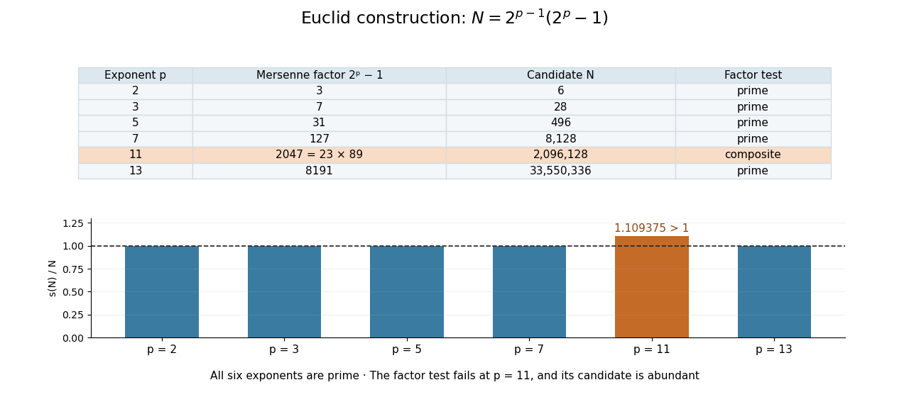

# Testing the prime condition in the Euclid construction

↑ **Parent:** [Euclid-Euler theorem](euclid-euler-theorem.md)

The [prime](prime-number-split.md) exponents $2,3,5,7,13$ give [Mersenne primes](mersenne-prime.md) and therefore [perfect numbers](perfect-number.md). But $p=11$ gives $2^{11}-1=2047=23\cdot89$. The resulting candidate $N=2^{10}\cdot2047=2096128$ has

$$
\sigma(N)=(1+2+\cdots+2^{10})(1+23)(1+89)=2047\cdot24\cdot90=4421520,
$$

so $s(N)=2325392>N$. It is an [abundant number](abundant-number.md), not a [perfect number](perfect-number.md). Checking only that the exponent is [prime](prime-number-split.md) would miss this obstruction.

**[Figure 4](#image-a-prime-exponent-gives-a-candidate-the-mersenne-factor-must-also-be-prime). A prime exponent gives a candidate; the Mersenne factor must also be prime**. Original exact computations for $p=2,3,5,7,11,13$. The upper table lists $M_p=2^p-1$ and the constructed candidate $N$. The lower bars show $s(N)/N$; equality at one identifies [perfect numbers](perfect-number.md). The composite factor at $p=11$ makes the candidate [abundant](abundant-number.md).

## ↑ Ancestors (8)

1. [Euclid-Euler theorem](euclid-euler-theorem.md)
2. [Perfect number](perfect-number.md)
3. [Positive integer](positive-integer.md)
4. [Integer](integer-split.md)
5. [Number theory](number-theory-split.md)
6. [Area of mathematics](area-of-mathematics.md)
7. [Mathematics](mathematics-split.md)
8. [Codex Wiki](split.md)
