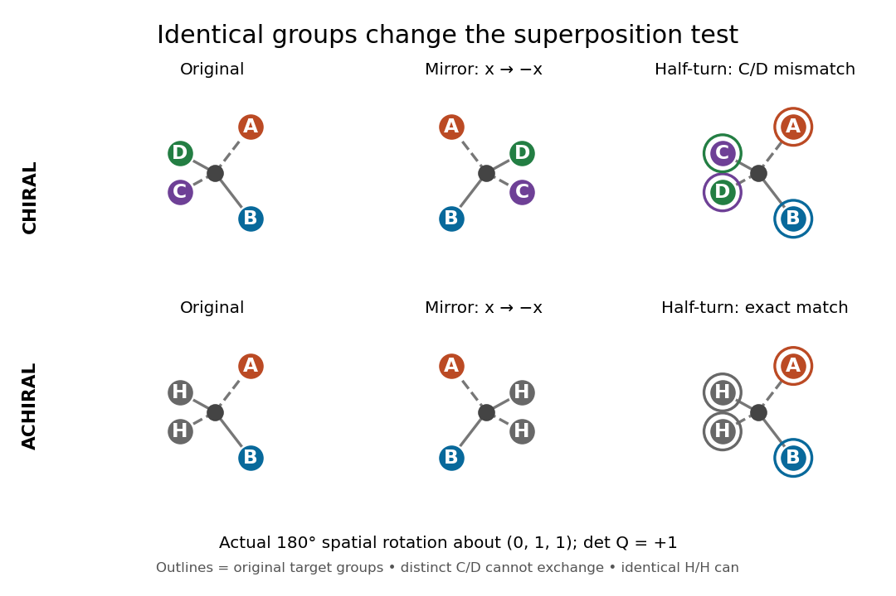

# Tetrahedral mirror-image test

↑ **Parent:** [Chirality (chemistry)](chirality-chemistry.md)

Take a central [chemical atom](atom-physics.md) at the origin and four [substituents](substituent.md) at the vertices of an ideal [regular tetrahedron](regular-tetrahedron.md):

$$
a=(1,1,1),\quad b=(1,-1,-1),\quad c=(-1,1,-1),\quad d=(-1,-1,1).
$$

These dimensionless [coordinates](coordinate-linear-algebra.md) describe shape, not measured [bond lengths](bond-length.md). For distinct labels A, B, C and D, define a signed [determinant](determinant.md)

$$
\Delta=\det\begin{pmatrix}|&|&|\\a-d&b-d&c-d\\|&|&|\end{pmatrix}=+16.
$$

It is six times the [oriented volume](oriented-volume.md) of the labelled [tetrahedron](tetrahedron.md). A [translation](translation-geometry.md) cancels from the differences. A [rotation](rotation-mathematics.md) $Q$ has $\det Q=+1$ and preserves $\Delta$, whereas the mirror [matrix](matrix.md) $S=\operatorname{diag}(-1,1,1)$ has $\det S=-1$ and changes it to $-16$. Consequently no [rotation](rotation-mathematics.md) can place every distinct label on its mirror partner. This argument uses three-dimensional [coordinates](coordinate-linear-algebra.md), not clockwise order on a page.

Now let C and D both be the same [substituent](substituent.md) H. Swapping these identical groups is allowed. For this model the half-turn

$$
Q=\begin{pmatrix}-1&0&0\\0&0&1\\0&1&0\end{pmatrix},\qquad Q^{\mathsf T}Q=I,\qquad\det Q=+1,
$$

about the axis $(0,1,1)$ maps the reflected A and B to their original positions and exchanges the two H positions. The models superpose. With distinct C and D, the same half-turn fails precisely at those two labels; the [determinant](determinant.md) argument rules out every other [rotation](rotation-mathematics.md) as well. This is the local reason two identical [hydrogen](hydrogen.md) [chemical atoms](atom-physics.md) prevent [glycine](glycine.md)'s [amino acid alpha carbon](amino-acid-alpha-carbon.md) from being a tetrahedral [stereocenter](stereocenter.md).

**[Figure 2](#image-the-same-spatial-half-turn-succeeds-only-when-the-exchanged-groups-are-identical). The same spatial half-turn succeeds only when the exchanged groups are identical**. Original model, mirror model and rotated mirror model. Top: the distinct C and D remain mismatched, so the A/B/C/D model is [chiral](chirality-chemistry.md). Bottom: the identical H groups may exchange, so the A/B/H/H model is [achiral](achirality.md). The operation is an actual three-dimensional $180^\circ$ [rotation](rotation-mathematics.md) about $(0,1,1)$, with [determinant](determinant.md) $+1$.

For a flexible [molecule](molecule-split.md), also distinguish [conformational isomerism](conformational-isomerism.md) from a persistent [enantiomer](enantiomer.md) pair. A particular frozen shape may be [chiral](chirality-chemistry.md) while ordinary internal motions interconvert mirror shapes. Turning the entire model is always allowed in a spatial comparison; an internal motion must be considered with its actual accessibility and timescale.

## ↑ Ancestors (4)

1. [Chirality (chemistry)](chirality-chemistry.md)
2. [Stereochemistry](stereochemistry-split.md)
3. [Chemistry](chemistry-split.md)
4. [Codex Wiki](split.md)

## ← Incoming links (1)

- [R and S configuration](r-and-s-configuration.md)
