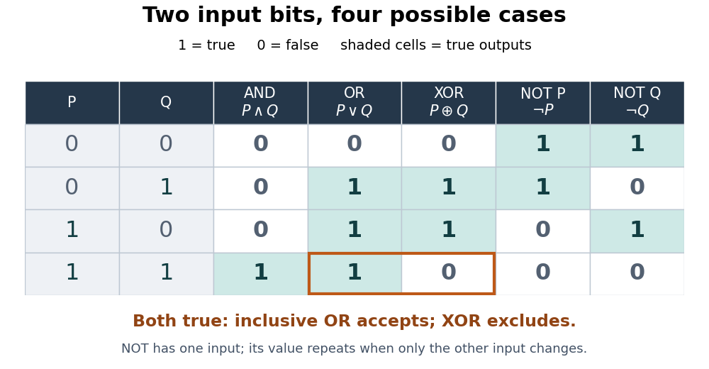
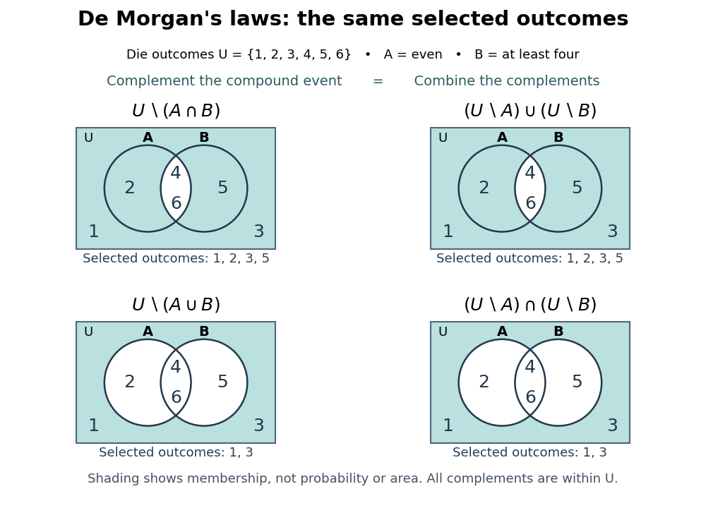
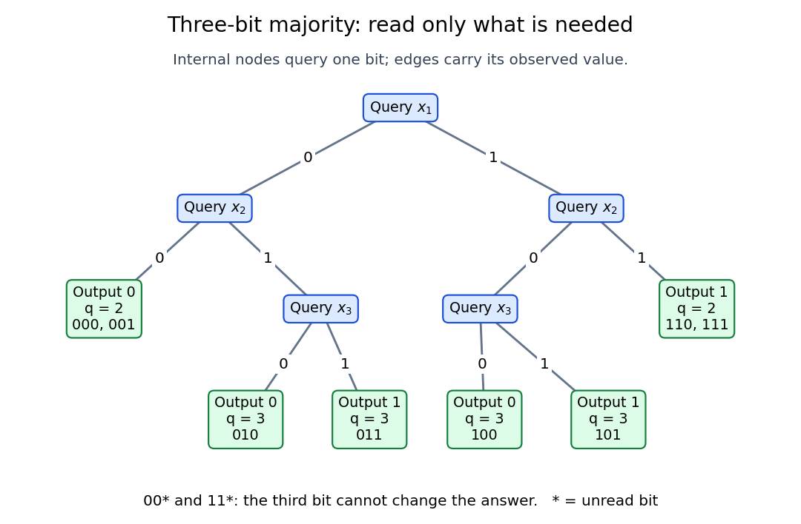
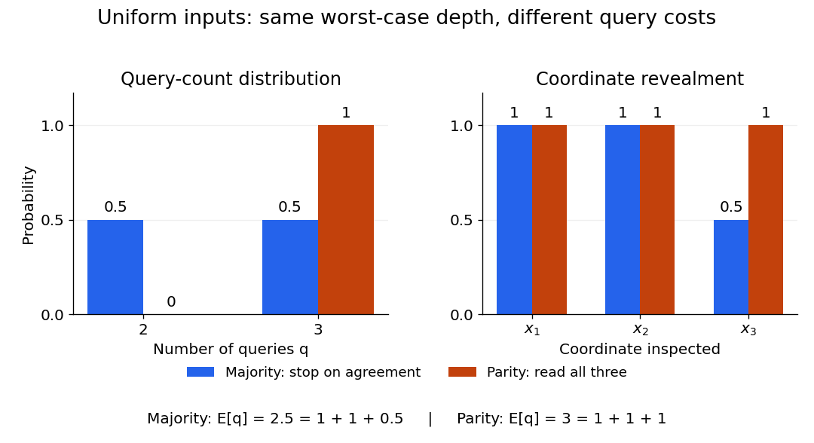
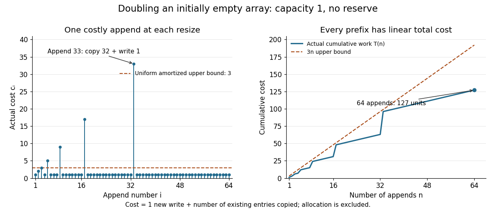
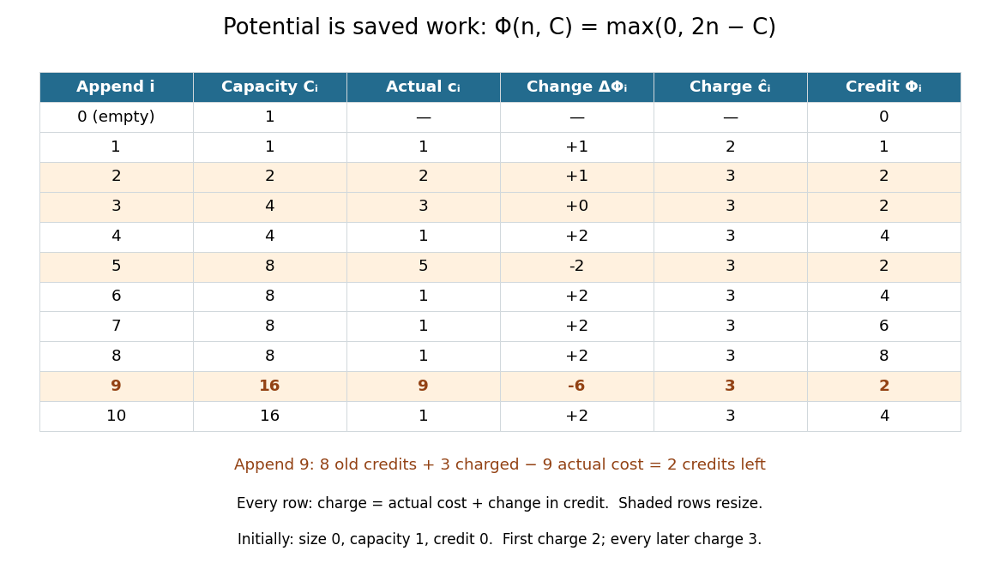
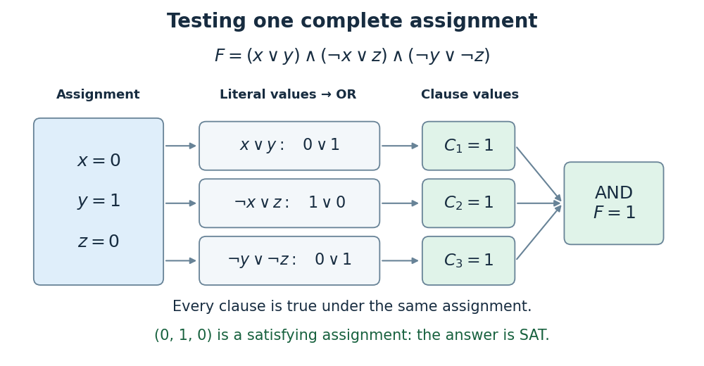
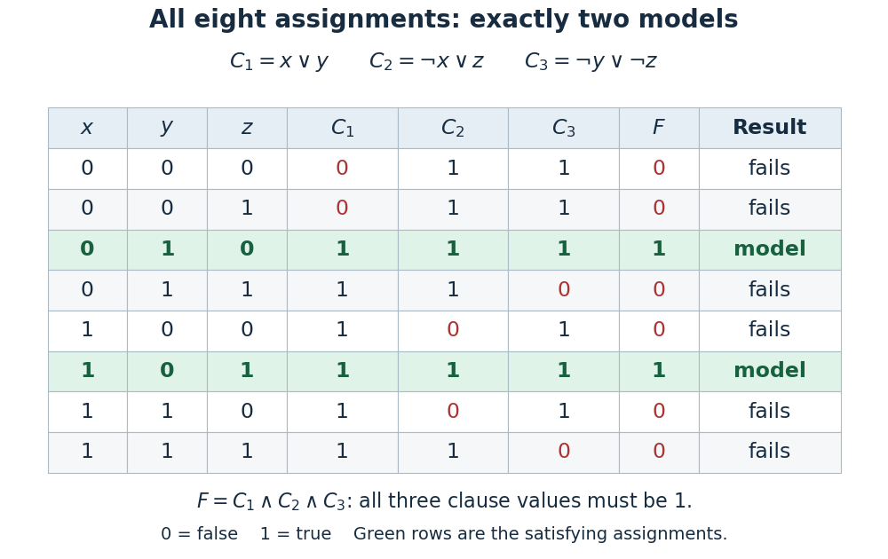
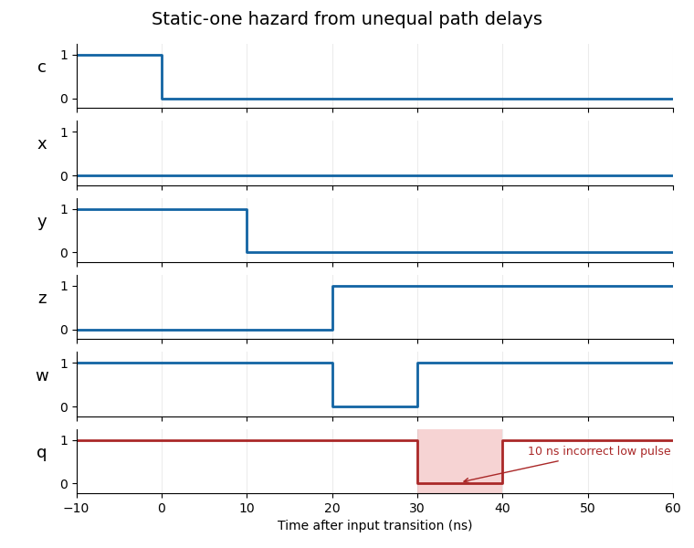
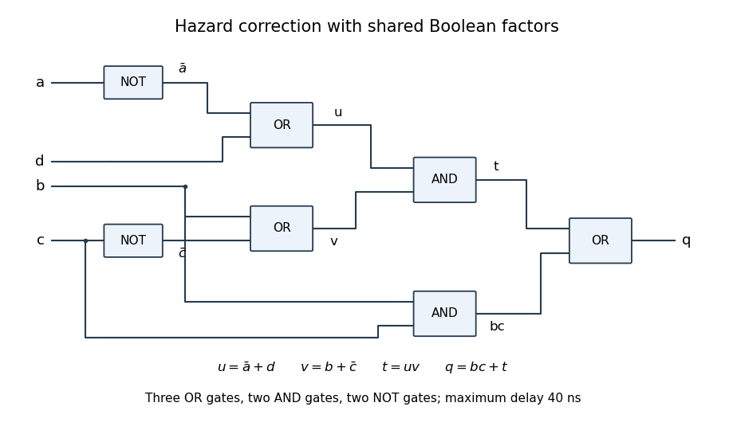

# Theoretical computer science

↑ **Parent:** [Computer science](computer-science.md)  
ⓦ [Wiki](https://en.wikipedia.org/wiki/Theoretical_computer_science)

**Table of contents**

- [Formal language](#formal-language)
  - [L-system](#l-system)
  - [Binary string](#binary-string)
    - [Counting binary strings with bounded ones](#counting-binary-strings-with-bounded-ones)
    - [Self-delimiting binary code](#self-delimiting-binary-code)
  - [Concatenation of formal languages](#concatenation-of-formal-languages)
  - [Empty language](#empty-language)
- [Turing machine](#turing-machine)
  - [Blank symbol](#blank-symbol)
  - [Turing machine encoding](#turing-machine-encoding)
  - [Multitape Turing machine](#multitape-turing-machine)
  - [Single-tape Turing machine](#single-tape-turing-machine)
  - [Read-only-from-left Turing acceptor](#read-only-from-left-turing-acceptor)
  - [Instantaneous description of a Turing machine](#instantaneous-description-of-a-turing-machine)
    - [Next-configuration relation](#next-configuration-relation)
  - [Instruction of a Turing machine](#instruction-of-a-turing-machine)
  - [Two-stack encoding of a Turing tape](#two-stack-encoding-of-a-turing-tape)
  - [Modular machine](#modular-machine)
    - [Group encoding of a modular machine](#group-encoding-of-a-modular-machine)
    - [Halting set at a designated terminal configuration](#halting-set-at-a-designated-terminal-configuration)
  - [Deterministic computation](#deterministic-computation)
  - [Reversible computation](#reversible-computation)
    - [Reversible circuit](#reversible-circuit)
  - [Nondeterministic Turing machine](#nondeterministic-turing-machine)
  - [Oracle machine](#oracle-machine)
    - [Function oracle](#function-oracle)
    - [Relativization (complexity theory)](#relativization-complexity-theory)
- [Boolean operation](#boolean-operation)
  - [Boolean operations on events](#boolean-operations-on-events)
  - [Exclusive or](#exclusive-or)
    - [Exclusive or toggles and parity](#exclusive-or-toggles-and-parity)
  - [Negation](#negation)
    - [NOT gate](#not-gate)
  - [De Morgan's laws](#de-morgan-s-laws)
    - [De Morgan dual of a Boolean function](#de-morgan-dual-of-a-boolean-function)
- [Computational complexity theory](#computational-complexity-theory)
  - [Bit complexity](#bit-complexity)
  - [Parameterized complexity](#parameterized-complexity)
    - [Kernelization](#kernelization)
    - [Fixed-parameter tractability](#fixed-parameter-tractability)
  - [Element distinctness problem](#element-distinctness-problem)
  - [Comparison model](#comparison-model)
    - [Ternary comparison](#ternary-comparison)
  - [Equivalence of weighted formula utility representations](#equivalence-of-weighted-formula-utility-representations)
  - [co-NP](#co-np)
  - [Query complexity](#query-complexity)
    - [Identification of a unique essential variable](#identification-of-a-unique-essential-variable)
    - [Classical query complexity of linear Boolean function identification](#classical-query-complexity-of-linear-boolean-function-identification)
  - [Communication complexity](#communication-complexity)
    - [Entanglement-assisted promised equality protocol](#entanglement-assisted-promised-equality-protocol)
  - [Promise problem](#promise-problem)
  - [Quantum complexity theory](#quantum-complexity-theory)
    - [BQP](#bqp)
      - [BQP error reduction](#bqp-error-reduction)
    - [Quantum witness](#quantum-witness)
    - [StoqMA](#stoqma)
    - [QMA](#qma)
      - [Witness acceptance operator](#witness-acceptance-operator)
        - [Trace-power witness optimization](#trace-power-witness-optimization)
      - [QMA error reduction](#qma-error-reduction)
      - [QMA parallel repetition with entangled witnesses](#qma-parallel-repetition-with-entangled-witnesses)
      - [Quantum verifier acceptance operator](#quantum-verifier-acceptance-operator)
    - [Quantum query complexity](#quantum-query-complexity)
      - [Quantum oracle](#quantum-oracle)
        - [Phase oracle](#phase-oracle)
          - [One-query constancy obstruction for phase oracles](#one-query-constancy-obstruction-for-phase-oracles)
      - [Polynomial method for quantum query lower bounds](#polynomial-method-for-quantum-query-lower-bounds)
      - [Exact quantum query complexity](#exact-quantum-query-complexity)
        - [Exact two-query majority algorithm](#exact-two-query-majority-algorithm)
      - [Quantum collision finding](#quantum-collision-finding)
        - [Brassard–Høyer–Tapp collision algorithm](#brassard-hoyer-tapp-collision-algorithm)
  - [Decision tree model](#decision-tree-model)
    - [Decision tree](#decision-tree)
      - [Binary decision tree](#binary-decision-tree)
      - [Three-bit majority decision tree](#three-bit-majority-decision-tree)
      - [Parity lower bound for Boolean queries](#parity-lower-bound-for-boolean-queries)
      - [Decision-tree query cost](#decision-tree-query-cost)
        - [Expected query cost](#expected-query-cost)
        - [Coordinate revealment](#coordinate-revealment)
      - [Decision-tree depth](#decision-tree-depth)
        - [Certificate complexity of a Boolean function](#certificate-complexity-of-a-boolean-function)
          - [Query certificate](#query-certificate)
        - [Evasive Boolean function](#evasive-boolean-function)
          - [Alternating-sum criterion for decision-tree evasiveness](#alternating-sum-criterion-for-decision-tree-evasiveness)
        - [Decision-tree adversary for a threshold function](#decision-tree-adversary-for-a-threshold-function)
  - [Computational problem](#computational-problem)
    - [Input (computer science)](#input-computer-science)
    - [Output (computing)](#output-computing)
    - [Decision problem](#decision-problem)
    - [Search problem](#search-problem)
      - [Word ladder](#word-ladder)
      - [Goal state](#goal-state)
      - [Path cost](#path-cost)
        - [Step cost](#step-cost)
      - [Adversarial search](#adversarial-search)
        - [Expectiminimax](#expectiminimax)
        - [Expectimax](#expectimax)
      - [Simultaneous rendezvous distance](#simultaneous-rendezvous-distance)
      - [Partially observable search](#partially-observable-search)
        - [Sensorless planning](#sensorless-planning)
          - [Incremental belief-state search](#incremental-belief-state-search)
        - [Belief state](#belief-state)
      - [Relaxation heuristic](#relaxation-heuristic)
        - [Abstraction heuristic](#abstraction-heuristic)
          - [Pattern database](#pattern-database)
        - [Delete-relaxation heuristic](#delete-relaxation-heuristic)
      - [Consistent heuristic](#consistent-heuristic)
      - [Admissible heuristic](#admissible-heuristic)
        - [Admissible heuristic combination](#admissible-heuristic-combination)
      - [Heuristic function](#heuristic-function)
        - [Perfect heuristic](#perfect-heuristic)
        - [Ordinal heuristic comparator](#ordinal-heuristic-comparator)
        - [Heuristic dominance](#heuristic-dominance)
      - [Goal test](#goal-test)
      - [Search transition model](#search-transition-model)
      - [Search tree](#search-tree)
        - [Search depth](#search-depth)
        - [Search node](#search-node)
        - [Search frontier](#search-frontier)
        - [Branching factor](#branching-factor)
      - [Constraint satisfaction problem](#constraint-satisfaction-problem)
        - [Constraint hypergraph](#constraint-hypergraph)
          - [Primal graph](#primal-graph)
        - [Cardinality constraint](#cardinality-constraint)
        - [Nonattacking knights problem](#nonattacking-knights-problem)
          - [Knight attack graph](#knight-attack-graph)
        - [Direct SAT encoding of finite-domain constraints](#direct-sat-encoding-of-finite-domain-constraints)
        - [Cutset conditioning](#cutset-conditioning)
        - [Degree heuristic](#degree-heuristic)
        - [Unary constraint](#unary-constraint)
        - [Hidden-variable encoding](#hidden-variable-encoding)
        - [N-queens problem](#n-queens-problem)
          - [Queens completion problem](#queens-completion-problem)
        - [Tree-structured constraint satisfaction](#tree-structured-constraint-satisfaction)
        - [Arc consistency](#arc-consistency)
          - [Full-sweep arc consistency](#full-sweep-arc-consistency)
          - [Arc-consistency closure](#arc-consistency-closure)
          - [AC-3](#ac-3)
        - [Constraint graph](#constraint-graph)
          - [Cycle cutset](#cycle-cutset)
        - [Binary constraint](#binary-constraint)
        - [Constraint domain](#constraint-domain)
        - [Sudoku](#sudoku)
        - [Kakuro](#kakuro)
        - [Forward checking](#forward-checking)
        - [Minimum remaining values](#minimum-remaining-values)
        - [Constraint propagation](#constraint-propagation)
          - [Fixed-point pruning of finite constraint domains](#fixed-point-pruning-of-finite-constraint-domains)
        - [All-different constraint](#all-different-constraint)
        - [Minimum remaining values heuristic](#minimum-remaining-values-heuristic)
      - [Search-to-decision reduction](#search-to-decision-reduction)
  - [Complexity class](#complexity-class)
    - [Time complexity](#time-complexity)
      - [Exponential time](#exponential-time)
        - [EXPTIME](#exptime)
      - [Linear speedup theorem](#linear-speedup-theorem)
      - [Unit-cost model](#unit-cost-model)
      - [Combinatorial explosion](#combinatorial-explosion)
      - [Pseudopolynomial time](#pseudopolynomial-time)
      - [Quadratic time](#quadratic-time)
      - [Linear time](#linear-time)
      - [Constant time](#constant-time)
      - [Pseudo-polynomial time](#pseudo-polynomial-time)
      - [Amortized analysis](#amortized-analysis)
        - [Weighted binary counter cost](#weighted-binary-counter-cost)
        - [Amortized time complexity](#amortized-time-complexity)
        - [Dynamic array doubling](#dynamic-array-doubling)
        - [Potential method](#potential-method)
          - [Amortized cost](#amortized-cost)
        - [Aggregate analysis](#aggregate-analysis)
        - [Accounting method](#accounting-method)
      - [Polynomial time](#polynomial-time)
        - [Polynomial-time algorithm](#polynomial-time-algorithm)
        - [P (complexity)](#p-complexity)
          - [co-P](#co-p)
          - [P-completeness](#p-completeness)
        - [NP (complexity)](#np-complexity)
          - [Certificate (complexity)](#certificate-complexity)
    - [Space complexity](#space-complexity)
      - [Constant space](#constant-space)
      - [Polynomial space](#polynomial-space)
      - [Nondeterministic space complexity class](#nondeterministic-space-complexity-class)
        - [Savitch's theorem](#savitch-s-theorem)
          - [Space-bound discovery by exit reachability](#space-bound-discovery-by-exit-reachability)
      - [Deterministic space complexity class](#deterministic-space-complexity-class)
        - [PSPACE](#pspace)
      - [Polynomial-register real-arithmetic computation](#polynomial-register-real-arithmetic-computation)
      - [Logarithmic space](#logarithmic-space)
        - [Binary addition in logarithmic space](#binary-addition-in-logarithmic-space)
        - [Logspace transducer](#logspace-transducer)
          - [Logspace-computable function](#logspace-computable-function)
            - [Logspace composition by recomputation](#logspace-composition-by-recomputation)
        - [L (complexity)](#l-complexity)
        - [NL (complexity)](#nl-complexity)
          - [NL-complete](#nl-complete)
            - [Directed cycle detection](#directed-cycle-detection)
            - [ST-connectivity](#st-connectivity)
              - [Even-length directed reachability](#even-length-directed-reachability)
              - [Configuration graph](#configuration-graph)
          - [co-NL](#co-nl)
            - [Immerman–Szelepcsényi theorem](#immerman-szelepcsenyi-theorem)
              - [Inductive counting](#inductive-counting)
  - [Polynomial-time reduction](#polynomial-time-reduction)
    - [Polynomial-time many-one reduction](#polynomial-time-many-one-reduction)
      - [Logspace many-one reduction](#logspace-many-one-reduction)
      - [NP-hardness](#np-hardness)
        - [NP-completeness](#np-completeness)
          - [Strong NP-completeness](#strong-np-completeness)
          - [Set cover problem](#set-cover-problem)
            - [Set cover reduction to equilibrium support](#set-cover-reduction-to-equilibrium-support)
          - [Cook-Levin theorem](#cook-levin-theorem)
          - [Subset sum problem](#subset-sum-problem)
            - [Subset sum dynamic programming](#subset-sum-dynamic-programming)
            - [Special sum set](#special-sum-set)
          - [Boolean satisfiability problem](#boolean-satisfiability-problem)
            - [SAT solver](#sat-solver)
              - [Clause learning](#clause-learning)
              - [Unit propagation](#unit-propagation)
            - [Exactly-one constraint](#exactly-one-constraint)
            - [Satisfying assignment](#satisfying-assignment)
              - [Quadratic-size formula with prescribed model count](#quadratic-size-formula-with-prescribed-model-count)
              - [Verifying a satisfying assignment](#verifying-a-satisfying-assignment)
            - [Unsatisfiable Boolean formula](#unsatisfiable-boolean-formula)
            - [Partial Boolean assignment](#partial-boolean-assignment)
            - [2-satisfiability](#2-satisfiability)
            - [Integer programming formulation of satisfiability](#integer-programming-formulation-of-satisfiability)
            - [Maximum satisfiability](#maximum-satisfiability)
              - [Literal-frequency greedy approximation for MAX-SAT](#literal-frequency-greedy-approximation-for-max-sat)
            - [2UN-SAT](#2un-sat)
            - [Maximum 2-satisfiability](#maximum-2-satisfiability)
              - [Golden ratio approximation for MAX-2SAT](#golden-ratio-approximation-for-max-2sat)
              - [Seven-clause gadget for MAX-2SAT](#seven-clause-gadget-for-max-2sat)
            - [Boolean formula](#boolean-formula)
              - [Disjunctive normal form](#disjunctive-normal-form)
                - [Endpoint-false disjunctive normal form](#endpoint-false-disjunctive-normal-form)
              - [Conjunctive normal form](#conjunctive-normal-form)
                - [3-CNF formula](#3-cnf-formula)
                - [2-CNF formula](#2-cnf-formula)
                - [Tseytin transformation](#tseytin-transformation)
              - [Clause of a Boolean formula](#clause-of-a-boolean-formula)
              - [Boolean literal](#boolean-literal)
              - [Boolean variable](#boolean-variable)
            - [3-SAT](#3-sat)
            - [Horn clause](#horn-clause)
              - [First-order Horn clause](#first-order-horn-clause)
              - [Horn-SAT](#horn-sat)
                - [Horn-SAT forward-chaining algorithm](#horn-sat-forward-chaining-algorithm)
          - [Quadratic-equation satisfiability over F2](#quadratic-equation-satisfiability-over-f2)
          - [Ladner's theorem](#ladner-s-theorem)
  - [Circuit complexity](#circuit-complexity)
    - [NC1](#nc1)
      - [MOD3 binary divisibility problem](#mod3-binary-divisibility-problem)
      - [Balanced finite-monoid reduction circuit](#balanced-finite-monoid-reduction-circuit)
    - [Boolean circuit](#boolean-circuit)
      - [Combinational logic](#combinational-logic)
        - [Binary decoder](#binary-decoder)
        - [Hazard (logic)](#hazard-logic)
          - [Static-one logic hazard](#static-one-logic-hazard)
        - [Propagation delay](#propagation-delay)
        - [Combinational critical path](#combinational-critical-path)
        - [Barrel shifter](#barrel-shifter)
        - [Count leading zeros](#count-leading-zeros)
          - [Byte-table leading-zero count](#byte-table-leading-zero-count)
          - [Hierarchical leading-zero counter](#hierarchical-leading-zero-counter)
        - [Adder](#adder)
          - [Half adder](#half-adder)
        - [Multiplexer](#multiplexer)
        - [Digital comparator](#digital-comparator)
          - [Bit-serial comparator](#bit-serial-comparator)
          - [Comparator composition](#comparator-composition)
      - [Logic gate](#logic-gate)
        - [XNOR gate](#xnor-gate)
        - [Fan-out](#fan-out)
        - [NOR gate](#nor-gate)
        - [NAND gate](#nand-gate)
      - [Circuit size](#circuit-size)
      - [Depth of a Boolean circuit](#depth-of-a-boolean-circuit)
      - [Circuit value problem](#circuit-value-problem)
        - [AND-NOT circuit value problem](#and-not-circuit-value-problem)
      - [Circuit satisfiability problem](#circuit-satisfiability-problem)
      - [Threshold function](#threshold-function)
        - [Majority function](#majority-function)
          - [Block conjunction of three-bit majorities](#block-conjunction-of-three-bit-majorities)
      - [Dual Boolean function](#dual-boolean-function)
    - [Circuit family](#circuit-family)
      - [Circuit size class](#circuit-size-class)
        - [Truth-table upper bound for circuit size](#truth-table-upper-bound-for-circuit-size)
      - [Polynomial-size circuit family](#polynomial-size-circuit-family)
        - [Undecidable unary languages with linear-size circuits](#undecidable-unary-languages-with-linear-size-circuits)
        - [P/poly](#p-poly)
    - [Constant-depth circuit complexity](#constant-depth-circuit-complexity)
      - [Håstad switching lemma](#hastad-switching-lemma)
        - [Switching-lemma depth reduction](#switching-lemma-depth-reduction)
    - [Monotone circuit complexity](#monotone-circuit-complexity)
      - [Monotone circuit](#monotone-circuit)
      - [Superpolynomial monotone clique lower bound](#superpolynomial-monotone-clique-lower-bound)
      - [Razborov approximation method](#razborov-approximation-method)
        - [Finite lattice approximation for monotone clique circuits](#finite-lattice-approximation-for-monotone-clique-circuits)
          - [Negative colouring error of a forced-set closure](#negative-colouring-error-of-a-forced-set-closure)
          - [Positive clique error of a truncated lattice meet](#positive-clique-error-of-a-truncated-lattice-meet)
        - [Razborov closure](#razborov-closure)
          - [Sunflower bound for minimal members of a Razborov-closed family](#sunflower-bound-for-minimal-members-of-a-razborov-closed-family)
          - [Minimal-member bound for a Razborov-closed family](#minimal-member-bound-for-a-razborov-closed-family)
        - [Razborov gate-by-gate approximation lemma](#razborov-gate-by-gate-approximation-lemma)
    - [Natural proof](#natural-proof)
      - [Constructive property of Boolean functions](#constructive-property-of-boolean-functions)
      - [Large property of Boolean functions](#large-property-of-boolean-functions)
      - [Useful property against a circuit class](#useful-property-against-a-circuit-class)
      - [Razborov–Rudich natural-proofs barrier](#razborov-rudich-natural-proofs-barrier)
    - [Pseudorandom function family](#pseudorandom-function-family)
    - [Arithmetic circuit](#arithmetic-circuit)
  - [Counting complexity](#counting-complexity)
    - [Valiant's permanent reduction](#valiant-s-permanent-reduction)
      - [Variable gadget in Valiant's permanent reduction](#variable-gadget-in-valiant-s-permanent-reduction)
      - [Clause gadget in Valiant's permanent reduction](#clause-gadget-in-valiant-s-permanent-reduction)
      - [Exclusive-or gadget in Valiant's permanent reduction](#exclusive-or-gadget-in-valiant-s-permanent-reduction)
      - [Binary path-counting gadget](#binary-path-counting-gadget)
    - [Balanced number 3-SAT](#balanced-number-3-sat)
  - [Polynomial hierarchy](#polynomial-hierarchy)
    - [Second level of the polynomial hierarchy](#second-level-of-the-polynomial-hierarchy)
      - [Two-block quantified Boolean formula](#two-block-quantified-boolean-formula)
    - [Karp–Lipton theorem](#karp-lipton-theorem)
  - [Primality testing](#primality-testing)
    - [Prime-proof number](#prime-proof-number)
    - [Miller-Rabin primality test](#miller-rabin-primality-test)
      - [Deterministic Miller-Rabin primality test](#deterministic-miller-rabin-primality-test)
    - [Fermat primality test](#fermat-primality-test)
    - [Pseudoprime base](#pseudoprime-base)
    - [Agrawal–Biswas primality test](#agrawal-biswas-primality-test)
- [Abstract machine](#abstract-machine)
  - [State machine](#state-machine)
    - [State (computer science)](#state-computer-science)
  - [Stack machine](#stack-machine)
    - [Postfix code](#postfix-code)
    - [Optimal stack evaluation of a binary expression tree](#optimal-stack-evaluation-of-a-binary-expression-tree)

## Formal language

↑ **Parent:** [Theoretical computer science](theoretical-computer-science.md)  
ⓦ [Wiki](https://en.wikipedia.org/wiki/Formal_language)

A formal language is a set of finite strings over a fixed finite alphabet.

### L-system

↑ **Parent:** [Formal language](#formal-language)

A parallel string-rewriting system: at each generation, every symbol is replaced simultaneously by its assigned word. Symbols can also encode drawing commands such as moving forward or turning. Large recursively defined drawings can be queried without expanding the whole word by precomputing the length, displacement, and rotation of each expanded block.

### Binary string

↑ **Parent:** [Formal language](#formal-language)

A [binary string](#binary-string) is a finite word over the alphabet $\{0,1\}$. There are $2^n$ strings of length $n$. Finite [binary strings](#binary-string) have an effective [bijection](function.md#bijection) with [natural numbers](arithmetic.md#natural-number), so computable enumerability and immunity apply to sets of strings.

#### Counting binary strings with bounded ones

↑ **Parent:** [Binary string](#binary-string)

A [binary string](#binary-string) with $n$ zeroes and $j$ ones is determined by its $j$ one-positions, giving $\binom{n+j}j$ possibilities. Sum for $0\le j\le m$ and apply the [hockey-stick identity](binomial-coefficient.md#hockey-stick-identity). Equivalently, distribute at most $m$ ones among the $n+1$ gaps around the zeroes and add a slack count; [stars and bars](combinatorics.md#stars-and-bars-combinatorics) counts $n+2$ nonnegative counts summing to $m$.

#### Self-delimiting binary code

↑ **Parent:** [Binary string](#binary-string)

A self-delimiting code permits a decoder to identify the end of a code without an external length marker. Encoding a binary word of length $\ell$ by $\ell$ ones, a zero and the word uses $2\ell+1$ bits. This yields an $O(\log n)$ description of a [natural number](arithmetic.md#natural-number) in an incompressibility proof.

### Concatenation of formal languages

↑ **Parent:** [Formal language](#formal-language)

For [formal languages](#formal-language) $L,M$ over the same [alphabet](information-theory.md#alphabet), concatenate each [word over an alphabet](foundations-of-mathematics.md#string) in $L$ with each [word over an alphabet](foundations-of-mathematics.md#string) in $M$. This operation is associative, has identity $\{\varepsilon\}$ and absorbing element the [empty language](#empty-language).

### Empty language

↑ **Parent:** [Formal language](#formal-language)

The [formal language](#formal-language) containing no [words over an alphabet](foundations-of-mathematics.md#string). It differs from the language containing only the [empty word](foundations-of-mathematics.md#empty-word), which is a multiplicative identity for [concatenation of formal languages](#concatenation-of-formal-languages).

## Turing machine

↑ **Parent:** [Theoretical computer science](theoretical-computer-science.md)  
ⓦ [Wiki](https://en.wikipedia.org/wiki/Turing_machine)

A Turing machine is an abstract computational model with a finite control, an unbounded tape and a head that reads, writes and moves on the tape.

### Blank symbol

↑ **Parent:** [Turing machine](#turing-machine)

A designated tape [alphabet](information-theory.md#alphabet) symbol occupying unused cells of a [Turing machine](#turing-machine). It is excluded from the input [alphabet](information-theory.md#alphabet), so a finite input [word](foundations-of-mathematics.md#string) occupies a finite region of an otherwise blank tape.

### Turing machine encoding

↑ **Parent:** [Turing machine](#turing-machine)

A finite [string](foundations-of-mathematics.md#string) describing a [Turing machine](#turing-machine)'s states, [alphabets](information-theory.md#alphabet), transition rules and designated initial and halting states. Standard encodings have a [decidable language](foundations-of-mathematics.md#recursive-language) of valid descriptions. A syntactic property of an encoding need not be an [extensional property of programs](computability-theory.md#extensional-property-of-programs); for example, adding an unreachable state changes state count without changing the accepted [formal language](#formal-language).

### Multitape Turing machine

↑ **Parent:** [Turing machine](#turing-machine)  
ⓦ [Wiki](https://en.wikipedia.org/wiki/Multitape_Turing_machine)

A [Turing machine](#turing-machine) with a fixed finite number of tapes and a head for each tape. One transition reads the scanned symbols, updates them and moves the heads. This model accepts the same [computably enumerable languages](foundations-of-mathematics.md#recursively-enumerable-language) as a [single-tape Turing machine](#single-tape-turing-machine), but step counts can differ.

### Single-tape Turing machine

↑ **Parent:** [Turing machine](#turing-machine)

A [Turing machine](#turing-machine) with one read-write tape. Every [multitape Turing machine](#multitape-turing-machine) can be simulated by a [single-tape Turing machine](#single-tape-turing-machine), using delimited tape portions and marked head positions. The simulation preserves the accepted [formal language](#formal-language) and whether a computation halts, while possibly increasing [time complexity](#time-complexity).

### Read-only-from-left Turing acceptor

↑ **Parent:** [Turing machine](#turing-machine)

A deterministic [single-tape Turing machine](#single-tape-turing-machine) that leaves every scanned symbol unchanged and moves one cell right after every nonhalting transition. Such machines decide exactly the [regular languages](foundations-of-mathematics.md#regular-language). A [deterministic finite automaton](foundations-of-mathematics.md#deterministic-finite-automaton) simulates the finite control, with accepting states determined by the blank-only continuation after the [input](#input-computer-science); conversely, a machine simulating a [deterministic finite automaton](foundations-of-mathematics.md#deterministic-finite-automaton) halts on the first blank.

### Instantaneous description of a Turing machine

↑ **Parent:** [Turing machine](#turing-machine)

An instantaneous description records the current control state, head position, and tape contents. For a tape blank outside a finite window, a word $h\,u\,q\,v\,h$ records the symbols $u$ to the left of the head and $v$ from the scanned cell rightward, with unrecorded cells blank. If $v$ is empty, the head scans an implicit blank. Extra outer blanks can represent the same infinite tape. The [instruction of a Turing machine](#instruction-of-a-turing-machine) determines its successor description.

#### Next-configuration relation

↑ **Parent:** [Instantaneous description of a Turing machine](#instantaneous-description-of-a-turing-machine)

For a [Turing machine](#turing-machine), the one-step [binary relation](set-theory.md#binary-relation) between [Turing machine configurations](#instantaneous-description-of-a-turing-machine) specified by its [Turing machine instructions](#instruction-of-a-turing-machine). Its [reflexive transitive closure](set-theory.md#reflexive-transitive-closure) $\vdash_M^*$ describes any finite number of computation steps, including zero.

### Instruction of a Turing machine

↑ **Parent:** [Turing machine](#turing-machine)

For a deterministic single-tape [Turing machine](#turing-machine), an instruction reads a state $q$ and scanned tape symbol $a$, writes $b$, changes state to $p$, and moves the head one cell left, one cell right, or not at all according to $D$. The state and tape alphabets are finite; an undefined transition halts. A dedicated terminal state can be introduced by directing undefined transitions to it without changing whether computation halts.

### Two-stack encoding of a Turing tape

↑ **Parent:** [Turing machine](#turing-machine)

Encode the cells immediately left of the head in a reversed positional stack $L$, and the current and right cells in $R$. Quotient and remainder by the alphabet base read and remove cells; multiplication by that base pushes a cell. The resulting local tape transitions are [primitive recursive](computability-theory.md#primitive-recursive-function), which makes them directly implementable on [Church numerals](computability-theory.md#church-numeral).

### Modular machine

↑ **Parent:** [Turing machine](#turing-machine)

A modular machine of modulus $m>1$ acts on pairs in $\mathbb N^2$. Each instruction $(a,b,c,R)$ or $(a,b,c,L)$ has $0\le a,b<m$ and $0\le c<m^2$, and at most one instruction is assigned to each residue pair $(a,b)$. The two transition types are $(mu+a,mv+b)\mapsto(m^2u+c,v)$ and $(mu+a,mv+b)\mapsto(u,m^2v+c)$. These finite arithmetic operations can encode a [Turing machine](#turing-machine); a designated terminal configuration can have a nonrecursive [halting set](foundations-of-mathematics.md#halting-set).

#### Group encoding of a modular machine

↑ **Parent:** [Modular machine](#modular-machine)

A [modular machine](#modular-machine) can be encoded by [HNN extensions](geometric-group-theory.md#hnn-extension) of $K=\mathbb Z^2*\langle t\rangle$. The kernel of $K\to\mathbb Z^2$ has a [free basis of a group](geometric-group-theory.md#free-basis-of-a-group) $t(r,s)=x^{-r}y^{-s}tx^ry^s$. Associated-subgroup maps send these basis elements according to the two arithmetic transition types. In the resulting group, membership of $t(r,s)$ in the subgroup generated by $t$ and the instruction stable letters is equivalent to $(r,s)\in H_0(\mathcal M)$. One more [HNN extension](geometric-group-theory.md#hnn-extension) centralizes that finitely generated subgroup, converting membership to equality and hence to the [word problem for a group](geometric-group-theory.md#word-problem-for-groups).

#### Halting set at a designated terminal configuration

↑ **Parent:** [Modular machine](#modular-machine)

For a [modular machine](#modular-machine) whose $(0,0)$ is terminal, $H_0(\mathcal M)$ is the set of configurations whose forward computation reaches exactly $(0,0)$, including the zero-step computation there. It may differ from the set of configurations stopping at any terminal configuration. Determinism makes membership invariant along each instruction edge.

### Deterministic computation

↑ **Parent:** [Turing machine](#turing-machine)

In a deterministic computation, every configuration and input symbol determine at most one next configuration.

### Reversible computation

↑ **Parent:** [Turing machine](#turing-machine)  
ⓦ [Wiki](https://en.wikipedia.org/wiki/Reversible_computation)

A reversible computation has an injective transition function, so its preceding configuration can be recovered from its current configuration. Any finite classical computation can be simulated reversibly while retaining enough workspace to [uncompute](quantum-theory.md#uncomputation) its temporary results.

#### Reversible circuit

↑ **Parent:** [Reversible computation](#reversible-computation)

A reversible circuit is composed of bijective gates. The [Toffoli gate](quantum-theory.md#toffoli-gate) is universal for reversible Boolean computation when ancillary bits are available.

### Nondeterministic Turing machine

↑ **Parent:** [Turing machine](#turing-machine)  
ⓦ [Wiki](https://en.wikipedia.org/wiki/Nondeterministic_Turing_machine)

A nondeterministic computation may have several possible next configurations and accepts when at least one computation path accepts.

### Oracle machine

↑ **Parent:** [Turing machine](#turing-machine)  
ⓦ [Wiki](https://en.wikipedia.org/wiki/Oracle_machine)

An oracle machine may query membership in a fixed language in one computation step.

#### Function oracle

↑ **Parent:** [Oracle machine](#oracle-machine)

A [function oracle](#function-oracle) supplies access to an unknown [function](function.md) $f$: given an allowed input $x$, one query returns $f(x)$. [Query complexity](#query-complexity) counts these accesses separately from known local computation. A classical query receives one definite answer; a [quantum oracle](#quantum-oracle) specifies coherent access through a [unitary operator](vector-space.md#unitary-operator), allowing inputs in [quantum superposition](quantum-system.md#quantum-superposition). The distinction is part of the access model, not a change to the mathematical function.

A [Boolean quantum oracle](quantum-theory.md#boolean-quantum-oracle) preserves $x$ and adds a one-[bit](information-theory.md#bit) value $f(x)$ into an answer [qubit](quantum-system.md#qubit) by [exclusive or](#exclusive-or). On known [computational-basis states](quantum-theory.md#computational-basis-state), its output determines the same value as a classical [function oracle](#function-oracle) query.

#### Relativization (complexity theory)

↑ **Parent:** [Oracle machine](#oracle-machine)  
ⓦ [Wiki](https://en.wikipedia.org/wiki/Relativization_(complexity_theory))

A relativized complexity class $\mathcal C^A$ allows every machine defining $\mathcal C$ to query the same oracle $A$.

## Boolean operation

↑ **Parent:** [Theoretical computer science](theoretical-computer-science.md)

A [Boolean operation](#boolean-operation) is a [Boolean function](analysis-of-boolean-functions.md#boolean-function) taking [truth values](mathematical-logic.md#truth-value) encoded as [bits](information-theory.md#bit): $0$ means false and $1$ means true. These operations supply the concrete two-valued interpretation of a [Boolean algebra](mathematical-logic.md#boolean-algebra). A [Boolean valuation](mathematical-logic.md#boolean-valuation) fixes the inputs; a [truth table](mathematical-logic.md#truth-table) lists every possible input. With two input [bits](information-theory.md#bit) there are four rows.

The basic [logical connectives](mathematical-logic.md#logical-connective) are [logical conjunction](mathematical-logic.md#logical-conjunction) (AND, $P\wedge Q$, both true), [logical disjunction](mathematical-logic.md#logical-disjunction) (OR, $P\vee Q$, at least one true), [exclusive or](#exclusive-or) (XOR, $P\oplus Q$, exactly one true), and [logical negation](#negation) (NOT, $\neg P$, the opposite value). OR is inclusive: it accepts the case where both inputs are true.[Discrete Mathematics: An Open Introduction (3rd edition) by Oscar Levin; Discrete Mathematics: An Open Introduction, 3rd edition by Oscar Levin, §3.1, Truth Tables: conjunction, disjunction and negation tables](mathematics-bibliography.md#discrete-mathematics-an-open-introduction-3rd-edition-by-oscar-levin/3-1-propositional-logic)

**[Figure 1](#image-four-input-pairs-distinguish-logical-conjunction-inclusive-logical-disjunction-exclusive-or-and-logical-negation). Four input pairs distinguish logical conjunction, inclusive logical disjunction, exclusive or, and logical negation**.

For an original program-condition example, let $P$ mean “the backup is recent” and $Q$ mean “the backup is verified”. A rule requiring a recent, verified backup uses [logical conjunction](mathematical-logic.md#logical-conjunction); one accepting either qualification uses [logical disjunction](mathematical-logic.md#logical-disjunction). A rule flagging a mismatch between the two qualifications uses [exclusive or](#exclusive-or). A recent, verified backup gives $(P,Q)=(1,1)$: AND and OR accept it, while XOR does not flag it. The last row of the [truth table](mathematical-logic.md#truth-table) makes this difference explicit.

The same small [Boolean operations](#boolean-operation) build larger tests and [Boolean circuits](#boolean-circuit). In a [programming language](programming-language.md), the value of a condition and the procedure for evaluating it both matter. For Boolean operands, [Python](programming-language.md#python-programming-language)'s `and`, `or`, and `not` implement these [logical connectives](mathematical-logic.md#logical-connective). Evaluation proceeds from the left; `and` skips its right operand if the left is false, and `or` skips it if the left is true. More generally, `and` and `or` return an operand, whereas `not` returns a Boolean.[Python 3.14 documentation; Python Language Reference, version 3.14, §6.11 Boolean operations: evaluation order and returned operands](computer-science-bibliography.md#python-3-14-documentation/expressions-python-3-14-language-reference)

For example, the [Python](programming-language.md#python-programming-language) condition `denominator != 0 and numerator / denominator > 2` avoids [division](arithmetic.md#division-mathematics) by zero because the [logical conjunction](mathematical-logic.md#logical-conjunction)'s second test is evaluated only when the first succeeds. Reversing the tests preserves the abstract [truth table](mathematical-logic.md#truth-table) for defined operands but can raise a division-by-zero error handled through [exception handling](programming-language.md#exception-handling). A rewrite involving a [side effect](programming-language.md#side-effect-computer-science) must also preserve the needed evaluation behavior.

### Boolean operations on events

↑ **Parent:** [Boolean operation](#boolean-operation)

[Events](probability-space.md#event) turn [Boolean operations](#boolean-operation) into operations on [sets](set.md). For a die with [sample space](probability-space.md#sample-space) $U=\{1,2,3,4,5,6\}$, let $A=\{2,4,6\}$ be the [event](probability-space.md#event) “even outcome” and $B=\{4,5,6\}$ the [event](probability-space.md#event) “outcome at least four”. At outcome $u$, use the [indicator functions](measure-theory.md#indicator-function) $P=\mathbf1_A(u)$ and $Q=\mathbf1_B(u)$. Then

$$
\begin{aligned}
\text{AND: }A\cap B&=\{4,6\},&\text{OR: }A\cup B&=\{2,4,5,6\},\\
\text{XOR: }A\mathbin\triangle B&=\{2,5\},&\text{NOT }A:\ U\setminus A&=\{1,3,5\}.
\end{aligned}
$$

Thus [logical conjunction](mathematical-logic.md#logical-conjunction) becomes [set intersection](set.md#set-intersection), [logical disjunction](mathematical-logic.md#logical-disjunction) becomes [set union](set.md#set-union), [exclusive or](#exclusive-or) becomes [symmetric difference](set.md#symmetric-difference), and [logical negation](#negation) becomes the [complement of a set](set.md#complement-of-a-set) within $U$. Outcome four satisfies both [events](probability-space.md#event), so inclusive [logical disjunction](mathematical-logic.md#logical-disjunction) includes it and [exclusive or](#exclusive-or) excludes it. If the die is fair, these four [events](probability-space.md#event) have [probabilities](probability-theory.md#probability) $1/3$, $2/3$, $1/3$, and $1/2$, respectively. No assumption of [independent events](probability-theory.md#independent-events) is needed for the [set](set.md) identities; indeed $A$ and $B$ here are not [independent](random-variable.md#independent-random-variables), since $1/3\ne(1/2)(1/2)$.

### Exclusive or

↑ **Parent:** [Boolean operation](#boolean-operation)  
ⓦ [Wiki](https://en.wikipedia.org/wiki/Exclusive_or)

[Exclusive or](#exclusive-or) returns one exactly when its two input [bits](information-theory.md#bit) differ. Its [truth table](mathematical-logic.md#truth-table) gives $0\oplus0=0$, $0\oplus1=1$, $1\oplus0=1$, and $1\oplus1=0$. The identities

$$
P\oplus Q=(P\vee Q)\wedge\neg(P\wedge Q)
=(P\wedge\neg Q)\vee(\neg P\wedge Q)
$$

express [exclusive or](#exclusive-or) using [logical conjunction](mathematical-logic.md#logical-conjunction), [logical disjunction](mathematical-logic.md#logical-disjunction), and [logical negation](#negation). The first expression accepts at least one input and then excludes both; the second explicitly lists the two accepted input pairs.

For numerical [bits](information-theory.md#bit), [exclusive or](#exclusive-or) is [addition](arithmetic.md#addition) in [modular arithmetic](modular-arithmetic.md) modulo two:

$$
x\oplus y=(x+y)\bmod2.
$$

The [binary operation](algebraic-operation.md#binary-operation) is [commutative](algebraic-operation.md#commutativity) and [associative](algebraic-operation.md#associative-property), because [addition](arithmetic.md#addition) modulo two has those properties. It satisfies $x\oplus0=x$, $x\oplus1=\neg x$, and $x\oplus x=0$. These identities explain why a [bit](information-theory.md#bit) can be toggled and restored with the same operation.

On [binary strings](#binary-string) of equal length, bitwise [exclusive or](#exclusive-or) applies the one-[bit](information-theory.md#bit) rule separately at each position. For example,

$$
1010\oplus0110=1100,\qquad1100\oplus0110=1010.
$$

A [bit mask](programming-language.md#bit-mask) of $0110$ toggles exactly the middle two [bits](information-theory.md#bit). Applying the mask twice restores the original [binary string](#binary-string): each selected [bit](information-theory.md#bit) changes twice, and each unselected [bit](information-theory.md#bit) stays fixed. This positional operation is distinct from taking the [exclusive or](#exclusive-or) of the overall [truth values](mathematical-logic.md#truth-value) of two [integers](integer.md).

#### Exclusive or toggles and parity

↑ **Parent:** [Exclusive or](#exclusive-or)

For [bits](information-theory.md#bit) $x_1,\ldots,x_n$, repeated [exclusive or](#exclusive-or) computes the [parity](quantum-mechanics.md#parity) of the number of ones:

$$
x_1\oplus\cdots\oplus x_n=\left(\sum_{i=1}^n x_i\right)\bmod2.
$$

An [induction](foundations-of-mathematics.md#mathematical-induction) proves this: the first [bit](information-theory.md#bit) gives its own [parity](quantum-mechanics.md#parity), and appending a zero preserves it while appending a one changes it. The [binary string](#binary-string) $10110$ has three ones, so its [parity bit](coding-theory.md#parity-bit) is one. Append that [parity bit](coding-theory.md#parity-bit) to obtain $101101$, whose six [bits](information-theory.md#bit) have even [parity](quantum-mechanics.md#parity). Flipping the second [bit](information-theory.md#bit) produces $111101$ and changes the combined [exclusive or](#exclusive-or) to one, detecting an error. Flipping the third [bit](information-theory.md#bit) as well produces $110101$, with four ones and combined [exclusive or](#exclusive-or) zero: an even number of flips can escape this check.

For three inputs, repeated [exclusive or](#exclusive-or) means an odd number of true inputs, rather than exactly one: $1\oplus1\oplus1=1$. The “exactly one” description applies to the two-input [exclusive or](#exclusive-or). This distinction matters when translating a requirement that exactly one option be selected into a program condition.

### Negation

↑ **Parent:** [Boolean operation](#boolean-operation)  
ⓦ [Wiki](https://en.wikipedia.org/wiki/Negation)

[Logical negation](#negation) exchanges zero and one: $\neg0=1$ and $\neg1=0$. For a numerical [bit](information-theory.md#bit) $x$, this is $1-x$; applying [logical negation](#negation) twice restores $x$. It acts on the entire [propositional formula](mathematical-logic.md#propositional-formula) in its scope. Parentheses therefore matter: $\neg(P\vee Q)$ says that neither condition holds, while $(\neg P)\vee Q$ also accepts every case where $Q$ holds. At $(P,Q)=(1,1)$ their values are zero and one.

On a [set](set.md), [logical negation](#negation) becomes taking a [complement](set.md#complement-of-a-set) in a fixed [universal set](set.md#universal-set). In [Boolean operations on events](#boolean-operations-on-events), “not even” selects $\{1,3,5\}$. “Not both even and at least four” selects $\{1,2,3,5\}$; it does not require both qualifications to fail. [De Morgan's laws](#de-morgan-s-laws) make the scope of these compound negations precise.

#### NOT gate

↑ **Parent:** [Negation](#negation)

A one-input [logic gate](#logic-gate) that complements a [bit](information-theory.md#bit).

<h3 id="de-morgan-s-laws">De Morgan's laws</h3>

↑ **Parent:** [Boolean operation](#boolean-operation)  
ⓦ [Wiki](https://en.wikipedia.org/wiki/De_Morgan's_laws)

[De Morgan's laws](#de-morgan-s-laws) exchange [logical conjunction](mathematical-logic.md#logical-conjunction) and [logical disjunction](mathematical-logic.md#logical-disjunction) when a [logical negation](#negation) moves across them:

$$
\neg(P\wedge Q)\equiv(\neg P)\vee(\neg Q),
\qquad
\neg(P\vee Q)\equiv(\neg P)\wedge(\neg Q).
$$

Here $\equiv$ denotes [logical equivalence](mathematical-logic.md#logical-equivalence): the two [propositional formulas](mathematical-logic.md#propositional-formula) agree under every [Boolean valuation](mathematical-logic.md#boolean-valuation).[Discrete Mathematics: An Open Introduction (3rd edition) by Oscar Levin; Discrete Mathematics: An Open Introduction, 3rd edition by Oscar Levin, §3.1, Logical Equivalence: definition, Example 3.1.3 and De Morgan's Laws box](mathematics-bibliography.md#discrete-mathematics-an-open-introduction-3rd-edition-by-oscar-levin/3-1-propositional-logic)

A complete verification uses the four rows of a [truth table](mathematical-logic.md#truth-table). In input order $(0,0),(0,1),(1,0),(1,1)$, both sides of the first [logical equivalence](mathematical-logic.md#logical-equivalence) have output sequence $(1,1,1,0)$; both sides of the second have $(1,0,0,0)$. A proof in words is equally short: failure of “both” means at least one failure, whereas failure of “at least one” means both fail. The differing middle rows explain why simply pushing [logical negation](#negation) inward without changing AND to OR is wrong.

For the [events](probability-space.md#event) in [Boolean operations on events](#boolean-operations-on-events), the corresponding [set](set.md) identities are

$$
U\setminus(A\cap B)=(U\setminus A)\cup(U\setminus B)=\{1,2,3,5\},
$$

$$
U\setminus(A\cup B)=(U\setminus A)\cap(U\setminus B)=\{1,3\}.
$$

One can prove these identities by checking an arbitrary [set element](set.md#element-of-a-set) $u\in U$: its two membership [truth values](mathematical-logic.md#truth-value) obey [De Morgan's laws](#de-morgan-s-laws). The same reasoning works for any two [subsets](set.md#subset) of a common [universal set](set.md#universal-set).

**[Figure 2](#image-de-morgan-s-laws-shade-the-same-set-whether-a-compound-event-is-complemented-first-or-its-component-events-are-complemented-first). De Morgan's laws shade the same set whether a compound event is complemented first or its component events are complemented first**.

For a nested program test, let $R$ mean “backup recent”, $V$ mean “backup verified”, and $O$ mean “manual override authorized”. Rejecting when neither an acceptable backup nor an override is present gives

$$
\neg\bigl((R\wedge V)\vee O\bigr)
\equiv\bigl((\neg R)\vee(\neg V)\bigr)\wedge\neg O.
$$

The transformed condition reads “backup stale or unverified, and no override”. Apply the second of [De Morgan's laws](#de-morgan-s-laws) at the outside, then the first at the inner [logical conjunction](mathematical-logic.md#logical-conjunction). For $(R,V,O)=(1,0,0)$ it rejects; changing only $O$ to one makes it accept. With Boolean operands in [Python](programming-language.md#python-programming-language), `not ((recent and verified) or override)` and `((not recent) or (not verified)) and (not override)` have the same result and inspect the operands in the same order, with the same skipped operands.

#### De Morgan dual of a Boolean function

↑ **Parent:** [De Morgan's laws](#de-morgan-s-laws)

For a [Boolean function](analysis-of-boolean-functions.md#boolean-function) $f$ of $n$ input [bits](information-theory.md#bit), define its [De Morgan dual](#de-morgan-dual-of-a-boolean-function) by complementing every input, applying $f$, and complementing the output:

$$
f^*(x_1,\ldots,x_n)=1-f(1-x_1,\ldots,1-x_n).
$$

[De Morgan's laws](#de-morgan-s-laws) say that the [De Morgan dual](#de-morgan-dual-of-a-boolean-function) of [logical conjunction](mathematical-logic.md#logical-conjunction) is [logical disjunction](mathematical-logic.md#logical-disjunction), and conversely. The constant zero [Boolean function](analysis-of-boolean-functions.md#boolean-function) becomes constant one. This is different from merely negating the output: for AND, output [logical negation](#negation) gives one at $(0,0)$, whereas the [De Morgan dual](#de-morgan-dual-of-a-boolean-function) gives zero there.

Taking the [De Morgan dual](#de-morgan-dual-of-a-boolean-function) twice restores the original [Boolean function](analysis-of-boolean-functions.md#boolean-function):

$$
(f^*)^*(x)=1-\bigl(1-f(x)\bigr)=f(x).
$$

Here each input is complemented twice as well. For a [Boolean formula](#boolean-formula) built from AND, OR, NOT and constants, its [De Morgan dual](#de-morgan-dual-of-a-boolean-function) can therefore be obtained by exchanging AND with OR and zero with one throughout, leaving input names and NOT in place. A structural [induction](foundations-of-mathematics.md#mathematical-induction) proves the rule: it holds for an input and each constant, [De Morgan's laws](#de-morgan-s-laws) handle the two binary [logical connectives](mathematical-logic.md#logical-connective), and double [logical negation](#negation) handles NOT. This symmetry lets one translate a complex test systematically instead of guessing where its failures occur.

## Computational complexity theory

↑ **Parent:** [Theoretical computer science](theoretical-computer-science.md)  
ⓦ [Wiki](https://en.wikipedia.org/wiki/Computational_complexity_theory)

Computational complexity theory classifies [computational problems](#computational-problem) by the resources needed to solve them.

### Bit complexity

↑ **Parent:** [Computational complexity theory](#computational-complexity-theory)

The number of elementary operations on [bits](information-theory.md#bit) required by an [algorithm](algorithm.md). Arithmetic-operation counts treat operations on entire [integers](integer.md) as units, whereas [bit complexity](#bit-complexity) charges for the sizes of their operands. An [algorithm](algorithm.md) using few multiplications can therefore require substantially more bit operations when the operands grow. State the model when comparing bounds for [repeated squaring](number-theory.md#exponentiation-by-squaring) or [dynamic programming](mathematical-optimization.md#dynamic-programming) counts.

### Parameterized complexity

↑ **Parent:** [Computational complexity theory](#computational-complexity-theory)  
ⓦ [Wiki](https://en.wikipedia.org/wiki/Parameterized_complexity)

[Parameterized complexity](#parameterized-complexity) studies an [algorithm](algorithm.md)'s resource use as a function of both the encoded [input](#input-computer-science) length $N$ and a distinguished [nonnegative integer](arithmetic.md#natural-number) parameter $k$. A small solution size, a dimension or a structural property of a [graph](graph.md) can serve as the parameter. [Fixed-parameter tractability](#fixed-parameter-tractability) allows arbitrary computable dependence on $k$ while keeping the exponent of $N$ independent of $k$.

#### Kernelization

↑ **Parent:** [Parameterized complexity](#parameterized-complexity)  
ⓦ [Wiki](https://en.wikipedia.org/wiki/Kernelization)

A [kernelization](#kernelization) is a [polynomial-time algorithm](#polynomial-time-algorithm) mapping a parameterized [decision problem](#decision-problem) instance $(I,k)$ to an equivalent instance $(I',k')$ of the same problem, with both encoded length $|I'|$ and parameter $k'$ bounded by a computable [function](function.md) of $k$. Equivalent means that both instances have the same yes/no answer. The bound need not be a [polynomial](polynomial.md) in $k$; a polynomial kernel is the stronger requirement that it is. For a decidable problem, exhaustively solving the bounded output leaves only a computable dependence on $k$, so [kernelization](#kernelization) yields [fixed-parameter tractability](#fixed-parameter-tractability).

#### Fixed-parameter tractability

↑ **Parent:** [Parameterized complexity](#parameterized-complexity)

A parameterized [decision problem](#decision-problem) is [fixed-parameter tractable](#fixed-parameter-tractability) if an [algorithm](algorithm.md) decides every instance of encoded length $N$ and parameter $k$ in [running time](algorithm.md#running-time) at most $f(k)N^c$, for a computable [function](function.md) $f$ and a constant $c$ independent of $k$. The distinction is in the exponent: $2^kN^3$ has this form, whereas an $N^k$ bound alone does not establish [fixed-parameter tractability](#fixed-parameter-tractability). Branching on an uncovered [edge](graph-theory.md#edge-of-a-graph) gives a [fixed-parameter tractable](#fixed-parameter-tractability) [vertex cover decision problem](graph-theory.md#vertex-cover-decision-problem).

### Element distinctness problem

↑ **Parent:** [Computational complexity theory](#computational-complexity-theory)

Decide whether all input elements are distinct. In the [comparison model](#comparison-model), this needs $\Omega(n\log n)$ comparisons in the worst case. An accepting decision-tree leaf for distinct keys must force a total order: incomparable keys could otherwise be made equal consistently with its strict comparison outcomes. Thus the $n!$ possible orders require different accepting leaves, giving a decision-tree depth of at least $\log_3(n!)=\Omega(n\log n)$ even for three-way comparisons.

### Comparison model

↑ **Parent:** [Computational complexity theory](#computational-complexity-theory)

A model in which an algorithm learns the relative order or equality of input keys by comparisons. Lower-bound reductions must preserve the information available to each comparison; transforming numbers and allowing stronger tests without justification can change the model. For intervals $(2z_i,2z_i+1)$ built from integers, every endpoint comparison can be simulated by comparing original keys and then fixed offsets.

#### Ternary comparison

↑ **Parent:** [Comparison model](#comparison-model)

A single comparison returning one of three outcomes: less than, equal to, or greater than. A [comparison model](#comparison-model) may count this as one operation even when a programming language expresses the outcomes using multiple Boolean tests. [Binary search](algorithm.md#binary-search) on ordered keys uses one such comparison per inspected position.

### Equivalence of weighted formula utility representations

↑ **Parent:** [Computational complexity theory](#computational-complexity-theory)

Given two [weighted formula utility representations](utility-function.md#weighted-formula-utility-representation) with binary [rational numbers](number-theory.md#rational-number) as weights, decide whether their values agree on every [Boolean valuation](mathematical-logic.md#boolean-valuation). This problem is [co-NP](#co-np)-complete.

For membership, a valuation witnessing unequal values certifies non-equivalence. Evaluate all [propositional formulas](mathematical-logic.md#propositional-formula) and add their weights exactly in [polynomial time](#polynomial-time). For hardness, compare the one-rule base $\{(\theta,1)\}$ with the empty base. They are equivalent exactly when $\theta$ is an [unsatisfiable Boolean formula](#unsatisfiable-boolean-formula). Thus even very small weighted rule bases express a universal equivalence question.

### co-NP

↑ **Parent:** [Computational complexity theory](#computational-complexity-theory)

The class of [decision problems](#decision-problem) whose complements belong to [NP](#np-complexity). Equivalently, negative instances admit polynomially bounded witnesses verifiable in [polynomial time](#polynomial-time). A problem is [co-NP](#co-np)-complete when it is in [co-NP](#co-np) and every problem in [co-NP](#co-np) has a [polynomial-time reduction](#polynomial-time-reduction) to it. Unsatisfiability of a [propositional formula](mathematical-logic.md#propositional-formula) is a basic example: its complement is the [NP](#np-complexity)-complete [Boolean satisfiability problem](#boolean-satisfiability-problem).

### Query complexity

↑ **Parent:** [Computational complexity theory](#computational-complexity-theory)

The number of accesses to an unknown input needed to solve a specified task. The input might be a string with individually readable entries, or an implicitly supplied function. A complete statement specifies deterministic, randomized, or quantum access, the accepted error, and worst-case or expected cost. [Quantum query complexity](#quantum-query-complexity) permits coherent input access through a [quantum oracle](#quantum-oracle).

#### Identification of a unique essential variable

↑ **Parent:** [Query complexity](#query-complexity)

Suppose an unknown [function](function.md) on $\{1,\ldots,d\}^n$ has exactly one [essential variable](function.md#essential-variable-of-a-function). Query the diagonal inputs $(t,\ldots,t)$ to find two coordinates values $a,b$ giving distinct outputs; at most $d$ [function-evaluation oracle](#function-oracle) calls suffice because the unary dependence is nonconstant. A query taking value $b$ on an index subset $H$ and $a$ outside it then tests whether the essential coordinate lies in $H$. Repeated halving locates it in at most $\lceil\log_2n\rceil$ further queries. If $n=1$, no query is needed.

For a matching lower bound with fixed $d$, restrict to $f^{(i)}(x)=1$ when $x_i=1$ and $2$ otherwise. Every query has only two possible replies. A binary [decision tree](#decision-tree) distinguishing the $n$ possible essential indices needs at least $n$ leaves and depth $\lceil\log_2n\rceil$. [Integer](integer.md) outputs in the unrestricted problem need not be binary; the restricted family is what makes this [query complexity](#query-complexity) argument valid.

#### Classical query complexity of linear Boolean function identification

↑ **Parent:** [Query complexity](#query-complexity)

In exact classical identification of an unknown [linear Boolean function](analysis-of-boolean-functions.md#linear-boolean-function) $f_a(x)=a\cdot x$, a [function oracle](#function-oracle) call returns one [bit](information-theory.md#bit) $f_a(x)$. The [query complexity](#query-complexity) is exactly $n$ for $n\ge1$. Queries on the [standard basis](vector-space.md#standard-basis) inputs $e_j$ reveal $a_j$, proving sufficiency. For necessity, a depth-$k$ [decision tree](#decision-tree) has at most $2^k$ answer histories and must distinguish $2^n$ hidden [binary strings](#binary-string); hence $k\ge n$, even with adaptive inputs. A [reversible circuit](#reversible-circuit) that preserves $x$ and updates a known target by [exclusive or](#exclusive-or) reveals the same one [bit](information-theory.md#bit) per call.

There is also a useful [linear algebra](linear-algebra.md) proof. Along a fixed history, the chosen inputs form the rows of a [matrix](vector-space.md#matrix) $M$ over the two-element [finite field](algebra.md#finite-field), and the replies specify $Ma$. If there are $k<n$ queries, the [rank-nullity theorem](kernel-of-a-linear-map.md#rank-nullity-theorem) gives a nonzero [vector](vector-space.md#vector) $v$ with $Mv=0$. Then $a$ and $a+v$ give identical replies throughout this history. This also explains why adaptive choices cannot evade the bound: equal earlier replies force the same later choices.

### Communication complexity

↑ **Parent:** [Computational complexity theory](#computational-complexity-theory)  
ⓦ [Wiki](https://en.wikipedia.org/wiki/Communication_complexity)

Communication complexity studies how much information distributed parties must exchange to compute a function of their separately held inputs. Local computation is free; the resource being counted is communicated bits or qubits, with the allowed shared randomness, [quantum entanglement](bell-state.md#entangled-state) or other correlations specified separately. For a [Boolean function](analysis-of-boolean-functions.md#boolean-function) $f(x,y)$, a one-way exact protocol has the receiver output $f$ correctly for every input after a single message. [One-bit computation using Popescu–Rohrlich boxes](foundations-of-quantum-mechanics.md#one-bit-computation-using-popescu-rohrlich-boxes) shows that this resource measure changes drastically if ideal superquantum boxes are available.

#### Entanglement-assisted promised equality protocol

↑ **Parent:** [Communication complexity](#communication-complexity)

For even positive $n$, share the [maximally entangled state](quantum-theory.md#maximally-entangled-state) $|\Omega\rangle=n^{-1/2}\sum_{i=0}^{n-1}|ii\rangle$. Each party applies a [phase oracle](#phase-oracle) from its input [binary string](#binary-string), producing $|\Omega_{xy}\rangle=n^{-1/2}\sum_i(-1)^{x_i+y_i}|ii\rangle$. Its overlap with $|\Omega\rangle$ is the displayed expression because the [Hamming distance](coding-theory.md#hamming-distance) counts exactly the negative signs. Under the promise $d_H(x,y)\in\{0,n/2\}$, the output either equals $|\Omega\rangle$ or is [orthogonal](inner-product.md#orthogonal-vectors) to it. Sending one subsystem lets the receiver distinguish the cases with the [projective measurement](quantum-measurement.md#projective-measurement) $\{|\Omega\rangle\langle\Omega|,I-|\Omega\rangle\langle\Omega|\}$. The transmitted system needs $\lceil\log_2n\rceil$ [qubits](quantum-system.md#qubit), including when $n$ is not a power of two.

### Promise problem

↑ **Parent:** [Computational complexity theory](#computational-complexity-theory)

A [promise problem](#promise-problem) consists of disjoint sets of YES and NO instances. An algorithm or verifier must obey its correctness guarantees only on their union. Energy problems with separated thresholds are naturally [promise problems](#promise-problem) because intermediate-energy instances require no prescribed answer.

### Quantum complexity theory

↑ **Parent:** [Computational complexity theory](#computational-complexity-theory)  
ⓦ [Wiki](https://en.wikipedia.org/wiki/Quantum_complexity_theory)

Quantum complexity theory studies resources needed by [quantum circuits](quantum-circuit.md) and quantum algorithms, including time, workspace, and [quantum query complexity](#quantum-query-complexity). Its models specify which input oracles and gate implementations are available; counting oracle calls is different from counting all elementary gates.

#### BQP

↑ **Parent:** [Quantum complexity theory](#quantum-complexity-theory)

[BQP](#bqp) is the class of [promise problems](#promise-problem) decided by uniform polynomial-size [quantum circuits](quantum-circuit.md) with bounded error. Completeness $2/3$ and soundness $1/3$ are conventional; [BQP error reduction](#bqp-error-reduction) shows that other fixed separated thresholds give the same class.

##### BQP error reduction

↑ **Parent:** [BQP](#bqp)

Independent runs of a [BQP](#bqp) algorithm with fresh [ancilla qubits](quantum-information-theory.md#ancilla-qubit) can be combined by a classical threshold rule. If completeness exceeds soundness by $\gamma$, a [Hoeffding inequality](probability-inequality.md#hoeffding-inequality) bounds the error after $r$ runs by $e^{-r\gamma^2/2}$. Polynomial repetition handles inverse-polynomial gaps. This does not automatically preserve the restricted gate and measurement rules of a [stoquastic circuit](quantum-circuit.md#stoquastic-circuit).

#### Quantum witness

↑ **Parent:** [Quantum complexity theory](#quantum-complexity-theory)

A [quantum witness](#quantum-witness) is a polynomial-size [quantum state](quantum-system.md#quantum-state) supplied to a verifier as evidence for a YES instance. The verifier fixes its own [ancilla qubits](quantum-information-theory.md#ancilla-qubit) independently. Pure [quantum witnesses](#quantum-witness) suffice when maximizing a linear acceptance functional on [density operators](density-matrix.md). [Quantum witnesses](#quantum-witness) are not generally restricted to basis vectors or product states.

#### StoqMA

↑ **Parent:** [Quantum complexity theory](#quantum-complexity-theory)

[StoqMA](#stoqma) is a restricted quantum-verifier class using [stoquastic circuits](quantum-circuit.md#stoquastic-circuit) and polynomial-size [quantum witnesses](#quantum-witness). A YES instance has a [quantum witness](#quantum-witness) accepted with probability at least $a$; on a NO instance every [quantum witness](#quantum-witness) has acceptance at most $b$, with an inverse-polynomial gap $a-b$. An optimal [quantum witness](#quantum-witness) can be chosen with nonnegative amplitudes, since the [witness acceptance operator](#witness-acceptance-operator) is entrywise nonnegative. The [quantum witness](#quantum-witness) is generally a superposition, rather than a [computational basis](quantum-theory.md#computational-basis) vector. The [stoquastic acceptance floor](quantum-circuit.md#stoquastic-acceptance-floor) explains the lower limit $b\geq1/2$ for a nontrivial soundness promise.

#### QMA

↑ **Parent:** [Quantum complexity theory](#quantum-complexity-theory)

[QMA](#qma) is the class of [promise problems](#promise-problem) with a polynomial-size quantum witness checked by a uniform polynomial-size [quantum circuit](quantum-circuit.md). YES instances have an accepting witness with probability at least $2/3$; NO instances have acceptance at most $1/3$ for every witness, including mixed states. The verifier's acceptance is linear in the witness [density operator](density-matrix.md). Inverse-polynomial or exponentially small error can be obtained through [QMA error reduction](#qma-error-reduction).

##### Witness acceptance operator

↑ **Parent:** [QMA](#qma)

For [quantum witness](#quantum-witness) embedding $J$, verifier unitary $U$ and accepting projector $\Pi$, the [witness acceptance operator](#witness-acceptance-operator) is the positive contraction $F=J^\dagger U^\dagger\Pi UJ$. The maximum acceptance over normalized [quantum witnesses](#quantum-witness) is $\lambda_{\max}(F)$ by the [Rayleigh quotient](linear-operator-theory.md#rayleigh-quotient). Restricting to basis [quantum witnesses](#quantum-witness) only tests its diagonal entries and need not find that maximum.

###### Trace-power witness optimization

↑ **Parent:** [Witness acceptance operator](#witness-acceptance-operator)

For a positive [witness acceptance operator](#witness-acceptance-operator) on dimension $D$, large trace powers approximate its largest [eigenvalue](linear-operator-theory.md#eigenvalue). With an $m$-qubit [QMA](#qma) [quantum witness](#quantum-witness) and $d=2m+2$, the usual NO instances give $\operatorname{Tr}(F^d)<2^{-d}$ and YES instances give a value above $2^{-d}$. A closed product-index expansion computes the trace by recomputation with polynomial storage, avoiding logarithms and roots in a real-arithmetic implementation.

##### QMA error reduction

↑ **Parent:** [QMA](#qma)

Starting from completeness $2/3$ and soundness $1/3$, run an odd number $r$ of parallel copies and take majority. The [QMA parallel repetition with entangled witnesses](#qma-parallel-repetition-with-entangled-witnesses) argument proves soundness for arbitrary repeated witnesses. Exponential [Markov's inequality](probability-inequality.md#markov-s-inequality) gives majority error at most $(2\sqrt2/3)^r$. Hence $O(\log(1/\epsilon))$ copies suffice for error $\epsilon$, with polynomial overhead when the target error is inverse-polynomial or exponentially small in input length.

##### QMA parallel repetition with entangled witnesses

↑ **Parent:** [QMA](#qma)

Independent verifier circuits on $r$ witness registers induce a threshold acceptance effect built from tensor products of $M$ and $I-M$, where $M$ is the [quantum verifier acceptance operator](#quantum-verifier-acceptance-operator). In a product eigenbasis of $M$, the effect's [eigenvalues](linear-operator-theory.md#eigenvalue) are threshold probabilities for independent [Bernoulli random variables](discrete-probability-distribution.md#bernoulli-distribution) with parameters given by the selected eigenvalues of $M$. Bounding every parameter on a NO instance bounds the effect's [operator norm](continuous-dual-space.md#operator-norm), even if the actual submitted witness is entangled. Independence is used only for the spectral calculation, not assumed for the witness.

##### Quantum verifier acceptance operator

↑ **Parent:** [QMA](#qma)

A verifier with clean ancillas and a designated output measurement induces an effect $0\leq M\leq I$ on the witness register. Its acceptance probability is $\operatorname{Tr}(M\rho)$, and the largest possible acceptance is $\|M\|$. Spectral bounds on $M$ make the soundness quantifier over all witnesses, including entangled repeated witnesses, explicit.

#### Quantum query complexity

↑ **Parent:** [Quantum complexity theory](#quantum-complexity-theory)

The quantum query complexity of a task counts uses of an input oracle by a [quantum circuit](quantum-circuit.md), for a specified success probability. Known gates and workspace operations are not counted as oracle queries, although they contribute to the circuit's full runtime. An efficient query bound therefore need not, by itself, be an efficient gate bound.

##### Quantum oracle

↑ **Parent:** [Quantum query complexity](#quantum-query-complexity)

A [quantum oracle](#quantum-oracle) supplies coherent access to a function through a specified [unitary operator](vector-space.md#unitary-operator). For a function with [binary string](#binary-string) output, the standard construction retains the input and adds the output into an answer [quantum register](quantum-circuit.md#quantum-register) by bitwise [exclusive or](#exclusive-or). This operation is its own inverse, even when the function is not [injective](algebra.md#injective-function). A [Boolean quantum oracle](quantum-theory.md#boolean-quantum-oracle) is the single-output-bit case; [Simon's algorithm](quantum-fourier-transform.md#simon-s-algorithm) uses several answer [qubits](quantum-system.md#qubit). Other encodings, such as a [modular-addition quantum oracle](quantum-theory.md#modular-addition-quantum-oracle) or a [phase gate](quantum-theory.md#phase-gate) encoding, require their own explicit query conventions.

###### Phase oracle

↑ **Parent:** [Quantum oracle](#quantum-oracle)

A phase oracle encodes a [Boolean function](analysis-of-boolean-functions.md#boolean-function) in the signs of [computational basis](quantum-theory.md#computational-basis) states. Its diagonal entries have [modulus](complex-analysis.md#modulus) one, so it is a [unitary operator](vector-space.md#unitary-operator). The usual convention $O_f$ changes the sign when $f(x)=1$. A complemented convention $U_f|x\rangle=(-1)^{f(x)\oplus1}|x\rangle$ instead changes the sign when $f(x)=0$, with $U_f=-O_f$; $\oplus$ denotes [exclusive or](#exclusive-or). The two conventions differ by a [global phase](quantum-system.md#global-phase) when used without coherent control, but the [global phase of a controlled quantum gate](quantum-theory.md#global-phase-of-a-controlled-quantum-gate) makes that difference observable when the [quantum oracle](#quantum-oracle) is controlled.

###### One-query constancy obstruction for phase oracles

↑ **Parent:** [Phase oracle](#phase-oracle)

An unrestricted [Boolean function](analysis-of-boolean-functions.md#boolean-function) on $M>2$ inputs cannot be classified as constant or nonconstant with certainty using a single [phase oracle](#phase-oracle) query, even with [quantum ancillas](quantum-information-theory.md#quantum-ancilla). Write a purified query input as $|\Psi\rangle=\sum_x|x\rangle|a_x\rangle$ with $p_x=\|a_x\|^2$ and $\sum_xp_x=1$. The zero [constant function](function.md#constant-function) leaves it unchanged; the function supported only at $j$ produces a vector with [inner product](inner-product.md) $1-2p_j$ with it. [Perfect discrimination of pure states requires orthogonality](quantum-measurement.md#perfect-discrimination-of-pure-states-requires-orthogonality), forcing $p_j=1/2$ for all $j$ and thus $M=2$, a contradiction. This is an [exact quantum query complexity](#exact-quantum-query-complexity) obstruction for all nonconstant inputs, rather than the restricted promise used by the [Deutsch-Jozsa algorithm](quantum-theory.md#deutsch-jozsa-algorithm).

##### Polynomial method for quantum query lower bounds

↑ **Parent:** [Quantum query complexity](#quantum-query-complexity)

After $T$ input-bit queries, every [probability amplitude](wave-function.md#probability-amplitude) is a [polynomial](polynomial.md) of degree at most $T$, because the bit-query matrix entries are affine in the input bits. An acceptance [probability](probability-theory.md#probability) is a sum of squared absolute amplitudes and has [polynomial degree](polynomial.md#degree-of-a-polynomial) at most $2T$. [Multilinear reduction on the Boolean cube](polynomial.md#multilinear-reduction-on-the-boolean-cube) does not increase degree. Exact acceptance therefore implies $Q_E(f)\ge\lceil\deg(f)/2\rceil$. For bounded error the acceptance polynomial only approximates the [Boolean function](analysis-of-boolean-functions.md#boolean-function); its exact representing degree is not the relevant bound.

##### Exact quantum query complexity

↑ **Parent:** [Quantum query complexity](#quantum-query-complexity)

The least worst-case number of input-oracle calls made by a [quantum circuit](quantum-circuit.md) that computes a [Boolean function](analysis-of-boolean-functions.md#boolean-function) with zero error on every input. Known [unitary gates](quantum-circuit.md#quantum-logic-gate) and classical processing do not count toward this quantity; their runtime is a separate cost.

###### Exact two-query majority algorithm

↑ **Parent:** [Exact quantum query complexity](#exact-quantum-query-complexity)

One exact parity query determines whether the first two bits agree. If they agree, a second query reads one of them; otherwise it reads the third bit. Those values respectively determine the three-bit [majority function](#majority-function). The matching lower bound follows from its degree-three [multilinear polynomial](polynomial.md#multilinear-polynomial).

##### Quantum collision finding

↑ **Parent:** [Quantum query complexity](#quantum-query-complexity)

Given a [function](function.md) $f$ with an $m$-bit output, accessed through the [unitary operator](vector-space.md#unitary-operator) $U_f|x\rangle|y\rangle=|x\rangle|y\mathbin\oplus f(x)\rangle$, quantum collision finding asks for distinct inputs with equal outputs. Here $\oplus$ is bitwise [exclusive or](#exclusive-or) on the $m$-bit answer [quantum register](quantum-circuit.md#quantum-register). The distinctness requirement excludes the uninformative pair $(x,x)$. For a two-to-one function on $N$ inputs, [Grover search algorithm](quantum-theory.md#grover-s-algorithm) methods yield a cube-root [quantum query complexity](#quantum-query-complexity), despite a square-root cost for finding a partner of just one preselected input.

<h6 id="brassard-hoyer-tapp-collision-algorithm">Brassard–Høyer–Tapp collision algorithm</h6>

↑ **Parent:** [Quantum collision finding](#quantum-collision-finding)

Query a known set of $m$ inputs and store its output table. If no [function collision](function.md#function-collision) occurs there, each of its $m$ distinct outputs has exactly one partner in the complement, for a two-to-one function. A [compute-phase-uncompute construction](quantum-theory.md#compute-phase-uncompute-construction) marks those partners using two function queries and reversible table comparison. [Known-subset Grover search](quantum-theory.md#known-subset-grover-search) then uses $O(\sqrt{(N-m)/m})$ such phase queries. Including table preparation and a final verification query gives

$$
T(m)=m+O\!\left(\sqrt{\frac{N-m}{m}}\right)+1.
$$

Choosing $m\asymp N^{1/3}$ balances both terms and gives $T(m)=O(N^{1/3})$. The [Grover rotation angle](quantum-theory.md#grover-rotation-angle) rounding bound gives success tending to one. This is a query bound; it does not make reversible table lookup free in a gate or physical-memory cost model.

### Decision tree model

↑ **Parent:** [Computational complexity theory](#computational-complexity-theory)  
ⓦ [Wiki](https://en.wikipedia.org/wiki/Decision_tree_model)

The decision tree model computes a function by adaptively querying input coordinates.

#### Decision tree

↑ **Parent:** [Decision tree model](#decision-tree-model)

A [decision tree](#decision-tree) represents a [deterministic computation](#deterministic-computation) of a known [Boolean function](analysis-of-boolean-functions.md#boolean-function) $f:\{0,1\}^n\to\{0,1\}$ by inspecting [input](#input-computer-science) [bits](information-theory.md#bit). Each internal [vertex](graph.md#vertex-graph-theory) of its [binary tree](data-structure.md#binary-tree) names a coordinate $i$ to query, its two outgoing [edges](graph-theory.md#edge-of-a-graph) carry answers 0 and 1, and each leaf carries the [output](#output-computing) 0 or 1. Starting at the [root of a tree](tree-graph-theory.md#root-of-a-tree), read the named [bit](information-theory.md#bit), follow its answer [edge](graph-theory.md#edge-of-a-graph), and repeat until a leaf is reached. Correctness requires the leaf's label to equal $f(x)$ for every [input](#input-computer-science) $x$.[Buhrman and de Wolf, Complexity Measures and Decision Tree Complexity: A Survey, section 3.1, manuscript p. 5: deterministic trees and D(f)](computer-science-bibliography.md#complexity-measures-and-decision-tree-complexity-a-survey-by-harry-buhrman-and-ronald-de-wolf)

The next coordinate, or the decision to stop, can depend on earlier answers: this is adaptive querying. The same [input](#input-computer-science) always follows the same [graph path](graph-theory.md#path-in-a-graph); adaptivity does not require randomness. A correct leaf must have the same [output](#output-computing) for every completion of the observed [bits](information-theory.md#bit). Thus a [decision tree](#decision-tree) can stop as soon as the observations form a [query certificate](#query-certificate). Querying an already known coordinate adds no information, so we use [decision trees](#decision-tree) without repeated coordinates on a [graph path](graph-theory.md#path-in-a-graph); an efficient tree also removes queries made after the [output](#output-computing) is already forced.

The motivation is exact computation with shortcuts. If inspecting an [input](#input-computer-science) entry is expensive, the question is how much of the [input](#input-computer-science) must actually be read. The [decision-tree query cost](#decision-tree-query-cost) counts these inspections, while local calculations on known values are free in this model; this cost need not equal an implementation's [time complexity](#time-complexity). Here the [Boolean function](analysis-of-boolean-functions.md#boolean-function) is specified in advance and must be computed exactly on every [input](#input-computer-science). [Decision tree learning](foundations-of-mathematics.md#decision-tree-learning) instead fits a predictor from data, with a different objective.

##### Binary decision tree

↑ **Parent:** [Decision tree](#decision-tree)

##### Three-bit majority decision tree

↑ **Parent:** [Decision tree](#decision-tree)

Three votes give a small but revealing [majority function](#majority-function):

$$
m(x_1,x_2,x_3)=\begin{cases}1,&x_1+x_2+x_3\geq2,\\0,&x_1+x_2+x_3<2.\end{cases}
$$

Our [decision tree](#decision-tree) queries $x_1$, then $x_2$. If these [bits](information-theory.md#bit) agree, return their common value: two equal votes already force the [majority function](#majority-function). If they disagree, query $x_3$ and return its value. The first two queries have a fixed order, but whether a third query occurs is adaptive.

**[Figure 3](#image-an-exact-three-bit-majority-decision-tree-equal-first-answers-stop-after-two-queries). An exact three-bit majority decision tree: equal first answers stop after two queries**.

Each internal label in the diagram names the next [bit](information-theory.md#bit) to inspect. Each leaf lists its [output](#output-computing), [decision-tree query cost](#decision-tree-query-cost) $q$, and compatible [inputs](#input-computer-science); an asterisk denotes an unread [bit](information-theory.md#bit). The two shallow leaves each cover two [inputs](#input-computer-science), while each deeper leaf covers one. Reading every [bit](information-theory.md#bit) would also compute the [majority function](#majority-function), but would miss these exact shortcuts.

All eight [inputs](#input-computer-science) give the following exhaustive check. The [parity](quantum-mechanics.md#parity) column is the [parity](quantum-mechanics.md#parity) of $x_1+x_2+x_3$, computed by [exclusive or](#exclusive-or); its [decision-tree query cost](#decision-tree-query-cost) is justified under [parity lower bound for Boolean queries](#parity-lower-bound-for-boolean-queries).

| $x_1x_2x_3$ | [Majority function](#majority-function) [output](#output-computing) | Queried coordinates for the [majority function](#majority-function) | [Majority function](#majority-function) query count | [Parity](quantum-mechanics.md#parity) [output](#output-computing) | [Parity](quantum-mechanics.md#parity) query count | 000 | 0 | $1,2$ | 2 | 0 | 3 | 001 | 0 | $1,2$ | 2 | 1 | 3 | 010 | 0 | $1,2,3$ | 3 | 1 | 3 | 011 | 1 | $1,2,3$ | 3 | 0 | 3 | 100 | 0 | $1,2,3$ | 3 | 1 | 3 | 101 | 1 | $1,2,3$ | 3 | 0 | 3 | 110 | 1 | $1,2$ | 2 | 0 | 3 | 111 | 1 | $1,2$ | 2 | 1 | 3 |
| --- | --- | --- | --- | --- | --- | --- | --- | --- | --- | --- | --- | --- | --- | --- | --- | --- | --- | --- | --- | --- | --- | --- | --- | --- | --- | --- | --- | --- | --- | --- | --- | --- | --- | --- | --- | --- | --- | --- | --- | --- | --- | --- | --- | --- | --- | --- | --- | --- | --- | --- | --- | --- | --- |

The worst [inputs](#input-computer-science) for this [decision tree](#decision-tree) are $010,011,100,101$, exactly those with $x_1\ne x_2$. Its actual depth is three. Every exact [decision tree](#decision-tree) for this [majority function](#majority-function) has depth at least three: after the first query, an adversary can answer the second distinct query with the opposite [bit](information-theory.md#bit), leaving the last [bit](information-theory.md#bit) decisive. Consequently its optimal [decision-tree depth](#decision-tree-depth) is $D(m)=3$, even though some [inputs](#input-computer-science) finish sooner. Every [input](#input-computer-science) has a two-[bit](information-theory.md#bit) [query certificate](#query-certificate), namely two agreeing votes; locating those votes can require a third query. This separates having a short [query certificate](#query-certificate) from finding one.

##### Parity lower bound for Boolean queries

↑ **Parent:** [Decision tree](#decision-tree)

For three [bits](information-theory.md#bit), the [Boolean function](analysis-of-boolean-functions.md#boolean-function) $p(x)=x_1\mathbin\oplus x_2\mathbin\oplus x_3$ outputs one when $x_1+x_2+x_3$ is odd, where $\oplus$ denotes [exclusive or](#exclusive-or). Unlike the [three-bit majority decision tree](#three-bit-majority-decision-tree), an exact [decision tree](#decision-tree) computing [parity](quantum-mechanics.md#parity) must inspect all three [bits](information-theory.md#bit) on every [input](#input-computer-science). If any coordinate is unread, two completions differing only at that coordinate follow the same observed [graph path](graph-theory.md#path-in-a-graph) but have opposite [parity](quantum-mechanics.md#parity). A single leaf cannot correctly label both.

The same argument works for $n$ [bits](information-theory.md#bit): [parity](quantum-mechanics.md#parity) needs all $n$ queries on every [input](#input-computer-science), whatever their order. Thus its [decision-tree depth](#decision-tree-depth) is $n$, its [expected query cost](#expected-query-cost) is $n$ for every [input](#input-computer-science) [probability distribution](probability-distribution.md), and each [coordinate revealment](#coordinate-revealment) is one. The algorithm remains required to be correct on the whole [Boolean cube](analysis-of-boolean-functions.md#boolean-hypercube), even if the chosen [probability distribution](probability-distribution.md) assigns some [inputs](#input-computer-science) zero [probability](probability-theory.md#probability); a promise restricting permitted [inputs](#input-computer-science) would be a different [computational problem](#computational-problem).

##### Decision-tree query cost

↑ **Parent:** [Decision tree](#decision-tree)

For a particular [decision tree](#decision-tree) $T$, its [decision-tree query cost](#decision-tree-query-cost) $q_T(x)$ is the number of queries along the [graph path](graph-theory.md#path-in-a-graph) followed by [input](#input-computer-science) $x$. Its actual tree depth is

$$
h(T)=\max_{x\in\{0,1\}^n}q_T(x).
$$

The query [vertices](graph.md#vertex-graph-theory) count as operations; each is followed by one answer [edge](graph-theory.md#edge-of-a-graph). Thus a leaf reached after $k$ queries has [graph path](graph-theory.md#path-in-a-graph) length $k$, and a tree consisting only of an [output](#output-computing) leaf has depth zero. With no repeated coordinates, $0\leq q_T(x)\leq n$. The [decision-tree depth](#decision-tree-depth) $D(f)$ minimizes $h(T)$ over all correct [decision trees](#decision-tree) for $f$; $h(T)$ measures the chosen algorithm, while $D(f)$ measures the [Boolean function](analysis-of-boolean-functions.md#boolean-function).

Choose an [input](#input-computer-science) [probability distribution](probability-distribution.md) $\mu$ and let $X$ have that distribution. Then $q_T(X)$ is a [random variable](random-variable.md) even when the [decision tree](#decision-tree) is deterministic. Its [probability mass function](probability-distribution.md#probability-mass-function) describes how often each path length occurs, and its [expected value](expected-value.md) is the [expected query cost](#expected-query-cost). None of these quantities changes the actual maximum depth of $T$.

**[Figure 4](#image-uniform-three-bit-inputs-query-count-distributions-and-coordinate-revealment-for-majority-and-parity). Uniform three-bit inputs: query-count distributions and coordinate revealment for majority and parity**.

The left panel aggregates the eight [inputs](#input-computer-science) from the [three-bit majority decision tree](#three-bit-majority-decision-tree): four cost two queries and four cost three. [Parity](quantum-mechanics.md#parity) always costs three. The right panel asks a different question, which coordinates are inspected: the [majority function](#majority-function) algorithm always queries coordinates 1 and 2, but queries coordinate 3 only on disagreements. These are [probabilities](probability-theory.md#probability) of inspection, not [probabilities](probability-theory.md#probability) that a [bit](information-theory.md#bit) equals one.

###### Expected query cost

↑ **Parent:** [Decision-tree query cost](#decision-tree-query-cost)

For a fixed [decision tree](#decision-tree) $T$ and [input](#input-computer-science) [probability distribution](probability-distribution.md) $\mu$, its [expected query cost](#expected-query-cost) is

$$
\mathbb E_\mu[q_T(X)]=\sum_{x\in\{0,1\}^n}\mu(x)q_T(x).
$$

Under the [discrete uniform distribution](discrete-probability-distribution.md#discrete-uniform-distribution) on the eight three-[bit](information-theory.md#bit) [inputs](#input-computer-science), the [three-bit majority decision tree](#three-bit-majority-decision-tree) has

$$
\Pr(q_T(X)=2)=\Pr(q_T(X)=3)=\frac12,\qquad \mathbb E[q_T(X)]=2\cdot\frac12+3\cdot\frac12=\frac52=2.5.
$$

This is an exact average, not a fractional query made during one execution. It is also optimal among exact deterministic [decision trees](#decision-tree) under this [discrete uniform distribution](discrete-probability-distribution.md#discrete-uniform-distribution): one observed [bit](information-theory.md#bit) never determines the [majority function](#majority-function); whichever two distinct coordinates are inspected first, their values disagree with [probability](probability-theory.md#probability) $1/2$, forcing a third query. In comparison, querying all three [bits](information-theory.md#bit) unconditionally has the same actual depth three but [expected query cost](#expected-query-cost) three.

For an arbitrary [input](#input-computer-science) [probability distribution](probability-distribution.md), the same fixed [three-bit majority decision tree](#three-bit-majority-decision-tree) gives $\mathbb E_\mu[q_T(X)]=2+\Pr_\mu(X_1\ne X_2)$. For three [independent random variables](random-variable.md#independent-random-variables), each a [Bernoulli random variable](discrete-probability-distribution.md#bernoulli-distribution) with common one-[probability](probability-theory.md#probability) $p$, this becomes $2+2p(1-p)$; the value $2.5$ depends on $p=1/2$. Averaging over [inputs](#input-computer-science) should also be distinguished from averaging over an algorithm's internal random choices at a fixed [input](#input-computer-science).[O'Donnell, Saks, Schramm and Servedio, Every decision tree has an influential variable, sections 1.1–1.2, pp. 1–2: worst-input expected randomized cost R(f) versus input-distribution average Δ(T)](computer-science-bibliography.md#every-decision-tree-has-an-influential-variable-by-ryan-o-donnell-and-others)

###### Coordinate revealment

↑ **Parent:** [Decision-tree query cost](#decision-tree-query-cost)

The [coordinate revealment](#coordinate-revealment) of coordinate $i$ for a [decision tree](#decision-tree) $T$ under [input](#input-computer-science) [probability distribution](probability-distribution.md) $\mu$ is

$$
\delta_i(T,\mu)=\Pr_{X\sim\mu}(T\text{ queries coordinate }i).
$$

It depends on the chosen [decision tree](#decision-tree) and the [probability distribution](probability-distribution.md), not just on the [Boolean function](analysis-of-boolean-functions.md#boolean-function). Since no coordinate is queried twice on a [graph path](graph-theory.md#path-in-a-graph), [indicator functions](measure-theory.md#indicator-function) give

$$
q_T(X)=\sum_{i=1}^n\mathbf 1_{\{T\text{ queries }i\}},\qquad \mathbb E_\mu[q_T(X)]=\sum_{i=1}^n\delta_i(T,\mu).
$$

The second equality uses [linearity of expectation](expected-value.md#linearity-of-expectation); it does not require [independence of random variables](random-variable.md#independent-random-variables) or a [product measure](probability-theory.md#product-measure). The cited paper defines these inspection [probabilities](probability-theory.md#probability) and their sum for [product measures](probability-theory.md#product-measure); the displayed [indicator function](measure-theory.md#indicator-function) argument extends the identity to any [input](#input-computer-science) [probability distribution](probability-distribution.md).[O'Donnell, Saks, Schramm and Servedio, Every decision tree has an influential variable, section 1.2, p. 2: δ\_i(T) and Δ(T); section 3.1, p. 6: distinct coordinates along each root–leaf path](computer-science-bibliography.md#every-decision-tree-has-an-influential-variable-by-ryan-o-donnell-and-others)

For the [three-bit majority decision tree](#three-bit-majority-decision-tree) under the [discrete uniform distribution](discrete-probability-distribution.md#discrete-uniform-distribution), $(\delta_1,\delta_2,\delta_3)=(1,1,1/2)$, whose sum is $2.5$. Reading coordinate 3 first, then coordinate 1, and stopping on agreement gives the same [majority function](#majority-function), depth and [expected query cost](#expected-query-cost), but [coordinate revealments](#coordinate-revealment) $(1,1/2,1)$. The asymmetry belongs to the chosen query order. [Parity](quantum-mechanics.md#parity) gives $(1,1,1)$ for every exact [decision tree](#decision-tree) without repeated queries. If repeated queries were charged, inspection [probabilities](probability-theory.md#probability) would count distinct coordinates; total query count would instead require expected multiplicities.

##### Decision-tree depth

↑ **Parent:** [Decision tree](#decision-tree)

The [decision-tree depth](#decision-tree-depth) $D(f)$ of a [Boolean function](analysis-of-boolean-functions.md#boolean-function) $f$ is the smallest possible maximum number of [input](#input-computer-science) coordinates queried along any root-to-leaf [graph path](graph-theory.md#path-in-a-graph) of a [decision tree](#decision-tree) computing $f$:

$$
D(f)=\min_{T\text{ computes }f}\max_{x\in\{0,1\}^n}q_T(x)=\min_{T\text{ computes }f}h(T).
$$

The actual depth $h(T)$ of a particular [decision tree](#decision-tree) can exceed this optimum. A [constant function](function.md#constant-function) admits a depth-zero tree even though an inefficient algorithm could inspect its entire [input](#input-computer-science) before returning that constant. [Expected query cost](#expected-query-cost) and [coordinate revealment](#coordinate-revealment) additionally require an [input](#input-computer-science) [probability distribution](probability-distribution.md); $D(f)$ does not. The [three-bit majority decision tree](#three-bit-majority-decision-tree) and three-[bit](information-theory.md#bit) [parity](quantum-mechanics.md#parity) both have optimal [decision-tree depth](#decision-tree-depth) three, although only the former has the two-query shortcuts described above.

###### Certificate complexity of a Boolean function

↑ **Parent:** [Decision-tree depth](#decision-tree-depth)

A [query certificate](#query-certificate) fixes some input coordinates to their values in a chosen input and must force the output for every completion. The smallest such size is $C(f,x)$; maximizing over accepted or rejected inputs gives $C_1(f)$ or $C_0(f)$, and maximizing both gives $C(f)$. A one-sided maximum over an empty output class is defined as zero. This is [query certificate](#query-certificate) complexity, distinct from polynomial verification of a witness in [NP](#np-complexity).

###### Query certificate

↑ **Parent:** [Certificate complexity of a Boolean function](#certificate-complexity-of-a-boolean-function)

For a [Boolean function](analysis-of-boolean-functions.md#boolean-function) $f$ and a chosen input $x$, a set of coordinates $S$ is a [query certificate](#query-certificate) if every $y$ agreeing with $x$ on $S$ has $f(y)=f(x)$. It fixes actual input bits rather than supplying an independently guessed [certificate](#certificate-complexity) to an NP verifier. Minimizing its size at each input and then maximizing gives [query certificate complexity](#certificate-complexity-of-a-boolean-function).

###### Evasive Boolean function

↑ **Parent:** [Decision-tree depth](#decision-tree-depth)

A [Boolean function](analysis-of-boolean-functions.md#boolean-function) is evasive when every deterministic [decision tree](#decision-tree) computing it has a worst-case path that queries all input bits. The [alternating-sum criterion for decision-tree evasiveness](#alternating-sum-criterion-for-decision-tree-evasiveness) is one sufficient method for proving this lower bound.

###### Alternating-sum criterion for decision-tree evasiveness

↑ **Parent:** [Evasive Boolean function](#evasive-boolean-function)

A leaf reached before all $n$ input bits are queried leaves at least one coordinate free. Flipping that coordinate pairs its inputs with opposite alternating signs and equal output. Thus every such leaf contributes zero. If the total alternating sum is nonzero, a depth below $n$ is impossible.

###### Decision-tree adversary for a threshold function

↑ **Parent:** [Decision-tree depth](#decision-tree-depth)

To prove that a threshold function requires every input bit in the worst case, an adversary answers queries while keeping completions on both sides of the threshold possible. If this remains true until the final unqueried bit, every decision tree has depth equal to the number of variables.

### Computational problem

↑ **Parent:** [Computational complexity theory](#computational-complexity-theory)  
ⓦ [Wiki](https://en.wikipedia.org/wiki/Computational_problem)

A computational problem specifies the required [output](#output-computing) for every permitted [input](#input-computer-science).

#### Input (computer science)

↑ **Parent:** [Computational problem](#computational-problem)  
ⓦ [Wiki](https://en.wikipedia.org/wiki/Input_(computer_science))

An input is the finite data supplied to a computation.

#### Output (computing)

↑ **Parent:** [Computational problem](#computational-problem)  
ⓦ [Wiki](https://en.wikipedia.org/wiki/Output_(computing))

An output is the data produced by a computation.

#### Decision problem

↑ **Parent:** [Computational problem](#computational-problem)  
ⓦ [Wiki](https://en.wikipedia.org/wiki/Decision_problem)

A decision problem asks for one of two answers, conventionally encoded as zero and one. Equivalently, it asks whether an input belongs to a [formal language](#formal-language).

#### Search problem

↑ **Parent:** [Computational problem](#computational-problem)  
ⓦ [Wiki](https://en.wikipedia.org/wiki/Search_problem)

A search problem asks for a witness satisfying a specified relation rather than only whether one exists.

##### Word ladder

↑ **Parent:** [Search problem](#search-problem)

A [search problem](#search-problem) whose states are words of fixed length, with a transition changing exactly one letter and requiring the resulting word to belong to a specified dictionary. Unit [path costs](#path-cost) make a shortest [graph path](graph-theory.md#path-in-a-graph) a minimum-mutation solution. [Hamming distance](coding-theory.md#hamming-distance) to the target is a [consistent heuristic](#consistent-heuristic): one transition changes this distance by at most one. Dictionary restrictions may force a longer solution or make the target unreachable.

##### Goal state

↑ **Parent:** [Search problem](#search-problem)

A state satisfying a problem's [goal test](#goal-test). Whether its generation or its later selection terminates a [search algorithm](algorithm.md#search-algorithm) affects optimality for algorithms such as [A-star search](graph.md#a-star-search). A [goal state](#goal-state)'s remaining optimal cost is zero, whereas its accumulated [path cost](#path-cost) need not be zero.

##### Path cost

↑ **Parent:** [Search problem](#search-problem)

The sum of step costs along the action history represented by a [search node](#search-node). Positive costs give lower bounds on [search depth](#search-depth), and the same physical state can have different [path costs](#path-cost) when reached along different histories. [Uniform-cost search](graph.md#uniform-cost-search) orders by accumulated cost; [A-star search](graph.md#a-star-search) adds an estimate of remaining cost.

###### Step cost

↑ **Parent:** [Path cost](#path-cost)

A [step cost](#step-cost) is the cost of one action or transition in a [search problem](#search-problem). The accumulated [path cost](#path-cost) is the [sum](arithmetic.md#sum) of the [step costs](#step-cost) along its action history. A uniform positive lower bound on [step costs](#step-cost) makes every bounded-cost action history have bounded [search depth](#search-depth); positivity of each individual term alone does not establish such a bound.

##### Adversarial search

↑ **Parent:** [Search problem](#search-problem)

Exploration of a [game tree](game-theory.md#game-tree) containing choices by competing decision makers. A maximizing node chooses the largest successor value; a minimizing opponent chooses the smallest. Known random outcomes instead require chance nodes and [expected values](expected-value.md), as in [expectimax](#expectimax). A [game tree](game-theory.md#game-tree) representation can combine controlled choices and chance without assuming that chance maliciously chooses its worst outcome.

###### Expectiminimax

↑ **Parent:** [Adversarial search](#adversarial-search)

[Backward induction](foundations-of-mathematics.md#backward-induction) on a finite [game tree](game-theory.md#game-tree) containing maximizing choices, minimizing choices and [chance nodes](game-theory.md#chance-node). Terminal [utilities](mathematics.md#utility) are backed up by $\max$, $\min$ and $\sum_jp_jV_j$, respectively. Exact [chance node](game-theory.md#chance-node) evaluation generally needs every positive-[probability](probability-theory.md#probability) outcome; ordinary [alpha-beta pruning](game-theory.md#alpha-beta-pruning) does not transfer unchanged because one child's value does not bound the full weighted sum.

###### Expectimax

↑ **Parent:** [Adversarial search](#adversarial-search)

A [game tree](game-theory.md#game-tree) evaluation rule using maxima at the controlled player’s decision nodes and [expected values](expected-value.md) at chance nodes:

$$
V(s)=\max_a V(T(s,a)),\qquad V(s)=\sum_{s'}P(s'\mid s)V(s'),
$$

respectively. Terminal [utilities](mathematics.md#utility) fix the boundary values. These rules exactly optimize a finite-horizon [expected utility](utility-function.md#expected-utility) objective by [backward induction](foundations-of-mathematics.md#backward-induction). For cyclic infinite-horizon reachability problems, a finite [Markov decision process](control-theory.md#markov-decision-process) formulation and [value iteration](mathematical-optimization.md#value-iteration) replace naive expansion of an infinite [game tree](game-theory.md#game-tree). Start with one at successful terminal states and zero elsewhere, keep terminal values fixed, and apply the maximizing/expectation backups repeatedly. The $t$th iterate is the greatest success [probability](probability-theory.md#probability) achievable within $t$ transitions, by [backward induction](foundations-of-mathematics.md#backward-induction). These values are nondecreasing and bounded by one. For every policy, eventual success is the increasing [set union](set.md#set-union) of success within finite horizons, so its [probability](probability-theory.md#probability) is the [limit](calculus.md#limit-of-a-function) of those finite-horizon [probabilities](probability-theory.md#probability). Taking the supremum over policies and horizons in either order proves that the iterates converge to the optimal eventual-success [probability](probability-theory.md#probability). The limiting fixed-point equations can also admit larger solutions, so the initialization from terminal-success indicators matters.

##### Simultaneous rendezvous distance

↑ **Parent:** [Search problem](#search-problem)

Two controlled walkers on the same connected [undirected graph](graph-theory.md#undirected-graph) can each traverse one [edge](graph-theory.md#edge-of-a-graph) or wait in each unit-cost step. If they meet only by occupying the same [vertex](graph.md#vertex-graph-theory) at the same time, their minimum meeting time is

$$
\left\lceil\frac{d(p,q)}2\right\rceil,
$$

where $d$ is the [shortest path](shortest-path-problem.md#shortest-path) distance. A common meeting point after $t$ steps implies $d(p,q)\le2t$ by the [triangle inequality](topological-analysis.md#triangle-inequality). Conversely, choose a middle [vertex](graph.md#vertex-graph-theory) of a shortest connecting [graph path](graph-theory.md#path-in-a-graph); both walkers reach it within $\lceil d/2\rceil$ steps, and the earlier arrival waits. The wait is essential when the path length is an [odd integer](integer.md#odd-integer). This distance on the joint [Cartesian product](set-theory.md#cartesian-product) [state space](dynamical-systems.md#state-space) is a [consistent heuristic](#consistent-heuristic): each joint move changes the walkers’ separation by at most two. Replacing $d$ by an obstacle-free [Manhattan distance](topological-analysis.md#manhattan-distance) preserves [admissible heuristic](#admissible-heuristic) and [consistent heuristic](#consistent-heuristic) guarantees.

##### Partially observable search

↑ **Parent:** [Search problem](#search-problem)

A [search problem](#search-problem) in which the available observations need not identify the current physical state. The controller must choose the same action for physical states that its observed history cannot distinguish. A [belief state](#belief-state) summarizes those possibilities; [contingent planning](artificial-intelligence.md#contingent-planning) selects future actions according to subsequent observations.

###### Sensorless planning

↑ **Parent:** [Partially observable search](#partially-observable-search)

[Sensorless planning](#sensorless-planning) chooses one action [sequence](sequence-and-series.md#sequence) that succeeds from every possible initial physical state without receiving distinguishing observations during execution. A [belief state](#belief-state) is a [set](set.md) of possibilities. For a deterministic [search transition model](#search-transition-model) $T$, an applicable action maps $B$ to $\{T(s,a):s\in B\}$; for nondeterministic outcomes, take the [union](set.md#set-union) of all possible successors. Applicability must hold for every member of $B$, and success requires the resulting [belief state](#belief-state) to be a [subset](set.md#subset) of the physical goal [set](set.md).

Every fixed action [sequence](sequence-and-series.md#sequence) preserves inclusion of the initial [belief states](#belief-state). Consequently, a successful [plan](artificial-intelligence.md#plan) for $B$ also succeeds for every [subset](set.md#subset) of $B$. Success on a [superset](set.md#superset) is an additional requirement, so cannot be inferred from success on $B$ alone. This property supports [incremental belief-state search](#incremental-belief-state-search).

###### Incremental belief-state search

↑ **Parent:** [Sensorless planning](#sensorless-planning)

An [incremental belief-state search](#incremental-belief-state-search) initially plans for a small [subset](set.md#subset) $B_0$ of the possible initial states, then tests the candidate [plan](artificial-intelligence.md#plan) on the full initial [belief state](#belief-state) $B$. If a state in $B$ makes an action inapplicable or fails the final [goal test](#goal-test), add that counterexample to $B_0$ and solve the enlarged problem. The new search may need to revise the entire [plan](artificial-intelligence.md#plan), rather than append actions to the previous candidate.

With finitely many initial states and a complete finite-model solver for each restricted problem, at most $|B|$ state additions are required. Failure to find a [plan](artificial-intelligence.md#plan) even for a restricted [subset](set.md#subset) proves that none can work for the whole [belief state](#belief-state). A candidate that passes full validation is a genuine [plan](artificial-intelligence.md#plan) for [sensorless planning](#sensorless-planning). The advantage is selective tracking: a small number of representative initial states may force a universally successful [plan](artificial-intelligence.md#plan) without constructing the full [power set](set.md#power-set) search space.

###### Belief state

↑ **Parent:** [Partially observable search](#partially-observable-search)

Without a prior [probability distribution](probability-distribution.md), a belief state is the [set](set.md) of physical states still compatible with an observed history. If the physical [search transition model](#search-transition-model) is deterministic, $T(s,a)$, and the sensor map is $O$, action $a$ followed by observation $o$ gives

$$
B'_{a,o}=\{T(s,a):s\in B,\ O(T(s,a))=o\}.
$$

For a [set](set.md)-valued outcome relation, replace the image by the [set union](set.md#set-union) of all possible successors before filtering. A guaranteed-success [goal test](#goal-test) requires every member of the surviving [belief state](#belief-state) to satisfy the physical goal. A probabilistic belief is instead a posterior [probability distribution](probability-distribution.md), requiring a specified prior and observation law.

##### Relaxation heuristic

↑ **Parent:** [Search problem](#search-problem)

A [heuristic function](#heuristic-function) obtained by solving an easier problem that permits every original transition and possibly additional ones, with original transitions costing no more in the easier problem. Every original solution remains available, so the easier optimum is an [admissible heuristic](#admissible-heuristic).

If $h$ is the exact distance to the relaxed goal set, each original transition also gives $h(s)\le c(s,a,s')+h(s')$ by taking that transition and then a relaxed optimal continuation. Thus this construction gives a [consistent heuristic](#consistent-heuristic) when original goals have relaxed distance zero. For a four-direction grid walk, deleting obstacles gives [Manhattan distance](topological-analysis.md#manhattan-distance); deleting a pursuer's capture constraint supplies another relaxation. The resulting estimate can remain finite when the original goal is unreachable.

###### Abstraction heuristic

↑ **Parent:** [Relaxation heuristic](#relaxation-heuristic)

Map original states to simpler abstract states, include every projected original transition at no greater cost, and map original goals to abstract goals. An original goal-reaching [graph path](graph-theory.md#path-in-a-graph) then projects to an abstract goal-reaching walk, so the exact abstract distance is an [admissible heuristic](#admissible-heuristic). A [pattern database](#pattern-database) stores such distances for repeated lookup.

###### Pattern database

↑ **Parent:** [Abstraction heuristic](#abstraction-heuristic)

A table of precomputed exact abstract goal distances used as an [abstraction heuristic](#abstraction-heuristic). Retaining a subset of the disks of a [Tower of Hanoi](game-theory.md#tower-of-hanoi) instance gives a smaller abstract puzzle: moving an ignored disk does not change the abstract state, and moving a retained disk projects to a legal abstract move. Taking maxima of [pattern database](#pattern-database) estimates preserves admissibility; summing them requires an additional cost-partition argument.

###### Delete-relaxation heuristic

↑ **Parent:** [Relaxation heuristic](#relaxation-heuristic)

For positive-precondition [STRIPS](artificial-intelligence.md#strips) with a positive conjunctive goal, remove every delete effect and use the exact shortest relaxed [plan](artificial-intelligence.md#plan) cost. Every original [plan](artificial-intelligence.md#plan) still succeeds in the relaxed model because facts can only accumulate, so its relaxed optimum is an [admissible heuristic](#admissible-heuristic). The cost of an arbitrary relaxed [plan](artificial-intelligence.md#plan) is an upper bound on the relaxed optimum and need not be an [admissible heuristic](#admissible-heuristic) for the original problem.

##### Consistent heuristic

↑ **Parent:** [Search problem](#search-problem)

A [heuristic function](#heuristic-function) is consistent if $h(g)=0$ at every goal and

$$
h(s)\le c(s,a,s')+h(s')
$$

for every permitted transition $s\xrightarrow{a}s'$ with step cost $c(s,a,s')$. Summing these inequalities along a finite route to a goal gives $h(s)\le$ its total cost. Taking the minimum over such routes proves that every [consistent heuristic](#consistent-heuristic) is an [admissible heuristic](#admissible-heuristic).

##### Admissible heuristic

↑ **Parent:** [Search problem](#search-problem)

A [heuristic function](#heuristic-function) bounded above by the minimum remaining goal cost $h^*(s)$. When no goal is reachable, take $h^*(s)=\infty$. Admissibility is a lower-bound guarantee, rather than a statement that the estimate is usually numerically accurate. Ignoring constraints can produce a [relaxation heuristic](#relaxation-heuristic) because it enlarges the available solution set.

###### Admissible heuristic combination

↑ **Parent:** [Admissible heuristic](#admissible-heuristic)

If $h_1,h_2\le h^*$, their pointwise minimum, pointwise maximum and each [convex combination](convex-set.md#convex-combination) $\alpha h_1+(1-\alpha)h_2$ with $0\le\alpha\le1$ are [admissible heuristics](#admissible-heuristic). Each inequality follows directly by comparison with $h^*$. The maximum has [heuristic dominance](#heuristic-dominance) over the minimum and every such [convex combination](convex-set.md#convex-combination).

A sum need not be an [admissible heuristic](#admissible-heuristic): two exact estimates of the same cost-one remaining action sum to two. A sufficient condition for a valid additive construction is separate nonnegative action-cost allocations $c_1,c_2$ with $c_1+c_2\le c$, and estimates bounded by the corresponding optimal allocated costs. Every goal-reaching [graph path](graph-theory.md#path-in-a-graph) then costs at least $h_1+h_2$ under its original costs. Taking the minimum proves admissibility without counting the same work twice.

If $h_1,h_2$ are [consistent heuristics](#consistent-heuristic), their maximum, minimum and fixed [convex combinations](convex-set.md#convex-combination) are also [consistent heuristics](#consistent-heuristic). For the maximum, choose an index attaining it at the source and bound its successor by the successor maximum. For the minimum, choose an index attaining it at the successor and bound the source minimum by that component. For a [convex combination](convex-set.md#convex-combination), multiply the two consistency inequalities by their nonnegative weights and add them. All these combinations vanish at goals when the inputs do.

##### Heuristic function

↑ **Parent:** [Search problem](#search-problem)

A [function](function.md) estimating the remaining cost from a state $s$ to a goal in a [search problem](#search-problem). The estimate is an [admissible heuristic](#admissible-heuristic) when it never exceeds the true minimum remaining cost. A [consistent heuristic](#consistent-heuristic) satisfies an additional local inequality along each permitted transition.

###### Perfect heuristic

↑ **Parent:** [Heuristic function](#heuristic-function)

The exact minimum remaining [path cost](#path-cost) from a state to a [goal state](#goal-state), with value $\infty$ when no goal is reachable. For nonnegative step costs, $h^*(g)=0$ at goals and $h^*(s)\le c(s,s')+h^*(s')$ on every transition. Thus a [perfect heuristic](#perfect-heuristic) is a [consistent heuristic](#consistent-heuristic) and an [admissible heuristic](#admissible-heuristic). It measures remaining cost; a [greedy best-first search](graph.md#greedy-best-first-search) decision using only this number can still take an excessively costly incoming [edge](graph-theory.md#edge-of-a-graph).

###### Ordinal heuristic comparator

↑ **Parent:** [Heuristic function](#heuristic-function)

A comparison oracle revealing the ordering of remaining optimal costs without returning their magnitudes. It supplies enough information for [greedy best-first search](graph.md#greedy-best-first-search). Its ordering alone does not provide the numerical differences needed to compare sums with independently varying accumulated costs. For $g(n)=5$, $g(m)=1$, remaining costs $(1,2)$ and $(1,10)$ have the same pairwise order but give opposite orderings of $g+h^*$.

###### Heuristic dominance

↑ **Parent:** [Heuristic function](#heuristic-function)

A [heuristic function](#heuristic-function) $h_2$ dominates $h_1$ if $h_2(s)\ge h_1(s)$ everywhere. When both are [admissible heuristics](#admissible-heuristic), the larger estimate is at least as informative for [A-star search](graph.md#a-star-search): for a fixed accumulated path cost $g$ and optimal solution cost $C^*$, $g+h_2<C^*$ implies $g+h_1<C^*$. This compares the compulsory search region, not arbitrary tie handling at $C^*$, evaluation overhead or wall-clock time.

##### Goal test

↑ **Parent:** [Search problem](#search-problem)

A condition deciding whether a state successfully completes a [search problem](#search-problem). Its timing must agree with the [search transition model](#search-transition-model): arriving at a destination before an adversary's compulsory response need not be a successful terminal state.

##### Search transition model

↑ **Parent:** [Search problem](#search-problem)

The rule giving the successor state of each permitted state-action pair in a [search problem](#search-problem). A compound action may include deterministic environmental responses. If a game state is sampled at full-turn boundaries, its [search transition model](#search-transition-model) must still detect terminal events occurring inside the turn. Otherwise an intermediate failure can be incorrectly hidden by the final position. All information needed for future successors and the [goal test](#goal-test) must be encoded in the state or supplied as fixed problem data.

##### Search tree

↑ **Parent:** [Search problem](#search-problem)

A [rooted tree](tree-graph-theory.md#rooted-tree) whose nodes are partial search states and whose children are possible next choices. Leaves represent completed candidates or terminated branches. [Backtracking](algorithm.md#backtracking) traverses this tree while storing the current path, and [search pruning](algorithm.md#search-pruning) removes branches that cannot yield a useful completion.

###### Search depth

↑ **Parent:** [Search tree](#search-tree)

The number of action edges between a [search node](#search-node) and the root of its [search tree](#search-tree). It is zero at the root. When every step costs more than $\epsilon>0$, a positive-depth node satisfies $g(n)>d(n)\epsilon$, connecting depth finiteness to [path cost](#path-cost) bounds.

###### Search node

↑ **Parent:** [Search tree](#search-tree)

An entry in a [search tree](#search-tree) representing a particular action history. It normally stores the current state, its parent, its last action and accumulated [path cost](#path-cost) $g$. Distinct [search nodes](#search-node) can represent the same state; identifying them changes [tree search](algorithm.md#tree-search) into a form of [graph search](graph.md#graph-search) and requires an appropriate repeated-state policy.

###### Search frontier

↑ **Parent:** [Search tree](#search-tree)

The generated but unexpanded [search nodes](#search-node) maintained by a [search algorithm](algorithm.md#search-algorithm). [Best-first search](graph.md#best-first-search) selects the next expansion from this frontier using a [priority queue](data-structure.md#priority-queue) or an equivalent ordering operation. A lower-bound argument about a frontier node on an optimal path is central to [A-star search](graph.md#a-star-search) correctness.

###### Branching factor

↑ **Parent:** [Search tree](#search-tree)

The number of children of a node in a [search tree](#search-tree), or an upper bound on that number over the tree. With branching factor at most $b$ and depth at most $d$, a complete traversal visits at most $1+b+\cdots+b^d$ nodes.

##### Constraint satisfaction problem

↑ **Parent:** [Search problem](#search-problem)

Assign values from specified domains to variables so that all stated constraints hold simultaneously. A partial assignment can be rejected when it violates a constraint or leaves an unassigned variable with no permissible value. [Backtracking](algorithm.md#backtracking) applies this test during a [depth-first search](algorithm.md#depth-first-search).

###### Constraint hypergraph

↑ **Parent:** [Constraint satisfaction problem](#constraint-satisfaction-problem)

The [hypergraph](hypergraph.md) whose [vertices](graph.md#vertex-graph-theory) are the [variables](mathematics.md#variable-mathematics) of a [constraint satisfaction problem](#constraint-satisfaction-problem) and whose [hypergraph edges](hypergraph.md#edge-of-a-hypergraph) are its constraint scopes. Several constraints can have the same scope. An incidence drawing uses extra scope nodes for display; these do not become extra [variables](mathematics.md#variable-mathematics) of the original problem. Ordinary [treewidth](graph-theory.md#treewidth) of a [constraint hypergraph](#constraint-hypergraph) refers to [treewidth](graph-theory.md#treewidth) of its [primal graph](#primal-graph), equivalently to a [tree decomposition](graph-theory.md#tree-decomposition) covering each whole scope, not to generalized hypergraph width measures.

###### Primal graph

↑ **Parent:** [Constraint hypergraph](#constraint-hypergraph)

The [graph](graph.md) with one [vertex](graph.md#vertex-graph-theory) per [variable](mathematics.md#variable-mathematics) and an [edge](graph-theory.md#edge-of-a-graph) between distinct [variables](mathematics.md#variable-mathematics) occurring in a common constraint scope. Each [hypergraph edge](hypergraph.md#edge-of-a-hypergraph) of the [constraint hypergraph](#constraint-hypergraph) becomes a [clique](graph-theory.md#clique-graph-theory). A [constraint satisfaction problem](#constraint-satisfaction-problem) consisting only of [all-different constraints](#all-different-constraint) on a common [constraint domain](#constraint-domain) is exactly a [proper graph colouring](graph-coloring.md) problem on this [primal graph](#primal-graph).

###### Cardinality constraint

↑ **Parent:** [Constraint satisfaction problem](#constraint-satisfaction-problem)

A [cardinality constraint](#cardinality-constraint) restricts how many members of a specified collection are selected or satisfy a property. For [Boolean variables](#boolean-variable), exactly $k$ selected entries gives the displayed [sum](arithmetic.md#sum); upper and lower bounds give at-most and at-least variants. [Constraint propagation](#constraint-propagation) can maintain the number already selected and the number still available. A requirement involving many [variables](mathematics.md#variable-mathematics) is a global constraint, even when it has a compact arithmetic description.

###### Nonattacking knights problem

↑ **Parent:** [Constraint satisfaction problem](#constraint-satisfaction-problem)

Choose $k$ distinct squares of an $n\times n$ chessboard so that no chosen pair has absolute coordinate differences $(1,2)$ or $(2,1)$. One [constraint satisfaction problem](#constraint-satisfaction-problem) representation has $k$ square-valued [variables](mathematics.md#variable-mathematics), requiring distinctness and pairwise nonattack. Another has one [Boolean variable](#boolean-variable) per square, a [cardinality constraint](#cardinality-constraint) fixing their [sum](arithmetic.md#sum) to $k$, and one mutual-exclusion constraint for every [edge](graph-theory.md#edge-of-a-graph) of the [knight attack graph](#knight-attack-graph). The first has fewer [variables](mathematics.md#variable-mathematics) when $k$ is small but represents each unlabelled placement up to $k!$ times; the second uses only binary [constraint domains](#constraint-domain) and sparse local attack restrictions.

###### Knight attack graph

↑ **Parent:** [Nonattacking knights problem](#nonattacking-knights-problem)

The [knight attack graph](#knight-attack-graph) has one [vertex](graph.md#vertex-graph-theory) per chessboard square and an [edge](graph-theory.md#edge-of-a-graph) between squares linked by a knight move. A nonattacking placement is an [independent set](graph-theory.md#independent-set-graph-theory). Colouring squares by the [parity](quantum-mechanics.md#parity) of the coordinate [sum](arithmetic.md#sum) makes this a [bipartite graph](bipartite-graph.md), because every knight move changes that [parity](quantum-mechanics.md#parity). Every [vertex](graph.md#vertex-graph-theory) has [degree](polynomial.md#degree-of-a-polynomial) at most eight, with fewer attacks near the boundary.

###### Direct SAT encoding of finite-domain constraints

↑ **Parent:** [Constraint satisfaction problem](#constraint-satisfaction-problem)

Represent each original value choice $X_i=v$ by a [Boolean variable](#boolean-variable) $p_{i,v}$ and impose an [exactly-one constraint](#exactly-one-constraint) for each original [variable](mathematics.md#variable-mathematics). For every forbidden tuple $(v_i)_{i\in S}$ of a constraint with scope $S$, add the [Boolean clause](#clause-of-a-boolean-formula) $\bigvee_{i\in S}\neg p_{i,v_i}$. A complete original assignment satisfies every constraint exactly when its one-hot indicators satisfy all these [Boolean clauses](#clause-of-a-boolean-formula): each forbidden-tuple [Boolean clause](#clause-of-a-boolean-formula) excludes precisely that joint choice. A [satisfying assignment](#satisfying-assignment) decodes by reading the unique true indicator for each original [variable](mathematics.md#variable-mathematics).

For [constraint domain](#constraint-domain) sizes $q_i$, pairwise uniqueness requires $\sum_i\binom{q_i}{2}$ [Boolean clauses](#clause-of-a-boolean-formula). If a constraint has $f_C$ forbidden tuples and arity $r_C$, its contribution is $f_C$ [Boolean clauses](#clause-of-a-boolean-formula) and $r_Cf_C$ [literal](#boolean-literal) occurrences. Thus bounded arity gives a polynomial-size encoding in explicitly listed domains, whereas enumerating a succinct high-arity relation can be exponential in its description length. [Unit propagation](#unit-propagation) on this encoding can be weaker than [arc consistency](#arc-consistency) on the original [binary constraints](#binary-constraint).

###### Cutset conditioning

↑ **Parent:** [Constraint satisfaction problem](#constraint-satisfaction-problem)

Enumerate assignments to a [cycle cutset](#cycle-cutset), reject internal violations, filter all crossing [binary constraints](#binary-constraint), and solve the residual [forest](tree-graph-theory.md#forest) by [tree-structured constraint satisfaction](#tree-structured-constraint-satisfaction). A full solution restricts to one enumerated cutset assignment; the residual tree passes preserve all its values. Conversely, a consistent cutset assignment combined with supported residual solutions satisfies every constraint. These observations prove completeness and soundness.

With $n$ [variables](mathematics.md#variable-mathematics), maximum [constraint domain](#constraint-domain) size $q$ and cutset size $k$, there are at most $q^k$ assignments and $O((n-k)q^2)$ residual tree work per assignment. Internal cutset and crossing-constraint tests require additional accounting. The method is attractive when a small [cycle cutset](#cycle-cutset) is available.[§2.4.1, Structure, cutset conditioning](computer-science-bibliography.md#cs-188-constraint-ordering-and-structure-notes)

###### Degree heuristic

↑ **Parent:** [Constraint satisfaction problem](#constraint-satisfaction-problem)

Choose an unassigned [variable](mathematics.md#variable-mathematics) constrained to the greatest number of other unassigned [variables](mathematics.md#variable-mathematics). This is commonly a tie-breaker after [minimum remaining values](#minimum-remaining-values). The relevant [vertex degree](graph-theory.md#degree-graph-theory) is computed in the remaining [constraint graph](#constraint-graph), rather than counting neighbors already assigned. It aims to make each decision constrain many future decisions without changing the solution [set](set.md).

###### Unary constraint

↑ **Parent:** [Constraint satisfaction problem](#constraint-satisfaction-problem)

A restriction on the value of one [variable](mathematics.md#variable-mathematics). In a finite-domain [constraint satisfaction problem](#constraint-satisfaction-problem), it can be applied by deleting disallowed values from that [variable](mathematics.md#variable-mathematics)'s [constraint domain](#constraint-domain) before search. It introduces no [edge](graph-theory.md#edge-of-a-graph) in the binary [constraint graph](#constraint-graph).

###### Hidden-variable encoding

↑ **Parent:** [Constraint satisfaction problem](#constraint-satisfaction-problem)

Replace a finite many-variable relation $R(X_1,\ldots,X_k)$ by one auxiliary [variable](mathematics.md#variable-mathematics) $Y$ whose domain is the allowed tuples of $R$, together with [binary constraints](#binary-constraint) equating each tuple coordinate to its corresponding $X_i$. Any original satisfying assignment extends to exactly its allowed tuple, and any satisfying encoded assignment projects to a solution of $R$. The tuple domain can be large; the transformation changes arity, not necessarily representation size efficiently when $R$ is succinct.

###### N-queens problem

↑ **Parent:** [Constraint satisfaction problem](#constraint-satisfaction-problem)

Place $N$ queens on an $N\times N$ chessboard so that none share a row, column or diagonal. One [constraint satisfaction problem](#constraint-satisfaction-problem) encoding uses a column variable $C_r\in\{1,\ldots,N\}$ for each row, with $C_r\ne C_s$ and $|C_r-C_s|\ne|r-s|$ whenever $r\ne s$. The [pigeonhole principle](combinatorics.md#pigeonhole-principle) explains why one queen per row loses no solutions. Prescribed occupied cells give the [queens completion problem](#queens-completion-problem).

###### Queens completion problem

↑ **Parent:** [N-queens problem](#n-queens-problem)

Complete a prescribed subset of occupied cells to a solution of the [N-queens problem](#n-queens-problem) while retaining every prescribed queen. In a row-variable [constraint satisfaction problem](#constraint-satisfaction-problem), a clue $(r,c)$ gives the singleton [constraint domain](#constraint-domain) $D_r=\{c\}$. Conflicting clues prove impossibility immediately, but nonattacking clues need not extend to a full solution. [Backtracking](algorithm.md#backtracking) decides the finite problem; [hill climbing](mathematical-optimization.md#hill-climbing) can search large candidate boards without an exhaustive guarantee.

###### Tree-structured constraint satisfaction

↑ **Parent:** [Constraint satisfaction problem](#constraint-satisfaction-problem)

A binary [constraint satisfaction problem](#constraint-satisfaction-problem) whose [constraint graph](#constraint-graph) is a [tree](tree-graph-theory.md). Restrict [constraint domains](#constraint-domain) by unary conditions first. Choose a [rooted tree](tree-graph-theory.md#rooted-tree) orientation and process children before parents. For each child $j$ of $i$, retain in $D_i$ only values having a compatible value in the already reduced $D_j$. Thus every retained parent value has support in each child subtree.

If the root [constraint domain](#constraint-domain) becomes empty, no solution exists. Otherwise choose any root value, then recursively choose supported child values. A child-to-parent [arc consistency](#arc-consistency) pass need not enforce full [arc consistency](#arc-consistency) in both directions; the chosen directional condition suffices for this construction.

The proof uses [mathematical induction](foundations-of-mathematics.md#mathematical-induction) on subtrees. A retained leaf value satisfies its unary requirements. Each retained parent value has a supported value in every child subtree. Those subtree solutions can be combined because the [tree](tree-graph-theory.md) has no [edges](graph-theory.md#edge-of-a-graph) between different child subtrees. Therefore every retained parent value extends to a whole subtree solution, and every retained root value extends to a complete solution without [backtracking](algorithm.md#backtracking).

For $N$ variables and maximum [constraint domain](#constraint-domain) size $d$, scanning all value pairs once per [edge](graph-theory.md#edge-of-a-graph) costs $O(Nd^2)$ [time complexity](#time-complexity) in [Big O notation](real-analysis.md#big-o-notation), when one [binary constraint](#binary-constraint) evaluation has unit cost. If a constraint requires summing bundle values, its evaluation cost must also be counted.

###### Arc consistency

↑ **Parent:** [Constraint satisfaction problem](#constraint-satisfaction-problem)

A directed requirement for a [binary constraint](#binary-constraint) $R_{ij}$: every remaining $x\in D_i$ has at least one support $y\in D_j$ with $(x,y)\in R_{ij}$. Revising the arc $i\to j$ deletes unsupported values from $D_i$; it does not directly delete values from $D_j$. Full [arc consistency](#arc-consistency) requires the condition in both directions on every [edge](graph-theory.md#edge-of-a-graph) of the [constraint graph](#constraint-graph). On general [graphs](graph.md), it need not imply that a complete solution exists.

###### Full-sweep arc consistency

↑ **Parent:** [Arc consistency](#arc-consistency)

Compute an [arc-consistency closure](#arc-consistency-closure) by revising every directed constrained pair in complete sweeps until one sweep deletes nothing. The first sweep is unconditional. With $v$ variables, maximum [constraint domain](#constraint-domain) size $d$, and $e$ constrained pairs, at most $vd$ deletions permit at most $vd+1$ sweeps. At $O(d^2)$ per revision plus $O(v)$ per emptiness scan, a direct [time complexity](#time-complexity) bound is $O((vd+1)(ed^2+v))$. [AC-3](#ac-3) uses a work list to avoid scanning unrelated arcs after each local change.

###### Arc-consistency closure

↑ **Parent:** [Arc consistency](#arc-consistency)

The greatest componentwise subdomains of given finite initial [constraint domains](#constraint-domain) satisfying every directed [arc consistency](#arc-consistency) condition, allowing empty subdomains. Repeated sound revisions to a fixed point produce this same closure regardless of revision order, provided every affected arc is eventually reconsidered.

For the proof, fix subdomains $E_i$ of the initial $D_i$ satisfying [arc consistency](#arc-consistency). If all current $D_i$ contain $E_i$, every value in $E_i$ has a support in $E_j\subseteq D_j$, so revising $i\to j$ preserves $E_i$. [Mathematical induction](foundations-of-mathematics.md#mathematical-induction) shows that every revision preserves every such family $E$. At termination the current domains themselves satisfy [arc consistency](#arc-consistency), so they are the greatest such family. Algorithms that stop immediately on the first empty [constraint domain](#constraint-domain) need not finish computing the closure, but correctly establish that no complete solution exists.

###### AC-3

↑ **Parent:** [Arc consistency](#arc-consistency)

An [arc consistency](#arc-consistency) [algorithm](algorithm.md) maintaining a work list of directed constrained variable pairs. Revising $i\to j$ deletes each value of $D_i$ with no compatible value in $D_j$. If $D_i$ shrinks, incoming arcs $k\to i$ are reconsidered; the just-used neighbor $j$ need not be included, since deleted values had no support in $D_j$ and hence supported no surviving value there. Initially empty [constraint domains](#constraint-domain) are rejected before processing.

Each deletion preserves every complete solution: a solution using the removed value would supply its missing support. Therefore an empty [constraint domain](#constraint-domain) certifies impossibility. Successful termination establishes [arc consistency](#arc-consistency) but need not establish satisfiability. A triangle of two-valued inequality constraints supplies a counterexample: all values have pairwise support, but no assignment can satisfy all three inequalities.

For $v$ variables, $e$ constrained pairs and maximum [constraint domain](#constraint-domain) size $d$, assume constant-time compatibility tests for combined pair relations. A revision costs $O(d^2)$, and each shrinking source [constraint domain](#constraint-domain) can cause at most $d$ rounds of reconsideration of its incoming arcs. Thus there are $O(ed)$ revisions and [time complexity](#time-complexity) $O(v+ed^3)$. Fixed $d$, including two-valued [constraint domains](#constraint-domain), gives linear time in $v+e$.

###### Constraint graph

↑ **Parent:** [Constraint satisfaction problem](#constraint-satisfaction-problem)

For a binary [constraint satisfaction problem](#constraint-satisfaction-problem), the [undirected graph](graph-theory.md#undirected-graph) with one [vertex](graph.md#vertex-graph-theory) per variable and an [edge](graph-theory.md#edge-of-a-graph) for each variable pair sharing a [binary constraint](#binary-constraint). Unary conditions restrict [constraint domains](#constraint-domain) but add no [edges](graph-theory.md#edge-of-a-graph). A more general constraint can be represented in a primal [constraint graph](#constraint-graph) by joining every pair of variables in its scope; such [edges](graph-theory.md#edge-of-a-graph) do not make a genuinely many-variable constraint binary.

After restricting [constraint domains](#constraint-domain), a [binary constraint](#binary-constraint) can become automatically satisfied for every remaining pair of values. Removing such constraints can reveal a [tree](tree-graph-theory.md) and enable [tree-structured constraint satisfaction](#tree-structured-constraint-satisfaction).

###### Cycle cutset

↑ **Parent:** [Constraint graph](#constraint-graph)

A [set](set.md) of [vertices](graph.md#vertex-graph-theory) whose deletion leaves a [forest](tree-graph-theory.md#forest). For a binary [constraint satisfaction problem](#constraint-satisfaction-problem), fixing these [variables](mathematics.md#variable-mathematics) and filtering the remaining [constraint domains](#constraint-domain) leaves independent instances of [tree-structured constraint satisfaction](#tree-structured-constraint-satisfaction). A valid cutset need not be minimum; smaller cutsets reduce the exponential enumeration in [cutset conditioning](#cutset-conditioning).

###### Binary constraint

↑ **Parent:** [Constraint satisfaction problem](#constraint-satisfaction-problem)

A restriction involving two variables in a [constraint satisfaction problem](#constraint-satisfaction-problem), represented by the allowed value pairs $R_{ij}$. Multiple restrictions on the same pair can be combined by intersection. For bundle allocation, disjointness and the two directional [envy-free allocation](game-theory.md#envy-free-allocation) inequalities together define one compatibility relation.

###### Constraint domain

↑ **Parent:** [Constraint satisfaction problem](#constraint-satisfaction-problem)

The [set](set.md) of values permitted for a variable $X_i$ in a [constraint satisfaction problem](#constraint-satisfaction-problem). All assignments before relational constraints form the [Cartesian product](set-theory.md#cartesian-product) $\prod_iD_i$, whose [cardinality](cardinal-number.md#cardinality) is $\prod_i|D_i|$ for finite domains. Unary restrictions can be incorporated directly into the [constraint domain](#constraint-domain) by deleting forbidden values.

###### Sudoku

↑ **Parent:** [Constraint satisfaction problem](#constraint-satisfaction-problem)

A finite [constraint satisfaction problem](#constraint-satisfaction-problem) on a $9\times9$ [array](data-structure.md#array-data-structure). Each entry must be one of the [integers](integer.md) $1,\ldots,9$, and every row, column, and designated $3\times3$ box must contain each value once. Given entries constrain the possible completions; [backtracking](algorithm.md#backtracking) searches those completions.

###### Kakuro

↑ **Parent:** [Constraint satisfaction problem](#constraint-satisfaction-problem)

###### Forward checking

↑ **Parent:** [Constraint satisfaction problem](#constraint-satisfaction-problem)

###### Minimum remaining values

↑ **Parent:** [Constraint satisfaction problem](#constraint-satisfaction-problem)

###### Constraint propagation

↑ **Parent:** [Constraint satisfaction problem](#constraint-satisfaction-problem)

###### Fixed-point pruning of finite constraint domains

↑ **Parent:** [Constraint propagation](#constraint-propagation)

Repeatedly apply a [constraint propagation](#constraint-propagation) operation that only deletes values from finite [constraint domains](#constraint-domain), preserves their order, and preserves every valid assignment. The sum of domain sizes is a nonnegative [loop variant](algorithm.md#loop-variant) at every changing step, so repetition reaches a [fixed point](function.md#fixed-point). For $N$ initial candidate values there are at most $N$ changing steps. An empty domain proves failure; a non-singleton fixed point may still require [backtracking](algorithm.md#backtracking) or explicit enumeration. Preservation of solutions, rather than mere deletion, is essential.

###### All-different constraint

↑ **Parent:** [Constraint satisfaction problem](#constraint-satisfaction-problem)

###### Minimum remaining values heuristic

↑ **Parent:** [Constraint satisfaction problem](#constraint-satisfaction-problem)

Choose an unassigned variable with the fewest currently legal values. No legal values detects failure immediately; exactly one legal value forces a choice. This ordering can reduce the [search tree](#search-tree) without changing the set of solutions.

##### Search-to-decision reduction

↑ **Parent:** [Search problem](#search-problem)  
ⓦ [Wiki](https://en.wikipedia.org/wiki/Search-to-decision_reduction)

A search-to-decision reduction reconstructs a witness by making queries that only decide whether a suitable witness exists.

### Complexity class

↑ **Parent:** [Computational complexity theory](#computational-complexity-theory)  
ⓦ [Wiki](https://en.wikipedia.org/wiki/Complexity_class)

A complexity class is a collection of [computational problems](#computational-problem) sharing specified resource bounds and a computational model.

#### Time complexity

↑ **Parent:** [Complexity class](#complexity-class)  
ⓦ [Wiki](https://en.wikipedia.org/wiki/Time_complexity)

The time complexity of an [algorithm](algorithm.md) bounds its number of computation steps as a function of its input length.

Specify both the size parameter and the operations counted. For [binary search](algorithm.md#binary-search), take $n$ to be the number of [array](data-structure.md#array-data-structure) entries and count a three-way comparison of the target with one entry as one operation. Code using separate equality and less-than tests may perform two primitive tests per inspected entry; this changes a constant factor. The [input](#input-computer-science) size in bits is a different parameter when entries have variable-length representations.

Worst-case [time complexity](#time-complexity) maximizes the count over permitted [inputs](#input-computer-science) of size $n$. An absent target forces $n$ comparisons in [linear search](algorithm.md#linear-search). For [binary search](algorithm.md#binary-search), the worst-case count is $\lfloor\log_2 n\rfloor+1$ for $n\geq1$, attained by a target larger than every entry. Both have a best case of one comparison when the first inspected entry matches.

In [Big O notation](real-analysis.md#big-o-notation), the worst-case bounds are $O(n)$ and $O(\log n)$ respectively. Here $T(n)=O(g(n))$ means that fixed constants $C,n_0$ exist with $T(n)\leq Cg(n)$ for all $n\geq n_0$. It is an upper bound, so a logarithmic count is also $O(n)$; the sharper bound communicates its scaling better. The base of the [logarithm](calculus.md#logarithm) changes only a constant factor.

For $n=1{,}000{,}000$, [linear search](algorithm.md#linear-search) can require $1{,}000{,}000$ comparisons, whereas [binary search](algorithm.md#binary-search) needs at most $20$, since $2^{19}\leq n<2^{20}$. Doubling $n$ adds just one to the worst-case [binary search](algorithm.md#binary-search) count. These are operation counts, not measured machine runtimes. Translating them into logarithmic execution time assumes constant-cost indexed access, comparison and index arithmetic. Long entries can make comparison expensive; a [linked list](data-structure.md#linked-list) does not provide constant-cost access to an arbitrary middle index. Building or sorting the [array](data-structure.md#array-data-structure) is additional work: [merge sort](algorithm.md#merge-sort) can provide order for many subsequent searches, but its cost belongs in the analysis too.

##### Exponential time

↑ **Parent:** [Time complexity](#time-complexity)

A [time complexity](#time-complexity) bounded by $2^{p(n)}$ for a [polynomial](polynomial.md) $p$, where $n$ is the encoded [input](#input-computer-science) length. This usage includes bounds such as $2^{n^2}$; it need not mean only $2^{O(n)}$.

###### EXPTIME

↑ **Parent:** [Exponential time](#exponential-time)  
ⓦ [Wiki](https://en.wikipedia.org/wiki/EXPTIME)

The [complexity class](#complexity-class) of [formal languages](#formal-language) decidable in deterministic [exponential time](#exponential-time). It contains [NP](#np-complexity): enumerate the finitely many choices of a [polynomial](polynomial.md)-length [nondeterministic computation](#nondeterministic-turing-machine) and simulate each branch with a [polynomial](polynomial.md) time cutoff. There are at most $b^{p(n)}$ branches for fixed branching bound $b$ and [polynomial](polynomial.md) $p$.

##### Linear speedup theorem

↑ **Parent:** [Time complexity](#time-complexity)  
ⓦ [Wiki](https://en.wikipedia.org/wiki/Linear_speedup_theorem)

For every constant $c>0$, a deterministic [multitape Turing machine](#multitape-turing-machine) with more than one tape and [time complexity](#time-complexity) bounded by $T(n)$ has an equivalent machine with the same tape count and bound $T(n)/c+n+O(1)$, allowing a larger finite control and tape [alphabet](information-theory.md#alphabet). Blocks of old symbols become single new symbols, and finite control implements blocks of old steps. The linear overhead accounts for initial [input](#input-computer-science) packing. If $T(n)/n\to\infty$, the overhead can be absorbed to obtain any fixed constant speed increase for sufficiently large [inputs](#input-computer-science). This does not supply unlimited speed increases for operations on fixed hardware.[Slides 47–48, PDF pp. 62–63: formal statement and block-simulation construction](computer-science-bibliography.md#computational-complexity-slides-1-by-paul-w-goldberg-2023)

##### Unit-cost model

↑ **Parent:** [Time complexity](#time-complexity)

A computation-cost convention assigning constant cost to specified primitive operations. For exact unbounded [integer](integer.md) arithmetic this can differ substantially from [bit complexity](#bit-complexity): a multiplication of increasingly large values is one primitive operation but requires more bit operations. State which convention is used when estimating an [algorithm](algorithm.md)'s running time.

##### Combinatorial explosion

↑ **Parent:** [Time complexity](#time-complexity)

A combinatorial explosion is a rapid increase in the number of candidates generated by a search over combinations, often exponential or factorial in an input parameter. For example, listing all [subsets](set.md#subset) of an $n$-element [set](set.md) produces $2^n$ candidates, while listing all [permutations](combinatorics.md#permutation) produces $n!$ candidates. In contrast, listing only fixed-size $q$-element [subsets](set.md#subset) has [time complexity](#time-complexity) at least $\binom nq=\Theta(n^q)$ for fixed $q$: potentially large, but polynomial rather than exponential in $n$.

##### Pseudopolynomial time

↑ **Parent:** [Time complexity](#time-complexity)

A [time complexity](#time-complexity) polynomial in numerical input values, which need not be polynomial in their binary encoding lengths. For example, an $O(nW)$ [knapsack](mathematical-optimization.md#knapsack-problem) algorithm depends on the capacity $W$, while its input representation needs only $O(\log(W+1))$ bits for that capacity.

##### Quadratic time

↑ **Parent:** [Time complexity](#time-complexity)

A [time complexity](#time-complexity) bounded by $O(n^2)$ for input size $n$. Examining every ordered pair of entries with constant work per pair has this bound.

##### Linear time

↑ **Parent:** [Time complexity](#time-complexity)

A [time complexity](#time-complexity) bounded by $O(n)$ for input size $n$. A single pass with constant work per input entry has this bound.

##### Constant time

↑ **Parent:** [Time complexity](#time-complexity)

A [time complexity](#time-complexity) bounded by $O(1)$ independently of input size, under a stated computational cost model. Fixed-size machine arithmetic may be constant time, whereas [arbitrary-precision arithmetic](arithmetic.md#arbitrary-precision-arithmetic) depends on operand length.

##### Pseudo-polynomial time

↑ **Parent:** [Time complexity](#time-complexity)  
ⓦ [Wiki](https://en.wikipedia.org/wiki/Pseudo-polynomial_time)

An [algorithm](algorithm.md) has [pseudo-polynomial time](#pseudo-polynomial-time) when its running time is bounded by a [polynomial](polynomial.md) in the numerical magnitudes of input quantities, rather than necessarily in their encoded length. The [dynamic programming](mathematical-optimization.md#dynamic-programming) table for the [0-1 knapsack problem](mathematical-optimization.md#0-1-knapsack-problem) uses $O(nW)$ arithmetic operations for $n$ items and capacity $W$. A [binary numeral system](integer.md#binary-numeral-system) encoding needs only $O(\log(W+1))$ bits for that capacity, so the table bound can be exponential in the number of capacity bits. This distinction does not claim that every input requires exponential work.

##### Amortized analysis

↑ **Parent:** [Time complexity](#time-complexity)

[Amortized analysis](#amortized-analysis) bounds the total cost of every permitted [sequence](sequence-and-series.md#sequence) of operations from a specified initial state. An amortized $O(1)$ bound means that some constants $a,b$ satisfy $\sum_{i=1}^m c_i\leq am+b$ for every such [sequence](sequence-and-series.md#sequence) of length $m$. The cost model and allowed operations are part of the claim; [Big O notation](real-analysis.md#big-o-notation) alone does not specify them.

- A worst-case bound for one operation limits its cost in any reachable state. Summing these separate maxima can overestimate the cost of a whole [sequence](sequence-and-series.md#sequence) because expensive states may take many cheap operations to rebuild.
- An [amortized analysis](#amortized-analysis) limits the total over every allowed [sequence](sequence-and-series.md#sequence), including an unfavourably chosen one. Dividing that bound by the number of operations is a deterministic guarantee about the [sequence](sequence-and-series.md#sequence).
- A probabilistic average-case analysis bounds an [expected value](expected-value.md) under a stated [probability distribution](probability-distribution.md) on [inputs](#input-computer-science). For a [randomized algorithm](algorithm.md#randomized-algorithm), an [expected value](expected-value.md) can instead average over its random choices. Neither interpretation is required by a deterministic [amortized analysis](#amortized-analysis).

This distinction, and the credit and [potential method](#potential-method) viewpoints, are developed in [R. Endre Tarjan](computer-science.md#robert-tarjan)'s 1985 paper [Amortized Computational Complexity](https://epubs.siam.org/doi/10.1137/0606031), sections 1–2, pp. 306–308. The [dynamic array doubling](#dynamic-array-doubling) example below shows how an expensive operation can pay for itself through the cheap operations that precede it.

###### Weighted binary counter cost

↑ **Parent:** [Amortized analysis](#amortized-analysis)

For an initially zero $k$-bit [binary counter](electrical-engineering.md#binary-counter), suppose changing [bit](information-theory.md#bit) $i$ costs $2^i$. It changes exactly $\lfloor n/2^i\rfloor$ times in $n$ increments. Consequently the total is $\Theta(n\min\{k,1+\log_2 n\})$ for $n,k\geq1$. The upper bound counts at most $n$ cost at each active position; the lower bound uses $\lfloor x\rfloor\geq x/2$ for $x\geq1$. This shows why exponential position costs cancel the decreasing carry frequencies that make the ordinary [binary counter](electrical-engineering.md#binary-counter) have constant [amortized cost](#amortized-cost).

###### Amortized time complexity

↑ **Parent:** [Amortized analysis](#amortized-analysis)

An [amortized analysis](#amortized-analysis) can bound the total [time complexity](#time-complexity) $T(m,n)$ of every allowed [sequence](sequence-and-series.md#sequence) of $m$ operations by $ma(n)+I(n)$, where $n$ is a size parameter and $I(n)$ accounts for initialization or the specified initial state. The bound $a(n)$ is then an amortized per-operation [time complexity](#time-complexity). Dividing the total bound by $m$ explains the averaging; it is a guarantee over every permitted [sequence](sequence-and-series.md#sequence), without an assumed [probability distribution](probability-distribution.md) on requests. Individual operations can cost more than $a(n)$.

###### Dynamic array doubling

↑ **Parent:** [Amortized analysis](#amortized-analysis)

Consider a [dynamic array](data-structure.md#dynamic-array) holding fixed-size entries. Its size $n$ is the number of occupied slots and its capacity $C$ is the number of allocated slots. Start with $n=0$, $C=1$. The only operation is append: if $n=C$, allocate a new [array](data-structure.md#array-data-structure) of capacity $2C$, copy the $C$ existing entries, and release the old [array](data-structure.md#array-data-structure); then write the new entry and increase $n$ by one. There is no reserve operation, deletion or shrinking in this model.

Count one unit for writing the new entry and one unit per existing entry copied during resizing. Thus the $i$th append has actual cost $c_i=1$ without resizing and $c_i=C+1$ when the old capacity $C$ is full. Copying an entry, including its read and write, is one counted action. Allocation, deallocation, index [arithmetic operations](numerical-analysis.md#arithmetic-operation) and the initial one-slot allocation are outside this exact count. If these add only a constant per ordinary append and a linear cost per resize, the [Big O notation](real-analysis.md#big-o-notation) conclusions still hold, with different constants; costly entry copies require their own cost model.

The first ten costs are $1,2,3,1,5,1,1,1,9,1$. For example, append $9$ copies eight entries and writes one, so $c_9=9$. At that point the capacity becomes $16$, but the total cost of all nine appends is only $24$.

For $n\geq1$, the final capacity is $C_n=2^{\lceil\log_2 n\rceil}$. Every earlier capacity $1,2,4,\ldots,C_n/2$ was copied once. This [geometric series](sequence-and-series.md#geometric-series) sums to $C_n-1$, including the empty sum when $n=1$. Therefore [aggregate analysis](#aggregate-analysis) gives the exact total

$$
T(0)=0,\qquad T(n)=\sum_{i=1}^n c_i=n+C_n-1,\qquad n\leq C_n<2n\quad(n\geq1).
$$

Consequently $T(n)<3n$, so append has amortized $O(1)$ cost in [Big O notation](real-analysis.md#big-o-notation) for every prefix from this empty initial state. The values being appended do not affect the count. In contrast, an append to a full [dynamic array](data-structure.md#dynamic-array) with $n$ entries costs $n+1$: its worst-case cost is $O(n)$, and actually grows linearly along full-capacity states. A bound on total work does not promise a constant response time for each call.

**[Figure 5](#image-individual-append-costs-and-cumulative-work-under-dynamic-array-doubling). Individual append costs and cumulative work under dynamic array doubling**. The spikes include every copied entry and the new write. At append 33 the actual cost is 33; at append 64 the total cost is 127. Every prefix lies below the line $3n$.

The same policy controls [computer memory](computer-memory.md): after each completed append, $n\leq C_n<2n$ for $n\geq1$, so fewer than $n$ slots are unused. This is a bound on the retained backing [array](data-structure.md#array-data-structure), with fixed-size slots. During a resize from full capacity $k$ to $2k$, a copying implementation can temporarily hold both [arrays](data-structure.md#array-data-structure), totalling $3k$ allocated slots before releasing the old one. Thus the retained-capacity bound does not bound this temporary peak by twice the live size. Allocator metadata and separately allocated objects are additional [computer memory](computer-memory.md) costs.

The [geometric series](sequence-and-series.md#geometric-series) is the source of the efficiency. If capacity instead increases by one each time, the same count becomes $n+1+2+\cdots+(n-1)=n(n+1)/2$, a quadratic total. [Dynamic array doubling](#dynamic-array-doubling) buys a linear total with bounded spare capacity, even when the final length is unknown.

###### Potential method

↑ **Parent:** [Amortized analysis](#amortized-analysis)  
ⓦ [Wiki](https://en.wikipedia.org/wiki/Potential_method)

The [potential method](#potential-method) assigns a number $\Phi(D)$ to each state $D$ of a [data structure](data-structure.md). Let $D_i$ be the state after operation $i$, $\Phi_i=\Phi(D_i)$, and $c_i$ its actual cost. Its [amortized cost](#amortized-cost) is the actual cost plus the change in potential. Summing and cancelling adjacent potentials gives a [telescoping sum](arithmetic.md#telescoping-sum):

$$
\widehat c_i=c_i+\Phi_i-\Phi_{i-1},\qquad
\sum_{i=1}^m c_i=\sum_{i=1}^m\widehat c_i+\Phi_0-\Phi_m.
$$

If $\Phi_0=0$ and every reachable $\Phi_i\geq0$, the sum of [amortized costs](#amortized-cost) bounds the actual total for every prefix. A nonzero initial potential contributes the explicit additive term $\Phi_0$. Potential is proof bookkeeping; the [algorithm](algorithm.md) need not store it.[CS 312 at Cornell University; CS 312, lecture 20, “Amortized analysis”: definition of amortized time and cancellation of successive potential changes](computer-science-bibliography.md#cs-312-at-cornell-university/lecture-20-hash-tables-and-amortized-analysis)

For [dynamic array doubling](#dynamic-array-doubling), choose

$$
\Phi(n,C)=\max(0,2n-C).
$$

The [potential method](#potential-method) now starts at $\Phi(0,1)=0$. After every nonempty reachable state, $C<2n$, so the maximum equals $2n-C$. There are just three cases for append:

- First append: $(0,1)$ becomes $(1,1)$, so $c_1=1$ and $\widehat c_1=1+(1-0)=2$.
- Later append without resizing: $C$ stays fixed and $n$ increases by one, so $\Delta\Phi=2$ and $\widehat c_i=1+2=3$.
- Append to a full capacity $k$: $(k,k)$ becomes $(k+1,2k)$, so the potential changes from $k$ to $2$. Hence $\widehat c_i=(k+1)+(2-k)=3$, including the resize from capacity one to two.

For every $n\geq1$, the total charge is $2+3(n-1)=3n-1$, and the [telescoping sum](arithmetic.md#telescoping-sum) proves

$$
T(n)=3n-1-\Phi(n,C_n)\leq3n-1.
$$

This agrees exactly with $T(n)=n+C_n-1$. The unmodified choice $2n-C$ has initial value $-1$, so calling it nonnegative at the empty state would be incorrect. It also works if that initial constant is retained in the identity; alternatively, $2n-C+1$ starts at zero and is nonnegative on these reachable states. The maximum above keeps a literal nonnegative credit balance from the beginning. The proof covers append alone; allowing reserve or arbitrary deletion changes the reachable states and requires a new argument.

**[Figure 6](#image-the-potential-method-as-a-credit-ledger-for-dynamic-array-doubling). The potential method as a credit ledger for dynamic array doubling**. Each row satisfies $\widehat c_i=c_i+\Delta\Phi_i$. Before append 9 there are eight credits; its charge of three and actual cost of nine leave two. Credits pay for counted work and do not represent spare [computer memory](computer-memory.md) slots.

###### Amortized cost

↑ **Parent:** [Potential method](#potential-method)

In the [potential method](#potential-method), an operation's [amortized cost](#amortized-cost) is $\widehat c_i=c_i+\Phi_i-\Phi_{i-1}$. It can exceed or fall below its actual cost $c_i$. The endpoint potentials determine how the total charge compares with the total actual cost.

###### Aggregate analysis

↑ **Parent:** [Amortized analysis](#amortized-analysis)

[Aggregate analysis](#aggregate-analysis) bounds the total cost of a whole [sequence](sequence-and-series.md#sequence) directly, then divides by its length to obtain an amortized bound. Summing the copied capacities as a [geometric series](sequence-and-series.md#geometric-series) in [dynamic array doubling](#dynamic-array-doubling) is an example.

###### Accounting method

↑ **Parent:** [Amortized analysis](#amortized-analysis)  
ⓦ [Wiki](https://en.wikipedia.org/wiki/Accounting_method)

The [accounting method](#accounting-method) charges operations enough to pay for their work and save credits for later work. A nonnegative balance from an initially empty account makes every prefix's total charge an upper bound on its actual cost. Choosing the balance to be $\Phi$ gives the [potential method](#potential-method); the ledger for [dynamic array doubling](#dynamic-array-doubling) illustrates this equivalence.[Robert Endre Tarjan, Amortized Computational Complexity, section 2, pp. 307–308: banker's credits and equivalence with the potential viewpoint](https://www.math.u-szeged.hu/~hajnal/courses/MSc_AlgoBony/2021/Tarjan.pdf)

// Destination: computer-science.bigb

##### Polynomial time

↑ **Parent:** [Time complexity](#time-complexity)  
ⓦ [Wiki](https://en.wikipedia.org/wiki/Polynomial_time)

An algorithm runs in polynomial time when its running time is at most $O(n^k)$ for some constant $k$, where $n$ is the input length.

###### Polynomial-time algorithm

↑ **Parent:** [Polynomial time](#polynomial-time)

An algorithm runs in polynomial time if its worst-case running time is bounded by a fixed polynomial in the input length. Arithmetic with fixed-degree algebraic numbers also needs polynomial bit cost when used in such a guarantee. The [Edmonds–Karp algorithm](flow-network.md#edmonds-karp-algorithm) and the [method of conditional probabilities](algorithm.md#method-of-conditional-probabilities) with efficiently computable [clause](#clause-of-a-boolean-formula) expectations are examples.

###### P (complexity)

↑ **Parent:** [Polynomial time](#polynomial-time)  
ⓦ [Wiki](https://en.wikipedia.org/wiki/P_(complexity))

$\mathbf P$ is the class of [decision problems](#decision-problem) decidable by a [deterministic computation](#deterministic-computation) in [polynomial time](#polynomial-time).

###### co-P

↑ **Parent:** [P (complexity)](#p-complexity)

The [complexity class](#complexity-class) of [complements](set.md#complement-of-a-set) of [formal languages](#formal-language) in [P](#p-complexity). A deterministic [polynomial-time algorithm](#polynomial-time-algorithm) deciding a [formal language](#formal-language) can have its accepting and rejecting outcomes interchanged, so [P](#p-complexity) is closed under [complement](set.md#complement-of-a-set) and equals [co-P](#co-p).

###### P-completeness

↑ **Parent:** [P (complexity)](#p-complexity)

A language in [P](#p-complexity) to which every P language has a [logspace many-one reduction](#logspace-many-one-reduction). The reduction strength matters: using arbitrary polynomial-time reductions instead would make completeness trivial for nontrivial P decision problems.

###### NP (complexity)

↑ **Parent:** [Polynomial time](#polynomial-time)  
ⓦ [Wiki](https://en.wikipedia.org/wiki/NP_(complexity))

$\mathbf{NP}$ is the class of [decision problems](#decision-problem) whose positive instances have polynomial-length [certificates](#certificate-complexity) verifiable in [polynomial time](#polynomial-time). Equivalently, it is polynomial time on a [nondeterministic computation](#nondeterministic-turing-machine).

###### Certificate (complexity)

↑ **Parent:** [NP (complexity)](#np-complexity)  
ⓦ [Wiki](https://en.wikipedia.org/wiki/Certificate_(complexity))

A certificate for a positive instance is a polynomial-length string that makes a polynomial-time verifier accept that instance.

#### Space complexity

↑ **Parent:** [Complexity class](#complexity-class)  
ⓦ [Wiki](https://en.wikipedia.org/wiki/Space_complexity)

The space complexity of an algorithm bounds the amount of working memory it uses as a function of input length.

##### Constant space

↑ **Parent:** [Space complexity](#space-complexity)

##### Polynomial space

↑ **Parent:** [Space complexity](#space-complexity)

An algorithm uses polynomial space if its working memory is bounded by a fixed polynomial in the input length. Exponentially many possibilities can still be searched when each candidate and the search counter need polynomial space and storage is reused. The decision problems with deterministic polynomial-space algorithms form [PSPACE](#pspace).

##### Nondeterministic space complexity class

↑ **Parent:** [Space complexity](#space-complexity)

Languages accepted by [Nondeterministic Turing machines](#nondeterministic-turing-machine) using $O(s(n))$ work space on every computation path, with acceptance defined by existence of an accepting path. Bounded-space loops do not prevent the reachability interpretation in the finite [configuration graph](#configuration-graph).

<h6 id="savitch-s-theorem">Savitch's theorem</h6>

↑ **Parent:** [Nondeterministic space complexity class](#nondeterministic-space-complexity-class)  
ⓦ [Wiki](https://en.wikipedia.org/wiki/Savitch's_theorem)

Reachability within $2^k$ steps can be tested by enumerating a midpoint and recursively testing two half-paths. Configurations have $O(s)$ bits and recursion depth $O(s)$, yielding deterministic space $O(s^2)$. The [space-bound discovery by exit reachability](#space-bound-discovery-by-exit-reachability) permits this simulation without assuming that the supplied function $s$ is constructible.

###### Space-bound discovery by exit reachability

↑ **Parent:** [Savitch's theorem](#savitch-s-theorem)

For a bounded-space machine, start with a logarithmic work budget and test accepting reachability and reachability of a transition leaving the budget. Accept if acceptance is found, double the budget if an exit is reachable, and otherwise reject. If all paths use at most $Cs(n)$ space, doubling stops at $O(s(n))$. Each budget test uses the [Savitch theorem](#savitch-s-theorem) recursion and the storage is reused. The method discovers a sufficient bound without computing $s(n)$.

##### Deterministic space complexity class

↑ **Parent:** [Space complexity](#space-complexity)

Languages decidable by deterministic [Turing machines](#turing-machine) using $O(s(n))$ work-tape cells with a read-only input. Input-head addresses take $O(\log n)$ bits, while the input itself is not charged to work space. The definition does not require the bound to be computed by the deciding machine.

###### PSPACE

↑ **Parent:** [Deterministic space complexity class](#deterministic-space-complexity-class)

PSPACE consists of decision problems solvable using a polynomial amount of work space. Running time may be exponential. Enumerating all polynomial-length relation encodings and reusing working storage preserves this bound, as does complementation. In particular fixed-sentence [second-order logic](mathematical-logic.md#second-order-logic) model checking lies in PSPACE.

##### Polynomial-register real-arithmetic computation

↑ **Parent:** [Space complexity](#space-complexity)

A [polynomial-register real-arithmetic computation](#polynomial-register-real-arithmetic-computation) stores polynomially many real numbers and may use arbitrarily many additions, subtractions and multiplications, with comparison tests for decisions. Register count does not bound precision or time. Fixed gate constants or sufficiently accurate computable approximations must be specified. This resource model is distinct from ordinary bit-cost computation.

##### Logarithmic space

↑ **Parent:** [Space complexity](#space-complexity)  
ⓦ [Wiki](https://en.wikipedia.org/wiki/Logarithmic_space)

A logarithmic-space computation uses $O(\!\log n)$ work-tape cells on inputs of length $n$.

###### Binary addition in logarithmic space

↑ **Parent:** [Logarithmic space](#logarithmic-space)

For canonical positive [binary numeral system](integer.md#binary-numeral-system) inputs, a [logspace transducer](#logspace-transducer) can emit the canonical representation of their [sum](arithmetic.md#sum) most significant digit first. Count the operand lengths, compute the final [arithmetic carry](arithmetic.md#carry-arithmetic) to determine output length, and then compute each requested result digit by restarting the least-significant-first column recurrence. Each pass uses only a fixed number of $O(\log n)$-[bit](information-theory.md#bit) indices and one [arithmetic carry](arithmetic.md#carry-arithmetic). The [binary-addition carry invariant](arithmetic.md#binary-addition-carry-invariant) proves correctness. [Logspace composition by recomputation](#logspace-composition-by-recomputation) consequently permits any [L](#l-complexity) property of the resulting digit [string](foundations-of-mathematics.md#string), including being a [binary palindrome](integer.md#binary-palindrome), to be tested without storing the sum.

###### Logspace transducer

↑ **Parent:** [Logarithmic space](#logarithmic-space)

A deterministic [Turing machine](#turing-machine) with read-only [input](#input-computer-science), $O(\log(n+2))$ work space, and successive write-only output whose contents it cannot inspect. A transducer for a total function halts on every [input](#input-computer-science). It has a [polynomial](polynomial.md) number of internal [Turing machine configurations](#instantaneous-description-of-a-turing-machine), so a halting run emits only a [polynomial](polynomial.md) number of symbols. The unreadable output position does not affect subsequent transitions.

###### Logspace-computable function

↑ **Parent:** [Logspace transducer](#logspace-transducer)

A total [function](function.md) computed by a halting [logspace transducer](#logspace-transducer). Its output may be much longer than its work tapes. [Logspace-computable functions](#logspace-computable-function) compose using [logspace composition by recomputation](#logspace-composition-by-recomputation).

###### Logspace composition by recomputation

↑ **Parent:** [Logspace-computable function](#logspace-computable-function)

To simulate $g$ on the virtual [input](#input-computer-science) $f(x)$, store the simulated [input](#input-computer-science)-head position and rerun the [logspace transducer](#logspace-transducer) for $f$ whenever an [input](#input-computer-science) symbol is requested. Count emitted symbols until the requested position is reached. The intermediate output has [polynomial](polynomial.md) length, so its positions take $O(\log n)$ [bits](information-theory.md#bit), and the work space of $g$ is also $O(\log n)$. Storage used by successive recomputations is reused. This proves closure of [logspace-computable functions](#logspace-computable-function) under composition and transitivity of [logspace many-one reductions](#logspace-many-one-reduction).

###### L (complexity)

↑ **Parent:** [Logarithmic space](#logarithmic-space)  
ⓦ [Wiki](https://en.wikipedia.org/wiki/L_(complexity))

$\mathbf L$ consists of decision problems solvable by a deterministic [logarithmic space](#logarithmic-space) computation.

###### NL (complexity)

↑ **Parent:** [Logarithmic space](#logarithmic-space)  
ⓦ [Wiki](https://en.wikipedia.org/wiki/NL_(complexity))

$\mathbf{NL}$ consists of decision problems solvable by a nondeterministic [logarithmic space](#logarithmic-space) computation.

###### NL-complete

↑ **Parent:** [NL (complexity)](#nl-complexity)  
ⓦ [Wiki](https://en.wikipedia.org/wiki/NL-complete)

A decision problem is NL-complete when it belongs to [NL](#nl-complexity) and every problem in NL reduces to it by a deterministic logarithmic-space many-one reduction.

###### Directed cycle detection

↑ **Parent:** [NL-complete](#nl-complete)

Decide whether a [directed graph](graph-theory.md#directed-graph) has a nonempty directed cycle; self-loops count. This problem is [NL-complete](#nl-complete). Membership guesses a returning walk of at most the vertex count. For hardness, layer a reachability instance into $N+1$ layers with wait arcs, then add only the backward edge from the target in the last layer to the source in the first. The otherwise acyclic layering has a cycle exactly when the original target is reachable. Zero-length paths must not be treated as cycles.

###### ST-connectivity

↑ **Parent:** [NL-complete](#nl-complete)  
ⓦ [Wiki](https://en.wikipedia.org/wiki/ST-connectivity)

The directed graph reachability problem asks whether a directed graph contains a directed path from a specified vertex $s$ to a specified vertex $t$. It is NL-complete.

###### Even-length directed reachability

↑ **Parent:** [ST-connectivity](#st-connectivity)

Decide whether a finite [directed graph](graph-theory.md#directed-graph) has an even-length directed [walk](graph-theory.md#walk-in-a-graph) from a specified source $s$ to a specified target $t$. [Vertices](graph.md#vertex-graph-theory) may repeat and a zero-length [walk](graph-theory.md#walk-in-a-graph) is allowed. The [NL](#nl-complexity)-completeness proof uses the [graph](graph.md) of pairs $(v,b)$ with $b\in\{0,1\}$ tracking [integer parity](integer.md#parity-mathematics): every original [edge](graph-theory.md#edge-of-a-graph) flips $b$, and acceptance means reaching $(t,0)$ from $(s,0)$. At most $2|V|-1$ steps are needed in the parity [graph](graph.md). For hardness, subdivide every [edge](graph-theory.md#edge-of-a-graph) of an ordinary reachability instance into two directed [edges](graph-theory.md#edge-of-a-graph). Both constructions are computable by [logspace transducers](#logspace-transducer). Requiring a simple [path in a graph](graph-theory.md#path-in-a-graph) in the original [graph](graph.md) changes the question; deleting an odd closed portion need not preserve [integer parity](integer.md#parity-mathematics).

###### Configuration graph

↑ **Parent:** [ST-connectivity](#st-connectivity)  
ⓦ [Wiki](https://en.wikipedia.org/wiki/Configuration_graph)

The configuration graph of a machine on a fixed input has one vertex for each machine configuration and a directed edge for each valid computation step.

###### co-NL

↑ **Parent:** [NL (complexity)](#nl-complexity)

$\mathbf{co\text{-}NL}$ consists of complements of languages in [NL](#nl-complexity).

<h6 id="immerman-szelepcsenyi-theorem">Immerman–Szelepcsényi theorem</h6>

↑ **Parent:** [co-NL](#co-nl)  
ⓦ [Wiki](https://en.wikipedia.org/wiki/Immerman–Szelepcsényi_theorem)

The Immerman–Szelepcsényi theorem states that $\mathbf{NL}=\mathbf{co\text{-}NL}$. Its proof uses [inductive counting](#inductive-counting) of reachable configurations.

###### Inductive counting

↑ **Parent:** [Immerman–Szelepcsényi theorem](#immerman-szelepcsenyi-theorem)

Inductive counting certifies the number of vertices reachable within successively larger path-length bounds. Knowing the exact earlier count lets a logarithmic-space nondeterministic machine certify that no reachable predecessor has been omitted.

### Polynomial-time reduction

↑ **Parent:** [Computational complexity theory](#computational-complexity-theory)  
ⓦ [Wiki](https://en.wikipedia.org/wiki/Polynomial-time_reduction)

A polynomial-time reduction transforms instances of one computational problem into instances of another using a polynomial-time algorithm.

#### Polynomial-time many-one reduction

↑ **Parent:** [Polynomial-time reduction](#polynomial-time-reduction)

A polynomial-time many-one reduction from a [decision problem](#decision-problem) $A$ to a decision problem $B$ is a polynomial-time computable function $r$ satisfying $x\in A$ exactly when $r(x)\in B$.

##### Logspace many-one reduction

↑ **Parent:** [Polynomial-time many-one reduction](#polynomial-time-many-one-reduction)

A total mapping $f$ with $x\in A$ exactly when $f(x)\in B$, computed by a deterministic logarithmic-work-space transducer with read-only input and write-only output. Such reductions compose, and are used for [NL-completeness](#nl-complete) and [P-completeness](#p-completeness). The output can be polynomially larger than the work storage.

##### NP-hardness

↑ **Parent:** [Polynomial-time many-one reduction](#polynomial-time-many-one-reduction)  
ⓦ [Wiki](https://en.wikipedia.org/wiki/NP-hardness)

A decision problem is NP-hard when every problem in [NP](#np-complexity) polynomial-time many-one reduces to it.

###### NP-completeness

↑ **Parent:** [NP-hardness](#np-hardness)  
ⓦ [Wiki](https://en.wikipedia.org/wiki/NP-completeness)

A decision problem is NP-complete when it is both in [NP](#np-complexity) and [NP-hard](#np-hardness).

###### Strong NP-completeness

↑ **Parent:** [NP-completeness](#np-completeness)  
ⓦ [Wiki](https://en.wikipedia.org/wiki/Strong_NP-completeness)

An [NP](#np-complexity) [decision problem](#decision-problem) is strongly [NP-complete](#np-completeness) when its [NP-hardness](#np-hardness) persists with numerical parameters written in the [unary numeral system](mathematics.md#unary-numeral-system). An important proof method bounds every relevant numerical value by a [polynomial](polynomial.md) in the remaining explicit [input](#input-computer-science) size. For the [clique decision problem](graph-theory.md#clique-decision-problem), values $k>|V(G)|$ can be mapped to one fixed no-instance; otherwise writing $1^k$ takes only [polynomial time](#polynomial-time). The distinction is representation-sensitive, so an explicit [graph](graph.md) encoding must be specified.

###### Set cover problem

↑ **Parent:** [NP-completeness](#np-completeness)  
ⓦ [Wiki](https://en.wikipedia.org/wiki/Set_cover_problem)

Given subsets $S_1,\ldots,S_m$ of a finite universe, the decision problem asks whether at most $k$ of them cover the universe. It is [NP-complete](#np-completeness). If $k<m$, existence of a cover by at most $k$ subsets is equivalent to existence of a cover by exactly $k$, by adding unused subsets. The promise that every element occurs in some subset loses no hardness: an uncovered element can be detected in polynomial time and mapped to a fixed negative instance.

// Target: mathematical-optimization.bigb

###### Set cover reduction to equilibrium support

↑ **Parent:** [Set cover problem](#set-cover-problem)

Assume $2\leq k<m$ and $\bigcup_iS_i=S$. Construct a two-player game with row $i$ for $S_i$ and columns $0,1,\ldots,n$. Column $0$ pays both players one; column $j>0$ pays $(1,0)$ when $j\in S_i$, and $(0,k/(k-1))$ otherwise. There is a [Nash equilibrium](game-theory.md#nash-equilibrium) whose row player's [support of a mixed strategy](game-theory.md#support-of-a-mixed-strategy) has size $k$ exactly when $k$ rows cover the universe. A uniform mixture on a cover makes column $0$ a [best response](game-theory.md#best-response). Conversely, if some element is uncovered by the support, the column player's [best responses](game-theory.md#best-response) are uncovered elements and the row player's current payoff is zero. The union promise provides a profitable row deviation. Without the union promise the equivalence is false: a globally uncovered element is a [best response](game-theory.md#best-response) against every row mixture.

// Target: mathematical-optimization.bigb

###### Cook-Levin theorem

↑ **Parent:** [NP-completeness](#np-completeness)  
ⓦ [Wiki](https://en.wikipedia.org/wiki/Cook–Levin_theorem)

Every [NP](#np-complexity) verifier can be compiled into a polynomial-size [Boolean circuit](#boolean-circuit) whose inputs encode its [certificate](#certificate-complexity), and then into an equisatisfiable [conjunctive normal form](#conjunctive-normal-form) by a [Tseitin transformation](#tseytin-transformation). This gives a [polynomial-time many-one reduction](#polynomial-time-many-one-reduction) from every [NP](#np-complexity) language to [SAT](#boolean-satisfiability-problem). Checking a guessed assignment proves membership, so [SAT](#boolean-satisfiability-problem) is [NP-complete](#np-completeness).

###### Subset sum problem

↑ **Parent:** [NP-completeness](#np-completeness)

Given finitely encoded nonnegative integers $s_i$ and target $t$, the subset sum problem asks whether some subset sums to $t$. Taking equal item weights and profits reduces it to testing whether a [0-1 knapsack problem](mathematical-optimization.md#0-1-knapsack-problem) with capacity $t$ attains value $t$.

###### Subset sum dynamic programming

↑ **Parent:** [Subset sum problem](#subset-sum-problem)

For indexed occurrences with [positive integer](integer.md#positive-integer) weights, let $D_i(t)$ record whether a [subset](set.md#subset) of the first $i$ entries has sum $t$. The recurrence chooses whether the last occurrence is absent or present: $D_i(t)=D_{i-1}(t)\lor D_{i-1}(t-a_i)$, with an out-of-range term false. Initialize only sum zero true. Descending one-dimensional updates prevent reusing the current occurrence. Time is $O(ns)$ for target $s$ and space $O(s)$; positivity permits immediate rejection above the total. With weights bounded by $k$, the total is at most $nk$, making the bound [polynomial](polynomial.md) in $n,k$.

###### Special sum set

↑ **Parent:** [Subset sum problem](#subset-sum-problem)

A finite [set](set.md) $A$ of [positive integers](integer.md#positive-integer) such that nonempty [disjoint sets](set.md#disjoint-sets) contained in $A$ have different [sums](arithmetic.md#sum), and the larger subset has the larger [sum](arithmetic.md#sum) when their sizes differ. For $a_1<\cdots<a_n$, the size condition is equivalent to $a_1+\cdots+a_{k+1}>a_{n-k+1}+\cdots+a_n$ for $1\le k\le\lfloor(n-1)/2\rfloor$: the left side is the smallest possible sum of $k+1$ elements and the right side the largest sum of $k$ elements.

###### Boolean satisfiability problem

↑ **Parent:** [NP-completeness](#np-completeness)  
ⓦ [Wiki](https://en.wikipedia.org/wiki/Boolean_satisfiability_problem)

The [Boolean satisfiability problem](#boolean-satisfiability-problem) asks whether a [Boolean formula](#boolean-formula) has an assignment making it true. A complete assignment is a [Boolean valuation](mathematical-logic.md#boolean-valuation): it gives every [Boolean variable](#boolean-variable) a [truth value](mathematical-logic.md#truth-value), consistently at all occurrences. A [satisfying assignment](#satisfying-assignment), also called a [model of a Boolean formula](#satisfying-assignment), makes the entire [Boolean formula](#boolean-formula) true. A solver's answer `SAT` asserts that at least one [satisfying assignment](#satisfying-assignment) exists; `UNSAT` asserts that the input is an [unsatisfiable Boolean formula](#unsatisfiable-boolean-formula). These are statements about existence, rather than the [truth value](mathematical-logic.md#truth-value) under one particular [Boolean valuation](mathematical-logic.md#boolean-valuation).

For [conjunctive normal form](#conjunctive-normal-form), or [CNF](#conjunctive-normal-form), write

$$
F=C_1\land\cdots\land C_m,
\qquad C_i=\ell_{i1}\lor\cdots\lor\ell_{ik_i}.
$$

Each [Boolean literal](#boolean-literal) $\ell$ is a [Boolean variable](#boolean-variable) or its [logical negation](#negation). Each [Boolean clause](#clause-of-a-boolean-formula) uses inclusive [logical disjunction](mathematical-logic.md#logical-disjunction): one true [Boolean literal](#boolean-literal) suffices. The outer [logical conjunction](mathematical-logic.md#logical-conjunction) requires every [Boolean clause](#clause-of-a-boolean-formula) to succeed under the same [Boolean valuation](mathematical-logic.md#boolean-valuation). Choosing a different [Boolean valuation](mathematical-logic.md#boolean-valuation) for each [Boolean clause](#clause-of-a-boolean-formula) would answer a different question.

Consider the original three-[Boolean variable](#boolean-variable) example

$$
F=(x\lor y)\land(\neg x\lor z)\land(\neg y\lor\neg z),
\qquad C_1=x\lor y,\quad C_2=\neg x\lor z,\quad C_3=\neg y\lor\neg z.
$$

At the [Boolean valuation](mathematical-logic.md#boolean-valuation) $(x,y,z)=(0,1,0)$, the [Boolean literals](#boolean-literal) in $C_1$ have values $(0,1)$, those in $C_2$ have values $(1,0)$, and those in $C_3$ have values $(0,1)$. Every [Boolean clause](#clause-of-a-boolean-formula) therefore has [truth value](mathematical-logic.md#truth-value) one, so $F$ has [truth value](mathematical-logic.md#truth-value) one: this is a [satisfying assignment](#satisfying-assignment).

**[Figure 7](#image-an-original-satisfying-assignment-evaluated-through-boolean-literals-three-boolean-clauses-and-their-logical-conjunction). An original satisfying assignment evaluated through Boolean literals, three Boolean clauses, and their logical conjunction**.

The complete [truth table](mathematical-logic.md#truth-table) has $2^3=8$ [Boolean valuations](mathematical-logic.md#boolean-valuation). Exactly two are [satisfying assignments](#satisfying-assignment): $(0,1,0)$ and $(1,0,1)$. In particular, $(1,1,1)$ satisfies the first two [Boolean clauses](#clause-of-a-boolean-formula) but falsifies the third, so satisfying most [Boolean clauses](#clause-of-a-boolean-formula) does not suffice for [SAT](#boolean-satisfiability-problem). That different objective belongs to [maximum satisfiability](#maximum-satisfiability).

**[Figure 8](#image-all-eight-boolean-valuations-of-the-original-cnf-example-with-its-two-satisfying-assignments-highlighted). All eight Boolean valuations of the original CNF example, with its two satisfying assignments highlighted**.

A short proof of completeness avoids listing all eight rows. If $x=0$, the [Boolean clause](#clause-of-a-boolean-formula) $C_1$ forces $y=1$, after which $C_3$ forces $z=0$; $C_2$ is already true. If $x=1$, $C_2$ forces $z=1$, after which $C_3$ forces $y=0$; $C_1$ is already true. These two cases exhaust the [truth values](mathematical-logic.md#truth-value) of $x$ and produce precisely the two [satisfying assignments](#satisfying-assignment) above.

[Verifying a satisfying assignment](#verifying-a-satisfying-assignment) and finding a [satisfying assignment](#satisfying-assignment) are different tasks. Given a candidate, evaluate the [Boolean formula](#boolean-formula) once; finding a candidate requires choosing compatible [truth values](mathematical-logic.md#truth-value) across all its [Boolean clauses](#clause-of-a-boolean-formula). The [Cook-Levin theorem](#cook-levin-theorem) says that general [SAT](#boolean-satisfiability-problem) is [NP-complete](#np-completeness), even though a proposed [satisfying assignment](#satisfying-assignment) is efficiently checkable. Its proof encodes a bounded [nondeterministic computation](#nondeterministic-turing-machine) as a [Boolean formula](#boolean-formula) whose [satisfying assignments](#satisfying-assignment) describe accepting computations. [Stephen A. Cook](computer-science.md#stephen-cook)'s 1971 paper established this connection between [computational complexity theory](#computational-complexity-theory) and [propositional logic](mathematical-logic.md#propositional-logic).[The Complexity of Theorem-Proving Procedures by Stephen A. Cook, 1971, §1, Theorem 1 and proof, pp. 2–3 of the revision-3 transcription: CNF encodes accepting computations](computer-science-bibliography.md#the-complexity-of-theorem-proving-procedures-by-stephen-a-cook)

A concrete use is checking finite configuration rules. Let $x$ mean that an optional feature is enabled, $y$ that a fallback is selected, and $z$ that the feature's required component is installed. Require a feature or fallback, require the component whenever the feature is enabled, and forbid using the fallback with that component. [Logical implication](mathematical-logic.md#logical-implication) rewrites the second rule $x\to z$ as $\neg x\lor z$; [De Morgan's laws](#de-morgan-s-laws) rewrite the third rule $\neg(y\land z)$ as $\neg y\lor\neg z$. Their [logical conjunction](mathematical-logic.md#logical-conjunction) is exactly $F$, so its two [satisfying assignments](#satisfying-assignment) give the two allowed configurations. The usefulness of [SAT](#boolean-satisfiability-problem) lies in expressing local rules uniformly while demanding one globally consistent [Boolean valuation](mathematical-logic.md#boolean-valuation). The conclusion concerns exactly these encoded rules.

###### SAT solver

↑ **Parent:** [Boolean satisfiability problem](#boolean-satisfiability-problem)

An [algorithm](algorithm.md) or software system that decides whether a [Boolean formula](#boolean-formula) has a [satisfying assignment](#satisfying-assignment), usually returning one when it exists. [Unit propagation](#unit-propagation) and [clause learning](#clause-learning) are important mechanisms in modern [SAT solvers](#sat-solver). A reduction must be correct and its representation costs counted before the performance of the downstream [SAT solver](#sat-solver) is relevant.

###### Clause learning

↑ **Parent:** [SAT solver](#sat-solver)

Deriving additional [Boolean clauses](#clause-of-a-boolean-formula) implied by the original [Boolean formula](#boolean-formula), usually after analyzing a conflict in search. A learned [Boolean clause](#clause-of-a-boolean-formula) excludes a failed combination of choices on subsequent branches without removing any [satisfying assignment](#satisfying-assignment).

###### Unit propagation

↑ **Parent:** [SAT solver](#sat-solver)

If all but one [literal](#boolean-literal) of a [Boolean clause](#clause-of-a-boolean-formula) are false under a partial [Boolean valuation](mathematical-logic.md#boolean-valuation), the remaining [literal](#boolean-literal) must be true in any extension satisfying the clause. Repeatedly make such forced assignments, remove satisfied [Boolean clauses](#clause-of-a-boolean-formula) and remove false [literals](#boolean-literal) from the others. An empty [Boolean clause](#clause-of-a-boolean-formula) proves that the current partial [Boolean valuation](mathematical-logic.md#boolean-valuation) has no satisfying extension. This is sound because every step is forced by an original or already implied [Boolean clause](#clause-of-a-boolean-formula); it is not by itself a complete [SAT](#boolean-satisfiability-problem) decision procedure.

###### Exactly-one constraint

↑ **Parent:** [Boolean satisfiability problem](#boolean-satisfiability-problem)

A restriction requiring exactly one member of a [set](set.md) of [Boolean variables](#boolean-variable) to be true. A direct [conjunctive normal form](#conjunctive-normal-form) encoding combines one at-least-one [Boolean clause](#clause-of-a-boolean-formula), $p_1\lor\cdots\lor p_q$, with $\binom q2$ at-most-one [Boolean clauses](#clause-of-a-boolean-formula), $\neg p_i\lor\neg p_j$ for $i<j$. The first supplies existence and the second supplies uniqueness. For $q=0$, the empty at-least-one [Boolean clause](#clause-of-a-boolean-formula) correctly makes the condition unsatisfiable.

###### Satisfying assignment

↑ **Parent:** [Boolean satisfiability problem](#boolean-satisfiability-problem)

A [satisfying assignment](#satisfying-assignment) is a complete [Boolean valuation](mathematical-logic.md#boolean-valuation) $v$ for which a [Boolean formula](#boolean-formula) $F$ has [truth value](mathematical-logic.md#truth-value) one, written $v\models F$. The notation describes a relation between the [Boolean valuation](mathematical-logic.md#boolean-valuation) and the [Boolean formula](#boolean-formula). For the example in [Boolean satisfiability problem](#boolean-satisfiability-problem), $(0,1,0)$ is a [model of a Boolean formula](#satisfying-assignment) $F$, whereas $(0,0,0)$ is not. [SAT](#boolean-satisfiability-problem) asks for existence of at least one [satisfying assignment](#satisfying-assignment), rather than for every [Boolean valuation](mathematical-logic.md#boolean-valuation) to work; the latter condition makes $F$ a [tautology](mathematical-logic.md#tautology).

###### Quadratic-size formula with prescribed model count

↑ **Parent:** [Satisfying assignment](#satisfying-assignment)

For each $0\leq k\leq2^n$, a [propositional formula](mathematical-logic.md#propositional-formula) over $n$ specified variables can have exactly $k$ [satisfying assignments](#satisfying-assignment) and length $O(n^2)$. For $0<k<2^n$, interpret a [Boolean valuation](mathematical-logic.md#boolean-valuation) as the [binary number](arithmetic.md#binary-number) $x_1\cdots x_n$ and test whether it is less than $k=b_1\cdots b_n$.

For every position $i$ with $b_i=1$, use a conjunction asserting that all earlier [bits](information-theory.md#bit) equal $b_j$ and $x_i=0$, leaving later [bits](information-theory.md#bit) unrestricted. Take the disjunction of these terms. Each satisfying assignment has a unique first differing position, so the terms are disjoint, and their counts sum to $\sum_{i:b_i=1}2^{n-i}=k$. Their combined length is $O(1+2+\cdots+n)=O(n^2)$. Use [logical falsity](mathematical-logic.md#logical-falsity) and [logical truth](mathematical-logic.md#logical-truth) at the two endpoints. The count is over all $n$ variables, including those absent from an individual term or from the whole formula.

###### Verifying a satisfying assignment

↑ **Parent:** [Satisfying assignment](#satisfying-assignment)

For a [CNF](#conjunctive-normal-form) input with $n$ [Boolean variables](#boolean-variable), $m$ [Boolean clauses](#clause-of-a-boolean-formula), and $L$ [Boolean literal](#boolean-literal) occurrences, first check that the supplied [Boolean valuation](mathematical-logic.md#boolean-valuation) gives each input [Boolean variable](#boolean-variable) exactly one [truth value](mathematical-logic.md#truth-value). Evaluate each [Boolean literal](#boolean-literal) by lookup or [logical negation](#negation), each [Boolean clause](#clause-of-a-boolean-formula) by [logical disjunction](mathematical-logic.md#logical-disjunction), and the [Boolean formula](#boolean-formula) by [logical conjunction](mathematical-logic.md#logical-conjunction). Indexed [Boolean variables](#boolean-variable) and constant-cost lookups give an $O(n+m+L)$ operation count; with a finite [binary string](#binary-string) encoding the check still takes [polynomial time](#polynomial-time). Thus a [satisfying assignment](#satisfying-assignment) is a [certificate in computational complexity](#certificate-complexity) for [SAT](#boolean-satisfiability-problem), proving that [SAT](#boolean-satisfiability-problem) belongs to [NP](#np-complexity). Finding it by exhaustive checking can require $2^n$ candidate [Boolean valuations](mathematical-logic.md#boolean-valuation); this enumeration cost is not a lower bound on every possible [SAT](#boolean-satisfiability-problem) [algorithm](algorithm.md).[CS 252, Lecture 8: Constraint Satisfaction Problems, p. 3, §3 opening paragraph: assignments as certificates and membership in NP](computer-science-bibliography.md#cs-252-lecture-8-constraint-satisfaction-problems-carnegie-mellon-university)

###### Unsatisfiable Boolean formula

↑ **Parent:** [Boolean satisfiability problem](#boolean-satisfiability-problem)

An [unsatisfiable Boolean formula](#unsatisfiable-boolean-formula) has no [satisfying assignment](#satisfying-assignment). For

$$
G=x\land\neg x,
$$

the [Boolean valuation](mathematical-logic.md#boolean-valuation) $x=0$ falsifies the first [Boolean clause](#clause-of-a-boolean-formula), and $x=1$ falsifies the second. Both possible [truth values](mathematical-logic.md#truth-value) fail, proving `UNSAT`. Each [Boolean clause](#clause-of-a-boolean-formula) alone has a [satisfying assignment](#satisfying-assignment), but their [logical conjunction](mathematical-logic.md#logical-conjunction) does not: compatibility is the central issue. By contrast, finding just one failed [Boolean valuation](mathematical-logic.md#boolean-valuation) for a general [Boolean formula](#boolean-formula) only rejects that candidate. Finding one successful [Boolean valuation](mathematical-logic.md#boolean-valuation) proves `SAT`; proving `UNSAT` requires excluding every candidate, possibly with a compact argument rather than a full [truth table](mathematical-logic.md#truth-table).

###### Partial Boolean assignment

↑ **Parent:** [Boolean satisfiability problem](#boolean-satisfiability-problem)

A [partial Boolean assignment](#partial-boolean-assignment) gives [truth values](mathematical-logic.md#truth-value) to some of a [Boolean formula](#boolean-formula)'s [Boolean variables](#boolean-variable). An extension is a complete [Boolean valuation](mathematical-logic.md#boolean-valuation) agreeing on the assigned [Boolean variables](#boolean-variable). In [CNF](#conjunctive-normal-form), a [Boolean clause](#clause-of-a-boolean-formula) containing a true assigned [Boolean literal](#boolean-literal) is already satisfied; a [Boolean clause](#clause-of-a-boolean-formula) whose every [Boolean literal](#boolean-literal) is assigned false rules out all extensions. A [Boolean clause](#clause-of-a-boolean-formula) with no true assigned [Boolean literal](#boolean-literal) and at least one unassigned [Boolean variable](#boolean-variable) is unresolved. An unresolved [Boolean clause](#clause-of-a-boolean-formula) need not have a compatible extension with the other [Boolean clauses](#clause-of-a-boolean-formula).

For $F$ in [Boolean satisfiability problem](#boolean-satisfiability-problem), setting $x=y=0$ already falsifies $C_1$, so both choices of $z$ can be discarded. Setting only $x=0$ leaves $C_1$ unresolved and forces $y=1$ if a [satisfying assignment](#satisfying-assignment) is to survive; then $C_3$ forces $z=0$. Branching on an unassigned [Boolean variable](#boolean-variable) into its two [truth values](mathematical-logic.md#truth-value) and discarding branches with a false [Boolean clause](#clause-of-a-boolean-formula) is sound: every [satisfying assignment](#satisfying-assignment) follows one branch and cannot extend a false [Boolean clause](#clause-of-a-boolean-formula). If all branches are eliminated, the original [Boolean formula](#boolean-formula) is an [unsatisfiable Boolean formula](#unsatisfiable-boolean-formula).

###### 2-satisfiability

↑ **Parent:** [Boolean satisfiability problem](#boolean-satisfiability-problem)  
ⓦ [Wiki](https://en.wikipedia.org/wiki/2-satisfiability)

[2-satisfiability](#2-satisfiability) restricts [SAT](#boolean-satisfiability-problem) to [CNF](#conjunctive-normal-form) in which each [Boolean clause](#clause-of-a-boolean-formula) has at most two [Boolean literals](#boolean-literal). The example in [Boolean satisfiability problem](#boolean-satisfiability-problem) is therefore a [2-SAT](#2-satisfiability) instance. Unlike general [SAT](#boolean-satisfiability-problem) and [3-SAT](#3-sat), [2-SAT](#2-satisfiability) has a [polynomial-time algorithm](#polynomial-time-algorithm); its tractability concerns finding a [satisfying assignment](#satisfying-assignment) or deciding that none exists, not merely checking a candidate. [3-SAT](#3-sat) allows up to three [Boolean literals](#boolean-literal) per [Boolean clause](#clause-of-a-boolean-formula) and is [NP-complete](#np-completeness), even though it includes many individually easy instances such as this one.[CS 252, Lecture 8: Constraint Satisfaction Problems, pp. 1–2, §2 examples 1 and 3; p. 3, §3 classification items 1 and 3](computer-science-bibliography.md#cs-252-lecture-8-constraint-satisfaction-problems-carnegie-mellon-university)

The key [logical equivalence](mathematical-logic.md#logical-equivalence) is

$$
a\lor b\equiv(\neg a\to b)\land(\neg b\to a),
$$

where $a,b$ are [Boolean literals](#boolean-literal). It expresses a two-[Boolean literal](#boolean-literal) [Boolean clause](#clause-of-a-boolean-formula) as two [logical implications](mathematical-logic.md#logical-implication). Representing these [logical implications](mathematical-logic.md#logical-implication) as edges in a [directed graph](graph-theory.md#directed-graph) gives a route to the [polynomial-time algorithm](#polynomial-time-algorithm). In the example, $C_2$ says both $x\to z$ and $\neg z\to\neg x$: enabling the feature requires its component, and an absent component excludes the feature.

###### Integer programming formulation of satisfiability

↑ **Parent:** [Boolean satisfiability problem](#boolean-satisfiability-problem)

Encode each truth value by $t_k\in\{0,1\}$. A positive [Boolean literal](#boolean-literal) has value $t_k$ and its negation has value $1-t_k$. The sum of literal values in a clause is at least one exactly when that clause is true. Thus the displayed inequalities, with objective zero, express [Boolean satisfiability](#boolean-satisfiability-problem) as a binary [integer programming](mathematical-optimization.md#integer-programming) feasibility problem. For [maximum satisfiability](#maximum-satisfiability), introduce $q_i\in\{0,1\}$ with $q_i\leq\sum_{\ell\in C_i}L_\ell(t)$ and maximize $\sum_iq_i$. False clauses force zero indicators; true clauses permit indicators one, and maximization selects all of them. Hence the optimal objective equals the maximum number of true clauses.

###### Maximum satisfiability

↑ **Parent:** [Boolean satisfiability problem](#boolean-satisfiability-problem)

Maximum satisfiability asks for a truth assignment maximizing the number of true clauses of a [conjunctive normal form](#conjunctive-normal-form) formula. The [Boolean satisfiability problem](#boolean-satisfiability-problem) asks whether all its clauses can be made true. Binary clause indicators give an [integer programming](mathematical-optimization.md#integer-programming) formulation, and the [literal-frequency greedy approximation for MAX-SAT](#literal-frequency-greedy-approximation-for-max-sat) guarantees at least half the optimum. Counts of clauses, rather than multiplicities of repeated literals within one clause, are relevant to this objective.

###### Literal-frequency greedy approximation for MAX-SAT

↑ **Parent:** [Maximum satisfiability](#maximum-satisfiability)

In the residual unsatisfied formula, choose a [Boolean literal](#boolean-literal) contained in the largest number $a$ of clauses and make it true. Its opposite occurs in at most $a$ clauses, since it too was an eligible literal. The step permanently satisfies $a$ clauses; only clauses containing the opposite can become empty, so it loses at most $a$ clauses. Delete satisfied clauses and false literals and repeat. No satisfied clause or newly empty clause is counted twice. Summing gives total lost nonempty clauses at most total satisfied clauses $G$. All initially nonempty clauses are eventually in one of these classes, so $G\geq N_+/2\geq\operatorname{OPT}/2$. Initial empty clauses can never be satisfied and are excluded from $N_+$. This proves the [approximation algorithm](mathematical-optimization.md#approximation-algorithm) guarantee even with tautological clauses or repeated literals.

###### 2UN-SAT

↑ **Parent:** [Boolean satisfiability problem](#boolean-satisfiability-problem)

Satisfiability of [conjunctive normal form](#conjunctive-normal-form) formulas whose [clauses](#clause-of-a-boolean-formula) have at most two unnegated variables. It is [NP-complete](#np-completeness): binary AND/OR and unary NOT gate equivalences in a [Tseitin transformation](#tseytin-transformation) already satisfy that restriction. [Clauses](#clause-of-a-boolean-formula) may contain arbitrarily many negative [literals](#boolean-literal); the total [clause](#clause-of-a-boolean-formula) width is not restricted to two.

###### Maximum 2-satisfiability

↑ **Parent:** [Boolean satisfiability problem](#boolean-satisfiability-problem)

Maximum 2-satisfiability asks for an assignment satisfying as many [clause](#clause-of-a-boolean-formula) occurrences as possible when every nonempty [clause](#clause-of-a-boolean-formula) has at most two [literals](#boolean-literal). Occurrences are counted even when a [clause](#clause-of-a-boolean-formula) is repeated. Its decision problem is [NP-complete](#np-completeness) by the [seven-clause gadget for MAX-2SAT](#seven-clause-gadget-for-max-2sat), while the [method of conditional probabilities](algorithm.md#method-of-conditional-probabilities) gives a polynomial-time half approximation.

###### Golden ratio approximation for MAX-2SAT

↑ **Parent:** [Maximum 2-satisfiability](#maximum-2-satisfiability)

When each variable appears in at most one normalized singleton [clause](#clause-of-a-boolean-formula), satisfy that favored [literal](#boolean-literal) with [probability](probability-theory.md#probability) $p>1/2$ and choose independent variables. Every proper binary [clause](#clause-of-a-boolean-formula) is then satisfied with [probability](probability-theory.md#probability) at least $1-p^2$, and every singleton with [probability](probability-theory.md#probability) $p$. Maximize the common lower bound by $p=1-p^2$, giving the reciprocal of the [golden ratio](algebra.md#golden-ratio). The [method of conditional probabilities](algorithm.md#method-of-conditional-probabilities) derandomizes the construction, obtaining [approximation ratio](mathematical-optimization.md#approximation-ratio) $p$. Tautologies are harmless; the singleton restriction must be applied after removing repeated [literals](#boolean-literal) within [clauses](#clause-of-a-boolean-formula).

###### Seven-clause gadget for MAX-2SAT

↑ **Parent:** [Maximum 2-satisfiability](#maximum-2-satisfiability)

A three-[literal](#boolean-literal) disjunction can be represented by ten unit or two-[literal](#boolean-literal) [clause](#clause-of-a-boolean-formula) occurrences with one fresh auxiliary variable. If the number $r$ of true input [literals](#boolean-literal) is zero, the best auxiliary choice satisfies six; for $r=1,2,3$, the best count is seven. Applying separate gadgets to all [clauses](#clause-of-a-boolean-formula) of a [3-SAT](#3-sat) instance gives target seven times the original [clause](#clause-of-a-boolean-formula) count, proving [NP-completeness](#np-completeness) of the decision form of [MAX-2SAT](#maximum-2-satisfiability). The local counting argument is essential: no gadget may exceed seven and compensate for an unsatisfied input [clause](#clause-of-a-boolean-formula).

###### Boolean formula

↑ **Parent:** [Boolean satisfiability problem](#boolean-satisfiability-problem)

A [Boolean formula](#boolean-formula) is a finite expression built from [Boolean variables](#boolean-variable) and [Boolean operations](#boolean-operation), equivalently a [propositional formula](mathematical-logic.md#propositional-formula) with two-valued semantics. A [Boolean valuation](mathematical-logic.md#boolean-valuation) determines its [truth value](mathematical-logic.md#truth-value). In $(x\lor y)\land\neg x$, [logical negation](#negation) acts only on $x$, and the outer [logical conjunction](mathematical-logic.md#logical-conjunction) combines $x\lor y$ with $\neg x$. Occurrences of the same [Boolean variable](#boolean-variable) share one [truth value](mathematical-logic.md#truth-value). The [Boolean satisfiability problem](#boolean-satisfiability-problem) asks whether some [Boolean valuation](mathematical-logic.md#boolean-valuation) makes the [Boolean formula](#boolean-formula) true.

###### Disjunctive normal form

↑ **Parent:** [Boolean formula](#boolean-formula)  
ⓦ [Wiki](https://en.wikipedia.org/wiki/Disjunctive_normal_form)

A [Boolean formula](#boolean-formula) is in disjunctive normal form when it is a disjunction of conjunctions of [Boolean literals](#boolean-literal). Width bounds the number of literals in each conjunction, not the number of conjunctions. A depth-$s$ [decision tree](#decision-tree) gives such a formula of width at most $s$ by taking the disjunction of its accepting leaf conditions; rejecting leaves give the dual [conjunctive normal form](#conjunctive-normal-form).

###### Endpoint-false disjunctive normal form

↑ **Parent:** [Disjunctive normal form](#disjunctive-normal-form)

A [propositional formula](mathematical-logic.md#propositional-formula) false on the all-true and all-false [Boolean valuations](mathematical-logic.md#boolean-valuation) has a [disjunctive normal form](#disjunctive-normal-form) in which every [minterm](mathematical-logic.md#minterm) contains a positive [literal](#boolean-literal) and a negative [literal](#boolean-literal). Grouping the positive [propositional variables](mathematical-logic.md#propositional-variable) into $C$ and the negated [propositional variables](mathematical-logic.md#propositional-variable) into the [negation](#negation) of a [logical disjunction](mathematical-logic.md#logical-disjunction) $D$ writes each [minterm](mathematical-logic.md#minterm) as $\neg(C\to D)$. [De Morgan's laws](#de-morgan-s-laws) therefore give the [negation](#negation) of a [logical conjunction](mathematical-logic.md#logical-conjunction) of such [logical implications](mathematical-logic.md#logical-implication). For a [contradiction](mathematical-logic.md#contradiction) use $\neg(p\to p)$.

###### Conjunctive normal form

↑ **Parent:** [Boolean formula](#boolean-formula)

A [Boolean formula](#boolean-formula) is in [conjunctive normal form](#conjunctive-normal-form) when it is a [logical conjunction](mathematical-logic.md#logical-conjunction) of [Boolean clauses](#clause-of-a-boolean-formula). It is true precisely when every [Boolean clause](#clause-of-a-boolean-formula) is true under the same [Boolean valuation](mathematical-logic.md#boolean-valuation); an empty [logical conjunction](mathematical-logic.md#logical-conjunction) is true. For example, $(x\lor\neg y)\land(z)$ has two [Boolean clauses](#clause-of-a-boolean-formula) with widths two and one. Width counts [Boolean literal](#boolean-literal) occurrences within a [Boolean clause](#clause-of-a-boolean-formula), whereas the [Boolean clause](#clause-of-a-boolean-formula) count counts the conjuncts. [2-SAT](#2-satisfiability) bounds width by two, and [3-SAT](#3-sat) bounds width by three. A [Boolean formula](#boolean-formula) with an empty [Boolean clause](#clause-of-a-boolean-formula) is an [unsatisfiable Boolean formula](#unsatisfiable-boolean-formula).

###### 3-CNF formula

↑ **Parent:** [Conjunctive normal form](#conjunctive-normal-form)

A [Boolean formula](#boolean-formula) in [conjunctive normal form](#conjunctive-normal-form) with at most three [Boolean literals](#boolean-literal) per [Boolean clause](#clause-of-a-boolean-formula). A shorter nonempty [Boolean clause](#clause-of-a-boolean-formula) can be padded by repeating a [Boolean literal](#boolean-literal). The corresponding [Boolean satisfiability problem](#boolean-satisfiability-problem) is [3-SAT](#3-sat).

###### 2-CNF formula

↑ **Parent:** [Conjunctive normal form](#conjunctive-normal-form)

A [Boolean formula](#boolean-formula) in [conjunctive normal form](#conjunctive-normal-form) with at most two [Boolean literals](#boolean-literal) per [Boolean clause](#clause-of-a-boolean-formula). Shorter [Boolean clauses](#clause-of-a-boolean-formula) are allowed. The [Boolean satisfiability problem](#boolean-satisfiability-problem) restricted to these [Boolean formulas](#boolean-formula) is [2-SAT](#2-satisfiability).

###### Tseytin transformation

↑ **Parent:** [Conjunctive normal form](#conjunctive-normal-form)  
ⓦ [Wiki](https://en.wikipedia.org/wiki/Tseytin_transformation)

Introduce a [Boolean variable](#boolean-variable) for each gate output and impose its equivalence to the gate's input function with a constant number of [clauses](#clause-of-a-boolean-formula). A final unit [clause](#clause-of-a-boolean-formula) forces acceptance. For a bounded-fan-in [Boolean circuit](#boolean-circuit), the formula size is linear in the gate count and it is satisfiable exactly when some input makes the [Boolean circuit](#boolean-circuit) output one. Auxiliary variables extend the satisfying assignments; this is equisatisfiability, not equality as functions of the enlarged variable set.

###### Clause of a Boolean formula

↑ **Parent:** [Boolean formula](#boolean-formula)

A [Boolean clause](#clause-of-a-boolean-formula) is an expression $\ell_1\lor\cdots\lor\ell_k$ formed from [Boolean literals](#boolean-literal), true when at least one [Boolean literal](#boolean-literal) is true. The empty [Boolean clause](#clause-of-a-boolean-formula) is false. Repeating a [Boolean literal](#boolean-literal) does not change the [truth value](mathematical-logic.md#truth-value). A [CNF](#conjunctive-normal-form) [Boolean formula](#boolean-formula) is a [logical conjunction](mathematical-logic.md#logical-conjunction) of these [Boolean clauses](#clause-of-a-boolean-formula).

For $(\neg x\lor z)$, the only failing pair is $(x,z)=(1,0)$: its two [Boolean literals](#boolean-literal) then both have [truth value](mathematical-logic.md#truth-value) zero. The one-[Boolean literal](#boolean-literal) [Boolean clause](#clause-of-a-boolean-formula) $(x)$ requires $x=1$. A [Boolean clause](#clause-of-a-boolean-formula) containing both $x$ and $\neg x$ is a [tautology](mathematical-logic.md#tautology), since one of those [Boolean literals](#boolean-literal) is true under every [Boolean valuation](mathematical-logic.md#boolean-valuation). These observations separate [Boolean clause](#clause-of-a-boolean-formula) satisfaction from the simultaneous satisfaction required by [SAT](#boolean-satisfiability-problem).

###### Boolean literal

↑ **Parent:** [Boolean formula](#boolean-formula)

A [Boolean literal](#boolean-literal) is a [Boolean variable](#boolean-variable) $u$ or its [logical negation](#negation) $\neg u$. The two [Boolean literals](#boolean-literal) have opposite [truth values](mathematical-logic.md#truth-value): a [Boolean valuation](mathematical-logic.md#boolean-valuation) $v$ gives $v(\neg u)=1-v(u)$ when false and true are encoded as zero and one. Thus $u=0$ makes the positive [Boolean literal](#boolean-literal) $u$ false and the negative [Boolean literal](#boolean-literal) $\neg u$ true. A [Boolean clause](#clause-of-a-boolean-formula) combines [Boolean literals](#boolean-literal), and a [Boolean-pair colouring gadget](graph-coloring.md#boolean-pair-colouring-gadget) represents a [Boolean variable](#boolean-variable) and its [logical negation](#negation) by two [vertices](graph.md#vertex-graph-theory) with opposite Boolean colours.

###### Boolean variable

↑ **Parent:** [Boolean formula](#boolean-formula)

A [Boolean variable](#boolean-variable) takes one of two [truth values](mathematical-logic.md#truth-value), false or true, encoded as zero or one. It is an input to a [Boolean formula](#boolean-formula); a [Boolean literal](#boolean-literal) uses the [Boolean variable](#boolean-variable) either positively or with [logical negation](#negation). A [Boolean valuation](mathematical-logic.md#boolean-valuation) assigns one [truth value](mathematical-logic.md#truth-value) to each distinct [Boolean variable](#boolean-variable), so three distinct [Boolean variables](#boolean-variable) give eight possible complete assignments regardless of how often each appears.

###### 3-SAT

↑ **Parent:** [Boolean satisfiability problem](#boolean-satisfiability-problem)

3-SAT is the [Boolean satisfiability problem](#boolean-satisfiability-problem) restricted to [Boolean formulas](#boolean-formula) in [conjunctive normal form](#conjunctive-normal-form) with at most three [Boolean literals](#boolean-literal) per [Boolean clause](#clause-of-a-boolean-formula). It is [NP-complete](#np-completeness). A nonempty short [Boolean clause](#clause-of-a-boolean-formula) can be padded to three positions by repeating a [Boolean literal](#boolean-literal), without changing satisfiability.

###### Horn clause

↑ **Parent:** [Boolean satisfiability problem](#boolean-satisfiability-problem)  
ⓦ [Wiki](https://en.wikipedia.org/wiki/Horn_clause)

A Horn clause is a disjunction of literals containing at most one positive literal. It can be read as an implication whose antecedent is a conjunction of variables.

###### First-order Horn clause

↑ **Parent:** [Horn clause](#horn-clause)

A [first-order clause](mathematical-logic.md#first-order-clause) containing at most one positive [first-order literal](mathematical-logic.md#first-order-literal). A clause with exactly one positive literal is definite; with no positive literal it is a constraint or goal clause.

###### Horn-SAT

↑ **Parent:** [Horn clause](#horn-clause)  
ⓦ [Wiki](https://en.wikipedia.org/wiki/Horn-SAT)

Horn-SAT asks whether a conjunction of [Horn clauses](#horn-clause) is satisfiable.

###### Horn-SAT forward-chaining algorithm

↑ **Parent:** [Horn-SAT](#horn-sat)

The Horn-SAT forward-chaining algorithm starts with every variable false and repeatedly makes the conclusion of any enabled implication true. It reports failure if it enables a clause with no positive conclusion; otherwise the fixed point is the least satisfying assignment.

###### Quadratic-equation satisfiability over F2

↑ **Parent:** [NP-completeness](#np-completeness)

Quadratic-equation satisfiability over $\mathbb F_2$ asks whether a finite system of polynomial equations of degree at most two over the [finite field](algebra.md#finite-field) $\mathbb F_2$ has a common solution.

<h6 id="ladner-s-theorem">Ladner's theorem</h6>

↑ **Parent:** [NP-completeness](#np-completeness)  
ⓦ [Wiki](https://en.wikipedia.org/wiki/Ladner's_theorem)

If $\mathbf P\ne\mathbf{NP}$, then [NP](#np-complexity) contains a decision problem that is neither in [P](#p-complexity) nor [NP-complete](#np-completeness).

### Circuit complexity

↑ **Parent:** [Computational complexity theory](#computational-complexity-theory)  
ⓦ [Wiki](https://en.wikipedia.org/wiki/Circuit_complexity)

Circuit complexity studies the size and depth of circuits computing finite-input functions.

#### NC1

↑ **Parent:** [Circuit complexity](#circuit-complexity)

Languages computable by polynomial-size [Boolean circuit](#boolean-circuit) families of bounded fan-in and depth $O(\log n)$. One can specify the nonuniform or logspace-uniform convention explicitly. Balanced constant-size operations give examples such as the [MOD3 binary divisibility problem](#mod3-binary-divisibility-problem) without nonuniform advice.

##### MOD3 binary divisibility problem

↑ **Parent:** [NC1](#nc1)

For a binary numeral, its remainder is the sum of its bits weighted alternately by $+1$ and $-1$ from the least significant position. A [balanced finite-monoid reduction circuit](#balanced-finite-monoid-reduction-circuit) adds these residues modulo three in two-bit encodings. A final zero test gives a uniform linear-size logarithmic-depth [Boolean circuit](#boolean-circuit), proving membership in [NC1](#nc1).

##### Balanced finite-monoid reduction circuit

↑ **Parent:** [NC1](#nc1)

A fixed finite [monoid](algebraic-operation.md#monoid) operation has a constant-size Boolean truth-table [Boolean circuit](#boolean-circuit) on its constant-bit encodings. Reduce $n$ elements in a balanced binary tree to get linear size and logarithmic depth. Associativity ensures that tree grouping does not change the product. [MOD3](#mod3-binary-divisibility-problem) uses addition in the three-element residue group, with input-position signs handled at the leaves.

#### Boolean circuit

↑ **Parent:** [Circuit complexity](#circuit-complexity)  
ⓦ [Wiki](https://en.wikipedia.org/wiki/Boolean_circuit)

A Boolean circuit is a finite directed acyclic graph of [Boolean gates](#boolean-operation) with designated inputs and outputs.

##### Combinational logic

↑ **Parent:** [Boolean circuit](#boolean-circuit)

A [Boolean circuit](#boolean-circuit) whose current output depends only on its current input, with no stored state or feedback dependency. Its delay is bounded by the longest input-to-output path of [logic gates](#logic-gate). This differs from a [synchronous sequential circuit](foundations-of-mathematics.md#synchronous-sequential-circuit), whose output can depend on state stored at earlier [clock edges](computer-science.md#clock-edge).

###### Binary decoder

↑ **Parent:** [Combinational logic](#combinational-logic)  
ⓦ [Wiki](https://en.wikipedia.org/wiki/Binary_decoder)

A [combinational logic](#combinational-logic) circuit mapping a binary input code to selected output lines. In a one-of-$k$ register-address decoder, line $i$ is asserted exactly when the address equals $i$, optionally combined with an enable. This selects which [processor register](computer-science.md#processor-register) may capture a common write-data word.

###### Hazard (logic)

↑ **Parent:** [Combinational logic](#combinational-logic)  
ⓦ [Wiki](https://en.wikipedia.org/wiki/Hazard_(logic))

A transient output error caused by timing differences in a [Boolean circuit](#boolean-circuit). A static hazard temporarily changes an output that should remain constant; a dynamic hazard introduces extra transitions when the output should change once. A steady-state [truth table](mathematical-logic.md#truth-table) cannot detect these timing effects. [Consensus theorem](analysis-of-boolean-functions.md#consensus-theorem) terms can remove single-input static hazards in a [sum of products](#disjunctive-normal-form), while simultaneous input changes may still produce other hazards.

A transient output error caused by timing differences in a [Boolean circuit](#boolean-circuit). A static hazard temporarily changes an output that should remain constant; a dynamic hazard introduces extra transitions when the output should change once. A steady-state [truth table](mathematical-logic.md#truth-table) cannot detect these timing effects. [Consensus theorem](analysis-of-boolean-functions.md#consensus-theorem) terms can remove single-input static hazards in a [sum of products](#disjunctive-normal-form), while simultaneous input changes may still produce other hazards.

###### Static-one logic hazard

↑ **Parent:** [Hazard (logic)](#hazard-logic)

A [logic hazard](#hazard-logic) in which an output intended to remain one briefly falls to zero. In a [sum of products](#disjunctive-normal-form), cover every adjacent pair of one-cells in a [Karnaugh map](analysis-of-boolean-functions.md#karnaugh-map) with a common product [implicant](analysis-of-boolean-functions.md#implicant). That term omits the changing input and remains one throughout the transition, holding the OR output high regardless of the other path delays. This argument assumes one input changes at a time and the circuit starts settled.

For a concrete circuit, let $x=\bar a\bar c$, $y=bc$, $z=\bar cd$, $w=y+z$ and $q=x+w$. Give every gate, including each inverter, [propagation delay](#propagation-delay) 10 ns. Starting from $a=b=c=d=1$, lower $c$ at time zero. Signal $y$ falls at 10 ns, while $z$ rises only at 20 ns. Their gap passes through the two OR gates, making $q$ fall during 30–40 ns even though its steady-state value remains one.

**[Figure 9](#image-a-static-one-logic-hazard-from-unequal-inversion-and-product-paths). A static-one logic hazard from unequal inversion and product paths**.

Adding the two [consensus theorem](analysis-of-boolean-functions.md#consensus-theorem) products $\bar ab$ and $bd$ preserves the [Boolean function](analysis-of-boolean-functions.md#boolean-function) and holds the output high across every potentially hazardous single-input transition. The resulting five-term expression factors as $q=bc+(\bar a+d)(b+\bar c)$. When a change of $c$ could leave the output steadily one, $b=1$ and $\bar a+d=1$ keep the second product steadily one. In the zero-to-zero case with changing $c$, $b=0$ and $\bar a+d=0$ keep both output products zero. Changes of $a,b,d$ use only one polarity each and therefore have no opposite-polarity race. This factored implementation uses three OR gates, two AND gates and two NOT gates, with a 40 ns maximum input-to-output path at the stated delays.

**[Figure 10](#image-a-shared-factor-implementation-of-the-consensus-theorem-correction). A shared-factor implementation of the consensus theorem correction**.

###### Propagation delay

↑ **Parent:** [Combinational logic](#combinational-logic)

The elapsed time between a change at a [logic gate](#logic-gate)'s input and the corresponding settled change at its output, under specified loading and transition conditions. Dependent gate delays add along a path. The [combinational critical path](#combinational-critical-path) gives the longest such input-to-output path; reconvergent paths of unequal delay can produce a [logic hazard](#hazard-logic) even when the final [Boolean function](analysis-of-boolean-functions.md#boolean-function) value does not change.

###### Combinational critical path

↑ **Parent:** [Combinational logic](#combinational-logic)

The [combinational critical path](#combinational-critical-path) is a longest propagation-delay path through a [combinational logic](#combinational-logic) circuit. Register-to-register clock timing also includes launch delay, setup time and clock uncertainty. Putting two functional units in series adds their dependent delays; operating them in parallel instead contributes the slower branch plus any subsequent selection delay.

###### Barrel shifter

↑ **Parent:** [Combinational logic](#combinational-logic)

A [barrel shifter](#barrel-shifter) moves a [machine word](computer-science.md#machine-word) by a variable number of [bit](information-theory.md#bit) positions through a bounded-depth [combinational logic](#combinational-logic) circuit. For a $2^k$-bit [machine word](computer-science.md#machine-word), cascade $k$ banks of [multiplexers](#multiplexer) selecting optional shifts of $1,2,\ldots,2^{k-1}$. The binary shift-amount [bits](information-theory.md#bit) select the stages; the chosen distances add. Logical shifts fill vacated positions with zero, whereas [bit rotations](programming-language.md#bit-rotation) reconnect the discarded positions. A 32-bit logical [barrel shifter](#barrel-shifter) can use five banks of 32 two-input [multiplexers](#multiplexer).

###### Count leading zeros

↑ **Parent:** [Combinational logic](#combinational-logic)

The number of zero [bits](information-theory.md#bit) before the first one, reading a fixed-width [binary representation](arithmetic.md#binary-number) from its [most significant bit](integer.md#most-significant-bit). The all-zero $n$-[bit](information-theory.md#bit) input has count $n$. Thus $\operatorname{clz}_8(00000101)=5$, and $\operatorname{clz}_8(00000000)=8$; the width is part of the definition.

###### Byte-table leading-zero count

↑ **Parent:** [Count leading zeros](#count-leading-zeros)

For [leading-zero count](#count-leading-zeros), inspect a word's bytes from most significant to least significant. Every zero byte contributes eight; the first nonzero byte contributes its table value in the title. If all bytes are zero, a word of width $w$ contributes $w$. Defining the zero table entry explicitly makes the all-zero argument a regular case rather than an out-of-range logarithm.

###### Hierarchical leading-zero counter

↑ **Parent:** [Count leading zeros](#count-leading-zeros)

For a block of $2^k$ [bits](information-theory.md#bit), encode its [count leading zeros](#count-leading-zeros) result as a zero flag $z$ followed by $k$ low count [bits](information-theory.md#bit) $r$. An all-zero block has $(z,r)=(1,0)$; otherwise $z=0$. Two half-block encoders supply flags $z_H,z_L$ and low counts $h,\ell$. Combine them using $z=z_H\land z_L$, $r_{k-1}=z_H\land\neg z_L$, and $r_i=\operatorname{mux}(z_H,h_i,\ell_i)$ for $i<k-1$. A one-[bit](information-theory.md#bit) leaf has $z=\neg x$ and no low count [bits](information-theory.md#bit). Checking whether the upper half is nonzero, only the lower half is nonzero, or both halves are zero proves the formula.

All count [bits](information-theory.md#bit) are selected in parallel, so $D(n)=D(n/2)+O(1)$ for [circuit depth](#depth-of-a-boolean-circuit). The [circuit size](#circuit-size) satisfies $S(n)=2S(n/2)+O(\log n)$; summing the work over levels gives $S(n)=O(n)$. Sharing the all-zero flags avoids a serial [adder](#adder) along the critical path.

###### Adder

↑ **Parent:** [Combinational logic](#combinational-logic)

A [Boolean circuit](#boolean-circuit) computing the [sum](arithmetic.md#sum) of [binary representations](arithmetic.md#binary-number), possibly including input and output [carry](arithmetic.md#carry-arithmetic) [bits](information-theory.md#bit). Its delay depends on how carries are propagated; specifying an [adder](#adder) does not by itself imply constant [circuit depth](#depth-of-a-boolean-circuit) as the input width grows.

###### Half adder

↑ **Parent:** [Adder](#adder)

A [combinational logic](#combinational-logic) circuit adding two input [bits](information-theory.md#bit) $a,b$ to a sum [bit](information-theory.md#bit) $s=a\oplus b$ and [carry](arithmetic.md#carry-arithmetic) [bit](information-theory.md#bit) $c=a\land b$. An [exclusive or](#exclusive-or) gate and an [AND gate](mathematical-logic.md#and-gate) implement it. The identity $a+b=(a\oplus b)+2(a\land b)$ follows by checking the four input pairs. A [half adder](#half-adder) has no input carry, so adding three equally weighted [bits](information-theory.md#bit) needs a different circuit or multiple stages.

###### Multiplexer

↑ **Parent:** [Combinational logic](#combinational-logic)  
ⓦ [Wiki](https://en.wikipedia.org/wiki/Multiplexer)

A selector that routes one of several inputs to its output according to control [bits](information-theory.md#bit). The displayed two-input version selects $a$ when $s=0$ and $b$ when $s=1$. A word selector applies the same control [bit](information-theory.md#bit) to parallel one-[bit](information-theory.md#bit) [multiplexers](#multiplexer); its [circuit size](#circuit-size) grows with the word width while its added [circuit depth](#depth-of-a-boolean-circuit) remains constant.

###### Digital comparator

↑ **Parent:** [Combinational logic](#combinational-logic)

A [combinational logic](#combinational-logic) device comparing two fixed-width [binary representations](arithmetic.md#binary-number). For unsigned inputs $a,b$, a two-output encoding is $L=1$ exactly when $a<b$ and $G=1$ exactly when $a>b$. Equality gives $(L,G)=(0,0)$; $(1,1)$ is unreachable. A one-[bit](information-theory.md#bit) implementation is $L=\neg a\land b$, $G=a\land\neg b$.

###### Bit-serial comparator

↑ **Parent:** [Digital comparator](#digital-comparator)

A [digital comparator](#digital-comparator) processes one pair of [bits](information-theory.md#bit) per [clock cycle](electrical-engineering.md#clock-cycle), storing a comparison result in a [finite-state machine](foundations-of-mathematics.md#finite-state-machine). For least-significant-first unsigned input, a new unequal pair overrides the stored result, while equal [bits](information-theory.md#bit) preserve it: the newest unequal pair has the greatest place value seen so far.

###### Comparator composition

↑ **Parent:** [Digital comparator](#digital-comparator)

To combine more and less significant [digital comparators](#digital-comparator), compute $E_H=\neg(L_H\lor G_H)$ and use the displayed formulas. Unequal upper blocks decide the order, because their difference outweighs every possible lower-block difference; equal upper blocks delegate the decision to the lower block. This is an [associative](algebraic-operation.md#associative-property) operation on the three comparison outcomes. A [balanced binary tree](data-structure.md#balanced-binary-tree) of these combinations has $O(n)$ [circuit size](#circuit-size) and $O(\log n)$ [circuit depth](#depth-of-a-boolean-circuit) for $n$-[bit](information-theory.md#bit) inputs.

##### Logic gate

↑ **Parent:** [Boolean circuit](#boolean-circuit)  
ⓦ [Wiki](https://en.wikipedia.org/wiki/Logic_gate)

A physical or idealized component implementing a fixed [Boolean function](analysis-of-boolean-functions.md#boolean-function) on one or more input [bits](information-theory.md#bit). For example, an [AND gate](mathematical-logic.md#and-gate) outputs one exactly when both input [bits](information-theory.md#bit) are one. A [Boolean circuit](#boolean-circuit) connects [logic gates](#logic-gate); [circuit size](#circuit-size) counts components and [circuit depth](#depth-of-a-boolean-circuit) measures the longest chain of dependencies.

###### XNOR gate

↑ **Parent:** [Logic gate](#logic-gate)  
ⓦ [Wiki](https://en.wikipedia.org/wiki/XNOR_gate)

A two-input [logic gate](#logic-gate) whose output is one exactly when its two input [bits](information-theory.md#bit) agree. Its [Boolean function](analysis-of-boolean-functions.md#boolean-function) is $(a\land b)\lor(\neg a\land\neg b)$, equivalently $(a\lor\neg b)\land(\neg a\lor b)$. This follows by considering the two cases in which inputs are equal. It implements [logical equivalence](mathematical-logic.md#logical-equivalence) of the input truth values.

###### Fan-out

↑ **Parent:** [Logic gate](#logic-gate)  
ⓦ [Wiki](https://en.wikipedia.org/wiki/Fan-out)

The number of load inputs driven by one output of a [logic gate](#logic-gate). A large fan-out increases the capacitive load and can increase [propagation delay](#propagation-delay); the allowable number also depends on the logic technology and input characteristics.

###### NOR gate

↑ **Parent:** [Logic gate](#logic-gate)

A [logic gate](#logic-gate) computing $\neg(a\lor b)=\neg a\land\neg b$. This is distinct from [exclusive or](#exclusive-or).

###### NAND gate

↑ **Parent:** [Logic gate](#logic-gate)

A [logic gate](#logic-gate) computing the [logical negation](#negation) of the [logical conjunction](mathematical-logic.md#logical-conjunction) of its inputs. Thus $\operatorname{NAND}(x_1,\ldots,x_k)=\neg(x_1\land\cdots\land x_k)$. It implements a [logical disjunction](mathematical-logic.md#logical-disjunction) of complemented inputs by [De Morgan laws](#de-morgan-s-laws).

##### Circuit size

↑ **Parent:** [Boolean circuit](#boolean-circuit)

The size of a [Boolean circuit](#boolean-circuit) counts its gates, or in another common convention its wires. The convention must be fixed when stating quantitative bounds. In switching arguments, new clauses created from a [decision tree](#decision-tree) are not separate original gates to be charged in the failure union bound.

##### Depth of a Boolean circuit

↑ **Parent:** [Boolean circuit](#boolean-circuit)

Circuit depth is the largest number of counted gates on any input-to-output path in the [Boolean circuit](#boolean-circuit). For an AND/OR circuit with negations on input literals, only the AND/OR gates are counted. This convention makes the restriction argument for the [Linial-Mansour-Nisan theorem](computer-science.md#linial-mansour-nisan-theorem) precise.

##### Circuit value problem

↑ **Parent:** [Boolean circuit](#boolean-circuit)

Given a finite acyclic [Boolean circuit](#boolean-circuit) and its input assignment, determine the output bit. Topological gate evaluation places the problem in [P](#p-complexity); it is a standard [P-complete](#p-completeness) problem under [logspace many-one reductions](#logspace-many-one-reduction). [Boolean circuit](#boolean-circuit) evaluation is different from [Circuit satisfiability problem](#circuit-satisfiability-problem), which asks whether some assignment succeeds.

###### AND-NOT circuit value problem

↑ **Parent:** [Circuit value problem](#circuit-value-problem)

The [circuit value problem](#circuit-value-problem) restricted to AND and NOT gates remains [P-complete](#p-completeness). Replace each OR by $\neg(\neg x\wedge\neg y)$, using a constant-size gadget. Gate indices and gadget positions can be emitted in [logarithmic space](#logarithmic-space), and assignments are preserved. Constants, when needed, can be represented by fixed-valued input nodes.

##### Circuit satisfiability problem

↑ **Parent:** [Boolean circuit](#boolean-circuit)  
ⓦ [Wiki](https://en.wikipedia.org/wiki/Circuit_satisfiability_problem)

The circuit satisfiability problem asks whether a [Boolean circuit](#boolean-circuit) has an input on which its designated output is one. It is [NP-complete](#np-completeness).

##### Threshold function

↑ **Parent:** [Boolean circuit](#boolean-circuit)  
ⓦ [Wiki](https://en.wikipedia.org/wiki/Threshold_function)

A threshold Boolean function outputs one exactly when a weighted sum of its input bits reaches a specified threshold. The unweighted threshold function $f_{n,r}$ tests whether at least $r$ of its $n$ inputs are one.

###### Majority function

↑ **Parent:** [Threshold function](#threshold-function)  
ⓦ [Wiki](https://en.wikipedia.org/wiki/Majority_function)

A majority [Boolean function](analysis-of-boolean-functions.md#boolean-function) outputs one when more than half its input bits are one. An odd number of inputs avoids a tie convention. For three bits its unique [multilinear polynomial](polynomial.md#multilinear-polynomial) is $x_1x_2+x_1x_3+x_2x_3-2x_1x_2x_3$, so the [polynomial method for quantum query lower bounds](#polynomial-method-for-quantum-query-lower-bounds) requires at least two exact queries.

###### Block conjunction of three-bit majorities

↑ **Parent:** [Majority function](#majority-function)

Its $n$ disjoint triples give a product of degree-three [multilinear polynomials](polynomial.md#multilinear-polynomial), with all-variable coefficient $(-2)^n$. Hence its degree is $3n$ and its [exact quantum query complexity](#exact-quantum-query-complexity) is at least $\lceil3n/2\rceil$. At the input consisting of repeated $110$ triples, each of the $2n$ one bits is a disjoint sensitive singleton. Thus [block sensitivity](analysis-of-boolean-functions.md#block-sensitivity) is at least $2n$, implying a bounded-error [quantum query complexity](#quantum-query-complexity) lower bound $\Omega(\sqrt n)$.

##### Dual Boolean function

↑ **Parent:** [Boolean circuit](#boolean-circuit)

The dual of a Boolean function $f$ is $f^*(x)=\neg f(\neg x)$. Swapping AND with OR and zero with one in a monotone circuit for $f$ produces a circuit for $f^*$ by [De Morgan's laws](#de-morgan-s-laws).

#### Circuit family

↑ **Parent:** [Circuit complexity](#circuit-complexity)

A circuit family $(C_n)$ contains one circuit for each input length $n$. The circuit for one length may be chosen independently of those for other lengths, so a family is a nonuniform model of computation.

##### Circuit size class

↑ **Parent:** [Circuit family](#circuit-family)

The languages whose length-$n$ [indicator functions](measure-theory.md#indicator-function) have [Boolean circuits](#boolean-circuit) with at most $T(n)$ gates for sufficiently large $n$, over a fixed bounded-fan-in complete basis. The family need not be constructible by one algorithm. Polynomial-size bounds give [P/poly](#p-poly); the [truth-table upper bound for circuit size](#truth-table-upper-bound-for-circuit-size) applies even to [undecidable](computability-theory.md#undecidable-decision-problem) languages.

###### Truth-table upper bound for circuit size

↑ **Parent:** [Circuit size class](#circuit-size-class)

OR together one minterm for each accepted length-$n$ input. Each minterm is an AND of the appropriate [Boolean literals](#boolean-literal). There are at most $2^n$ minterms, and their negated input wires can be shared, giving $O(n2^n)$ bounded-fan-in gates. This is a nonuniform existence statement, not an algorithm for determining an [undecidable](computability-theory.md#undecidable-decision-problem) truth table.

##### Polynomial-size circuit family

↑ **Parent:** [Circuit family](#circuit-family)

A circuit family has polynomial size when $C_n$ has at most $n^{O(1)}$ gates.

###### Undecidable unary languages with linear-size circuits

↑ **Parent:** [Polynomial-size circuit family](#polynomial-size-circuit-family)

For any set of lengths $A$, choose at length $n$ a constant-zero [Boolean circuit](#boolean-circuit) when $n\notin A$, and an AND of all inputs when $n\in A$. This uses $O(n+1)$ gates. If $A$ is [undecidable](computability-theory.md#undecidable-decision-problem), so is $U_A$, yet it belongs to [P/poly](#p-poly). Since all [NP](#np-complexity) languages are decidable by certificate enumeration, this proves [P/poly](#p-poly) is not equal to [NP](#np-complexity); it does not resolve containment in the other direction.

<h6 id="p-poly">P/poly</h6>

↑ **Parent:** [Polynomial-size circuit family](#polynomial-size-circuit-family)  
ⓦ [Wiki](https://en.wikipedia.org/wiki/P/poly)

$\mathbf P/\mathrm{poly}$ is the class of [decision problems](#decision-problem) decided by [polynomial-size circuit families](#polynomial-size-circuit-family).

#### Constant-depth circuit complexity

↑ **Parent:** [Circuit complexity](#circuit-complexity)

Constant-depth circuit complexity studies circuit families whose depth is bounded independently of the input length.

<h5 id="hastad-switching-lemma">Håstad switching lemma</h5>

↑ **Parent:** [Constant-depth circuit complexity](#constant-depth-circuit-complexity)  
ⓦ [Wiki](https://en.wikipedia.org/wiki/Håstad_switching_lemma)

The Håstad switching lemma says that a small-width DNF or CNF becomes representable by a shallow [decision tree](#decision-tree) with high probability under a sufficiently sparse random restriction. Iterating it is a central method for proving lower bounds against constant-depth circuits.

###### Switching-lemma depth reduction

↑ **Parent:** [Håstad switching lemma](#hastad-switching-lemma)

Switching-lemma depth reduction applies the [Håstad switching lemma](#hastad-switching-lemma) to every bottom-layer gate, replaces each restricted gate by a shallow decision tree, and merges adjacent layers of the same gate type. Repetition reduces a constant-depth circuit to a bounded-depth decision tree while retaining many live variables.

#### Monotone circuit complexity

↑ **Parent:** [Circuit complexity](#circuit-complexity)

Monotone circuit complexity studies Boolean circuits built only from AND and OR gates, without negations. Such circuits compute [monotone Boolean functions](analysis-of-boolean-functions.md#monotone-boolean-function), but some monotone functions require much larger monotone circuits than unrestricted circuits.

##### Monotone circuit

↑ **Parent:** [Monotone circuit complexity](#monotone-circuit-complexity)

A monotone [Boolean circuit](#boolean-circuit) uses only AND and OR gates, variables, and optional constants. It computes a [monotone Boolean function](analysis-of-boolean-functions.md#monotone-boolean-function); negation gates are excluded.

##### Superpolynomial monotone clique lower bound

↑ **Parent:** [Monotone circuit complexity](#monotone-circuit-complexity)

In the [finite lattice approximation for monotone clique circuits](#finite-lattice-approximation-for-monotone-clique-circuits), set $m=r=\lfloor n^{1/4}\rfloor$ and $\ell=\lfloor\log_2n\rfloor$. A nonuniversal output accepts at most $\sum_{s=2}^\ell s!(r-1)^s(m/n)^s\leq2(\ell rm/n)^2$ of uniform positive [cliques](graph-theory.md#clique-graph-theory). Its missing positives require the circuit size times the [positive clique error of a truncated lattice meet](#positive-clique-error-of-a-truncated-lattice-meet) to be bounded below. A universal output accepts every negative colouring input; those errors require the circuit size times the [negative colouring error of a forced-set closure](#negative-colouring-error-of-a-forced-set-closure) to be at least one. Both alternatives imply the displayed superpolynomial bound by the [Razborov gate-by-gate approximation lemma](#razborov-gate-by-gate-approximation-lemma).

##### Razborov approximation method

↑ **Parent:** [Monotone circuit complexity](#monotone-circuit-complexity)

The Razborov approximation method replaces the AND and OR operations of a monotone circuit by tractable lattice operations. If each gate introduces only a controlled set of positive or negative errors, a small circuit cannot separate all positive inputs from all negative inputs.

###### Finite lattice approximation for monotone clique circuits

↑ **Parent:** [Razborov approximation method](#razborov-approximation-method)

Take upward-closed [set families](extremal-set-theory.md#set-family) of subsets of $[n]$ of size at most $\ell$, closed under the forcing rule in [Razborov closure](#razborov-closure). Normalize any family containing a set of size at most one to the full family, since its clique predicate is identically true. Intersection is the [meet in a lattice](mathematical-logic.md#meet-in-a-lattice); closure of the union is the [join in a lattice](mathematical-logic.md#join-in-a-lattice). A family represents the [graphs](graph.md) containing a [clique](graph-theory.md#clique-graph-theory) on at least one of its members. The approximate meet can lose positive inputs and the approximate join can acquire negative inputs. The [Razborov gate-by-gate approximation lemma](#razborov-gate-by-gate-approximation-lemma) charges output errors to those local errors.

###### Negative colouring error of a forced-set closure

↑ **Parent:** [Finite lattice approximation for monotone clique circuits](#finite-lattice-approximation-for-monotone-clique-circuits)

Independently colour each [vertex](graph.md#vertex-graph-theory) with one of $m-1$ colours and join differently coloured [vertices](graph.md#vertex-graph-theory). This [complete multipartite graph](graph-theory.md#complete-multipartite-graph) has no $m$-[clique](graph-theory.md#clique-graph-theory). If a forced set $W$ is rainbow but its $r$ witnesses are not, condition on the colours of $W$. The disjoint petals make those failure events [conditionally independent](random-variable.md#conditional-independence). For each witness of size at most $\ell$, the probability of a colour collision is at most $\binom{\ell}{2}/(m-1)$. If this is at most $1/2$, one closure step causes an error with probability at most $2^{-r}$. There are at most $n^{\ell+1}$ possible steps; apply the [union bound](probability-inequality.md#boole-s-inequality).

###### Positive clique error of a truncated lattice meet

↑ **Parent:** [Finite lattice approximation for monotone clique circuits](#finite-lattice-approximation-for-monotone-clique-circuits)

Choose a uniform $m$-subset $Z$ and the [graph](graph.md) consisting only of its [clique](graph-theory.md#clique-graph-theory). Acceptance by two approximating [set families](extremal-set-theory.md#set-family) but rejection by their intersection requires two minimal witnesses whose union has size greater than $\ell$. At least one has size greater than $\ell/2$. The [sunflower bound for minimal members of a Razborov-closed family](#sunflower-bound-for-minimal-members-of-a-razborov-closed-family) and $\mathbb P(W\subseteq Z)\leq(m/n)^{|W|}$ give $2\sum_{s>\ell/2}s!(r-1)^s(m/n)^s\leq4q^{\ell/2}$.

###### Razborov closure

↑ **Parent:** [Razborov approximation method](#razborov-approximation-method)

Fix integers $r$ and $l$. The Razborov closure of a family of vertex sets of size at most $l$ repeatedly adjoins a set $W$ whenever there are $r$ existing sets $W_1,\ldots,W_r$ whose pairwise intersections are contained in $W$. A family equal to its closure is called $r$-closed.

###### Sunflower bound for minimal members of a Razborov-closed family

↑ **Parent:** [Razborov closure](#razborov-closure)

An inclusion-minimal $s$-set in an upward-closed family cannot belong to an $r$-member [delta-system](set-theory.md#delta-system) of such minimal sets: its proper core would be adjoined by [Razborov closure](#razborov-closure), violating minimality. The [Erdős–Rado sunflower lemma](set-theory.md#erdos-rado-sunflower-lemma) therefore bounds the number $a_s$ of minimal $s$-sets. This weaker factorial bound is sufficient for the [superpolynomial monotone clique lower bound](#superpolynomial-monotone-clique-lower-bound).

###### Minimal-member bound for a Razborov-closed family

↑ **Parent:** [Razborov closure](#razborov-closure)

An $r$-closed family has at most $(r-1)^k$ inclusion-minimal members of cardinality $k$. This limits the number of cliques accepted by a proper closed approximation.

###### Razborov gate-by-gate approximation lemma

↑ **Parent:** [Razborov approximation method](#razborov-approximation-method)

The Razborov gate-by-gate approximation lemma compares a monotone circuit with the lattice computation obtained by replacing each gate by an approximate meet or join. Every disagreement at the output is charged to an error introduced by one of the circuit's gates.

#### Natural proof

↑ **Parent:** [Circuit complexity](#circuit-complexity)  
ⓦ [Wiki](https://en.wikipedia.org/wiki/Natural_proof)

A natural proof lower bound is based on a property of Boolean functions that is simultaneously [constructive](#constructive-property-of-boolean-functions), [large](#large-property-of-boolean-functions), and [useful](#useful-property-against-a-circuit-class) against the circuit class being bounded.

##### Constructive property of Boolean functions

↑ **Parent:** [Natural proof](#natural-proof)

A property of $n$-variable Boolean functions is constructive when membership can be decided from a $2^n$-bit truth table in time polynomial in $2^n$.

##### Large property of Boolean functions

↑ **Parent:** [Natural proof](#natural-proof)

A property of Boolean functions is large when it contains a nonnegligible fraction, customarily at least $2^{-O(n)}$, of all $n$-variable Boolean functions.

##### Useful property against a circuit class

↑ **Parent:** [Natural proof](#natural-proof)

A property is useful against a circuit class when it contains functions at infinitely many input lengths but eventually excludes every function family computed by circuits of the target size in that class.

<h5 id="razborov-rudich-natural-proofs-barrier">Razborov–Rudich natural-proofs barrier</h5>

↑ **Parent:** [Natural proof](#natural-proof)

The Razborov–Rudich natural-proofs barrier says that the existence of sufficiently secure [pseudorandom function families](#pseudorandom-function-family) rules out constructive, large properties useful against the associated circuit class.

#### Pseudorandom function family

↑ **Parent:** [Circuit complexity](#circuit-complexity)  
ⓦ [Wiki](https://en.wikipedia.org/wiki/Pseudorandom_function_family)

A pseudorandom function family is an efficiently computable keyed family whose oracle behavior cannot be distinguished from that of a uniformly random function by the specified class of resource-bounded algorithms.

#### Arithmetic circuit

↑ **Parent:** [Circuit complexity](#circuit-complexity)

An arithmetic circuit is a [Directed acyclic graph](combinatorics.md#directed-acyclic-graph) whose input nodes are [variables](mathematics.md#variable-mathematics) or constants in a [field](algebra.md#field), and whose internal gates perform [addition](arithmetic.md#addition), [subtraction](arithmetic.md#subtraction), or [multiplication](arithmetic.md#multiplication). Gates may reuse earlier outputs, so the circuit can represent a [polynomial](polynomial.md) without listing all its [monomials](polynomial.md#monomial).

### Counting complexity

↑ **Parent:** [Computational complexity theory](#computational-complexity-theory)  
ⓦ [Wiki](https://en.wikipedia.org/wiki/Counting_complexity)

Counting complexity studies the resources needed to count witnesses, paths, assignments, or other combinatorial objects rather than merely decide whether one exists.

<h4 id="valiant-s-permanent-reduction">Valiant's permanent reduction</h4>

↑ **Parent:** [Counting complexity](#counting-complexity)

Valiant's permanent reduction encodes satisfying assignments as [cycle covers](graph-theory.md#cycle-cover-of-a-directed-graph) so that their weighted sum is the [permanent of a matrix](linear-algebra.md#permanent-mathematics). Local gadgets enforce variable consistency and clause satisfaction, while signed contributions cancel invalid covers.

<h5 id="variable-gadget-in-valiant-s-permanent-reduction">Variable gadget in Valiant's permanent reduction</h5>

↑ **Parent:** [Valiant's permanent reduction](#valiant-s-permanent-reduction)

The variable gadget has two relevant cycle-cover states, representing the two truth values, and exposes ports that transmit the chosen value to occurrences of the variable.

<h5 id="clause-gadget-in-valiant-s-permanent-reduction">Clause gadget in Valiant's permanent reduction</h5>

↑ **Parent:** [Valiant's permanent reduction](#valiant-s-permanent-reduction)

The clause gadget contributes the required fixed weight precisely when at least one incident literal port represents a satisfying value.

<h5 id="exclusive-or-gadget-in-valiant-s-permanent-reduction">Exclusive-or gadget in Valiant's permanent reduction</h5>

↑ **Parent:** [Valiant's permanent reduction](#valiant-s-permanent-reduction)

The exclusive-or gadget connects two ports while allowing exactly one corresponding external edge to participate. Signed edge weights pair and cancel unwanted cycle covers.

##### Binary path-counting gadget

↑ **Parent:** [Valiant's permanent reduction](#valiant-s-permanent-reduction)

A binary path-counting gadget replaces an edge of nonnegative integer weight $w$ by a zero-one directed graph with exactly $w$ routes from its entrance to its exit. Repeated doubling and conditional addition follow the binary expansion of $w$ using only linearly many vertices in its bit length.

#### Balanced number 3-SAT

↑ **Parent:** [Counting complexity](#counting-complexity)

Balanced number 3-SAT is the counting version of 3-SAT under a promise that every variable has equally many positive and negative occurrences.

### Polynomial hierarchy

↑ **Parent:** [Computational complexity theory](#computational-complexity-theory)  
ⓦ [Wiki](https://en.wikipedia.org/wiki/Polynomial_hierarchy)

The polynomial hierarchy consists of decision problems described by a constant number of alternating polynomially bounded existential and universal quantifiers with a polynomial-time predicate.

#### Second level of the polynomial hierarchy

↑ **Parent:** [Polynomial hierarchy](#polynomial-hierarchy)

A language is in $\Sigma_2^{\mathbf P}$ when membership has the form $\exists u\,\forall v\,R(x,u,v)$ for a polynomial-time predicate $R$ and polynomially bounded strings. Reversing the quantifiers defines $\Pi_2^{\mathbf P}$.

##### Two-block quantified Boolean formula

↑ **Parent:** [Second level of the polynomial hierarchy](#second-level-of-the-polynomial-hierarchy)

A [propositional formula](mathematical-logic.md#propositional-formula) with two blocks of quantified [Boolean variables](#boolean-variable). Determining the truth of an existential-then-universal instance is a canonical complete problem for the existential [second level of the polynomial hierarchy](#second-level-of-the-polynomial-hierarchy), $\Sigma_2^{\mathrm P}$. For completeness one may restrict the matrix $\psi$ to a disjunction of terms with at most three literals. The order of the quantifiers matters: the assignment to $X$ must work for every assignment to $Y$.

<h4 id="karp-lipton-theorem">Karp–Lipton theorem</h4>

↑ **Parent:** [Polynomial hierarchy](#polynomial-hierarchy)  
ⓦ [Wiki](https://en.wikipedia.org/wiki/Karp–Lipton_theorem)

The Karp–Lipton theorem states that $\mathbf{NP}\subseteq\mathbf P/\mathrm{poly}$ implies that the [polynomial hierarchy](#polynomial-hierarchy) collapses to its second level.

### Primality testing

↑ **Parent:** [Computational complexity theory](#computational-complexity-theory)  
ⓦ [Wiki](https://en.wikipedia.org/wiki/Primality_testing)

Primality testing is the decision problem of determining whether an input integer is a [prime number](prime-number.md).

#### Prime-proof number

↑ **Parent:** [Primality testing](#primality-testing)

An [integer](integer.md) for which replacing any one decimal [numerical digit](integer.md#numerical-digit) by a different digit never produces a [prime number](prime-number.md). The convention must specify whether changes creating a leading zero are permitted. An exact test enumerates the allowed substitutions and applies [primality testing](#primality-testing) to each result.

#### Miller-Rabin primality test

↑ **Parent:** [Primality testing](#primality-testing)  
ⓦ [Wiki](https://en.wikipedia.org/wiki/Miller–Rabin_primality_test)

For an odd candidate $n>3$, write $n-1=2^s d$ with $d$ odd. A base $a$ passes when $a^d\equiv1\pmod n$ or $a^{2^jd}\equiv-1\pmod n$ for some $0\le j<s$; a nontrivial common divisor of $a,n$ or failure of these conditions proves compositeness. A prime passes every base, while an odd composite passes at most one quarter of possible bases. Independent rounds give a false probable-prime probability at most $4^{-r}$. A passing composite is a [strong pseudoprime](number-theory.md#strong-pseudoprime), stronger than a [Fermat pseudoprime](number-theory.md#fermat-pseudoprime).

##### Deterministic Miller-Rabin primality test

↑ **Parent:** [Miller-Rabin primality test](#miller-rabin-primality-test)

#### Fermat primality test

↑ **Parent:** [Primality testing](#primality-testing)  
ⓦ [Wiki](https://en.wikipedia.org/wiki/Fermat_primality_test)

The Fermat test looks for a coprime base $a$ with $a^{N-1}\not\equiv1\pmod N$. Such a witness proves compositeness by the [Fermat little theorem](number-theory.md#fermat-little-theorem), but [Carmichael numbers](number-theory.md#carmichael-number) pass for every coprime base.

#### Pseudoprime base

↑ **Parent:** [Primality testing](#primality-testing)

A base $b$ coprime to the tested odd composite $N$ for which a specified probable-prime criterion passes. The sets of passing bases depend on the criterion and need not be subgroups.

<h4 id="agrawal-biswas-primality-test">Agrawal–Biswas primality test</h4>

↑ **Parent:** [Primality testing](#primality-testing)

The Agrawal–Biswas primality test checks the identity $(X+1)^n=X^n+1$ modulo $n$ and a random low-degree monic polynomial. Prime inputs always pass, while a composite input that is not a prime power fails with inverse-polynomial probability per trial.

## Abstract machine

↑ **Parent:** [Theoretical computer science](theoretical-computer-science.md)  
ⓦ [Wiki](https://en.wikipedia.org/wiki/Abstract_machine)

An [abstract machine](#abstract-machine) specifies a computational state and rules for advancing that state without requiring one particular physical implementation. A [Turing machine](#turing-machine) and a [stack machine](#stack-machine) give different ways to organize the state and its transitions.

### State machine

↑ **Parent:** [Abstract machine](#abstract-machine)

A computational model with an internal state and transition rule, together with an initial state and optional observation and stopping functions. The state space need not be finite; a [finite-state machine](foundations-of-mathematics.md#finite-state-machine) is the special case with finitely many states. A trace records observations along transitions. An interface providing only reset, update, stopping and observation operations does not by itself provide copying or rollback; a trace [iterator](data-structure.md#iterator) can revisit saved observations without reversing machine effects.

#### State (computer science)

↑ **Parent:** [State machine](#state-machine)  
ⓦ [Wiki](https://en.wikipedia.org/wiki/State_(computer_science))

A configuration of a system at one moment. In a [transition system](algorithm.md#transition-system), a [state](#state-computer-science) is an element of its [state space](dynamical-systems.md#state-space) $S$, and a [transition relation](algorithm.md#transition-relation) specifies permitted changes of [state](#state-computer-science).

### Stack machine

↑ **Parent:** [Abstract machine](#abstract-machine)  
ⓦ [Wiki](https://en.wikipedia.org/wiki/Stack_machine)

An execution model whose instructions obtain operands from a [stack](data-structure.md#stack-data-structure) and put results back on that [stack](data-structure.md#stack-data-structure).

#### Postfix code

↑ **Parent:** [Stack machine](#stack-machine)

Code whose operand-producing instructions precede the instruction that consumes those operands. A [stack machine](#stack-machine) can translate a binary [program expression](programming-language.md#program-expression) by producing its left operand, producing its right operand, and then applying the operation to the two top values.

#### Optimal stack evaluation of a binary expression tree

↑ **Parent:** [Stack machine](#stack-machine)

Suppose each subtree of a [binary expression tree](data-structure.md#binary-expression-tree) is evaluated completely before its sibling, leaves one result on an operand [stack](data-structure.md#stack-data-structure), and is not spilled or interleaved. If the child depths are $p,q$, evaluating the first child needs $p$ slots and keeping its result while evaluating the second needs $1+q$. Reversing the order gives $\max(q,1+p)$. If either order preserves the expression's meaning, the minimum is $\max(p,q)$ when $p\ne q$ and $p+1$ when $p=q$. For example, if $p>q$, integrality gives $p\geq q+1$, so evaluating the deeper child first attains the lower bound $p$. If $p=q$, the second child needs its own $p$ slots plus one saved result regardless of order. Induction over the [binary expression tree](data-structure.md#binary-expression-tree) proves optimality in this evaluation model.

For a noncommutative operator, an instruction swapping the top two [stack](data-structure.md#stack-data-structure) entries or a reverse-operand opcode permits the same ordering while preserving operand positions. Reordering still requires absence of order-sensitive [side effects](programming-language.md#side-effect-computer-science). Reassociation and interleaving are separate transformations and are not part of this optimality claim.

## ↑ Ancestors (2)

1. [Computer science](computer-science.md)
2. [Codex Wiki](README.md)
