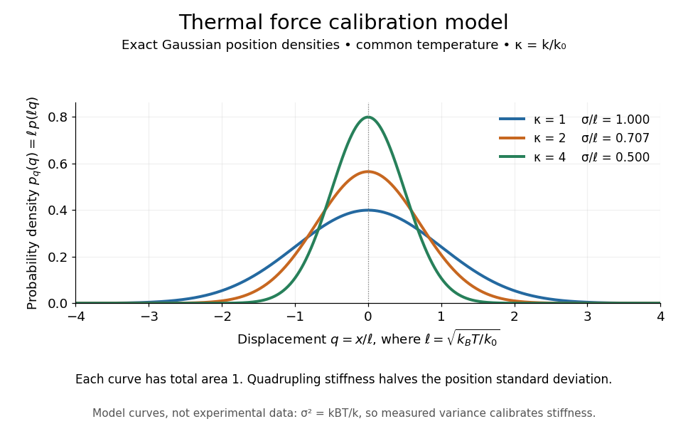

# Thermal calibration of an optical trap

↑ **Parent:** [Harmonic optical trap](harmonic-optical-trap.md)

A bead in a liquid keeps undergoing [Brownian motion](brownian-motion-split.md) even when an [optical trap](optical-tweezers.md) holds its average position fixed. For a stationary [harmonic optical trap](harmonic-optical-trap.md) in [thermal equilibrium](thermal-equilibrium-split.md) at absolute [temperature](temperature-split.md) $T$, the [equipartition theorem](equipartition-theorem.md) assigns mean [potential energy](potential-energy.md) $k_BT/2$ to this one quadratic coordinate. With $k_B$ the [Boltzmann constant](boltzmann-constant.md) and $x=0$ at [equilibrium](equilibrium-point-of-a-dynamical-system.md),

$$
\langle x\rangle=0,\qquad \sigma^2=\operatorname{Var}(x)=\langle x^2\rangle=\frac{k_BT}{k}.
$$

At the same [temperature](temperature-split.md), quadrupling the [spring constant](spring-constant.md) divides the position [variance](variance-split.md) by four and the [standard deviation](standard-deviation.md) by two. The [Boltzmann factor](boltzmann-factor.md) gives the complete equilibrium [probability density function](probability-density-function.md), a [Gaussian distribution](normal-distribution.md):

$$
p(x)=\sqrt{\frac{k}{2\pi k_BT}}\exp\!\left(-\frac{kx^2}{2k_BT}\right),\qquad -\infty<x<\infty.
$$

The prefactor makes $\int_{-\infty}^{\infty}p(x)\,dx=1$; its second moment is $\int_{-\infty}^{\infty}x^2p(x)\,dx=k_BT/k$. The [probability density function](probability-density-function.md) has units of inverse length, and its area gives [probability](probability.md). This density is exact for the ideal quadratic model. In a finite [optical trap](optical-tweezers.md) it approximates the occupied well when thermal excursions remain within the harmonic region and escape is negligible during observation. Driven motion, appreciable nonconservative [forces](force-split.md) or [laser](laser-split.md) heating need not give this equilibrium density.

**[Figure 12](#image-thermal-force-calibration-model-exact-gaussian-position-densities-for-relative-trap-stiffnesses-1-2-and-4-at-a-common-temperature). Thermal force calibration model: exact Gaussian position densities for relative trap stiffnesses 1, 2 and 4 at a common temperature**.

Here $\ell=\sqrt{k_BT/k_0}$, $q=x/\ell$ and $\kappa=k/k_0$. The plotted density per unit $q$ is $p_q(q)=\ell p(\ell q)=\sqrt{\kappa/(2\pi)}e^{-\kappa q^2/2}$. Each curve has total area one; their dimensionless [standard deviations](standard-deviation.md) are $1$, $1/\sqrt2$ and $1/2$. The curves are exact model densities, not noisy experimental data.

[Brownian motion](brownian-motion-split.md) becomes a measuring tool: a calibrated position measurement supplies $\sigma^2=\langle(x-\langle x\rangle)^2\rangle$, and the known [temperature](temperature-split.md) supplies $k=k_BT/\sigma^2$. Once $k$ is known, a slowly applied constant external [force](force-split.md) $f$ shifts the mean by $\langle x\rangle=f/k$, so $f=k\langle x\rangle$ in the same harmonic range. Fluctuations therefore calibrate the conversion from [displacement](displacement.md) to [force](force-split.md). Svoboda and Block used this [equipartition theorem](equipartition-theorem.md) method when calibrating their bead traps. [Svoboda and Block, 1994, trap stiffness calibration](https://www.andrew.cmu.edu/course/42-620/handouts/svoboda_cell_94.pdf).

For the example stiffness $0.01\,\mathrm{pN/nm}$ and $T=300\,\mathrm K$, $k_BT\approx4.142\,\mathrm{pN\,nm}$ and $\sigma\approx20.35\,\mathrm{nm}$. Using a [variance](variance-split.md) measured in uncalibrated detector units would not determine that physical stiffness. Measurement noise, finite exposure time, drift and insufficient sampling of the correlated [Brownian motion](brownian-motion-split.md) can bias the estimate; record positions over many [optical trap relaxation times](optical-trap-relaxation-time.md) and account for the detector response. The deterministic relaxation curve above describes relaxation without thermal forcing; an individual thermal trajectory continues to fluctuate.

**Table of contents**

- [Optical trap Langevin calibration](optical-trap-langevin-calibration.md)
  - [Sinusoidal-stage optical trap calibration](sinusoidal-stage-optical-trap-calibration.md)

## ↑ Ancestors (6)

1. [Harmonic optical trap](harmonic-optical-trap.md)
2. [Optical tweezers](optical-tweezers.md)
3. [Optics](optics-split.md)
4. [Branches of physics](branches-of-physics.md)
5. [Physics](physics-split.md)
6. [Codex Wiki](split.md)

## ← Incoming links (5)

- [Equipartition theorem](equipartition-theorem.md)
- [Optical trap position readout](optical-trap-position-readout.md)
- [Optical tweezers](optical-tweezers.md)
- [Ornstein-Uhlenbeck process](ornstein-uhlenbeck-process.md)
- [Solution](past-exam-of-the-quantum-condensed-matter-course-of-the-university-of-cambridge/2006/section-a/a1/c/solution.md)
