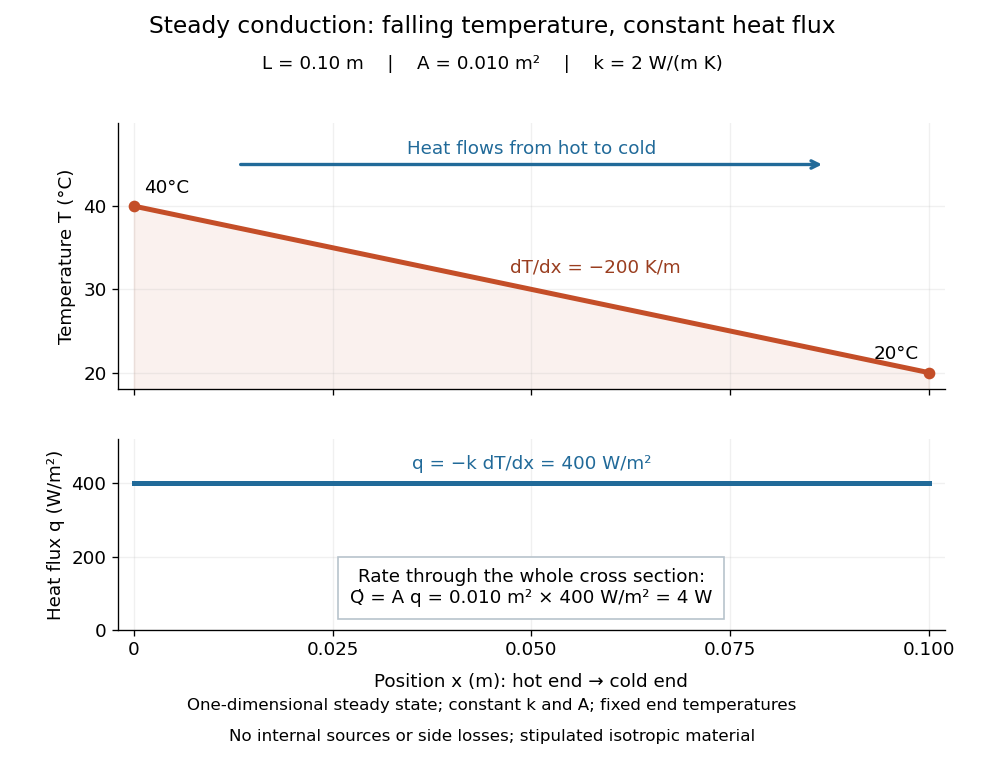
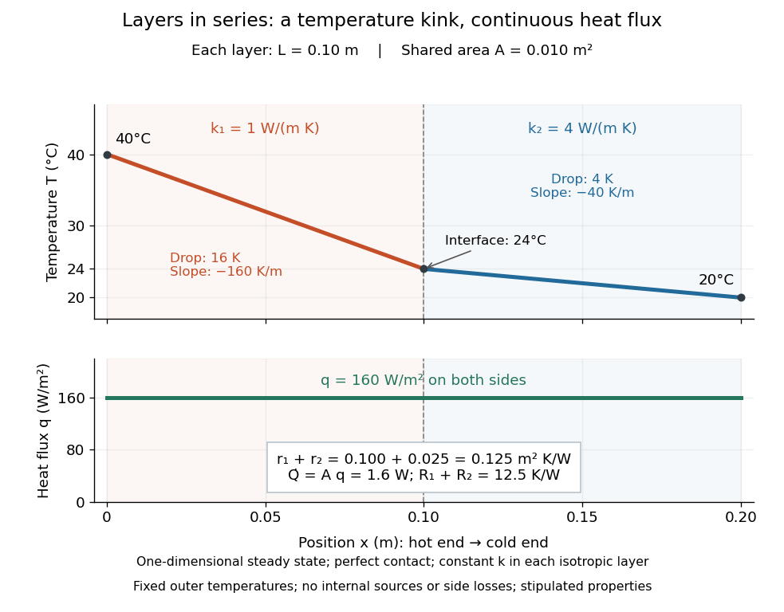

# Thermal conduction

↑ **Parent:** [Heat](heat.md)  
ⓦ [Wiki](https://en.wikipedia.org/wiki/Thermal_conduction)

[Thermal conduction](thermal-conduction.md) transfers [heat](heat.md) through microscopic interactions without bulk transport of matter. To predict the heating load through a bar, combine [Fourier's law](fourier-s-law.md) with [conservation of energy](conservation-of-energy.md) and the imposed end [temperatures](temperature.md). In the [isotropic](isotropy.md) model with positive [thermal conductivity](thermal-conductivity.md) $k$, the conductive [heat flux](heat-flux-density.md) points from high to low [temperature](temperature.md), opposite to the [temperature gradient](temperature-gradient.md). A spoon warming along its handle and [heat](heat.md) escaping through a wall are familiar examples.

Consider a bar of [length](length.md) $L=0.10\,\mathrm m$, constant cross-sectional [area](surface-area.md) $A=0.010\,\mathrm{m^2}$ and constant [thermal conductivity](thermal-conductivity.md) $k=2\,\mathrm{W\,m^{-1}\,K^{-1}}$. Maintain its ends at $T_h=40\,{}^\circ\mathrm C$ and $T_c=20\,{}^\circ\mathrm C$, with $x$ increasing toward the colder end. Assume a [steady state](steady-state.md), one-dimensional [thermal conduction](thermal-conduction.md), no internal sources and no [heat transfer](heat-transfer.md) through the sides. The [temperature](temperature.md) falls by $20\,\mathrm K$ over $0.10\,\mathrm m$, giving

$$
\frac{dT}{dx}=-200\,\mathrm{K\,m^{-1}},\qquad
q=-k\frac{dT}{dx}=400\,\mathrm{W\,m^{-2}},\qquad
\dot Q=Aq=4\,\mathrm W.
$$

The difference between the two readings in [degree Celsius](degree-celsius.md) units is the same $20$-[kelvin](kelvin.md) difference. The positive [heat flux](heat-flux-density.md) carries [heat](heat.md) toward increasing $x$.

**[Figure 33](#image-steady-thermal-conduction-through-a-bar-declining-temperature-constant-heat-flux). Steady thermal conduction through a bar: declining temperature, constant heat flux**. An [isotropic](isotropy.md) bar with stipulated constant [thermal conductivity](thermal-conductivity.md) $k=2\,\mathrm{W\,m^{-1}\,K^{-1}}$, [length](length.md) $0.10\,\mathrm m$ and cross-sectional [area](surface-area.md) $0.010\,\mathrm{m^2}$. Its ends remain at $40$ and $20\,{}^\circ\mathrm C$, and its sides exchange no [heat](heat.md). The lower panel distinguishes $q=400\,\mathrm{W\,m^{-2}}$ from $\dot Q=4\,\mathrm W$.

The general solution under these assumptions is

$$
T(x)=T_h-\frac{T_h-T_c}{L}x,\qquad
q=\frac{k(T_h-T_c)}{L},\qquad
\dot Q=\frac{kA(T_h-T_c)}{L}.
$$

A proof outline is enough to explain the straight line: [conservation of energy](conservation-of-energy.md) in any small slice, with no accumulation, sources or side losses, gives $d\dot Q/dx=0$. Constant cross-sectional [area](surface-area.md) gives $dq/dx=0$; constant [thermal conductivity](thermal-conductivity.md) and [Fourier's law](fourier-s-law.md) then give $d^2T/dx^2=0$. Two [integrations](integral.md) and the end [boundary conditions](boundary-condition.md) determine the displayed [affine function](affine-function.md). This is why a visually simple [temperature](temperature.md) profile can encode a continuous flow of [energy](energy.md). [E. M. Greitzer, Z. S. Spakovszky and I. A. Waitz, MIT Thermodynamics and Propulsion, section 16.3: steady one-dimensional conduction](https://web.mit.edu/16.unified/www/FALL/thermodynamics/notes/node117.html)

Doubling the [length](length.md) halves the rate, while doubling the cross-sectional [area](surface-area.md) doubles it, at fixed end [temperatures](temperature.md) and [thermal conductivity](thermal-conductivity.md). This explains why a long narrow support can limit unwanted [heat transfer](heat-transfer.md), while a short broad path can help remove [heat](heat.md). Joining materials leads to [thermal resistance](thermal-resistance.md) in series. During initial warming, [internal energy](internal-energy.md) can accumulate and the [temperature](temperature.md) profile need not be a straight line; the time dependence is described by the [heat equation](heat-equation.md) and [thermal diffusivity](thermal-diffusivity.md).

Now join two layers, each of [length](length.md) $L_1=L_2=0.10\,\mathrm m$, with constant cross-sectional [area](surface-area.md) $A=0.010\,\mathrm{m^2}$ and stipulated constant [thermal conductivities](thermal-conductivity.md) $k_1=1$ and $k_2=4\,\mathrm{W\,m^{-1}\,K^{-1}}$. Keep the outer ends at $40$ and $20\,{}^\circ\mathrm C$. Assume a [steady state](steady-state.md), one-dimensional [thermal conduction](thermal-conduction.md), no internal sources or side losses, and perfect contact: the [temperature](temperature.md) is continuous at the interface, with no extra contact drop. For each layer, use the area-specific [thermal resistance](thermal-resistance.md) $r_i=L_i/k_i$ and $R_i=r_i/A$. The series calculation gives

$$
\begin{aligned}
r_1+r_2=\frac{L_1}{k_1}+\frac{L_2}{k_2}
=0.100+0.025=0.125\,\mathrm{m^2\,K\,W^{-1}},\\
R_1+R_2=\frac{r_1+r_2}{A}=12.5\,\mathrm{K\,W^{-1}},\\
q=\frac{20\,\mathrm K}{0.125\,\mathrm{m^2\,K\,W^{-1}}}
=160\,\mathrm{W\,m^{-2}},\qquad \dot Q=Aq=1.6\,\mathrm W,\\
\Delta T_1=qr_1=16\,\mathrm K,\qquad
\Delta T_2=qr_2=4\,\mathrm K,\qquad
T_{\rm interface}=40\,{}^\circ\mathrm C-16\,\mathrm K=24\,{}^\circ\mathrm C.
\end{aligned}
$$

**[Figure 34](#image-two-layers-in-series-continuous-heat-flux-different-temperature-gradients). Two layers in series: continuous heat flux, different temperature gradients**. Each layer is $0.10\,\mathrm m$ long with the same cross-sectional [area](surface-area.md) $0.010\,\mathrm{m^2}$ and perfect contact. Stipulated constant [thermal conductivities](thermal-conductivity.md) are $1$ and $4\,\mathrm{W\,m^{-1}\,K^{-1}}$. The [temperature](temperature.md) drops by $16\,\mathrm K$ and $4\,\mathrm K$, reaching $24\,{}^\circ\mathrm C$ at the interface, while $q=160\,\mathrm{W\,m^{-2}}$ and $\dot Q=1.6\,\mathrm W$ throughout.

The [heat flux](heat-flux-density.md) is continuous: otherwise [energy](energy.md) would accumulate at the interface. Yet [Fourier's law](fourier-s-law.md) gives different [temperature gradients](temperature-gradient.md), $dT/dx=-q/k_1=-160\,\mathrm{K\,m^{-1}}$ and $dT/dx=-q/k_2=-40\,\mathrm{K\,m^{-1}}$. Lower [thermal conductivity](thermal-conductivity.md) requires a steeper [temperature gradient](temperature-gradient.md) to carry the same [heat flux](heat-flux-density.md); equal [lengths](length.md) therefore give drops in the ratio $4:1$. A kink in the [temperature](temperature.md) profile records the change of material while perfect contact keeps the [temperature](temperature.md) itself continuous.

**Table of contents**

- [Thermal resistance](thermal-resistance.md)
- [Temperature dipole around an insulating sphere](temperature-dipole-around-an-insulating-sphere.md)
- [Isobaric conductive cooling in mass coordinates](isobaric-conductive-cooling-in-mass-coordinates.md)
  - [Error-function isobaric cooling front](error-function-isobaric-cooling-front.md)
- [Temperature gradient](temperature-gradient.md)
- [Fourier's law](fourier-s-law.md)
  - [Thermal conductivity](thermal-conductivity.md)
    - [Thermal conductivity tensor](thermal-conductivity-tensor.md)
- [Thermal diffusivity](thermal-diffusivity.md)
  - [Prandtl number](prandtl-number.md)
  - [Thermal diffusion time](thermal-diffusion-time.md)
    - [Thermal diffusion rate of a Fourier mode](thermal-diffusion-rate-of-a-fourier-mode.md)
    - [Thermal diffusion length](thermal-diffusion-length.md)
  - [Laser flash analysis](laser-flash-analysis.md)

## ↑ Ancestors (6)

1. [Heat](heat.md)
2. [Thermodynamics](thermodynamics-split.md)
3. [Statistical physics](statistical-physics-split.md)
4. [Branches of physics](branches-of-physics.md)
5. [Physics](physics-split.md)
6. [Codex Wiki](split.md)

## ← Incoming links (43)

- [Adiabatic process](adiabatic-process.md)
- [Constitutional superheating](constitutional-superheating.md)
- [Convective overstability](convective-overstability.md)
- [Diffusion](diffusion.md)
- [Fourier's law](fourier-s-law.md)
- [Heat flux density](heat-flux-density.md)
- [Heat transfer](heat-transfer.md)
- [Icicle ripple](icicle-ripple.md)
- [Infrared](infrared.md)
- [Instantaneous stationary lava-crust thickness](instantaneous-stationary-lava-crust-thickness.md)
- [Isothermal process](isothermal-process.md)
- [Joule's paddle-wheel experiment](joule-s-paddle-wheel-experiment.md)
- [Laser flash analysis](laser-flash-analysis.md)
- [Solution](past-exam-of-the-mathematics-course-of-the-university-of-cambridge/2001/iii/paper-37/4/solution.md)
- [Solution](past-exam-of-the-mathematics-course-of-the-university-of-cambridge/2001/iii/paper-44/3/solution.md)
- [Solution](past-exam-of-the-mathematics-course-of-the-university-of-cambridge/2003/iii/paper-76/2/b/solution.md)
- [Solution](past-exam-of-the-mathematics-course-of-the-university-of-cambridge/2005/iii/paper-71/3/solution.md)
- [Solution](past-exam-of-the-mathematics-course-of-the-university-of-cambridge/2009/iii/paper-73/2/iii/solution.md)
- [Solution](past-exam-of-the-mathematics-course-of-the-university-of-cambridge/2009/iii/paper-73/2/iv/solution.md)
- [Solution](past-exam-of-the-mathematics-course-of-the-university-of-cambridge/2010/iii/paper-72/1/solution.md)
- [Solution](past-exam-of-the-mathematics-course-of-the-university-of-cambridge/2010/iii/paper-72/2/solution.md)
- [Solution](past-exam-of-the-mathematics-course-of-the-university-of-cambridge/2016/iii/paper-315/1/c/solution.md)
- [Solution](past-exam-of-the-mathematics-course-of-the-university-of-cambridge/2016/iii/paper-315/3/b/solution.md)
- [Solution](past-exam-of-the-mathematics-course-of-the-university-of-cambridge/2018/iii/paper-321/3/c/solution.md)
- [Solution](past-exam-of-the-mathematics-course-of-the-university-of-cambridge/2018/iii/paper-321/3/d/solution.md)
- [Solution](past-exam-of-the-mathematics-course-of-the-university-of-cambridge/2018/iii/paper-332/4/solution.md)
- [Solution](past-exam-of-the-mathematics-course-of-the-university-of-cambridge/2024/iii/paper-332/2/iv/solution.md)
- [Solution](past-exam-of-the-mathematics-course-of-the-university-of-cambridge/2026/iii/paper-332/1/d/solution.md)
- [Planetary ice shell](planetary-ice-shell.md)
- [Porous thermal plume](porous-thermal-plume.md)
- [Pressure-limited spherical freezing in a porous medium](pressure-limited-spherical-freezing-in-a-porous-medium.md)
- [Recovery of summer sea ice](recovery-of-summer-sea-ice.md)
- [Sea ice](sea-ice.md)
- [Single-category sea-ice thermodynamic model](single-category-sea-ice-thermodynamic-model.md)
- [Spherical freezing inside a porous cavity](spherical-freezing-inside-a-porous-cavity.md)
- [Thermal boundary layer](thermal-boundary-layer.md)
- [Thermal conduction](thermal-conduction.md)
- [Thermal convection](thermal-convection.md)
- [Thermal diffusion length](thermal-diffusion-length.md)
- [Thermal diffusivity](thermal-diffusivity.md)
- [Thermal-front viscous-fingering dispersion relation](thermal-front-viscous-fingering-dispersion-relation.md)
- [Thermal resistance](thermal-resistance.md)
- [Thermodynamic equilibrium](thermodynamic-equilibrium.md)
