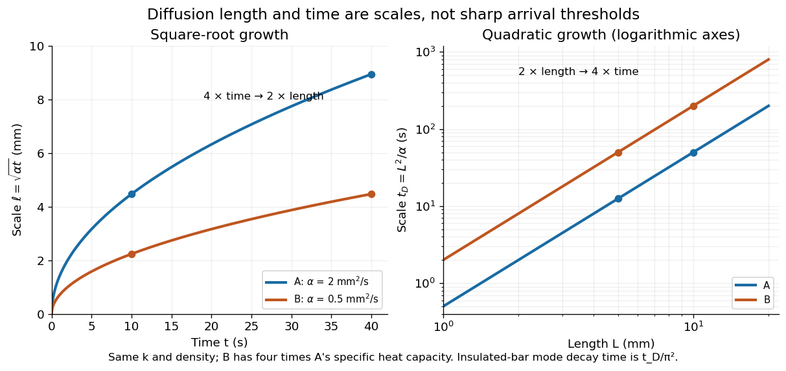

# Thermal diffusion length

↑ **Parent:** [Thermal diffusion time](thermal-diffusion-time.md)

The [thermal diffusion length](thermal-diffusion-length.md) $\ell(t)=\sqrt{\alpha t}$ is the characteristic [length](length.md) over which [thermal conduction](thermal-conduction.md) changes a [temperature](temperature-split.md) distribution during time $t$ in the constant-[thermal diffusivity](thermal-diffusivity.md) model. It is a scale, not a sharp front or distance travelled at a constant speed: the [heat equation](heat-equation.md) has [infinite propagation speed](infinite-propagation-speed.md) mathematically. Different definitions of penetration depth introduce numerical factors. In particular, the normalized one-dimensional [heat kernel](heat-kernel.md) has spatial [variance](variance-split.md) $2\alpha t$, so its root-mean-square width is $\sqrt{2\alpha t}$.

**[Figure 8](#image-thermal-diffusion-length-grows-as-the-square-root-of-time-thermal-diffusion-time-grows-as-length-squared). Thermal diffusion length grows as the square root of time; thermal diffusion time grows as length squared**. Original predictions for the two stipulated materials in [thermal diffusivity](thermal-diffusivity.md). Left: $\ell=\sqrt{\alpha t}$, with four times the time needed to double [length](length.md). Right: $t_D=L^2/\alpha$ on logarithmic axes. Equal [thermal conductivity](thermal-conductivity.md) with four times the [volumetric heat capacity](volumetric-heat-capacity.md) halves the reached [length](length.md) at a given time and quadruples the time at a given [length](length.md). The scale $t_D$ differs from the insulated-bar decay time by the factor $\pi^2$.

At $t=10\,\mathrm s$, the model materials have [thermal diffusion lengths](thermal-diffusion-length.md) $4.47$ and $2.24\,\mathrm{mm}$. For $L=10\,\mathrm{mm}$ their [thermal diffusion times](thermal-diffusion-time.md) are $50$ and $200\,\mathrm s$. These values describe the same [heat equation](heat-equation.md) as the [thermal diffusion rate of a Fourier mode](thermal-diffusion-rate-of-a-fourier-mode.md); the different numerical factors come from the definition of the scale.

## ↑ Ancestors (9)

1. [Thermal diffusion time](thermal-diffusion-time.md)
2. [Thermal diffusivity](thermal-diffusivity.md)
3. [Thermal conduction](thermal-conduction.md)
4. [Heat](heat-split.md)
5. [Thermodynamics](thermodynamics-split.md)
6. [Statistical physics](statistical-physics-split.md)
7. [Branches of physics](branches-of-physics.md)
8. [Physics](physics-split.md)
9. [Codex Wiki](split.md)

## ← Incoming links (2)

- [Thermal diffusion length](thermal-diffusion-length.md)
- [Thermal penetration depth](thermal-penetration-depth.md)
