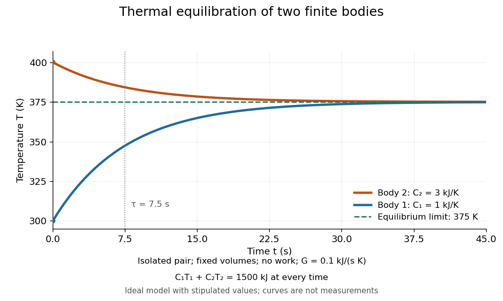
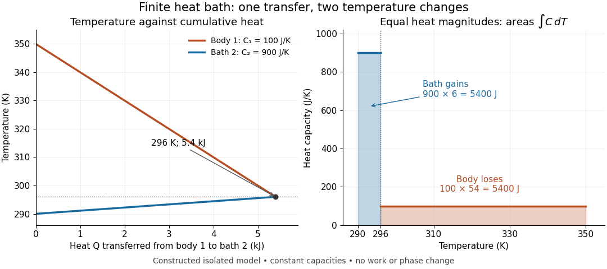
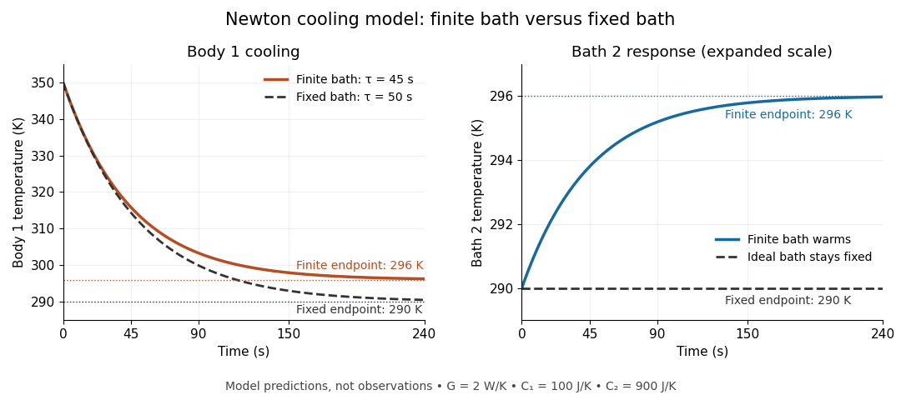

# Thermal equilibrium

↑ **Parent:** [Thermodynamics](thermodynamics.md)  
ⓦ [Wiki](https://en.wikipedia.org/wiki/Thermal_equilibrium)

Two internally equilibrated systems are in thermal equilibrium if bringing them into contact that permits only [heat](heat.md) exchange causes no net [heat transfer](heat.md#heat-transfer). In ordinary nonrelativistic [thermodynamics](thermodynamics.md) without appreciable gravitational temperature shifts, their [thermodynamic temperatures](second-law-of-thermodynamics.md#thermodynamic-temperature) are equal. Merely preventing [heat transfer](heat.md#heat-transfer) with insulation does not establish [thermal equilibrium](thermal-equilibrium.md): two insulated bodies can have different [temperatures](temperature.md). [Samuel J. Ling, William Moebs and Jeff Sanny, OpenStax University Physics Volume 2, section 1.1](physics-bibliography.md#university-physics-volume-2-by-samuel-j-ling-and-others/1-1-temperature-and-thermal-equilibrium)

A [thermometer](temperature.md#thermometer) illustrates the definition. Its own [temperature](temperature.md) settles to the object's [temperature](temperature.md) after thermal contact, provided its effect on the object is negligible. The existing [zeroth law of thermodynamics](thermodynamics.md#zeroth-law-of-thermodynamics) makes this comparison transitive: two objects separately in [thermal equilibrium](thermal-equilibrium.md) with the same [thermometer](temperature.md#thermometer) are in [thermal equilibrium](thermal-equilibrium.md) with each other. This lets one calibrated scale compare different materials.

Equal [temperatures](temperature.md) do not imply equal [internal energies](internal-energy.md) or equal [heat capacities](heat.md#heat-capacity). Nor does [thermal equilibrium](thermal-equilibrium.md) by itself imply [mechanical equilibrium](thermodynamics.md#mechanical-equilibrium) or [chemical equilibrium](chemical-potential.md#chemical-equilibrium); these require additional allowed exchanges. There is also a distinction between no net exchange in [thermal equilibrium](thermal-equilibrium.md) and a constant [temperature](temperature.md) maintained by equal incoming and outgoing [heat](heat.md). The latter can be a [steady state](dynamical-systems.md#steady-state) with ongoing [entropy production](stochastic-thermodynamics.md#entropy-production). Microscopic exchanges can continue at [thermal equilibrium](thermal-equilibrium.md), but their opposing contributions balance on average.

Historically, OpenStax credits the name “zeroth law” to Ralph Fowler in the 1930s: the already numbered laws needed a logically earlier statement about [thermal equilibrium](thermal-equilibrium.md). [Ling, Moebs and Sanny, section 1.1: naming the zeroth law](physics-bibliography.md#university-physics-volume-2-by-samuel-j-ling-and-others/1-1-temperature-and-thermal-equilibrium)

**Table of contents**

- [Thermostat](#thermostat)
- [Thermal equilibration of two finite bodies](#thermal-equilibration-of-two-finite-bodies)
- [Tolman–Ehrenfest relation](#tolman-ehrenfest-relation)
- [Boltzmann suppression](#boltzmann-suppression)
  - [Boltzmann suppression of a nonrelativistic relic](#boltzmann-suppression-of-a-nonrelativistic-relic)
- [Kinetic equilibrium](#kinetic-equilibrium)
- [Heat bath](#heat-bath)
  - [Finite heat bath](#finite-heat-bath)
    - [Heat bath relaxation with finite capacity](#heat-bath-relaxation-with-finite-capacity)
  - [Regulated calibration bath](#regulated-calibration-bath)
- [Entropy maximization under thermal contact](#entropy-maximization-under-thermal-contact)

## Thermostat

↑ **Parent:** [Thermal equilibrium](thermal-equilibrium.md)

A [thermostat](#thermostat) senses [temperature](temperature.md) and adjusts a heating or cooling actuator to approach a reference [temperature](temperature.md). For precise regulation, sensor placement, thermal delay and feedback stability matter as well as the nominal reference. Thermal shielding can reduce rapid environmental disturbances while feedback corrects slower ones.

## Thermal equilibration of two finite bodies

↑ **Parent:** [Thermal equilibrium](thermal-equilibrium.md)

Consider two rigid bodies forming an [isolated system](thermodynamics.md#isolated-system), with fixed composition and constant whole-body [heat capacity at constant volume](heat.md#heat-capacity-at-constant-volume) values $C_1=1\,\mathrm{kJ\,K^{-1}}$ and $C_2=3\,\mathrm{kJ\,K^{-1}}$. Their initial [temperatures](temperature.md) are $T_{1,0}=300\,\mathrm K$ and $T_{2,0}=400\,\mathrm K$. Assume each body remains internally uniform, their contact stores negligible [energy](energy.md), no [phase transition](critical-phenomenon.md#phase-transition) occurs and no [work](energy.md#work) is done or extracted. These are stipulated model values, not material measurements.

Because $dU_i=C_i\,dT_i$, write $U_i=a_i+C_iT_i$ with arbitrary fixed reference constants $a_i$. The conserved relative [internal energy](internal-energy.md) is

$$
E=U_1+U_2-a_1-a_2=C_1T_1+C_2T_2=1500\,\mathrm{kJ}.
$$

This is an [energy](energy.md) reference convention, not a claim about actual [heat capacities](heat.md#heat-capacity) down to zero [temperature](temperature.md). At [thermal equilibrium](thermal-equilibrium.md) the two [temperatures](temperature.md) equal $T_f$, so the [first law of thermodynamics](first-law-of-thermodynamics.md) gives

$$
T_f=\frac{C_1T_{1,0}+C_2T_{2,0}}{C_1+C_2}=375\,\mathrm K,\qquad
\Delta U_1=75\,\mathrm{kJ},\qquad \Delta U_2=-75\,\mathrm{kJ}.
$$

The larger [heat capacity](heat.md#heat-capacity) pulls the common [temperature](temperature.md) closer to its initial value: body 1 warms by $75\,\mathrm K$, while body 2 cools by $25\,\mathrm K$.

**[Figure 1](#image-two-finite-bodies-approach-thermal-equilibrium-at-375-mathrm-k). Two finite bodies approach thermal equilibrium at $375\,\mathrm K$**. Ideal model with $C_1=1$ and $C_2=3\,\mathrm{kJ\,K^{-1}}$ and contact conductance $G=0.1\,\mathrm{kJ\,s^{-1}\,K^{-1}}$. The weighted [temperature](temperature.md) stays at $375\,\mathrm K$ and the relative [internal energy](internal-energy.md) stays at $1500\,\mathrm{kJ}$; the plotted curves are model predictions.

To predict a timescale, stipulate a constant contact conductance $G=1/R_{\rm th}=0.1\,\mathrm{kJ\,s^{-1}\,K^{-1}}$, the reciprocal of the contact's [thermal resistance](heat.md#thermal-resistance). The rate of [heat transfer](heat.md#heat-transfer) into body 1 is $G(T_2-T_1)$, giving

$$
C_1\dot T_1=G(T_2-T_1),\qquad C_2\dot T_2=-G(T_2-T_1).
$$

Adding proves conservation of $E$. Subtracting gives [exponential decay](analysis.md#exponential-decay) of the [temperature](temperature.md) difference, with [time constant](analysis.md#time-constant)

$$
\tau=\frac{C_1C_2}{G(C_1+C_2)}=7.5\,\mathrm s,\qquad
T_2-T_1=100\,\mathrm K\,e^{-t/\tau},
$$

and therefore

$$
T_1(t)=375\,\mathrm K-75\,\mathrm K\,e^{-t/\tau},\qquad
T_2(t)=375\,\mathrm K+25\,\mathrm K\,e^{-t/\tau}.
$$

Exact equality is approached as $t\to\infty$ in this ideal model. Changing $G$ changes the rate but not $T_f$: equilibrium and the speed of reaching it are separate predictions. Real bodies can have internal [temperature gradients](heat.md#temperature-gradient), changing [heat capacities](heat.md#heat-capacity) and contact losses, so the plotted $7.5\,\mathrm s$ is an assumed model timescale.

<h2 id="tolman-ehrenfest-relation">Tolman–Ehrenfest relation</h2>

↑ **Parent:** [Thermal equilibrium](thermal-equilibrium.md)

In static [thermal equilibrium](thermal-equilibrium.md), the local temperature times the stationary lapse is constant. Energy measured locally redshifts to conserved Killing energy by that same lapse; requiring a single equilibrium Boltzmann exponent gives the relation. The [Killing vector field](killing-vector-field.md) normalization fixes the constant but not the ratio of temperatures at different locations.

## Boltzmann suppression

↑ **Parent:** [Thermal equilibrium](thermal-equilibrium.md)

[Boltzmann suppression](#boltzmann-suppression) is the exponential reduction of an equilibrium population when creating it costs energy much greater than the temperature. For a nonrelativistic species with negligible [chemical potential](chemical-potential.md), the leading factor is $e^{-m/T}$, multiplied by its momentum phase-space volume. It concerns the equilibrium abundance; freeze-out can preserve a larger population than the instantaneous equilibrium value at later times.

### Boltzmann suppression of a nonrelativistic relic

↑ **Parent:** [Boltzmann suppression](#boltzmann-suppression)

A nonrelativistic species with $g$ states and negligible [chemical potential](chemical-potential.md) has equilibrium density $g(mT/(2\pi))^{3/2}e^{-m/T}$. If particle-antiparticle annihilation maintains equilibrium after the species becomes massive, its eventual freeze-out population can be much smaller than a relativistically decoupled population. The nonrelativistic annihilation rate and any asymmetry determine the final abundance.

## Kinetic equilibrium

↑ **Parent:** [Thermal equilibrium](thermal-equilibrium.md)

Momentum-exchange collisions maintain a common [temperature](temperature.md) and an equilibrium-shaped momentum [probability distribution](probability-distribution.md). Particle abundances and [chemical potentials](chemical-potential.md) need not have their [chemical equilibrium](chemical-potential.md#chemical-equilibrium) values: elastic scattering alone conserves particle number. Thus kinetic equilibrium does not by itself imply either zero [chemical potential](chemical-potential.md) or conserved comoving [entropy](entropy.md).

## Heat bath

↑ **Parent:** [Thermal equilibrium](thermal-equilibrium.md)  
ⓦ [Wiki](https://en.wikipedia.org/wiki/Heat_bath)

A heat bath, or thermal reservoir, is an idealized system so large that exchanging a finite amount of [heat](heat.md) does not appreciably change its [temperature](temperature.md).

The ideal [heat bath](#heat-bath) supplies a fixed absolute [temperature](temperature.md) $T_b$ while its [internal energy](internal-energy.md) changes through [heat transfer](heat.md#heat-transfer). A real body's suitability as a [heat bath](#heat-bath) depends on its [heat capacity](heat.md#heat-capacity) relative to the exchange being studied, and on how quickly its internal [temperature gradients](heat.md#temperature-gradient) disappear. Large physical size alone supplies neither condition. A [finite heat bath](#finite-heat-bath) makes the approximation quantitative; a [regulated calibration bath](#regulated-calibration-bath) instead uses [feedback control](control-theory.md#closed-loop-control) to maintain its [temperature](temperature.md) by exchanging [energy](energy.md) with external equipment.

For a weakly coupled system that exchanges [energy](energy.md) but no matter with an ideal [heat bath](#heat-bath), the [canonical ensemble](canonical-ensemble.md) assigns the [Boltzmann distribution](thermodynamics.md#boltzmann-distribution)

$$
p_n=\frac{e^{-E_n/(k_BT_b)}}{Z},\qquad Z=\sum_m e^{-E_m/(k_BT_b)}.
$$

Here $E_n$ is a [microstate](statistical-physics.md#microstate)'s [energy](energy.md), $k_B$ the [Boltzmann constant](thermodynamics.md#boltzmann-constant) and $Z$ the [partition function](canonical-ensemble.md#canonical-partition-function). The fixed [temperature](temperature.md) removes the need to track every exchange with the environment. A substantially changing bath [temperature](temperature.md) no longer gives this one fixed [Boltzmann distribution](thermodynamics.md#boltzmann-distribution).[Statistical Physics, §1.3, printed pp. 17–18, equation (1.19): reservoir assumption and canonical probabilities](physics-bibliography.md#statistical-physics-by-david-tong/1-the-fundamentals-of-statistical-mechanics)

### Finite heat bath

↑ **Parent:** [Heat bath](#heat-bath)

A [finite heat bath](#finite-heat-bath) has a finite whole-body [heat capacity](heat.md#heat-capacity) $C_b$ and therefore changes [temperature](temperature.md) when it absorbs [heat](heat.md) $Q_b$. For a rigid [closed system](thermodynamics.md#closed-system) with no [work](energy.md#work), fixed composition and no [phase transition](critical-phenomenon.md#phase-transition), the [first law of thermodynamics](first-law-of-thermodynamics.md) gives

$$
Q_b=\Delta U_b=\int_{T_{b,0}}^{T_{b,f}}C_b(T)\,dT.
$$

If the [heat capacity at constant volume](heat.md#heat-capacity-at-constant-volume) $C_b$ is constant throughout this [temperature](temperature.md) [interval](real-analysis.md#interval-mathematics), the [integral](integral.md) becomes $Q_b=C_b(T_{b,f}-T_{b,0})$. This statement concerns an [internal energy](internal-energy.md) difference; $C_bT_b$ need not be the body's absolute [internal energy](internal-energy.md).

For an original example, put a rigid body 1 and a finite bath 2 into thermal contact inside an [isolated system](thermodynamics.md#isolated-system). Stipulate constant whole-body [heat capacities](heat.md#heat-capacity) $C_1=100\,\mathrm{J\,K^{-1}}$ and $C_2=900\,\mathrm{J\,K^{-1}}$, with initial [temperatures](temperature.md) $T_{1,0}=350\,\mathrm K$ and $T_{2,0}=290\,\mathrm K$. Each body remains internally uniform; the connection stores negligible [energy](energy.md); no external [work](energy.md#work), matter exchange or [phase transition](critical-phenomenon.md#phase-transition) occurs. These are constructed model values. The argument in [thermal equilibration of two finite bodies](#thermal-equilibration-of-two-finite-bodies) applies directly: equal final [temperatures](temperature.md) and conserved total [internal energy](internal-energy.md) give

$$
C_1(T_f-T_{1,0})+C_2(T_f-T_{2,0})=0,\qquad
T_f=\frac{C_1T_{1,0}+C_2T_{2,0}}{C_1+C_2}=296\,\mathrm K.
$$

Thus the [heat](heat.md) $Q$ transferred from body 1 to bath 2 is

$$
Q=C_1(350-296)\,\mathrm K=C_2(296-290)\,\mathrm K=5400\,\mathrm J.
$$

Body 1 loses $5400\,\mathrm J$ of [internal energy](internal-energy.md) and bath 2 gains exactly that amount. Body 1 cools by $54\,\mathrm K$, while bath 2 warms by $6\,\mathrm K$. Equal [heat](heat.md) transfers produce unequal [temperature](temperature.md) changes because the [heat capacities](heat.md#heat-capacity) differ.

**[Figure 2](#image-finite-bath-temperature-changes-and-the-integrated-heat-ledger). Finite bath temperature changes and the integrated heat ledger**. Original constant-[heat capacity](heat.md#heat-capacity) model, not measured data. Left: accumulated [heat](heat.md) $Q$ leaving body 1 lowers its [temperature](temperature.md) and raises bath 2's [temperature](temperature.md); the lines meet at $Q=5400\,\mathrm J$ and $T_f=296\,\mathrm K$. Right: the shaded [integrals](integral.md) $\int C_i\,dT$ have equal area $5400\,\mathrm J$, although their widths are $54\,\mathrm K$ and $6\,\mathrm K$. The outgoing [heat](heat.md) magnitude is shown positive; body 1's signed [internal energy](internal-energy.md) change is negative.

The [heat bath](#heat-bath) approximation can now be assessed against a chosen allowed [temperature](temperature.md) change $\delta T>0$. Constant $C_b$ requires $|Q_b|/C_b\le\delta T$, rather than merely calling the bath large. For this example, an allowed change of $0.1\,\mathrm K$ would fail because the computed change is $6\,\mathrm K$. The exact bath shift and its ideal-reservoir [limit](calculus.md#limit-of-a-function) are

$$
T_f-T_{2,0}=\frac{C_1}{C_1+C_2}(T_{1,0}-T_{2,0}),\qquad
\lim_{C_2\to\infty}T_f=T_{2,0}=290\,\mathrm K.
$$

Hold $C_1$ and both initial [temperatures](temperature.md) fixed in this [limit](calculus.md#limit-of-a-function). The transferred [heat](heat.md) then approaches $C_1(T_{1,0}-T_{2,0})=6000\,\mathrm J$. The finite bath receives less [heat](heat.md) because its warming reduces the available [temperature](temperature.md) difference. For [heat capacities](heat.md#heat-capacity) that vary, use the two [integrals](integral.md) in the [energy](energy.md) balance instead of this weighted average.

Conservation of [energy](energy.md) also permits imagining the reverse transfer, so it cannot explain the direction of equilibration by itself. [Entropy from heat capacity](heat.md#entropy-from-heat-capacity) gives the additional test, using reversible comparison paths between equilibrium endpoints:

$$
\Delta S_1=C_1\ln\frac{296}{350}\simeq-16.75737\,\mathrm{J\,K^{-1}},\qquad
\Delta S_2=C_2\ln\frac{296}{290}\simeq18.43068\,\mathrm{J\,K^{-1}},
$$

$$
\Delta S_{\rm tot}=C_1\ln\frac{T_f}{T_{1,0}}+C_2\ln\frac{T_f}{T_{2,0}}
\simeq1.673308\,\mathrm{J\,K^{-1}}>0.
$$

All ratios inside the [natural logarithms](calculus.md#natural-logarithm) use absolute [temperatures](temperature.md). The actual exchange across unequal [temperatures](temperature.md) is irreversible, even though reversible paths calculate the endpoint [entropy](entropy.md) differences.

There is a short general proof of positivity. Put $w_i=C_i/(C_1+C_2)$ for positive constant [heat capacities](heat.md#heat-capacity) and positive initial [temperatures](temperature.md). The strict [concavity](real-analysis.md#concave-function) of the [natural logarithm](calculus.md#natural-logarithm) gives

$$
\frac{\Delta S_{\rm tot}}{C_1+C_2}
=\ln(w_1T_{1,0}+w_2T_{2,0})-w_1\ln T_{1,0}-w_2\ln T_{2,0}\ge0,
$$

with equality only for equal initial [temperatures](temperature.md). In this proof all [temperatures](temperature.md) inside the [logarithms](calculus.md#logarithm) mean their numerical values in one common absolute unit. This is [Jensen's inequality](real-analysis.md#jensen-s-inequality) applied to the same weighted average that [conservation of energy](mathematical-physics.md#conservation-of-energy) selected. The direction of [heat transfer](heat.md#heat-transfer) and the stability of its endpoint also follow from [entropy maximization under thermal contact](#entropy-maximization-under-thermal-contact).

#### Heat bath relaxation with finite capacity

↑ **Parent:** [Finite heat bath](#finite-heat-bath)

The equilibrium calculation determines where the two [temperatures](temperature.md) end, without determining how long they take. Stipulate a constant [thermal conductance](heat.md#thermal-conductance) $G>0$ and the linear [heat transfer](heat.md#heat-transfer) law underlying [Newton's law of cooling](linear-ordinary-differential-equation.md#newton-s-law-of-cooling). With $Q$ positive from body 1 to bath 2, the [ordinary differential equations](differential-equation.md#ordinary-differential-equation) are

$$
\dot Q=G(T_1-T_2),\qquad C_1\dot T_1=-G(T_1-T_2),\qquad C_2\dot T_2=G(T_1-T_2).
$$

The dot denotes a [derivative](calculus.md#derivative) with respect to time. This model assumes internal equilibration is fast compared with exchange between the bodies. Adding the two [energy](energy.md) rates gives zero; subtracting the [temperature](temperature.md) rates gives

$$
\frac{d}{dt}(T_1-T_2)=-G\left(\frac1{C_1}+\frac1{C_2}\right)(T_1-T_2),\qquad
\tau=\frac{C_1C_2}{G(C_1+C_2)}.
$$

The [temperature](temperature.md) difference has [exponential decay](analysis.md#exponential-decay) with [time constant](analysis.md#time-constant) $\tau$. For the [finite heat bath](#finite-heat-bath) example and the stipulated $G=2\,\mathrm{W\,K^{-1}}=2\,\mathrm{J\,s^{-1}\,K^{-1}}$, $\tau=45\,\mathrm s$, and solving the [ordinary differential equations](differential-equation.md#ordinary-differential-equation) gives

$$
T_1(t)=296\,\mathrm K+54\,\mathrm K\,e^{-t/(45\,\mathrm s)},\qquad
T_2(t)=296\,\mathrm K-6\,\mathrm K\,e^{-t/(45\,\mathrm s)},
$$

$$
Q(t)=5400\,\mathrm J\left(1-e^{-t/(45\,\mathrm s)}\right).
$$

At one [time constant](analysis.md#time-constant), $T_1\simeq315.865\,\mathrm K$, $T_2\simeq293.793\,\mathrm K$ and $Q\simeq3413.451\,\mathrm J$. Equal [temperatures](temperature.md) are approached as a [limit](calculus.md#limit-of-a-function) at infinite time. The finite bath causes the [temperature](temperature.md) difference to shrink faster than the fixed-bath model, because both bodies change [temperature](temperature.md).

**[Figure 3](#image-finite-bath-and-fixed-bath-newton-s-law-of-cooling-histories). Finite bath and fixed bath Newton's law of cooling histories**. Original analytical model predictions with $C_1=100\,\mathrm{J\,K^{-1}}$, $C_2=900\,\mathrm{J\,K^{-1}}$ and $G=2\,\mathrm{W\,K^{-1}}$; time is in seconds. Solid lines show the two finite bodies approaching $296\,\mathrm K$ with [time constant](analysis.md#time-constant) $45\,\mathrm s$. Dashed lines show body 1 cooling toward a bath held at $290\,\mathrm K$, with [time constant](analysis.md#time-constant) $50\,\mathrm s$. The two panels use different vertical scales so that the finite bath's $6\,\mathrm K$ warming remains visible.

For an ideal [heat bath](#heat-bath) with the same $G$, set $T_2=T_b=290\,\mathrm K$ rather than evolving its [temperature](temperature.md). [Newton's law of cooling](linear-ordinary-differential-equation.md#newton-s-law-of-cooling) then yields

$$
T_1(t)=290\,\mathrm K+60\,\mathrm K\,e^{-t/(50\,\mathrm s)},\qquad
\tau_\infty=C_1/G=50\,\mathrm s.
$$

Changing $G$ changes these [time constants](analysis.md#time-constant), while the final [temperature](temperature.md) is fixed by the capacities and initial conditions. The dynamical model independently checks the [Second law of thermodynamics](second-law-of-thermodynamics.md):

$$
\dot S_{\rm tot}=\frac{-\dot Q}{T_1}+\frac{\dot Q}{T_2}
=\frac{G(T_1-T_2)^2}{T_1T_2}\ge0.
$$

Its [integral](integral.md) over the relaxation reproduces the endpoint [entropy](entropy.md) change. The useful separation is between capacity, which governs how much the bath [temperature](temperature.md) shifts, and [thermal conductance](heat.md#thermal-conductance), which governs the exchange rate. Neither alone establishes a reliable [heat bath](#heat-bath).

### Regulated calibration bath

↑ **Parent:** [Heat bath](#heat-bath)

A regulated bath holds its [temperature](temperature.md) near a chosen setting through [feedback control](control-theory.md#closed-loop-control), while stirring reduces internal [temperature gradients](heat.md#temperature-gradient). Its finite [heat capacity](heat.md#heat-capacity) buffers disturbances; external heating and cooling replace the ideal [heat bath](#heat-bath)'s unlimited capacity. This is useful for [thermometer calibration](temperature.md#thermometer-calibration) and for maintaining a [blackbody](astrophysics.md#blackbody) calibration source at a known [temperature](temperature.md).

[Joel B. Fowler](electrical-engineering.md#joel-b-fowler)'s A Third Generation Water Bath Based Blackbody Source reports a NIST test of a stirred water bath containing a copper [blackbody](astrophysics.md#blackbody) cavity. A bottom plate supplied heating and cooling; a double stirrer circulated water. Electronic [feedback control](control-theory.md#closed-loop-control) regulated heating. An electronic [thermometer](temperature.md#thermometer) with a [thermistor](temperature.md#thermistor) probe provided the readout. The preparation was to approach a selected setting, wait for stabilization, adjust against the measured [temperature](temperature.md) and then log continuously.[A Third Generation Water Bath Based Blackbody Source, §§2–3, printed pp. 592–593: bath construction, controller and setpoint procedure](physics-bibliography.md#a-third-generation-water-bath-based-blackbody-source-by-joel-b-fowler)

To test spatial uniformity, one [thermistor](temperature.md#thermistor) stayed near the cavity tip while another visited ten locations at three heights. The simultaneous reference distinguished spatial differences from temporal drift. An insulated dome reduced [thermal conduction](heat.md#thermal-conduction) along probe casings. Table 1 reports nonzero departures at several settings: circulation did not make every location identical. The [measurement uncertainty](physics.md#measurement-uncertainty) analysis separately included uniformity, stability, setting, immersion and readout contributions. These tests supported a bounded [temperature](temperature.md) assignment around the cavity, rather than infinite [heat capacity](heat.md#heat-capacity) or perfect [thermal equilibrium](thermal-equilibrium.md) throughout the apparatus.[A Third Generation Water Bath Based Blackbody Source, §4.1 and Tables 1–2, printed pp. 594–595: fixed and movable probes, immersion control, measured nonuniformity and uncertainty components](physics-bibliography.md#a-third-generation-water-bath-based-blackbody-source-by-joel-b-fowler)

## Entropy maximization under thermal contact

↑ **Parent:** [Thermal equilibrium](thermal-equilibrium.md)

At fixed [volumes](geometry-and-topology.md#volume) and material inventories, two internally equilibrated bodies that exchange only [heat](heat.md) within an [isolated system](thermodynamics.md#isolated-system) have fixed total [internal energy](internal-energy.md) $E=E_1+E_2$. Their total [entropy](entropy.md) is

$$
S_{\mathrm{tot}}(E_1)=S_1(E_1)+S_2(E-E_1).
$$

Using $1/T_i=(\partial S_i/\partial E_i)_{V_i,N_i}$, an interior stationary point obeys

$$
\frac{dS_{\rm tot}}{dE_1}=\frac1{T_1}-\frac1{T_2}=0.
$$

Thus [entropy](entropy.md) stationarity requires matching [thermodynamic temperatures](second-law-of-thermodynamics.md#thermodynamic-temperature). Positive values of [heat capacity at constant volume](heat.md#heat-capacity-at-constant-volume) make this a strict local maximum because

$$
\frac{d^2S_{\rm tot}}{dE_1^2}=-\frac1{C_1T_1^2}-\frac1{C_2T_2^2}<0.
$$

For bodies with positive [heat capacities](heat.md#heat-capacity) throughout the accessible range, this [concavity](real-analysis.md#concave-function) gives at most one interior maximum. This is the stability check behind the equal-[temperature](temperature.md) condition; see [entropy concavity and positive heat capacity](heat.md#entropy-concavity-and-positive-heat-capacity). [David Tong, Statistical Physics, sections 1.2.1–1.2.2: entropy maximization, temperature and heat capacity](physics-bibliography.md#statistical-physics-by-david-tong/1-the-fundamentals-of-statistical-mechanics)

For [thermal equilibration of two finite bodies](#thermal-equilibration-of-two-finite-bodies), [entropy from heat capacity](heat.md#entropy-from-heat-capacity) gives

$$
\Delta S_{\rm tot}=C_1\ln\frac{T_f}{T_{1,0}}+C_2\ln\frac{T_f}{T_{2,0}}
=\left(\ln\frac{375}{300}+3\ln\frac{375}{400}\right)\mathrm{kJ\,K^{-1}}
\simeq0.02952799\,\mathrm{kJ\,K^{-1}}>0.
$$

Body 1 gains about $0.22314355\,\mathrm{kJ\,K^{-1}}$ of [entropy](entropy.md), while body 2 loses about $0.19361556\,\mathrm{kJ\,K^{-1}}$. Total [energy](energy.md) is conserved even though total [entropy](entropy.md) increases. The [entropy](entropy.md) calculation uses reversible comparison paths between the endpoint states; actual exchange across a finite [temperature](temperature.md) difference is irreversible.

**[Figure 4](#image-at-fixed-total-energy-matching-temperatures-maximize-total-entropy). At fixed total energy, matching temperatures maximize total entropy**. The curve is total [entropy](entropy.md) relative to the initial $300\,\mathrm K$, $400\,\mathrm K$ state. Every point satisfies $C_1T_1+C_2T_2=1500\,\mathrm{kJ}$. Only $250\le T_1/\mathrm K\le500$ is shown; the mathematical model's positive-[temperature](temperature.md) domain is $0<T_1/\mathrm K<1500$.

To construct the plot, vary $T_1$ while enforcing the [energy](energy.md) constraint, rather than holding $T_2$ fixed. In numerical units of [kelvin](temperature.md#kelvin), $T_2/\mathrm K=(1500-T_1/\mathrm K)/3$, and the plotted function is

$$
\mathcal S(T_1)=C_1\ln\frac{T_1}{300\,\mathrm K}+C_2\ln\frac{T_2(T_1)}{400\,\mathrm K},\qquad
\frac{dT_2}{dT_1}=-\frac{C_1}{C_2}.
$$

Here $\mathcal S$ means $S_{\rm tot}-S_{\rm tot,initial}$, so its zero is a reference choice. The [chain rule](calculus.md#chain-rule) yields

$$
\mathcal S'(T_1)=\frac{C_1}{T_1}-\frac{C_1}{T_2},\qquad
\mathcal S''(T_1)=-\frac{C_1}{T_1^2}-\frac{C_1^2}{C_2T_2^2}<0.
$$

The unique maximum is at $T_1=T_2=375\,\mathrm K$. The physical trajectory starts at $T_1=300\,\mathrm K$ and moves toward that maximum; the rest of the curve compares other possible [energy](energy.md) partitions, not later times in the trajectory.

The contact model also proves the direction of change directly:

$$
\dot S_{\rm tot}=G(T_2-T_1)\left(\frac1{T_1}-\frac1{T_2}\right)
=\frac{G(T_2-T_1)^2}{T_1T_2}\ge0.
$$

For $G>0$ and positive [temperatures](temperature.md), equality holds exactly at [thermal equilibrium](thermal-equilibrium.md). The appealing link is that a dynamical [heat transfer](heat.md#heat-transfer) law moves the system uphill on the constrained [entropy](entropy.md) curve, while conservation of [energy](energy.md) keeps it on that curve. This predicts both why the endpoint is stable and why the reverse separation into hot and cold bodies cannot happen spontaneously in the [isolated system](thermodynamics.md#isolated-system).

## ↑ Ancestors (5)

1. [Thermodynamics](thermodynamics.md)
2. [Statistical physics](statistical-physics.md)
3. [Branches of physics](physics.md#branches-of-physics)
4. [Physics](physics.md)
5. [Codex Wiki](README.md)

## ← Incoming links (180)

- [Additivity of Boltzmann entropy](entropy.md#additivity-of-boltzmann-entropy)
- [Adiabatic demagnetization](temperature.md#adiabatic-demagnetization)
- [Adiabatic expansion](first-law-of-thermodynamics.md#adiabatic-expansion)
- [Adiabatic process](first-law-of-thermodynamics.md#adiabatic-process)
- [Adiabatic wall](thermodynamics.md#adiabatic-wall)
- [Angular-frequency Einstein coefficients](atomic-physics.md#angular-frequency-einstein-coefficients)
- [Antenna gain-effective-area relation](electrical-engineering.md#antenna-gain-effective-area-relation)
- [Baryon-number washout](cosmology.md#baryon-number-washout)
- [Black-body radiation](statistical-physics.md#black-body-radiation)
- [Blackbody](astrophysics.md#blackbody)
- [Blackbody spectrum](statistical-physics.md#blackbody-spectrum)
- [Bloch nuclear induction experiment](nuclear-magnetic-resonance.md#bloch-nuclear-induction-experiment)
- [Boltzmann distribution](thermodynamics.md#boltzmann-distribution)
- [Bose condensation in a three-dimensional harmonic trap](quantum-ideal-gas-statistics.md#bose-condensation-in-a-three-dimensional-harmonic-trap)
- [Boyle's law](second-law-of-thermodynamics.md#boyle-s-law)
- [Calorimeter](calorimetry.md#calorimeter)
- [Canonical ensemble](canonical-ensemble.md)
- [Clément-Desormes experiment](ideal-gas.md#clement-desormes-experiment)
- [Coarse-grained variable](statistical-physics.md#coarse-grained-variable)
- [COBE FIRAS blackbody spectrum experiment](cosmic-microwave-background.md#cobe-firas-blackbody-spectrum-experiment)
- [Crooks fluctuation theorem](stochastic-thermodynamics.md#crooks-fluctuation-theorem)
- [Dilute-gas Bose-Einstein condensation](quantum-ideal-gas-statistics.md#dilute-gas-bose-einstein-condensation)
- [Einstein diffusion relation](thermodynamics.md#einstein-diffusion-relation)
- [Electrical calorimetry of a resistor](electric-charge.md#electrical-calorimetry-of-a-resistor)
- [Emissivity](heat.md#emissivity)
- [Empirical temperature](thermodynamics.md#empirical-temperature)
- [Entropy](entropy.md)
- [Entropy maximization under thermal contact](#entropy-maximization-under-thermal-contact)
- [Equipartition theorem](canonical-ensemble.md#equipartition-theorem)
- [Fourth-power thermal boundary model](temperature.md#fourth-power-thermal-boundary-model)
- [Gas-syringe measurement of Boyle's law](second-law-of-thermodynamics.md#gas-syringe-measurement-of-boyle-s-law)
- [Hahn spin echo experiment](nuclear-magnetic-resonance.md#hahn-spin-echo-experiment)
- [Heat-engine calorimetry](thermodynamics.md#heat-engine-calorimetry)
- [Heavy-boson decay baryogenesis](cosmology.md#heavy-boson-decay-baryogenesis)
- [Independent spin Barnett response](electromagnetism.md#independent-spin-barnett-response)
- [Intensive and extensive thermodynamic quantities](thermodynamics.md#intensive-and-extensive-thermodynamic-quantities)
- [Isobaric thermal instability](astrophysical-fluid-dynamics.md#isobaric-thermal-instability)
- [Isolated system](thermodynamics.md#isolated-system)
- [Isothermal gas syringe experiment](second-law-of-thermodynamics.md#isothermal-gas-syringe-experiment)
- [Kamerlingh Onnes's 1908 helium liquefaction experiment](temperature.md#kamerlingh-onnes-s-1908-helium-liquefaction-experiment)
- [Kelvin thermoelectric relation](thermoelectric-effect.md#kelvin-thermoelectric-relation)
- [Knudsen number](kinetic-theory.md#knudsen-number)
- [Lamb-Mössbauer factor](mossbauer-effect.md#lamb-mossbauer-factor)
- [Langevin dynamics](stochastic-process.md#langevin-dynamics)
- [Limits of adiabatic demagnetization](temperature.md#limits-of-adiabatic-demagnetization)
- [Low-temperature heat capacity measurement](heat.md#low-temperature-heat-capacity-measurement)
- [Magnetic entropy](temperature.md#magnetic-entropy)
- [Mass-dependent fermion freeze-out](cosmology.md#mass-dependent-fermion-freeze-out)
- [Maxwell-Boltzmann distribution](quantum-ideal-gas-statistics.md#maxwell-boltzmann-distribution)
- [Mechanical equilibrium](thermodynamics.md#mechanical-equilibrium)
- [Molar mass measurement model](chemistry.md#molar-mass-measurement-model)
- [Neutron moderation](neutron.md#neutron-moderation)
- [NIST trace-gas FTMW validation experiment](molecule.md#nist-trace-gas-ftmw-validation-experiment)
- [Normal hydrogen](molecule.md#normal-hydrogen)
- [Observation of Bose-Einstein condensation in rubidium in 1995](quantum-ideal-gas-statistics.md#observation-of-bose-einstein-condensation-in-rubidium-in-1995)
- [Observation of Fermi pressure in trapped lithium](quantum-ideal-gas-statistics.md#observation-of-fermi-pressure-in-trapped-lithium)
- [P-n junction](semiconductor.md#p-n-junction)
- [Solution](past-exam-of-the-advanced-quantum-physics-course-of-the-university-of-cambridge/2022.md#section-b/6/e/solution)
- [Solution](past-exam-of-the-astrophysical-fluid-dynamics-course-of-the-university-of-cambridge/2012/paper-1.md#1/b/solution)
- [Solution](past-exam-of-the-atomic-and-optical-physics-course-of-the-university-of-cambridge/2016/paper-1.md#2/a/solution)
- [Solution](past-exam-of-the-biochemistry-course-of-the-university-of-cambridge/2025/paper-1.md#section-i/2/solution)
- [Solution](past-exam-of-the-formation-of-structure-in-the-universe-course-of-the-university-of-cambridge/2014/paper-1.md#3/a/solution)
- [Solution](past-exam-of-the-mathematics-course-of-the-university-of-cambridge/2001/iii/paper-67.md#2/ii/solution)
- [Solution](past-exam-of-the-mathematics-course-of-the-university-of-cambridge/2002/iii/paper-71.md#2/a/solution)
- [Solution](past-exam-of-the-mathematics-course-of-the-university-of-cambridge/2002/iii/paper-71.md#2/c/solution)
- [Solution](past-exam-of-the-mathematics-course-of-the-university-of-cambridge/2003/iii/paper-55.md#2/solution)
- [Solution](past-exam-of-the-mathematics-course-of-the-university-of-cambridge/2006/ii/paper-4.md#34d/solution)
- [Solution](past-exam-of-the-mathematics-course-of-the-university-of-cambridge/2007/ii/paper-2.md#10a/solution)
- [Solution](past-exam-of-the-mathematics-course-of-the-university-of-cambridge/2008/ii/paper-3.md#10e/solution)
- [Solution](past-exam-of-the-mathematics-course-of-the-university-of-cambridge/2008/iii/paper-83.md#2/solution)
- [Solution](past-exam-of-the-mathematics-course-of-the-university-of-cambridge/2012/iii/paper-58.md#1/d/solution)
- [Solution](past-exam-of-the-mathematics-course-of-the-university-of-cambridge/2013/iii/paper-56.md#3/solution)
- [Solution](past-exam-of-the-mathematics-course-of-the-university-of-cambridge/2014/iii/paper-71.md#2/solution)
- [Solution](past-exam-of-the-mathematics-course-of-the-university-of-cambridge/2015/iii/paper-53.md#2/1/i/solution)
- [Solution](past-exam-of-the-mathematics-course-of-the-university-of-cambridge/2015/iii/paper-53.md#2/2/ii/solution)
- [Solution](past-exam-of-the-mathematics-course-of-the-university-of-cambridge/2016/iii/paper-310.md#3/a/solution)
- [Solution](past-exam-of-the-mathematics-course-of-the-university-of-cambridge/2017/iii/paper-305.md#1/e/solution)
- [Solution](past-exam-of-the-mathematics-course-of-the-university-of-cambridge/2018/ii/paper-3.md#9b/a/solution)
- [Solution](past-exam-of-the-mathematics-course-of-the-university-of-cambridge/2018/iii/paper-321.md#2/b/solution)
- [Solution](past-exam-of-the-mathematics-course-of-the-university-of-cambridge/2018/iii/paper-344.md#1/c/solution)
- [Solution](past-exam-of-the-mathematics-course-of-the-university-of-cambridge/2020/ii/paper-1.md#36a/solution)
- [Solution](past-exam-of-the-mathematics-course-of-the-university-of-cambridge/2023/ii/paper-3.md#9b/solution)
- [Solution](past-exam-of-the-mathematics-course-of-the-university-of-cambridge/2023/iii/paper-310.md#2/c/solution)
- [Solution](past-exam-of-the-mphil-in-micro-and-nanotechnology-enterprise-course-of-the-university-of-cambridge/2018/paper-2.md#section-a-iii/17/ii/solution)
- [Solution](past-exam-of-the-mphil-in-micro-and-nanotechnology-enterprise-course-of-the-university-of-cambridge/2018/paper-2.md#section-b/18/i/solution)
- [Solution](past-exam-of-the-mphil-in-nuclear-energy-course-of-the-university-of-cambridge/2020/paper-ne3.md#1/c/solution)
- [Solution](past-exam-of-the-mphil-in-nuclear-energy-course-of-the-university-of-cambridge/2020/paper-ne3.md#1/d/solution)
- [Solution](past-exam-of-the-optics-and-electrodynamics-course-of-the-university-of-cambridge/2015/paper-1.md#3/solution)
- [Solution](past-exam-of-the-particle-and-nuclear-physics-course-of-the-university-of-cambridge/2016/paper-1.md#2/c/solution)
- [Solution](past-exam-of-the-particle-astrophysics-course-of-the-university-of-cambridge/2012/paper-1.md#3/c/solution)
- [Solution](past-exam-of-the-particle-astrophysics-course-of-the-university-of-cambridge/2013/paper-1.md#2/a/solution)
- [Solution](past-exam-of-the-physics-a-course-of-the-university-of-cambridge/2011/paper-2.md#section-c/c10/solution)
- [Solution](past-exam-of-the-physics-a-course-of-the-university-of-cambridge/2014/paper-2.md#section-d/d13/solution)
- [Solution](past-exam-of-the-physics-a-course-of-the-university-of-cambridge/2015/paper-1.md#section-c/c10/solution)
- [Solution](past-exam-of-the-physics-a-course-of-the-university-of-cambridge/2016/paper-1.md#section-c/c10/solution)
- [Solution](past-exam-of-the-physics-a-course-of-the-university-of-cambridge/2016/paper-2.md#section-d/d13/c/solution)
- [Solution](past-exam-of-the-physics-a-course-of-the-university-of-cambridge/2018/paper-1.md#section-c/c11/a/solution)
- [Solution](past-exam-of-the-physics-a-course-of-the-university-of-cambridge/2018/paper-1.md#section-c/c11/b/solution)
- [Solution](past-exam-of-the-physics-a-course-of-the-university-of-cambridge/2021/paper-2.md#section-d/d9/a/solution)
- [Solution](past-exam-of-the-physics-a-course-of-the-university-of-cambridge/2021/paper-2.md#section-d/d9/b/solution)
- [Solution](past-exam-of-the-physics-a-course-of-the-university-of-cambridge/2022/paper-2.md#section-a/4/solution)
- [Solution](past-exam-of-the-physics-b-course-of-the-university-of-cambridge/2010/paper-1.md#section-c/c11/solution)
- [Solution](past-exam-of-the-physics-b-course-of-the-university-of-cambridge/2010/paper-1.md#section-c/c12/solution)
- [Solution](past-exam-of-the-physics-b-course-of-the-university-of-cambridge/2010/paper-1.md#section-c/c13/solution)
- [Solution](past-exam-of-the-physics-b-course-of-the-university-of-cambridge/2011/paper-1.md#section-c/c13/solution)
- [Solution](past-exam-of-the-physics-b-course-of-the-university-of-cambridge/2013/paper-2.md#section-c/c11/solution)
- [Solution](past-exam-of-the-physics-b-course-of-the-university-of-cambridge/2017/paper-2.md#section-c/c12/mixing-by-effusion/solution)
- [Solution](past-exam-of-the-physics-b-course-of-the-university-of-cambridge/2017/paper-2.md#section-c/c12/solution)
- [Solution](past-exam-of-the-physics-b-course-of-the-university-of-cambridge/2018/paper-2.md#section-c/c11/solution)
- [Solution](past-exam-of-the-physics-b-course-of-the-university-of-cambridge/2018/paper-2.md#section-c/c12/diffusion-with-a-heat-source/solution)
- [Solution](past-exam-of-the-physics-b-course-of-the-university-of-cambridge/2019/paper-2.md#section-c/c13/solution)
- [Solution](past-exam-of-the-physics-b-course-of-the-university-of-cambridge/2021/paper-2.md#section-c/c9/a/solution)
- [Solution](past-exam-of-the-physics-b-course-of-the-university-of-cambridge/2022/paper-2.md#section-a/a3/solution)
- [Solution](past-exam-of-the-physics-b-course-of-the-university-of-cambridge/2022/paper-2.md#section-a/a5/solution)
- [Solution](past-exam-of-the-physics-b-course-of-the-university-of-cambridge/2022/paper-2.md#section-c/c9/b/solution)
- [Solution](past-exam-of-the-physics-b-course-of-the-university-of-cambridge/2022/paper-2.md#section-c/c9/c/solution)
- [Solution](past-exam-of-the-quantum-condensed-matter-course-of-the-university-of-cambridge/2006.md#section-a/a1/c/solution)
- [Solution](past-exam-of-the-quantum-condensed-matter-course-of-the-university-of-cambridge/2006.md#section-b/b5/solution)
- [Solution](past-exam-of-the-quantum-condensed-matter-course-of-the-university-of-cambridge/2017.md#3/solution)
- [Solution](past-exam-of-the-quantum-condensed-matter-course-of-the-university-of-cambridge/2021.md#section-b/6/b/solution)
- [Solution](past-exam-of-the-soft-condensed-matter-course-of-the-university-of-cambridge/2019.md#section-b/b4/solution)
- [Solution](past-exam-of-the-soft-matter-and-biological-physics-course-of-the-university-of-cambridge/2012/paper-1.md#3/a/solution)
- [Solution](past-exam-of-the-soft-matter-and-biological-physics-course-of-the-university-of-cambridge/2013/paper-1.md#3/b/solution)
- [Solution](past-exam-of-the-thermal-and-statistical-physics-course-of-the-university-of-cambridge/2012/paper-1.md#2/b/solution)
- [Solution](past-exam-of-the-thermal-and-statistical-physics-course-of-the-university-of-cambridge/2013/paper-1.md#2/b/solution)
- [Solution](past-exam-of-the-thermal-and-statistical-physics-course-of-the-university-of-cambridge/2014/paper-1.md#2/a/solution)
- [Solution](past-exam-of-the-thermal-and-statistical-physics-course-of-the-university-of-cambridge/2019.md#section-b/4/solution)
- [Perturbative inflaton reheating equations](cosmic-inflation.md#perturbative-inflaton-reheating-equations)
- [Photon gas](statistical-physics.md#photon-gas)
- [Planck photon distribution](statistical-physics.md#planck-photon-distribution)
- [Planck's law](statistical-physics.md#planck-s-law)
- [Poisson-Boltzmann equation](electrostatics.md#poisson-boltzmann-equation)
- [Pycnometer density measurement](thermodynamics.md#pycnometer-density-measurement)
- [Quantronium Ramsey interference experiment](quantum-system.md#quantronium-ramsey-interference-experiment)
- [Radiation pressure of an isotropic photon gas](pressure.md#radiation-pressure-of-an-isotropic-photon-gas)
- [Reference-bath thermometer comparison](thermodynamics.md#reference-bath-thermometer-comparison)
- [Regulated calibration bath](#regulated-calibration-bath)
- [Resistance-versus-temperature experiment for superconductivity](superconductivity.md#resistance-versus-temperature-experiment-for-superconductivity)
- [Resistor-capacitor equilibrium noise](electrical-engineering.md#resistor-capacitor-equilibrium-noise)
- [Richardson-Dushman law](thermionic-emission.md#richardson-dushman-law)
- [Rotational state populations](molecule.md#rotational-state-populations)
- [Sakharov conditions](cosmology.md#sakharov-conditions)
- [Semiconductor](semiconductor.md)
- [Shot noise](electrical-engineering.md#shot-noise)
- [Shot noise departures from Poisson statistics](electrical-engineering.md#shot-noise-departures-from-poisson-statistics)
- [Spin-lattice relaxation](angular-momentum-operator.md#spin-lattice-relaxation)
- [Steady-state approximation](chemical-kinetics.md#steady-state-approximation)
- [Stellar thermal equilibrium](stellar-structure.md#stellar-thermal-equilibrium)
- [Temperature](temperature.md)
- [Thermal boundary resistance](temperature.md#thermal-boundary-resistance)
- [Thermal calibration of an optical trap](optics.md#thermal-calibration-of-an-optical-trap)
- [Thermal contact](thermodynamics.md#thermal-contact)
- [Thermal diffusion time](heat.md#thermal-diffusion-time)
- [Thermal electrical noise](electrical-engineering.md#thermal-electrical-noise)
- [Thermal equilibration of two finite bodies](#thermal-equilibration-of-two-finite-bodies)
- [Thermal equilibrium](thermal-equilibrium.md)
- [Thermal light](quantum-optics.md#thermal-light)
- [Thermal neutron](neutron.md#thermal-neutron)
- [Thermal noise loading](electrical-engineering.md#thermal-noise-loading)
- [Thermal radiation](electromagnetic-radiation.md#thermal-radiation)
- [Thermal Raman line ratio](optics.md#thermal-raman-line-ratio)
- [Thermal relic](cosmology.md#thermal-relic)
- [Thermal transpiration](kinetic-theory.md#thermal-transpiration)
- [Thermalization temperature for a massless gauge mediator](cosmology.md#thermalization-temperature-for-a-massless-gauge-mediator)
- [Thermocouple measuring junction](thermoelectric-effect.md#thermocouple-measuring-junction)
- [Thermocouple voltage calibration](thermoelectric-effect.md#thermocouple-voltage-calibration)
- [Thermodynamic equilibrium](thermodynamics.md#thermodynamic-equilibrium)
- [Thermodynamics](thermodynamics.md)
- [Thermometer](temperature.md#thermometer)
- [Thermometer calibration](temperature.md#thermometer-calibration)
- [Three-sublevel optical pumping model](atomic-physics.md#three-sublevel-optical-pumping-model)
- [Tolman–Ehrenfest relation](#tolman-ehrenfest-relation)
- [Translation mode of a circular boundary](mathematical-biology.md#translation-mode-of-a-circular-boundary)
- [Vacancy defect](physical-chemistry.md#vacancy-defect)
- [Vapor-density molar mass measurement](chemistry.md#vapor-density-molar-mass-measurement)
- [Virial expansion](statistical-physics.md#virial-expansion)
- [Virialization](classical-mechanics.md#virialization)
- [Warm neutral medium](galaxy.md#warm-neutral-medium)
- [Zeroth law of thermodynamics](thermodynamics.md#zeroth-law-of-thermodynamics)
- [Zeroth-law thermometer comparison](thermodynamics.md#zeroth-law-thermometer-comparison)
