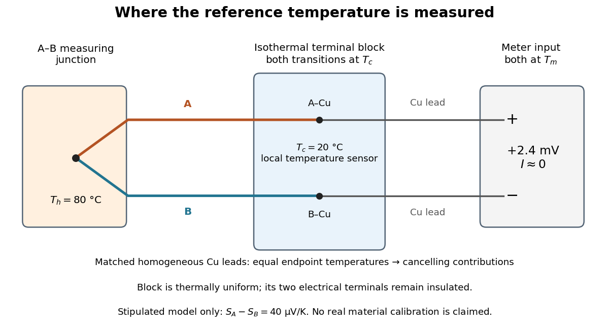

# Thermocouple

↑ **Parent:** [Seebeck effect](seebeck-effect.md)  
ⓦ [Wiki](https://en.wikipedia.org/wiki/Thermocouple)

A [thermocouple](thermocouple.md) uses two different [electrical conductors](electrical-conductor.md) and the [Seebeck effect](seebeck-effect.md) to infer a measuring-junction [temperature](temperature-split.md) from a voltage and a known reference [temperature](temperature-split.md). The reference material and the reference [temperature](temperature-split.md) are distinct choices: B specifies the comparison [Seebeck coefficient](seebeck-coefficient.md), while $T_c$ specifies the lower limit of the [integral](integral-split.md). The two-material experiment in [Seebeck effect](seebeck-effect.md) gives the geometry, sign convention, and calibration limitations.

The useful measurement is a pair: the raw terminal [electric potential difference](electric-potential-difference.md) and the [thermocouple reference junction](thermocouple-reference-junction.md) [temperature](temperature-split.md). For the A-positive terminal order and homogeneous-wire assumptions of [Seebeck effect](seebeck-effect.md), write the open-circuit [electromotive force](electromotive-force.md) as

$$
E(T_h,T_c)=\int_{T_c}^{T_h}[S_A(T)-S_B(T)]\,dT.
$$

Here $T_h$ is the [thermocouple measuring junction](thermocouple-measuring-junction.md) [temperature](temperature-split.md) and $T_c$ is the common [temperature](temperature-split.md) of the reference connections. The subscript $h$ names the measuring end; it need not be hotter. A [voltmeter](voltmeter.md) senses the complete connected thermoelectric path through the wires and its leads, in the [electrochemical potential](electrochemical-potential.md) convention already described under [Seebeck effect](seebeck-effect.md). It does not measure an absolute [temperature](temperature-split.md), the individual [Seebeck coefficient](seebeck-coefficient.md) of A, or an isolated contact [electric potential](electric-potential.md).

**[Figure 3](#image-thermocouple-wiring-with-two-copper-lead-junctions-at-a-common-reference-temperature). Thermocouple wiring with two copper-lead junctions at a common reference temperature**. Original schematic. The [isothermal terminal block](isothermal-terminal-block.md) contains electrically separate A–Cu and B–Cu transitions and a local [temperature](temperature-split.md) sensor. Both homogeneous [copper](copper.md) leads end at the same meter-input [temperature](temperature-split.md) $T_m$, so their thermoelectric contributions cancel. The displayed $+2.4\,\mathrm{mV}$ is calculated from a stipulated constant difference of [Seebeck coefficients](seebeck-coefficient.md), not measured data or a calibration of actual materials.

**Table of contents**

- [Thermopile](thermopile.md)
  - [Thermopile series voltage](thermopile-series-voltage.md)
  - [Thermopile absorber](thermopile-absorber.md)
  - [Thermopile thermal response](thermopile-thermal-response.md)
  - [Thermopile radiative measurement](thermopile-radiative-measurement.md)
- [Thermocouple measuring junction](thermocouple-measuring-junction.md)
- [Thermocouple reference junction](thermocouple-reference-junction.md)
  - [Isothermal terminal block](isothermal-terminal-block.md)
  - [Cold-junction compensation](cold-junction-compensation.md)
- [Thermocouple voltage calibration](thermocouple-voltage-calibration.md)
  - [Thermocouple reference function](thermocouple-reference-function.md)

## ↑ Ancestors (6)

1. [Seebeck effect](seebeck-effect.md)
2. [Thermoelectric effect](thermoelectric-effect-split.md)
3. [Electromagnetism](electromagnetism-split.md)
4. [Branches of physics](branches-of-physics.md)
5. [Physics](physics-split.md)
6. [Codex Wiki](split.md)

## ← Incoming links (17)

- [Adiabatic process](adiabatic-process.md)
- [Ångström periodic heating method](angstrom-periodic-heating-method.md)
- [Coblentz's cavity-radiation spectrum measurement](coblentz-s-cavity-radiation-spectrum-measurement.md)
- [Cold-junction compensation](cold-junction-compensation.md)
- [Kamerlingh Onnes's 1908 helium liquefaction experiment](kamerlingh-onnes-s-1908-helium-liquefaction-experiment.md)
- [Kelvin thermoelectric relation](kelvin-thermoelectric-relation.md)
- [Laser flash analysis](laser-flash-analysis.md)
- [Measuring the Joule-Thomson effect with a porous plug](measuring-the-joule-thomson-effect-with-a-porous-plug.md)
- [Solution](past-exam-of-the-mphil-in-micro-and-nanotechnology-enterprise-course-of-the-university-of-cambridge/2021/paper-1/7/ii/solution.md)
- [Seebeck effect](seebeck-effect.md)
- [Skin-temperature perturbation experiment](skin-temperature-perturbation-experiment.md)
- [Thermocouple](thermocouple.md)
- [Thermocouple reference function](thermocouple-reference-function.md)
- [Thermocouple voltage calibration](thermocouple-voltage-calibration.md)
- [Thermoelectric effect](thermoelectric-effect-split.md)
- [Thermopile](thermopile.md)
- [Thermopile series voltage](thermopile-series-voltage.md)
