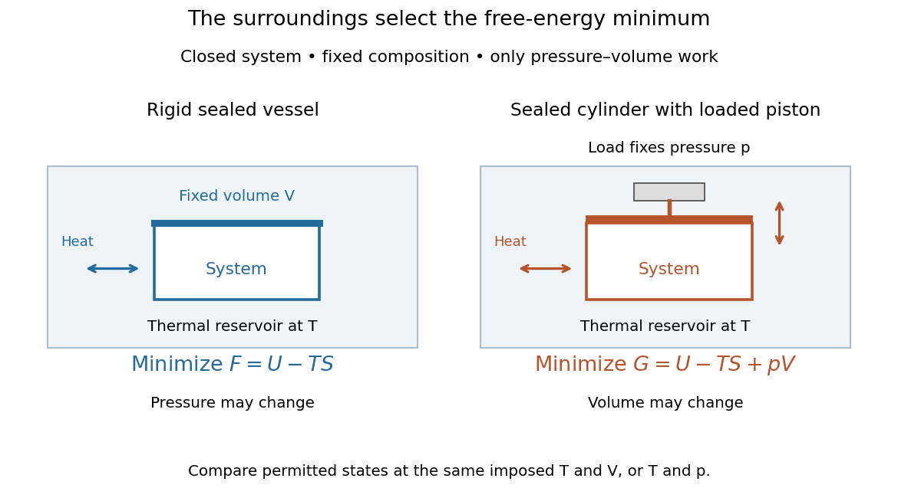

# Thermodynamic free energy

↑ **Parent:** [Thermodynamic potential](thermodynamic-potential.md)  
ⓦ [Wiki](https://en.wikipedia.org/wiki/Thermodynamic_free_energy)

A [free energy](thermodynamic-free-energy.md) is a [thermodynamic potential](thermodynamic-potential.md) that compares possible states under specified environmental constraints. For a [closed system](closed-system.md) of fixed composition, treated as a [simple compressible system](simple-compressible-system.md) with only [pressure](pressure.md)-[volume](volume-thermodynamics.md) [work](work.md), stable [thermodynamic equilibrium](thermodynamic-equilibrium.md) minimizes [Helmholtz free energy](helmholtz-free-energy.md) at fixed [temperature](temperature.md) and [volume](volume-thermodynamics.md), or [Gibbs free energy](gibbs-free-energy.md) at fixed [temperature](temperature.md) and [pressure](pressure.md). The choice follows the experiment: a rigid sealed vessel and a sealed cylinder with a freely moving loaded piston impose different constraints. Both may exchange [heat](heat.md) with a [thermal reservoir](heat-bath.md). See [W. C. Carter, MIT thermodynamics notes, sections 2-1.14 and 2-1.19](https://ocw.mit.edu/courses/3-00-thermodynamics-of-materials-fall-2002/14c95abd6fac023d84bd33c5d74d787d_lecture_02_oneside.PDF).

**[Figure 44](#image-choose-helmholtz-free-energy-for-fixed-temperature-and-volume-thermodynamics-or-gibbs-free-energy-for-fixed-temperature-and-pressure). Choose Helmholtz free energy for fixed temperature and volume, or Gibbs free energy for fixed temperature and pressure**. Original schematic of two closed vessels in contact with a [thermal reservoir](heat-bath.md). Composition is fixed, and only [pressure](pressure.md)-[volume](volume-thermodynamics.md) [work](work.md) is allowed. The right piston permits the [volume](volume-thermodynamics.md) to change.

The useful insight is that [internal energy](internal-energy.md) alone cannot rank these alternatives: exchanging [heat](heat.md) also changes the surroundings' [entropy](entropy.md). Subtracting $TS$ packages that accounting into a property of the chosen system. Adding $pV$ additionally accounts for displacing the surroundings at fixed [pressure](pressure.md). A [free energy](thermodynamic-free-energy.md) is a [state function](state-function.md); supplied [heat](heat.md) describes a transfer during a process. Under the stated constraints, supplied [heat](heat.md) is $Q=\Delta U$ at fixed [volume](volume-thermodynamics.md) or $Q=\Delta H$ at fixed [pressure](pressure.md), whereas neither $\Delta F$ nor $\Delta G$ generally equals $Q$.

A lower [free energy](thermodynamic-free-energy.md) identifies a thermodynamic preference, without specifying a timescale. A barrier can trap a system in a [local minimum](local-minimum.md), producing [metastability](metastability.md) although a lower [global minimum](global-minimum.md) exists. The [enzyme](enzyme.md) example illustrates the corresponding distinction for [chemical reactions](chemical-reaction.md): changing the route can change the [reaction rate](reaction-rate.md) while preserving the endpoint [Gibbs free energy](gibbs-free-energy.md) difference and [chemical equilibrium](chemical-equilibrium.md).

**Table of contents**

- [Free-energy functional](free-energy-functional.md)
- [Helmholtz free energy](helmholtz-free-energy.md)
- [Gibbs free energy](gibbs-free-energy.md)
  - [Gibbs free energy of an ideal-gas mixture](gibbs-free-energy-of-an-ideal-gas-mixture.md)
  - [Gibbs free-energy Maxwell relation](gibbs-free-energy-maxwell-relation.md)
  - [Chemical-potential balance for a reaction](chemical-potential-balance-for-a-reaction.md)
    - [Thermochemical equilibrium](thermochemical-equilibrium.md)
      - [Constrained Gibbs minimization for chemical equilibrium](constrained-gibbs-minimization-for-chemical-equilibrium.md)
      - [Reverse reaction rate from equilibrium thermodynamics](reverse-reaction-rate-from-equilibrium-thermodynamics.md)
  - [Phase coexistence curve](phase-coexistence-curve.md)
    - [Triple point](triple-point.md)
    - [Vapor pressure](vapor-pressure.md)
    - [Maxwell construction](maxwell-construction.md)
    - [Phase diagram](phase-diagram.md)
      - [Solidus](solidus.md)
      - [Lever rule](lever-rule.md)
      - [Bicritical point](bicritical-point.md)
      - [Liquidus](liquidus.md)
        - [Freezing-point depression](freezing-point-depression.md)
      - [Eutectic system](eutectic-system.md)
        - [Eutectic composition](eutectic-composition.md)
        - [Eutectic temperature](eutectic-temperature.md)
    - [First-order phase transition](first-order-phase-transition.md)
      - [Two-phase scalar coexistence endpoint conditions](two-phase-scalar-coexistence-endpoint-conditions.md)
      - [Spin-flop transition](spin-flop-transition.md)
      - [Classical nucleation theory](classical-nucleation-theory.md)
        - [Critical nucleus](critical-nucleus.md)
        - [Arrhenius nucleation time](arrhenius-nucleation-time.md)
    - [Latent heat](latent-heat.md)
      - [Stefan number](stefan-number.md)
        - [Latent-to-sensible heat ratio](latent-to-sensible-heat-ratio.md)
      - [Clausius-Clapeyron relation](clausius-clapeyron-relation.md)
        - [Ideal-vapor Clausius-Clapeyron approximation](ideal-vapor-clausius-clapeyron-approximation.md)
          - [Integrated Clausius-Clapeyron relation](integrated-clausius-clapeyron-relation.md)
            - [Stipulated vapor-pressure calculation](stipulated-vapor-pressure-calculation.md)
            - [Latent heat from a vapor-pressure slope](latent-heat-from-a-vapor-pressure-slope.md)
        - [Saturation-pressure equilibrium measurement](saturation-pressure-equilibrium-measurement.md)
        - [Common-pressure melting-point slope](common-pressure-melting-point-slope.md)
          - [Negative melting-point slope of water](negative-melting-point-slope-of-water.md)

## ↑ Ancestors (6)

1. [Thermodynamic potential](thermodynamic-potential.md)
2. [Thermodynamics](thermodynamics-split.md)
3. [Statistical physics](statistical-physics-split.md)
4. [Branches of physics](branches-of-physics.md)
5. [Physics](physics-split.md)
6. [Codex Wiki](split.md)

## ← Incoming links (1)

- [Surface energy](surface-energy.md)
