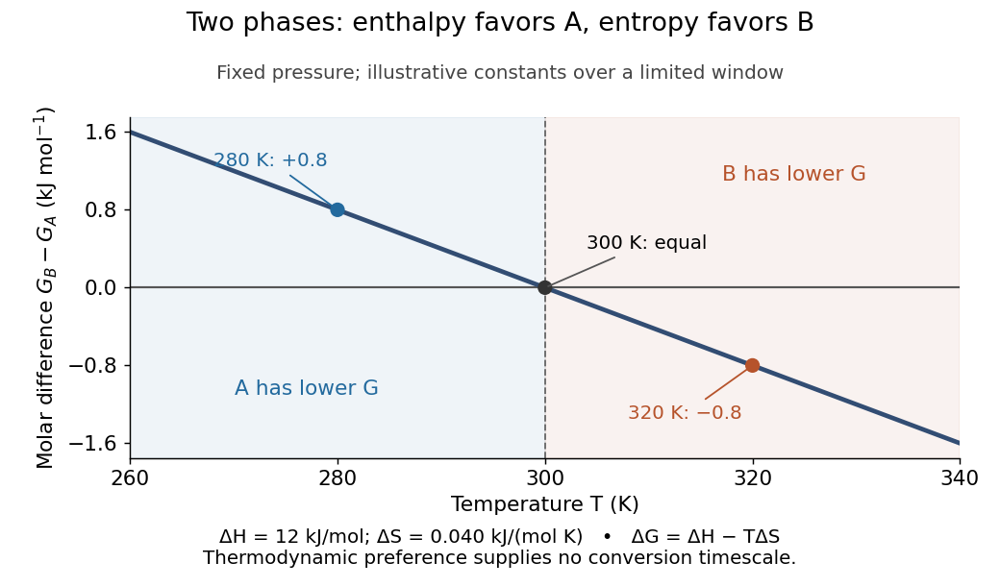

# Thermodynamic potential

↑ **Parent:** [Thermodynamics](thermodynamics.md)  
ⓦ [Wiki](https://en.wikipedia.org/wiki/Thermodynamic_potential)

A [state function](thermodynamics.md#state-function) used to describe a [thermodynamic system](thermodynamics.md#thermodynamic-system) with a chosen set of natural variables. [Internal energy](internal-energy.md), [enthalpy](enthalpy.md), [Helmholtz free energy](#helmholtz-free-energy), and [Gibbs free energy](#gibbs-free-energy) use different variables and serve different environmental constraints.

**Table of contents**

- [Natural variables of a thermodynamic potential](#natural-variables-of-a-thermodynamic-potential)
- [Exergy](#exergy)
  - [Availability curvature and equilibrium fluctuations](#availability-curvature-and-equilibrium-fluctuations)
    - [Volume fluctuations of a small fluid parcel](#volume-fluctuations-of-a-small-fluid-parcel)
- [Thermodynamic free energy](#thermodynamic-free-energy)
  - [Free-energy functional](#free-energy-functional)
  - [Helmholtz free energy](#helmholtz-free-energy)
  - [Gibbs free energy](#gibbs-free-energy)
    - [Single-component Gibbs Euler relation](#single-component-gibbs-euler-relation)
    - [Fixed-particle-number Gibbs minimum](#fixed-particle-number-gibbs-minimum)
    - [Gibbs–Helmholtz equation](#gibbs-helmholtz-equation)
    - [Transfer Gibbs energy](#transfer-gibbs-energy)
    - [Gibbs free-energy change for a pressure-linear gas correction](#gibbs-free-energy-change-for-a-pressure-linear-gas-correction)
    - [Gibbs free energy of an ideal-gas mixture](#gibbs-free-energy-of-an-ideal-gas-mixture)
    - [Gibbs free-energy Maxwell relation](#gibbs-free-energy-maxwell-relation)
    - [Chemical-potential balance for a reaction](#chemical-potential-balance-for-a-reaction)
      - [Thermochemical equilibrium](#thermochemical-equilibrium)
        - [Constrained Gibbs minimization for chemical equilibrium](#constrained-gibbs-minimization-for-chemical-equilibrium)
        - [Reverse reaction rate from equilibrium thermodynamics](#reverse-reaction-rate-from-equilibrium-thermodynamics)
    - [Phase coexistence curve](#phase-coexistence-curve)
      - [Kelvin equation](#kelvin-equation)
        - [Capillary condensation](#capillary-condensation)
      - [Triple point](#triple-point)
        - [Triple-point cell](#triple-point-cell)
      - [Vapor pressure](#vapor-pressure)
      - [Maxwell construction](#maxwell-construction)
        - [Maxwell construction in density coordinates](#maxwell-construction-in-density-coordinates)
      - [Phase diagram](#phase-diagram)
        - [Solvus](#solvus)
        - [Lower critical solution temperature](#lower-critical-solution-temperature)
        - [Upper critical solution temperature](#upper-critical-solution-temperature)
        - [Phase rule](#phase-rule)
        - [Solidus](#solidus)
        - [Lever rule](#lever-rule)
        - [Bicritical point](#bicritical-point)
        - [Liquidus](#liquidus)
          - [Freezing-point depression](#freezing-point-depression)
        - [Eutectic system](#eutectic-system)
          - [Eutectic solidification](#eutectic-solidification)
          - [Eutectic point](#eutectic-point)
          - [Eutectic microstructure](#eutectic-microstructure)
            - [Eutectic constituent fraction](#eutectic-constituent-fraction)
          - [Eutectic composition](#eutectic-composition)
          - [Eutectic temperature](#eutectic-temperature)
      - [First-order phase transition](#first-order-phase-transition)
        - [Two-phase scalar coexistence endpoint conditions](#two-phase-scalar-coexistence-endpoint-conditions)
        - [Spin-flop transition](#spin-flop-transition)
        - [Classical nucleation theory](#classical-nucleation-theory)
          - [Critical nucleus radius](#critical-nucleus-radius)
          - [Nucleation barrier](#nucleation-barrier)
          - [Disc-shaped nucleus](#disc-shaped-nucleus)
          - [Critical nucleus](#critical-nucleus)
          - [Arrhenius nucleation time](#arrhenius-nucleation-time)
      - [Latent heat](#latent-heat)
        - [Stefan number](#stefan-number)
          - [Latent-to-sensible heat ratio](#latent-to-sensible-heat-ratio)
        - [Clausius-Clapeyron relation](#clausius-clapeyron-relation)
          - [Melting pressure inferred from flotation and latent heats](#melting-pressure-inferred-from-flotation-and-latent-heats)
          - [Solid-phase Clapeyron slope from cell volumes](#solid-phase-clapeyron-slope-from-cell-volumes)
          - [Ideal-vapor Clausius-Clapeyron approximation](#ideal-vapor-clausius-clapeyron-approximation)
            - [Integrated Clausius-Clapeyron relation](#integrated-clausius-clapeyron-relation)
              - [Stipulated vapor-pressure calculation](#stipulated-vapor-pressure-calculation)
              - [Latent heat from a vapor-pressure slope](#latent-heat-from-a-vapor-pressure-slope)
          - [Saturation-pressure equilibrium measurement](#saturation-pressure-equilibrium-measurement)
          - [Common-pressure melting-point slope](#common-pressure-melting-point-slope)
            - [Negative melting-point slope of water](#negative-melting-point-slope-of-water)

## Natural variables of a thermodynamic potential

↑ **Parent:** [Thermodynamic potential](thermodynamic-potential.md)

Natural variables are the independent variables appearing in the differential that directly identifies a potential's conjugate quantities. For $U(S,V,N)$, $dU=T\,dS-p\,dV+\mu\,dN$. [Legendre transforms](convex-optimization.md#convex-conjugate) exchange a variable for its conjugate: $F=U-TS$ has natural variables $T,V,N$, and $G=F+pV$ has $T,p,N$. Equilibrium minimum principles require the corresponding environmental constraints and fixed conserved amounts.

## Exergy

↑ **Parent:** [Thermodynamic potential](thermodynamic-potential.md)  
ⓦ [Wiki](https://en.wikipedia.org/wiki/Exergy)

For a [closed system](thermodynamics.md#closed-system) with fixed composition in an environment at [temperature](temperature.md) $T_R>0$ and [pressure](pressure.md) $p_R$, define $A=U+p_RV-T_RS$, where $U$ is [internal energy](internal-energy.md), $V$ is [volume](thermodynamics.md#volume-thermodynamics) and $S$ is [entropy](entropy.md). The [exergy](#exergy) is this [availability](#exergy) relative to the equilibrium reference state, $A-A_{\mathrm{eq}}$. When the combined system and environment are isolated except for the specified exchanges, $\Delta S_{\mathrm{tot}}=-\Delta A/T_R$, so the [Second law of thermodynamics](second-law-of-thermodynamics.md) makes $A$ decrease toward its constrained minimum. Away from equilibrium, the environmental $T_R,p_R$ must not be replaced by the system's instantaneous values.

### Availability curvature and equilibrium fluctuations

↑ **Parent:** [Exergy](#exergy)

After integrating out other variables, let $A(x)$ include the constrained [entropy](entropy.md) and the [measure](measure.md) appropriate to the chosen coordinate $x$. Its equilibrium [probability density function](continuous-probability-distribution.md#probability-density-function) is proportional to $e^{-A(x)/(k_BT_R)}$. Near a stable interior minimum, $A(x)=A(x_0)+A''(x_0)(x-x_0)^2/2+\cdots$ with $A''(x_0)>0$. The resulting [normal distribution](probability-distribution.md#normal-distribution) has [variance](variance.md) $k_BT_R/A''(x_0)$. This is the leading [Gaussian fluctuation approximation](perturbative-quantum-field-theory.md#gaussian-fluctuation-approximation); a coordinate-dependent [measure](measure.md) contributes to the effective $A$, and higher-order terms matter near a vanishing curvature.

#### Volume fluctuations of a small fluid parcel

↑ **Parent:** [Availability curvature and equilibrium fluctuations](#availability-curvature-and-equilibrium-fluctuations)

For a material parcel of fixed amount inside a much larger thermal and mechanical environment, [availability](#exergy) is $A(V)=F(V,T)+p_{\rm bath}V$. Since $F_V=-p$, its curvature is $A_{VV}=-p_V=1/(V\kappa_T)$. The [Gaussian fluctuation approximation](perturbative-quantum-field-theory.md#gaussian-fluctuation-approximation) gives $\langle\delta V^2\rangle=k_BT\kappa_T\bar V$. This describes parcel-volume fluctuations, not the geometric [volume](geometry-and-topology.md#volume) of a fixed observation box or a globally rigid vessel. A fixed spatial box instead has number fluctuations related to the same compressibility.

## Thermodynamic free energy

↑ **Parent:** [Thermodynamic potential](thermodynamic-potential.md)  
ⓦ [Wiki](https://en.wikipedia.org/wiki/Thermodynamic_free_energy)

A [free energy](#thermodynamic-free-energy) is a [thermodynamic potential](thermodynamic-potential.md) that compares possible states under specified environmental constraints. For a [closed system](thermodynamics.md#closed-system) of fixed composition, treated as a [simple compressible system](thermodynamics.md#simple-compressible-system) with only [pressure](pressure.md)-[volume](thermodynamics.md#volume-thermodynamics) [work](energy.md#work), stable [thermodynamic equilibrium](thermodynamics.md#thermodynamic-equilibrium) minimizes [Helmholtz free energy](#helmholtz-free-energy) at fixed [temperature](temperature.md) and [volume](thermodynamics.md#volume-thermodynamics), or [Gibbs free energy](#gibbs-free-energy) at fixed [temperature](temperature.md) and [pressure](pressure.md). The choice follows the experiment: a rigid sealed vessel and a sealed cylinder with a freely moving loaded piston impose different constraints. Both may exchange [heat](heat.md) with a [thermal reservoir](thermal-equilibrium.md#heat-bath). See [W. C. Carter, MIT thermodynamics notes, sections 2-1.14 and 2-1.19](https://ocw.mit.edu/courses/3-00-thermodynamics-of-materials-fall-2002/14c95abd6fac023d84bd33c5d74d787d_lecture_02_oneside.PDF).

**[Figure 1](#image-choose-helmholtz-free-energy-for-fixed-temperature-and-volume-thermodynamics-or-gibbs-free-energy-for-fixed-temperature-and-pressure). Choose Helmholtz free energy for fixed temperature and volume, or Gibbs free energy for fixed temperature and pressure**. Original schematic of two closed vessels in contact with a [thermal reservoir](thermal-equilibrium.md#heat-bath). Composition is fixed, and only [pressure](pressure.md)-[volume](thermodynamics.md#volume-thermodynamics) [work](energy.md#work) is allowed. The right piston permits the [volume](thermodynamics.md#volume-thermodynamics) to change.

The useful insight is that [internal energy](internal-energy.md) alone cannot rank these alternatives: exchanging [heat](heat.md) also changes the surroundings' [entropy](entropy.md). Subtracting $TS$ packages that accounting into a property of the chosen system. Adding $pV$ additionally accounts for displacing the surroundings at fixed [pressure](pressure.md). A [free energy](#thermodynamic-free-energy) is a [state function](thermodynamics.md#state-function); supplied [heat](heat.md) describes a transfer during a process. Under the stated constraints, supplied [heat](heat.md) is $Q=\Delta U$ at fixed [volume](thermodynamics.md#volume-thermodynamics) or $Q=\Delta H$ at fixed [pressure](pressure.md), whereas neither $\Delta F$ nor $\Delta G$ generally equals $Q$.

A lower [free energy](#thermodynamic-free-energy) identifies a thermodynamic preference, without specifying a timescale. A barrier can trap a system in a [local minimum](analysis.md#local-minimum), producing [metastability](critical-phenomenon.md#metastability) although a lower [global minimum](analysis.md#global-minimum) exists. The [enzyme](enzyme.md) example illustrates the corresponding distinction for [chemical reactions](chemical-reaction.md): changing the route can change the [reaction rate](chemical-kinetics.md#reaction-rate) while preserving the endpoint [Gibbs free energy](#gibbs-free-energy) difference and [chemical equilibrium](chemical-potential.md#chemical-equilibrium).

### Free-energy functional

↑ **Parent:** [Thermodynamic free energy](#thermodynamic-free-energy)

A [free-energy functional](#free-energy-functional) assigns a [free energy](#thermodynamic-free-energy) to an entire spatial [order parameter](critical-phenomenon.md#order-parameter) configuration rather than only to one uniform value. In [Landau-Ginzburg theory](critical-phenomenon.md#landau-ginzburg-theory), a [local derivative expansion](critical-phenomenon.md#local-derivative-expansion) gives $\mathcal A[m]=\int d^Dx\{\kappa(\nabla m)^2/2+V(m)\}$, with appropriate boundary terms and regular backgrounds. The [Landau approximation](critical-phenomenon.md#landau-approximation) minimizes this functional; a fluctuating [statistical field theory](statistical-physics.md#statistical-field-theory) instead integrates its [Boltzmann weight](canonical-ensemble.md#boltzmann-factor) over configurations. These procedures need not give identical [critical exponents](critical-phenomenon.md#critical-exponent).

### Helmholtz free energy

↑ **Parent:** [Thermodynamic free energy](#thermodynamic-free-energy)  
ⓦ [Wiki](https://en.wikipedia.org/wiki/Helmholtz_free_energy)

The [Helmholtz free energy](#helmholtz-free-energy) is

$$
F=U-TS,
$$

where $U$ is [internal energy](internal-energy.md), also denoted $E$ elsewhere here, $T$ is absolute [temperature](temperature.md), and $S$ is [entropy](entropy.md). For the [closed system](thermodynamics.md#closed-system) of fixed composition and only [pressure](pressure.md)-[volume](thermodynamics.md#volume-thermodynamics) [work](energy.md#work) described above, spontaneous relaxation at fixed [temperature](temperature.md) and [volume](thermodynamics.md#volume-thermodynamics) cannot increase $F$. Stable [thermodynamic equilibrium](thermodynamics.md#thermodynamic-equilibrium) is a [global minimum](analysis.md#global-minimum) over the permitted alternatives, including different [thermodynamic phases](thermodynamics.md#thermodynamic-phase). A rigid vessel fixes the total [volume](thermodynamics.md#volume-thermodynamics); it does not require each coexisting [thermodynamic phase](thermodynamics.md#thermodynamic-phase) to retain its own [volume](thermodynamics.md#volume-thermodynamics).

For a constructed comparison at $300\,\mathrm K$, suppose one candidate has $1.5\,\mathrm{kJ}$ more [internal energy](internal-energy.md) but $6\,\mathrm{J\,K^{-1}}$ more [entropy](entropy.md) than another at the same [temperature](temperature.md) and [volume](thermodynamics.md#volume-thermodynamics). Its difference is

$$
\Delta F=1500-300(6)=-300\,\mathrm J.
$$

Thus the candidate with higher [internal energy](internal-energy.md) has lower [Helmholtz free energy](#helmholtz-free-energy). This is the practical reason for retaining the [entropy](entropy.md) term when selecting a state.

For equilibrium states within a smooth branch of fixed composition, the [first law of thermodynamics](first-law-of-thermodynamics.md) gives $dU=T\,dS-p\,dV$, hence

$$
dF=-S\,dT-p\,dV,\qquad
S=-\left(\frac{\partial F}{\partial T}\right)_V,\qquad
p=-\left(\frac{\partial F}{\partial V}\right)_T.
$$

These [derivatives](calculus.md#derivative) extract [entropy](entropy.md) and [pressure](pressure.md); the differential is not an evolution equation for relaxation. If [chemical species](mathematical-biology.md#chemical-species) amounts $n_i$ vary, add $\sum_i\mu_i\,dn_i$, with molar [chemical potentials](chemical-potential.md) $\mu_i$. A [closed system](thermodynamics.md#closed-system) can still change [chemical species](mathematical-biology.md#chemical-species) amounts through [chemical reactions](chemical-reaction.md); the fixed-composition simplification then needs the conserved-inventory constraints of [chemical equilibrium](chemical-potential.md#chemical-equilibrium). See [MIT 5.60, Lecture 14, fundamental equations and chemical potentials](https://ocw.mit.edu/courses/5-60-thermodynamics-kinetics-spring-2008/e763a06aa3b5de09cd6bfea6280f219c_5_60_lecture14.pdf).

The minimum principle has a short explanation. At fixed [volume](thermodynamics.md#volume-thermodynamics), no boundary [work](energy.md#work) occurs, so $Q=\Delta U$. A [thermal reservoir](thermal-equilibrium.md#heat-bath) at positive [temperature](temperature.md) $T$ loses [entropy](entropy.md) $Q/T$. Consequently

$$
\Delta S_{\rm total}=\Delta S-\frac{\Delta U}{T}=-\frac{\Delta F}{T}\geq0,
$$

by the [Second law of thermodynamics](second-law-of-thermodynamics.md). Here both endpoint states share the imposed [temperature](temperature.md). See [MIT 5.60, Lecture 12, criteria for spontaneous change](https://ocw.mit.edu/courses/5-60-thermodynamics-kinetics-spring-2008/64efc6f359b20c43dab61fc77791d744_5_60_lecture12.pdf).

The microscopic counterpart is $F=-k_BT\ln Z$ in the [canonical ensemble](canonical-ensemble.md), with [Boltzmann constant](thermodynamics.md#boltzmann-constant) $k_B$ and [partition function](canonical-ensemble.md#canonical-partition-function) $Z$. The [partition function](canonical-ensemble.md#canonical-partition-function) examples compute the balance between [internal energy](internal-energy.md) and [entropy](entropy.md); the [chemical equilibrium](chemical-potential.md#chemical-equilibrium) example already displays an ideal-mixture [Helmholtz free energy](#helmholtz-free-energy) minimum.

### Gibbs free energy

↑ **Parent:** [Thermodynamic free energy](#thermodynamic-free-energy)  
ⓦ [Wiki](https://en.wikipedia.org/wiki/Gibbs_free_energy)

The [Gibbs free energy](#gibbs-free-energy) is

$$
G=U-TS+pV=H-TS,\qquad H=U+pV,
$$

where $H$ is [enthalpy](enthalpy.md). For a [closed system](thermodynamics.md#closed-system) of fixed composition, with only [pressure](pressure.md)-[volume](thermodynamics.md#volume-thermodynamics) [work](energy.md#work), spontaneous relaxation at fixed [temperature](temperature.md) and [pressure](pressure.md) cannot increase $G$; stable [thermodynamic equilibrium](thermodynamics.md#thermodynamic-equilibrium) minimizes it over the allowed states. A loaded piston can move while maintaining the imposed [pressure](pressure.md), so the [enthalpy](enthalpy.md) term includes the displacement cost. Along a smooth equilibrium branch of fixed composition,

$$
dG=-S\,dT+V\,dp.
$$

Thus its [temperature](temperature.md) slope at fixed [pressure](pressure.md) is $-S$, while its [pressure](pressure.md) slope at fixed [temperature](temperature.md) is $V$. See [MIT 5.60, Lecture 13, Gibbs free energy and its derivatives](https://ocw.mit.edu/courses/5-60-thermodynamics-kinetics-spring-2008/7bc33304ab1db561a64b4a6b12e25476_5_60_lecture13.pdf).

Consider two illustrative [thermodynamic phases](thermodynamics.md#thermodynamic-phase), A and B, of the same substance at one fixed [pressure](pressure.md). Write B minus A, using quantities per [mole](physics.md#mole-unit):

$$
\Delta H=12\,\mathrm{kJ\,mol^{-1}},\qquad
\Delta S=40\,\mathrm{J\,mol^{-1}\,K^{-1}}=0.040\,\mathrm{kJ\,mol^{-1}\,K^{-1}}.
$$

Treat these differences as approximately constant over a limited [temperature](temperature.md) window. Then

$$
\frac{\Delta G(T)}{\mathrm{kJ\,mol^{-1}}}=12-0.040\frac{T}{\mathrm K},\qquad
T_* =\frac{\Delta H}{\Delta S}=300\,\mathrm K.
$$

At $280\,\mathrm K$, $\Delta G=+0.8\,\mathrm{kJ\,mol^{-1}}$, so A is preferred. At $320\,\mathrm K$, $\Delta G=-0.8\,\mathrm{kJ\,mol^{-1}}$, so B is preferred. At $300\,\mathrm K$, both have equal molar [Gibbs free energy](#gibbs-free-energy), permitting [phase coexistence](critical-phenomenon.md#phase-coexistence) in this bulk model. B's greater [entropy](entropy.md) outweighs its greater [enthalpy](enthalpy.md) above the crossing.

**[Figure 2](#image-illustrative-molar-gibbs-free-energy-difference-crosses-zero-at-300-mathrm-k). Illustrative molar Gibbs free energy difference crosses zero at $300\,\mathrm K$**. Constructed B-minus-A values: $+0.8\,\mathrm{kJ\,mol^{-1}}$ at $280\,\mathrm K$ and $-0.8\,\mathrm{kJ\,mol^{-1}}$ at $320\,\mathrm K$. The constants approximate a limited [temperature](temperature.md) window and represent no measured substance.

Each plotted point compares alternatives at the same [temperature](temperature.md); moving along the curve changes the imposed [temperature](temperature.md). The model predicts preference, not instantaneous conversion: [nucleation](critical-phenomenon.md#nucleation) barriers can sustain [metastability](critical-phenomenon.md#metastability). Real [enthalpy](enthalpy.md) and [entropy](entropy.md) differences generally vary with [temperature](temperature.md) through [heat capacities](heat.md#heat-capacity), bending this line outside the approximation.

At fixed [pressure](pressure.md), the [first law of thermodynamics](first-law-of-thermodynamics.md) gives $Q=\Delta H$ under the stated [work](energy.md#work) restriction, so the same [thermal reservoir](thermal-equilibrium.md#heat-bath) accounting yields $\Delta S_{\rm total}=-\Delta G/T\geq0$. Variable composition restores $\sum_i\mu_i\,dn_i$ to $dG$; [constrained Gibbs minimization for chemical equilibrium](#constrained-gibbs-minimization-for-chemical-equilibrium) handles those permitted changes.

The historical foundation is Gibbs's [On the Equilibrium of Heterogeneous Substances, first part completed in 1876, continued in 1878](https://en.wikisource.org/wiki/Scientific_Papers_of_Josiah_Willard_Gibbs,_Volume_1/Chapter_IIIa). Its equations (87) and (91) introduce the combinations now called [Helmholtz free energy](#helmholtz-free-energy) and [Gibbs free energy](#gibbs-free-energy), connecting [entropy](entropy.md) criteria, [chemical potentials](chemical-potential.md) and [phase coexistence](critical-phenomenon.md#phase-coexistence) within one framework.

#### Single-component Gibbs Euler relation

↑ **Parent:** [Gibbs free energy](#gibbs-free-energy)

For a homogeneous extensive simple-compressible phase, $U=TS-pV+\mu N$ implies $G=\mu N$. A mixture instead obeys $G=\sum_i\mu_iN_i$. Surface and other nonextensive contributions require extra terms.

#### Fixed-particle-number Gibbs minimum

↑ **Parent:** [Gibbs free energy](#gibbs-free-energy)

At imposed [temperature](temperature.md) and [pressure](pressure.md), with fixed species amounts and only pressure-volume work, increasing total system-plus-reservoir [entropy](entropy.md) is equivalent to decreasing $G=U-TS+pV$. Unconstrained particle exchange requires the reservoir [chemical potentials](chemical-potential.md) to be included; minimizing $G$ over arbitrary particle number is a different problem.

<h4 id="gibbs-helmholtz-equation">Gibbs–Helmholtz equation</h4>

↑ **Parent:** [Gibbs free energy](#gibbs-free-energy)

For fixed composition and pressure, $\partial(G/T)/\partial T=-H/T^2$. Applying the identity to standard reaction quantities connects equilibrium temperature dependence to reaction enthalpy.

#### Transfer Gibbs energy

↑ **Parent:** [Gibbs free energy](#gibbs-free-energy)

The standard free-energy change for moving a species between specified phases or solvents. For a consistently standardized equilibrium distribution coefficient, $\Delta G^\circ=-RT\ln K$. Pure-solid lattice dissolution is a separate thermodynamic step.

#### Gibbs free-energy change for a pressure-linear gas correction

↑ **Parent:** [Gibbs free energy](#gibbs-free-energy)

For the [equation of state](pressure.md#equation-of-state) $V=Nk_BT/p-NA(T)$, integrate $(\partial G/\partial p)_{T,N}=V$ along an isotherm. This gives the displayed [Gibbs free energy](#gibbs-free-energy) difference. Its negative [temperature](temperature.md) [derivative](calculus.md#derivative) at fixed endpoint pressures gives $\Delta S=-Nk_B\ln(p_1/p_0)+NA'(T)(p_1-p_0)$. The physically admissible branch must retain positive [volume](thermodynamics.md#volume-thermodynamics).

#### Gibbs free energy of an ideal-gas mixture

↑ **Parent:** [Gibbs free energy](#gibbs-free-energy)

For a single-phase [ideal gas](ideal-gas.md) mixture with molar amounts $N_i$, common [temperature](temperature.md) $T$, and [pressure](pressure.md) $P$, extensivity and ideal mixing give

$$
G=\sum_iN_i\mu_i=N\sum_i x_i\left[\mu_i^\circ(T)+\mathcal RT\log\left(\frac{x_iP}{P^\circ}\right)\right].
$$

Here $N=\sum_iN_i$, $x_i$ is the [mole fraction](mathematical-biology.md#mole-fraction), $\mathcal R$ is the molar gas constant, and $P^\circ$ is the standard [pressure](pressure.md). Integrating $\partial\mu_i/\partial P=\mathcal RT/P$ and including the ideal mixing [entropy](entropy.md) proves $\mu_i=\mu_i^\circ+\mathcal RT\log(x_iP/P^\circ)$. Reactions can change $N$, so fractions alone do not set the extensive [Gibbs free energy](#gibbs-free-energy). Its composition Hessian is $\mathcal RT(\delta_{ij}/N_i-1/N)$; it is positive semidefinite by the weighted [Cauchy-Schwarz inequality](probability-and-statistics.md#cauchy-schwarz-inequality).

#### Gibbs free-energy Maxwell relation

↑ **Parent:** [Gibbs free energy](#gibbs-free-energy)

Equality of mixed derivatives of $dG=-S\,dT+V\,dP$ gives

$$
\left(\frac{\partial S}{\partial P}\right)_T
=-\left(\frac{\partial V}{\partial T}\right)_P.
$$

#### Chemical-potential balance for a reaction

↑ **Parent:** [Gibbs free energy](#gibbs-free-energy)

For a reaction with stoichiometric changes $\nu_i$, varying the reaction extent at fixed temperature and pressure gives

$$
dG=\left(\sum_i\nu_i\mu_i\right)d\xi.
$$

Equilibrium requires $\sum_i\nu_i\mu_i=0$.

##### Thermochemical equilibrium

↑ **Parent:** [Chemical-potential balance for a reaction](#chemical-potential-balance-for-a-reaction)

Thermochemical equilibrium requires every chemical reaction to have zero Gibbs free-energy change. For ideal reactants, the equilibrium constant is $K=\exp[-\Delta_rG^\circ/(RT)]$ after standard-state activity factors are included.

###### Constrained Gibbs minimization for chemical equilibrium

↑ **Parent:** [Thermochemical equilibrium](#thermochemical-equilibrium)

At fixed [temperature](temperature.md) and [pressure](pressure.md), a closed reacting system reaches [thermochemical equilibrium](#thermochemical-equilibrium) by minimizing [Gibbs free energy](#gibbs-free-energy) over nonnegative species amounts subject to conserved elemental abundances. For an allowed [stoichiometric vector](mathematical-biology.md#stoichiometric-vector) $\nu$, an interior minimum has $\sum_i\nu_i\mu_i=0$. More generally the [chemical potential](chemical-potential.md) vector lies in the row span of the elemental conservation matrix at positive concentrations, with the appropriate one-sided inequalities for absent species. The [first law of thermodynamics](first-law-of-thermodynamics.md) gives the thermodynamic differential, while the [Second law of thermodynamics](second-law-of-thermodynamics.md) supplies the minimization direction.

###### Reverse reaction rate from equilibrium thermodynamics

↑ **Parent:** [Thermochemical equilibrium](#thermochemical-equilibrium)

For an elementary reversible reaction, detailed balance gives $k_f\prod_r n_r^{\nu_r}=k_r\prod_p n_p^{\nu_p}$ at equilibrium. Hence the reverse rate coefficient is the forward coefficient divided by the equilibrium constant, with units fixed by the reaction stoichiometry.

#### Phase coexistence curve

↑ **Parent:** [Gibbs free energy](#gibbs-free-energy)

Two phases coexist where their molar Gibbs free energies agree. Differentiating that equality along the coexistence curve relates its slope to the entropy and volume jumps.

##### Kelvin equation

↑ **Parent:** [Phase coexistence curve](#phase-coexistence-curve)  
ⓦ [Wiki](https://en.wikipedia.org/wiki/Kelvin_equation)

In the ideal-vapor, incompressible-liquid capillarity approximation, a spherical droplet of radius $R$ has the displayed equilibrium vapor-pressure relation. Here $v_l$ is liquid volume per molecule, $\Gamma$ is [surface tension](surface-tension.md), and $p_{\rm sat}$ is the flat-interface saturation pressure at the same [temperature](temperature.md). The [Young–Laplace equation](surface-tension.md#young-laplace-equation) raises liquid pressure by $2\Gamma/R$, increasing its [chemical potential](chemical-potential.md) by approximately $2\Gamma v_l/R$. Matching this with the ideal-vapor chemical-potential increase $k_BT\ln(p/p_{\rm sat})$ proves the formula. The liquid contribution from the vapor-pressure change itself is neglected relative to its curvature pressure, and bulk properties are taken independent of radius. A convex small drop therefore requires a higher ambient vapor pressure than a flat interface.

###### Capillary condensation

↑ **Parent:** [Kelvin equation](#kelvin-equation)

Condensation in a [wetting](surface-tension.md#wetting) confined geometry at a [vapor pressure](#vapor-pressure) below planar-interface saturation. A concave [liquid](thermodynamics.md#liquid) meniscus has lower equilibrium [vapor pressure](#vapor-pressure) in the capillarity approximation. Gap size, [contact angle](surface-tension.md#contact-angle) and surface [adsorption](physical-chemistry.md#adsorption) affect the actual onset.

##### Triple point

↑ **Parent:** [Phase coexistence curve](#phase-coexistence-curve)

A triple point is a [temperature](temperature.md)–[pressure](pressure.md) pair at which three distinct bulk [thermodynamic phases](thermodynamics.md#thermodynamic-phase) of a one-component substance coexist in [thermodynamic equilibrium](thermodynamics.md#thermodynamic-equilibrium). In the familiar [solid](thermodynamics.md#solid)–[liquid](thermodynamics.md#liquid)–[gas](thermodynamics.md#gas) case, their three [phase coexistence curves](#phase-coexistence-curve) meet. Other combinations, such as two [crystal polymorphs](thermodynamics.md#crystal-polymorph) and a [liquid](thermodynamics.md#liquid), also qualify: “triple” counts [thermodynamic phases](thermodynamics.md#thermodynamic-phase), rather than states-of-matter categories.

For the same substance, the [chemical potential](chemical-potential.md) in each [thermodynamic phase](thermodynamics.md#thermodynamic-phase) must agree:

$$
\mu_s(T_t,p_t)=\mu_l(T_t,p_t)=\mu_g(T_t,p_t).
$$

There are two independent equality conditions for two controls, [temperature](temperature.md) and [pressure](pressure.md). Generically they select an isolated pair $(T_t,p_t)$; the third pairwise equality follows from the first two. Equivalently, the [phase rule](#phase-rule) gives $F=1-3+2=0$. This counts independent intensive controls, not [phase fractions](thermodynamics.md#phase-fraction): changing the amounts of the three [thermodynamic phases](thermodynamics.md#thermodynamic-phase) need not change the ideal bulk [temperature](temperature.md) and [pressure](pressure.md), provided all three remain present. Different sets of [crystal polymorphs](thermodynamics.md#crystal-polymorph) can give different triple points for the same substance.[Gibbs Phase Rule, three-phase count and pressure–temperature diagram discussion](physics-bibliography.md#gibbs-phase-rule-mit-10-213-course-material)

At a [liquid-gas critical point](critical-phenomenon.md#liquid-gas-critical-point), the two fluid [thermodynamic phases](thermodynamics.md#thermodynamic-phase) instead merge, and their [mass density](fluid-mechanics.md#density) difference and [latent heat](#latent-heat) vanish. It is the endpoint of the [liquid](thermodynamics.md#liquid)–[gas](thermodynamics.md#gas) [phase coexistence curve](#phase-coexistence-curve), rather than a meeting of three distinct [thermodynamic phases](thermodynamics.md#thermodynamic-phase). The regular independent-equality count used for a triple point cannot explain this merger. A triple point can retain finite [mass density](fluid-mechanics.md#density) and [entropy](entropy.md) differences between all three [thermodynamic phases](thermodynamics.md#thermodynamic-phase).[§5.1.2, printed p. 141: vanishing liquid–gas discontinuity at the critical point; Figure 41 separates it from the three-phase junction](physics-bibliography.md#statistical-physics-by-david-tong)

###### Triple-point cell

↑ **Parent:** [Triple point](#triple-point)

A triple-point cell turns [phase coexistence](critical-phenomenon.md#phase-coexistence) into a reproducible reference for [thermometer calibration](temperature.md#thermometer-calibration). The NIST water-cell demonstration uses a sealed glass vessel containing [water](chemical-substance.md#water) of specified [isotopic composition](chemical-substance.md#isotopic-composition) and an open central thermometer well. Cooling this well with [solid](thermodynamics.md#solid) [carbon dioxide](chemical-substance.md#carbon-dioxide) and alcohol freezes an [ice](chemical-substance.md#ice) mantle while leaving [liquid](thermodynamics.md#liquid) [water](chemical-substance.md#water) and its vapor. The coolant is outside the sealed sample; the sample's vapor space does not communicate with room air.[Triple-Point Cell, preparation description, uploaded 21 December 2016](physics-bibliography.md#triple-point-cell-nist-demonstration)

In the actual NIST cell-comparison experiment, newly frozen mantles were compared with an aged reference mantle in a controlled maintenance bath. A warm aluminium rod melted a thin inner layer around the well, allowing the mantle to rotate freely and establishing an [ice](chemical-substance.md#ice)–[water](chemical-substance.md#water) interface close to the sensor. A [standard platinum resistance thermometer](temperature.md#standard-platinum-resistance-thermometer) and a [resistance bridge](electrical-engineering.md#resistance-bridge) measured the [electrical resistance](electric-charge.md#electrical-resistance) ratio to a calibrated, temperature-controlled reference resistor. Readings at two currents permitted extrapolation to zero electrical [power](energy.md#power), correcting self-heating; measured immersion depths supplied [hydrostatic pressure](fluid-mechanics.md#hydrostatic-pressure) corrections. Comparing preparations over time tested stabilization rather than assuming freshly frozen [ice](chemical-substance.md#ice) was ready.[Furukawa, Mangum and Strouse, Effects of different methods of preparation of ice mantles of triple point of water cells on the temporal behaviour of the triple-point temperatures (1997), Abstract, §1 and §§3.2–3.5: aged reference, inner melt, bridge readout, zero-power and hydrostatic corrections](physics-bibliography.md#effects-of-different-methods-of-preparation-of-ice-mantles-of-triple-point-of-water-cells-on-the-temporal-behaviour-of-the-triple-point-temperatures-by-g-t-furukawa-and-others)

The inference is a reproducible fixed-point response for the [thermometer](temperature.md#thermometer), not a direct reading of three [chemical potentials](chemical-potential.md). The reference cell anchors the comparison; a water point alone does not determine a [thermometer](temperature.md#thermometer)'s response at every other [temperature](temperature.md). The ideal $F=0$ argument excludes impurity and [isotope](chemical-substance.md#isotope) variation, finite interface effects and unintended [heat transfer](heat.md#heat-transfer); real cells also require adequate immersion and stable electrical references. Repeatability is evidence that these effects are controlled, not a reason to omit their uncertainty.

Since 20 May 2019 the [kelvin](temperature.md#kelvin) has been defined through a fixed numerical value of the [Boltzmann constant](thermodynamics.md#boltzmann-constant). The thermodynamic [temperature](temperature.md) of the [water](chemical-substance.md#water) triple point is consequently a measured quantity with uncertainty, rather than an exact value imposed by the [kelvin](temperature.md#kelvin) definition. Its continued use as an assigned reference on the [International Temperature Scale of 1990](temperature.md#international-temperature-scale-of-1990) is a separate convention.[Resolution 1 of the 26th CGPM (2018), effective date; Appendix 2, third bullet; Appendix 3, kelvin definition](physics-bibliography.md#on-the-revision-of-the-international-system-of-units-si-26th-cgpm-resolution-1-2018)[§2.3.1: practical temperature scales and ITS-90](physics-bibliography.md#the-international-system-of-units-si-ninth-edition-si-brochure)

##### Vapor pressure

↑ **Parent:** [Phase coexistence curve](#phase-coexistence-curve)  
ⓦ [Wiki](https://en.wikipedia.org/wiki/Vapor_pressure)

The equilibrium [pressure](pressure.md) of a vapor in contact with its [liquid](thermodynamics.md#liquid) or [solid](thermodynamics.md#solid) at a specified [temperature](temperature.md). For pure [liquid](thermodynamics.md#liquid)–[gas](thermodynamics.md#gas) [phase coexistence](critical-phenomenon.md#phase-coexistence) with negligible interface effects, it is the [pressure](pressure.md) on their [phase coexistence curve](#phase-coexistence-curve). In a [gas](thermodynamics.md#gas) [mixture](mixture.md), distinguish the component's [partial pressure](ideal-gas.md#partial-pressure) from the total [pressure](pressure.md); the pure-substance [Integrated Clausius-Clapeyron relation](#integrated-clausius-clapeyron-relation) does not describe the total [pressure](pressure.md) of arbitrary humid air.

##### Maxwell construction

↑ **Parent:** [Phase coexistence curve](#phase-coexistence-curve)

At fixed [temperature](temperature.md), choose a coexistence [pressure](pressure.md) $p_*$ such that the gas and liquid have equal [chemical potentials](chemical-potential.md). Because $d\mu=v\,dp$, this gives $\int_{v_l}^{v_g}v\,dp=0$, or equivalently $\int_{v_l}^{v_g}[p(v,T)-p_*]\,dv=0$. The equal areas replace the unstable part of an isotherm by a horizontal coexistence segment.

###### Maxwell construction in density coordinates

↑ **Parent:** [Maxwell construction](#maxwell-construction)

The equal-area condition is naturally $\int(p-p_{\rm coex})\,dv=0$ in volume per particle $v$. In number density $n=1/v$, it becomes $\int_{n_g}^{n_l}[p(n)-p_{\rm coex}]\,dn/n^2=0$. Unweighted area in a [pressure](pressure.md)-versus-density plot is not the [Maxwell construction](#maxwell-construction).

##### Phase diagram

↑ **Parent:** [Phase coexistence curve](#phase-coexistence-curve)  
ⓦ [Wiki](https://en.wikipedia.org/wiki/Phase_diagram)

A phase diagram partitions a space of thermodynamic variables into regions occupied by different equilibrium [thermodynamic phases](thermodynamics.md#thermodynamic-phase) and records the [phase coexistence curves](#phase-coexistence-curve) between them. For a pure, one-component substance, a [pressure](pressure.md)–[temperature](temperature.md) [phase diagram](#phase-diagram) gives one point for each pair $(T,p)$. In a single-[thermodynamic phase](thermodynamics.md#thermodynamic-phase) region both controls can vary independently. On a two-[thermodynamic phase](thermodynamics.md#thermodynamic-phase) [phase coexistence curve](#phase-coexistence-curve), they obey one relation; at a [triple point](#triple-point), both are fixed. These statements assume bulk [thermodynamic equilibrium](thermodynamics.md#thermodynamic-equilibrium), fixed composition and no additional applied fields.[Gibbs Phase Rule, single-, two- and three-phase counts and final pressure–temperature diagram paragraphs](physics-bibliography.md#gibbs-phase-rule-mit-10-213-course-material)

At fixed [temperature](temperature.md) and [pressure](pressure.md), the stable bulk [thermodynamic phase](thermodynamics.md#thermodynamic-phase) minimizes [Gibbs free energy](#gibbs-free-energy) for a fixed [amount of substance](physics.md#amount-of-substance). For a pure substance this is a comparison of [chemical potentials](chemical-potential.md) on a common normalization. Two candidate [thermodynamic phases](thermodynamics.md#thermodynamic-phase) coexist where $\mu_\alpha(T,p)=\mu_\beta(T,p)$ and neither is exceeded in stability by a third [thermodynamic phase](thermodynamics.md#thermodynamic-phase). Differentiating their equality gives the [Clapeyron equation](#clausius-clapeyron-relation). Thus a [phase coexistence curve](#phase-coexistence-curve) is a locus of equal stability, rather than a trajectory that every heated sample must follow.[§5.1.1, equations (5.3)–(5.4), printed p. 137: chemical-potential equality; §5.1.2, equation (5.6), printed pp. 140–141: coexistence slope](physics-bibliography.md#statistical-physics-by-david-tong)

The following original cartoon uses dimensionless positive coordinates $\theta=T/T_*$ and $\pi=p/p_*$, with arbitrary reference scales $T_*,p_*$. It represents no particular substance and contains no measured data. Stipulate a [triple point](#triple-point) at $(1,1)$, a [liquid-gas critical point](critical-phenomenon.md#liquid-gas-critical-point) at $(3,5)$, and these drawing rules:

$$
\begin{aligned}
\pi_{\rm sub}(\theta)&=e^{\theta-1},&&0<\theta\le1,\\
\pi_{\rm vap}(\theta)&=2\theta-1,&&1\le\theta\le3,\\
\theta_{\rm melt}(\pi)&=1+0.1(\pi-1),&&\pi\ge1.
\end{aligned}
$$

They specify [sublimation](critical-phenomenon.md#sublimation), [liquid](thermodynamics.md#liquid)–[gas](thermodynamics.md#gas) [phase coexistence](critical-phenomenon.md#phase-coexistence) and [melting](critical-phenomenon.md#melting) boundaries for the picture. They are not an [equation of state](pressure.md#equation-of-state), do not predict [latent heat](#latent-heat) or [mass density](fluid-mechanics.md#density), and do not supply a quantitative critical theory. In particular, the [melting](critical-phenomenon.md#melting) slope is merely an illustrative choice.

**[Figure 3](#image-generic-dimensionless-pressure-temperature-phase-diagram-curves-triple-point-and-liquid-gas-critical-point). Generic dimensionless pressure–temperature phase diagram: curves, triple point and liquid-gas critical point**. Original cartoon with stipulated drawing rules. Three distinct bulk [thermodynamic phases](thermodynamics.md#thermodynamic-phase) coexist at $(1,1)$; the [liquid](thermodynamics.md#liquid)–[gas](thermodynamics.md#gas) boundary ends at $(3,5)$. The fluid region beyond that endpoint is connected: no extra boundary is implied by the fading background. These coordinates are not [water](chemical-substance.md#water) data.

For example, at fixed $\pi=3$ the [melting](critical-phenomenon.md#melting) boundary is at $\theta=1.2$ and the [liquid](thermodynamics.md#liquid)–[gas](thermodynamics.md#gas) boundary is at $\theta=2$. Heating from $(\theta,\pi)=(1.6,3)$ to $(3.6,3)$ therefore starts in [liquid](thermodynamics.md#liquid), crosses [phase coexistence](critical-phenomenon.md#phase-coexistence) at $(2,3)$, and ends in [gas](thermodynamics.md#gas). In an equilibrium conversion at that crossing, added [heat](heat.md) can change the [phase fraction](thermodynamics.md#phase-fraction) at fixed [temperature](temperature.md) through [latent heat](#latent-heat). The [pressure](pressure.md)–[temperature](temperature.md) point alone does not specify how much of each [thermodynamic phase](thermodynamics.md#thermodynamic-phase) is present: for that one needs an additional amount or [volume](thermodynamics.md#volume-thermodynamics) constraint.

Now connect exactly the same endpoints by raising $\pi$ from $3$ to $6$ at $\theta=1.6$, moving to $\theta=3.6$ at $\pi=6$, then lowering $\pi$ to $3$. The first leg stays on the [liquid](thermodynamics.md#liquid) side because $\theta_{\rm melt}$ ranges only from $1.2$ to $1.5$ and $\pi_{\rm vap}(1.6)=2.2<3$. The second leg lies above the entire [liquid](thermodynamics.md#liquid)–[gas](thermodynamics.md#gas) boundary, whose largest drawn [pressure](pressure.md) coordinate is $5$; the third lies beyond its largest [temperature](temperature.md) coordinate, $3$. No leg crosses a [first-order phase transition](#first-order-phase-transition) boundary. The middle leg passes through a [supercritical fluid](critical-phenomenon.md#supercritical-fluid) region, with $\theta>3$ and $\pi>5$, and the final leg returns to a gaslike state continuously.

**[Figure 4](#image-the-same-liquid-and-gas-endpoints-crossing-phase-coexistence-or-going-around-the-liquid-gas-critical-point). The same liquid and gas endpoints: crossing phase coexistence or going around the liquid-gas critical point**. Original dimensionless cartoon. The orange constant-[pressure](pressure.md) path crosses the [liquid](thermodynamics.md#liquid)–[gas](thermodynamics.md#gas) boundary at $(2,3)$. The blue path follows $(1.6,3)$ to $(1.6,6)$ to $(3.6,6)$ to $(3.6,3)$ and avoids every drawn [phase coexistence curve](#phase-coexistence-curve). Dashed coordinate guides locate the critical endpoint without representing additional boundaries.

Avoiding a [first-order phase transition](#first-order-phase-transition) does not mean that no [heat](heat.md) or [work](energy.md#work) is exchanged. Along the detour, [mass density](fluid-mechanics.md#density), [enthalpy](enthalpy.md) and [heat capacity](heat.md#heat-capacity) may change substantially but continuously. The [liquid-gas critical point](critical-phenomenon.md#liquid-gas-critical-point) itself has singular behavior, so the detour goes around it rather than through it. This connected fluid region is the striking lesson of a [phase diagram](#phase-diagram): a familiar change from [liquid](thermodynamics.md#liquid) to [gas](thermodynamics.md#gas) need not involve boiling across a sharp boundary.

An equilibrium [phase diagram](#phase-diagram) also does not predict how rapidly a conversion occurs. [Metastability](critical-phenomenon.md#metastability) and a barrier described by [classical nucleation theory](#classical-nucleation-theory) can delay the observed [phase transition](critical-phenomenon.md#phase-transition). Nor should a binary-composition [phase diagram](#phase-diagram) be read as the same picture: its coexistence regions and [lever rule](#lever-rule) encode composition and [phase fractions](thermodynamics.md#phase-fraction), and can occupy an area even though pure-substance two-[thermodynamic phase](thermodynamics.md#thermodynamic-phase) coexistence occupies a curve in the [pressure](pressure.md)–[temperature](temperature.md) plane.

###### Solvus

↑ **Parent:** [Phase diagram](#phase-diagram)

A boundary giving the equilibrium limit of one [solid solution](chemical-substance.md#solid-solution) against coexistence with another solid phase. Moving along a [solvus](#solvus) during cooling changes equilibrium solid compositions even after all liquid has disappeared.

###### Lower critical solution temperature

↑ **Parent:** [Phase diagram](#phase-diagram)

The lower endpoint of a two-liquid coexistence region. In the lower-critical case, demixing can be induced by heating above the endpoint.

###### Upper critical solution temperature

↑ **Parent:** [Phase diagram](#phase-diagram)

The upper endpoint of a two-liquid coexistence region in a temperature-composition diagram. In the ordinary upper-critical case, heating above this temperature removes liquid-liquid demixing.

###### Phase rule

↑ **Parent:** [Phase diagram](#phase-diagram)  
ⓦ [Wiki](https://en.wikipedia.org/wiki/Phase_rule)

The [phase rule](#phase-rule) counts independent intensive controls compatible with coexistence of $P$ distinct bulk [thermodynamic phases](thermodynamics.md#thermodynamic-phase) made from $C$ independent components:

$$
F=C-P+2.
$$

Here $P$ counts [thermodynamic phases](thermodynamics.md#thermodynamic-phase), not [pressure](pressure.md), and $F$ does not count [phase fractions](thermodynamics.md#phase-fraction). For the nonreacting one-component case, $C=1$ and $F=3-P$: a single [thermodynamic phase](thermodynamics.md#thermodynamic-phase) occupies a region with $F=2$, two-[thermodynamic phase](thermodynamics.md#thermodynamic-phase) coexistence a curve with $F=1$, and a [triple point](#triple-point) an isolated point with $F=0$. Fixing [pressure](pressure.md) externally removes one adjustable control wherever that constraint is independent.[Gibbs Phase Rule, displayed nonreacting rule and pure-substance table](physics-bibliography.md#gibbs-phase-rule-mit-10-213-course-material)

For an elementary count without [chemical reactions](chemical-reaction.md), take $C$ [chemical species](mathematical-biology.md#chemical-species). Each [thermodynamic phase](thermodynamics.md#thermodynamic-phase) has $C-1$ independent composition fractions, since they sum to one. Shared [temperature](temperature.md) and [pressure](pressure.md) add two controls, giving $2+P(C-1)$. Equality of each species' [chemical potential](chemical-potential.md) between one reference [thermodynamic phase](thermodynamics.md#thermodynamic-phase) and the other $P-1$ [thermodynamic phases](thermodynamics.md#thermodynamic-phase) supplies $C(P-1)$ constraints. Subtraction gives $2+P(C-1)-C(P-1)=C-P+2$. This argument assumes the constraints are independent and treats interfaces as negligible; [chemical reactions](chemical-reaction.md), external fields or critical mergers require appropriate qualifications.

###### Solidus

↑ **Parent:** [Phase diagram](#phase-diagram)

The solidus bounds the entirely solid equilibrium region of a [phase diagram](#phase-diagram). For a linear [liquidus](#liquidus) $T_L(C_l)=-mC_l$ and a constant [segregation coefficient](geophysics.md#solid-liquid-segregation-coefficient) $C_s=k_D C_l$, the corresponding solidus is $T_S(C_s)=-mC_s/k_D$. The [concentration](mathematical-physics.md#concentration) argument is the solid [concentration](mathematical-physics.md#concentration), not the neighboring liquid [concentration](mathematical-physics.md#concentration).

###### Lever rule

↑ **Parent:** [Phase diagram](#phase-diagram)  
ⓦ [Wiki](https://en.wikipedia.org/wiki/Lever_rule)

The lever rule finds phase fractions from a horizontal tie line on a [phase diagram](#phase-diagram). For solid and liquid [concentrations](mathematical-physics.md#concentration) $C_s,C_l$ and bulk [concentration](mathematical-physics.md#concentration) $\overline C$, conservation gives $\overline C=(1-\phi)C_s+\phi C_l$. Thus $\phi=(\overline C-C_s)/(C_l-C_s)$ is the [liquid fraction](geophysics.md#liquid-fraction), provided $C_s\le\overline C\le C_l$. For pure solid, $\phi=\overline C/C_l$.

###### Bicritical point

↑ **Parent:** [Phase diagram](#phase-diagram)

A bicritical point is where two continuous transition lines and a first-order line meet, typically separating a disordered phase from two competing ordered phases.

###### Liquidus

↑ **Parent:** [Phase diagram](#phase-diagram)  
ⓦ [Wiki](https://en.wikipedia.org/wiki/Liquidus)

The liquidus is the locus in a [phase diagram](#phase-diagram) above which the equilibrium state is entirely liquid. In a dilute binary solution it is often approximated locally by a linear relation such as $T_L=T_0-mC$.

###### Freezing-point depression

↑ **Parent:** [Liquidus](#liquidus)  
ⓦ [Wiki](https://en.wikipedia.org/wiki/Freezing-point_depression)

Freezing-point depression is the lowering of a solvent's equilibrium freezing temperature by dissolved solute. In the linear dilute approximation, $T_L=T_0-mC$ with $m>0$.

###### Eutectic system

↑ **Parent:** [Phase diagram](#phase-diagram)  
ⓦ [Wiki](https://en.wikipedia.org/wiki/Eutectic_system)

An eutectic system has a composition and temperature at which a liquid is in equilibrium with two distinct solid phases. Cooling liquid of that composition through the eutectic temperature produces both solid phases together.

###### Eutectic solidification

↑ **Parent:** [Eutectic system](#eutectic-system)

The transformation $L\rightarrow\alpha+\beta$ in which one liquid produces two solid phases at a binary [eutectic composition](#eutectic-composition) and [temperature](temperature.md) under fixed [pressure](pressure.md). The resulting two-phase constituent must be distinguished from either individual [thermodynamic phase](thermodynamics.md#thermodynamic-phase).

###### Eutectic point

↑ **Parent:** [Eutectic system](#eutectic-system)

The invariant liquid-plus-two-solids equilibrium of a binary [eutectic system](#eutectic-system) at fixed [pressure](pressure.md). It specifies both the [eutectic temperature](#eutectic-temperature) and the [eutectic composition](#eutectic-composition).

###### Eutectic microstructure

↑ **Parent:** [Eutectic system](#eutectic-system)

A two-solid [microstructure](engineering.md#microstructure) formed by the coupled transformation of liquid at a [eutectic point](#eutectic-point). Lamellae and rods are common morphologies. A hypoeutectic alloy can contain both primary crystals and a [eutectic microstructure](#eutectic-microstructure); those [microconstituents](engineering.md#microconstituent) are not the same accounting categories as its total phase fractions.

###### Eutectic constituent fraction

↑ **Parent:** [Eutectic microstructure](#eutectic-microstructure)

The fraction of an alloy that solidifies through the eutectic reaction, equal to the remaining liquid fraction immediately before that reaction in a simple equilibrium [solidification](critical-phenomenon.md#freezing) path. It differs from the total fraction of either solid phase, and later precipitation can change the phase inventory.

###### Eutectic composition

↑ **Parent:** [Eutectic system](#eutectic-system)

The eutectic composition is the liquid [concentration](mathematical-physics.md#concentration) at the [eutectic temperature](#eutectic-temperature), where liquid and two solid phases coexist. It is a composition coordinate on a [phase diagram](#phase-diagram), not the overall [concentration](mathematical-physics.md#concentration) of every sample in an [eutectic system](#eutectic-system).

###### Eutectic temperature

↑ **Parent:** [Eutectic system](#eutectic-system)

The eutectic temperature is the temperature of simultaneous liquid–two-solid [phase coexistence](critical-phenomenon.md#phase-coexistence) in an [eutectic system](#eutectic-system). In directional freezing of a solution away from the eutectic composition, a [mushy layer](geophysics.md#mushy-layer) can end at this temperature, where its remaining liquid solidifies.

##### First-order phase transition

↑ **Parent:** [Phase coexistence curve](#phase-coexistence-curve)

At a first-order phase transition, the Gibbs free energy is continuous while at least one first derivative, such as entropy or volume, jumps. A nonzero entropy jump produces latent heat $L=T\Delta S$.

###### Two-phase scalar coexistence endpoint conditions

↑ **Parent:** [First-order phase transition](#first-order-phase-transition)

A smooth scalar [Landau free energy](critical-phenomenon.md#landau-free-energy) can end a two-phase [phase coexistence curve](#phase-coexistence-curve) by merging two minima and their intervening maximum. At a generic stable endpoint, its first three derivatives vanish and its fourth derivative is positive. A field shift and two mixed control parameters reduce the local form to a quartic [Landau free energy](critical-phenomenon.md#landau-free-energy); the order-parameter jump then vanishes and the [magnetic susceptibility](statistical-physics.md#magnetic-susceptibility) diverges. This conclusion assumes there is no competing third phase and that the endpoint lies inside the control-parameter domain. It is not a general theorem about every first-order line: a sextic potential with fixed negative quartic coefficient has a symmetry-related ordered coexistence line that ends at a triple point with a finite jump.

###### Spin-flop transition

↑ **Parent:** [First-order phase transition](#first-order-phase-transition)

###### Classical nucleation theory

↑ **Parent:** [First-order phase transition](#first-order-phase-transition)  
ⓦ [Wiki](https://en.wikipedia.org/wiki/Classical_nucleation_theory)

Classical nucleation theory balances the positive surface free energy of a droplet against its negative bulk free-energy gain. In three dimensions,

$$
F(R)=4\pi\sigma R^2-\frac{4\pi}{3}\Delta R^3
$$

has critical radius $R^*=2\sigma/\Delta$ and barrier $F^*=16\pi\sigma^3/(3\Delta^2)$.

###### Critical nucleus radius

↑ **Parent:** [Classical nucleation theory](#classical-nucleation-theory)

In the spherical capillarity approximation, the nonzero maximum of $\Delta G=4\pi r^2\gamma+(4\pi/3)r^3\Delta g_V$ lies at $r^*=-2\gamma/\Delta g_V$ when $\Delta g_V<0$. Smaller [nuclei](atomic-nucleus.md) tend to shrink and larger ones tend to grow. Surface anisotropy and molecular-scale structure limit the approximation.

###### Nucleation barrier

↑ **Parent:** [Classical nucleation theory](#classical-nucleation-theory)

The maximum free-energy cost along a [nucleation](critical-phenomenon.md#nucleation) pathway, at its [critical nucleus](#critical-nucleus). A pathway with fixed shape is a constraint and need not coincide with an unconstrained saddle point.

###### Disc-shaped nucleus

↑ **Parent:** [Classical nucleation theory](#classical-nucleation-theory)

A cylindrical model nucleus of [diameter](topological-analysis.md#diameter) $d$ and height $h$. Its [free energy](#thermodynamic-free-energy) is $\pi d^2h\Delta g/4+\pi d^2\gamma_f/2+\pi dh\gamma_e$, where $\Delta g$ is the signed bulk free-energy change per [volume](geometry-and-topology.md#volume).

###### Critical nucleus

↑ **Parent:** [Classical nucleation theory](#classical-nucleation-theory)

A critical nucleus is the unstable droplet at the maximum of the nucleation free energy. Smaller droplets shrink, while larger droplets lower their free energy by growing.

###### Arrhenius nucleation time

↑ **Parent:** [Classical nucleation theory](#classical-nucleation-theory)

Thermal crossing of a nucleation barrier $F^*$ has rate proportional to $e^{-F^*/(k_BT)}$ and mean waiting time proportional to $e^{F^*/(k_BT)}$, up to a kinetic prefactor.

##### Latent heat

↑ **Parent:** [Phase coexistence curve](#phase-coexistence-curve)  
ⓦ [Wiki](https://en.wikipedia.org/wiki/Latent_heat)

Latent heat is the [heat](heat.md) absorbed or released in a [first-order phase transition](#first-order-phase-transition) through its [entropy](entropy.md) jump. For an equilibrium conversion from [thermodynamic phase](thermodynamics.md#thermodynamic-phase) $\alpha$ to [thermodynamic phase](thermodynamics.md#thermodynamic-phase) $\beta$ at fixed [pressure](pressure.md), evaluate both [thermodynamic phases](thermodynamics.md#thermodynamic-phase) at the same [temperature](temperature.md) and [pressure](pressure.md) on their [phase coexistence curve](#phase-coexistence-curve):

$$
L=T_{\rm tr}(S_\beta-S_\alpha)=H_\beta-H_\alpha.
$$

Use one normalization throughout: $L$, $S$ and $H$ may all be per [mole](physics.md#mole-unit), giving $L$ in $\mathrm{J\,mol^{-1}}$, or all per unit [mass](classical-mechanics.md#mass), giving $L$ in $\mathrm{J\,kg^{-1}}$. Here $S$ is [entropy](entropy.md) and $H$ is [enthalpy](enthalpy.md) on that basis. Equal [Gibbs free energies](#gibbs-free-energy) of the coexisting [thermodynamic phases](thermodynamics.md#thermodynamic-phase) give $\Delta H=T_{\rm tr}\Delta S$. Identifying this [enthalpy](enthalpy.md) difference with supplied [heat](heat.md) assumes a [closed system](thermodynamics.md#closed-system) and an equilibrium conversion with only [pressure](pressure.md)-[volume](thermodynamics.md#volume-thermodynamics) [work](energy.md#work). [Tong, Statistical Physics, phase coexistence and latent heat](physics-bibliography.md#statistical-physics-by-david-tong)

For a pure substance with positive [latent heat](#latent-heat) per unit [mass](classical-mechanics.md#mass) $L$, let $x$ be the [phase fraction](thermodynamics.md#phase-fraction) of the higher-[enthalpy](enthalpy.md) [thermodynamic phase](thermodynamics.md#thermodynamic-phase), measured by [mass](classical-mechanics.md#mass). While both [thermodynamic phases](thermodynamics.md#thermodynamic-phase) coexist at the fixed [pressure](pressure.md),

$$
Q=mL(x_2-x_1),\qquad T=T_{\rm tr}.
$$

Adding [heat](heat.md) changes $x$ rather than the [temperature](temperature.md); this creates the horizontal portion of a [heating curve](heat.md#heating-curve). Once $x=1$, additional [heat](heat.md) raises the [temperature](temperature.md) according to [specific heat capacity at constant pressure](heat.md#specific-heat-capacity-at-constant-pressure). Reversing the conversion releases [heat](heat.md). The plateau represents changing [enthalpy](enthalpy.md), rather than a finite single-[thermodynamic phase](thermodynamics.md#thermodynamic-phase) [heat capacity](heat.md#heat-capacity) satisfying $Q=C_p\Delta T$. [1.5 Phase Changes](physics-bibliography.md#university-physics-volume-2-by-samuel-j-ling-and-others/1-5-phase-changes)

For a constructed fixed-[pressure](pressure.md) model, take $m=1\,\mathrm{kg}$, initial [temperature](temperature.md) $280\,\mathrm K$, transition [temperature](temperature.md) $T_{\rm tr}=300\,\mathrm K$, [solid](thermodynamics.md#solid) [specific heat capacity at constant pressure](heat.md#specific-heat-capacity-at-constant-pressure) $c_s=2\,\mathrm{kJ\,kg^{-1}\,K^{-1}}$, [latent heat](#latent-heat) $L=100\,\mathrm{kJ\,kg^{-1}}$, and [liquid](thermodynamics.md#liquid) [specific heat capacity at constant pressure](heat.md#specific-heat-capacity-at-constant-pressure) $c_l=3\,\mathrm{kJ\,kg^{-1}\,K^{-1}}$. These are stipulated model parameters, not empirical properties of a named material. Heating the [solid](thermodynamics.md#solid) to $300\,\mathrm K$ takes $40\,\mathrm{kJ}$ of [sensible heat](heat.md#sensible-heat); converting it fully to [liquid](thermodynamics.md#liquid) takes another $100\,\mathrm{kJ}$ of [heat](heat.md); heating the [liquid](thermodynamics.md#liquid) to $320\,\mathrm K$ takes $60\,\mathrm{kJ}$. The total is $200\,\mathrm{kJ}$. After a total [heat](heat.md) input of $90\,\mathrm{kJ}$, $x=(90-40)/100=1/2$ and the [temperature](temperature.md) is still $300\,\mathrm K$. The corresponding per-unit-[mass](classical-mechanics.md#mass) [entropy](entropy.md) jump is $L/T_{\rm tr}=\frac13\,\mathrm{kJ\,kg^{-1}\,K^{-1}}$.

**[Figure 5](#image-sensible-heat-raises-temperature-latent-heat-changes-phase-fraction). Sensible heat raises temperature; latent heat changes phase fraction**. Constructed $1\,\mathrm{kg}$ fixed-[pressure](pressure.md) model with total supplied [heat](heat.md) starting at zero at $280\,\mathrm K$. The plateau runs from $40$ to $140\,\mathrm{kJ}$, while the [liquid](thermodynamics.md#liquid) [phase fraction](thermodynamics.md#phase-fraction) by [mass](classical-mechanics.md#mass) rises from zero to one. The horizontal axis measures $Q=\Delta H$, rather than absolute [internal energy](internal-energy.md).

A [continuous phase transition](critical-phenomenon.md#continuous-phase-transition) has no [latent heat](#latent-heat). Its [heat capacity](heat.md#heat-capacity) can have a jump or a singularity without a finite interval in which added [heat](heat.md) converts coexisting [thermodynamic phases](thermodynamics.md#thermodynamic-phase) at a constant [temperature](temperature.md). A heating plateau therefore requires the stated [phase coexistence](critical-phenomenon.md#phase-coexistence) conditions; it is not a feature of every [phase transition](critical-phenomenon.md#phase-transition). [Tong, Statistical Physics, first-order and continuous transitions](physics-bibliography.md#statistical-physics-by-david-tong)

###### Stefan number

↑ **Parent:** [Latent heat](#latent-heat)  
ⓦ [Wiki](https://en.wikipedia.org/wiki/Stefan_number)

The Stefan number compares sensible heat $c_p\Delta T$ with [latent heat](#latent-heat) $L$ per unit mass. Some solidification literature uses its reciprocal as the Stefan parameter, so the defining formula must accompany the convention.

###### Latent-to-sensible heat ratio

↑ **Parent:** [Stefan number](#stefan-number)

The latent-to-sensible heat ratio is the reciprocal of the [Stefan number](#stefan-number) defined by $\mathrm{Ste}=c_p\Delta T/L$. Large $S$ means that phase change uses much more energy than changing temperature by $\Delta T$.

###### Clausius-Clapeyron relation

↑ **Parent:** [Latent heat](#latent-heat)  
ⓦ [Wiki](https://en.wikipedia.org/wiki/Clausius–Clapeyron_relation)

The [Clapeyron equation](#clausius-clapeyron-relation) connects the slope of a [phase coexistence curve](#phase-coexistence-curve) to the [latent heat](#latent-heat) and the change in [volume](thermodynamics.md#volume-thermodynamics) during a [first-order phase transition](#first-order-phase-transition). A steep boundary can indicate a large [latent heat](#latent-heat), a small change in [volume](thermodynamics.md#volume-thermodynamics), or both. This lets a measured boundary constrain caloric properties and predicts how changing [pressure](pressure.md) shifts a [melting](critical-phenomenon.md#melting) [temperature](temperature.md).

For a pure substance in bulk [phase coexistence](critical-phenomenon.md#phase-coexistence), label the initial and final [thermodynamic phases](thermodynamics.md#thermodynamic-phase) $\alpha$ and $\beta$. Both have the same absolute [temperature](temperature.md) $T$, [pressure](pressure.md) $p$, and [chemical potential](chemical-potential.md). With $s$, $h$, and $v$ denoting [entropy](entropy.md), [enthalpy](enthalpy.md), and [volume](thermodynamics.md#volume-thermodynamics) on one common basis, define $\Delta s=s_\beta-s_\alpha$, $\Delta h=h_\beta-h_\alpha$, and $\Delta v=v_\beta-v_\alpha$. Then

$$
\boxed{\frac{dp}{dT}=\frac{\Delta s}{\Delta v}=\frac{L}{T\Delta v}},\qquad L=\Delta h=T\Delta s.
$$

The [derivative](calculus.md#derivative) follows the [phase coexistence curve](#phase-coexistence-curve); it is not a [partial derivative](multivariable-calculus.md#partial-derivative) within one [thermodynamic phase](thermodynamics.md#thermodynamic-phase). Use [molar volume](thermodynamics.md#molar-volume) $v_m$ with molar [latent heat](#latent-heat) $L_m$ in $\mathrm{J\,mol^{-1}}$, or [specific volume](thermodynamics.md#specific-volume) $v$ with [latent heat](#latent-heat) $L$ in $\mathrm{J\,kg^{-1}}$. Both give $dp/dT$ in $\mathrm{Pa\,K^{-1}}$. For [molar mass](chemistry.md#molar-mass) $M$, $L_m=ML$ and $\Delta v_m=M\Delta v$, so the predicted slope is independent of the chosen basis. This formulation assumes a [simple compressible system](thermodynamics.md#simple-compressible-system), fixed composition, and negligible interface contributions; a curved interface can instead require the [Young–Laplace equation](surface-tension.md#young-laplace-equation).

For positive [latent heat](#latent-heat) in the stated conversion direction, the sign of the slope is the sign of $\Delta v$. Converting [liquid](thermodynamics.md#liquid) to [gas](thermodynamics.md#gas) normally increases [volume](thermodynamics.md#volume-thermodynamics) and gives a positive slope. The [negative melting-point slope of water](#negative-melting-point-slope-of-water) illustrates the opposite sign. At a [thermodynamic critical point](critical-phenomenon.md#thermodynamic-critical-point), the coexisting [gas](thermodynamics.md#gas) and [liquid](thermodynamics.md#liquid) merge: both $L$ and $\Delta v$ vanish, so their ratio needs a limiting analysis rather than substitution of zero into the [Clapeyron equation](#clausius-clapeyron-relation).[§5.1.2, equation (5.185) and the discussion of the critical endpoint](physics-bibliography.md#statistical-physics-by-david-tong)

**[Figure 6](#image-phase-coexistence-curve-tangents-positive-vaporization-slope-and-negative-water-melting-slope). Phase coexistence curve tangents: positive vaporization slope and negative water melting slope**.

A short derivation uses the molar [Gibbs free energy](#gibbs-free-energy) $g_m$, equal to the [chemical potential](chemical-potential.md) for a pure substance. Equality persists along the boundary, so $dg_{m,\alpha}=dg_{m,\beta}$ with $dg_m=-s_m\,dT+v_m\,dp$. Therefore $-\Delta s_m\,dT+\Delta v_m\,dp=0$. Equality of $g_m=h_m-Ts_m$ also gives $\Delta h_m=T\Delta s_m$. Eliminating $\Delta s_m$ yields the [Clapeyron equation](#clausius-clapeyron-relation).

###### Melting pressure inferred from flotation and latent heats

↑ **Parent:** [Clausius-Clapeyron relation](#clausius-clapeyron-relation)

Floating ice with submerged volume fraction $f$ has [density](fluid-mechanics.md#density) $f\rho_l$ by [Archimedes' principle](fluid-mechanics.md#archimedes-principle). Its volume change on melting is therefore $v_l-v_s=(1-1/f)/\rho_l<0$. An [enthalpy](enthalpy.md) cycle gives $L_f=L_s-L_v$ for quantities consistently expressed per [mass](classical-mechanics.md#mass) at the same [temperature](temperature.md). Treating these [latent heats](#latent-heat) and specific volumes as constant and integrating the [Clausius-Clapeyron relation](#clausius-clapeyron-relation) gives the displayed [pressure](pressure.md) estimate. Using a vaporization [latent heat](#latent-heat) extrapolated from a different [temperature](temperature.md) carries that approximation into the inferred fusion [heat](heat.md).

###### Solid-phase Clapeyron slope from cell volumes

↑ **Parent:** [Clausius-Clapeyron relation](#clausius-clapeyron-relation)

Molar crystal volume follows from $V_m=N_AV_{\rm cell}/Z$ with $Z$ atoms per cell for an elemental solid. Combining two such values with their molar [entropy](entropy.md) difference gives $\mathrm dP/\mathrm dT=\Delta S_m/\Delta V_m$. Ambient values supply only an approximation to a high-pressure coexistence slope, not a phase-boundary intercept.

###### Ideal-vapor Clausius-Clapeyron approximation

↑ **Parent:** [Clausius-Clapeyron relation](#clausius-clapeyron-relation)

For [liquid](thermodynamics.md#liquid)–[gas](thermodynamics.md#gas) [phase coexistence](critical-phenomenon.md#phase-coexistence), make two distinct approximations: the [gas](thermodynamics.md#gas) obeys the [ideal gas law](ideal-gas.md#ideal-gas-law), $v_{m,g}=RT/p$, and its [molar volume](thermodynamics.md#molar-volume) greatly exceeds the [liquid](thermodynamics.md#liquid) [molar volume](thermodynamics.md#molar-volume), $v_{m,g}\gg v_{m,l}$. Here $R$ is the [molar gas constant](ideal-gas.md#molar-gas-constant) and $p$ is the [saturation pressure](#vapor-pressure) of the pure substance. Substitution into the [Clapeyron equation](#clausius-clapeyron-relation) gives

$$
\frac{dp}{dT}\simeq\frac{L_m(T)p}{RT^2},\qquad \frac{d\ln(p/p_*)}{dT}\simeq\frac{L_m(T)}{RT^2},
$$

where $p_*>0$ is any fixed reference [pressure](pressure.md), making the [logarithm](calculus.md#logarithm) dimensionless. Constant [latent heat](#latent-heat) is a further approximation, needed for the elementary [Integrated Clausius-Clapeyron relation](#integrated-clausius-clapeyron-relation) below.[§5.1.2, “An Approximate Solution to the Clausius-Clapeyron Equation”: the three assumptions and the exponential solution](physics-bibliography.md#statistical-physics-by-david-tong)

The neglected [liquid](thermodynamics.md#liquid) [molar volume](thermodynamics.md#molar-volume) has a transparent error estimate. If the [gas](thermodynamics.md#gas) is ideal but $\epsilon=v_{m,l}/v_{m,g}$ is retained, then

$$
\left(\frac{dp}{dT}\right)_{\rm full}=\frac{L_m p}{RT^2(1-\epsilon)},\qquad \frac{(dp/dT)_{\rm approx}}{(dp/dT)_{\rm full}}=1-\epsilon.
$$

Thus ignoring the [liquid](thermodynamics.md#liquid) [molar volume](thermodynamics.md#molar-volume) underestimates this slope by a relative amount $\epsilon$. This estimate does not bound errors from treating a [real gas](thermodynamics.md#real-gas) as ideal or from freezing $L_m(T)$. Near a [thermodynamic critical point](critical-phenomenon.md#thermodynamic-critical-point), the [gas](thermodynamics.md#gas) and [liquid](thermodynamics.md#liquid) [molar volumes](thermodynamics.md#molar-volume) approach each other and these dilute-vapor assumptions fail.

###### Integrated Clausius-Clapeyron relation

↑ **Parent:** [Ideal-vapor Clausius-Clapeyron approximation](#ideal-vapor-clausius-clapeyron-approximation)

If the molar [latent heat](#latent-heat) $L_m$ is approximately constant on the chosen [temperature](temperature.md) interval, the [ideal-vapor Clausius-Clapeyron approximation](#ideal-vapor-clausius-clapeyron-approximation) integrates to

$$
\ln\frac{p_2}{p_1}\simeq-\frac{L_m}{R}\left(\frac{1}{T_2}-\frac{1}{T_1}\right),\qquad p(T)\simeq p_1\exp\left[\frac{L_m}{R}\left(\frac{1}{T_1}-\frac{1}{T}\right)\right].
$$

For $L_m>0$, higher absolute [temperature](temperature.md) gives higher [saturation pressure](#vapor-pressure). A plot of $\ln(p/p_1)$ against [inverse temperature](temperature.md#inverse-temperature) $1/T$ is a straight line of slope $-L_m/R$. One reference pair $(T_1,p_1)$ fixes its intercept. On a per-unit-[mass](classical-mechanics.md#mass) basis replace $L_m/R$ by $L/R_s$, with $R_s=R/M$ and $M$ the [molar mass](chemistry.md#molar-mass); using $L$ in $\mathrm{J\,kg^{-1}}$ with the molar $R$ would give incompatible units.

If only the constant-[latent heat](#latent-heat) approximation is relaxed, the same ideal-vapor model instead gives

$$
\ln\frac{p_2}{p_1}\simeq\frac{1}{R}\int_{T_1}^{T_2}\frac{L_m(T)}{T^2}\,dT.
$$

Consequently an apparent straight-line fit across a broad [temperature](temperature.md) range need not represent a single material constant. The simple exponential also approaches a finite value as $T\to\infty$; this is a property of the stipulated formula, not a prediction that [liquid](thermodynamics.md#liquid)–[gas](thermodynamics.md#gas) [phase coexistence](critical-phenomenon.md#phase-coexistence) extends beyond a [thermodynamic critical point](critical-phenomenon.md#thermodynamic-critical-point).

###### Stipulated vapor-pressure calculation

↑ **Parent:** [Integrated Clausius-Clapeyron relation](#integrated-clausius-clapeyron-relation)

Consider an unnamed model substance with molar [latent heat](#latent-heat) $L_m=40.0\,\mathrm{kJ\,mol^{-1}}$ and [saturation pressure](#vapor-pressure) $p_1=10.0\,\mathrm{kPa}$ at $T_1=300\,\mathrm K$. Stipulate the [ideal-vapor Clausius-Clapeyron approximation](#ideal-vapor-clausius-clapeyron-approximation) throughout $280\leq T\leq340\,\mathrm K$, constant $L_m$, and $R=8.314\,\mathrm{J\,mol^{-1}\,K^{-1}}$. These parameters define an illustrative model, not a measured dataset or a fit to [water](chemical-substance.md#water). At $T_2=330\,\mathrm K$,

$$
\ln\frac{p_2}{p_1}=\frac{40000}{8.314}\left(\frac{1}{300}-\frac{1}{330}\right)\simeq1.458,\qquad p_2\simeq42.97\,\mathrm{kPa}.
$$

At the reference state the [gas](thermodynamics.md#gas) [molar volume](thermodynamics.md#molar-volume) is $RT_1/p_1=0.24942\,\mathrm{m^3\,mol^{-1}}$, and the local slope is $dp/dT\simeq0.5346\,\mathrm{kPa\,K^{-1}}$. The tangent estimate $p_2\approx10.0+30(0.5346)=26.04\,\mathrm{kPa}$ is much lower than the integrated result: a local [derivative](calculus.md#derivative) should not be extrapolated over this whole interval. By contrast, over a small [temperature](temperature.md) increment, the fractional sensitivity is $d\ln(p/p_1)/dT=L_m/(RT_1^2)\simeq0.05346\,\mathrm{K^{-1}}$.

**[Figure 7](#image-stipulated-saturation-pressure-versus-temperature-and-its-linear-logarithm-versus-inverse-temperature). Stipulated saturation pressure versus temperature and its linear logarithm versus inverse temperature**.

###### Latent heat from a vapor-pressure slope

↑ **Parent:** [Integrated Clausius-Clapeyron relation](#integrated-clausius-clapeyron-relation)

Within the [ideal-vapor Clausius-Clapeyron approximation](#ideal-vapor-clausius-clapeyron-approximation), a local slope of the [natural logarithm](calculus.md#natural-logarithm) of [saturation pressure](#vapor-pressure) against [inverse temperature](temperature.md#inverse-temperature) estimates the molar [latent heat](#latent-heat):

$$
L_m(T)\simeq-R\frac{d\ln(p/p_*)}{d(1/T)}.
$$

In the [stipulated vapor-pressure calculation](#stipulated-vapor-pressure-calculation), the slope is $-4811.16\,\mathrm K$, which recovers $40.0\,\mathrm{kJ\,mol^{-1}}$. For variable $L_m(T)$, a two-point estimate gives an average weighted by $T^{-2}$, rather than the [latent heat](#latent-heat) at an arbitrary midpoint. Differentiating noisy [pressure](pressure.md) measurements amplifies their errors. Outside the ideal-vapor regime, use independently determined [molar volumes](thermodynamics.md#molar-volume) in $L_m=T\Delta v_m\,dp/dT$; a straight-looking graph alone cannot establish that the [gas](thermodynamics.md#gas) is ideal.

###### Saturation-pressure equilibrium measurement

↑ **Parent:** [Clausius-Clapeyron relation](#clausius-clapeyron-relation)

A concrete experiment turns the [phase coexistence curve](#phase-coexistence-curve) into pairs of [temperature](temperature.md) and [saturation pressure](#vapor-pressure). A 1969 paper reports [water](chemical-substance.md#water) measurements made in 1942 and 1947–1949 using a boiler and precision [mercury](chemical-substance.md#mercury-element) [manometer](fluid-mechanics.md#manometer). [Platinum resistance thermometers](temperature.md#platinum-resistance-thermometer) read the boiler [temperature](temperature.md) through a [resistance bridge](electrical-engineering.md#resistance-bridge). The [pressure](pressure.md)-transfer line passed through an ice-water condenser and a dry-ice trap; [helium](chemical-substance.md#helium) filled connecting sections. Corrected [mercury](chemical-substance.md#mercury-element) column height gave the [pressure](pressure.md) at the thermometer coils, including [hydrostatic pressure](fluid-mechanics.md#hydrostatic-pressure) contributions from [water](chemical-substance.md#water) vapor, [helium](chemical-substance.md#helium), [mercury](chemical-substance.md#mercury-element), and [mercury](chemical-substance.md#mercury-element) vapor.[Stimson, §§1–2, pp. 493–495: boiler, bridge thermometry, and fluid-head corrections](physics-bibliography.md#some-precise-measurements-of-the-vapor-pressure-of-water-in-the-range-from-25-to-100-°c-by-h-f-stimson)

Controls included normal/reversed-lead readings, readings at two thermometer [electric currents](electric-charge.md#electric-current) extrapolated to zero current to remove self-heating, repeated bridge calibration, and daily [triple point](#triple-point) [thermometer calibration](temperature.md#thermometer-calibration) checks. Cellar [temperature](temperature.md) measurements corrected fluid-column and gauge-block [thermal expansion](thermodynamics.md#thermal-expansion). One measurement series was excluded because a trapped gas bubble was suspected of corrupting the [mercury](chemical-substance.md#mercury-element) head. The paper adjusted measurements to round [temperatures](temperature.md) using previously tabulated slopes; those adjusted values therefore are not independent measurements of those slopes.[Stimson, §2, pp. 494–495, and §3, p. 495: corrections and suspected gas-bubble bias](physics-bibliography.md#some-precise-measurements-of-the-vapor-pressure-of-water-in-the-range-from-25-to-100-°c-by-h-f-stimson)

The thermodynamic inference requires [liquid](thermodynamics.md#liquid) and [gas](thermodynamics.md#gas) in [phase coexistence](critical-phenomenon.md#phase-coexistence), a well-defined common [temperature](temperature.md), and a [pressure](pressure.md) corrected to that same location. Leaks, contamination, or a [temperature gradient](heat.md#temperature-gradient) can spoil that interpretation. A separate [calorimetry](calorimetry.md) measurement of [latent heat](#latent-heat), together with the two [specific volumes](thermodynamics.md#specific-volume), allows a test of the full [Clapeyron equation](#clausius-clapeyron-relation). Converting a measured [phase coexistence curve](#phase-coexistence-curve) slope directly into [latent heat](#latent-heat) instead assumes that equation; it is not an independent test.

###### Common-pressure melting-point slope

↑ **Parent:** [Clausius-Clapeyron relation](#clausius-clapeyron-relation)

When the solid and liquid have the same [pressure](pressure.md), equality of [chemical potentials](chemical-potential.md) implies $-(s_l-s_s)dT+(1/\rho_l-1/\rho_s)dp=0$. With [latent heat of fusion](statistical-physics.md#latent-heat-of-fusion) $L=T_m(s_l-s_s)$, this gives the displayed slope. If solid is less dense than liquid, raising the common pressure depresses the [melting](critical-phenomenon.md#melting) temperature. $T_m$ is absolute [temperature](temperature.md). This coexistence-curve derivative differs from a thermomolecular pressure difference between equal-density phases.

###### Negative melting-point slope of water

↑ **Parent:** [Common-pressure melting-point slope](#common-pressure-melting-point-slope)

For a local illustrative [ice](chemical-substance.md#ice)–[water](chemical-substance.md#water) [melting](critical-phenomenon.md#melting) calculation, stipulate $T_m=273.15\,\mathrm K$, [latent heat of fusion](statistical-physics.md#latent-heat-of-fusion) $L=334\,\mathrm{kJ\,kg^{-1}}$, [solid](thermodynamics.md#solid) [mass density](fluid-mechanics.md#density) $\rho_s=917\,\mathrm{kg\,m^{-3}}$, and [liquid](thermodynamics.md#liquid) [mass density](fluid-mechanics.md#density) $\rho_l=1000\,\mathrm{kg\,m^{-3}}$. These are explicitly stipulated rounded inputs, not measurements made here. The [specific volume](thermodynamics.md#specific-volume) change on [melting](critical-phenomenon.md#melting) is

$$
\Delta v=\frac{1}{\rho_l}-\frac{1}{\rho_s}=-9.0513\times10^{-5}\,\mathrm{m^3\,kg^{-1}}.
$$

The [common-pressure melting-point slope](#common-pressure-melting-point-slope) therefore gives

$$
\frac{dT_m}{dp}=\frac{T_m\Delta v}{L}=-7.4022\times10^{-8}\,\mathrm{K\,Pa^{-1}}\simeq-0.07402\,\mathrm{K\,MPa^{-1}}.
$$

A small $1\,\mathrm{MPa}$ increase in the common [pressure](pressure.md) thus lowers the [melting](critical-phenomenon.md#melting) [temperature](temperature.md) by about $0.074\,\mathrm K$ in this local model. Positive [latent heat](#latent-heat) does not force a positive [phase coexistence curve](#phase-coexistence-curve) slope: [ice](chemical-substance.md#ice) contracts on conversion to [liquid](thermodynamics.md#liquid) [water](chemical-substance.md#water). Increasing [pressure](pressure.md) favors the smaller [specific volume](thermodynamics.md#specific-volume). This calculation compares equilibrium states of the same two [thermodynamic phases](thermodynamics.md#thermodynamic-phase); extending its tangent to large [pressures](pressure.md) would require updated [mass densities](fluid-mechanics.md#density), [latent heat of fusion](statistical-physics.md#latent-heat-of-fusion), and the relevant [ice](chemical-substance.md#ice) [phase diagram](#phase-diagram).

## ↑ Ancestors (5)

1. [Thermodynamics](thermodynamics.md)
2. [Statistical physics](statistical-physics.md)
3. [Branches of physics](physics.md#branches-of-physics)
4. [Physics](physics.md)
5. [Codex Wiki](README.md)

## ← Incoming links (14)

- [Chemical potential](chemical-potential.md)
- [Chemical potential and Helmholtz free energy](chemical-potential.md#chemical-potential-and-helmholtz-free-energy)
- [Chemical potential of an ideal gas](chemical-potential.md#chemical-potential-of-an-ideal-gas)
- [Enthalpy](enthalpy.md)
- [Maxwell relations](thermodynamics.md#maxwell-relations)
- [Mechanical stability](thermodynamics.md#mechanical-stability)
- [Solution](past-exam-of-the-physics-b-course-of-the-university-of-cambridge/2012/paper-2.md#section-c/c13/solution)
- [Solution](past-exam-of-the-physics-b-course-of-the-university-of-cambridge/2013/paper-2.md#section-c/c11/solution)
- [Solution](past-exam-of-the-physics-b-course-of-the-university-of-cambridge/2022/paper-2.md#section-a/a4/solution)
- [Solution](past-exam-of-the-thermal-and-statistical-physics-course-of-the-university-of-cambridge/2016/paper-1.md#2/a/solution)
- [Solution](past-exam-of-the-thermal-and-statistical-physics-course-of-the-university-of-cambridge/2021.md#section-a/1/solution)
- [Solution](past-exam-of-the-thermal-and-statistical-physics-course-of-the-university-of-cambridge/2021.md#section-b/5/a/solution)
- [Reservoir constraints of equilibrium ensembles](thermodynamics.md#reservoir-constraints-of-equilibrium-ensembles)
- [Thermodynamic free energy](#thermodynamic-free-energy)
