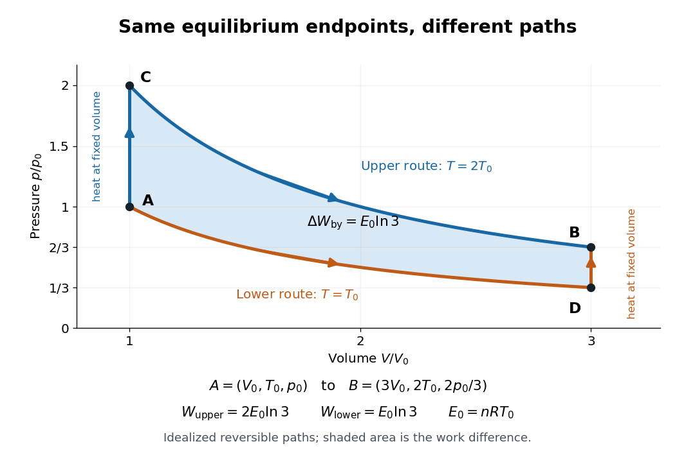
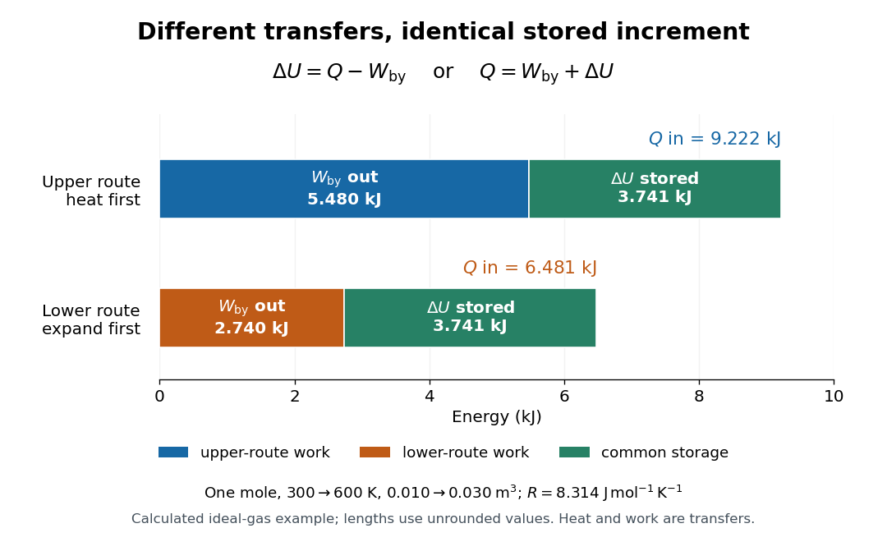
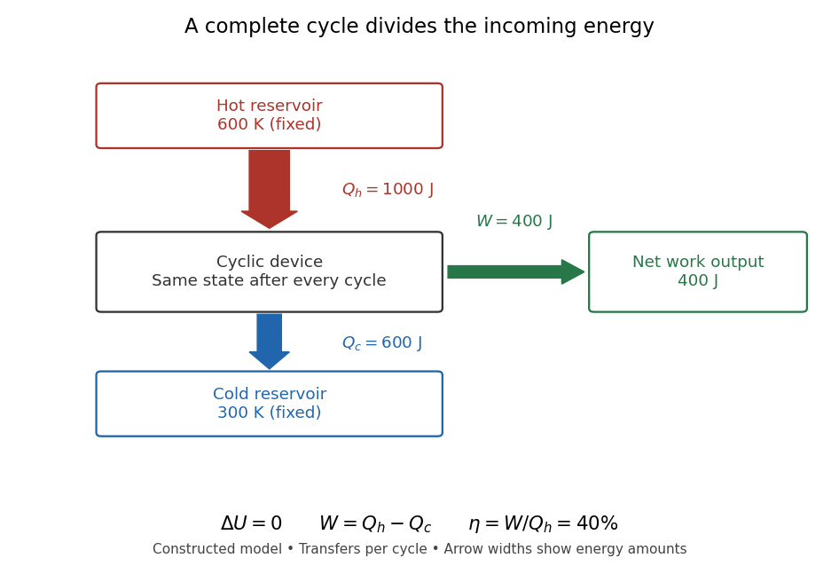
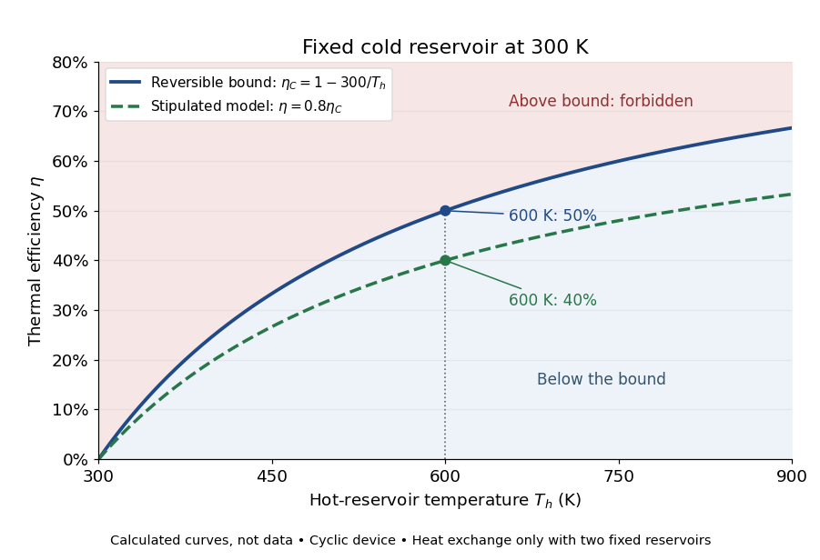
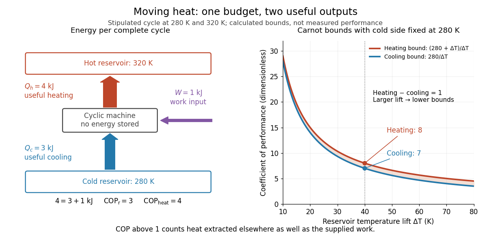
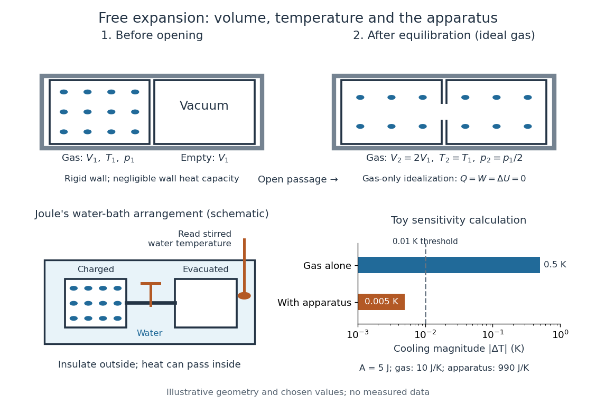
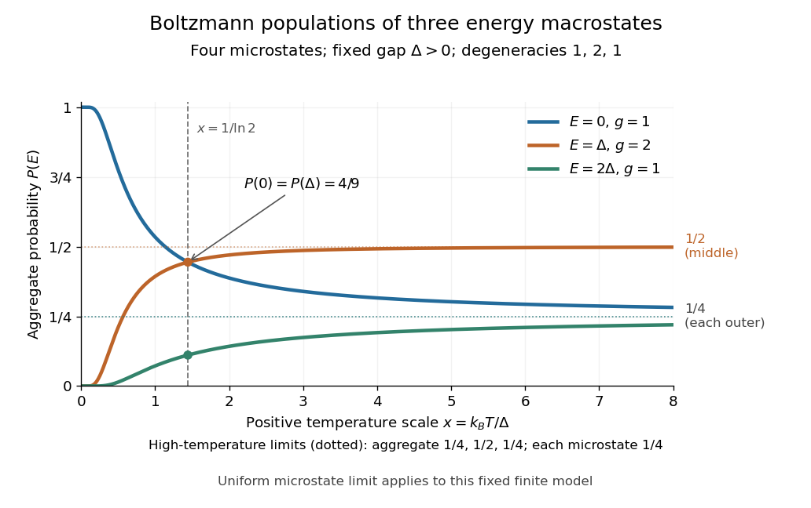
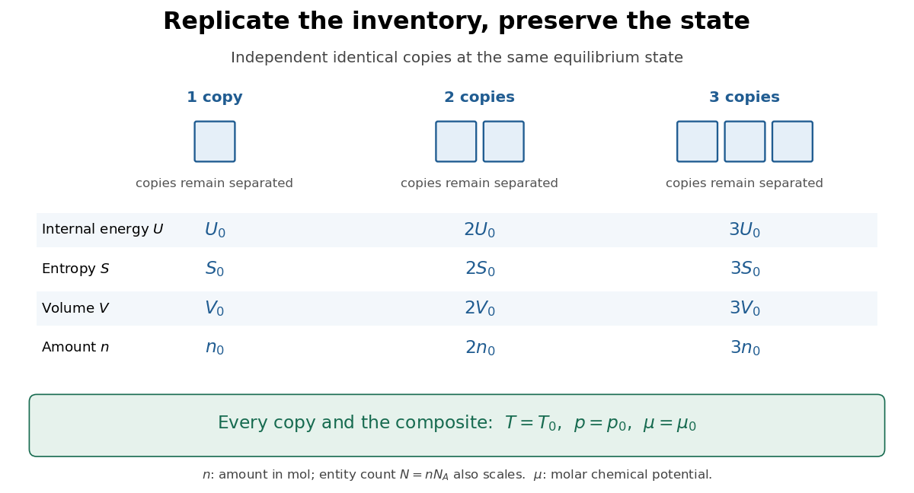

# Thermodynamics

↑ **Parent:** [Statistical physics](statistical-physics.md)  
ⓦ [Wiki](https://en.wikipedia.org/wiki/Thermodynamics)

Thermodynamics studies [energy](energy.md) transfers and the constraints on macroscopic changes. Its vocabulary connects [internal energy](internal-energy.md), [entropy](entropy.md), [temperature](temperature.md), [pressure](pressure.md) and [volume](geometry-and-topology.md#volume) to [heat](heat.md) and [work](energy.md#work). The [first law of thermodynamics](first-law-of-thermodynamics.md) balances [energy](energy.md); the [Second law of thermodynamics](second-law-of-thermodynamics.md) decides which changes can occur spontaneously and limits how much [work](energy.md#work) a [heat engine](#heat-engine) can deliver. These principles let us bound performance before choosing a material or a detailed machine design. Applications include power generation, propulsion and [refrigerators](#refrigerator). [MIT, What thermodynamics describes](https://web.mit.edu/16.unified/www/FALL/thermodynamics/notes/node10.html)

Start by choosing a system boundary. A [closed system](#closed-system) can exchange [energy](energy.md) but no matter; an [isolated system](#isolated-system) exchanges neither. A [state function](#state-function), such as [internal energy](internal-energy.md) or [entropy](entropy.md), depends on the equilibrium state. A process specifies how that state changes. Thus a body's [temperature](temperature.md) is a property it has, whereas [heat](heat.md) records [energy](energy.md) crossing its boundary during a process. A body contains [internal energy](internal-energy.md), rather than a stored quantity of [heat](heat.md).

Two insulated bodies initially at different positive [temperatures](temperature.md) approach [thermal equilibrium](thermal-equilibrium.md) when brought into thermal contact. Their combined [energy](energy.md) is conserved, but their combined [entropy](entropy.md) increases. They do not spontaneously separate again into a hotter body and a colder one. This familiar asymmetry makes [thermodynamics](thermodynamics.md) interesting: conserving [energy](energy.md) leaves many imaginable changes available, and [entropy](entropy.md) supplies a further constraint. The same distinction underlies both [entropy maximization under thermal contact](thermal-equilibrium.md#entropy-maximization-under-thermal-contact) and the [thermal efficiency](#thermal-efficiency) limit in [Carnot's theorem](second-law-of-thermodynamics.md#carnot-s-theorem).

**Table of contents**

- [Dissipation](#dissipation)
- [Pressure-temperature path-work identity](#pressure-temperature-path-work-identity)
- [Thermal energy](#thermal-energy)
- [Maxwell's demon](#maxwell-s-demon)
- [State of matter](#state-of-matter)
  - [Solid](#solid)
    - [Crystal](#crystal)
      - [Crystal facet](#crystal-facet)
      - [Polycrystalline material](#polycrystalline-material)
        - [Grain in a polycrystal](#grain-in-a-polycrystal)
          - [Grain aspect ratio](#grain-aspect-ratio)
          - [Grain size](#grain-size)
      - [Crystal packing](#crystal-packing)
      - [Cocrystal](#cocrystal)
      - [Hexagonal close packing](#hexagonal-close-packing)
      - [Face-centered cubic](#face-centered-cubic)
      - [Wulff construction](#wulff-construction)
        - [Winterbottom construction](#winterbottom-construction)
      - [Single crystal](#single-crystal)
  - [Liquid](#liquid)
    - [Radial distribution function](#radial-distribution-function)
      - [Virial pressure from pair correlations](#virial-pressure-from-pair-correlations)
      - [Pair-correlation expression for internal energy](#pair-correlation-expression-for-internal-energy)
  - [Gas](#gas)
    - [Vapor](#vapor)
  - [Polymorphism (materials science)](#polymorphism-materials-science)
    - [Crystal polymorph](#crystal-polymorph)
- [Thermodynamic system](#thermodynamic-system)
  - [Thermodynamic state](#thermodynamic-state)
  - [Thermodynamic process](#thermodynamic-process)
  - [Simple compressible system](#simple-compressible-system)
  - [Thermodynamic equilibrium](#thermodynamic-equilibrium)
    - [Phase equilibrium](#phase-equilibrium)
    - [Mechanical equilibrium](#mechanical-equilibrium)
      - [Pressure equilibrium](#pressure-equilibrium)
    - [Thermodynamic stability](#thermodynamic-stability)
      - [Mechanical stability](#mechanical-stability)
  - [Closed system](#closed-system)
  - [Isolated system](#isolated-system)
- [Quasistatic process](#quasistatic-process)
- [State function](#state-function)
  - [Two reversible ideal-gas paths between the same states](#two-reversible-ideal-gas-paths-between-the-same-states)
  - [Mechanical input and thermal storage in a calorimeter](#mechanical-input-and-thermal-storage-in-a-calorimeter)
- [Heat engine](#heat-engine)
  - [Isobaric-isochoric-adiabatic heat engine](#isobaric-isochoric-adiabatic-heat-engine)
  - [Heat input to a cycle](#heat-input-to-a-cycle)
  - [Reversible heat engine](#reversible-heat-engine)
  - [Stirling engine](#stirling-engine)
    - [Prony brake](#prony-brake)
  - [Heat-engine calorimetry](#heat-engine-calorimetry)
- [Calorimetry](calorimetry.md)
  - [Differential scanning calorimetry](calorimetry.md#differential-scanning-calorimetry)
  - [Mixing calorimetry](calorimetry.md#mixing-calorimetry)
  - [Calorimeter](calorimetry.md#calorimeter)
    - [Calorimeter calibration](calorimetry.md#calorimeter-calibration)
    - [Calorimeter heat-loss correction](calorimetry.md#calorimeter-heat-loss-correction)
- [Caloric theory](#caloric-theory)
- [Refrigerator](#refrigerator)
  - [Carnot refrigerator](#carnot-refrigerator)
  - [Vapor-compression refrigeration](#vapor-compression-refrigeration)
- [Heat pump](#heat-pump)
  - [Seasonal source depth for a reversible heat pump](#seasonal-source-depth-for-a-reversible-heat-pump)
  - [Indoor-temperature limit of a Carnot heat pump](#indoor-temperature-limit-of-a-carnot-heat-pump)
  - [Coefficient of performance](#coefficient-of-performance)
  - [Heat-pump calorimetry](#heat-pump-calorimetry)
- [Free expansion](#free-expansion)
  - [Cooling in free expansion of a van der Waals gas](#cooling-in-free-expansion-of-a-van-der-waals-gas)
  - [Joule's free-expansion experiment](#joule-s-free-expansion-experiment)
    - [Temperature sensitivity of a free-expansion experiment](#temperature-sensitivity-of-a-free-expansion-experiment)
  - [Entropy change in free expansion](#entropy-change-in-free-expansion)
- [Thermodynamic phase](#thermodynamic-phase)
  - [Phase fraction](#phase-fraction)
- [Laws of thermodynamics](#laws-of-thermodynamics)
  - [Zeroth law of thermodynamics](#zeroth-law-of-thermodynamics)
    - [Thermal contact](#thermal-contact)
      - [Diathermal wall](#diathermal-wall)
      - [Adiabatic wall](#adiabatic-wall)
    - [Empirical temperature](#empirical-temperature)
    - [Zeroth-law thermometer comparison](#zeroth-law-thermometer-comparison)
      - [Two-point thermometer calibration example](#two-point-thermometer-calibration-example)
      - [Reference-bath thermometer comparison](#reference-bath-thermometer-comparison)
- [Compressibility](#compressibility)
  - [Density susceptibility](#density-susceptibility)
  - [Heat-capacity and compressibility ratio identity](#heat-capacity-and-compressibility-ratio-identity)
  - [Isothermal compressibility](#isothermal-compressibility)
    - [Critical-density compressibility of a cubic gas](#critical-density-compressibility-of-a-cubic-gas)
    - [Isothermal compressibility from chemical-potential response](#isothermal-compressibility-from-chemical-potential-response)
  - [Isentropic compressibility](#isentropic-compressibility)
- [Maxwell relations](#maxwell-relations)
  - [Isentropic temperature-volume derivative](#isentropic-temperature-volume-derivative)
- [Diffusion](#diffusion)
  - [Collective diffusion](#collective-diffusion)
  - [Self-diffusion](#self-diffusion)
  - [Diffusion-distance convention](#diffusion-distance-convention)
  - [Einstein diffusion relation](#einstein-diffusion-relation)
  - [Diffusion approximation](#diffusion-approximation)
    - [One-group neutron diffusion equation](#one-group-neutron-diffusion-equation)
      - [Geometric buckling](#geometric-buckling)
      - [Neutron diffusion coefficient](#neutron-diffusion-coefficient)
  - [Mass transport](#mass-transport)
  - [Tracer diffusion](#tracer-diffusion)
  - [Diffusion jump correlation factor](#diffusion-jump-correlation-factor)
  - [Direct interstitial diffusion](#direct-interstitial-diffusion)
  - [Vacancy diffusion](#vacancy-diffusion)
  - [Molecular diffusion](#molecular-diffusion)
  - [Rotational diffusion](#rotational-diffusion)
    - [Planar rotational diffusion](#planar-rotational-diffusion)
    - [Isotropic rotational diffusion in three dimensions](#isotropic-rotational-diffusion-in-three-dimensions)
    - [Rotational diffusion of a sphere](#rotational-diffusion-of-a-sphere)
    - [Ellipsoid rotational diffusion microscopy experiment](#ellipsoid-rotational-diffusion-microscopy-experiment)
  - [Translational diffusion](#translational-diffusion)
- [Thermal expansion](#thermal-expansion)
  - [Thermal expansion tensor](#thermal-expansion-tensor)
    - [Anisotropic thermal expansion](#anisotropic-thermal-expansion)
  - [Coefficient of thermal expansion](#coefficient-of-thermal-expansion)
    - [Reference-volume thermal expansion coefficient](#reference-volume-thermal-expansion-coefficient)
  - [Linear thermal expansion coefficient](#linear-thermal-expansion-coefficient)
- [Stochastic thermodynamics](stochastic-thermodynamics.md)
  - [Local detailed balance](stochastic-thermodynamics.md#local-detailed-balance)
    - [Microscopic reversibility](stochastic-thermodynamics.md#microscopic-reversibility)
  - [Entropy production](stochastic-thermodynamics.md#entropy-production)
    - [Entropy gain from impact and thermal equilibration](stochastic-thermodynamics.md#entropy-gain-from-impact-and-thermal-equilibration)
    - [Thermodynamic entropy flux](stochastic-thermodynamics.md#thermodynamic-entropy-flux)
    - [Fluctuation theorem](stochastic-thermodynamics.md#fluctuation-theorem)
      - [Finite trajectory entropy production](stochastic-thermodynamics.md#finite-trajectory-entropy-production)
        - [Integral fluctuation theorem](stochastic-thermodynamics.md#integral-fluctuation-theorem)
      - [Biased-step entropy production model](stochastic-thermodynamics.md#biased-step-entropy-production-model)
        - [Negative entropy production over finite durations](stochastic-thermodynamics.md#negative-entropy-production-over-finite-durations)
      - [Steady-state asymptotic fluctuation theorem](stochastic-thermodynamics.md#steady-state-asymptotic-fluctuation-theorem)
      - [Crooks fluctuation theorem](stochastic-thermodynamics.md#crooks-fluctuation-theorem)
        - [Jarzynski equality](stochastic-thermodynamics.md#jarzynski-equality)
      - [Dragged-bead fluctuation theorem experiment](stochastic-thermodynamics.md#dragged-bead-fluctuation-theorem-experiment)
  - [Fluctuation-dissipation relation for a Langevin particle](stochastic-thermodynamics.md#fluctuation-dissipation-relation-for-a-langevin-particle)
    - [Vector noise normalization in inertial Langevin dynamics](stochastic-thermodynamics.md#vector-noise-normalization-in-inertial-langevin-dynamics)
- [Boltzmann constant](#boltzmann-constant)
- [Boltzmann distribution](#boltzmann-distribution)
  - [Boltzmann distribution ratios and energy reference](#boltzmann-distribution-ratios-and-energy-reference)
  - [Boltzmann distribution and state degeneracy](#boltzmann-distribution-and-state-degeneracy)
  - [Boltzmann distribution in a four-state system](#boltzmann-distribution-in-a-four-state-system)
  - [Boltzmann distribution temperature limits in a finite system](#boltzmann-distribution-temperature-limits-in-a-finite-system)
- [Statistical ensemble](#statistical-ensemble)
  - [Reservoir constraints of equilibrium ensembles](#reservoir-constraints-of-equilibrium-ensembles)
- [Entropy](entropy.md)
  - [Translational entropy](entropy.md#translational-entropy)
  - [Reaction entropy](entropy.md#reaction-entropy)
  - [Standard molar entropy](entropy.md#standard-molar-entropy)
  - [Entropy generated by cooling a finite body in a reservoir](entropy.md#entropy-generated-by-cooling-a-finite-body-in-a-reservoir)
  - [Residual entropy](entropy.md#residual-entropy)
  - [Specific entropy](entropy.md#specific-entropy)
  - [Boltzmann's entropy formula](entropy.md#boltzmann-s-entropy-formula)
    - [Microstate multiplier from photon absorption](entropy.md#microstate-multiplier-from-photon-absorption)
    - [Configurational entropy](entropy.md#configurational-entropy)
      - [Equiatomic configurational entropy](entropy.md#equiatomic-configurational-entropy)
    - [Boltzmann entropy of a two-box occupancy](entropy.md#boltzmann-entropy-of-a-two-box-occupancy)
    - [Boltzmann entropy when a restriction is removed](entropy.md#boltzmann-entropy-when-a-restriction-is-removed)
    - [Additivity of Boltzmann entropy](entropy.md#additivity-of-boltzmann-entropy)
    - [Scope of Boltzmann's entropy formula](entropy.md#scope-of-boltzmann-s-entropy-formula)
  - [Entropy density](entropy.md#entropy-density)
    - [Comoving entropy](entropy.md#comoving-entropy)
    - [Entropy density at zero chemical potential](entropy.md#entropy-density-at-zero-chemical-potential)
      - [Nonrelativistic entropy at zero chemical potential](entropy.md#nonrelativistic-entropy-at-zero-chemical-potential)
- [Heat](heat.md)
  - [Lumped thermal model](heat.md#lumped-thermal-model)
  - [Heat generation rate](heat.md#heat-generation-rate)
    - [Volumetric heat generation rate](heat.md#volumetric-heat-generation-rate)
  - [Sensible heat](heat.md#sensible-heat)
  - [Heat transfer](heat.md#heat-transfer)
    - [Thermal insulation](heat.md#thermal-insulation)
      - [Thermal shield](heat.md#thermal-shield)
    - [First-order thermal isolation](heat.md#first-order-thermal-isolation)
      - [Thermal time constant](heat.md#thermal-time-constant)
    - [Heat current](heat.md#heat-current)
      - [Heat-current relaxation time](heat.md#heat-current-relaxation-time)
    - [Heat sink](heat.md#heat-sink)
    - [Heat exchanger](heat.md#heat-exchanger)
      - [Counterflow heat exchanger](heat.md#counterflow-heat-exchanger)
    - [Nusselt number](heat.md#nusselt-number)
    - [Thermal inertia](heat.md#thermal-inertia)
    - [Radiative cooling](heat.md#radiative-cooling)
      - [Compton cooling by the cosmic microwave background](heat.md#compton-cooling-by-the-cosmic-microwave-background)
      - [Dust thermal emission](heat.md#dust-thermal-emission)
      - [Inverse Compton cooling](heat.md#inverse-compton-cooling)
      - [Astrophysical cooling function](heat.md#astrophysical-cooling-function)
        - [Electron-hydrogen normalization of the cooling function](heat.md#electron-hydrogen-normalization-of-the-cooling-function)
        - [Molecular line cooling](heat.md#molecular-line-cooling)
        - [Cooling suppression by photoionization](heat.md#cooling-suppression-by-photoionization)
        - [Optically thin gas cooling time](heat.md#optically-thin-gas-cooling-time)
          - [Cooling-to-free-fall equality curve](heat.md#cooling-to-free-fall-equality-curve)
        - [Primordial atomic cooling curve](heat.md#primordial-atomic-cooling-curve)
        - [Atomic line cooling](heat.md#atomic-line-cooling)
          - [Metal-line cooling](heat.md#metal-line-cooling)
  - [Heat flux density](heat.md#heat-flux-density)
  - [Thermal conduction](heat.md#thermal-conduction)
    - [Slab conduction with exponentially decaying heat generation](heat.md#slab-conduction-with-exponentially-decaying-heat-generation)
    - [Heat switch](heat.md#heat-switch)
    - [Thermal resistance](heat.md#thermal-resistance)
      - [Thermal conductance](heat.md#thermal-conductance)
    - [Temperature dipole around an insulating sphere](heat.md#temperature-dipole-around-an-insulating-sphere)
    - [Isobaric conductive cooling in mass coordinates](heat.md#isobaric-conductive-cooling-in-mass-coordinates)
      - [Error-function isobaric cooling front](heat.md#error-function-isobaric-cooling-front)
    - [Temperature gradient](heat.md#temperature-gradient)
    - [Fourier's law](heat.md#fourier-s-law)
      - [Thermal conductivity](heat.md#thermal-conductivity)
        - [Kinetic thermal-conductivity approximation](heat.md#kinetic-thermal-conductivity-approximation)
        - [Wiedemann-Franz law](heat.md#wiedemann-franz-law)
          - [Thermal and electrical relaxation times in metals](heat.md#thermal-and-electrical-relaxation-times-in-metals)
          - [Lorenz number](heat.md#lorenz-number)
        - [Thermal conductivity tensor](heat.md#thermal-conductivity-tensor)
    - [Thermal diffusivity](heat.md#thermal-diffusivity)
      - [Ångström periodic heating method](heat.md#angstrom-periodic-heating-method)
        - [Steady periodic thermal state](heat.md#steady-periodic-thermal-state)
        - [Thermal diffusion wave](heat.md#thermal-diffusion-wave)
          - [Thermal penetration depth](heat.md#thermal-penetration-depth)
        - [Ångström method with linear heat loss](heat.md#angstrom-method-with-linear-heat-loss)
        - [Ångström method worked example](heat.md#angstrom-method-worked-example)
        - [Finite-end correction for periodic rod heating](heat.md#finite-end-correction-for-periodic-rod-heating)
      - [Prandtl number](heat.md#prandtl-number)
      - [Thermal diffusion time](heat.md#thermal-diffusion-time)
        - [Thermal diffusion rate of a Fourier mode](heat.md#thermal-diffusion-rate-of-a-fourier-mode)
        - [Thermal diffusion length](heat.md#thermal-diffusion-length)
      - [Laser flash analysis](heat.md#laser-flash-analysis)
  - [Stefan–Boltzmann law](heat.md#stefan-boltzmann-law)
    - [Net radiative heat exchange](heat.md#net-radiative-heat-exchange)
      - [View factor](heat.md#view-factor)
    - [Stefan-Boltzmann constant](heat.md#stefan-boltzmann-constant)
    - [Emissivity](heat.md#emissivity)
      - [Total hemispherical emissivity](heat.md#total-hemispherical-emissivity)
      - [Spectral emissivity](heat.md#spectral-emissivity)
      - [Directional emissivity](heat.md#directional-emissivity)
      - [Grey body](heat.md#grey-body)
      - [Diffuse thermal emitter](heat.md#diffuse-thermal-emitter)
      - [Comparing surface emission at equal temperature](heat.md#comparing-surface-emission-at-equal-temperature)
    - [Radiative equilibrium](heat.md#radiative-equilibrium)
  - [Heat capacity](heat.md#heat-capacity)
    - [Heat capacity of a diatomic gas](heat.md#heat-capacity-of-a-diatomic-gas)
    - [Equilibrium heat capacity of interconverting states](heat.md#equilibrium-heat-capacity-of-interconverting-states)
    - [Low-temperature heat capacity measurement](heat.md#low-temperature-heat-capacity-measurement)
      - [Calorimeter addenda](heat.md#calorimeter-addenda)
    - [Debye T-cubed test](heat.md#debye-t-cubed-test)
    - [Electronic heat capacity](heat.md#electronic-heat-capacity)
      - [Constant-pressure gas versus electronic metal heat capacity](heat.md#constant-pressure-gas-versus-electronic-metal-heat-capacity)
        - [Lattice qualification of an electron-only heat-capacity ratio](heat.md#lattice-qualification-of-an-electron-only-heat-capacity-ratio)
      - [Electronic heat capacity coefficient](heat.md#electronic-heat-capacity-coefficient)
        - [Molar Fermi-liquid heat-capacity mass scaling](heat.md#molar-fermi-liquid-heat-capacity-mass-scaling)
        - [Fermi-edge heat-capacity counting](heat.md#fermi-edge-heat-capacity-counting)
      - [Thermal-shell estimate of electronic heat capacity](heat.md#thermal-shell-estimate-of-electronic-heat-capacity)
    - [Schottky anomaly](heat.md#schottky-anomaly)
      - [Schottky anomaly with unequal degeneracies](heat.md#schottky-anomaly-with-unequal-degeneracies)
    - [Molar heat capacity](heat.md#molar-heat-capacity)
    - [Heating curve](heat.md#heating-curve)
    - [Entropy from heat capacity](heat.md#entropy-from-heat-capacity)
    - [Entropy concavity and positive heat capacity](heat.md#entropy-concavity-and-positive-heat-capacity)
    - [Specific heat capacity](heat.md#specific-heat-capacity)
      - [Volumetric heat capacity](heat.md#volumetric-heat-capacity)
      - [Specific heat capacity at constant volume](heat.md#specific-heat-capacity-at-constant-volume)
      - [Specific heat capacity at constant pressure](heat.md#specific-heat-capacity-at-constant-pressure)
        - [Pure-radiation constant-pressure heat-capacity singularity](heat.md#pure-radiation-constant-pressure-heat-capacity-singularity)
    - [Heat capacity at constant volume](heat.md#heat-capacity-at-constant-volume)
      - [Temperature-linear pressure and volume-independent heat capacity](heat.md#temperature-linear-pressure-and-volume-independent-heat-capacity)
      - [Dulong-Petit law](heat.md#dulong-petit-law)
        - [Einstein solid](heat.md#einstein-solid)
    - [Heat capacity at constant area](heat.md#heat-capacity-at-constant-area)
    - [Electron heat capacity](heat.md#electron-heat-capacity)
- [Second law of thermodynamics](second-law-of-thermodynamics.md)
  - [Entropy generation in finite-temperature heat transfer](second-law-of-thermodynamics.md#entropy-generation-in-finite-temperature-heat-transfer)
    - [Entropy generation by mixing equal thermal masses](second-law-of-thermodynamics.md#entropy-generation-by-mixing-equal-thermal-masses)
  - [Maximum work from two finite heat reservoirs](second-law-of-thermodynamics.md#maximum-work-from-two-finite-heat-reservoirs)
  - [Clausius inequality](second-law-of-thermodynamics.md#clausius-inequality)
  - [Reversible thermodynamic process](second-law-of-thermodynamics.md#reversible-thermodynamic-process)
  - [Clausius statement of the second law](second-law-of-thermodynamics.md#clausius-statement-of-the-second-law)
  - [Kelvin-Planck statement of the second law](second-law-of-thermodynamics.md#kelvin-planck-statement-of-the-second-law)
  - [Carnot's theorem](second-law-of-thermodynamics.md#carnot-s-theorem)
    - [Thermodynamic temperature](second-law-of-thermodynamics.md#thermodynamic-temperature)
    - [Carnot cycle](second-law-of-thermodynamics.md#carnot-cycle)
      - [Carnot efficiency](second-law-of-thermodynamics.md#carnot-efficiency)
      - [Isothermal process](second-law-of-thermodynamics.md#isothermal-process)
        - [Isotherm](second-law-of-thermodynamics.md#isotherm)
        - [Isothermal ideal-gas work](second-law-of-thermodynamics.md#isothermal-ideal-gas-work)
        - [Finite-rate isothermal piston model](second-law-of-thermodynamics.md#finite-rate-isothermal-piston-model)
        - [Boyle's law](second-law-of-thermodynamics.md#boyle-s-law)
          - [Absolute pressure in Boyle's law](second-law-of-thermodynamics.md#absolute-pressure-in-boyle-s-law)
          - [Linearized plot of Boyle's law](second-law-of-thermodynamics.md#linearized-plot-of-boyle-s-law)
          - [Gas-syringe measurement of Boyle's law](second-law-of-thermodynamics.md#gas-syringe-measurement-of-boyle-s-law)
            - [Gas-syringe dead-volume correction](second-law-of-thermodynamics.md#gas-syringe-dead-volume-correction)
        - [Isothermal compression](second-law-of-thermodynamics.md#isothermal-compression)
          - [Isothermal gas syringe experiment](second-law-of-thermodynamics.md#isothermal-gas-syringe-experiment)
            - [Gas syringe](second-law-of-thermodynamics.md#gas-syringe)
        - [Isothermal expansion](second-law-of-thermodynamics.md#isothermal-expansion)
- [Temperature](temperature.md)
  - [Absolute zero](temperature.md#absolute-zero)
  - [Adiabatic demagnetization](temperature.md#adiabatic-demagnetization)
    - [Demagnetization with a linear-heat-capacity load](temperature.md#demagnetization-with-a-linear-heat-capacity-load)
    - [Magnetic-entropy demagnetization adiabat](temperature.md#magnetic-entropy-demagnetization-adiabat)
    - [Magnetic entropy](temperature.md#magnetic-entropy)
      - [Magnetic entropy deficit](temperature.md#magnetic-entropy-deficit)
      - [Entropy of a finite magnetic multiplet](temperature.md#entropy-of-a-finite-magnetic-multiplet)
      - [Two-level paramagnetic cooling model](temperature.md#two-level-paramagnetic-cooling-model)
        - [Constant-entropy magnetic cooling example](temperature.md#constant-entropy-magnetic-cooling-example)
    - [Giauque-MacDougall magnetic cooling experiment](temperature.md#giauque-macdougall-magnetic-cooling-experiment)
    - [Limits of adiabatic demagnetization](temperature.md#limits-of-adiabatic-demagnetization)
  - [International Temperature Scale of 1990](temperature.md#international-temperature-scale-of-1990)
  - [Thermometer](temperature.md#thermometer)
    - [Resistance thermometer](temperature.md#resistance-thermometer)
      - [Platinum resistance thermometer](temperature.md#platinum-resistance-thermometer)
        - [Standard platinum resistance thermometer](temperature.md#standard-platinum-resistance-thermometer)
        - [Industrial platinum resistance thermometer](temperature.md#industrial-platinum-resistance-thermometer)
          - [Pt100](temperature.md#pt100)
            - [Pt100 local linear model](temperature.md#pt100-local-linear-model)
        - [Platinum resistance thermometer comparison calibration](temperature.md#platinum-resistance-thermometer-comparison-calibration)
        - [Platinum resistance thermometer lead resistance error](temperature.md#platinum-resistance-thermometer-lead-resistance-error)
      - [Resistance thermometer self-heating](temperature.md#resistance-thermometer-self-heating)
      - [Resistance thermometer immersion test](temperature.md#resistance-thermometer-immersion-test)
      - [Thermistor](temperature.md#thermistor)
    - [Gas thermometer](temperature.md#gas-thermometer)
      - [Gas thermometer dead-space correction](temperature.md#gas-thermometer-dead-space-correction)
    - [Thermometer calibration](temperature.md#thermometer-calibration)
  - [Kelvin](temperature.md#kelvin)
  - [Degree Celsius](temperature.md#degree-celsius)
  - [Inverse temperature](temperature.md#inverse-temperature)
  - [Cryogenics](temperature.md#cryogenics)
    - [Thermal anchoring](temperature.md#thermal-anchoring)
    - [Cryostat](temperature.md#cryostat)
    - [Helium liquefaction](temperature.md#helium-liquefaction)
      - [Kamerlingh Onnes's 1908 helium liquefaction experiment](temperature.md#kamerlingh-onnes-s-1908-helium-liquefaction-experiment)
      - [Liquefaction enthalpy budget](temperature.md#liquefaction-enthalpy-budget)
        - [Liquefaction yield with separate warm-gas and liquid outlets](temperature.md#liquefaction-yield-with-separate-warm-gas-and-liquid-outlets)
    - [Thermal boundary resistance](temperature.md#thermal-boundary-resistance)
      - [Kapitza resistance](temperature.md#kapitza-resistance)
        - [Kapitza thermal boundary experiment](temperature.md#kapitza-thermal-boundary-experiment)
        - [Fourth-power thermal boundary model](temperature.md#fourth-power-thermal-boundary-model)
- [Thermal equilibrium](thermal-equilibrium.md)
  - [Thermostat](thermal-equilibrium.md#thermostat)
  - [Thermal equilibration of two finite bodies](thermal-equilibrium.md#thermal-equilibration-of-two-finite-bodies)
  - [Tolman–Ehrenfest relation](thermal-equilibrium.md#tolman-ehrenfest-relation)
  - [Boltzmann suppression](thermal-equilibrium.md#boltzmann-suppression)
    - [Boltzmann suppression of a nonrelativistic relic](thermal-equilibrium.md#boltzmann-suppression-of-a-nonrelativistic-relic)
  - [Kinetic equilibrium](thermal-equilibrium.md#kinetic-equilibrium)
  - [Heat bath](thermal-equilibrium.md#heat-bath)
    - [Finite heat bath](thermal-equilibrium.md#finite-heat-bath)
      - [Heat bath relaxation with finite capacity](thermal-equilibrium.md#heat-bath-relaxation-with-finite-capacity)
    - [Regulated calibration bath](thermal-equilibrium.md#regulated-calibration-bath)
  - [Entropy maximization under thermal contact](thermal-equilibrium.md#entropy-maximization-under-thermal-contact)
- [Third law of thermodynamics](#third-law-of-thermodynamics)
  - [Low-temperature Gibbs free-energy expansion](#low-temperature-gibbs-free-energy-expansion)
  - [Unattainability of absolute zero](#unattainability-of-absolute-zero)
- [Pressure](pressure.md)
  - [Multi-anvil press](pressure.md#multi-anvil-press)
  - [Pressure sensor](pressure.md#pressure-sensor)
  - [Atmospheric pressure](pressure.md#atmospheric-pressure)
  - [Kinematic pressure](pressure.md#kinematic-pressure)
  - [Pressure tensor](pressure.md#pressure-tensor)
  - [Gas pressure](pressure.md#gas-pressure)
  - [Radiation pressure](pressure.md#radiation-pressure)
    - [Proper-time acceleration by reflected laser light](pressure.md#proper-time-acceleration-by-reflected-laser-light)
    - [Radiation pressure of a directed beam](pressure.md#radiation-pressure-of-a-directed-beam)
    - [Radiation pressure of an isotropic photon gas](pressure.md#radiation-pressure-of-an-isotropic-photon-gas)
    - [Radiation-pressure laser power measurement](pressure.md#radiation-pressure-laser-power-measurement)
  - [Equation of state](pressure.md#equation-of-state)
    - [Compressibility factor](pressure.md#compressibility-factor)
    - [Barotropic stellar equation of state](pressure.md#barotropic-stellar-equation-of-state)
    - [Clausius gas](pressure.md#clausius-gas)
    - [Van der Waals equation](pressure.md#van-der-waals-equation)
      - [Van der Waals gas](pressure.md#van-der-waals-gas)
        - [Isothermal free-energy change of a Van der Waals gas](pressure.md#isothermal-free-energy-change-of-a-van-der-waals-gas)
      - [Caloric closure of the van der Waals equation](pressure.md#caloric-closure-of-the-van-der-waals-equation)
      - [Internal energy of a van der Waals gas](pressure.md#internal-energy-of-a-van-der-waals-gas)
      - [Entropy excess of a van der Waals gas](pressure.md#entropy-excess-of-a-van-der-waals-gas)
      - [Van der Waals molar equation](pressure.md#van-der-waals-molar-equation)
        - [Molar Van der Waals worked example](pressure.md#molar-van-der-waals-worked-example)
      - [Van der Waals law of corresponding states](pressure.md#van-der-waals-law-of-corresponding-states)
      - [Van der Waals isotherm](pressure.md#van-der-waals-isotherm)
      - [Van der Waals critical point](pressure.md#van-der-waals-critical-point)
        - [Critical-isochore compressibility of a van der Waals gas](pressure.md#critical-isochore-compressibility-of-a-van-der-waals-gas)
      - [Van der Waals liquid-gas coexistence](pressure.md#van-der-waals-liquid-gas-coexistence)
        - [Low-temperature liquid volume of a van der Waals gas](pressure.md#low-temperature-liquid-volume-of-a-van-der-waals-gas)
      - [Andrews's carbon dioxide experiment](pressure.md#andrews-s-carbon-dioxide-experiment)
    - [Equation of state of an ideal ultrarelativistic gas](pressure.md#equation-of-state-of-an-ideal-ultrarelativistic-gas)
    - [Adiabatic equation of state](pressure.md#adiabatic-equation-of-state)
  - [Pressure measurement](pressure.md#pressure-measurement)
    - [High-pressure experimental metrology](pressure.md#high-pressure-experimental-metrology)
      - [Piston-cylinder pressure apparatus](pressure.md#piston-cylinder-pressure-apparatus)
        - [Bridgman unsupported-area seal](pressure.md#bridgman-unsupported-area-seal)
      - [Hydrostatic stress](pressure.md#hydrostatic-stress)
      - [Pressure calibration](pressure.md#pressure-calibration)
        - [Resistance pressure gauge](pressure.md#resistance-pressure-gauge)
      - [Diamond anvil cell](pressure.md#diamond-anvil-cell)
        - [Diamond anvil culet](pressure.md#diamond-anvil-culet)
        - [Ruby pressure scale](pressure.md#ruby-pressure-scale)
          - [Ruby R-line shift](pressure.md#ruby-r-line-shift)
          - [Ruby calibration against sodium chloride](pressure.md#ruby-calibration-against-sodium-chloride)
          - [Ruby pressure uncertainty worked example](pressure.md#ruby-pressure-uncertainty-worked-example)
          - [Nonhydrostatic stress in ruby pressure measurement](pressure.md#nonhydrostatic-stress-in-ruby-pressure-measurement)
- [Volume (thermodynamics)](#volume-thermodynamics)
  - [Molar volume](#molar-volume)
  - [Volume per particle](#volume-per-particle)
  - [Specific volume](#specific-volume)
- [Chemical potential](chemical-potential.md)
  - [Water activity](chemical-potential.md#water-activity)
  - [Standard chemical potential](chemical-potential.md#standard-chemical-potential)
  - [Grand-canonical chemical potential of a classical ideal gas](chemical-potential.md#grand-canonical-chemical-potential-of-a-classical-ideal-gas)
  - [Quasi-Fermi level](chemical-potential.md#quasi-fermi-level)
    - [Quasi-Fermi-level splitting](chemical-potential.md#quasi-fermi-level-splitting)
  - [Chemical potential equality for particle exchange](chemical-potential.md#chemical-potential-equality-for-particle-exchange)
    - [Open-system equilibrium contacts](chemical-potential.md#open-system-equilibrium-contacts)
    - [Chemical potential and Helmholtz free energy](chemical-potential.md#chemical-potential-and-helmholtz-free-energy)
  - [Chemical potential of an ideal gas](chemical-potential.md#chemical-potential-of-an-ideal-gas)
  - [Electrochemical potential](chemical-potential.md#electrochemical-potential)
    - [Electrochemical gradient](chemical-potential.md#electrochemical-gradient)
      - [Proton-motive force](chemical-potential.md#proton-motive-force)
  - [Chemical potential of a composition field](chemical-potential.md#chemical-potential-of-a-composition-field)
  - [Chemical equilibrium](chemical-potential.md#chemical-equilibrium)
    - [Number-based dissociation equilibrium ratio](chemical-potential.md#number-based-dissociation-equilibrium-ratio)
    - [Reaction formula-unit conservation](chemical-potential.md#reaction-formula-unit-conservation)
      - [Dissociation fraction versus conserved density](chemical-potential.md#dissociation-fraction-versus-conserved-density)
    - [Ionic product of water](chemical-potential.md#ionic-product-of-water)
    - [Dimerization](chemical-potential.md#dimerization)
    - [Ocean carbonate chemistry](chemical-potential.md#ocean-carbonate-chemistry)
      - [Carbonate compensation](chemical-potential.md#carbonate-compensation)
    - [Van't Hoff equation](chemical-potential.md#van-t-hoff-equation)
    - [Standard entropy of reaction](chemical-potential.md#standard-entropy-of-reaction)
    - [Gibbs energy of reaction](chemical-potential.md#gibbs-energy-of-reaction)
      - [Standard Gibbs energy of reaction](chemical-potential.md#standard-gibbs-energy-of-reaction)
    - [Chemical equilibrium of a classical spin gas](chemical-potential.md#chemical-equilibrium-of-a-classical-spin-gas)
    - [Chemical disequilibrium](chemical-potential.md#chemical-disequilibrium)
    - [Zero chemical potential from number-changing reactions](chemical-potential.md#zero-chemical-potential-from-number-changing-reactions)
    - [Chemical relaxation time](chemical-potential.md#chemical-relaxation-time)
    - [Equilibrium constant](chemical-potential.md#equilibrium-constant)
      - [Dimensionless concentration equilibrium constant](chemical-potential.md#dimensionless-concentration-equilibrium-constant)
      - [Association constant](chemical-potential.md#association-constant)
      - [Dissociation constant](chemical-potential.md#dissociation-constant)
    - [Standard state](chemical-potential.md#standard-state)
      - [Standard pressure](chemical-potential.md#standard-pressure)
      - [Standard concentration](chemical-potential.md#standard-concentration)
      - [Thermodynamic activity](chemical-potential.md#thermodynamic-activity)
        - [Chemical fugacity](chemical-potential.md#chemical-fugacity)
        - [Activity coefficient](chemical-potential.md#activity-coefficient)
    - [Reaction quotient](chemical-potential.md#reaction-quotient)
    - [Photon chemical potential](chemical-potential.md#photon-chemical-potential)
- [Ideal gas](ideal-gas.md)
  - [Classical ideal-gas entropy limits](ideal-gas.md#classical-ideal-gas-entropy-limits)
  - [Isobaric ideal-gas internal-energy density](ideal-gas.md#isobaric-ideal-gas-internal-energy-density)
  - [Mean particle mass](ideal-gas.md#mean-particle-mass)
  - [Diatomic gas](ideal-gas.md#diatomic-gas)
  - [Specific gas constant](ideal-gas.md#specific-gas-constant)
  - [Two-dimensional ideal gas](ideal-gas.md#two-dimensional-ideal-gas)
  - [Classical grand potential in a harmonic trap](ideal-gas.md#classical-grand-potential-in-a-harmonic-trap)
  - [Partial pressure](ideal-gas.md#partial-pressure)
  - [Molar gas constant](ideal-gas.md#molar-gas-constant)
  - [Ideal gas law](ideal-gas.md#ideal-gas-law)
    - [Ideal gas pressure from wall collisions](ideal-gas.md#ideal-gas-pressure-from-wall-collisions)
  - [Monatomic gas](ideal-gas.md#monatomic-gas)
  - [Mean free path](ideal-gas.md#mean-free-path)
    - [Transport mean free path](ideal-gas.md#transport-mean-free-path)
    - [Mean free path through randomly oriented disc absorbers](ideal-gas.md#mean-free-path-through-randomly-oriented-disc-absorbers)
  - [Mean molecular weight](ideal-gas.md#mean-molecular-weight)
    - [Stellar gas constant](ideal-gas.md#stellar-gas-constant)
    - [Mean molecular weight per ion](ideal-gas.md#mean-molecular-weight-per-ion)
    - [Mean molecular weight per electron](ideal-gas.md#mean-molecular-weight-per-electron)
  - [Heat capacity ratio](ideal-gas.md#heat-capacity-ratio)
    - [Rüchardt experiment](ideal-gas.md#ruchardt-experiment)
    - [Clément-Desormes experiment](ideal-gas.md#clement-desormes-experiment)
  - [Nondegenerate gas](ideal-gas.md#nondegenerate-gas)
  - [Internal energy of an ideal gas](ideal-gas.md#internal-energy-of-an-ideal-gas)
  - [Mayer's relation](ideal-gas.md#mayer-s-relation)
- [Internal energy](internal-energy.md)
  - [Thermodynamic internal pressure](internal-energy.md#thermodynamic-internal-pressure)
  - [Internal energy and system boundaries](internal-energy.md#internal-energy-and-system-boundaries)
  - [Internal energy at constant temperature](internal-energy.md#internal-energy-at-constant-temperature)
  - [Joule's paddle-wheel experiment](internal-energy.md#joule-s-paddle-wheel-experiment)
    - [Paddle-wheel calorimetry energy balance](internal-energy.md#paddle-wheel-calorimetry-energy-balance)
  - [Specific internal energy](internal-energy.md#specific-internal-energy)
- [Thermodynamic potential](thermodynamic-potential.md)
  - [Natural variables of a thermodynamic potential](thermodynamic-potential.md#natural-variables-of-a-thermodynamic-potential)
  - [Exergy](thermodynamic-potential.md#exergy)
    - [Availability curvature and equilibrium fluctuations](thermodynamic-potential.md#availability-curvature-and-equilibrium-fluctuations)
      - [Volume fluctuations of a small fluid parcel](thermodynamic-potential.md#volume-fluctuations-of-a-small-fluid-parcel)
  - [Thermodynamic free energy](thermodynamic-potential.md#thermodynamic-free-energy)
    - [Free-energy functional](thermodynamic-potential.md#free-energy-functional)
    - [Helmholtz free energy](thermodynamic-potential.md#helmholtz-free-energy)
    - [Gibbs free energy](thermodynamic-potential.md#gibbs-free-energy)
      - [Single-component Gibbs Euler relation](thermodynamic-potential.md#single-component-gibbs-euler-relation)
      - [Fixed-particle-number Gibbs minimum](thermodynamic-potential.md#fixed-particle-number-gibbs-minimum)
      - [Gibbs–Helmholtz equation](thermodynamic-potential.md#gibbs-helmholtz-equation)
      - [Transfer Gibbs energy](thermodynamic-potential.md#transfer-gibbs-energy)
      - [Gibbs free-energy change for a pressure-linear gas correction](thermodynamic-potential.md#gibbs-free-energy-change-for-a-pressure-linear-gas-correction)
      - [Gibbs free energy of an ideal-gas mixture](thermodynamic-potential.md#gibbs-free-energy-of-an-ideal-gas-mixture)
      - [Gibbs free-energy Maxwell relation](thermodynamic-potential.md#gibbs-free-energy-maxwell-relation)
      - [Chemical-potential balance for a reaction](thermodynamic-potential.md#chemical-potential-balance-for-a-reaction)
        - [Thermochemical equilibrium](thermodynamic-potential.md#thermochemical-equilibrium)
          - [Constrained Gibbs minimization for chemical equilibrium](thermodynamic-potential.md#constrained-gibbs-minimization-for-chemical-equilibrium)
          - [Reverse reaction rate from equilibrium thermodynamics](thermodynamic-potential.md#reverse-reaction-rate-from-equilibrium-thermodynamics)
      - [Phase coexistence curve](thermodynamic-potential.md#phase-coexistence-curve)
        - [Kelvin equation](thermodynamic-potential.md#kelvin-equation)
          - [Capillary condensation](thermodynamic-potential.md#capillary-condensation)
        - [Triple point](thermodynamic-potential.md#triple-point)
          - [Triple-point cell](thermodynamic-potential.md#triple-point-cell)
        - [Vapor pressure](thermodynamic-potential.md#vapor-pressure)
        - [Maxwell construction](thermodynamic-potential.md#maxwell-construction)
          - [Maxwell construction in density coordinates](thermodynamic-potential.md#maxwell-construction-in-density-coordinates)
        - [Phase diagram](thermodynamic-potential.md#phase-diagram)
          - [Solvus](thermodynamic-potential.md#solvus)
          - [Lower critical solution temperature](thermodynamic-potential.md#lower-critical-solution-temperature)
          - [Upper critical solution temperature](thermodynamic-potential.md#upper-critical-solution-temperature)
          - [Phase rule](thermodynamic-potential.md#phase-rule)
          - [Solidus](thermodynamic-potential.md#solidus)
          - [Lever rule](thermodynamic-potential.md#lever-rule)
          - [Bicritical point](thermodynamic-potential.md#bicritical-point)
          - [Liquidus](thermodynamic-potential.md#liquidus)
            - [Freezing-point depression](thermodynamic-potential.md#freezing-point-depression)
          - [Eutectic system](thermodynamic-potential.md#eutectic-system)
            - [Eutectic solidification](thermodynamic-potential.md#eutectic-solidification)
            - [Eutectic point](thermodynamic-potential.md#eutectic-point)
            - [Eutectic microstructure](thermodynamic-potential.md#eutectic-microstructure)
              - [Eutectic constituent fraction](thermodynamic-potential.md#eutectic-constituent-fraction)
            - [Eutectic composition](thermodynamic-potential.md#eutectic-composition)
            - [Eutectic temperature](thermodynamic-potential.md#eutectic-temperature)
        - [First-order phase transition](thermodynamic-potential.md#first-order-phase-transition)
          - [Two-phase scalar coexistence endpoint conditions](thermodynamic-potential.md#two-phase-scalar-coexistence-endpoint-conditions)
          - [Spin-flop transition](thermodynamic-potential.md#spin-flop-transition)
          - [Classical nucleation theory](thermodynamic-potential.md#classical-nucleation-theory)
            - [Critical nucleus radius](thermodynamic-potential.md#critical-nucleus-radius)
            - [Nucleation barrier](thermodynamic-potential.md#nucleation-barrier)
            - [Disc-shaped nucleus](thermodynamic-potential.md#disc-shaped-nucleus)
            - [Critical nucleus](thermodynamic-potential.md#critical-nucleus)
            - [Arrhenius nucleation time](thermodynamic-potential.md#arrhenius-nucleation-time)
        - [Latent heat](thermodynamic-potential.md#latent-heat)
          - [Stefan number](thermodynamic-potential.md#stefan-number)
            - [Latent-to-sensible heat ratio](thermodynamic-potential.md#latent-to-sensible-heat-ratio)
          - [Clausius-Clapeyron relation](thermodynamic-potential.md#clausius-clapeyron-relation)
            - [Melting pressure inferred from flotation and latent heats](thermodynamic-potential.md#melting-pressure-inferred-from-flotation-and-latent-heats)
            - [Solid-phase Clapeyron slope from cell volumes](thermodynamic-potential.md#solid-phase-clapeyron-slope-from-cell-volumes)
            - [Ideal-vapor Clausius-Clapeyron approximation](thermodynamic-potential.md#ideal-vapor-clausius-clapeyron-approximation)
              - [Integrated Clausius-Clapeyron relation](thermodynamic-potential.md#integrated-clausius-clapeyron-relation)
                - [Stipulated vapor-pressure calculation](thermodynamic-potential.md#stipulated-vapor-pressure-calculation)
                - [Latent heat from a vapor-pressure slope](thermodynamic-potential.md#latent-heat-from-a-vapor-pressure-slope)
            - [Saturation-pressure equilibrium measurement](thermodynamic-potential.md#saturation-pressure-equilibrium-measurement)
            - [Common-pressure melting-point slope](thermodynamic-potential.md#common-pressure-melting-point-slope)
              - [Negative melting-point slope of water](thermodynamic-potential.md#negative-melting-point-slope-of-water)
- [Real gas](#real-gas)
  - [Dieterici equation](#dieterici-equation)
- [Intensive and extensive thermodynamic quantities](#intensive-and-extensive-thermodynamic-quantities)
  - [Extensive quantity](#extensive-quantity)
    - [Euler relation in thermodynamics](#euler-relation-in-thermodynamics)
  - [Intensive quantity](#intensive-quantity)
    - [Normalizing extensive quantities](#normalizing-extensive-quantities)
      - [Density of a composite system](#density-of-a-composite-system)
      - [Pycnometer density measurement](#pycnometer-density-measurement)
- [Gibbs-Duhem equation](#gibbs-duhem-equation)
  - [Ideal binary Gibbs-Duhem cancellation](#ideal-binary-gibbs-duhem-cancellation)
  - [Binary activity-coefficient consistency](#binary-activity-coefficient-consistency)
  - [Mixture measurements and the Gibbs-Duhem constraint](#mixture-measurements-and-the-gibbs-duhem-constraint)
- [Conjugate variables (thermodynamics)](#conjugate-variables-thermodynamics)
- [Enthalpy](enthalpy.md)
  - [Stagnation enthalpy](enthalpy.md#stagnation-enthalpy)
  - [Enthalpy of mixing](enthalpy.md#enthalpy-of-mixing)
  - [Reaction enthalpy](enthalpy.md#reaction-enthalpy)
  - [Molar enthalpy](enthalpy.md#molar-enthalpy)
  - [Isenthalpic process](enthalpy.md#isenthalpic-process)
  - [Steady-flow energy balance](enthalpy.md#steady-flow-energy-balance)
  - [Joule-Thomson effect](enthalpy.md#joule-thomson-effect)
    - [Measuring the Joule-Thomson effect with a porous plug](enthalpy.md#measuring-the-joule-thomson-effect-with-a-porous-plug)
  - [Joule-Thomson coefficient](enthalpy.md#joule-thomson-coefficient)
    - [Joule-Thomson inversion curve](enthalpy.md#joule-thomson-inversion-curve)
      - [Joule-Thomson inversion temperature](enthalpy.md#joule-thomson-inversion-temperature)
    - [Van der Waals throttling model](enthalpy.md#van-der-waals-throttling-model)
    - [Virial criterion for Joule-Thomson cooling](enthalpy.md#virial-criterion-for-joule-thomson-cooling)
  - [Specific enthalpy](enthalpy.md#specific-enthalpy)
    - [Polytropic enthalpy](enthalpy.md#polytropic-enthalpy)
  - [Enthalpy Maxwell relation](enthalpy.md#enthalpy-maxwell-relation)
  - [Heat capacity at constant pressure](enthalpy.md#heat-capacity-at-constant-pressure)
    - [Difference between constant-pressure and constant-volume heat capacities](enthalpy.md#difference-between-constant-pressure-and-constant-volume-heat-capacities)
      - [Heat-capacity difference and mechanical stability](enthalpy.md#heat-capacity-difference-and-mechanical-stability)
      - [Volume derivative form of the heat-capacity difference](enthalpy.md#volume-derivative-form-of-the-heat-capacity-difference)
- [First law of thermodynamics](first-law-of-thermodynamics.md)
  - [Heat-flow reversal along a thermodynamic path](first-law-of-thermodynamics.md#heat-flow-reversal-along-a-thermodynamic-path)
  - [Adiabatic process](first-law-of-thermodynamics.md#adiabatic-process)
    - [Adiabat](first-law-of-thermodynamics.md#adiabat)
    - [Adiabatic compression](first-law-of-thermodynamics.md#adiabatic-compression)
    - [Adiabatic expansion](first-law-of-thermodynamics.md#adiabatic-expansion)
    - [Isentropic process](first-law-of-thermodynamics.md#isentropic-process)
    - [Reversible ideal-gas adiabat](first-law-of-thermodynamics.md#reversible-ideal-gas-adiabat)
- [Diatomic ideal-gas enthalpy](#diatomic-ideal-gas-enthalpy)
- [Irreversible adiabatic piston compression](#irreversible-adiabatic-piston-compression)
- [Constant-pressure heating of an ideal gas](#constant-pressure-heating-of-an-ideal-gas)
- [Thermodynamic cycle](#thermodynamic-cycle)
  - [Atkinson cycle](#atkinson-cycle)
    - [Atkinson efficiency advantage from extended expansion](#atkinson-efficiency-advantage-from-extended-expansion)
  - [Brayton cycle](#brayton-cycle)
    - [Brayton-Carnot efficiency comparison](#brayton-carnot-efficiency-comparison)
  - [Thermal efficiency](#thermal-efficiency)
  - [Otto cycle](#otto-cycle)
  - [Diesel cycle](#diesel-cycle)
    - [Vanishing-cutoff limit of the Diesel cycle](#vanishing-cutoff-limit-of-the-diesel-cycle)
- [Dilution refrigerator](#dilution-refrigerator)

## Dissipation

↑ **Parent:** [Thermodynamics](thermodynamics.md)

Conversion of organized [work](energy.md#work) into internal modes with macroscopic [entropy](entropy.md) production. Total [energy](energy.md) remains conserved. For a passive linear material, the loss coefficient must give nonnegative supplied [work](energy.md#work) over a completed cycle.

## Pressure-temperature path-work identity

↑ **Parent:** [Thermodynamics](thermodynamics.md)

Suppose a small [volume](geometry-and-topology.md#volume) change obeys $dV=-V_1\kappa_TdP+V_1\alpha dT$, with its displayed coefficients held constant. Work on the body is $\delta W=V_1\kappa_TP\,dP-V_1\alpha P\,dT$. Two rectangular pressure-temperature paths between the same endpoints differ by $W_a-W_b=V_1\alpha\Delta P\Delta T$, where path a changes [temperature](temperature.md) first. The straight interpolation samples the mean [pressure](pressure.md) during its [temperature](temperature.md) change, giving $W_c=(W_a+W_b)/2$. Variable material coefficients need not preserve that average relation.

## Thermal energy

↑ **Parent:** [Thermodynamics](thermodynamics.md)

The characteristic [thermal energy](#thermal-energy) per microscopic degree-of-freedom scale is $k_BT$. Equipartition gives $k_BT/2$ per independent quadratic term under its classical assumptions.

<h2 id="maxwell-s-demon">Maxwell's demon</h2>

↑ **Parent:** [Thermodynamics](thermodynamics.md)  
ⓦ [Wiki](https://en.wikipedia.org/wiki/Maxwell's_demon)

A thought experiment about measurement, selective control and the [Second law of thermodynamics](second-law-of-thermodynamics.md). An active [stochastic cooling](particle-accelerator.md#stochastic-cooling) system uses and dissipates resources while reducing beam deviations.

## State of matter

↑ **Parent:** [Thermodynamics](thermodynamics.md)  
ⓦ [Wiki](https://en.wikipedia.org/wiki/State_of_matter)

A state of matter is a broad category of material behavior. A [solid](#solid) resists a sustained change of shape, a [liquid](#liquid) flows while remaining difficult to compress, and a [gas](#gas) expands to fill its container. These distinctions are useful first descriptions, but they do not enumerate all [thermodynamic phases](#thermodynamic-phase). [Plasma](physics.md#plasma-physics) adds collective behavior of charged particles, while [liquid crystals](critical-phenomenon.md#liquid-crystal) show that flow and structural order need not disappear together.

Distinguish three questions: what broad state of matter does the material resemble, which [thermodynamic phase](#thermodynamic-phase) is present, and what are its [temperature](temperature.md), [pressure](pressure.md) and other state variables? Two samples at different [temperatures](temperature.md) can be in the same [liquid](#liquid) [thermodynamic phase](#thermodynamic-phase). Conversely, [crystal polymorphism](#polymorphism-materials-science) gives different [solid](#solid) [thermodynamic phases](#thermodynamic-phase) of the same substance, distinguished by their [crystal structures](physical-chemistry.md#crystal-structure). A [phase transition](critical-phenomenon.md#phase-transition) between them need not change the broad state-of-matter category.

For an imagined substance with crystalline forms A and B, melting A produces a [solid](#solid)–[liquid](#liquid) [phase transition](critical-phenomenon.md#phase-transition), while converting A to B produces a [solid](#solid)–[solid](#solid) [phase transition](critical-phenomenon.md#phase-transition). A sample containing A and B has two [thermodynamic phases](#thermodynamic-phase) even though all its material is [solid](#solid). Cutting one uniform crystal into two pieces does not create a second [thermodynamic phase](#thermodynamic-phase): count distinct equilibrium forms, rather than pieces or grains. This distinction matters when applying the [phase rule](thermodynamic-potential.md#phase-rule).

A [phase diagram](thermodynamic-potential.md#phase-diagram) locates stable [thermodynamic phases](#thermodynamic-phase) using [temperature](temperature.md) and [pressure](pressure.md). Its [liquid](#liquid)–[gas](#gas) [phase coexistence curve](thermodynamic-potential.md#phase-coexistence-curve) ends at a [liquid-gas critical point](critical-phenomenon.md#liquid-gas-critical-point), around which a path connects [liquid](#liquid) and [gas](#gas) without a [first-order phase transition](thermodynamic-potential.md#first-order-phase-transition). Broad categories can therefore remain useful without a sharp boundary.[§5.1.2, printed pp. 140–141, Figures 40–41: pressure–temperature coexistence and disappearance of the liquid–gas distinction](physics-bibliography.md#statistical-physics-by-david-tong)

### Solid

↑ **Parent:** [State of matter](#state-of-matter)  
ⓦ [Wiki](https://en.wikipedia.org/wiki/Solid)

#### Crystal

↑ **Parent:** [Solid](#solid)  
ⓦ [Wiki](https://en.wikipedia.org/wiki/Crystal)

A [crystal](#crystal) is a [solid](#solid) with spatially ordered constituents.

##### Crystal facet

↑ **Parent:** [Crystal](#crystal)

A macroscopically planar crystal boundary characterized by a crystallographic orientation. Its [Miller index](physical-chemistry.md#miller-index) specifies that orientation; visible facet area depends on surface thermodynamics and growth kinetics. A low surface energy and a slow growth rate are different properties.

##### Polycrystalline material

↑ **Parent:** [Crystal](#crystal)

A solid containing many differently oriented crystalline [crystal grains](#grain-in-a-polycrystal). [grain boundaries](physical-chemistry.md#grain-boundary) impose compatibility and act as transport paths or sinks for mobile defects.

###### Grain in a polycrystal

↑ **Parent:** [Polycrystalline material](#polycrystalline-material)

A region with an approximately common crystal orientation, separated from other such regions by [grain boundaries](physical-chemistry.md#grain-boundary).

###### Grain aspect ratio

↑ **Parent:** [Grain in a polycrystal](#grain-in-a-polycrystal)

A measure of [crystal grain](#grain-in-a-polycrystal) elongation. It changes directional boundary spacings and can influence anisotropic defect transport independently of average [grain size](#grain-size).

###### Grain size

↑ **Parent:** [Grain in a polycrystal](#grain-in-a-polycrystal)

A measure of the spatial scale of [crystal grains](#grain-in-a-polycrystal). Its definition must be stated for elongated [crystal grains](#grain-in-a-polycrystal); size, aspect ratio and orientation distribution have distinct physical effects.

##### Crystal packing

↑ **Parent:** [Crystal](#crystal)

The spatial arrangement and intermolecular contacts of components in a [crystal](#crystal).

##### Cocrystal

↑ **Parent:** [Crystal](#crystal)

A crystalline phase containing two or more distinct molecular components in one lattice.

##### Hexagonal close packing

↑ **Parent:** [Crystal](#crystal)

Close packing of triangular layers with ABAB stacking. Its nearest-layer geometry agrees with [face-centered cubic](#face-centered-cubic) stacking, but the further-layer registry differs.

##### Face-centered cubic

↑ **Parent:** [Crystal](#crystal)

A cubic crystal structure with lattice sites at cube corners and face centres. Its close-packed layers are (111) planes, stacked ABCABC.

##### Wulff construction

↑ **Parent:** [Crystal](#crystal)  
ⓦ [Wiki](https://en.wikipedia.org/wiki/Wulff_construction)

The fixed-volume equilibrium crystal shape obtained by minimizing orientation-dependent surface free energy. Facet support-plane distances are proportional to their interfacial free energies under the construction assumptions.

###### Winterbottom construction

↑ **Parent:** [Wulff construction](#wulff-construction)

An equilibrium construction for a supported particle that modifies the [Wulff construction](#wulff-construction) using particle-support and support-medium interfacial energies. The support truncates the corresponding free-particle shape.

##### Single crystal

↑ **Parent:** [Crystal](#crystal)  
ⓦ [Wiki](https://en.wikipedia.org/wiki/Single_crystal)

### Liquid

↑ **Parent:** [State of matter](#state-of-matter)  
ⓦ [Wiki](https://en.wikipedia.org/wiki/Liquid)

#### Radial distribution function

↑ **Parent:** [Liquid](#liquid)

In a homogeneous isotropic one-component fluid, $g(r)$ is the conditional [number density](statistical-physics.md#number-density) at separation $r$ from a tagged particle divided by the bulk number density $n$. Thus the displayed shell contains the mean number of neighbours. For an uncorrelated ideal gas $g(r)=1$ away from the tagged particle; repulsive cores suppress small separations, while liquid coordination shells can produce damped oscillations approaching one at large distance. This is a pair correlation, not a normalized one-particle radial probability density. The [static structure factor](critical-phenomenon.md#static-structure-factor) measures its Fourier-space counterpart.

##### Virial pressure from pair correlations

↑ **Parent:** [Radial distribution function](#radial-distribution-function)

For a differentiable central [pair potential](statistical-physics.md#pair-potential) in a classical homogeneous three-dimensional fluid, the mechanical [virial theorem](classical-mechanics.md#virial-theorem) gives the displayed pressure. The [radial distribution function](#radial-distribution-function) accounts for the probability of each pair separation. In the dilute limit, $g(r)=e^{-v(r)/(k_BT)}+O(n)$, and integration by parts yields $B_2(T)=-2\pi\int_0^\infty[e^{-v(r)/(k_BT)}-1]r^2dr$. Thus the [second virial coefficient](statistical-physics.md#second-virial-coefficient) controls $p/(nk_BT)=1+B_2n+\cdots$. A few virial terms are a low-density approximation, not generally a converged description of a dense liquid. A discontinuous hard core needs its contact form or a limiting argument.

##### Pair-correlation expression for internal energy

↑ **Parent:** [Radial distribution function](#radial-distribution-function)

For a classical monatomic homogeneous fluid with pairwise central [pair potential](statistical-physics.md#pair-potential) $v(r)$, the mean interaction energy is one half the sum over neighbours of a tagged particle. Using the [radial distribution function](#radial-distribution-function) gives the displayed formula; the factor one half prevents counting each pair twice. The kinetic term follows from the [equipartition theorem](canonical-ensemble.md#equipartition-theorem). Its use requires the relevant integral to exist and a thermodynamic state specified by number density and temperature. Quantum kinetic contributions, many-body forces and internal molecular modes require modifications.

### Gas

↑ **Parent:** [State of matter](#state-of-matter)  
ⓦ [Wiki](https://en.wikipedia.org/wiki/Gas)

#### Vapor

↑ **Parent:** [Gas](#gas)  
ⓦ [Wiki](https://en.wikipedia.org/wiki/Vapor)

### Polymorphism (materials science)

↑ **Parent:** [State of matter](#state-of-matter)  
ⓦ [Wiki](https://en.wikipedia.org/wiki/Polymorphism_(materials_science))

[Crystal polymorphism](#polymorphism-materials-science) is the existence of different [crystal structures](physical-chemistry.md#crystal-structure) for the same chemical substance. Each [crystal polymorph](#crystal-polymorph) can have its own [mass density](fluid-mechanics.md#density), [melting](critical-phenomenon.md#melting) behavior and range of stability on a [phase diagram](thermodynamic-potential.md#phase-diagram). A different external shape of the same [crystal structure](physical-chemistry.md#crystal-structure) alone does not establish a different [crystal polymorph](#crystal-polymorph).[IUPAC Compendium of Chemical Terminology, fifth edition, entry “polymorph” (15225), definition and Note 2](chemistry-bibliography.md#iupac-compendium-of-chemical-terminology-fifth-edition-gold-book-by-international-union-of-pure-and-applied-chemistry/polymorph)

At fixed [temperature](temperature.md) and [pressure](pressure.md), compare the [chemical potentials](chemical-potential.md) of the possible [crystal polymorphs](#crystal-polymorph). The lower value determines the stable bulk [thermodynamic phase](#thermodynamic-phase); equality permits [phase coexistence](critical-phenomenon.md#phase-coexistence) when neither form is beaten by another [thermodynamic phase](#thermodynamic-phase). A higher-[chemical potential](chemical-potential.md) form can persist through [metastability](critical-phenomenon.md#metastability), so finding it in a sample does not by itself locate an equilibrium boundary.

#### Crystal polymorph

↑ **Parent:** [Polymorphism (materials science)](#polymorphism-materials-science)

A [solid](#solid) [thermodynamic phase](#thermodynamic-phase) with a particular [crystal structure](physical-chemistry.md#crystal-structure), among distinct crystalline forms of the same chemical substance. [Crystal polymorphism](#polymorphism-materials-science) names the existence of these alternatives; a [crystal polymorph](#crystal-polymorph) names one of the forms.

## Thermodynamic system

↑ **Parent:** [Thermodynamics](thermodynamics.md)

A [thermodynamic system](#thermodynamic-system) is the part of the physical world selected for an [energy](energy.md) and matter balance. Draw its boundary before classifying an interaction as [heat](heat.md), [work](energy.md#work) or transported matter. The boundary may move: a sealed piston encloses a [closed system](#closed-system) even while its [volume](#volume-thermodynamics) changes. An [isolated system](#isolated-system) additionally excludes all external [energy](energy.md) transfers.[Thermodynamics and Propulsion, §1.2.2: system boundaries and closed systems](physics-bibliography.md#thermodynamics-and-propulsion)

Boundary choice changes the ledger. If an electrical heater warms [water](chemical-substance.md#water), choosing only the [water](chemical-substance.md#water) counts incoming [heat](heat.md); including the heater counts electrical [work](energy.md#work) entering through its leads. The combined [internal energy](internal-energy.md) records storage, without separate stored categories for the two transfer mechanisms.[Thermodynamics and Propulsion, §1.3.4, Figure 1.14: resistor and water with alternative system boundaries](physics-bibliography.md#thermodynamics-and-propulsion)

### Thermodynamic state

↑ **Parent:** [Thermodynamic system](#thermodynamic-system)

An equilibrium [thermodynamic state](#thermodynamic-state) specifies sufficient independent macroscopic properties, together with material identity and constraints, to determine the other equilibrium properties. For a uniform fixed-composition [ideal gas](ideal-gas.md), its [amount of substance](physics.md#amount-of-substance), [temperature](temperature.md) and [volume](#volume-thermodynamics) determine its [pressure](pressure.md) through the [ideal gas law](ideal-gas.md#ideal-gas-law). These properties specify a state, without specifying a [thermodynamic process](#thermodynamic-process) that prepared it.[Thermodynamics and Propulsion, §1.2.3: state specification](physics-bibliography.md#thermodynamics-and-propulsion)

### Thermodynamic process

↑ **Parent:** [Thermodynamic system](#thermodynamic-system)

A [thermodynamic process](#thermodynamic-process) changes a [thermodynamic system](#thermodynamic-system) between states. A [quasistatic process](#quasistatic-process) supplies equilibrium intermediate states and therefore a path on equilibrium coordinates. An irreversible [thermodynamic process](#thermodynamic-process) can have equilibrium endpoints while lacking a uniform intermediate [temperature](temperature.md) or [pressure](pressure.md). Endpoint values still determine changes in a [state function](#state-function); computing [heat](heat.md) and [work](energy.md#work) requires the actual interaction history.

### Simple compressible system

↑ **Parent:** [Thermodynamic system](#thermodynamic-system)

A [thermodynamic system](#thermodynamic-system) for which the reversible mechanical [work](energy.md#work) is entirely [pressure](pressure.md)-[volume](#volume-thermodynamics) work. At fixed composition its [internal energy](internal-energy.md) is specified by [entropy](entropy.md) and [volume](#volume-thermodynamics); additional work modes require additional state variables.

### Thermodynamic equilibrium

↑ **Parent:** [Thermodynamic system](#thermodynamic-system)  
ⓦ [Wiki](https://en.wikipedia.org/wiki/Thermodynamic_equilibrium)

A [thermodynamic system](#thermodynamic-system) is in thermodynamic equilibrium when its macroscopic state has no spontaneous tendency to change through any exchange allowed by its constraints. For an [isolated system](#isolated-system), stable [thermodynamic equilibrium](#thermodynamic-equilibrium) maximizes [entropy](entropy.md) over the accessible states at fixed total [energy](energy.md) and conserved material inventories. A wall can forbid an exchange, so always specify what can cross or move. Thermal, mechanical and chemical conditions answer different questions about that same constrained state. [4 Classical Thermodynamics](physics-bibliography.md#statistical-physics-by-david-tong/4-classical-thermodynamics)

For example, two compartments separated by a rigid, impermeable wall that transmits [heat](heat.md) can reach [thermal equilibrium](thermal-equilibrium.md) while retaining different [pressures](pressure.md) and compositions. Allowing an unloaded piston to move adds a [mechanical equilibrium](#mechanical-equilibrium) condition. Allowing one [chemical species](mathematical-biology.md#chemical-species) to cross adds [chemical potential equality for particle exchange](chemical-potential.md#chemical-potential-equality-for-particle-exchange); allowing a [chemical reaction](chemical-reaction.md) adds its [chemical equilibrium](chemical-potential.md#chemical-equilibrium) condition. A fixed barrier can therefore support a constrained [thermodynamic equilibrium](#thermodynamic-equilibrium) that ceases to be an equilibrium when the barrier is removed.

Uniformity is not the definition of [thermodynamic equilibrium](#thermodynamic-equilibrium). An [isothermal atmosphere](statistical-physics.md#isothermal-atmosphere) in [hydrostatic equilibrium](statistical-physics.md#hydrostatic-equilibrium) can have a common [temperature](temperature.md) while its [pressure](pressure.md) and [mass density](fluid-mechanics.md#density) vary with height: the [pressure gradient](fluid-mechanics.md#pressure-gradient) balances [gravity](physics.md#gravity). In an external field, the exchange condition must include the relevant potential [energy](energy.md); for charged matter this leads to the [electrochemical potential](chemical-potential.md#electrochemical-potential). Relativistic gravitational corrections to [thermal equilibrium](thermal-equilibrium.md) are described separately by the [Tolman temperature law](thermal-equilibrium.md#tolman-ehrenfest-relation).

A [steady state](dynamical-systems.md#steady-state) only says that the macroscopic description is constant in time. A bar maintained between hot and cold [thermal reservoirs](thermal-equilibrium.md#heat-bath) has steady [heat flux](heat.md#heat-flux-density) and produces [entropy](entropy.md), so it is not in [thermodynamic equilibrium](#thermodynamic-equilibrium). Even matching [temperatures](temperature.md) at one perfect-contact interface can coexist with [heat transfer](heat.md#heat-transfer) through the surrounding material; matching those two local values does not establish equilibrium of the whole apparatus. See [thermal conduction](heat.md#thermal-conduction) for that spatial transport problem.

The useful simplification is that equilibrium conditions predict an endpoint without computing every collision or flow during relaxation. The [first law of thermodynamics](first-law-of-thermodynamics.md) supplies the conserved quantities, and the [Second law of thermodynamics](second-law-of-thermodynamics.md) supplies the direction of change. For a system held at fixed [temperature](temperature.md) and [volume](#volume-thermodynamics), the corresponding criterion is minimization of [Helmholtz free energy](thermodynamic-potential.md#helmholtz-free-energy); at fixed [temperature](temperature.md) and [pressure](pressure.md), it is minimization of [Gibbs free energy](thermodynamic-potential.md#gibbs-free-energy), with the material and exchange constraints still imposed.

#### Phase equilibrium

↑ **Parent:** [Thermodynamic equilibrium](#thermodynamic-equilibrium)

Coexistence without a thermodynamic driving [force](force.md) for further exchange. Phases able to exchange heat and constituents have equal [temperature](temperature.md) and [chemical potentials](chemical-potential.md) of the exchanging species. Mechanical balance is also needed; interface [curvature](differential-geometry.md#curvature) can require a pressure jump rather than equal bulk pressures.

#### Mechanical equilibrium

↑ **Parent:** [Thermodynamic equilibrium](#thermodynamic-equilibrium)  
ⓦ [Wiki](https://en.wikipedia.org/wiki/Mechanical_equilibrium)

Mechanical equilibrium requires [force balance](force.md#force-balance) for the mechanical displacements that are allowed. Two uniform fluids separated by a freely moving, unloaded, frictionless piston with equal face [areas](differential-geometry.md#surface-area) require equal [pressures](pressure.md). A supported piston can sustain a [pressure](pressure.md) difference, and a fluid in [gravity](physics.md#gravity) instead obeys [hydrostatic equilibrium](statistical-physics.md#hydrostatic-equilibrium). For an upward height coordinate $z$, that balance is $dp/dz=-\rho g$, where $\rho$ is [mass density](fluid-mechanics.md#density) and $g$ is the downward gravitational acceleration. Mechanical equilibrium alone does not establish [thermal equilibrium](thermal-equilibrium.md) or [chemical equilibrium](chemical-potential.md#chemical-equilibrium).

##### Pressure equilibrium

↑ **Parent:** [Mechanical equilibrium](#mechanical-equilibrium)

Two [fluids](fluid-mechanics.md#fluid) at a stationary, freely movable interface require equal [pressures](pressure.md) when [surface tension](surface-tension.md) and other normal stresses are negligible. This local pressure equilibrium does not require equal [temperatures](temperature.md) or [mass densities](fluid-mechanics.md#density). Curvature with nonzero [surface tension](surface-tension.md) or an applied load changes the normal-stress balance. Comparing points at different heights also requires the [hydrostatic equilibrium](statistical-physics.md#hydrostatic-equilibrium) condition.

#### Thermodynamic stability

↑ **Parent:** [Thermodynamic equilibrium](#thermodynamic-equilibrium)

##### Mechanical stability

↑ **Parent:** [Thermodynamic stability](#thermodynamic-stability)

For a mechanical coordinate $x$ at fixed [temperature](temperature.md), total [volume](geometry-and-topology.md#volume) and [particle](physics.md#particle-physics) numbers, the relevant [thermodynamic potential](thermodynamic-potential.md) is the [Helmholtz free energy](thermodynamic-potential.md#helmholtz-free-energy) $F(x)$. Its generalized [force](force.md) is $f=-F'(x)$. At [mechanical equilibrium](#mechanical-equilibrium), $f(x_*)=0$, and a linearly restoring [force](force.md) has $f'(x_*)<0$, equivalently $F''(x_*)>0$. A [Taylor expansion](calculus.md#taylor-expansion) then proves a strict local free-energy minimum. If $F$ is a [strictly convex function](real-analysis.md#strictly-convex-function) throughout the accessible domain, the stationary state is the unique global minimum.

### Closed system

↑ **Parent:** [Thermodynamic system](#thermodynamic-system)

A [closed system](#closed-system) exchanges no matter with its surroundings, but can exchange [energy](energy.md) through [heat](heat.md) or [work](energy.md#work). A sealed cylinder with a moving piston is a typical idealized example. “Closed” fixes the material inventory, rather than the [volume](#volume-thermodynamics) or the [internal energy](internal-energy.md). An insulated cylinder can receive compression [work](energy.md#work); a rigid sealed vessel can receive [heat](heat.md). Neither is necessarily an [isolated system](#isolated-system).

### Isolated system

↑ **Parent:** [Thermodynamic system](#thermodynamic-system)

An [isolated system](#isolated-system) exchanges neither matter nor [energy](energy.md) with its surroundings. Its total [energy](energy.md) is fixed, while the [Second law of thermodynamics](second-law-of-thermodynamics.md) requires its total [entropy](entropy.md) to be nondecreasing. Its [internal energy](internal-energy.md) alone is fixed when bulk [kinetic energy](energy.md#kinetic-energy) and external [potential energy](energy.md#potential-energy) also remain unchanged. For example, an initially spinning stirrer inside an insulated rigid vessel can lose [kinetic energy](energy.md#kinetic-energy) while the contents gain [internal energy](internal-energy.md), with no external input.

An [isolated system](#isolated-system) need not yet be in [thermodynamic equilibrium](#thermodynamic-equilibrium). Two enclosed bodies at different [temperatures](temperature.md) can exchange [heat](heat.md) internally until they reach [thermal equilibrium](thermal-equilibrium.md); their combined [energy](energy.md) stays constant. Their internal transfer is absent from the outer boundary ledger. A vacuum-insulated container is only an approximation to isolation: residual [thermal conduction](heat.md#thermal-conduction) and [thermal radiation](electromagnetic-radiation.md#thermal-radiation) can still carry [energy](energy.md) across its boundary.

## Quasistatic process

↑ **Parent:** [Thermodynamics](thermodynamics.md)

A quasistatic process is an ideal limit in which a changing [thermodynamic system](#thermodynamic-system) passes through a sequence of states arbitrarily close to [thermodynamic equilibrium](#thermodynamic-equilibrium). Its intermediate [pressure](pressure.md), [temperature](temperature.md) and [volume](#volume-thermodynamics) are therefore well defined and obey its [equation of state](pressure.md#equation-of-state). Driving must be slow compared with the system's own equilibration, rather than merely taking a long time on a clock. A [reversible thermodynamic process](second-law-of-thermodynamics.md#reversible-thermodynamic-process) additionally allows both system and surroundings to be restored without net change; [friction](newtonian-mechanics.md#friction) can produce [entropy](entropy.md) even in a [quasistatic process](#quasistatic-process).[§§4.2–4.3: quasi-static and reversible processes](physics-bibliography.md#statistical-physics-by-david-tong/4-classical-thermodynamics)

For a computed example, take a fixed [amount of substance](physics.md#amount-of-substance) $n$ of [ideal gas](ideal-gas.md) in a sealed cylinder with a frictionless piston, in contact with a [heat bath](thermal-equilibrium.md#heat-bath) at absolute [temperature](temperature.md) $T$. Reduce the external load in infinitesimal steps so that the piston expands from $V_0$ to $2V_0$. In the reversible limit, the gas [pressure](pressure.md) exceeds the external [pressure](pressure.md) by an infinitesimal amount during expansion, and the [heat transfer](heat.md#heat-transfer) occurs across an infinitesimal [temperature](temperature.md) difference. Exact [mechanical equilibrium](#mechanical-equilibrium) would give no driving [force](force.md); the limiting imbalance supplies motion while preserving equilibrium intermediate states.[§3.4: a piston unloaded in infinitesimal steps](physics-bibliography.md#university-physics-volume-2-by-samuel-j-ling-and-others/3-4-thermodynamic-processes)

Along this reversible [isothermal expansion](second-law-of-thermodynamics.md#isothermal-expansion), the [ideal gas law](ideal-gas.md#ideal-gas-law) gives

$$
p(V)=\frac{nRT}{V},\qquad nRT=1\,\mathrm{kJ},\qquad V_0=1\,\mathrm L=10^{-3}\,\mathrm{m^3},\qquad
p_0=\frac{nRT}{V_0}=1\,\mathrm{MPa}.
$$

Here $R$ is the [molar gas constant](ideal-gas.md#molar-gas-constant); specifying $nRT$ fixes an [energy](energy.md) scale, without choosing $n$ and $T$ separately. The initial and final equilibrium states are $(V_0,p_0,T)$ and $(2V_0,p_0/2,T)$. Count [work](energy.md#work) delivered to the surroundings as positive. The reversible [work](energy.md#work) is the shaded [area](differential-geometry.md#surface-area) beneath the [pressure](pressure.md)-[volume](#volume-thermodynamics) curve:

$$
W_{\rm out,rev}=\int_{V_0}^{2V_0}p(V)\,dV
=nRT\ln2\approx0.693147\,\mathrm{kJ}.
$$

The [integral](integral.md) of $1/V$ supplies the [natural logarithm](calculus.md#natural-logarithm). Since [internal energy of an ideal gas](ideal-gas.md#internal-energy-of-an-ideal-gas) depends only on [temperature](temperature.md), $\Delta U=0$; the [first law of thermodynamics](first-law-of-thermodynamics.md), $\Delta U=Q_{\rm in}-W_{\rm out}$, gives $Q_{\rm in,rev}=0.693147\,\mathrm{kJ}$ to the displayed precision. The [heat bath](thermal-equilibrium.md#heat-bath) replaces the [energy](energy.md) delivered as [work](energy.md#work).[§3.2: pressure-volume work and the isothermal integral](physics-bibliography.md#university-physics-volume-2-by-samuel-j-ling-and-others/3-2-work-heat-and-internal-energy)

**[Figure 1](#image-reversible-isothermal-expansion-work-is-the-area-beneath-the-equilibrium-pressure-curve). Reversible isothermal expansion: work is the area beneath the equilibrium pressure curve**. Fixed [amount of substance](physics.md#amount-of-substance) of [ideal gas](ideal-gas.md), with $nRT=1\,\mathrm{kJ}$ and $V_0=1\,\mathrm L$. The blue curve gives every intermediate equilibrium state; its shaded [area](differential-geometry.md#surface-area) is $0.693147\,\mathrm{kJ}$. The arrow indicates expansion, without specifying a time dependence.

Now start from the same initial state, but abruptly lower the external [pressure](pressure.md) to the constant value $p_{\rm ext}=p_0/2=0.5\,\mathrm{MPa}$. There is a finite initial [pressure](pressure.md) imbalance, so this is an irreversible expansion rather than a [quasistatic process](#quasistatic-process). Assume the piston begins and ends at rest, has no net change in stored [energy](energy.md), and has no external [friction](newtonian-mechanics.md#friction); relaxation occurs within the [gas](#gas) and its [heat bath](thermal-equilibrium.md#heat-bath). After motion has settled and the [heat bath](thermal-equilibrium.md#heat-bath) has restored [temperature](temperature.md) $T$, [mechanical equilibrium](#mechanical-equilibrium) and the [ideal gas law](ideal-gas.md#ideal-gas-law) give $V_f=nRT/p_{\rm ext}=2V_0$. The [work](energy.md#work) delivered to the constant load is

$$
W_{\rm out,load}=p_{\rm ext}(V_f-V_0)
=(0.5\,\mathrm{MPa})(1\,\mathrm L)=0.5\,\mathrm{kJ},\qquad
\Delta U=0,\qquad Q_{\rm in,load}=0.5\,\mathrm{kJ}.
$$

This [work](energy.md#work) follows directly from load [force](force.md) times piston [displacement](classical-mechanics.md#displacement), using $dV=A\,dx$ for piston [area](differential-geometry.md#surface-area) $A$. Intermediate gas states need not have a single equilibrium [pressure](pressure.md) or [temperature](temperature.md). In particular, neither $p(V)=nRT/V$ at the bath [temperature](temperature.md) nor $p(V)=p_{\rm ext}$ describes the actual gas during this irreversible motion. The rectangle below plots the known external load; its upper edge is not an equilibrium gas path.

**[Figure 2](#image-the-same-equilibrium-endpoints-give-different-work-for-reversible-and-constant-load-expansion). The same equilibrium endpoints give different work for reversible and constant-load expansion**. The blue curve is the reversible [ideal gas](ideal-gas.md) path. The dashed orange line is constant external [pressure](pressure.md), whose rectangle gives $0.5\,\mathrm{kJ}$ of load [work](energy.md#work). The additional blue shading is $0.193147\,\mathrm{kJ}$ available in the reversible case. Black points mark the common gas endpoints; the open orange point marks the initial external load, and the dotted gap indicates the initial imbalance. No irreversible internal gas path is drawn.

The [entropy](entropy.md) accounting makes the difference precise. Because [entropy](entropy.md) is a [state function](#state-function), both expansions have the same gas [entropy](entropy.md) change, computed along the reversible [isothermal expansion](second-law-of-thermodynamics.md#isothermal-expansion):

$$
\Delta S_{\rm gas}=\int_{V_0}^{2V_0}\frac{\delta Q_{\rm rev}}{T}=nR\ln2.
$$

The [thermal reservoir](thermal-equilibrium.md#heat-bath) stays at $T$ and loses [heat](heat.md) $Q_{\rm in}=W_{\rm out}$, so $\Delta S_{\rm bath}=-W_{\rm out}/T$. Assume the ideal load stores [work](energy.md#work) without an [entropy](entropy.md) change. The combined [entropy production](stochastic-thermodynamics.md#entropy-production) is therefore

$$
\Delta S_{\rm total}=nR\ln2-\frac{W_{\rm out}}{T}
=\begin{cases}
0,&\text{reversible expansion},\\
nR(\ln2-1/2)>0,&\text{constant external load}.
\end{cases}
$$

No numerical [entropy](entropy.md) unit is implied by $nRT=1\,\mathrm{kJ}$ alone: $nR$ or $T$ must also be specified. The lost [work](energy.md#work) opportunity is $T\Delta S_{\rm total}=0.193147\,\mathrm{kJ}$ for this comparison. This calculation uses equilibrium endpoints and the reservoir's [temperature](temperature.md), without assigning equilibrium intermediate states to the irreversible gas. [OpenStax, §4.6: entropy as a state function and reversible reference paths](https://openstax.org/books/university-physics-volume-2/pages/4-6-entropy)

For another boundary choice, let the same [ideal gas](ideal-gas.md) expand into an initially evacuated compartment of [volume](#volume-thermodynamics) $V_0$ inside a rigid, insulated vessel of total [volume](#volume-thermodynamics) $2V_0$. Removing the partition causes [free expansion](#free-expansion): no load is moved and no [heat](heat.md) crosses the outer boundary, so $W_{\rm out}=Q_{\rm in}=0$ and $\Delta U=0$. After equilibration the [temperature](temperature.md) is again $T$, the [pressure](pressure.md) is $p_0/2$, and the gas [entropy](entropy.md) has increased by $nR\ln2$. The outer vessel has fixed [volume](#volume-thermodynamics); the gas's accessible [volume](#volume-thermodynamics) doubles. Restoring the initial gas state requires compression and removal of [heat](heat.md), changing the surroundings. Equal endpoints do not make [free expansion](#free-expansion) reversible. [OpenStax, §4.1: insulated free expansion and restoration](https://openstax.org/books/university-physics-volume-2/pages/4-1-reversible-and-irreversible-processes)

A slowly moving piston with dry [friction](newtonian-mechanics.md#friction) supplies a different caution: its gas can remain arbitrarily close to [thermodynamic equilibrium](#thermodynamic-equilibrium), yet rubbing still converts [work](energy.md#work) into [heat](heat.md) and produces [entropy](entropy.md). If the frictional [force](force.md) has a nonzero slow-motion limit, its dissipated [energy](energy.md) over a fixed travel does not vanish with speed. Reversing the motion reverses [friction](newtonian-mechanics.md#friction), so infinitesimally changing the external load cannot retrace the same operation and restore the surroundings. The [heat capacity](heat.md#heat-capacity) calculations additionally exclude [friction](newtonian-mechanics.md#friction) and other dissipative [work](energy.md#work).[§3.4: a quasi-static piston with friction](physics-bibliography.md#university-physics-volume-2-by-samuel-j-ling-and-others/3-4-thermodynamic-processes)

The usefulness of a [quasistatic process](#quasistatic-process) is that it replaces detailed motion by a readable sequence of equilibrium states. An [equation of state](pressure.md#equation-of-state) and an [integral](integral.md) then turn a [pressure](pressure.md)-[volume](#volume-thermodynamics) drawing into an [energy](energy.md) budget. The beautiful distinction is that [internal energy](internal-energy.md) and [entropy](entropy.md) depend on the endpoints, while [heat](heat.md) and [work](energy.md#work) record how the change was performed. Reversible benchmarks expose how much [work](energy.md#work) an irreversible device sacrifices, while [entropy production](stochastic-thermodynamics.md#entropy-production) explains why simply making it slower need not recover that opportunity.

## State function

↑ **Parent:** [Thermodynamics](thermodynamics.md)  
ⓦ [Wiki](https://en.wikipedia.org/wiki/State_function)

A [state function](#state-function) assigns a value to each equilibrium [thermodynamic state](#thermodynamic-state) of a specified [thermodynamic system](#thermodynamic-system). Its change depends only on the initial and final states. [Internal energy](internal-energy.md) $U$, [entropy](entropy.md) $S$ and [enthalpy](enthalpy.md) $H=U+pV$ are [state functions](#state-function); here $p$ is [pressure](pressure.md) and $V$ is [volume](#volume-thermodynamics). Transferred [heat](heat.md) $Q$ and [work](energy.md#work) $W$ belong to a [thermodynamic process](#thermodynamic-process), rather than to a state. A system stores [internal energy](internal-energy.md); it does not store separate inventories of “heat received” and “work received”.[Thermodynamics and Propulsion, §2.1, points 3–5 and equation 2.2: internal energy, transfer notation and signs](physics-bibliography.md#thermodynamics-and-propulsion)

Use the explicit convention $Q>0$ for [heat](heat.md) entering and $W_{\rm by}>0$ for [work](energy.md#work) done by the [thermodynamic system](#thermodynamic-system) on its surroundings. For a [closed system](#closed-system) with unchanged endpoint bulk [kinetic energy](energy.md#kinetic-energy) and external [potential energy](energy.md#potential-energy), the [first law of thermodynamics](first-law-of-thermodynamics.md) reads

$$
\Delta U=Q-W_{\rm by},\qquad dU=\delta Q-\delta W_{\rm by}.
$$

The notation $dU$ denotes an [exact differential](differential-form.md#exact-differential) of a [state function](#state-function); $\delta Q$ and $\delta W_{\rm by}$ denote incremental transfers. Along a [reversible thermodynamic process](second-law-of-thermodynamics.md#reversible-thermodynamic-process) of a [simple compressible system](#simple-compressible-system),

$$
\delta W_{\rm by,rev}=p\,dV,\qquad \delta Q_{\rm rev}=T\,dS,
$$

where $T$ is absolute [temperature](temperature.md). These are rules for particular [thermodynamic processes](#thermodynamic-process), not definitions of stored [heat](heat.md) or stored [work](energy.md#work). In particular, a [quasistatic process](#quasistatic-process) with [friction](newtonian-mechanics.md#friction) can remain near [thermodynamic equilibrium](#thermodynamic-equilibrium) while producing [entropy](entropy.md).[Thermodynamics and Propulsion, §5.3: reversible transfer formulas distinguished from relations between state properties](physics-bibliography.md#thermodynamics-and-propulsion)

For any [state function](#state-function) $F$ and two equilibrium states $A,B$, an [integral](integral.md) of its [exact differential](differential-form.md#exact-differential) gives

$$
\int_{A}^{B}dF=F(B)-F(A),\qquad \oint dF=0.
$$

The proof is telescoping: add the changes $F(x_{i+1})-F(x_i)$ along a subdivided path, and all intermediate values cancel. The smooth limit gives the [integral](integral.md). Conversely, if an integrable [differential form](differential-form.md) has zero [integral](integral.md) around every accessible closed path in a connected region, define $F(B)$ by integrating from a reference state. Two routes differ by a closed path, so the definition is unambiguous. This argument needs every accessible loop, rather than a local test that might miss a hole in the domain; see [path independence](multivariable-calculus.md#path-independence).

The same cancellation does not hold separately for [heat](heat.md) and [work](energy.md#work). A [thermodynamic cycle](#thermodynamic-cycle) has $\Delta U=0$ but can have nonzero net transfers, with $\oint\delta Q=\oint\delta W_{\rm by}$. Nor does the fact that [entropy](entropy.md) is a [state function](#state-function) make $Q/T$ its general change: the formula $dS=\delta Q_{\rm rev}/T$ uses a [reversible thermodynamic process](second-law-of-thermodynamics.md#reversible-thermodynamic-process) and its varying [temperature](temperature.md).

This distinction makes endpoint calculations powerful. We can compute an [internal energy](internal-energy.md), [entropy](entropy.md) or [enthalpy](enthalpy.md) difference along a convenient reversible reference path even when the actual [thermodynamic process](#thermodynamic-process) is irreversible. Its actual [heat](heat.md) and [work](energy.md#work) must still be obtained from its own boundary interactions. The appealing cancellation is visible in [two reversible ideal-gas paths between the same states](#two-reversible-ideal-gas-paths-between-the-same-states): a different mechanical output requires a matching difference in thermal input, while stored [internal energy](internal-energy.md) arrives at the same value.

### Two reversible ideal-gas paths between the same states

↑ **Parent:** [State function](#state-function)

Take a [closed system](#closed-system) consisting of one [mole](physics.md#mole-unit) of a classical [monatomic gas](ideal-gas.md#monatomic-gas), idealized as an [ideal gas](ideal-gas.md) with constant [heat capacity at constant volume](heat.md#heat-capacity-at-constant-volume) $C_V=3nR/2$. Stipulate [amount of substance](physics.md#amount-of-substance) $n=1\,\mathrm{mol}$ and [molar gas constant](ideal-gas.md#molar-gas-constant) $R=8.314\,\mathrm{J\,mol^{-1}\,K^{-1}}$ for this calculation. Set initial [temperature](temperature.md) $T_0=300\,\mathrm K$ and [volume](#volume-thermodynamics) $V_0=0.010\,\mathrm{m^3}$, and define $E_0=nRT_0=2.4942\,\mathrm{kJ}$ and $p_0=E_0/V_0=249.42\,\mathrm{kPa}$. The specified equilibrium endpoints are

$$
A:(V,T,p)=(V_0,T_0,p_0),\qquad
B:(V,T,p)=(3V_0,2T_0,2p_0/3).
$$

Thus $B$ has [volume](#volume-thermodynamics) $0.030\,\mathrm{m^3}$, [temperature](temperature.md) $600\,\mathrm K$ and [pressure](pressure.md) $166.28\,\mathrm{kPa}$. The fixed material inventory and [ideal gas law](ideal-gas.md#ideal-gas-law) make these complete endpoint specifications for this model. All numbers below are calculated values, rather than measurements of a particular [gas](#gas).

Use a frictionless piston, ignore bulk mechanical [energy](energy.md) changes, and allow only [pressure](pressure.md)-[volume](#volume-thermodynamics) [work](energy.md#work). Each step is the limit of a [reversible thermodynamic process](second-law-of-thermodynamics.md#reversible-thermodynamic-process): adjust loads by infinitesimal [pressure](pressure.md) differences, and supply [heat](heat.md) through infinitesimal [temperature](temperature.md) differences. Heating with changing [temperature](temperature.md) requires a succession of matching [thermal reservoirs](thermal-equilibrium.md#heat-bath); contact with a single hotter [heat bath](thermal-equilibrium.md#heat-bath) would give an irreversible finite difference. On a fixed-[volume](#volume-thermodynamics) leg the piston is locked. These assumptions justify using the actual equilibrium path's [pressure](pressure.md) in

$$
W_{\rm by,rev}=\int_{\rm path}p\,dV.
$$

An endpoint chord is not the path; substituting a guessed straight line would compute a different [thermodynamic process](#thermodynamic-process).[Thermodynamics and Propulsion, §1.3.3, Figures 1.10–1.11: external pressure versus equilibrium gas pressure in boundary work](physics-bibliography.md#thermodynamics-and-propulsion)

The upper route heats at fixed [volume](#volume-thermodynamics) from $A$ to $C=(V_0,2T_0,2p_0)$, then undergoes [isothermal expansion](second-law-of-thermodynamics.md#isothermal-expansion) at $2T_0$ to $B$. The lower route undergoes [isothermal expansion](second-law-of-thermodynamics.md#isothermal-expansion) at $T_0$ from $A$ to $D=(3V_0,T_0,p_0/3)$, then heats at fixed [volume](#volume-thermodynamics) to $B$. The tuples use the same $(V,T,p)$ ordering as the endpoints. Vertical legs do zero expansion [work](energy.md#work), and the two curved legs have different [pressures](pressure.md) at every shared intermediate [volume](#volume-thermodynamics).

**[Figure 3](#image-two-reversible-ideal-gas-paths-connect-the-same-equilibrium-endpoints). Two reversible ideal gas paths connect the same equilibrium endpoints**. Original idealized [pressure](pressure.md)-[volume](#volume-thermodynamics) diagram. The upper route is $A\to C\to B$ and the lower route is $A\to D\to B$; the shaded gap is the difference in [work](energy.md#work), not an experimental uncertainty. Both are [reversible thermodynamic processes](second-law-of-thermodynamics.md#reversible-thermodynamic-process) under the stated piston and [thermal reservoir](thermal-equilibrium.md#heat-bath) assumptions.

The [internal energy of an ideal gas](ideal-gas.md#internal-energy-of-an-ideal-gas) gives the same endpoint difference for both routes:

$$
\Delta U=\frac32nR(2T_0-T_0)=\frac32E_0=3.7413\,\mathrm{kJ}.
$$

On either fixed-[volume](#volume-thermodynamics) heating leg, $W_{\rm by}=0$ and $Q=3E_0/2$. On each [isothermal expansion](second-law-of-thermodynamics.md#isothermal-expansion), $\Delta U=0$, so the [first law of thermodynamics](first-law-of-thermodynamics.md) gives $Q=W_{\rm by}$. The [ideal gas law](ideal-gas.md#ideal-gas-law) and the [integral](integral.md) of $1/V$ then give

$$
\begin{aligned}
W_{\rm by,upper}&=\int_{V_0}^{3V_0}\frac{2E_0}{V}\,dV=2E_0\ln3, & Q_{\rm upper}&=\frac32E_0+2E_0\ln3,\\
W_{\rm by,lower}&=\int_{V_0}^{3V_0}\frac{E_0}{V}\,dV=E_0\ln3, & Q_{\rm lower}&=\frac32E_0+E_0\ln3.
\end{aligned}
$$

Here $\ln$ is the [natural logarithm](calculus.md#natural-logarithm). Rounded to $0.001\,\mathrm{kJ}$, the upper route has $(Q,W_{\rm by},\Delta U)=(9.222,5.480,3.741)\,\mathrm{kJ}$ and the lower route has $(6.481,2.740,3.741)\,\mathrm{kJ}$. Subtracting separately rounded entries can differ by $0.001\,\mathrm{kJ}$; the unrounded balances are exact in the stipulated model.

**[Figure 4](#image-different-heat-and-work-transfers-leave-the-same-internal-energy-increment). Different heat and work transfers leave the same internal energy increment**. Original calculated [energy](energy.md) ledger for the two reversible paths. Each incoming [heat](heat.md) bar is divided into outgoing [work](energy.md#work) and the common stored increment $\Delta U$. Labels are rounded; bar lengths use unrounded values. These are process totals, not inventories of stored [heat](heat.md) or stored [work](energy.md#work).

The shaded [area](differential-geometry.md#surface-area) between the curves explains the entire difference:

$$
W_{\rm by,upper}-W_{\rm by,lower}
=Q_{\rm upper}-Q_{\rm lower}
=E_0\ln3\approx2.740159\,\mathrm{kJ}.
$$

Following the upper route forward and the lower route backward makes a [thermodynamic cycle](#thermodynamic-cycle) with this positive net [work](energy.md#work) and matching net [heat](heat.md). Its [internal energy](internal-energy.md) change is zero. The two open routes themselves are reversible, so their different [work](energy.md#work) outputs should not be mistaken for a loss caused by [entropy production](stochastic-thermodynamics.md#entropy-production): they receive different [heat](heat.md) transfers at different [temperatures](temperature.md).

Two other [state functions](#state-function) provide independent endpoint checks. With [enthalpy](enthalpy.md) $H=5nRT/2$ in this model,

$$
\Delta H=\frac52E_0=6.2355\,\mathrm{kJ},\qquad
\Delta S=\frac32nR\ln2+nR\ln3\approx17.7781\,\mathrm{J\,K^{-1}}.
$$

To obtain the [entropy](entropy.md) change along either route, integrate $C_V\,dT/T$ on its heating leg, giving $C_V\ln2$, and $nR\,dV/V$ on its [isothermal expansion](second-law-of-thermodynamics.md#isothermal-expansion), giving $nR\ln3$. Reordering the legs changes their [heat](heat.md) totals but leaves the sum of their [entropy](entropy.md) changes unchanged. In particular, neither route's total $Q$ divided by its final [temperature](temperature.md) equals $\Delta S$, and neither total $Q$ equals $\Delta H$: both routes include an [isothermal expansion](second-law-of-thermodynamics.md#isothermal-expansion), rather than a single fixed-[pressure](pressure.md) heating step.

### Mechanical input and thermal storage in a calorimeter

↑ **Parent:** [State function](#state-function)

The UCSB demonstration uses an [aluminum](chemical-substance.md#aluminium) cylinder turned by a crank, with a wrapped rope supporting a hanging [mass](classical-mechanics.md#mass). An embedded electrical [thermometer](temperature.md#thermometer) connects through sliding contacts to an [electrical resistance](electric-charge.md#electrical-resistance) meter; a supplied [electrical resistance](electric-charge.md#electrical-resistance)–[temperature](temperature.md) table or fitted equation converts the readout. A counter records turns. Record the initial [temperature](temperature.md), crank steadily, then stop and convert the minimum recorded [electrical resistance](electric-charge.md#electrical-resistance) to the final [temperature](temperature.md).[UCSB Physics Lecture Demonstrations; UCSB demonstration 52.33, opening apparatus paragraphs and “Operating the demonstration”: cylinder, rope, turn counter and resistance calibration](physics-bibliography.md#ucsb-physics-lecture-demonstrations/52-33-mechanical-equivalent-of-heat)

The proposed control is to start below room [temperature](temperature.md) and finish comparably above it, approximately balancing incoming and outgoing environmental [heat](heat.md). Neglected accessory [heat capacities](heat.md#heat-capacity) and rough [temperature](temperature.md) estimates limit accuracy. The mechanical input and thermal response test an [energy](energy.md) balance; warming alone does not establish quantitative equivalence.[UCSB Physics Lecture Demonstrations; UCSB demonstration 52.33, final operating paragraphs: symmetric temperature preparation, environmental heat exchange and omitted apparatus capacities](physics-bibliography.md#ucsb-physics-lecture-demonstrations/52-33-mechanical-equivalent-of-heat)

This is a modern companion to [Joule's paddle-wheel experiment](internal-energy.md#joule-s-paddle-wheel-experiment), with a different apparatus. Choose the cylinder as the [closed system](#closed-system). When endpoint bulk mechanical [energy](energy.md) changes are negligible, a model for its thermal storage is

$$
\Delta U\simeq C_{\rm eff}(T_f-T_i)=W_{\rm on}+Q_{\rm room},\qquad W_{\rm by}=-W_{\rm on},
$$

where $C_{\rm eff}$ is its participating [heat capacity](heat.md#heat-capacity), approximately constant over the run, and $Q_{\rm room}$ is signed environmental [heat](heat.md). The cylinder is not an [isolated system](#isolated-system), since mechanical [work](energy.md#work) enters. The [temperature](temperature.md) rise estimates a change in [internal energy](internal-energy.md), rather than an amount of externally supplied [heat](heat.md). This boundary distinction connects a measured thermal response to the same stored quantity used in [two reversible ideal-gas paths between the same states](#two-reversible-ideal-gas-paths-between-the-same-states).

## Heat engine

↑ **Parent:** [Thermodynamics](thermodynamics.md)

A heat engine uses a repeating [thermodynamic cycle](#thermodynamic-cycle) to turn part of an incoming [heat](heat.md) transfer into net outgoing [work](energy.md#work). In the two-[thermal reservoir](thermal-equilibrium.md#heat-bath) model, the hot [thermal reservoir](thermal-equilibrium.md#heat-bath) supplies [heat](heat.md) $Q_h>0$ at fixed [temperature](temperature.md) $T_h$, and the cold [thermal reservoir](thermal-equilibrium.md#heat-bath) receives [heat](heat.md) of magnitude $Q_c>0$ at fixed [temperature](temperature.md) $T_c<T_h$. A [Stirling engine](#stirling-engine) makes the repeated motion visible; the abstract [energy](energy.md) budget applies independently of its particular mechanism.[§3.2, Figure 3.3: two reservoirs and net work output](physics-bibliography.md#thermodynamics-and-propulsion/3-2-generalized-representation-of-thermodynamic-cycles)

Choose the entire cyclic device as a [closed system](#closed-system), with no net change in bulk [kinetic energy](energy.md#kinetic-energy) or [potential energy](energy.md#potential-energy). Count [heat](heat.md) entering as positive and net [work](energy.md#work) delivered as positive, as in the [first law of thermodynamics](first-law-of-thermodynamics.md). Thus $Q_h$ enters with a plus sign and $Q_c$, although a positive magnitude, enters with a minus sign. Assume these two [heat](heat.md) transfers and the net [work](energy.md#work) are the only transfers across the boundary. Over one complete [thermodynamic cycle](#thermodynamic-cycle), all stored [energy](energy.md), including [internal energy](internal-energy.md) $U$, returns to its starting value:

$$
\Delta U=Q_h-Q_c-W=0,\qquad W=Q_h-Q_c.
$$

The device does not accumulate [heat](heat.md) from cycle to cycle. More precisely, [heat](heat.md) is a transfer, while [internal energy](internal-energy.md) is what can be stored; even a component that temporarily stores [internal energy](internal-energy.md) must return to its initial state for this boundary to be cyclic.[§3.2: heat, work and changes in stored internal energy](physics-bibliography.md#university-physics-volume-2-by-samuel-j-ling-and-others/3-2-work-heat-and-internal-energy)

For engine operation, $Q_h>Q_c$ and $W>0$. Its [thermal efficiency](#thermal-efficiency) is

$$
\eta=\frac{W}{Q_h}=1-\frac{Q_c}{Q_h}.
$$

Use net [work](energy.md#work), after subtracting any [work](energy.md#work) supplied during compression or required by auxiliaries included in the chosen device. For periodic operation, average [power](energy.md#power) satisfies $P_{\rm out}=\dot Q_h-\dot Q_c$ and $\eta=P_{\rm out}/\dot Q_h$, with the rates averaged over complete [thermodynamic cycles](#thermodynamic-cycle).[§4.2, equations 4.1–4.2: heat-engine balance and efficiency](physics-bibliography.md#university-physics-volume-2-by-samuel-j-ling-and-others/4-2-heat-engines)

For a stipulated model at $T_h=600\,\mathrm K$ and $T_c=300\,\mathrm K$, let $Q_h=1000\,\mathrm J$ and $Q_c=600\,\mathrm J$ per [thermodynamic cycle](#thermodynamic-cycle). Then $W=400\,\mathrm J$ and $\eta=2/5=40\%$. At two [thermodynamic cycles](#thermodynamic-cycle) per second, these become $2000\,\mathrm W$ incoming [heat transfer](heat.md#heat-transfer), $1200\,\mathrm W$ outgoing [heat transfer](heat.md#heat-transfer), and $800\,\mathrm W$ net [power](energy.md#power). These are constructed values, not measurements.

**[Figure 5](#image-two-thermal-reservoir-heat-engine-1000-mathrm-j-in-400-mathrm-j-of-net-work-and-600-mathrm-j-rejected). Two-thermal reservoir heat engine: $1000\,\mathrm J$ in, $400\,\mathrm J$ of net work, and $600\,\mathrm J$ rejected**. Illustrative transfers per complete [thermodynamic cycle](#thermodynamic-cycle), with positive magnitudes labeled on the arrows. The [closed system](#closed-system) returns to its initial state. Arrow widths represent the [energy](energy.md) split; the [thermal reservoirs](thermal-equilibrium.md#heat-bath) remain at $600\,\mathrm K$ and $300\,\mathrm K$.

Different signs describe different tasks. With the same directions of [heat transfer](heat.md#heat-transfer), $Q_h=Q_c$ gives $W=0$: a device transmitting [heat](heat.md) without net [work](energy.md#work) output. If $Q_c>Q_h$, net [work](energy.md#work) is supplied to that device. A [refrigerator](#refrigerator) or [heat pump](#heat-pump) instead extracts [heat](heat.md) from the cold side and delivers [heat](heat.md) to the hot side, using positive input [work](energy.md#work) $W_{\rm in}$ and the balance $Q_h=Q_c+W_{\rm in}$. Their useful output is [heat transfer](heat.md#heat-transfer), measured by a [coefficient of performance](#coefficient-of-performance). Finally, a one-time [isothermal expansion](second-law-of-thermodynamics.md#isothermal-expansion) can have $Q=W$ and $\Delta U=0$ while leaving the [volume](#volume-thermodynamics) changed: it is not a complete [thermodynamic cycle](#thermodynamic-cycle). A warming device also fails the cyclic assumption, and a fuel-consuming device requires an accounting of matter crossing its boundary.

For two fixed [thermal reservoirs](thermal-equilibrium.md#heat-bath) at positive [thermodynamic temperatures](second-law-of-thermodynamics.md#thermodynamic-temperature), the [Second law of thermodynamics](second-law-of-thermodynamics.md) strengthens the [energy](energy.md) balance to

$$
\eta\le\eta_C=1-\frac{T_c}{T_h}.
$$

Equality requires the overall operation to be a [reversible thermodynamic process](second-law-of-thermodynamics.md#reversible-thermodynamic-process), including its [heat transfer](heat.md#heat-transfer) to the [thermal reservoirs](thermal-equilibrium.md#heat-bath). The [Carnot cycle](second-law-of-thermodynamics.md#carnot-cycle) explains how the reversible benchmark is constructed, and [Carnot's theorem](second-law-of-thermodynamics.md#carnot-s-theorem) explains its universality and the [entropy production](stochastic-thermodynamics.md#entropy-production) penalty. Use [kelvin](temperature.md#kelvin) values, never ratios of [degree Celsius](temperature.md#degree-celsius) readings. The example above lies below the $50\%$ bound: its total [entropy production](stochastic-thermodynamics.md#entropy-production) is $-1000/600+600/300=1/3\,\mathrm{J\,K^{-1}}$ per [thermodynamic cycle](#thermodynamic-cycle).

**[Figure 6](#image-thermal-efficiency-versus-hot-thermal-reservoir-temperature-at-t-c-300-mathrm-k). Thermal efficiency versus hot thermal reservoir temperature at $T_c=300\,\mathrm K$**. The upper curve is the reversible bound in [Carnot's theorem](second-law-of-thermodynamics.md#carnot-s-theorem). The lower curve is the stipulated model $\eta=0.8\eta_C$, not experimental data or a universal engine law. At $T_h=600\,\mathrm K$, the curves give $50\%$ and $40\%$, matching the [energy](energy.md) budget above. The endpoint $T_h=T_c$ is a zero-output limit.

This is useful before building a machine: warmer cooling surroundings reduce the possible [thermal efficiency](#thermal-efficiency), even if the mechanism is unchanged. A small observed [thermal efficiency](#thermal-efficiency) does not by itself test the [Second law of thermodynamics](second-law-of-thermodynamics.md); [heat](heat.md) leaks, [friction](newtonian-mechanics.md#friction), incomplete recovery of [work](energy.md#work), and the measurement boundary can all reduce the reported ratio. A meaningful comparison requires the actual [thermal reservoir](thermal-equilibrium.md#heat-bath) [temperatures](temperature.md), matched [heat](heat.md) and net [work](energy.md#work) measurements, and the hypotheses of [Carnot's theorem](second-law-of-thermodynamics.md#carnot-s-theorem). Finite bodies whose [temperatures](temperature.md) change are treated separately there.

The practical question already appears in the 1824 [Réflexions sur la puissance motrice du feu et sur les machines propres à développer cette puissance by Sadi Carnot](physics-bibliography.md#reflexions-sur-la-puissance-motrice-du-feu-et-sur-les-machines-propres-a-developper-cette-puissance-by-sadi-carnot): pp. 6–8 ask whether machines driven by [heat](heat.md) have a fundamental limit and whether changing the working substance can improve their output. Pages 9–11 describe heating and cooling in real machines, but use the historical [caloric theory](#caloric-theory), rather than the modern [first law of thermodynamics](first-law-of-thermodynamics.md) balance. The historical discussion under [Carnot's theorem](second-law-of-thermodynamics.md#carnot-s-theorem) explains that distinction.

### Isobaric-isochoric-adiabatic heat engine

↑ **Parent:** [Heat engine](#heat-engine)

Consider an ideal-gas cycle with constant heat-capacity ratio $\gamma>1$: expand isobarically from $V_1$ to $rV_1$, cool isochorically, then compress reversibly and adiabatically to the initial state. With $P_*=p_1V_1=nRT_1$, closure gives $T_2=rT_1$ and $T_3=r^{1-\gamma}T_1$. The [heat](heat.md) input is $Q_h=\gamma P_*(r-1)/(\gamma-1)$ and the rejected [heat](heat.md) magnitude is $Q_c=P_*(r-r^{1-\gamma})/(\gamma-1)$. Thus $\eta=1-(r-r^{1-\gamma})/[\gamma(r-1)]$. Reservoir temperatures determine feasibility and [entropy](entropy.md) generation but need not coincide with the gas temperatures at heat-exchange endpoints.

### Heat input to a cycle

↑ **Parent:** [Heat engine](#heat-engine)

The [heat input to a cycle](#heat-input-to-a-cycle) sums positive transfers of [heat](heat.md) into its working substance. It is not the net [heat](heat.md) over the entire cycle, which equals net [work](energy.md#work). A single geometric branch can contain both heat absorption and rejection, so grouping the branch into one net transfer can overestimate a [heat engine](#heat-engine)'s [thermal efficiency](#thermal-efficiency).

### Reversible heat engine

↑ **Parent:** [Heat engine](#heat-engine)

An ideal cyclic [heat engine](#heat-engine) producing no [entropy](entropy.md) overall. Between two equilibrium reservoirs its efficiency reaches the Carnot bound; finite reservoir [temperatures](temperature.md) can be treated as varying through successive reversible cycles.

### Stirling engine

↑ **Parent:** [Heat engine](#heat-engine)  
ⓦ [Wiki](https://en.wikipedia.org/wiki/Stirling_engine)

A Stirling engine repeatedly heats and cools a confined [gas](#gas), whose expansion and compression drive a moving mechanical load. This makes it a particularly accessible example of a [heat engine](#heat-engine): both the repeating motion and the two regions exchanging [heat](heat.md) can be observed.

In the published [Demonstration experiments with a Stirling engine by Christopher G Deacon and others](physics-bibliography.md#demonstration-experiments-with-a-stirling-engine-by-christopher-g-deacon-and-others), an electrical heater warms one end of a cylinder and flowing [water](chemical-substance.md#water) cools the other at $12\,{}^\circ\mathrm C$. A moving displacer shuttles [gas](#gas) through [copper](chemical-substance.md#copper) wool that temporarily stores and returns [internal energy](internal-energy.md). A [laser](laser.md) spot traces a closed [pressure](pressure.md)-[volume](#volume-thermodynamics) path on a screen: mechanical motion controls one coordinate, [pressure](pressure.md) the other. Calibrating both scales converts the enclosed [area](differential-geometry.md#surface-area) to [work](energy.md#work) per [thermodynamic cycle](#thermodynamic-cycle); multiplying by rotation [frequency](wave.md#frequency) gives gas-cycle [power](energy.md#power). At $97\,\mathrm W$ heater input, the paper reports $4.4\,\mathrm W$ gas-cycle [power](energy.md#power), while a separate [Prony brake](#prony-brake) measures $3.4\,\mathrm W$ shaft output. The cold-side [temperature](temperature.md) is controlled and two higher heater settings are compared. The gas has a nonuniform [temperature](temperature.md), and heater [energy](energy.md) also escapes to the room: neither output/input ratio measures $W/Q_h$ for an ideal two-[thermal reservoir](thermal-equilibrium.md#heat-bath) engine. These observations demonstrate [work](energy.md#work) production and losses, not a direct measurement of the bound in [Carnot's theorem](second-law-of-thermodynamics.md#carnot-s-theorem). The inspected apparatus, readouts and results are on pp. 180–182, Figures 1–3 and Table 1.

#### Prony brake

↑ **Parent:** [Stirling engine](#stirling-engine)  
ⓦ [Wiki](https://en.wikipedia.org/wiki/Prony_brake)

A Prony brake measures shaft [power](energy.md#power) using a resisting band: its [force](force.md) difference gives [torque](momentum.md#torque) $\tau=r(F_1-F_2)$, and rotation gives $P=\tau\omega$, where $\omega$ is [angular velocity](rigid-body-dynamics.md#angular-velocity). The [Stirling engine](#stirling-engine) experiment above uses this independent load measurement to distinguish shaft output from gas-cycle [work](energy.md#work).

### Heat-engine calorimetry

↑ **Parent:** [Heat engine](#heat-engine)

Heat-engine calorimetry measures [heat](heat.md) transfers so that observed [work](energy.md#work) can be compared with the correct [energy](energy.md) input. Measuring motion alone cannot supply the denominator of [thermal efficiency](#thermal-efficiency).

The institutional [Laboratory 16: Stirling Engine](physics-bibliography.md#laboratory-16-stirling-engine) describes a modern teaching arrangement: an [ethanol](biology.md#ethanol) lamp drives a [Stirling engine](#stirling-engine) coupled to an electrical output device, which supplies a [resistor](electric-charge.md#resistor) immersed in [water](chemical-substance.md#water) in a [calorimeter](calorimetry.md#calorimeter). The prescribed readouts include fuel [mass](classical-mechanics.md#mass) consumed, the [pressure](pressure.md)-[volume](#volume-thermodynamics) loop, electrical readings, and [water](chemical-substance.md#water) [temperature](temperature.md). The sequence separates fuel input, gas-cycle [work](energy.md#work), electrical output, and [Joule heating](electric-charge.md#joule-heating) of the [water](chemical-substance.md#water). Warming of the [water](chemical-substance.md#water) is the final useful output; it is not the engine's rejected $Q_c$. The handout distinguishes warm-up from steady operation and asks students to compare the final warming with direct heating by the lamp. It gives a procedure, not a table of measured efficiencies. Its pp. 1–3 therefore establish an apparatus and measurement design without supplying a new experimental result.

For a proposed calibration, use a known input of electrical [work](energy.md#work) to determine the effective [heat capacity](heat.md#heat-capacity) $C_{\rm eff}$ of the [water](chemical-substance.md#water), vessel and immersed parts; stir to make the measured [temperature](temperature.md) representative. A matched run with no input estimates exchange with the room. For constant $C_{\rm eff}$ and no [phase transition](critical-phenomenon.md#phase-transition), the resulting model is

$$
E_{\rm in}=C_{\rm eff}(T_f-T_i)+Q_{\rm leak,out},
$$

where $Q_{\rm leak,out}$ is the signed net [heat](heat.md) lost to the room during the measurement. Here $E_{\rm in}$ is supplied electrical [work](energy.md#work) when the [resistor](electric-charge.md#resistor) lies inside the calibration boundary; for a separate external [heat](heat.md) input it is the received [heat](heat.md). These are proposed controls, not controls reported in that handout. Slow cooling, changing material properties and imperfectly matched room exchange limit this inference; the approach to [thermal equilibrium](thermal-equilibrium.md) and [heat capacity](heat.md#heat-capacity) matter as much as the thermometer reading.

To measure the actual engine-input $Q_h$, one must instrument its hot-side transfer separately, or close a calibrated [energy](energy.md) balance around a specified heater boundary. A heater's electrical [work](energy.md#work) includes changes in its stored [internal energy](internal-energy.md) and [heat transfer](heat.md#heat-transfer) that bypasses the engine. At periodic operation a cold-side flowing-[water](chemical-substance.md#water) measurement can instead estimate $\dot Q_c=\dot m c_p(T_{\rm out}-T_{\rm in})$, if [mass flow rate](fluid-mechanics.md#mass-flow-rate) $\dot m$ and [specific heat capacity at constant pressure](heat.md#specific-heat-capacity-at-constant-pressure) $c_p$ are known, with negligible storage and other [heat](heat.md) exchange in that measurement boundary. It measures only the rejection captured by that stream. Include all remaining transfers before using the residual to infer $\dot Q_h=P_{\rm out}+\dot Q_c$. This measurement discipline makes a comparison with [Carnot's theorem](second-law-of-thermodynamics.md#carnot-s-theorem) meaningful.

## Calorimetry

↑ **Parent:** [Thermodynamics](thermodynamics.md)

[This section is present in another page, follow this link to view it.](calorimetry.md)

## Caloric theory

↑ **Parent:** [Thermodynamics](thermodynamics.md)  
ⓦ [Wiki](https://en.wikipedia.org/wiki/Caloric_theory)

The historical caloric theory treated [heat](heat.md) as a conserved substance. The modern [first law of thermodynamics](first-law-of-thermodynamics.md) conserves [energy](energy.md), allowing net [heat](heat.md) input to become [work](energy.md#work) in a [heat engine](#heat-engine).

## Refrigerator

↑ **Parent:** [Thermodynamics](thermodynamics.md)

A refrigerator removes [heat](heat.md) from the region we want to keep cold and releases [heat](heat.md) to warmer surroundings. Here we consider a work-driven cyclic device: its useful output is the cold-side extraction $Q_c$, and its input is net [work](energy.md#work) $W$. A food compartment is a familiar example; the same cooling objective applies when removing [heat](heat.md) from a room. The [coefficient of performance](#coefficient-of-performance) measures extraction per unit [work](energy.md#work), rather than the fraction of input [energy](energy.md) converted into output. [Ling, Moebs and Sanny, University Physics Volume 2, §4.3: refrigerators and useful output](https://openstax.org/books/university-physics-volume-2/pages/4-3-refrigerators-and-heat-pumps)

Choose the complete machine as the [thermodynamic system](#thermodynamic-system). Let $Q_c>0$ be [heat](heat.md) entering from the colder side, $Q_h>0$ be [heat](heat.md) delivered to the hotter side, and $W>0$ be net [work](energy.md#work) supplied, all over the same complete cycle. Assume these are its only [energy](energy.md) transfers, no matter crosses the outer boundary, and there is no net change in stored [energy](energy.md). Returning to the initial state gives $\Delta U=0$, so the [first law of thermodynamics](first-law-of-thermodynamics.md) reads

$$
0=Q_c-Q_h+W,\qquad Q_h=Q_c+W.
$$

The [heat](heat.md) leaving the warmer side includes both the extracted [heat](heat.md) and the supplied [work](energy.md#work). For instance, stipulated transfers $Q_c=3\,\mathrm{kJ}$ and $W=1\,\mathrm{kJ}$ require $Q_h=4\,\mathrm{kJ}$; the cooling [coefficient of performance](#coefficient-of-performance) is $3$. This is an illustrative budget, not measured performance. At steady operation the same balance holds for average transfer rates, $\dot Q_h=\dot Q_c+P_{\rm in}$, where $P_{\rm in}$ is input [power](energy.md#power).

This budget explains a useful counterexample: operating a [refrigerator](#refrigerator) with its door open inside an otherwise isolated room cannot cool the room as a whole. If both [heat](heat.md) transfers occur within the room and the electrical input comes from outside, the room gains $Q_h-Q_c=W$ each cycle. Locally cold air does not imply net cooling. The [Second law of thermodynamics](second-law-of-thermodynamics.md) permits cold-to-hot transfer because [work](energy.md#work) is supplied; it forbids a cyclic device whose sole effect is that transfer. See the [Clausius statement of the second law](second-law-of-thermodynamics.md#clausius-statement-of-the-second-law).

### Carnot refrigerator

↑ **Parent:** [Refrigerator](#refrigerator)

A [Carnot refrigerator](#carnot-refrigerator) operates a reversible [Carnot cycle](second-law-of-thermodynamics.md#carnot-cycle) in the refrigeration direction between two [thermal reservoirs](thermal-equilibrium.md#heat-bath).

### Vapor-compression refrigeration

↑ **Parent:** [Refrigerator](#refrigerator)  
ⓦ [Wiki](https://en.wikipedia.org/wiki/Vapor-compression_refrigeration)

Vapor-compression refrigeration circulates a working [fluid](fluid-mechanics.md#fluid) through cold and hot coils. In the cold coil, [liquid](#liquid) becomes [gas](#gas) while absorbing [heat](heat.md) from the refrigerated region. Compression supplies [work](energy.md#work) and raises the [pressure](pressure.md) and [temperature](temperature.md); the hot coil releases [heat](heat.md) as the [gas](#gas) returns to [liquid](#liquid). A restriction reduces the [pressure](pressure.md) before the next cold-side passage. Changing the [pressure](pressure.md) changes the [temperature](temperature.md) of the [phase transition](critical-phenomenon.md#phase-transition), letting one circulating [fluid](fluid-mechanics.md#fluid) receive and release [heat](heat.md) at different [temperatures](temperature.md). This physical implementation serves both [refrigerators](#refrigerator) and [heat pumps](#heat-pump); its ordinary dissipative operation differs from the reversible [Carnot cycle](second-law-of-thermodynamics.md#carnot-cycle) used to bound performance. [Ling, Moebs and Sanny, University Physics Volume 2, §4.3, Figure 4.7: circulating coolant](https://openstax.org/books/university-physics-volume-2/pages/4-3-refrigerators-and-heat-pumps) [MIT, Refrigerators and heat pumps, refrigerator hardware](https://web.mit.edu/16.unified/www/FALL/thermodynamics/notes/node25.html)

## Heat pump

↑ **Parent:** [Thermodynamics](thermodynamics.md)

A heat pump uses [work](energy.md#work) to deliver [heat](heat.md) to the region we want to keep warm. Its useful output is the hot-side delivery $Q_h$. The same operating machine can be described as a [refrigerator](#refrigerator) when the cold-side extraction $Q_c$ is the objective: which output is useful changes the [coefficient of performance](#coefficient-of-performance), while the [energy](energy.md) balance stays $Q_h=Q_c+W$. Heating a water bath by taking [heat](heat.md) from a colder water bath makes this distinction visible in the [heat-pump calorimetry](#heat-pump-calorimetry) experiment below. [University of Tennessee, Refrigerators, air conditioners, and heat pumps: heating objective](https://labs.phys.utk.edu/mbreinig/phys136core/modules/m3/refrigerators.html)

In the illustrative budget from [refrigerator](#refrigerator), supplying $1\,\mathrm{kJ}$ of [work](energy.md#work) delivers $4\,\mathrm{kJ}$ of useful [heat](heat.md), giving a heating [coefficient of performance](#coefficient-of-performance) of $4$. The additional $3\,\mathrm{kJ}$ came from the colder region. Compare an ideal electrical heater whose entire input [work](energy.md#work) becomes [heat](heat.md) in the target region: it delivers $1\,\mathrm{kJ}$ for that input. The appeal of a [heat pump](#heat-pump) is this ability to move existing [energy](energy.md), while the [Second law of thermodynamics](second-law-of-thermodynamics.md) limits the [work](energy.md#work) saving for a given pair of [temperatures](temperature.md).

**[Figure 7](#image-one-energy-budget-two-useful-outputs-and-carnot-s-theorem-bounds-on-the-coefficient-of-performance). One energy budget, two useful outputs, and Carnot's theorem bounds on the coefficient of performance**. Original quantitative diagram, with stipulated $Q_c=3\,\mathrm{kJ}$, $W=1\,\mathrm{kJ}$ and $Q_h=4\,\mathrm{kJ}$. Arrow widths follow the $3:1:4$ transfer magnitudes. The curves are reversible bounds for fixed cold [temperature](temperature.md) $T_c=280\,\mathrm K$ and varying hot [temperature](temperature.md) $T_h=T_c+\Delta T$; they are not measured performance. At $\Delta T=40\,\mathrm K$, the bounds are $7$ for cooling and $8$ for heating, above the illustrative machine's $3$ and $4$.

### Seasonal source depth for a reversible heat pump

↑ **Parent:** [Heat pump](#heat-pump)

For a sinusoidal ground-temperature model whose coldest surface day is $t=0$, source [temperature](temperature.md) on that day is $T_0-T_Ae^{-x}\cos x$, where $x=z/\delta$. The first and largest thermal maximum occurs at $x=3\pi/4$, not at infinite depth. This maximizes the winter [coefficient of performance](#coefficient-of-performance) for a reversible pump with a fixed indoor [temperature](temperature.md). With a heating load even about that day, the same optimum minimizes annually integrated reversible heating [work](energy.md#work). Excavation cost, finite [heat](heat.md) extraction and real heat-pump behaviour can change the optimum.

### Indoor-temperature limit of a Carnot heat pump

↑ **Parent:** [Heat pump](#heat-pump)

A reversible [heat pump](#heat-pump) maintaining $T_h$ against an external $T_c<T_h$ has heating [coefficient of performance](#coefficient-of-performance) $T_h/(T_h-T_c)$. If its maximum work input is $\dot W_{\max}$ and the building loses heat at rate $\lambda(T_h-T_c)$, maintaining equilibrium requires $\lambda(T_h-T_c)^2\leq\dot W_{\max}T_h$. This yields the displayed minimum external temperature, provided it lies in the physical positive-temperature range. If the rating instead specifies maximum delivered heat, the bound is $T_h-T_c\leq\dot Q_{h,\max}/\lambda$; a heat-output rating cannot be substituted for a work-input rating in the Carnot formula.

### Coefficient of performance

↑ **Parent:** [Heat pump](#heat-pump)  
ⓦ [Wiki](https://en.wikipedia.org/wiki/Coefficient_of_performance)

For the cyclic two-side [energy](energy.md) balance in [refrigerator](#refrigerator), define the dimensionless cooling and heating coefficients by

$$
\mathrm{COP}_{\rm r}=\frac{Q_c}{W},\qquad
\mathrm{COP}_{\rm heat}=\frac{Q_h}{W}
=\frac{Q_c+W}{W}=\mathrm{COP}_{\rm r}+1.
$$

This identity applies even to irreversible machines, provided both coefficients refer to the same operating point, [work](energy.md#work) input and boundary with no additional [energy](energy.md) transfer or storage. It does not compare two separately operated appliances. Unlike [thermal efficiency](#thermal-efficiency) of a [heat engine](#heat-engine), a [COP](#coefficient-of-performance) can exceed one: its numerator counts [heat](heat.md) moved, including [energy](energy.md) taken from another region. [University of Tennessee, Refrigerators, air conditioners, and heat pumps: the two performance ratios](https://labs.phys.utk.edu/mbreinig/phys136core/modules/m3/refrigerators.html)

To obtain temperature-only bounds, impose stronger assumptions: a cyclic machine exchanges [heat](heat.md) only with two ideal [thermal reservoirs](thermal-equilibrium.md#heat-bath) maintained at uniform, fixed absolute [thermodynamic temperatures](second-law-of-thermodynamics.md#thermodynamic-temperature) $0<T_c<T_h$, and receives [work](energy.md#work) through an ideal input carrying no [entropy](entropy.md). Include the machine and the [heat transfer](heat.md#heat-transfer) interfaces in the [entropy production](stochastic-thermodynamics.md#entropy-production) accounting. Because its own [entropy](entropy.md) returns to its initial value each cycle, the [Second law of thermodynamics](second-law-of-thermodynamics.md) gives

$$
S_{\rm gen}=\frac{Q_h}{T_h}-\frac{Q_c}{T_c}\geq0.
$$

Combining this inequality with $Q_h=Q_c+W$ gives

$$
\boxed{\mathrm{COP}_{\rm r}\leq\frac{T_c}{T_h-T_c}},\qquad
\boxed{\mathrm{COP}_{\rm heat}\leq\frac{T_h}{T_h-T_c}}.
$$

Equality requires a [reversible thermodynamic process](second-law-of-thermodynamics.md#reversible-thermodynamic-process) for the entire cycle and its contacts, as in a reversed [Carnot cycle](second-law-of-thermodynamics.md#carnot-cycle). These are [Carnot's theorem](second-law-of-thermodynamics.md#carnot-s-theorem) bounds independent of the working substance. Use [kelvin](temperature.md#kelvin) values, not [degree Celsius](temperature.md#degree-celsius) readings, in the numerators; the [temperature](temperature.md) difference can be expressed in either unit. [MIT, Refrigerators and heat pumps: reversed Carnot cycle and absolute-temperature cooling bound](https://web.mit.edu/16.unified/www/FALL/thermodynamics/notes/node25.html) [Ling, Moebs and Sanny, University Physics Volume 2, §4.5: reversible reservoir entropy balance](https://openstax.org/books/university-physics-volume-2/pages/4-5-the-carnot-cycle)

The diagram fixes $T_c=280\,\mathrm K$ and sets $T_h=320\,\mathrm K$, so the reversible bounds are $280/40=7$ and $320/40=8$. The stipulated machine with $\mathrm{COP}_{\rm r}=3$ and $\mathrm{COP}_{\rm heat}=4$ satisfies both. Its reservoir [entropy production](stochastic-thermodynamics.md#entropy-production) per cycle is $4000/320-3000/280=25/14\,\mathrm{J\,K^{-1}}>0$. Increasing the [temperature](temperature.md) lift $\Delta T=T_h-T_c$ at fixed $T_c$ lowers both bounds. Equivalently, delivering fixed $Q_h$ needs at least

$$
W_{\min}=Q_h\left(1-\frac{T_c}{T_h}\right).
$$

These expressions reveal why a small [temperature](temperature.md) lift is attractive. Their divergence as $T_h-T_c\to0^+$ is an ideal reversible limit, not a promise of infinite heating or cooling [power](energy.md#power). For finite [heat transfer](heat.md#heat-transfer) rates, the working [fluid](fluid-mechanics.md#fluid) must be colder than the cold bath and hotter than the hot bath; these contact differences produce [entropy](entropy.md) and increase the internal [temperature](temperature.md) lift. Dissipative compression and the pressure-reducing restriction of [vapor-compression refrigeration](#vapor-compression-refrigeration) supply further departures from reversibility. Thus bath [temperatures](temperature.md) set an outer bound, not a prediction of real [COP](#coefficient-of-performance). [MIT, Refrigerator hardware: working-fluid temperatures on either side of the baths](https://web.mit.edu/16.unified/www/FALL/thermodynamics/notes/node25.html)

### Heat-pump calorimetry

↑ **Parent:** [Heat pump](#heat-pump)

A motivating bench experiment asks whether a hot bath receives more [heat](heat.md) than the electrical [work](energy.md#work) supplied to a [heat pump](#heat-pump). PHYWE's authored operating instructions, section 4, describe a sealed [vapor-compression refrigeration](#vapor-compression-refrigeration) apparatus with its cold and hot coils immersed in separate [water](chemical-substance.md#water) vessels. The quantitative procedure calls for insulated vessels, stirring to reduce [temperature](temperature.md) gradients, timed [temperature](temperature.md) readings, and a wattmeter for the input. It waits about five minutes for operating conditions to settle before measurements and explicitly includes the glass vessel and immersed copper pipe when calculating the heated body's [heat capacity](heat.md#heat-capacity). One bath cooling while the other warms makes the origin of the delivered [energy](energy.md) observable. [PHYWE Systeme, Heat pump, compression principle 04373-93, operating instructions, §4, p. 2](https://phywe-itemservice.s3.eu-central-1.amazonaws.com/sites/DMS-Phywe/PROD/de-DE/item/phy_operatingmanuals/04/04373-93/0437393e.pdf)

The following analysis extends that procedure to simultaneous measurements of both finite baths. Weigh the [water](chemical-substance.md#water) in each vessel; determine the effective [heat capacities](heat.md#heat-capacity) $C_c$ and $C_h$, including immersed hardware, by a separate known electrical-input calibration over the working [temperature](temperature.md) range. A matched pair of calibrated [thermometers](temperature.md#thermometer) placed in stirred [water](chemical-substance.md#water) measures bulk $T_c(t)$ and $T_h(t)$; keeping probes away from the coils avoids mistaking a local contact [temperature](temperature.md) for the whole bath. Record the room [temperature](temperature.md) and synchronise the electrical meter and thermometry. Use short intervals after startup, with no boiling or freezing and small enough [temperature](temperature.md) changes that constant effective [heat capacities](heat.md#heat-capacity) are a reasonable approximation. These are proposed measurement controls, rather than reported results from the manual.

Over a common interval $[t_0,t_1]$, the uncorrected bath estimates and measured electrical input are

$$
Q_{h,\rm raw}=C_h[T_h(t_1)-T_h(t_0)],\qquad
Q_{c,\rm raw}=-C_c[T_c(t_1)-T_c(t_0)],\qquad
W_{\rm el}=\int_{t_0}^{t_1}P_{\rm el}(t)\,dt.
$$

Here the wattmeter records real electrical [power](energy.md#power) $P_{\rm el}$. The [integral](integral.md) handles changing input, and the signs make both estimated useful [heat](heat.md) quantities positive during heating and cooling. The effective [heat capacity](heat.md#heat-capacity) includes [water](chemical-substance.md#water) [mass](classical-mechanics.md#mass) times its [specific heat capacity](heat.md#specific-heat-capacity) plus the response of the vessel and immersed hardware. Without that correction, equal [temperature](temperature.md) changes need not imply equal [heat](heat.md) transfers.

Insulation reduces heat leaks but does not establish an [isolated system](#isolated-system). A warmer bath can lose [heat](heat.md) to the room while a colder bath gains it. As a proposed control, measure pump-off drift at matched bath and room [temperatures](temperature.md), with the same stirring and insulation. Writing $L_h>0$ for outward hot-bath leak [power](energy.md#power) and $L_c>0$ for inward cold-bath leak [power](energy.md#power), the bath balances give

$$
\dot Q_h=C_h\frac{dT_h}{dt}+L_h,\qquad
\dot Q_c=-C_c\frac{dT_c}{dt}+L_c.
$$

Integrate these rates over the same interval before dividing by $W_{\rm el}$. For example, in a pump-off hot-bath control, $L_h=-C_h\,dT_h/dt$; in the cold-bath control, $L_c=C_c\,dT_c/dt$. Check that a stopped machine does not create a different leak path from the running one; otherwise use an independent bath calibration and keep that discrepancy as an uncertainty. Repeat at the same starting [temperatures](temperature.md) to distinguish drift from a change in [COP](#coefficient-of-performance) as the baths separate.

**[Figure 8](#image-heat-pump-calorimetry-bath-temperature-slopes-electrical-work-and-heat-leak-corrections). Heat-pump calorimetry: bath temperature slopes, electrical work, and heat-leak corrections**. Original apparatus schematic and stipulated constant-rate calculation, not measured data and not a performance claim for the cited apparatus. Each finite bath has effective [heat capacity](heat.md#heat-capacity) $4.5\,\mathrm{kJ\,K^{-1}}$. The hypothetical machine takes $50\,\mathrm W$, extracts $100\,\mathrm W$, and delivers $150\,\mathrm W$; hot-bath loss is $15\,\mathrm W$ and cold-bath gain is $5\,\mathrm W$. Over $180\,\mathrm s$ the hot bath warms by $5.4\,\mathrm K$ and the cold bath cools by $3.8\,\mathrm K$. Correcting the two bath estimates restores the machine's $3$ heating [COP](#coefficient-of-performance) and $2$ cooling [COP](#coefficient-of-performance).

In the illustrated toy model, $C_h=C_c=4500\,\mathrm{J\,K^{-1}}$, $P_{\rm el}=50\,\mathrm W$, $\dot Q_h=150\,\mathrm W$, $\dot Q_c=100\,\mathrm W$, $L_h=15\,\mathrm W$, and $L_c=5\,\mathrm W$ are stipulated constants for $180\,\mathrm s$. The slopes are $dT_h/dt=0.030\,\mathrm{K\,s^{-1}}$ and $dT_c/dt=-19/900\,\mathrm{K\,s^{-1}}$. Consequently,

$$
\begin{aligned}
W_{\rm el}&=9.0\,\mathrm{kJ},\\
Q_{h,\rm raw}&=24.3\,\mathrm{kJ},&Q_h&=24.3+2.7=27.0\,\mathrm{kJ},\\
Q_{c,\rm raw}&=17.1\,\mathrm{kJ},&Q_c&=17.1+0.9=18.0\,\mathrm{kJ}.
\end{aligned}
$$

The raw heating and cooling ratios are $2.7$ and $1.9$, whose difference is $0.8$. Correcting the bath leaks gives $3$ and $2$, whose difference is one. The apparent failure of $Q_h=Q_c+W$ was incomplete measurement of [heat](heat.md), not a violation of the [first law of thermodynamics](first-law-of-thermodynamics.md).

Real apparatus can also release motor [heat](heat.md) and pipe [heat](heat.md) directly to the room, and store [internal energy](internal-energy.md) during startup. For a machine boundary that receives electrical [work](energy.md#work), an additional outward [heat](heat.md) transfer $Q_{\rm room}$ gives $Q_h+Q_{\rm room}=Q_c+W_{\rm el}-\Delta U_{\rm machine}$. The residual $Q_h-Q_c-W_{\rm el}$ therefore tests the boundary and corrections; do not force it to zero. Include any auxiliary electrical [work](energy.md#work) in the input if quoting whole-apparatus [COP](#coefficient-of-performance), and account separately for stirring [work](energy.md#work) deposited in a bath. Ignoring vessel [heat capacity](heat.md#heat-capacity), sensor lag or room leaks can bias the inferred result. These limitations follow from extending the measured [energy](energy.md) budget, and the manual's explicit hardware correction illustrates why such boundaries matter.

Finally, these vessels are finite bodies whose [temperatures](temperature.md) change; they are not fixed [thermal reservoirs](thermal-equilibrium.md#heat-bath). Their ratio of integrated useful [heat](heat.md) to integrated input [work](energy.md#work) is an interval [COP](#coefficient-of-performance). A [Carnot's theorem](second-law-of-thermodynamics.md#carnot-s-theorem) comparison using simultaneous bath [temperatures](temperature.md) is a local approximation only when the machine settles much faster than the baths change. An exact reversible comparison for changing bath [temperatures](temperature.md) instead uses the bath [entropy](entropy.md) changes, for example $C_h\ln(T_{h,1}/T_{h,0})+C_c\ln(T_{c,1}/T_{c,0})$ for constant [heat capacities](heat.md#heat-capacity), negligible net machine [entropy](entropy.md) change and no room leaks. The experiment's beauty is that two [thermometers](temperature.md#thermometer), known [heat capacities](heat.md#heat-capacity) and an electrical-energy measurement expose both [conservation of energy](mathematical-physics.md#conservation-of-energy) and the practical gap from reversibility.

## Free expansion

↑ **Parent:** [Thermodynamics](thermodynamics.md)

Free expansion occurs when a [gas](#gas) spreads into an initially evacuated region without driving an external load. The standard idealization uses a rigid, insulated vessel: initially a partition confines the [gas](#gas) to [volume](#volume-thermodynamics) $V_1$, while the remaining compartment contains [vacuum](physics.md#vacuum). Open a passage and wait for [thermodynamic equilibrium](#thermodynamic-equilibrium); the same fixed [amount of substance](physics.md#amount-of-substance) $n$ now occupies the larger accessible [volume](#volume-thermodynamics) $V_2$. The outer vessel never changes size. This simple release separates three questions: what [energy](energy.md) is conserved, whether [temperature](temperature.md) changes, and why [entropy](entropy.md) increases. [Free Expansion of Gas](physics-bibliography.md#thermodynamics-and-statistical-mechanics-by-richard-fitzpatrick/free-expansion-of-gas)

**[Figure 9](#image-free-expansion-changes-the-accessible-volume-thermodynamics-the-apparatus-affects-the-observed-temperature). Free expansion changes the accessible volume; the apparatus affects the observed temperature**. Original schematic, with equal compartments chosen for illustration. The top row assumes an insulated [gas](#gas) with negligible wall [heat capacity](heat.md#heat-capacity). The bottom left sketches the water-bath arrangement of [Joule's free-expansion experiment](#joule-s-free-expansion-experiment), rather than a reconstruction to scale. The bottom right uses stipulated [heat capacities](heat.md#heat-capacity) and an illustrative [energy](energy.md) demand to show signal suppression; it contains no measured data.

Choose the [gas](#gas) as the [closed system](#closed-system), neglect [heat](heat.md) exchange with the walls, and assume negligible changes in bulk [kinetic energy](energy.md#kinetic-energy) and [potential energy](energy.md#potential-energy) between the equilibrium endpoints. Insulation gives $Q_{\rm in}=0$; no moving outer boundary or external load receives [work](energy.md#work), so $W_{\rm out}=0$. The [first law of thermodynamics](first-law-of-thermodynamics.md) therefore gives

$$
\Delta U=Q_{\rm in}-W_{\rm out}=0.
$$

The gas can develop internal motion during the release; this does not supply external [work](energy.md#work). The intermediate state need not have one equilibrium [pressure](pressure.md) or [temperature](temperature.md), so there is no actual [quasistatic process](#quasistatic-process) curve $p(V)$ to integrate. In particular, substituting the equilibrium [ideal gas law](ideal-gas.md#ideal-gas-law) into $\int p\,dV$ would describe a different process. [OpenStax, section 4.1: free expansion and the absence of equilibrium intermediate states](https://openstax.org/books/university-physics-volume-2/pages/4-1-reversible-and-irreversible-processes)

For an [ideal gas](ideal-gas.md), [internal energy of an ideal gas](ideal-gas.md#internal-energy-of-an-ideal-gas) depends only on [temperature](temperature.md). With positive [heat capacity at constant volume](heat.md#heat-capacity-at-constant-volume), $U(T_2)=U(T_1)$ implies $T_2=T_1$, and the [ideal gas law](ideal-gas.md#ideal-gas-law) gives $p_2/p_1=V_1/V_2$. Doubling the accessible [volume](#volume-thermodynamics) thus halves the final [pressure](pressure.md) without changing the final [temperature](temperature.md). This is an endpoint statement; it does not assert a spatially uniform, constant [temperature](temperature.md) during the rush. Insulation alone does not imply constant [temperature](temperature.md): a reversible [adiabatic expansion](first-law-of-thermodynamics.md#adiabatic-expansion) cools an [ideal gas](ideal-gas.md) because it supplies [work](energy.md#work). [4 Classical Thermodynamics](physics-bibliography.md#statistical-physics-by-david-tong/4-classical-thermodynamics)

For a [real gas](#real-gas), $U(T,V)$ can depend on [volume](#volume-thermodynamics) as well as [temperature](temperature.md), so unchanged [internal energy](internal-energy.md) need not mean unchanged [temperature](temperature.md). For a fixed-composition [simple compressible system](#simple-compressible-system) in a single [thermodynamic phase](#thermodynamic-phase), equilibrium identities using a [Maxwell relation](#maxwell-relations) give

$$
dU=C_V\,dT+\left[T\left(\frac{\partial p}{\partial T}\right)_V-p\right]dV,
\qquad
\left(\frac{\partial T}{\partial V}\right)_U=
\frac{p-T(\partial p/\partial T)_V}{C_V}.
$$

Here $C_V$ is the whole sample's [heat capacity at constant volume](heat.md#heat-capacity-at-constant-volume). The sign depends on the [equation of state](pressure.md#equation-of-state); for an [ideal gas](ideal-gas.md) the numerator vanishes. For a finite [free expansion](#free-expansion), solve $U(T_2,V_2)=U(T_1,V_1)$, or integrate this slope along equilibrium states of equal [internal energy](internal-energy.md); that mathematical curve does not describe the actual release. [Free Expansion of Gas](physics-bibliography.md#thermodynamics-and-statistical-mechanics-by-richard-fitzpatrick/free-expansion-of-gas)

Free expansion is useful because it tests how [internal energy](internal-energy.md) depends on [number density](statistical-physics.md#number-density) while eliminating external expansion [work](energy.md#work). Its beautiful surprise is that an [ideal gas](ideal-gas.md) can finish with the same [temperature](temperature.md) and [internal energy](internal-energy.md) but greater [entropy](entropy.md): a [thermometer](temperature.md#thermometer) alone cannot diagnose reversibility. See [entropy change in free expansion](#entropy-change-in-free-expansion) for the calculation and [temperature sensitivity of a free-expansion experiment](#temperature-sensitivity-of-a-free-expansion-experiment) for the experimental qualification. The continuous-flow throttling associated with the [Joule-Thomson coefficient](enthalpy.md#joule-thomson-coefficient) has a different balance: under its usual assumptions it preserves [enthalpy](enthalpy.md), whereas the gas-only idealization here preserves [internal energy](internal-energy.md). [Fitzpatrick, Joule-Thompson Throttling: steady-flow enthalpy balance](physics-bibliography.md#thermodynamics-and-statistical-mechanics-by-richard-fitzpatrick/joule-thompson-throttling)

### Cooling in free expansion of a van der Waals gas

↑ **Parent:** [Free expansion](#free-expansion)

For the classical monatomic caloric model, energy conservation in expansion from $V_i$ to $V_f$ gives $T_f-T_i=2aN(1/V_f-1/V_i)/(3k_B)$. Attractions make the gas cool. The formula assumes homogeneous equilibrium states, not a two-phase coexistence state.

<h3 id="joule-s-free-expansion-experiment">Joule's free-expansion experiment</h3>

↑ **Parent:** [Free expansion](#free-expansion)

In his paper published in 1845, Joule connected two copper receivers with stopcocks, filled one with compressed dry air, and evacuated the other with an air pump. He immersed the connected receivers in water in an insulated arrangement, stirred the water, and read a sensitive [thermometer](temperature.md#thermometer). He then opened the stopcocks, let the air redistribute, stirred again, and compared the water's [temperature](temperature.md) with its initial value. Alternating control trials accounted for effects such as stirring and evaporation. The observation was no detectable net cooling of the common bath, rather than a record of the [gas](#gas) [temperature](temperature.md) at every instant. [J. P. Joule, On the Changes of Temperature Produced by the Rarefaction and Condensation of Air (1845), reprinted in Ames's 1898 collection, pp. 24–26](https://upload.wikimedia.org/wikipedia/commons/4/47/The_free_expansion_of_gases-_memoirs_by_Gay-Lussac%2C_Joule%2C_and_Joule_and_Thomson%3B_%28IA_cu31924012329300%29.pdf#page=37) [John Young (2015), section 5: Joule's paired-cylinder experiments and common-bath observation](https://pmc.ncbi.nlm.nih.gov/articles/PMC4360093/)

Joule also immersed the receivers and their connecting piece in separate water vessels. The source receiver cooled while the receiving side warmed, with nearly cancelling thermal effects. [Joule (1845), separate-water-vessel comparison, reprint pp. 26–27](https://upload.wikimedia.org/wikipedia/commons/4/47/The_free_expansion_of_gases-_memoirs_by_Gay-Lussac%2C_Joule%2C_and_Joule_and_Thomson%3B_%28IA_cu31924012329300%29.pdf#page=39)

This distinguishes local transient changes from the final observation for the combined apparatus. Insulating its outer boundary suppresses external [heat](heat.md) exchange; it does not prevent [heat](heat.md) exchange between the [gas](#gas), the receivers and the water inside that boundary.

An idealized modern version can use two rigid chambers joined by a valve, with [thermometers](temperature.md#thermometer) in the chambers and on the walls. Prepare one chamber with [gas](#gas) and the other evacuated, disconnect the pump, close the apparatus to matter exchange, and let the initial [temperature](temperature.md) settle. Record initial and final equilibrium [pressure](pressure.md) and [temperature](temperature.md), along with the wall response. Repeated closed-valve runs can reveal drift and valve-actuation effects; independent heating calibrations can estimate the [heat capacity](heat.md#heat-capacity) of the participating apparatus. This is a proposed measurement protocol, not a claim of a particular measured result. Fast local readings can characterize the release, but they cannot replace the final equilibrium readings in the endpoint [internal energy](internal-energy.md) balance.

#### Temperature sensitivity of a free-expansion experiment

↑ **Parent:** [Joule's free-expansion experiment](#joule-s-free-expansion-experiment)

The [gas](#gas)-only condition $\Delta U=0$ requires negligible [heat](heat.md) exchange with the apparatus. If the insulated [isolated system](#isolated-system) instead includes the walls, sensors and water, the [first law of thermodynamics](first-law-of-thermodynamics.md) fixes their combined [energy](energy.md). Once everything returns to a common final [temperature](temperature.md), a constant apparatus [heat capacity](heat.md#heat-capacity) $C_a$ gives

$$
U_g(T_2,V_2)-U_g(T_1,V_1)+C_a(T_2-T_1)=0.
$$

Define $A=U_g(T_1,V_2)-U_g(T_1,V_1)$, the gas's [internal energy](internal-energy.md) increase for the same expansion evaluated at the initial [temperature](temperature.md). For a small [temperature](temperature.md) change, linearizing at the final [volume](#volume-thermodynamics) gives

$$
\Delta T\simeq-\frac{A}{C_{V,g}+C_a}.
$$

Here $C_{V,g}$ is the whole gas sample's [heat capacity at constant volume](heat.md#heat-capacity-at-constant-volume) at the reference state. Compared with an isolated gas sample's $-A/C_{V,g}$, the common final signal is reduced by $C_{V,g}/(C_{V,g}+C_a)$. This [energy](energy.md) accounting explains why a massive bath can conceal a real-gas effect. Fitzpatrick gives the corresponding apparatus correction for the [Van der Waals equation](pressure.md#van-der-waals-equation). [Van der Waals Gas](physics-bibliography.md#thermodynamics-and-statistical-mechanics-by-richard-fitzpatrick/van-der-waals-gas)

For a toy calculation, stipulate $A=5\,\mathrm J$, $C_{V,g}=10\,\mathrm{J\,K^{-1}}$ and $C_a=990\,\mathrm{J\,K^{-1}}$, all constant in this example. The predicted cooling magnitude changes from $0.5\,\mathrm K$ for the gas alone to $0.005\,\mathrm K$ for the combined apparatus. An illustrative effective detection threshold of $0.01\,\mathrm K$ would miss the latter. These are chosen numbers, not Joule's measurements. In this approximation a null observation only bounds $|A|\lesssim(C_{V,g}+C_a)\epsilon_T$, where $\epsilon_T$ is the detectable [temperature](temperature.md) change after allowing for drift and other experimental uncertainties; a display's smallest digit is not automatically this threshold.

The historical limitation was recognized explicitly: Joule and Thomson later estimated that the common apparatus in Joule's experiment would cool by only about $0.003\,\mathrm K$, explaining why the earlier external thermal effect was undetectable. This was a later calculation about the apparatus, not a measured cooling trace. [Joule and Thomson, On the Thermal Effects of Elastic Fluids, Part II, reprint p. 63: estimated temperature change of the copper-and-water apparatus](https://upload.wikimedia.org/wikipedia/commons/4/47/The_free_expansion_of_gases-_memoirs_by_Gay-Lussac%2C_Joule%2C_and_Joule_and_Thomson%3B_%28IA_cu31924012329300%29.pdf#page=75)

### Entropy change in free expansion

↑ **Parent:** [Free expansion](#free-expansion)

For the insulated gas-only [free expansion](#free-expansion) of an [ideal gas](ideal-gas.md), the equilibrium endpoints are $(T,V_1)$ and $(T,V_2)$ with $V_2>V_1$. Because [entropy](entropy.md) is a [state function](#state-function), calculate their difference along a hypothetical [reversible thermodynamic process](second-law-of-thermodynamics.md#reversible-thermodynamic-process): an [isothermal expansion](second-law-of-thermodynamics.md#isothermal-expansion) using a frictionless piston and a [thermal reservoir](thermal-equilibrium.md#heat-bath) at $T$. This comparison process receives [heat](heat.md) and delivers [work](energy.md#work), even though the actual [free expansion](#free-expansion) does neither. Its reversible [heat](heat.md) increment is $\delta Q_{\rm rev}=p\,dV=nRT\,dV/V$, so

$$
\Delta S=\int_1^2\frac{\delta Q_{\rm rev}}{T}
=nR\int_{V_1}^{V_2}\frac{dV}{V}
=nR\ln\frac{V_2}{V_1}>0.
$$

Here $R$ is the [molar gas constant](ideal-gas.md#molar-gas-constant), and the [logarithm](calculus.md#logarithm) acts on a dimensionless ratio. The reversible reference gives the correct endpoint [entropy](entropy.md) difference because [entropy](entropy.md) is a [state function](#state-function); putting the actual $Q=0$ into $\Delta S=Q/T$ would misuse a relation requiring reversible [heat](heat.md) transfer. For the actual isolated gas, all this increase is [entropy production](stochastic-thermodynamics.md#entropy-production). Thus an [adiabatic process](first-law-of-thermodynamics.md#adiabatic-process) can increase [entropy](entropy.md) and need not be an [isentropic process](first-law-of-thermodynamics.md#isentropic-process). [OpenStax, section 4.6: reversible reference path for the entropy change of free expansion](https://openstax.org/books/university-physics-volume-2/pages/4-6-entropy)

**[Figure 10](#image-the-reversible-reference-calculates-entropy-without-supplying-a-path-for-the-actual-free-expansion). The reversible reference calculates entropy without supplying a path for the actual free expansion**. Toy [ideal gas](ideal-gas.md) example with $n=1\,\mathrm{mol}$, $T=300\,\mathrm K$, $V_1=0.025\,\mathrm{m^3}$ and stipulated $R=8.314\,\mathrm{J\,mol^{-1}\,K^{-1}}$. The plotted curve belongs only to the hypothetical reversible [isothermal expansion](second-law-of-thermodynamics.md#isothermal-expansion); the actual release has the same equilibrium endpoints but no equilibrium curve between them. The table refers to the [gas](#gas), with [work](energy.md#work) positive outward. No points are experimental data.

In the figure's volume doubling, the [ideal gas law](ideal-gas.md#ideal-gas-law) gives $p_1=99.768\,\mathrm{kPa}$ and $p_2=49.884\,\mathrm{kPa}$, while $\Delta S=R\ln2\simeq5.763\,\mathrm{J\,K^{-1}}$. The reference process receives and delivers $nRT\ln2\simeq1728.85\,\mathrm J$ as [heat](heat.md) and [work](energy.md#work); its [thermal reservoir](thermal-equilibrium.md#heat-bath) loses the same [entropy](entropy.md) that the [gas](#gas) gains. The actual [free expansion](#free-expansion) has $Q_{\rm in}=W_{\rm out}=0$ and produces that [entropy](entropy.md) internally. Reversibly compressing the [gas](#gas) back at $300\,\mathrm K$ would require $1728.85\,\mathrm J$ of [work](energy.md#work) input and rejection of equal [heat](heat.md). Restoring the gas alone therefore changes the surroundings: the actual release is irreversible.

For a [real gas](#real-gas) the final [temperature](temperature.md) may differ, so the ideal-gas [logarithm](calculus.md#logarithm) formula cannot simply be copied. Evaluate $S(T_2,V_2)-S(T_1,V_1)$ using that gas's equilibrium properties or a suitable reversible comparison path. If the walls and water exchange [heat](heat.md) with it, the [Second law of thermodynamics](second-law-of-thermodynamics.md) constrains the total [entropy](entropy.md) of the isolated apparatus; the gas alone is then not an [isolated system](#isolated-system).

## Thermodynamic phase

↑ **Parent:** [Thermodynamics](thermodynamics.md)

A thermodynamic phase is a form of macroscopic equilibrium characterized by its structure, symmetries and thermodynamic response. Away from [phase transitions](critical-phenomenon.md#phase-transition), its [free-energy density](statistical-physics.md#free-energy-density) varies smoothly with the control parameters. Different phases can share a [phase coexistence](critical-phenomenon.md#phase-coexistence) boundary. An ordered magnetic phase is distinguished from a disordered phase by its spontaneous [order parameter](critical-phenomenon.md#order-parameter); positive and negative ordered states are different [pure thermodynamic phases](critical-phenomenon.md#pure-thermodynamic-phase) related by [spin inversion symmetry](spin-model.md#spin-inversion-symmetry).

### Phase fraction

↑ **Parent:** [Thermodynamic phase](#thermodynamic-phase)

A phase fraction is the proportion of a mixture occupying a specified [thermodynamic phase](#thermodynamic-phase). State the basis: by [mass](classical-mechanics.md#mass), $x_\beta=m_\beta/\sum_\alpha m_\alpha$; by [volume](#volume-thermodynamics), divide the occupied [volume](#volume-thermodynamics) by the total [volume](#volume-thermodynamics). These fractions need not agree when the [mass densities](fluid-mechanics.md#density) differ. The [latent heat](thermodynamic-potential.md#latent-heat) [heating curve](heat.md#heating-curve) uses the [liquid](#liquid) fraction by [mass](classical-mechanics.md#mass), whereas [liquid fraction](geophysics.md#liquid-fraction) in a [mushy layer](geophysics.md#mushy-layer) is defined by [volume](#volume-thermodynamics).

## Laws of thermodynamics

↑ **Parent:** [Thermodynamics](thermodynamics.md)  
ⓦ [Wiki](https://en.wikipedia.org/wiki/Laws_of_thermodynamics)

The laws organize the equilibrium and process constraints of [thermodynamics](thermodynamics.md): the [zeroth law of thermodynamics](#zeroth-law-of-thermodynamics) makes thermal equilibrium transitive, the [first law of thermodynamics](first-law-of-thermodynamics.md) expresses energy balance, the [Second law of thermodynamics](second-law-of-thermodynamics.md) restricts entropy changes, and the [third law of thermodynamics](#third-law-of-thermodynamics) describes the zero-temperature limit. Their analogy with horizon mechanics becomes quantitative through [Hawking temperature](black-hole.md#hawking-temperature) and [Bekenstein-Hawking entropy](black-hole.md#bekenstein-hawking-entropy).

### Zeroth law of thermodynamics

↑ **Parent:** [Laws of thermodynamics](#laws-of-thermodynamics)  
ⓦ [Wiki](https://en.wikipedia.org/wiki/Zeroth_law_of_thermodynamics)

If two [thermodynamic systems](#thermodynamic-system) are each in [thermal equilibrium](thermal-equilibrium.md) with the same third system in the same equilibrium state, they are in [thermal equilibrium](thermal-equilibrium.md) with each other. Write $A\sim B$ for this relation. The [zeroth law of thermodynamics](#zeroth-law-of-thermodynamics) supplies [transitivity](set-theory.md#transitive-relation):

$$
A\sim C\quad\text{and}\quad B\sim C\quad\Longrightarrow\quad A\sim B.
$$

Its [symmetric relation](set-theory.md#symmetric-relation) property and self-equilibrium ([reflexivity](set-theory.md#reflexive-relation)), together with [transitivity](set-theory.md#transitive-relation), make [thermal equilibrium](thermal-equilibrium.md) an [equivalence relation](set-theory.md#equivalence-relation). Its [equivalence classes](set-theory.md#equivalence-class) can be labelled by a common [empirical temperature](#empirical-temperature); choosing an absolute numerical scale requires the further structure of [thermodynamic temperature](second-law-of-thermodynamics.md#thermodynamic-temperature).[§4.1, printed pp. 109–110: thermal contact, transitivity and temperature labels](physics-bibliography.md#statistical-physics-by-david-tong/4-classical-thermodynamics)

The comparison assumes internally equilibrated macroscopic bodies, unchanged composition and mechanical constraints, and contact permitting only [heat](heat.md) exchange. Use rigid, impermeable [diathermal walls](#diathermal-wall) so that neither matter transfer nor boundary [work](energy.md#work) spoils the test. The same state of $C$ matters: letting $C$ warm while measuring $A$, then cool while measuring $B$, does not supply the premise. Ordinary nonrelativistic laboratory [thermodynamics](thermodynamics.md) is assumed; the [Tolman temperature law](thermal-equilibrium.md#tolman-ehrenfest-relation) treats gravitational qualifications. Equal [temperatures](temperature.md) establish the thermal condition, without requiring [mechanical equilibrium](#mechanical-equilibrium) or [chemical equilibrium](chemical-potential.md#chemical-equilibrium).

**[Figure 11](#zeroth-law-thermal-contact-comparison). Thermal equilibrium is transitive; an adiabatic wall supplies no equality test**. The top row compares $A$ and $B$ separately with the same equilibrium state of reference $C$. The lower left shows the predicted absence of net [heat transfer](heat.md#heat-transfer) when $A$ and $B$ are put in [thermal contact](#thermal-contact). The lower right is a counterexample to inferring equality from insulation: a rigid [adiabatic wall](#adiabatic-wall) can separate bodies at different [temperatures](temperature.md). All numerical labels are illustrative.

This explains why a [thermometer](temperature.md#thermometer) can compare unlike materials: it supplies a reusable third system. A [temperature](temperature.md) is a property of an equilibrium state, while [heat](heat.md) is [energy](energy.md) transferred because of a [temperature](temperature.md) difference. Two bodies at the same [temperature](temperature.md) can have different [internal energies](internal-energy.md) and [heat capacities](heat.md#heat-capacity). A [thermometer](temperature.md#thermometer) therefore does not measure a body's stored amount of [heat](heat.md); the finite-body disturbance and waiting-time calculations in [thermometer](temperature.md#thermometer) describe how making the comparison can change the state being measured.[§4.2, printed p. 111: heat as energy transfer, rather than a stored state quantity](physics-bibliography.md#statistical-physics-by-david-tong/4-classical-thermodynamics)

The name “zeroth” reflects logical order rather than the date of the first [thermometer](temperature.md#thermometer): this premise about [thermal equilibrium](thermal-equilibrium.md) precedes the already numbered [first law of thermodynamics](first-law-of-thermodynamics.md), [Second law of thermodynamics](second-law-of-thermodynamics.md) and [third law of thermodynamics](#third-law-of-thermodynamics). This is the naming explanation given in [University Physics Volume 2 by Samuel J. Ling and others](physics-bibliography.md#university-physics-volume-2-by-samuel-j-ling-and-others) (§1.1, “Thermal Equilibrium”).[§1.1, paragraph introducing the zeroth law: retrospective numbering; the textbook credits the name to Ralph Fowler in the 1930s](physics-bibliography.md#university-physics-volume-2-by-samuel-j-ling-and-others)

The corresponding [Zeroth law of black-hole mechanics](black-hole.md#zeroth-law-of-black-hole-mechanics) states constancy of [surface gravity](general-relativity.md#surface-gravity) over an equilibrium horizon; [Hawking radiation](black-hole.md#hawking-radiation) identifies that quantity with physical temperature up to its universal conversion factor.

#### Thermal contact

↑ **Parent:** [Zeroth law of thermodynamics](#zeroth-law-of-thermodynamics)

Two [thermodynamic systems](#thermodynamic-system) are in thermal contact when their boundary permits [heat transfer](heat.md#heat-transfer). They need not already be in [thermal equilibrium](thermal-equilibrium.md): contact between unequal [temperatures](temperature.md) is precisely how equilibration can begin. Contact specifies an allowed exchange; equilibrium specifies its balance.

##### Diathermal wall

↑ **Parent:** [Thermal contact](#thermal-contact)

A diathermal wall permits [heat transfer](heat.md#heat-transfer). For a clean [zeroth law of thermodynamics](#zeroth-law-of-thermodynamics) comparison, idealize it as rigid and impermeable, excluding boundary [work](energy.md#work) and matter transfer. A thin metal partition approximates this arrangement.[§4.1, printed p. 109: rigid, particle-impermeable diathermal walls and the thin-metal example](physics-bibliography.md#statistical-physics-by-david-tong/4-classical-thermodynamics)

##### Adiabatic wall

↑ **Parent:** [Thermal contact](#thermal-contact)

An adiabatic wall prevents [heat transfer](heat.md#heat-transfer). Two bodies at $300\,\mathrm K$ and $350\,\mathrm K$ can remain separated by a rigid adiabatic wall with no [heat transfer](heat.md#heat-transfer), although they are not in [thermal equilibrium](thermal-equilibrium.md) with each other. An adiabatic boundary alone need not make a system an [isolated system](#isolated-system): a moving insulated piston can still transmit [work](energy.md#work). Isolation additionally excludes matter transfer and every [energy](energy.md) exchange.

#### Empirical temperature

↑ **Parent:** [Zeroth law of thermodynamics](#zeroth-law-of-thermodynamics)

An empirical temperature labels classes of [thermal equilibrium](thermal-equilibrium.md) using a reproducible [thermometer](temperature.md#thermometer) response. Equal labels express the [zeroth law of thermodynamics](#zeroth-law-of-thermodynamics) comparison. A suitable continuous response and calibration let ordinary laboratory states be represented on a numerical scale; the abstract [equivalence relation](set-theory.md#equivalence-relation) alone does not guarantee a useful real-valued coordinate. An [injective function](algebra.md#injective-function) of the label preserves equality, so the [zeroth law of thermodynamics](#zeroth-law-of-thermodynamics) alone fixes neither unit nor spacing. [Thermometer calibration](temperature.md#thermometer-calibration) supplies a chosen response relation; [thermodynamic temperature](second-law-of-thermodynamics.md#thermodynamic-temperature) supplies the additional absolute-scale structure.

#### Zeroth-law thermometer comparison

↑ **Parent:** [Zeroth law of thermodynamics](#zeroth-law-of-thermodynamics)

Put a contact [thermometer](temperature.md#thermometer) $C$ in [thermal contact](#thermal-contact) with $A$, wait for [thermal equilibrium](thermal-equilibrium.md), and record response $X_A$. Repeat with $B$ under the same operating constraints. If $X_A=X_B$, and the calibrated response is an [injective function](algebra.md#injective-function) of [temperature](temperature.md) on this range, $C$ occupies the same thermal reference state in both comparisons. The [zeroth law of thermodynamics](#zeroth-law-of-thermodynamics) then predicts $A\sim B$. Equality of raw numbers from different uncalibrated [thermometers](temperature.md#thermometer) supplies no such premise.[§1.1, Figure 1.2 and following paragraph: a thermometer measures its own temperature and transfers the equilibrium comparison](physics-bibliography.md#university-physics-volume-2-by-samuel-j-ling-and-others)

Use a probe whose participating [heat capacity](heat.md#heat-capacity) is small relative to each sample, or use maintained [heat baths](thermal-equilibrium.md#heat-bath). Otherwise the matching readings describe the disturbed final states. Also hold the probe's immersion and mechanical conditions fixed: its response can depend on more than [temperature](temperature.md). Matching readouts only tests agreement within resolution and repeatability, rather than proving exact equality of [temperatures](temperature.md).

Agreement within a tolerance is not itself an [equivalence relation](set-theory.md#equivalence-relation). With a $0.10\,{}^\circ\mathrm C$ tolerance, readings $25.00$ and $25.16\,{}^\circ\mathrm C$ each agree with $25.08\,{}^\circ\mathrm C$, yet disagree with each other. This is a limitation of the measurement rule, not a failure of the exact [transitivity](set-theory.md#transitive-relation) asserted by the [zeroth law of thermodynamics](#zeroth-law-of-thermodynamics).

##### Two-point thermometer calibration example

↑ **Parent:** [Zeroth-law thermometer comparison](#zeroth-law-thermometer-comparison)

Consider an original worked [thermometer calibration](temperature.md#thermometer-calibration), using the height $X$ of a [liquid](#liquid) column responding through [thermal expansion](#thermal-expansion). Stipulate two equilibrated reference baths whose corrected [thermometer](temperature.md#thermometer) readings are $0\,{}^\circ\mathrm C$ and $40\,{}^\circ\mathrm C$, in [degree Celsius](temperature.md#degree-celsius) units. Suppose the corresponding column heights are $12\,\mathrm{mm}$ and $52\,\mathrm{mm}$. These are constructed inputs, not observed measurements. Assume the response is linear over this interval, with the same immersion and reading procedure throughout. Applying [thermometer calibration](temperature.md#thermometer-calibration) gives

$$
\frac{t_C(X)}{{}^\circ\mathrm C}
=40\frac{X-12\,\mathrm{mm}}{52\,\mathrm{mm}-12\,\mathrm{mm}}.
$$

For $X=37\,\mathrm{mm}$, first subtract the zero-reference height, then divide by the full reference span: $(37-12)/(52-12)=25/40$. Multiplying by the $40\,{}^\circ\mathrm C$ span gives $t_C=25\,{}^\circ\mathrm C$, or $T=298.15\,\mathrm K$ in [kelvin](temperature.md#kelvin). Thus equal $37\,\mathrm{mm}$ readings in separately equilibrated samples test equal [temperatures](temperature.md), regardless of how much [internal energy](internal-energy.md) those samples contain. The Celsius offset and modern absolute-scale definition are described in [degree Celsius](temperature.md#degree-celsius) and [kelvin](temperature.md#kelvin).

**[Figure 12](#zeroth-law-thermometer-bath-calibration). A reference-bath thermometer comparison and a worked two-point thermometer calibration**. Left: two probes sample gently stirred [water](chemical-substance.md#water), with sensing tips immersed away from the walls and bottom; the heater is off for the ambient comparison. Right: an assumed linear column response maps $12\,\mathrm{mm}$ to $0\,{}^\circ\mathrm C$, $52\,\mathrm{mm}$ to $40\,{}^\circ\mathrm C$, and $37\,\mathrm{mm}$ to $25\,{}^\circ\mathrm C$. The schematic and all plotted values are illustrative, not experimental data.

The two endpoints determine the assumed line, but do not establish linearity. An independent middle reference and a return to the initial bath can test curvature and drift. If the height has an error of $0.2\,\mathrm{mm}$ while reference values and endpoints are held exact in this calculation, the inferred [temperature](temperature.md) error is $0.2\,{}^\circ\mathrm C$; that is only the height contribution, not a full measurement error budget. A boiling-water reference needs a measured [atmospheric pressure](pressure.md#atmospheric-pressure) correction, rather than an automatic $100\,{}^\circ\mathrm C$ assignment. The modern [kelvin](temperature.md#kelvin) is not defined by either bath.

##### Reference-bath thermometer comparison

↑ **Parent:** [Zeroth-law thermometer comparison](#zeroth-law-thermometer-comparison)

A motivating real procedure is NIST's ambient [thermometer](temperature.md#thermometer) verification. Its apparatus is a deep beaker of [water](chemical-substance.md#water), a calibrated reference [thermometer](temperature.md#thermometer), a test [thermometer](temperature.md#thermometer), and a magnetic stirrer with any heater switched off. Let the [water](chemical-substance.md#water) approach room [temperature](temperature.md), stir gently, immerse both sensing tips well below the surface, and wait before reading. NIST specifies about $20\,\mathrm{cm}$ of [water](chemical-substance.md#water), $10$–$15\,\mathrm{cm}$ immersion where possible, and an initial five-minute wait. Record test then reference, repeat in reverse order, and apply the reference's certificate correction. Subtract corrected reference from test: the difference estimates the test instrument's error at this bath [temperature](temperature.md). Agreement between the two reading orders checks repeatability. [“Comparison with another calibrated thermometer at ambient temperature”, apparatus and steps 1–10; “Measurement at the steam point”, pressure and elevation correction](physics-bibliography.md#mercury-thermometer-alternatives-verification-methods-for-alternative-thermometers-by-national-institute-of-standards-and-technology)

For example, suppose a test reads $24.7\,{}^\circ\mathrm C$, a reference reads $24.4\,{}^\circ\mathrm C$, and its certificate says to add $0.1\,{}^\circ\mathrm C$. The corrected reference is $24.5\,{}^\circ\mathrm C$, so the test error is $+0.2\,{}^\circ\mathrm C$: it reads high. These are illustrative readings. This verification tests a previously calibrated instrument at one point; it does not establish the two-point response used in [two-point thermometer calibration example](#two-point-thermometer-calibration-example).

Additional controls follow from the [thermal equilibrium](thermal-equilibrium.md) premise. Keep tips away from walls and bottom, interchange probe positions to test a [temperature gradient](heat.md#temperature-gradient), and check that longer waits and modest immersion changes leave agreement unchanged within the required tolerance. A flat trace alone can be a [steady state](dynamical-systems.md#steady-state) maintained by competing [heat transfer](heat.md#heat-transfer) paths. Five minutes is a procedural starting point, not a universal equilibration time. Excessive stirring can supply [work](energy.md#work) and warm the bath, while probe stems can exchange [heat](heat.md) with the room. These controls test whether both probes sample the same state; neither one-point agreement nor this experiment proves the [zeroth law of thermodynamics](#zeroth-law-of-thermodynamics) for every material and condition.

## Compressibility

↑ **Parent:** [Thermodynamics](thermodynamics.md)  
ⓦ [Wiki](https://en.wikipedia.org/wiki/Compressibility)

Compressibility measures how readily a sample's [volume](#volume-thermodynamics) decreases when its [pressure](pressure.md) increases. For a [simple compressible system](#simple-compressible-system) with fixed particle number $N$ and composition, specify the constraint $X$:

$$
\kappa_X=-\frac1V\left(\frac{\partial V}{\partial P}\right)_{X,N},\qquad
\frac{dV}{V}=-\kappa_X\,dP\quad(X,N\text{ fixed}).
$$

Here $P$ denotes [pressure](pressure.md), also written $p$ elsewhere. The minus sign makes [compressibility](#compressibility) positive on a mechanically stable equilibrium branch. Its units are inverse [pressure](pressure.md), $\mathrm{Pa^{-1}}$; its reciprocal $K_X=1/\kappa_X$ is the constrained [bulk modulus](elasticity-physics.md#bulk-modulus), measured in [pascal](physics.md#pascal-unit) units. Holding [temperature](temperature.md) fixed gives [isothermal compressibility](#isothermal-compressibility); holding [entropy](entropy.md) fixed gives [isentropic compressibility](#isentropic-compressibility) $\kappa_S$ along an [isentropic process](first-law-of-thermodynamics.md#isentropic-process). The latter describes a reversible [adiabatic compression](first-law-of-thermodynamics.md#adiabatic-compression), since an irreversible [adiabatic process](first-law-of-thermodynamics.md#adiabatic-process) can increase [entropy](entropy.md). [G. Ceder, MIT thermodynamics notes, section 1.14: compressibility](https://ocw.mit.edu/courses/3-20-materials-at-equilibrium-sma-5111-fall-2003/e402e3f0f555e15ff3af29b5b44b4e57_notes1.pdf)

For an [ideal gas](ideal-gas.md), the [ideal gas law](ideal-gas.md#ideal-gas-law) $PV=Nk_BT$ and the [reversible ideal-gas adiabat](first-law-of-thermodynamics.md#reversible-ideal-gas-adiabat) give, at the same equilibrium state,

$$
\kappa_T=\frac1P,\qquad
\kappa_S=\frac1{\gamma P},\qquad
\gamma=\frac{C_P}{C_V}>1.
$$

Here $C_P$ and $C_V$ are the whole sample's [heat capacity at constant pressure](enthalpy.md#heat-capacity-at-constant-pressure) and [heat capacity at constant volume](heat.md#heat-capacity-at-constant-volume), and $\gamma$ is the [heat capacity ratio](ideal-gas.md#heat-capacity-ratio). Constant $\gamma$ is required for the finite-path formula $PV^\gamma=\mathrm{constant}$. Reversible [adiabatic compression](first-law-of-thermodynamics.md#adiabatic-compression) raises the [temperature](temperature.md), making the [pressure](pressure.md) rise more steeply than in an [isothermal compression](second-law-of-thermodynamics.md#isothermal-compression). Thus keeping [entropy](entropy.md) fixed makes the [gas](#gas) harder to compress locally. For a classical [monatomic gas](ideal-gas.md#monatomic-gas) at $100\,\mathrm{kPa}$, $\gamma=5/3$, so $\kappa_T=10^{-5}\,\mathrm{Pa^{-1}}$ and $\kappa_S=6\times10^{-6}\,\mathrm{Pa^{-1}}$; the corresponding values of the [bulk modulus](elasticity-physics.md#bulk-modulus) are $100\,\mathrm{kPa}$ and $166.67\,\mathrm{kPa}$.

For a smooth, stable single [thermodynamic phase](#thermodynamic-phase) at positive [temperature](temperature.md), [Maxwell relations](#maxwell-relations) also imply

$$
\frac{\kappa_T}{\kappa_S}=\frac{C_P}{C_V},\qquad
\kappa_T-\kappa_S=\frac{TV\alpha^2}{C_P},
$$

where $\alpha$ is the [coefficient of thermal expansion](#coefficient-of-thermal-expansion). The [ideal gas](ideal-gas.md) result is one example of this broader link between mechanical and thermal responses. The equality $\kappa_T=\kappa_S$ is possible when $\alpha=0$ and the other responses remain finite. These formulas compare equilibrium [partial derivatives](multivariable-calculus.md#partial-derivative), rather than arbitrary fast or dissipative compression histories. [G. P. Beretta, MIT 2.43, Lecture 7: response-function identities](https://ocw.mit.edu/courses/2-43-advanced-thermodynamics-spring-2024/1Q7kBt43LW4oPrh3pxYjs2xxe7HWsC1oR_transcript.pdf)

### Density susceptibility

↑ **Parent:** [Compressibility](#compressibility)

The static [density susceptibility](#density-susceptibility) is the linear density response to a chemical-potential perturbation. In the quadratic uniform contact [Bose gas](quantum-ideal-gas-statistics.md#bose-gas), $\chi_\rho(q)=[g+q^2/(4m\rho_0)]^{-1}$. Its inverse is a density stiffness. At zero [wavevector](elasticity-physics.md#wavevector) $\partial\rho/\partial\mu=1/g$ at mean field, while the isothermal [compressibility](#compressibility) includes the additional factor $1/\rho^2$.

### Heat-capacity and compressibility ratio identity

↑ **Parent:** [Compressibility](#compressibility)

In a smooth fixed-composition thermodynamic region, write $a=(\partial S/\partial T)_V$, $b=(\partial S/\partial V)_T$, $c=(\partial p/\partial T)_V$, and $d=(\partial p/\partial V)_T$, with $a,d\ne0$. The [chain rule](calculus.md#chain-rule) gives $(\partial S/\partial T)_p=a-bc/d$ and $(\partial p/\partial V)_S=d-bc/a$. Multiplying these expressions by $d$ and $a$, respectively, gives the same [Jacobian determinant](multivariable-calculus.md#jacobian-determinant) $ad-bc$.

Using [heat capacity at constant pressure](enthalpy.md#heat-capacity-at-constant-pressure) $C_p=T(\partial S/\partial T)_p$, [heat capacity at constant volume](heat.md#heat-capacity-at-constant-volume) $C_V=Ta$, [isothermal compressibility](#isothermal-compressibility) $\kappa_T=-1/(Vd)$ and [isentropic compressibility](#isentropic-compressibility) $\kappa_S=-1/[V(\partial p/\partial V)_S]$ proves the displayed ratio. The derivation does not require division by thermal expansion, so it still applies when that derivative vanishes. For a stable single phase, the [Maxwell relation](#maxwell-relations) $b=c$ also explains why $C_p\geq C_V$ and $\kappa_T\geq\kappa_S$.

### Isothermal compressibility

↑ **Parent:** [Compressibility](#compressibility)

Isothermal compressibility is the [compressibility](#compressibility) measured at fixed [temperature](temperature.md), particle number and composition. A slowly compressed sealed piston in contact with a [thermal reservoir](thermal-equilibrium.md#heat-bath) can approach this constraint. For an [ideal gas](ideal-gas.md), differentiating $V=Nk_BT/P$ at fixed [temperature](temperature.md) gives $(\partial V/\partial P)_{T,N}=-V/P$, hence $\kappa_T=1/P$. A small [pressure](pressure.md) increase $\Delta P$ therefore gives $\Delta V/V\simeq-\Delta P/P$. For a finite change, use the whole [isothermal process](second-law-of-thermodynamics.md#isothermal-process) curve $V_2/V_1=P_1/P_2$ instead.

Take one [mole](physics.md#mole-unit) of classical [monatomic gas](ideal-gas.md#monatomic-gas), with stipulated [molar gas constant](ideal-gas.md#molar-gas-constant) $R=8.314\,\mathrm{J\,mol^{-1}\,K^{-1}}$, initially at $T_0=300\,\mathrm K$ and $P_0=100\,\mathrm{kPa}$. The initial [volume](#volume-thermodynamics) is $V_0=nRT_0/P_0=0.024942\,\mathrm{m^3}$. Compressing to $V_0/2$ gives

$$
\begin{aligned}
\text{Isothermal:}\quad &P_2=2P_0=200\,\mathrm{kPa},\quad T_2=300\,\mathrm K,\\
\text{Reversible adiabatic:}\quad &P_2=2^{5/3}P_0\simeq317.48\,\mathrm{kPa},\quad
T_2=2^{2/3}T_0\simeq476.22\,\mathrm K.
\end{aligned}
$$

The [isothermal compression](second-law-of-thermodynamics.md#isothermal-compression) releases [heat](heat.md) to the [thermal reservoir](thermal-equilibrium.md#heat-bath); the reversible [adiabatic compression](first-law-of-thermodynamics.md#adiabatic-compression) retains the input [work](energy.md#work) as [internal energy](internal-energy.md). Reversing either curve gives the corresponding expansion, with [adiabatic expansion](first-law-of-thermodynamics.md#adiabatic-expansion) cooling the [gas](#gas).

**[Figure 13](#image-an-ideal-gas-resists-reversible-adiabatic-compression-more-strongly-than-isothermal-compression). An ideal gas resists reversible adiabatic compression more strongly than isothermal compression**. Left: two [pressure](pressure.md)-[volume](#volume-thermodynamics) curves through the same initial state; arrows point toward compression. Right: the corresponding [temperature](temperature.md) changes, including cooling during reversible [adiabatic expansion](first-law-of-thermodynamics.md#adiabatic-expansion). The dotted line marks half the initial [volume](#volume-thermodynamics). One [mole](physics.md#mole-unit) of classical [monatomic gas](ideal-gas.md#monatomic-gas), with $\gamma=5/3$ and the stipulated $R$ above.

The equilibrium curvature of [Gibbs free energy](thermodynamic-potential.md#gibbs-free-energy) provides another measurement of [isothermal compressibility](#isothermal-compressibility):

$$
\kappa_T=-\frac1V\left(\frac{\partial^2G}{\partial P^2}\right)_{T,N}.
$$

This follows from $V=(\partial G/\partial P)_{T,N}$, with $G$ denoting [Gibbs free energy](thermodynamic-potential.md#gibbs-free-energy). Within a stable single [thermodynamic phase](#thermodynamic-phase), increasing [pressure](pressure.md) reduces [volume](#volume-thermodynamics) and makes this curvature negative. At [phase coexistence](critical-phenomenon.md#phase-coexistence), changing the [phase fraction](#phase-fraction) can change the [volume](#volume-thermodynamics) at constant [temperature](temperature.md) and [pressure](pressure.md); the usual finite single-phase [isothermal compressibility](#isothermal-compressibility) then need not exist. Near a [critical point](analysis.md#critical-point), it can diverge. [Feynman, Leighton and Sands, section 45-3: compression and phase coexistence](https://www.feynmanlectures.caltech.edu/I_45.html#Ch45-S3)

#### Critical-density compressibility of a cubic gas

↑ **Parent:** [Isothermal compressibility](#isothermal-compressibility)

For the cubic-density model, $\kappa_T=(n\,\partial p/\partial n)^{-1}$ gives $\kappa_T(n_c,T)=1/[n_ck_B(T-T_c)]$. Divergence from above is a mean-field critical prediction. The negative value below $T_c$ signals an unstable homogeneous branch rather than an equilibrium negative compressibility.

#### Isothermal compressibility from chemical-potential response

↑ **Parent:** [Isothermal compressibility](#isothermal-compressibility)

For a homogeneous extensive single-component [thermodynamic phase](#thermodynamic-phase), the [Gibbs-Duhem equation](#gibbs-duhem-equation) at fixed [temperature](temperature.md) gives $dp=n\,d\mu$. With [number density](statistical-physics.md#number-density) $n=N/V$, fixed $N$ gives $dn=-(n/V)dV$. The [chain rule](calculus.md#chain-rule) therefore gives

$$
\kappa_T=\frac1n\left(\frac{\partial n}{\partial p}\right)_T
=\frac1{n^2}\left(\frac{\partial n}{\partial\mu}\right)_T.
$$

The [derivatives](calculus.md#derivative) are evaluated within the same smooth [equation of state](pressure.md#equation-of-state); an interface contribution or [phase coexistence](critical-phenomenon.md#phase-coexistence) can invalidate this simple homogeneous derivation.

### Isentropic compressibility

↑ **Parent:** [Compressibility](#compressibility)

Isentropic compressibility is the [compressibility](#compressibility) at fixed [entropy](entropy.md), particle number and composition. The conventional name adiabatic compressibility refers to a reversible [adiabatic process](first-law-of-thermodynamics.md#adiabatic-process); an irreversible [adiabatic compression](first-law-of-thermodynamics.md#adiabatic-compression) need not keep [entropy](entropy.md) fixed. For an [ideal gas](ideal-gas.md), it is $\kappa_S=1/(\gamma P)$, where $\gamma=C_P/C_V$ is the [heat capacity ratio](ideal-gas.md#heat-capacity-ratio). It describes a steeper local pressure response than [isothermal compressibility](#isothermal-compressibility) when $\gamma>1$.

## Maxwell relations

↑ **Parent:** [Thermodynamics](thermodynamics.md)  
ⓦ [Wiki](https://en.wikipedia.org/wiki/Maxwell_relations)

Maxwell relations turn [pressure](pressure.md), [volume](#volume-thermodynamics) and [temperature](temperature.md) measurements into information about [entropy](entropy.md). For example, the [pressure](pressure.md) rise when heating a rigid sealed vessel determines the [entropy](entropy.md) change when expanding the same sample isothermally:

$$
\left(\frac{\partial S}{\partial V}\right)_{T,N}
=\left(\frac{\partial P}{\partial T}\right)_{V,N}.
$$

The quantities on the two sides describe different experiments, yet both are [mixed partial derivatives](multivariable-calculus.md#mixed-partial-derivative) of one [Helmholtz free energy](thermodynamic-potential.md#helmholtz-free-energy). This is the useful surprise: a mechanical measurement can reveal a thermal property. Similarly, the [coefficient of thermal expansion](#coefficient-of-thermal-expansion) gives $(\partial S/\partial P)_{T,N}=-\alpha V$. [MIT 5.60, Lecture 13: entropy derivatives from equations of state](https://ocw.mit.edu/courses/5-60-thermodynamics-kinetics-spring-2008/7bc33304ab1db561a64b4a6b12e25476_5_60_lecture13.pdf)

For a [simple compressible system](#simple-compressible-system), hold particle number $N$ and composition fixed, and allow only [pressure](pressure.md)-[volume](#volume-thermodynamics) [work](energy.md#work). Write $U$ for [internal energy](internal-energy.md), $H=U+PV$ for [enthalpy](enthalpy.md), $F=U-TS$ for [Helmholtz free energy](thermodynamic-potential.md#helmholtz-free-energy), and $G=H-TS$ for [Gibbs free energy](thermodynamic-potential.md#gibbs-free-energy). Their natural-variable differentials are

$$
\begin{aligned}
dU(S,V,N)&=T\,dS-P\,dV, &dH(S,P,N)&=T\,dS+V\,dP,\\
dF(T,V,N)&=-S\,dT-P\,dV, &dG(T,P,N)&=-S\,dT+V\,dP.
\end{aligned}
$$

Thus the first [partial derivatives](multivariable-calculus.md#partial-derivative), with the subscript recording the variables kept fixed, are

$$
\begin{aligned}
U_S\big|_{V,N}=T,&\quad U_V\big|_{S,N}=-P, &H_S\big|_{P,N}=T,&\quad H_P\big|_{S,N}=V,\\
F_T\big|_{V,N}=-S,&\quad F_V\big|_{T,N}=-P, &G_T\big|_{P,N}=-S,&\quad G_P\big|_{T,N}=V.
\end{aligned}
$$

The [symmetry of second derivatives](multivariable-calculus.md#symmetry-of-second-derivatives) produces all four standard [Maxwell relations](#maxwell-relations), including their signs:

$$
\begin{aligned}
U:\quad\left(\frac{\partial T}{\partial V}\right)_{S,N}
&=-\left(\frac{\partial P}{\partial S}\right)_{V,N},\\
H:\quad\left(\frac{\partial T}{\partial P}\right)_{S,N}
&=\left(\frac{\partial V}{\partial S}\right)_{P,N},\\
F:\quad\left(\frac{\partial S}{\partial V}\right)_{T,N}
&=\left(\frac{\partial P}{\partial T}\right)_{V,N},\\
G:\quad\left(\frac{\partial S}{\partial P}\right)_{T,N}
&=-\left(\frac{\partial V}{\partial T}\right)_{P,N}.
\end{aligned}
$$

For a brief derivation of the $F$ relation, differentiate $F_T=-S$ with respect to $V$ and $F_V=-P$ with respect to $T$: $-S_V=F_{TV}=F_{VT}=-P_T$. Each other row follows in the same way. Assume continuous second [partial derivatives](multivariable-calculus.md#partial-derivative) of the relevant [thermodynamic potential](thermodynamic-potential.md) in the region considered. At a [phase transition](critical-phenomenon.md#phase-transition), the equilibrium potential may lose this smoothness; apply the identities within each smooth [thermodynamic phase](#thermodynamic-phase), and handle [latent heat](thermodynamic-potential.md#latent-heat) and [phase coexistence](critical-phenomenon.md#phase-coexistence) separately. If particle numbers vary, the potential differentials acquire [chemical potential](chemical-potential.md) terms, so the fixed-$N$ constraints must remain explicit. [David Tong, Statistical Physics, section 4.4.2: the four Maxwell relations](https://davidtong.org/teaching/statistical-physics/statmechhtml/S4#S4.SS4.SSS2)

For an [ideal gas](ideal-gas.md) with fixed $N$, the [ideal gas law](ideal-gas.md#ideal-gas-law) gives $P=Nk_BT/V$. At fixed [volume](#volume-thermodynamics), heating changes the [pressure](pressure.md) at rate $Nk_B/V$. Consequently an [isothermal expansion](second-law-of-thermodynamics.md#isothermal-expansion) at positive [temperature](temperature.md) has

$$
\Delta S=\int_{V_1}^{V_2}\left(\frac{\partial P}{\partial T}\right)_{V,N}\,dV
=Nk_B\ln\frac{V_2}{V_1}.
$$

For one [mole](physics.md#mole-unit) with $R=8.314\,\mathrm{J\,mol^{-1}\,K^{-1}}$ and $V_2=2V_1$, this is $\Delta S=R\ln2\simeq5.763\,\mathrm{J\,K^{-1}}$. At $300\,\mathrm K$, a reversible [isothermal expansion](second-law-of-thermodynamics.md#isothermal-expansion) absorbs $Q=T\Delta S\simeq1728.85\,\mathrm J$ and performs equal [work](energy.md#work), since its [internal energy](internal-energy.md) is unchanged. The [entropy](entropy.md) difference is a [state function](#state-function) difference: the same equilibrium endpoints give the same $\Delta S$ in an insulated [free expansion](#free-expansion), although there $Q=0$ and the process is irreversible.

**[Figure 14](#image-ideal-gas-entropy-slopes-equal-measured-pressure-responses-to-heating). Ideal gas entropy slopes equal measured pressure responses to heating**. Left: [entropy](entropy.md) relative to one common reference state $(T_0,V_0)$ for a classical [monatomic gas](ideal-gas.md#monatomic-gas), $[S(T,V)-S(T_0,V_0)]/(Nk_B)=\frac32\ln(T/T_0)+\ln(V/V_0)$, with $T_0=300\,\mathrm K$. Each fixed-[temperature](temperature.md) curve gains $\ln2$ on doubling the [volume](#volume-thermodynamics). Right: both [partial derivatives](multivariable-calculus.md#partial-derivative), multiplied by $V_0/(Nk_B)$, equal $V_0/V$; circles are independent finite differences of [entropy](entropy.md), while the line is the [pressure](pressure.md) response.

The same [Maxwell relations](#maxwell-relations) let thermal measurements determine the [difference between constant-pressure and constant-volume heat capacities](enthalpy.md#difference-between-constant-pressure-and-constant-volume-heat-capacities). In a smooth single [thermodynamic phase](#thermodynamic-phase),

$$
dS=\frac{C_V}{T}\,dT+\frac{\alpha}{\kappa_T}\,dV
=\frac{C_P}{T}\,dT-\alpha V\,dP,
$$

using [heat capacity at constant volume](heat.md#heat-capacity-at-constant-volume), [heat capacity at constant pressure](enthalpy.md#heat-capacity-at-constant-pressure), [coefficient of thermal expansion](#coefficient-of-thermal-expansion) and [isothermal compressibility](#isothermal-compressibility). Along fixed [pressure](pressure.md), $dV=\alpha V\,dT$, so

$$
C_P-C_V=\frac{TV\alpha^2}{\kappa_T}.
$$

Thus measured expansion and compression responses determine a [heat capacity](heat.md#heat-capacity) difference without measuring both [heat capacities](heat.md#heat-capacity) separately. They do not determine the absolute [heat capacities](heat.md#heat-capacity) or absolute [entropy](entropy.md) by themselves; an independent thermal measurement supplies that missing information. For an [ideal gas](ideal-gas.md), $\alpha=1/T$ and $\kappa_T=1/P$ reduce the result to $C_P-C_V=PV/T=Nk_B$, which is [Mayer's relation](ideal-gas.md#mayer-s-relation).

When the necessary higher [partial derivatives](multivariable-calculus.md#partial-derivative) exist and commute, differentiating the [Maxwell relations](#maxwell-relations) once more also gives

$$
\left(\frac{\partial C_V}{\partial V}\right)_{T,N}
=T\left(\frac{\partial^2P}{\partial T^2}\right)_{V,N},\qquad
\left(\frac{\partial C_P}{\partial P}\right)_{T,N}
=-T\left(\frac{\partial^2V}{\partial T^2}\right)_{P,N}.
$$

Integrating these slopes determines how a [heat capacity](heat.md#heat-capacity) changes with [volume](#volume-thermodynamics) or [pressure](pressure.md) at fixed [temperature](temperature.md). For an [ideal gas](ideal-gas.md), both right-hand sides vanish because the [ideal gas law](ideal-gas.md#ideal-gas-law) is linear in [temperature](temperature.md) at either fixed [volume](#volume-thermodynamics) or fixed [pressure](pressure.md). Consequently $C_V$ and $C_P$ depend only on [temperature](temperature.md) at fixed $N$, although they need not be constant in [temperature](temperature.md). [Tong, section 4.4.2: heat-capacity changes from thermal pressure and volume curves](https://davidtong.org/teaching/statistical-physics/statmechhtml/S4#S4.SS4.SSS2)

Historically, [James Clerk Maxwell](physicist.md#james-clerk-maxwell)'s _Theory of Heat_, first published in 1871, presents these connections using the geometry of [isothermal processes](second-law-of-thermodynamics.md#isothermal-process) and reversible [adiabatic processes](first-law-of-thermodynamics.md#adiabatic-process). His fourth edition, page 167, explicitly relates expansion on heating at fixed [pressure](pressure.md) to [heat](heat.md) emitted during an [isothermal compression](second-law-of-thermodynamics.md#isothermal-compression): the modern $G$ relation gives $\delta Q_{\rm rev}=T\,dS=-T\alpha V\,dP$. This explains why a substance with positive [coefficient of thermal expansion](#coefficient-of-thermal-expansion) emits [heat](heat.md) when compressed isothermally, whereas one with negative coefficient absorbs it. [Maxwell, Theory of Heat, publication record and chapter IX](https://www.cambridge.org/core/books/theory-of-heat/7052E2DAA4CD862126D5105ABBFFAD0F/listing) [Maxwell, Theory of Heat, fourth edition, page 167](https://en.wikisource.org/wiki/Page:Theory_of_Heat,_James_Clerk_Maxwell,_Fourth_Edition.djvu/183)

### Isentropic temperature-volume derivative

↑ **Parent:** [Maxwell relations](#maxwell-relations)

For a [simple compressible system](#simple-compressible-system) at fixed particle number, assume the [internal energy](internal-energy.md) has continuous second [partial derivatives](multivariable-calculus.md#partial-derivative) and $T$ is a locally invertible function of [entropy](entropy.md) at fixed [volume](#volume-thermodynamics). Its [exact differential](differential-form.md#exact-differential) $dU=T\,dS-p\,dV$ gives the [Maxwell relation](#maxwell-relations) $T_V|_S=-p_S|_V$. Meanwhile the [constant-volume heat capacity](heat.md#heat-capacity-at-constant-volume) is $C_V=T S_T|_V$. The [chain rule](calculus.md#chain-rule) therefore gives

$$
\left(\frac{\partial T}{\partial V}\right)_S=-\left(\frac{\partial p}{\partial T}\right)_V\left(\frac{\partial T}{\partial S}\right)_V=-\frac{T}{C_V}\left(\frac{\partial p}{\partial T}\right)_V.
$$

For one mole of an [ideal gas](ideal-gas.md) with constant molar $C_V>0$, this becomes $T_V|_S=-RT/(C_VV)$, whose [integral curves](multivariable-calculus.md#integral-curve-of-a-vector-field) satisfy $TV^{R/C_V}=\text{constant}$. It expresses cooling on reversible [adiabatic expansion](first-law-of-thermodynamics.md#adiabatic-expansion) in terms of measurable thermal and mechanical derivatives.

## Diffusion

↑ **Parent:** [Thermodynamics](thermodynamics.md)

Diffusion is net transport associated with random microscopic motion. A localized patch of a dilute [solute](mixture.md#solute) can spread through a stationary [solvent](mixture.md#solvent): individual [molecules](molecule.md) move in both directions, but more cross from the crowded side of an imaginary surface than from the less crowded side. This imbalance gives a net [diffusive flux](mathematical-physics.md#diffusive-flux) down the [concentration](mathematical-physics.md#concentration) [gradient](multivariable-calculus.md#gradient); the [molecules](molecule.md) do not need to sense which direction has lower [concentration](mathematical-physics.md#concentration). At uniform [concentration](mathematical-physics.md#concentration), microscopic exchanges continue even though the net [diffusive flux](mathematical-physics.md#diffusive-flux) vanishes. [Heidi Nepf, MIT: random motion and Fick's law](https://ocw.mit.edu/courses/1-061-transport-processes-in-the-environment-fall-2008/8260e3e1577cd739ce85143510d9c165_lec_01.pdf)

The distinction from [advection](fluid-mechanics.md#advection) is easiest to see in a dye patch. Uniform bulk motion carries its centre downstream; [diffusion](#diffusion) broadens it relative to that centre. Both can happen together. A moving or spreading patch by itself does not identify the mechanism: a nonuniform [velocity field](fluid-mechanics.md#velocity-field) can also stretch a patch. [Nepf, MIT: advection and diffusion of a release](https://ocw.mit.edu/courses/1-061-transport-processes-in-the-environment-fall-2008/c96f9a75576238ac2c4e0e73b84e8072_lec_05.pdf)

**[Figure 15](#image-diffusion-broadens-a-patch-uniform-advection-translates-it). Diffusion broadens a patch; uniform advection translates it**. Original model curves, not measured data. Each panel starts with the same [Gaussian distribution](probability-distribution.md#normal-distribution) of dye, with [standard deviation](variance.md#standard-deviation) $\sigma_0=0.50\,\mathrm{mm}$. The chosen [diffusion coefficient](brownian-motion.md#diffusion-coefficient) is $D=0.20\,\mathrm{mm^2\,h^{-1}}$ where enabled; the chosen bulk speed is $u=0.60\,\mathrm{mm\,h^{-1}}$ where enabled. The vertical axis is [concentration](mathematical-physics.md#concentration) divided by its spatial integral, so every curve has area one. Pure uniform [advection](fluid-mechanics.md#advection) preserves width and peak height; [diffusion](#diffusion) lowers the peak while preserving the total dye.

For a dilute nonreacting [solute](mixture.md#solute) in a uniform medium at fixed [temperature](temperature.md), [Fick's first law](diffusion-equation.md#fick-s-first-law) models the relative [diffusive flux](mathematical-physics.md#diffusive-flux) as $\mathbf j=-D\nabla C$, with scalar [diffusion coefficient](brownian-motion.md#diffusion-coefficient) $D>0$ of units $\mathrm{m^2\,s^{-1}}$. Here $C$ is the [amount of substance](physics.md#amount-of-substance) per unit [volume](#volume-thermodynamics), so $\mathbf j$ has units $\mathrm{mol\,m^{-2}\,s^{-1}}$. With carrier [velocity field](fluid-mechanics.md#velocity-field) $\mathbf u$, the total [flux](mathematical-physics.md#flux) is $C\mathbf u+\mathbf j$. The [continuity equation](mathematical-physics.md#continuity-equation), with no sources or [chemical reactions](chemical-reaction.md), gives

$$
\frac{\partial C}{\partial t}+\nabla\cdot(C\mathbf u)=\nabla\cdot(D\nabla C).
$$

For constant $D$ and [incompressible flow](fluid-mechanics.md#incompressible-flow), this reduces to $C_t+\mathbf u\cdot\nabla C=D\nabla^2C$, where $\nabla^2$ is the [Laplacian](multivariable-calculus.md#laplacian). In a stationary carrier it is the [diffusion equation](diffusion-equation.md). These assumptions matter: variable $D$ must remain inside the [divergence](multivariable-calculus.md#divergence), and changing sources require extra terms. [Nepf, MIT: conservation with advective and diffusive fluxes](https://ocw.mit.edu/courses/1-061-transport-processes-in-the-environment-fall-2008/5536a0bf7f3bd0b21fde2169b93a4b5a_lec_02.pdf)

The useful surprise is the common mathematics: [thermal conduction](heat.md#thermal-conduction) smooths [temperature](temperature.md) through the analogous [heat equation](diffusion-equation.md#heat-equation), while [molecular diffusion](#molecular-diffusion) smooths composition. This analogy already motivated the original formulation of [Fick's laws](mathematical-physics.md#fick-s-laws). [Fick (1855), On liquid diffusion: the analogy with heat conduction](https://doi.org/10.1080/14786445508641925) However, the [thermal diffusivity](heat.md#thermal-diffusivity) and the [solutal diffusivity](brownian-motion.md#solutal-diffusivity) need not be equal. A [diffusive time scale](diffusion-equation.md#diffusive-time-scale) $t_D\sim L^2/D$ means that crossing ten times the distance requires roughly one hundred times the time. This is why [molecular diffusion](#molecular-diffusion) is especially effective across thin layers, and why [chaotic advection](fluid-mechanics.md#chaotic-advection) can assist mixing by making those layers thinner. Physical [diffusion](#diffusion) is a transport mechanism, distinct from the broader probabilistic class of [Markov diffusion](stochastic-calculus.md#markov-diffusion).

### Collective diffusion

↑ **Parent:** [Diffusion](#diffusion)

Relaxation of a [density](fluid-mechanics.md#density) or composition fluctuation involving many constituents. Its coefficient can depend on osmotic compressibility and collective [mobility](critical-phenomenon.md#order-parameter-mobility), and need not equal the tagged-particle [self-diffusion](#self-diffusion) coefficient at nonzero [concentration](mathematical-physics.md#concentration).

### Self-diffusion

↑ **Parent:** [Diffusion](#diffusion)

Random displacement of a tagged constituent, even in a material of uniform composition. The displayed long-time relation defines ordinary isotropic [diffusion](#diffusion) in $d$ dimensions.

### Diffusion-distance convention

↑ **Parent:** [Diffusion](#diffusion)

The scale $\sqrt{Dt}$ characterizes [diffusion](#diffusion) over time $t$. For unrestricted isotropic [diffusion](#diffusion), the rms displacement in one coordinate is $\sqrt{2Dt}$ and the total three-dimensional rms displacement is $\sqrt{6Dt}$. Stating the convention avoids spurious disagreement over a numerical prefactor.

### Einstein diffusion relation

↑ **Parent:** [Diffusion](#diffusion)

For translational drag coefficient $\zeta$ and [mobility](critical-phenomenon.md#order-parameter-mobility) $1/\zeta$, [thermal equilibrium](thermal-equilibrium.md) requires $D=k_BT/\zeta$. This connects random displacement to dissipative response and is a form of the [fluctuation-dissipation theorem](quantum-field-theory.md#fluctuation-dissipation-theorem). Combining it with [Stokes drag law](stokes-flow.md#stokes-s-law) gives the [Stokes–Einstein relation](stokes-flow.md#stokes-einstein-relation).

### Diffusion approximation

↑ **Parent:** [Diffusion](#diffusion)

A transport closure in which a current is proportional to the negative gradient of a scalar field. It discards detailed angular dependence and becomes unreliable where a nearly isotropic local distribution cannot be assumed. Effective coefficients and boundary modelling must match the physical application.

#### One-group neutron diffusion equation

↑ **Parent:** [Diffusion approximation](#diffusion-approximation)

A [diffusion approximation](#diffusion-approximation) for a scalar [neutron flux](neutron.md#neutron-flux), with one prescribed energy group. Its terms balance current loss, absorption, [nuclear fission](physics.md#nuclear-fission) production and a source. A solution also requires appropriate [boundary conditions](differential-equation.md#boundary-condition).

##### Geometric buckling

↑ **Parent:** [One-group neutron diffusion equation](#one-group-neutron-diffusion-equation)

The positive separation parameter in $-\nabla^2\phi=B_g^2\phi$ for a specified fundamental spatial mode and [boundary conditions](differential-equation.md#boundary-condition). The corresponding material parameter must match it for a source-free steady solution.

##### Neutron diffusion coefficient

↑ **Parent:** [One-group neutron diffusion equation](#one-group-neutron-diffusion-equation)

The coefficient in $\mathbf J=-D\nabla\phi$ for the scalar [neutron flux](neutron.md#neutron-flux) convention. It has dimensions of length, unlike a particle-density [diffusion coefficient](brownian-motion.md#diffusion-coefficient) with dimensions length squared per time. For a single fixed speed $v$, the corresponding density [diffusion coefficient](brownian-motion.md#diffusion-coefficient) is $vD$.

### Mass transport

↑ **Parent:** [Diffusion](#diffusion)

Movement of material by [diffusion](#diffusion), convection or migration.

### Tracer diffusion

↑ **Parent:** [Diffusion](#diffusion)

[diffusion](#diffusion) inferred by tracking labelled particles in an equilibrium material. Local jump correlations and carrier concentration must be accounted for when relating it to [electrical conductivity](electric-charge.md#electrical-conductivity).

### Diffusion jump correlation factor

↑ **Parent:** [Diffusion](#diffusion)

The factor $f_D$ correcting an independent-jump mean-square-displacement estimate. If $\tau_j$ is the total waiting time between jumps of length $\ell$, then $D=f_D\ell^2/(6\tau_j)$ in three dimensions.

### Direct interstitial diffusion

↑ **Parent:** [Diffusion](#diffusion)

[diffusion](#diffusion) by hopping of an interstitial particle between interstitial sites without displacing a host lattice particle. Direction sums over neighbour vectors determine the [conductivity tensor](electric-charge.md#conductivity-tensor) in a dilute independent-jump model.

### Vacancy diffusion

↑ **Parent:** [Diffusion](#diffusion)

Migration through successive exchanges of atoms or [ions](chemistry.md#ion) with vacant lattice sites. The diffusivity depends on both defect abundance and jump kinetics; mobile-defect diffusivity and atomic tracer diffusivity are different quantities.

### Molecular diffusion

↑ **Parent:** [Diffusion](#diffusion)

Molecular diffusion is the component of material transport caused by the random thermal motion of [molecules](molecule.md), measured relative to bulk motion of their surroundings. A [diffusion coefficient](brownian-motion.md#diffusion-coefficient) is a property of a particular substance in a particular medium under specified conditions, not a universal speed of spreading. Its dependence on the [solute](mixture.md#solute), [solvent](mixture.md#solvent) and [temperature](temperature.md) is precisely what makes a spreading experiment informative. A [random walk](random-walk.md) idealizes this motion; the [Brownian motion](brownian-motion.md) description provides a continuous approximation over sufficiently long times. [Nepf, MIT: molecular motion and diffusivity](https://ocw.mit.edu/courses/1-061-transport-processes-in-the-environment-fall-2008/8260e3e1577cd739ce85143510d9c165_lec_01.pdf)

**A motivating experiment: watch dye enter a gel.** Samprovalaki, Robbins and Fryer studied rhodamine 6G and methylene blue entering agar gel from two side reservoirs. A covered slab, $10\times5\times1\,\mathrm{mm}$, sat on a controlled thermal stage; the dye was brought to the same [temperature](temperature.md). They photographed the gel every ten minutes, averaged image intensity across a strip, and fitted the changing [concentration](mathematical-physics.md#concentration) to a [diffusion equation](diffusion-equation.md) model. The cover limited evaporation and stopped dye travelling over the gel surface. Runs at $30$, $50$ and $70\,\mathrm{{}^{\circ}C}$ were repeated in triplicate. The measured spatial colour change therefore supplied a quantitative transport test, rather than merely showing that dye eventually spreads. Changing lighting also changes image intensity, so the optical response had to be checked. Importantly for interpretation, their constant-[diffusion coefficient](brownian-motion.md#diffusion-coefficient) fit was imperfect and the gel coefficient is an effective transport coefficient, not automatically the value in free [water](chemical-substance.md#water). [Samprovalaki, Robbins and Fryer (2012), Investigation of the diffusion of dyes in agar gels, sections 2-4](https://doi.org/10.1016/j.jfoodeng.2012.03.024)

**A finite-pulse version to test width growth.** The following is a proposed teaching variant, not that paper's apparatus or a report of measurements. Make a long, narrow, transparent gel channel of uniform cross-section. Join a thin dyed gel band between two undyed lengths of the same gel, with good contact and no air gaps; the dye should initially fill the cross-section so the dominant [concentration](mathematical-physics.md#concentration) variation is along the channel coordinate $x$. After assembly, keep the covered channel horizontal at uniform [temperature](temperature.md), away from vibration. The dye is a finite initial pulse: no reservoir supplies more dye. Choose a dye whose image response can be calibrated and whose interaction with the gel is small enough for an approximately constant [diffusion coefficient](brownian-motion.md#diffusion-coefficient) to be plausible.

Photograph the whole pulse at recorded times with fixed lighting, focus and exposure, including a length scale. Use uniformly dyed standards of the same gel thickness and a blank gel to convert image intensity to [concentration](mathematical-physics.md#concentration) $C(x,t)$; do not assume raw brightness is proportional to [concentration](mathematical-physics.md#concentration). Average across the channel width and examine several parallel strips to check the one-dimensional approximation. Measure the initial profile instead of treating the band as infinitely thin. For a finite pulse with negligible end effects, define its spatial integral $Q$, centre $\bar x$ and width $\sigma$ by

$$
Q=\int_{-\infty}^{\infty}C(x,t)\,dx,\qquad
\bar x(t)=\frac1Q\int_{-\infty}^{\infty}xC(x,t)\,dx,\qquad
\sigma^2(t)=\frac1Q\int_{-\infty}^{\infty}(x-\bar x(t))^2C(x,t)\,dx.
$$

Here $\sigma^2$ is the [variance](variance.md) of the normalized profile $C/Q$, and $\sigma$ is its [standard deviation](variance.md#standard-deviation). If $C$ is measured in $\mathrm{mol\,m^{-3}}$, then $Q$ has units $\mathrm{mol\,m^{-2}}$; multiplying by the channel cross-section gives the total [amount of substance](physics.md#amount-of-substance). For the unbounded one-dimensional [diffusion equation](diffusion-equation.md) with constant $D$, conserved $Q$, finite [variance](variance.md) and sufficiently decaying tails,

$$
\sigma^2(t)=\sigma_0^2+2Dt,\qquad
D=\frac12\frac{d\sigma^2}{dt}.
$$

Thus plot width _squared_ against time: its slope determines the [diffusion coefficient](brownian-motion.md#diffusion-coefficient), while its intercept includes the finite starting width. This moment law holds even for a non-[Gaussian distribution](probability-distribution.md#normal-distribution) initially; it follows by applying [integration by parts](calculus.md#integration-by-parts) twice to the [diffusion equation](diffusion-equation.md). [Nepf, MIT: profile moments and estimating diffusivity from variance growth](https://ocw.mit.edu/courses/1-061-transport-processes-in-the-environment-fall-2008/68b0a4a664246168ee639298b39384b1_lec_03.pdf)

**[Figure 16](#image-measuring-molecular-diffusion-from-the-growth-of-width-squared). Measuring molecular diffusion from the growth of width squared**. Original schematic of the proposed finite-pulse gel experiment, with an illustrative calculation rather than measured data. A camera records the broadening band. The plotted points are exact samples of $\sigma^2=0.25+0.40t$ with $\sigma^2$ in $\mathrm{mm^2}$ and $t$ in hours; the slope gives the chosen $D=0.20\,\mathrm{mm^2\,h^{-1}}$. The schematic is not to scale and is not a reproduction of the published apparatus.

For the particularly readable case of an initially [Gaussian distribution](probability-distribution.md#normal-distribution) centred at zero, uniform [advection](fluid-mechanics.md#advection) at speed $u$ and constant [diffusion coefficient](brownian-motion.md#diffusion-coefficient) $D$ give the one-dimensional [concentration](mathematical-physics.md#concentration) profile

$$
C(x,t)=\frac{Q}{\sqrt{2\pi(\sigma_0^2+2Dt)}}\exp\!\left[-\frac{(x-ut)^2}{2(\sigma_0^2+2Dt)}\right].
$$

Its centre moves as $\bar x=ut$ and its [variance](variance.md) grows as $\sigma_0^2+2Dt$. Our illustrative choice $\sigma_0=0.50\,\mathrm{mm}$ and $D=0.20\,\mathrm{mm^2\,h^{-1}}$ gives widths $0.50$, $0.81$ and $1.36\,\mathrm{mm}$ at zero, one and four hours. These are calculated values, not a measured dye coefficient. Once $2Dt$ dominates the initial [variance](variance.md), width grows as $\sqrt{2Dt}$: four times the elapsed time gives approximately twice the width. A rectangular starting band will not immediately have a [Gaussian distribution](probability-distribution.md#normal-distribution), although the same width-squared law still applies under the stated assumptions.

**Controls and limits of the interpretation.** In the proposed experiment, check that $Q$ stays constant and that the centre remains stationary while the width increases. Include a blank and a uniformly dyed gel photographed over the same period: an apparent signal change there exposes lighting drift, dye fading or evaporation. Repeat with a lower starting dye [concentration](mathematical-physics.md#concentration) and a second initial width; agreement of the slopes is a check on constant $D$ and on preparation effects. Keep the pulse far from the channel ends and record its faint tails: truncation and background errors can strongly bias a [variance](variance.md). Poor contact, dye binding, [chemical reactions](chemical-reaction.md) or transport in a liquid film can invalidate the simple model. A gel suppresses bulk liquid motion, but its inferred [diffusivity](brownian-motion.md#diffusion-coefficient) need not equal that in the pure [solvent](mixture.md#solvent). A stationary centre alone does not exclude symmetric flows, and linear width-squared growth alone does not prove a molecular mechanism: [turbulence](turbulence.md) can also produce an effective diffusive description. These are reasons to combine the profile test with the controlled setup.

### Rotational diffusion

↑ **Parent:** [Diffusion](#diffusion)  
ⓦ [Wiki](https://en.wikipedia.org/wiki/Rotational_diffusion)

Rotational diffusion is the random change of a particle's [rigid body orientation](rigid-body-dynamics.md#rigid-body-orientation) through [Brownian motion](brownian-motion.md). A suspended [ellipsoid](euclidean-geometry.md#ellipsoid) can turn while its centre hardly moves; [translational diffusion](#translational-diffusion) instead spreads its position. Random molecular collisions supply fluctuating [torques](momentum.md#torque) as well as [forces](force.md). The rotational [diffusion coefficient](brownian-motion.md#diffusion-coefficient) $D_r$ measures how quickly angular uncertainty grows, rather than a steady spin speed. Its units are $\mathrm{s^{-1}}$, often written $\mathrm{rad^2\,s^{-1}}$ to distinguish angular spreading from translational spreading, whose [diffusion coefficient](brownian-motion.md#diffusion-coefficient) $D_t$ has units $\mathrm{m^2\,s^{-1}}$. The [radian](geometry-and-topology.md#radian) is [dimensionless](physics.md#dimensionless-quantity), but writing angular [variance](variance.md) in $\mathrm{rad^2}$ remains useful.

First identify what the image can reveal. A marked end of an elongated particle defines an arrow: turning it through $\pi$ reverses that arrow. An unmarked [ellipsoid](euclidean-geometry.md#ellipsoid) with identical ends reveals only its long axis, a [director](critical-phenomenon.md#director-liquid-crystals): angles $\phi$ and $\phi+\pi$ describe the same visible state. An unmarked perfect [sphere](euclidean-geometry.md#sphere) has no visible [rigid body orientation](rigid-body-dynamics.md#rigid-body-orientation) at all. Tracking its centre cannot measure its [rotational diffusion](#rotational-diffusion); a surface mark or another identifiable internal direction is needed.

This distinction makes [rotational diffusion](#rotational-diffusion) useful: it measures how long a particle remembers its pointing direction. For an elongated particle, turning also changes which laboratory direction is easiest for [translational diffusion](#translational-diffusion). Randomization of [rigid body orientation](rigid-body-dynamics.md#rigid-body-orientation) can therefore erase directional preferences in the observed displacement, even though the particle's shape has not changed.

#### Planar rotational diffusion

↑ **Parent:** [Rotational diffusion](#rotational-diffusion)

For free planar turning with constant $D_r$, no imposed [torque](momentum.md#torque) and negligible [inertia](classical-mechanics.md#inertia), model an unwrapped [angle](geometry-and-topology.md#angle) by the [stochastic differential equation](stochastic-calculus.md#stochastic-differential-equation)

$$
d\phi=\sqrt{2D_r}\,dW,\qquad
\Delta\phi=\phi(t)-\phi(0),\qquad
\langle\Delta\phi\rangle=0,\qquad
\langle(\Delta\phi)^2\rangle=2D_rt.
$$

Here $W$ is standard one-dimensional [Brownian motion](brownian-motion.md), with increment [variance](variance.md) $dt$, and brackets denote [expected values](expected-value.md) over repeated realizations. The angular [variance](variance.md) is conventionally reported in $\mathrm{rad^2}$. “Unwrapped” means recording accumulated turns continuously, rather than resetting the [angle](geometry-and-topology.md#angle) at each revolution. Directly subtracting wrapped camera angles creates artificial jumps; for an unmarked [ellipsoid](euclidean-geometry.md#ellipsoid) the wrapping period is $\pi$, and resolving successive turns additionally requires sufficiently frequent images.

For a planar arrow $\mathbf u=(\cos\phi,\sin\phi)$, the orientational [autocorrelation](time-series.md#autocorrelation) is

$$
C_{\rm arrow}(t)=\langle\mathbf u(t)\cdot\mathbf u(0)\rangle
=\langle\cos\Delta\phi\rangle=e^{-D_rt}.
$$

For an unoriented planar axis, use an [autocorrelation](time-series.md#autocorrelation) unchanged by replacing either endpoint [angle](geometry-and-topology.md#angle) by that [angle](geometry-and-topology.md#angle) plus $\pi$:

$$
C_{\rm axis}(t)=\langle\cos(2\Delta\phi)\rangle=e^{-4D_rt}.
$$

The same $D_r$ thus gives arrow and axis [correlation times](time-series.md#correlation-time) $1/D_r$ and $1/(4D_r)$, respectively, where a [correlation time](time-series.md#correlation-time) here is the lag at which the relevant curve reaches $1/e$. A short explanation is enough: $\Delta\phi$ has a [Gaussian distribution](probability-distribution.md#normal-distribution) of [variance](variance.md) $2D_rt$, so its [characteristic function](characteristic-function.md) gives $\langle\cos(n\Delta\phi)\rangle=e^{-n^2D_rt}$. The integer $n$ selects what the observable can distinguish; it does not change the underlying angular spreading.

For an original numerical example, choose $D_r=0.25\,\mathrm{s^{-1}}$. After $2\,\mathrm s$, the angular [variance](variance.md) is $1\,\mathrm{rad^2}$ and its [root mean square](analysis.md#root-mean-square) displacement is $1\,\mathrm{rad}$, although the mean displacement is zero. The planar arrow [autocorrelation](time-series.md#autocorrelation) is $e^{-0.5}\simeq0.607$, while the planar axis [autocorrelation](time-series.md#autocorrelation) is $e^{-2}\simeq0.135$. Calling both “the orientation correlation” without specifying the observable would hide a factor of four in decay rate.

**[Figure 17](#image-planar-rotational-diffusion-arrows-unoriented-axes-and-loss-of-angular-memory). Planar rotational diffusion: arrows, unoriented axes and loss of angular memory**. Original schematics, three simulated [Brownian motion](brownian-motion.md) angle paths and exact ensemble [autocorrelation](time-series.md#autocorrelation) curves for the chosen $D_r=0.25\,\mathrm{s^{-1}}$. The paths use independent [Gaussian distribution](probability-distribution.md#normal-distribution) increments of [variance](variance.md) $2D_r\Delta t$ with $\Delta t=0.01\,\mathrm s$. The curves are model predictions, not fits to these three paths or experimental measurements. Both curves concern planar turning; neither is the three-dimensional unit-vector law.

#### Isotropic rotational diffusion in three dimensions

↑ **Parent:** [Rotational diffusion](#rotational-diffusion)

For [isotropic](continuum-mechanics.md#isotropy) turning in three dimensions, the tip of a marked [unit vector](vector-space.md#unit-vector) $\mathbf u$ wanders over the unit [sphere](euclidean-geometry.md#sphere). Its [probability density function](continuous-probability-distribution.md#probability-density-function) $f$ obeys the orientational [Fokker-Planck equation](probability-theory.md#fokker-planck-equation)

$$
\frac{\partial f}{\partial t}=D_r\nabla_{\mathbf u}^2f,\qquad
C_1(t)=\langle\mathbf u(t)\cdot\mathbf u(0)\rangle=e^{-2D_rt},\qquad
\tau_1=\frac1{2D_r}.
$$

Here $\nabla_{\mathbf u}^2$ is the [Laplace-Beltrami operator](differential-geometry.md#laplace-beltrami-operator) on the unit [sphere](euclidean-geometry.md#sphere). The factor two follows from the [sphere surface derivative identities](riemannian-geometry.md#sphere-surface-derivative-identities): $\nabla_{\mathbf u}^2u_i=-2u_i$, so each mean vector component decays at rate $2D_r$. This is a different orientation space from the circle of [planar rotational diffusion](#planar-rotational-diffusion), whose corresponding rate is $D_r$. For the same illustrative $D_r=0.25\,\mathrm{s^{-1}}$ and $t=2\,\mathrm s$, this three-dimensional [autocorrelation](time-series.md#autocorrelation) is $e^{-1}\simeq0.368$.

One [unit vector](vector-space.md#unit-vector) records a pointing direction, not every aspect of a [rigid body](rigid-body-dynamics.md)'s [rigid body orientation](rigid-body-dynamics.md#rigid-body-orientation): rotation about that vector remains unspecified. Also, $C_1$ requires an identifiable arrow. An unmarked [ellipsoid](euclidean-geometry.md#ellipsoid)'s long axis alone does not supply one, and projecting a three-dimensional trajectory onto a camera plane does not automatically produce the planar model.

#### Rotational diffusion of a sphere

↑ **Parent:** [Rotational diffusion](#rotational-diffusion)

For a [sphere](euclidean-geometry.md#sphere) of radius $a$ in an otherwise stationary, unbounded [Newtonian fluid](viscous-fluid-flow.md#newtonian-fluid) with [dynamic viscosity](dynamic-viscosity.md) $\eta$, impose the [no-slip boundary condition](viscous-fluid-flow.md#no-slip-boundary-condition) and the slow-flow assumptions of [Stokes flow](stokes-flow.md). The resisting [torque](momentum.md#torque) on a [rotating sphere in Stokes flow](stokes-flow.md#rotating-sphere-in-stokes-flow) is $-\zeta_r\boldsymbol\Omega$, where $\boldsymbol\Omega$ is its [angular velocity](rigid-body-dynamics.md#angular-velocity) and $\zeta_r=8\pi\eta a^3$. Thermal [rotational diffusion](#rotational-diffusion) at absolute [temperature](temperature.md) $T$ then gives

$$
D_r=\frac{k_BT}{\zeta_r}=\frac{k_BT}{8\pi\eta a^3},\qquad
D_t=\frac{k_BT}{6\pi\eta a},\qquad
\frac{D_r}{D_t}=\frac3{4a^2}.
$$

Here $k_B$ is the [Boltzmann constant](#boltzmann-constant); the translational expression is the [Stokes–Einstein relation](stokes-flow.md#stokes-einstein-relation). The ratio has units of inverse length squared, so comparing the numerical values of $D_r$ and $D_t$ without their units is meaningless. At fixed [temperature](temperature.md) and [dynamic viscosity](dynamic-viscosity.md), decreasing radius tenfold increases $D_r$ a thousandfold but $D_t$ only tenfold. This strong size dependence explains why small particles can lose directional memory extremely quickly.

Choose $T=298\,\mathrm K$ and $\eta=0.001\,\mathrm{Pa\,s}$ as illustrative model inputs. Using $k_B=1.380649\times10^{-23}\,\mathrm{J\,K^{-1}}$ gives $k_BT=4.11433402\times10^{-21}\,\mathrm J$ and the following predictions:

$$
\begin{array}{c|c|c|c}
a\ (\mu\mathrm m)&D_r\ (\mathrm{s^{-1}})&D_t\ (\mu\mathrm{m^2\,s^{-1}})&\tau_1=1/(2D_r)\ (\mathrm s)\\
\hline
0.1&163.704&2.18272&0.00305429\\
1&0.163704&0.218272&3.05429
\end{array}
$$

These are bulk three-dimensional [sphere](euclidean-geometry.md#sphere) calculations, explicitly not a fit to the confined [ellipsoid](euclidean-geometry.md#ellipsoid) experiment below. Walls, nonspherical shape and departure from the [no-slip boundary condition](viscous-fluid-flow.md#no-slip-boundary-condition) can change rotational resistance. A visible surface mark is still necessary to read the [sphere](euclidean-geometry.md#sphere)'s turning in an image, even when its rotational [diffusion coefficient](brownian-motion.md#diffusion-coefficient) is well defined physically.

**[Figure 18](#image-bulk-sphere-size-controls-rotational-diffusion-and-three-dimensional-directional-memory). Bulk sphere size controls rotational diffusion and three-dimensional directional memory**. Original model curves for $T=298\,\mathrm K$ and $\eta=0.001\,\mathrm{Pa\,s}$. Left: $D_r$ and $D_t$ are each divided by their own value at radius $1\,\mu\mathrm m$, making the plotted ratios [dimensionless](physics.md#dimensionless-quantity). Right: the three-dimensional marked-vector [autocorrelation](time-series.md#autocorrelation) $e^{-2D_rt}$ for the two chosen radii; dots mark its $1/e$ times. The horizontal time axis is logarithmic. These are predictions for [spheres](euclidean-geometry.md#sphere) in unbounded [fluid](fluid-mechanics.md#fluid), not measurements or confined [ellipsoid](euclidean-geometry.md#ellipsoid) fits.

#### Ellipsoid rotational diffusion microscopy experiment

↑ **Parent:** [Rotational diffusion](#rotational-diffusion)

In 2006, [Yilong Han](physicist.md#yilong-han) and colleagues dispersed plastic [ellipsoids](euclidean-geometry.md#ellipsoid) in [water](chemical-substance.md#water) inside a thin glass cell, using a very dilute suspension to limit particle interactions. A camera on an [optical microscope](optical-instrument.md#optical-microscope) recorded 30 frames per second. Image analysis extracted centre positions and long-axis [angles](geometry-and-topology.md#angle), with reported angular resolution about $1^\circ$. Their shape supplied the observable axis. Reflected interference colours calibrated cell thickness; nearly constant particle interference colour checked vertical wandering. One tracked particle had dimensions $2.4\times0.3\times0.3\,\mu\mathrm m$ in an $846\,\mathrm{nm}$ gap. Angular displacement [variance](variance.md) grew linearly with lag; displacement resolved along the particle's axes and in the laboratory showed how turning washes out translational [anisotropy](continuum-mechanics.md#anisotropy). These are observations of confined particles: walls alter drag, and slight out-of-plane tumbling affected positional resolution. They do not establish the bulk [sphere](euclidean-geometry.md#sphere) formula. The paper's Figure 1A–B shows simulations; Figure 1F shows a measured trajectory.[Han et al., Brownian Motion of an Ellipsoid, Science 314 (2006), pp. 626–628; Figures 1D–F and 2A–B: apparatus, angular readout, dilution and height checks, angular variance and translational crossover](physics-bibliography.md#brownian-motion-of-an-ellipsoid-by-yilong-han-and-others)

For interpreting such images, the [director](critical-phenomenon.md#director-liquid-crystals) distinction is essential: identical ends give an [angle](geometry-and-topology.md#angle) modulo $\pi$. A continuously unwrapped trace can follow small successive turns, but it does not make the ends physically distinguishable. The invariant planar axis [autocorrelation](time-series.md#autocorrelation) is $\langle\cos(2\Delta\phi)\rangle$, and its decay determines $D_r$ through $e^{-4D_rt}$. Separately measuring position and [rigid body orientation](rigid-body-dynamics.md#rigid-body-orientation) is what makes the connection between translational [anisotropy](continuum-mechanics.md#anisotropy) and loss of angular memory experimentally accessible.

### Translational diffusion

↑ **Parent:** [Diffusion](#diffusion)

[Diffusion](#diffusion) of particle position, as distinguished from [rotational diffusion](#rotational-diffusion) of its orientation. Its [diffusion coefficient](brownian-motion.md#diffusion-coefficient) has units of length squared per time.

## Thermal expansion

↑ **Parent:** [Thermodynamics](thermodynamics.md)  
ⓦ [Wiki](https://en.wikipedia.org/wiki/Thermal_expansion)

Thermal expansion is a change in a body's dimensions as its [temperature](temperature.md) changes under a specified mechanical constraint. A heated [gas](#gas) under a freely moving loaded piston usually increases its [volume](#volume-thermodynamics) at fixed [pressure](pressure.md); heating the same [gas](#gas) in a rigid vessel instead raises its [pressure](pressure.md). The [coefficient of thermal expansion](#coefficient-of-thermal-expansion) quantifies the first response. Expansion can be negative, so the name does not assert that every substance grows on heating.

For an [ideal gas](ideal-gas.md) at fixed [pressure](pressure.md) and particle number, $V=Nk_BT/P$ gives $V_2/V_1=T_2/T_1$. Heating from $300\,\mathrm K$ to $330\,\mathrm K$ therefore increases the [volume](#volume-thermodynamics) by exactly $10\%$ within the [ideal gas](ideal-gas.md) model. For a [solid](#solid), specify whether the measurement concerns length or [volume](#volume-thermodynamics): for uniform expansion in all three directions, the volumetric coefficient is three times the [linear thermal expansion coefficient](#linear-thermal-expansion-coefficient), because $V\propto L^3$. Direction-dependent expansion requires the separate dimensional responses. [G. Ceder, MIT thermodynamics notes, section 1.14: linear and volumetric expansion](https://ocw.mit.edu/courses/3-20-materials-at-equilibrium-sma-5111-fall-2003/e402e3f0f555e15ff3af29b5b44b4e57_notes1.pdf)

### Thermal expansion tensor

↑ **Parent:** [Thermal expansion](#thermal-expansion)

The tensor relating a small unconstrained thermal [strain](continuum-mechanics.md#strain) to a [temperature](temperature.md) change: $\boldsymbol\varepsilon^{\rm th}=\boldsymbol\alpha\Delta T$. A crystal orientation rotates this tensor into laboratory coordinates.

#### Anisotropic thermal expansion

↑ **Parent:** [Thermal expansion tensor](#thermal-expansion-tensor)

Direction-dependent [thermal expansion](#thermal-expansion). Different [crystal grain](#grain-in-a-polycrystal) orientations can demand incompatible [strains](continuum-mechanics.md#strain) even under uniform macroscopic heating.

### Coefficient of thermal expansion

↑ **Parent:** [Thermal expansion](#thermal-expansion)

The volumetric coefficient of [thermal expansion](#thermal-expansion) is the fractional [volume](#volume-thermodynamics) increase per [temperature](temperature.md) increase at fixed [pressure](pressure.md) and composition:

$$
\alpha=\frac1V\left(\frac{\partial V}{\partial T}\right)_{P,N}
=-\frac1\rho\left(\frac{\partial\rho}{\partial T}\right)_{P,N},\qquad
\rho=\frac mV.
$$

The [mass density](fluid-mechanics.md#density) form requires fixed [mass](classical-mechanics.md#mass) $m$. Its units are $\mathrm{K^{-1}}$; $\alpha_T$ is another notation for this coefficient. For small [temperature](temperature.md) changes $\theta$ at fixed [pressure](pressure.md),

$$
V(T_0+\theta)\simeq V(T_0)(1+\alpha(T_0)\theta),\qquad
\rho(T_0+\theta)\simeq\rho(T_0)(1-\alpha(T_0)\theta).
$$

For a finite change in a single [thermodynamic phase](#thermodynamic-phase), integrate the possibly varying coefficient: $\ln(V_2/V_1)=\int_{T_1}^{T_2}\alpha(T,P,N)\,dT$. A constant-coefficient approximation gives an exponential, while the displayed linear formula additionally requires $|\alpha\theta|\ll1$.

For an [ideal gas](ideal-gas.md) at fixed particle number,

$$
\alpha=\frac1T,\qquad
\alpha(300\,\mathrm K)=\frac1{300}\,\mathrm{K^{-1}}\simeq3.333\times10^{-3}\,\mathrm{K^{-1}}.
$$

Integrating $1/T$ recovers the exact fixed-[pressure](pressure.md) [thermal expansion](#thermal-expansion) ratio $V_2/V_1=T_2/T_1$. Combining expansion with [isothermal compressibility](#isothermal-compressibility) gives the local response of any smooth [simple compressible system](#simple-compressible-system) of fixed composition,

$$
\frac{dV}{V}=\alpha\,dT-\kappa_T\,dP,\qquad
\left(\frac{\partial P}{\partial T}\right)_{V,N}=\frac\alpha{\kappa_T}.
$$

The ratio has units $\mathrm{Pa\,K^{-1}}$. For the one-[mole](physics.md#mole-unit) [ideal gas](ideal-gas.md) state in [isothermal compressibility](#isothermal-compressibility), it is $P_0/T_0=333.33\,\mathrm{Pa\,K^{-1}}$: a $1\,\mathrm K$ increase at fixed [volume](#volume-thermodynamics) raises the [pressure](pressure.md) by about $333.33\,\mathrm{Pa}$. [Maxwell relations](#maxwell-relations) identify this same ratio as the [entropy](entropy.md) slope with respect to [volume](#volume-thermodynamics) and give $C_P-C_V=TV\alpha^2/\kappa_T$.

Under the [Boussinesq approximation](geophysical-fluid-dynamics.md#boussinesq-approximation), the small fractional [mass density](fluid-mechanics.md#density) change produces [buoyancy](fluid-mechanics.md#buoyancy) while [mass density](fluid-mechanics.md#density) is otherwise treated as constant. A positive [temperature](temperature.md) excess $\theta$ gives [reduced gravity](reduced-gravity.md) $g'=g\alpha_T\theta$ in the convention used in [natural ventilation](fluid-mechanics.md#natural-ventilation). The coefficient therefore converts a [heat](heat.md) budget into a buoyancy budget. The same measurable expansion response supplies [entropy](entropy.md) changes and [heat capacity](heat.md#heat-capacity) differences through [Maxwell relations](#maxwell-relations), connecting fluid motion to equilibrium [thermodynamics](thermodynamics.md).

#### Reference-volume thermal expansion coefficient

↑ **Parent:** [Coefficient of thermal expansion](#coefficient-of-thermal-expansion)

The derivative $V_0^{-1}dV/dT$ uses a fixed reference volume $V_0$. It differs from the instantaneous fractional coefficient $V^{-1}dV/dT$ by the factor $V/V_0$. The volume convention must be specified before comparing coefficients.

### Linear thermal expansion coefficient

↑ **Parent:** [Thermal expansion](#thermal-expansion)

The linear thermal expansion coefficient is the fractional change in a specified [length](physics.md#length) per change in [temperature](temperature.md), at fixed external [pressure](pressure.md) for a sample free to expand. For small changes, $\Delta L/L\simeq\alpha_L\Delta T$. An isotropic sample with the same response in all directions has volumetric [coefficient of thermal expansion](#coefficient-of-thermal-expansion) $\alpha=3\alpha_L$, since differentiating $V\propto L^3$ gives $dV/V=3\,dL/L$. Direction-dependent materials require a specified measurement direction. [OpenStax University Physics 2, §1.3: linear and volumetric expansion](https://openstax.org/books/university-physics-volume-2/pages/1-3-thermal-expansion).

## Stochastic thermodynamics

↑ **Parent:** [Thermodynamics](thermodynamics.md)

[This section is present in another page, follow this link to view it.](stochastic-thermodynamics.md)

## Boltzmann constant

↑ **Parent:** [Thermodynamics](thermodynamics.md)  
ⓦ [Wiki](https://en.wikipedia.org/wiki/Boltzmann_constant)

The Boltzmann constant converts temperature into an energy scale.

## Boltzmann distribution

↑ **Parent:** [Thermodynamics](thermodynamics.md)  
ⓦ [Wiki](https://en.wikipedia.org/wiki/Boltzmann_distribution)

The [Boltzmann distribution](#boltzmann-distribution) assigns [probabilities](probability-theory.md#probability) to individual [microstates](statistical-physics.md#microstate) in a [canonical ensemble](canonical-ensemble.md), a [statistical ensemble](#statistical-ensemble) for thermal contact. The system exchanges [energy](energy.md) with a [thermal reservoir](thermal-equilibrium.md#heat-bath) at fixed positive absolute [temperature](temperature.md) $T$, while its particle number $N$ and external parameters, such as [volume](geometry-and-topology.md#volume), stay fixed. The [thermal reservoir](thermal-equilibrium.md#heat-bath) is large enough that these exchanges barely change its [temperature](temperature.md); the coupling permits [thermal equilibrium](thermal-equilibrium.md) but contributes negligible interaction [energy](energy.md). All the [microstates](statistical-physics.md#microstate) considered have the same $N$. No [chemical potential](chemical-potential.md) term is needed in their weights; fixed $N$ does not imply that the [chemical potential](chemical-potential.md) is zero.

For a finite discrete set of [microstates](statistical-physics.md#microstate) with [energies](energy.md) $E_i$, write

$$
p_i=\frac{e^{-\beta E_i}}{Z},\qquad
\beta=\frac1{k_BT},\qquad
Z=\sum_i e^{-\beta E_i},\qquad
\sum_i p_i=1.
$$

Here $k_B$ is the [Boltzmann constant](#boltzmann-constant), $\beta$ is the [inverse temperature](temperature.md#inverse-temperature), $e^{-\beta E_i}$ is a [Boltzmann factor](canonical-ensemble.md#boltzmann-factor), and $Z$ is the [partition function](canonical-ensemble.md#canonical-partition-function). The [Boltzmann factor](canonical-ensemble.md#boltzmann-factor) is a weight; dividing by the [partition function](canonical-ensemble.md#canonical-partition-function) makes it a [probability](probability-theory.md#probability). [MIT 5.62 Physical Chemistry II, spring 2008, lecture 2, pages 4–7: fixed N, V, T and canonical probabilities](https://ocw.mit.edu/courses/5-62-physical-chemistry-ii-spring-2008/ec4f40d5a0fa41df3692f076e850543d_02_562ln08.pdf)

The useful surprise is that a fixed [temperature](temperature.md) still permits [thermal fluctuations](statistical-physics.md#thermal-fluctuation) in the system's [energy](energy.md). The [Boltzmann distribution](#boltzmann-distribution) predicts their [probabilities](probability-theory.md#probability) and [expected values](expected-value.md) without tracking every microscopic exchange. Its [exponential function](calculus.md#exponential-function) also makes rare excited [microstates](statistical-physics.md#microstate) sensitive to [temperature](temperature.md): an [energy](energy.md) gap much larger than $k_BT$ gives strong [Boltzmann suppression](thermal-equilibrium.md#boltzmann-suppression), while warming increases their relative populations. A population ratio can therefore reveal a gap or serve as a [thermometer](temperature.md#thermometer), provided [thermal equilibrium](thermal-equilibrium.md) and the relevant [state degeneracies](statistical-physics.md#state-degeneracy) are known.

Historically, [Josiah Willard Gibbs](mathematics.md#josiah-willard-gibbs)'s _Elementary Principles in Statistical Mechanics_ (1902) presents the [canonical ensemble](canonical-ensemble.md) in Chapter IV. His equations 90–92 give an [exponential function](calculus.md#exponential-function) of [energy](energy.md) and its normalization, in classical [phase space](hamiltonian-mechanics.md#phase-space). This classical formulation exhibits the same weighting principle. [Gibbs (1902), title page and preface](https://en.wikisource.org/wiki/Elementary_Principles_in_Statistical_Mechanics) [Gibbs (1902), Chapter IV, equations 90–92](https://en.wikisource.org/wiki/Elementary_Principles_in_Statistical_Mechanics/Chapter_IV)

### Boltzmann distribution ratios and energy reference

↑ **Parent:** [Boltzmann distribution](#boltzmann-distribution)

For two individual [microstates](statistical-physics.md#microstate), the [partition function](canonical-ensemble.md#canonical-partition-function) cancels:

$$
\frac{p_i}{p_j}=e^{-\beta(E_i-E_j)}.
$$

At positive [temperature](temperature.md), a higher-[energy](energy.md) individual [microstate](statistical-physics.md#microstate) is less probable, and equal-[energy](energy.md) individual [microstates](statistical-physics.md#microstate) are equally probable. For example, a gap $E_i-E_j=k_BT\ln2$, using the [natural logarithm](calculus.md#natural-logarithm), gives $p_i/p_j=1/2$. This comparison concerns individual [microstates](statistical-physics.md#microstate); a whole [macrostate](statistical-physics.md#macrostate) can contain several of them.

Changing the reference for [energy](energy.md) leaves every [probability](probability-theory.md#probability) unchanged. If all [energies](energy.md) become $E_i'=E_i+C$ for the same constant $C$, then

$$
Z'=e^{-\beta C}Z,\qquad
p_i'=\frac{e^{-\beta(E_i+C)}}{e^{-\beta C}Z}=p_i.
$$

The [partition function](canonical-ensemble.md#canonical-partition-function) itself changes, but its common factor cancels in the [Boltzmann distribution](#boltzmann-distribution). Thus choosing a [ground state](quantum-mechanics.md#ground-state) [energy](energy.md) of zero simplifies calculations without changing populations. The [expected value](expected-value.md) of [energy](energy.md) shifts by $C$, as it must when its reference changes.

### Boltzmann distribution and state degeneracy

↑ **Parent:** [Boltzmann distribution](#boltzmann-distribution)

Group [microstates](statistical-physics.md#microstate) by their [energy](energy.md) $E$. The [state degeneracy](statistical-physics.md#state-degeneracy) $g(E)$ counts how many [microstates](statistical-physics.md#microstate) have that [energy](energy.md); their aggregate [probability](probability-theory.md#probability) is

$$
P(E)=\sum_{i:E_i=E}p_i=\frac{g(E)e^{-\beta E}}{Z},\qquad
Z=\sum_{\text{distinct }E}g(E)e^{-\beta E}.
$$

Here $P(E)$ is the [probability](probability-theory.md#probability) of the [macrostate](statistical-physics.md#macrostate) retaining only [energy](energy.md), while $p_i$ is the [probability](probability-theory.md#probability) of one individual [microstate](statistical-physics.md#microstate). For two such [macrostates](statistical-physics.md#macrostate),

$$
\frac{P(E_a)}{P(E_b)}=\frac{g(E_a)}{g(E_b)}e^{-\beta(E_a-E_b)}.
$$

Counting more [microstates](statistical-physics.md#microstate) can compensate for a smaller [Boltzmann factor](canonical-ensemble.md#boltzmann-factor). Omitting the [state degeneracy](statistical-physics.md#state-degeneracy) confuses a sum over [microstates](statistical-physics.md#microstate) with a sum over distinct [energies](energy.md). [MIT 5.62, spring 2008, lecture 3, page 4: degeneracy and the aggregate energy probability](https://ocw.mit.edu/courses/5-62-physical-chemistry-ii-spring-2008/bda82786b6014d3f468798339f658629_03_562ln08.pdf)

### Boltzmann distribution in a four-state system

↑ **Parent:** [Boltzmann distribution](#boltzmann-distribution)

Consider two distinguishable, noninteracting [two-level systems](canonical-ensemble.md#two-level-system), each with [energies](energy.md) $0$ and $\Delta>0$. Their four [microstates](statistical-physics.md#microstate) $(0,0),(0,1),(1,0),(1,1)$ have total [energies](energy.md) $0,\Delta,\Delta,2\Delta$. Thus the three [energy](energy.md) [macrostates](statistical-physics.md#macrostate) have [state degeneracies](statistical-physics.md#state-degeneracy) $1,2,1$. This is a stipulated finite model, not a measured material.

Set $q=e^{-\beta\Delta}$. The four individual [Boltzmann factors](canonical-ensemble.md#boltzmann-factor) are $1,q,q,q^2$, so the [partition function](canonical-ensemble.md#canonical-partition-function) and aggregate [probabilities](probability-theory.md#probability) are

$$
Z=1+2q+q^2=(1+q)^2,\qquad
\bigl(P(0),P(\Delta),P(2\Delta)\bigr)=\frac{(1,2q,q^2)}{(1+q)^2}.
$$

Each of the two middle [microstates](statistical-physics.md#microstate) has [probability](probability-theory.md#probability) $q/Z$, while their shared [energy](energy.md) [macrostate](statistical-physics.md#macrostate) has [probability](probability-theory.md#probability) $2q/Z$.

At the [temperature](temperature.md) satisfying $\Delta=k_BT\ln2$, the [Boltzmann factor](canonical-ensemble.md#boltzmann-factor) is $q=1/2$ and the [partition function](canonical-ensemble.md#canonical-partition-function) is $Z=9/4$. Therefore

$$
\bigl(p_{00},p_{01},p_{10},p_{11}\bigr)=\left(\frac49,\frac29,\frac29,\frac19\right),\qquad
\bigl(P(0),P(\Delta),P(2\Delta)\bigr)=\left(\frac49,\frac49,\frac19\right).
$$

The middle [energy](energy.md) is as likely as the [ground state](quantum-mechanics.md#ground-state) [energy](energy.md) because its [state degeneracy](statistical-physics.md#state-degeneracy) is twice as large. Yet each individual middle [microstate](statistical-physics.md#microstate) is only half as likely as the [ground state](quantum-mechanics.md#ground-state) [microstate](statistical-physics.md#microstate). The diagram places the four [energies](energy.md) beside their individual [probabilities](probability-theory.md#probability), then shows the sums within each [macrostate](statistical-physics.md#macrostate).

**[Figure 19](#image-four-microstates-and-three-energy-macrostates-at-a-gap-of-k-bt-ln2). Four microstates and three energy macrostates at a gap of $k_BT\ln2$**.

The [expected value](expected-value.md) of [energy](energy.md) follows directly by weighting the three possible [energies](energy.md):

$$
\langle E\rangle=0\,P(0)+\Delta P(\Delta)+2\Delta P(2\Delta)
=\frac{2\Delta q+2\Delta q^2}{(1+q)^2}
=\frac{2\Delta q}{1+q}.
$$

At $q=1/2$ this is $2\Delta/3$. An individual [energy](energy.md) measurement still returns $0$, $\Delta$ or $2\Delta$; the [expected value](expected-value.md) describes the [ensemble average](expected-value.md), rather than a fourth possible measured [energy](energy.md).

### Boltzmann distribution temperature limits in a finite system

↑ **Parent:** [Boltzmann distribution](#boltzmann-distribution)

Keep the gap $\Delta$ fixed and vary positive [temperature](temperature.md). With $x=k_BT/\Delta$, the [Boltzmann factor](canonical-ensemble.md#boltzmann-factor) is $q=e^{-1/x}$. In the four-[microstate](statistical-physics.md#microstate) example, as $T\to0^+$, $q\to0$: the unique [ground state](quantum-mechanics.md#ground-state) has [probability](probability-theory.md#probability) tending to one, and the other [microstates](statistical-physics.md#microstate) have [probabilities](probability-theory.md#probability) tending to zero. If several [microstates](statistical-physics.md#microstate) instead shared the lowest [energy](energy.md), their [state degeneracy](statistical-physics.md#state-degeneracy) would split that limiting population equally.

As $T\to\infty$ in this fixed finite model, all four individual [Boltzmann factors](canonical-ensemble.md#boltzmann-factor) tend to one, so all four individual [microstates](statistical-physics.md#microstate) have [probability](probability-theory.md#probability) tending to $1/4$. The three aggregate [probabilities](probability-theory.md#probability) instead approach

$$
\bigl(P(0),P(\Delta),P(2\Delta)\bigr)\longrightarrow
\left(\frac14,\frac12,\frac14\right).
$$

The equal-population limit applies to this finite set of [microstates](statistical-physics.md#microstate). An infinite collection of [microstates](statistical-physics.md#microstate) cannot all have the same positive normalized [probability](probability-theory.md#probability), so the statement cannot be extended to an unbounded [energy](energy.md) spectrum. Real systems may also acquire additional accessible [microstates](statistical-physics.md#microstate) as [temperature](temperature.md) rises.

**[Figure 20](#image-aggregate-boltzmann-distribution-populations-versus-positive-temperature-for-state-degeneracies-1-2-1). Aggregate Boltzmann distribution populations versus positive temperature for state degeneracies 1, 2, 1**.

The plotted crossing occurs at $x=1/\ln2$, where $P(0)=P(\Delta)=4/9$. For larger positive [temperatures](temperature.md), the middle [macrostate](statistical-physics.md#macrostate) is more probable than the lowest-[energy](energy.md) [macrostate](statistical-physics.md#macrostate), although the lowest-[energy](energy.md) individual [microstate](statistical-physics.md#microstate) remains more probable than either individual middle [microstate](statistical-physics.md#microstate). The [expected value](expected-value.md) of [energy](energy.md) rises from zero toward $\Delta$ in this finite model.

## Statistical ensemble

↑ **Parent:** [Thermodynamics](thermodynamics.md)  
ⓦ [Wiki](https://en.wikipedia.org/wiki/Statistical_ensemble)

A [statistical ensemble](#statistical-ensemble) describes hypothetical copies of the same system under specified constraints, with a [probability distribution](probability-distribution.md) over their [microstates](statistical-physics.md#microstate). An [ensemble average](expected-value.md) is an [expected value](expected-value.md) across those copies. The [canonical ensemble](canonical-ensemble.md) fixes [temperature](temperature.md) and particle number while allowing [energy](energy.md) exchange; the [microcanonical ensemble](statistical-physics.md#microcanonical-ensemble) fixes [energy](energy.md), and the [grand canonical ensemble](statistical-physics.md#grand-canonical-ensemble) also allows particle exchange. These choices specify different physical preparations. [Gibbs (1902), preface: ensembles of systems with different microscopic conditions](https://en.wikisource.org/wiki/Elementary_Principles_in_Statistical_Mechanics)

## Entropy

↑ **Parent:** [Thermodynamics](thermodynamics.md)

[This section is present in another page, follow this link to view it.](entropy.md)

## Heat

↑ **Parent:** [Thermodynamics](thermodynamics.md)

[This section is present in another page, follow this link to view it.](heat.md)

## Second law of thermodynamics

↑ **Parent:** [Thermodynamics](thermodynamics.md)

[This section is present in another page, follow this link to view it.](second-law-of-thermodynamics.md)

## Temperature

↑ **Parent:** [Thermodynamics](thermodynamics.md)

[This section is present in another page, follow this link to view it.](temperature.md)

## Thermal equilibrium

↑ **Parent:** [Thermodynamics](thermodynamics.md)

[This section is present in another page, follow this link to view it.](thermal-equilibrium.md)

### Reservoir constraints of equilibrium ensembles

↑ **Parent:** [Statistical ensemble](#statistical-ensemble)

An isolated [energy](energy.md) shell gives the [microcanonical ensemble](statistical-physics.md#microcanonical-ensemble); a heat bath fixes $T$ for the [canonical ensemble](canonical-ensemble.md); a heat and particle reservoir fixes $T,\mu$ for the [grand canonical ensemble](statistical-physics.md#grand-canonical-ensemble). Constraints determine the allowed fluctuations and which [thermodynamic potential](thermodynamic-potential.md) is useful.

## Third law of thermodynamics

↑ **Parent:** [Thermodynamics](thermodynamics.md)  
ⓦ [Wiki](https://en.wikipedia.org/wiki/Third_law_of_thermodynamics)

The third law implies that the entropy of a system with a nondegenerate ground state approaches zero as its temperature approaches absolute zero. In particular, ordinary equilibrium heat capacities approach zero.

## Pressure

↑ **Parent:** [Thermodynamics](thermodynamics.md)

[This section is present in another page, follow this link to view it.](pressure.md)

### Low-temperature Gibbs free-energy expansion

↑ **Parent:** [Third law of thermodynamics](#third-law-of-thermodynamics)

At fixed [pressure](pressure.md) and material content, $S=-(\partial G/\partial T)_p$. If the equilibrium [entropy](entropy.md) tends to zero, the [Gibbs free energy](thermodynamic-potential.md#gibbs-free-energy) approaches its zero-[temperature](temperature.md) value with zero slope. When $C_p=aT^r+o(T^r)$ with $r>0$ and zero residual [entropy](entropy.md), integrating $dS=C_p\,dT/T$ gives $S=(a/r)T^r+o(T^r)$ and $G=G(0,p)-aT^{r+1}/[r(r+1)]+o(T^{r+1})$. Nonzero residual [entropy](entropy.md) $S_0$ instead contributes $-S_0T$ to $G$; a horizontal limiting tangent requires the zero-[entropy](entropy.md) hypothesis.

### Unattainability of absolute zero

↑ **Parent:** [Third law of thermodynamics](#third-law-of-thermodynamics)

In a regular thermodynamic formulation, a state at [absolute zero](temperature.md#absolute-zero) cannot be reached from positive [temperature](temperature.md) by finitely many cooling operations with finite control resources. The entropy-difference form of the [third law of thermodynamics](#third-law-of-thermodynamics) makes regular [entropy](entropy.md) curves approach a common limiting [entropy](entropy.md). An [isentropic process](first-law-of-thermodynamics.md#isentropic-process) starting above that [entropy](entropy.md) cannot intersect the common zero-temperature endpoint.

For an illustrative pair of settings with $S-S_0=a_1T$ and $S-S_0=a_2T$, $0<a_1<a_2$, an isothermal entropy-reduction step followed by reversible adiabatic cooling gives $T_{n+1}=(a_1/a_2)T_n$. Every finite number of stages leaves $T_n>0$. The model illustrates the [entropy](entropy.md) geometry; a general finite-time impossibility statement additionally needs assumptions about available interactions and cooling rates.

## Volume (thermodynamics)

↑ **Parent:** [Thermodynamics](thermodynamics.md)  
ⓦ [Wiki](https://en.wikipedia.org/wiki/Volume_(thermodynamics))

Thermodynamic volume is the [volume](geometry-and-topology.md#volume) occupied by a thermodynamic system, treated as an [extensive variable](#extensive-quantity).

### Molar volume

↑ **Parent:** [Volume (thermodynamics)](#volume-thermodynamics)  
ⓦ [Wiki](https://en.wikipedia.org/wiki/Molar_volume)

The [volume](#volume-thermodynamics) per [amount of substance](physics.md#amount-of-substance), with $n$ measured in [moles](physics.md#mole-unit). For a uniform pure substance, $v_m=M/\rho$, where $M$ is its [molar mass](chemistry.md#molar-mass) and $\rho$ its [mass density](fluid-mechanics.md#density). The [Clapeyron equation](thermodynamic-potential.md#clausius-clapeyron-relation) pairs a difference of [molar volumes](#molar-volume) with [latent heat](thermodynamic-potential.md#latent-heat) per [mole](physics.md#mole-unit).

### Volume per particle

↑ **Parent:** [Volume (thermodynamics)](#volume-thermodynamics)

The [volume](#volume-thermodynamics) divided by the positive number of particles $N$. The [Van der Waals equation](pressure.md#van-der-waals-equation) uses this convention for $v$, whereas [specific volume](#specific-volume) divides by [mass](classical-mechanics.md#mass) and [molar volume](#molar-volume) divides by the [amount of substance](physics.md#amount-of-substance). With the [Avogadro constant](physics.md#avogadro-constant) $N_A$, the [molar volume](#molar-volume) is $v_m=N_Av$.

### Specific volume

↑ **Parent:** [Volume (thermodynamics)](#volume-thermodynamics)  
ⓦ [Wiki](https://en.wikipedia.org/wiki/Specific_volume)

The [volume](#volume-thermodynamics) per unit [mass](classical-mechanics.md#mass); for a uniform substance it is the reciprocal of [mass density](fluid-mechanics.md#density). The [Clapeyron equation](thermodynamic-potential.md#clausius-clapeyron-relation) pairs a difference of [specific volumes](#specific-volume) with [latent heat](thermodynamic-potential.md#latent-heat) per unit [mass](classical-mechanics.md#mass).

## Chemical potential

↑ **Parent:** [Thermodynamics](thermodynamics.md)

[This section is present in another page, follow this link to view it.](chemical-potential.md)

## Ideal gas

↑ **Parent:** [Thermodynamics](thermodynamics.md)

[This section is present in another page, follow this link to view it.](ideal-gas.md)

## Internal energy

↑ **Parent:** [Thermodynamics](thermodynamics.md)

[This section is present in another page, follow this link to view it.](internal-energy.md)

## Thermodynamic potential

↑ **Parent:** [Thermodynamics](thermodynamics.md)

[This section is present in another page, follow this link to view it.](thermodynamic-potential.md)

## Real gas

↑ **Parent:** [Thermodynamics](thermodynamics.md)  
ⓦ [Wiki](https://en.wikipedia.org/wiki/Real_gas)

A [real gas](#real-gas) departs from the [ideal gas](ideal-gas.md) law because interactions and molecular volume matter. Nonideal [equations of state](pressure.md#equation-of-state), including the [Dieterici equation](#dieterici-equation), model such departures.

### Dieterici equation

↑ **Parent:** [Real gas](#real-gas)

The Dieterici equation of state

$$
p=\frac{k_BT}{v-b}\exp\left(-\frac{a}{k_BTv}\right)
$$

models excluded volume through $b$ and attraction through $a$. Its critical point has $v_c=2b$ and $T_c=a/(4bk_B)$.

## Intensive and extensive thermodynamic quantities

↑ **Parent:** [Thermodynamics](thermodynamics.md)

An [extensive quantity](#extensive-quantity) measures how much of a [thermodynamic system](#thermodynamic-system) there is; an [intensive quantity](#intensive-quantity) describes its state independently of that amount. The clean comparison is replication: take independent identical systems at the same [thermodynamic equilibrium](#thermodynamic-equilibrium), with the same substance, composition and [thermodynamic phase](#thermodynamic-phase). Combining their accounting boundaries multiplies [internal energy](internal-energy.md) $U$, [entropy](entropy.md) $S$, [volume](#volume-thermodynamics) $V$, [mass](classical-mechanics.md#mass) $m$ and [amount of substance](physics.md#amount-of-substance) $n$, while leaving [temperature](temperature.md) $T$, [pressure](pressure.md) $p$ and [chemical potential](chemical-potential.md) $\mu$ unchanged.[Statistical Physics, chapter 1 The Fundamentals of Statistical Mechanics, §1.4.3 Extensive and Intensive Quantities](physics-bibliography.md#statistical-physics-by-david-tong)

For $\lambda$ copies the ledger is

$$
(U,S,V,m,n)\longmapsto\lambda(U,S,V,m,n),
\qquad (T,p,\mu)\longmapsto(T,p,\mu).
$$

An integer $\lambda$ counts actual copies; a positive real $\lambda$ describes the corresponding bulk scaling law. Copies can remain separated: replication need not involve removing a partition, changing a container or performing any [work](energy.md#work). Distinguish $n$, the [amount of substance](physics.md#amount-of-substance) measured in [moles](physics.md#mole-unit), from $N=nN_A$, the dimensionless count of specified entities, where $N_A$ is the [Avogadro constant](physics.md#avogadro-constant) in $\mathrm{mol}^{-1}$. For example, $2\,\mathrm{mol}$ contains $1.204428152\times10^{24}$ specified entities; tripling it gives $6\,\mathrm{mol}$ and $3.613284456\times10^{24}$ entities. This uses the exact [Avogadro constant](physics.md#avogadro-constant) $N_A=6.02214076\times10^{23}\,\mathrm{mol}^{-1}$, which does not triple. In the differential $dU=T\,dS-p\,dV+\mu\,dn$, $\mu$ is a molar [chemical potential](chemical-potential.md) in $\mathrm{J\,mol^{-1}}$; the coefficient of $dN$ instead has units of [energy](energy.md) per entity.

**[Figure 21](#image-replication-multiplies-the-extensive-ledger-while-preserving-the-equilibrium-state). Replication multiplies the extensive ledger while preserving the equilibrium state**.

As a direct check, the [ideal gas law](ideal-gas.md#ideal-gas-law) $pV=nRT$ gives

$$
p'=\frac{(\lambda n)RT}{\lambda V}=p.
$$

For a monatomic [ideal gas](ideal-gas.md) with only translational [degrees of freedom](classical-mechanics.md#degree-of-freedom) active, [internal energy of an ideal gas](ideal-gas.md#internal-energy-of-an-ideal-gas) gives $U=3nRT/2$, so $U'=\lambda U$ at unchanged [temperature](temperature.md). Here $R$ is the [molar gas constant](ideal-gas.md#molar-gas-constant). The scaling distinction lets a small sample supply an [equation of state](pressure.md#equation-of-state) for a much larger amount: material state and inventory become separate questions.

Replication does not mean multiplying every linear dimension by $\lambda$: a geometrically similar container then has $\lambda^3$ times the [volume](geometry-and-topology.md#volume). Nor does it mean combining samples at different states. Equal [temperature](temperature.md) establishes [thermal equilibrium](thermal-equilibrium.md) but does not imply equal [pressure](pressure.md), composition or [mass density](fluid-mechanics.md#density). [Density of a composite system](#density-of-a-composite-system) makes this distinction concrete.

### Extensive quantity

↑ **Parent:** [Intensive and extensive thermodynamic quantities](#intensive-and-extensive-thermodynamic-quantities)

Two related properties of an [extensive quantity](#extensive-quantity) must be distinguished. Additivity says that a quantity $X$ for independent subsystems A and B obeys

$$
X_{A\cup B}=X_A+X_B.
$$

The subsystems may be in different states. Extensivity expressed through a [homogeneous function](real-analysis.md#homogeneous-function) says that the equilibrium fundamental relation obeys

$$
U(\lambda S,\lambda V,\lambda n)=\lambda U(S,V,n),\qquad \lambda>0,
$$

with composition held fixed. This is degree-one [homogeneity](real-analysis.md#homogeneity) along a replication ray; it does not say that [internal energy](internal-energy.md) is a [linear function](vector-space.md#linear-function) of arbitrary independent changes of [entropy](entropy.md), [volume](#volume-thermodynamics) and [amount of substance](physics.md#amount-of-substance).

Additivity gives integer replication by repeated addition. Subdividing a uniform bulk sample into $b$ equivalent parts gives rational scaling $a/b$; continuity then extends it to positive real factors. This argument requires negligible boundary contributions and a consistently prepared state. Conversely, a degree-one [homogeneous function](real-analysis.md#homogeneous-function) need not be additive between different rays: $f(x,y)=\sqrt{x^2+y^2}$ has $f(\lambda x,\lambda y)=\lambda f(x,y)$, but $f(1,0)+f(0,1)=2\ne\sqrt2=f(1,1)$. Thus a scaling identity alone cannot justify summing arbitrary states.

For finite samples, the [surface correction to thermodynamic free energy](statistical-physics.md#surface-correction-to-thermodynamic-free-energy) can matter. Under geometric enlargement with [volume](geometry-and-topology.md#volume) multiplied by $\lambda$, [surface area](differential-geometry.md#surface-area) grows as $\lambda^{2/3}$, so a [surface energy](surface-tension.md#surface-energy) term is not a bulk [extensive quantity](#extensive-quantity). Replicating separated droplets retains every original surface, whereas merging them changes the total [surface area](differential-geometry.md#surface-area). Likewise, appreciable mutual [gravitational potential energy](energy.md#gravitational-energy) makes interacting subsystems fail the independent-copy premise. The [thermodynamic limit](statistical-physics.md#thermodynamic-limit) explains when bulk scaling becomes accurate; it does not remove these qualifications for every small or strongly interacting system.

#### Euler relation in thermodynamics

↑ **Parent:** [Extensive quantity](#extensive-quantity)

For a single-component equilibrium system with extensive [internal energy](internal-energy.md) $E(S,V,N)$, scaling its [entropy](entropy.md), [volume](geometry-and-topology.md#volume) and particle number together gives $E(\lambda S,\lambda V,\lambda N)=\lambda E(S,V,N)$. The [Euler theorem for homogeneous functions](real-analysis.md#euler-theorem-for-homogeneous-functions) therefore gives $E=S\partial_SE+V\partial_VE+N\partial_NE$. The [first law of thermodynamics](first-law-of-thermodynamics.md) identifies these derivatives as $T,-P,\mu$, respectively, proving $E=TS-PV+\mu N$. Dividing by volume yields the [entropy density](entropy.md#entropy-density) formula $s=(\rho+P-\mu n)/T$. This step fixes the entropy normalization rather than merely identifying its differential. Differentiating the Euler relation and subtracting $dE=T\,dS-P\,dV+\mu\,dN$ gives the [Gibbs-Duhem equation](#gibbs-duhem-equation) $S\,dT-V\,dP+N\,d\mu=0$. The argument requires extensivity; it is not an assumption about arbitrary nonadditive systems.

### Intensive quantity

↑ **Parent:** [Intensive and extensive thermodynamic quantities](#intensive-and-extensive-thermodynamic-quantities)

An [intensive quantity](#intensive-quantity) is unchanged under replication at the same [thermodynamic equilibrium](#thermodynamic-equilibrium). [Temperature](temperature.md), [pressure](pressure.md), [chemical potential](chemical-potential.md) and the [mass density](fluid-mechanics.md#density) of a uniform substance are examples. Independence from sample size does not mean independence from state: a material's [mass density](fluid-mechanics.md#density) can change with [temperature](temperature.md) or [pressure](pressure.md).

The relation to [extensive quantities](#extensive-quantity) is particularly elegant for a differentiable bulk fundamental relation. Put $\mathbf x=(S,V,n)$ and write

$$
U(\lambda\mathbf x)=\lambda U(\mathbf x).
$$

Taking a [partial derivative](multivariable-calculus.md#partial-derivative) with respect to $x_i$ and cancelling $\lambda$ gives

$$
\frac{\partial U}{\partial x_i}(\lambda\mathbf x)
=\frac{\partial U}{\partial x_i}(\mathbf x).
$$

The equilibrium differential $dU=T\,dS-p\,dV+\mu\,dn$ identifies these derivatives with [temperature](temperature.md), minus [pressure](pressure.md) and molar [chemical potential](chemical-potential.md). They are degree-zero [homogeneous functions](real-analysis.md#homogeneous-function). The same degree-one assumption yields the [Euler relation in thermodynamics](#euler-relation-in-thermodynamics), but a [surface energy](surface-tension.md#surface-energy) contribution requires extra care.

An [intensive quantity](#intensive-quantity) generally has no meaningful sum across samples: two equal [temperatures](temperature.md) do not add to a doubled [temperature](temperature.md). Neither is the final [temperature](temperature.md) after thermal contact generally an unweighted average; [heat capacities](heat.md#heat-capacity) and the [first law of thermodynamics](first-law-of-thermodynamics.md) determine the balance. Ratios of additive inventories lead to the useful weighted rules in [normalizing extensive quantities](#normalizing-extensive-quantities).

#### Normalizing extensive quantities

↑ **Parent:** [Intensive quantity](#intensive-quantity)

Dividing two [extensive quantities](#extensive-quantity) with the same replication factor produces an [intensive quantity](#intensive-quantity):

$$
\frac{\lambda X}{\lambda Y}=\frac XY,\qquad Y>0.
$$

Division by [volume](#volume-thermodynamics) gives a density, such as [mass density](fluid-mechanics.md#density) $\rho=m/V$ or [energy density](statistical-physics.md#energy-density) $U/V$. Division by [mass](classical-mechanics.md#mass) gives a specific quantity, such as [specific internal energy](internal-energy.md#specific-internal-energy) $u=U/m$ or [specific volume](#specific-volume) $v=V/m$. Division by [amount of substance](physics.md#amount-of-substance) gives a molar quantity, such as [molar volume](#molar-volume) $V_m=V/n$. Their units are respectively $\mathrm{kg\,m^{-3}}$, $\mathrm{J\,m^{-3}}$, $\mathrm{J\,kg^{-1}}$, $\mathrm{m^3\,kg^{-1}}$ and $\mathrm{m^3\,mol^{-1}}$. The denominator must be stated: “per particle”, “per [mole](physics.md#mole-unit)” and “per unit [mass](classical-mechanics.md#mass)” are different normalizations.

For a hypothetical uniform parcel with [mass](classical-mechanics.md#mass) $2\,\mathrm{kg}$, [volume](#volume-thermodynamics) $0.002\,\mathrm{m^3}$ and [internal energy](internal-energy.md) $40\,\mathrm{kJ}$ relative to a specified reference, $u=20\,\mathrm{kJ\,kg^{-1}}$ and $\rho=1000\,\mathrm{kg\,m^{-3}}$. Three independent copies have $6\,\mathrm{kg}$, $0.006\,\mathrm{m^3}$ and $120\,\mathrm{kJ}$; both ratios remain unchanged. This permits comparison of materials without confusing the amount tested with the state tested.

If $X$ and $Y$ are additive but the parcels have different $r_i=X_i/Y_i$, their composite ratio is a [weighted arithmetic mean](arithmetic.md#weighted-arithmetic-mean):

$$
r_{\rm total}=\frac{\sum_i X_i}{\sum_i Y_i}
=\sum_i\frac{Y_i}{\sum_jY_j}r_i.
$$

The denominator supplies the weights: [specific internal energy](internal-energy.md#specific-internal-energy) uses [mass](classical-mechanics.md#mass) weights, while [mass density](fluid-mechanics.md#density) uses [volume](#volume-thermodynamics) weights. This identity is accounting for the specified subsystems; predicting a new state after mixing also needs the relevant [equation of state](pressure.md#equation-of-state).

**[Figure 22](#image-size-changes-extensive-inventory-composite-density-weights-each-parcel-by-its-volume). Size changes extensive inventory; composite density weights each parcel by its volume**.

##### Density of a composite system

↑ **Parent:** [Normalizing extensive quantities](#normalizing-extensive-quantities)

Consider two hypothetical parcels at the same [temperature](temperature.md) $300\,\mathrm K$, kept separated with negligible partition [mass](classical-mechanics.md#mass) and excluded container [volume](geometry-and-topology.md#volume). Parcel A has [mass](classical-mechanics.md#mass) $2\,\mathrm{kg}$ and [volume](#volume-thermodynamics) $0.002\,\mathrm{m^3}$; parcel B has [mass](classical-mechanics.md#mass) $3\,\mathrm{kg}$ and [volume](#volume-thermodynamics) $0.006\,\mathrm{m^3}$. They may be different materials. Their individual [mass densities](fluid-mechanics.md#density) and the composite [mass density](fluid-mechanics.md#density) are

$$
\rho_A=1000\,\mathrm{kg\,m^{-3}},\qquad
\rho_B=500\,\mathrm{kg\,m^{-3}},\qquad
\rho_{\rm total}=\frac{5\,\mathrm{kg}}{0.008\,\mathrm{m^3}}
=625\,\mathrm{kg\,m^{-3}}.
$$

The composite [mass density](fluid-mechanics.md#density) is total material [mass](classical-mechanics.md#mass) divided by total occupied [volume](#volume-thermodynamics); it need not be the local [mass density](fluid-mechanics.md#density) anywhere. Equal [temperature](temperature.md) does not make these parcels replicas. In particular, the unweighted average $750\,\mathrm{kg\,m^{-3}}$ is wrong. The [volume](#volume-thermodynamics) fractions are $1/4$ and $3/4$, giving

$$
\rho_{\rm total}=\tfrac14\rho_A+\tfrac34\rho_B
=625\,\mathrm{kg\,m^{-3}}.
$$

With [mass](classical-mechanics.md#mass) fractions $2/5$ and $3/5$, the equivalent rule is a [weighted harmonic mean](arithmetic.md#weighted-harmonic-mean):

$$
\frac1{\rho_{\rm total}}
=\frac{2/5}{\rho_A}+\frac{3/5}{\rho_B}
=0.0016\,\mathrm{m^3\,kg^{-1}}.
$$

This follows directly by writing $V_i=m_i/\rho_i$ and dividing total [volume](#volume-thermodynamics) by total [mass](classical-mechanics.md#mass); it is also the [mass](classical-mechanics.md#mass)-weighted average of [specific volumes](#specific-volume). An unweighted average of [mass densities](fluid-mechanics.md#density) is valid when the parcel [volume](#volume-thermodynamics) values are equal, not merely when their [temperatures](temperature.md) are equal.

If a partition is removed and different substances mix, the final [volume](#volume-thermodynamics) need not equal the sum of initial [volume](#volume-thermodynamics) values. A new [temperature](temperature.md), [thermodynamic phase](#thermodynamic-phase) or composition may also change the local [mass density](fluid-mechanics.md#density). Use the actual final [volume](#volume-thermodynamics) in $\rho=m/V$; the pre-mixing weighted identity cannot supply it. Even unchanged [temperature](temperature.md) alone does not guarantee unchanged [volume](#volume-thermodynamics).

##### Pycnometer density measurement

↑ **Parent:** [Normalizing extensive quantities](#normalizing-extensive-quantities)

A [pycnometer](physics.md#pycnometer) makes the distinction between [mass](classical-mechanics.md#mass) and [mass density](fluid-mechanics.md#density) experimentally tangible. NIST's 1994 report describes a glass vessel with filling capillaries, wire plugs and a covered overflow bowl in a controlled water bath. The operators soaked a pure-water filling to establish the bath [temperature](temperature.md), dried the outside, then left it overnight in the balance enclosure to reach [thermal equilibrium](thermal-equilibrium.md) before weighing. Empty and full [force-restoration balance](physics.md#force-restoration-balance) readings, together with known water [mass density](fluid-mechanics.md#density), calibrated its capacity at the bath [temperature](temperature.md). A tin-oxide coating suppressed stray [electric charge](electric-charge.md); an [electrometer](electric-charge.md#electrometer) detected none during use. The authors distinguish bath and weighing [temperatures](temperature.md) and correct for [buoyancy](fluid-mechanics.md#buoyancy) and changes of displacement [volume](geometry-and-topology.md#volume). Capacity and water-reference uncertainties carry into later liquid [mass density](fluid-mechanics.md#density) determinations. Their pycnometer data were not yet analyzed, so this account provides no measured density or achieved precision.[The Electronic Balance and Some Gravimetric Applications (The Density of Solids and Liquids, Pycnometry and Mass), NISTIR 5375, printed pp. 313–316, “Pycnometer Calibration”, Figure 5 and “Pycnometer Application”; p. 315 states that pycnometer data had not yet been analyzed](physics-bibliography.md#the-electronic-balance-and-some-gravimetric-applications-the-density-of-solids-and-liquids-pycnometry-and-mass-by-randall-m-schoonover-and-others)

The ideal accounting behind this [measurement calibration](physics.md#measurement-calibration) can be derived without numerical observations. Let $m_0,m_w,m_x$ denote corrected [masses](classical-mechanics.md#mass) of the empty vessel, water-filled vessel and sample-filled vessel. At the same filling [temperature](temperature.md), with known reference water [mass density](fluid-mechanics.md#density) $\rho_w$ and reproducibly filled [volume](#volume-thermodynamics) $V_c$,

$$
V_c=\frac{m_w-m_0}{\rho_w},\qquad
\rho_x=\frac{m_x-m_0}{V_c}
=\rho_w\frac{m_x-m_0}{m_w-m_0}.
$$

The empty-vessel subtraction removes vessel [mass](classical-mechanics.md#mass); the water filling sets [volume](#volume-thermodynamics). Doubling $V_c$ for the same uniform sample doubles the sample [mass](classical-mechanics.md#mass) increment but preserves $\rho_x$. Uncorrected balance indications, trapped bubbles, incomplete filling or unequal filling [temperatures](temperature.md) break the simple identification with corrected [mass](classical-mechanics.md#mass) and a common $V_c$. This explains why replication is a statement about comparable states rather than arbitrary instrument readings.

## Gibbs-Duhem equation

↑ **Parent:** [Thermodynamics](thermodynamics.md)  
ⓦ [Wiki](https://en.wikipedia.org/wiki/Gibbs–Duhem_equation)

The [Euler theorem for homogeneous functions](real-analysis.md#euler-theorem-for-homogeneous-functions) applied to an [extensive quantity](#extensive-quantity), together with $dE=T\,dS-p\,dV+\mu\,dN$ give

$$
E=TS-pV+\mu N,
\qquad
S\,dT-V\,dp+N\,d\mu=0.
$$

The [Gibbs-Duhem equation](#gibbs-duhem-equation) constrains changes of the [intensive quantities](#intensive-quantity) describing one uniform [thermodynamic phase](#thermodynamic-phase). For a [mixture](mixture.md) with $k$ independently specified component amounts, its molar form is

$$
S\,dT-V\,dp+\sum_{i=1}^k n_i\,d\mu_i=0.
$$

Here $S$ is [entropy](entropy.md), $V$ is [volume](#volume-thermodynamics), $T$ is [temperature](temperature.md), $p$ is [pressure](pressure.md), $n_i$ is the [amount of substance](physics.md#amount-of-substance) of component $i$, and $\mu_i$ is its molar [chemical potential](chemical-potential.md). This assumes a [simple compressible system](#simple-compressible-system) whose bulk [internal energy](internal-energy.md) is an [extensive quantity](#extensive-quantity); additional [work](energy.md#work) coordinates require additional terms.[Howard DeVoe, Thermodynamics and Chemistry, second edition, version 10, §9.2.8, printed p. 240, equations 9.2.42–9.2.44](physics-bibliography.md#thermodynamics-and-chemistry-by-howard-devoe)

The proof exposes the source of the constraint. For [internal energy](internal-energy.md) $E(S,V,n_1,\ldots,n_k)$, replication of the whole [thermodynamic phase](#thermodynamic-phase) by a factor $\lambda$ gives $E(\lambda S,\lambda V,\lambda n_1,\ldots,\lambda n_k)=\lambda E(S,V,n_1,\ldots,n_k)$. The [Euler theorem for homogeneous functions](real-analysis.md#euler-theorem-for-homogeneous-functions) and the fundamental [differential](smooth-manifold.md#differential-of-a-smooth-map) of [internal energy](internal-energy.md) therefore give

$$
E=TS-pV+\sum_i\mu_i n_i,
\qquad
dE=T\,dS-p\,dV+\sum_i\mu_i\,dn_i.
$$

Taking the [differential](smooth-manifold.md#differential-of-a-smooth-map) of the first equation produces all the terms in the second, plus $S\,dT-V\,dp+\sum_i n_i\,d\mu_i$. Subtraction proves the [Gibbs-Duhem equation](#gibbs-duhem-equation). Thus the constraint comes from two descriptions of the same [state function](#state-function), rather than an assumed microscopic interaction model.

At fixed [temperature](temperature.md) and [pressure](pressure.md), divide by $n=\sum_i n_i>0$ and introduce the [mole fractions](mathematical-biology.md#mole-fraction) $x_i=n_i/n$:

$$
\sum_i x_i\,d\mu_i=0.
$$

The [chemical potentials](chemical-potential.md) cannot be varied independently. In a two-component [mixture](mixture.md), put $x_A=x$ and $x_B=1-x$. Within a smooth single-[thermodynamic phase](#thermodynamic-phase) region with $0<x<1$,

$$
x\left(\frac{\partial\mu_A}{\partial x}\right)_{T,p}
+(1-x)\left(\frac{\partial\mu_B}{\partial x}\right)_{T,p}=0,
\qquad
d\mu_B=-\frac{x}{1-x}\,d\mu_A.
$$

One [chemical potential](chemical-potential.md) fixes the other's change, but determining its absolute value still requires a reference value. This does not say $\mu_A=\mu_B$: equality at [phase coexistence](critical-phenomenon.md#phase-coexistence) concerns the same [chemical species](mathematical-biology.md#chemical-species) in different [thermodynamic phases](#thermodynamic-phase). Nor does the constraint say $dG=0$ whenever [temperature](temperature.md) and [pressure](pressure.md) are fixed; changing composition still contributes $\sum_i\mu_i\,dn_i$ to the [Gibbs free energy](thermodynamic-potential.md#gibbs-free-energy).

### Ideal binary Gibbs-Duhem cancellation

↑ **Parent:** [Gibbs-Duhem equation](#gibbs-duhem-equation)

An [ideal solution](mixture.md#ideal-solution) has molar [chemical potentials](chemical-potential.md)

$$
\mu_A=\mu_A^*(T,p)+RT\ln x,
\qquad
\mu_B=\mu_B^*(T,p)+RT\ln(1-x),
$$

where $R$ is the [molar gas constant](ideal-gas.md#molar-gas-constant) and the stars denote pure-component reference values at the same [temperature](temperature.md) and [pressure](pressure.md).[Thermodynamics and Chemistry, §9.4.2, printed pp. 249–250, equations 9.4.5 and 9.4.8; definition of an ideal mixture](physics-bibliography.md#thermodynamics-and-chemistry-by-howard-devoe)

Hold [temperature](temperature.md) and [pressure](pressure.md) fixed. The [derivatives](calculus.md#derivative) with respect to $x$ are $RT/x$ and $-RT/(1-x)$, so

$$
x\frac{d\mu_A}{dx}=RT,
\qquad
(1-x)\frac{d\mu_B}{dx}=-RT.
$$

Each [chemical potential](chemical-potential.md) changes, yet their composition-weighted slopes cancel exactly. At $x=1/4$, the two slopes are $4RT$ and $-4RT/3$; multiplying by $1/4$ and $3/4$ gives $RT$ and $-RT$. Near either pure-component endpoint the dilute component's slope diverges, but its weighted contribution remains finite. The endpoint [chemical potential](chemical-potential.md) itself requires a limiting interpretation because its [logarithm](calculus.md#logarithm) diverges.

**[Figure 23](#image-ideal-binary-chemical-potentials-change-while-their-weighted-slopes-cancel). Ideal binary chemical potentials change while their weighted slopes cancel**. Original ideal-solution calculations at fixed temperature and pressure. The left panel subtracts each pure-component chemical potential and divides by RT. The right panel shows the two weighted derivatives divided by RT; they sum to zero throughout the open composition interval.

The same constraint has a geometric explanation. Subtract the pure-component reference contribution from the molar [Gibbs free energy](thermodynamic-potential.md#gibbs-free-energy) and divide by $RT$ to obtain

$$
f(x)=x\ln x+(1-x)\ln(1-x).
$$

Its [derivative](calculus.md#derivative) is $f'(x)=\ln[x/(1-x)]$. At fixed total [amount of substance](physics.md#amount-of-substance), exchanging a little B for A changes the [Gibbs free energy](thermodynamic-potential.md#gibbs-free-energy) with slope $\mu_A-\mu_B$. Consequently the tangent to $f$ at $x$ has intercepts

$$
f(x)-x f'(x)=\ln(1-x),
\qquad
f(x)+(1-x)f'(x)=\ln x
$$

at horizontal coordinates $0$ and $1$, respectively. The two [chemical potentials](chemical-potential.md) come from the same curve: choosing two unrelated functions would generally destroy this tangent construction.

**[Figure 24](#image-one-ideal-mixing-gibbs-energy-curve-determines-both-chemical-potentials). One ideal mixing Gibbs-energy curve determines both chemical potentials**. Original ideal-solution geometry with each pure-component reference subtracted. The tangent at x=0.30 reaches the B chemical-potential shift at x=0 and the A chemical-potential shift at x=1. The plotted curve and tangent are theoretical calculations, not experimental data.

### Binary activity-coefficient consistency

↑ **Parent:** [Gibbs-Duhem equation](#gibbs-duhem-equation)

For a nonideal [chemical solution](mixture.md#solution-chemistry), write its [thermodynamic activities](chemical-potential.md#thermodynamic-activity) on a [mole fraction](mathematical-biology.md#mole-fraction) basis as $a_A=x\gamma_A$ and $a_B=(1-x)\gamma_B$. Use composition-independent pure-component reference [chemical potentials](chemical-potential.md) at the same [temperature](temperature.md) and [pressure](pressure.md):

$$
\mu_A=\mu_A^*+RT\ln(x\gamma_A),
\qquad
\mu_B=\mu_B^*+RT\ln[(1-x)\gamma_B].
$$

The [activity coefficients](chemical-potential.md#activity-coefficient) describe departure from the [ideal solution](mixture.md#ideal-solution) under that reference convention.[Thermodynamics and Chemistry, §9.5.1, printed p. 259, reference states; §9.5.3, printed p. 261, equation 9.5.14](physics-bibliography.md#thermodynamics-and-chemistry-by-howard-devoe)

At fixed [temperature](temperature.md) and [pressure](pressure.md), insert these expressions into the [Gibbs-Duhem equation](#gibbs-duhem-equation). The [ideal solution](mixture.md#ideal-solution) terms cancel because $x\,d\ln x+(1-x)\,d\ln(1-x)=dx-dx=0$. What remains is

$$
x\,d\ln\gamma_A+(1-x)\,d\ln\gamma_B=0.
$$

Thus two independent fits to measured [activity coefficients](chemical-potential.md#activity-coefficient) can each look smooth while failing to describe one possible [Gibbs free energy](thermodynamic-potential.md#gibbs-free-energy). This is a necessary consistency condition; satisfying it alone does not establish experimental accuracy or [thermodynamic stability](#thermodynamic-stability).

For an original algebraic example, suppose at one fixed [temperature](temperature.md) and [pressure](pressure.md) that $\ln\gamma_A=\alpha(1-x)^2$, with dimensionless constant $\alpha$. The constraint requires $d\ln\gamma_B/dx=2\alpha x$. With the pure-B normalization $\gamma_B(0)=1$, [integration](integral.md) gives

$$
\ln\gamma_B=\alpha x^2.
$$

For $\alpha=1/2$ and $x=1/4$, the [derivatives](calculus.md#derivative) of the two [logarithms](calculus.md#logarithm) are $-3/4$ and $1/4$; their weighted sum is $-3/16+3/16=0$. Choosing $\ln\gamma_B=\alpha x$ instead would give a weighted sum $3/16$ at that composition, contradicting the [Gibbs-Duhem equation](#gibbs-duhem-equation). These are invented model functions, with no claim to fit a particular [mixture](mixture.md).

The fixed-[temperature](temperature.md), fixed-[pressure](pressure.md) restriction matters. Along a path with changing [temperature](temperature.md) or [pressure](pressure.md), the general equation contains $S\,dT-V\,dp$, and the reference [chemical potentials](chemical-potential.md) and $RT$ also change. Across [phase coexistence](critical-phenomenon.md#phase-coexistence), apply the relation separately within each smooth [thermodynamic phase](#thermodynamic-phase); do not differentiate a discontinuous switch between phases as if it were a single composition curve.

### Mixture measurements and the Gibbs-Duhem constraint

↑ **Parent:** [Gibbs-Duhem equation](#gibbs-duhem-equation)

A concrete motivating experiment is the [acetone](chemical-substance.md#acetone)–[chloroform](chemical-substance.md#chloroform) [mixture](mixture.md) in Truman State University's Liquid-Vapor Equilibrium of a Binary System, Procedure and Figure 1. A two-neck flask feeds a [distillation](chemistry.md#distillation) head with a water-cooled [laboratory condenser](chemistry.md#laboratory-condenser), condensate sampling arm and [temperature](temperature.md) probe. Starting with one pure [liquid](#liquid), the procedure adds the other component successively and waits for stable [temperature](temperature.md) with returning condensate. Small paired samples from the flask and condensate are read on an [Abbé refractometer](optical-instrument.md#abbe-refractometer); a tabulated [refractive index](electromagnetic-wave.md#refractive-index)–composition relation gives the two compositions. Controls include three-point [thermometer calibration](temperature.md#thermometer-calibration), corrected atmospheric [pressure](pressure.md) readings, and agreement of the initial pure-[liquid](#liquid) and condensate [refractive indices](electromagnetic-wave.md#refractive-index) with the reference value. Small withdrawals and little retained condensate reduce disturbance of composition. Sample [evaporation](critical-phenomenon.md#evaporation) can bias the readout. The inferred paired [mole fractions](mathematical-biology.md#mole-fraction), [temperature](temperature.md) and [pressure](pressure.md) describe [vapor-liquid equilibrium](critical-phenomenon.md#vapor-liquid-equilibrium), subject to the conversion from [mass fraction](mixture.md#mass-fraction) to [mole fraction](mathematical-biology.md#mole-fraction) and to representative sampling. This teaching protocol reports no measured results of a particular student run.[Liquid-Vapor Equilibrium of a Binary System, adapted by J. M. McCormick; Procedure, Figure 1, Tables 1–2, pure-solvent checks and repeated additions](physics-bibliography.md#liquid-vapor-equilibrium-of-a-binary-system-by-james-m-mccormick)

How does such a measurement expose [activity coefficients](chemical-potential.md#activity-coefficient)? Let $x_i$ and $y_i$ be the [mole fractions](mathematical-biology.md#mole-fraction) in the [liquid](#liquid) and [gas](#gas) [thermodynamic phases](#thermodynamic-phase), respectively, and let $p_i^*(T)$ be the pure-component [vapor pressure](thermodynamic-potential.md#vapor-pressure). Assume the [gas](#gas) [thermodynamic phase](#thermodynamic-phase) is an [ideal gas](ideal-gas.md) [mixture](mixture.md) and neglect the change of the pure-[liquid](#liquid) reference [chemical potential](chemical-potential.md) between its saturation [pressure](pressure.md) and the experimental [pressure](pressure.md). Equality of each component's [chemical potential](chemical-potential.md) between the two [thermodynamic phases](#thermodynamic-phase) then gives

$$
RT\ln(x_i\gamma_i)=RT\ln\frac{y_i p}{p_i^*(T)},
\qquad
\gamma_i\simeq\frac{y_i p}{x_i p_i^*(T)}.
$$

This turns the paired composition readings into estimates of the [activity coefficients](chemical-potential.md#activity-coefficient). The approximation needs refinement when the [gas](#gas) departs appreciably from [ideal gas](ideal-gas.md) behavior or the neglected [liquid](#liquid) [pressure](pressure.md) effect matters.

The apparatus measures a boiling-composition series in which [temperature](temperature.md) changes as the [mixture](mixture.md) changes. Its readings therefore cannot be inserted directly into the fixed-[temperature](temperature.md), fixed-[pressure](pressure.md) [activity coefficient](chemical-potential.md#activity-coefficient) constraint. They motivate the more general task: test whether the measured mixture properties can arise from a common [Gibbs free energy](thermodynamic-potential.md#gibbs-free-energy) while accounting for changing state variables. A failure can reveal incompatible property fits or experimental bias; a pass supplies a consistency check, not proof that every reading is correct.

## Conjugate variables (thermodynamics)

↑ **Parent:** [Thermodynamics](thermodynamics.md)  
ⓦ [Wiki](https://en.wikipedia.org/wiki/Conjugate_variables_(thermodynamics))

Two thermodynamic variables are conjugate when their product has units of energy and they occur as a paired term in a thermodynamic differential, such as pressure and volume or tension and length.

## Enthalpy

↑ **Parent:** [Thermodynamics](thermodynamics.md)

[This section is present in another page, follow this link to view it.](enthalpy.md)

## First law of thermodynamics

↑ **Parent:** [Thermodynamics](thermodynamics.md)

[This section is present in another page, follow this link to view it.](first-law-of-thermodynamics.md)

## Diatomic ideal-gas enthalpy

↑ **Parent:** [Thermodynamics](thermodynamics.md)

With translational and rotational modes active but vibration frozen, a diatomic ideal gas has $E=5Nk_BT/2$ and $H=7Nk_BT/2$.

## Irreversible adiabatic piston compression

↑ **Parent:** [Thermodynamics](thermodynamics.md)

After a sudden increase to constant external pressure $p_1$, an insulated gas obeys $\Delta E=p_1(V_0-V_1)$ rather than a reversible adiabatic power law.

## Constant-pressure heating of an ideal gas

↑ **Parent:** [Thermodynamics](thermodynamics.md)

At fixed pressure, $Q=\Delta H$ and the expansion work is $p\Delta V=Nk_B\Delta T$.

## Thermodynamic cycle

↑ **Parent:** [Thermodynamics](thermodynamics.md)  
ⓦ [Wiki](https://en.wikipedia.org/wiki/Thermodynamic_cycle)

A thermodynamic cycle returns a working substance to its initial state. Its net internal-energy change is zero, so the net work output equals net heat input.

### Atkinson cycle

↑ **Parent:** [Thermodynamic cycle](#thermodynamic-cycle)

The ideal [Atkinson cycle](#atkinson-cycle) considered here has reversible adiabatic compression, isochoric [heat](heat.md) addition, a longer reversible adiabatic expansion and isobaric [heat](heat.md) rejection. Its expansion ends at the initial [pressure](pressure.md) rather than at the initial volume. With constant ideal-gas [heat capacities](heat.md#heat-capacity), $r=V_1/V_2$ and $r_p=p_3/p_2$, the [temperatures](temperature.md) are $T_2=T_1r^{\gamma-1}$, $T_3=r_pT_2$, and $T_{4'}=T_1r_p^{1/\gamma}$. This ideal cycle is distinguished from the detailed valve timing and losses of a practical engine.

#### Atkinson efficiency advantage from extended expansion

↑ **Parent:** [Atkinson cycle](#atkinson-cycle)

For the same initial state, compression ratio and constant-volume [heat](heat.md) input, the ideal [Atkinson cycle](#atkinson-cycle) adds net [work](energy.md#work) during the extended expansion and subsequent constant-pressure return. The extra [work](energy.md#work) is the [integral](integral.md) of $p_{\rm expansion}-p_1$ over the added volume, which is positive. Equivalently, [concavity](real-analysis.md#concave-function) of $x^{1/\gamma}$ gives $\gamma(r_p^{1/\gamma}-1)<r_p-1$ when $r_p>1$ and $\gamma>1$, so its efficiency exceeds the corresponding [Otto cycle](#otto-cycle) efficiency. The comparison fixes these shared conditions rather than asserting universal superiority under arbitrary engine constraints.

### Brayton cycle

↑ **Parent:** [Thermodynamic cycle](#thermodynamic-cycle)  
ⓦ [Wiki](https://en.wikipedia.org/wiki/Brayton_cycle)

The ideal Brayton cycle consists of [adiabatic compression](first-law-of-thermodynamics.md#adiabatic-compression), constant-pressure [heat](heat.md) addition, [adiabatic expansion](first-law-of-thermodynamics.md#adiabatic-expansion), and constant-pressure heat rejection. Its ideal working substance is an [ideal gas](ideal-gas.md) with constant [heat capacities](heat.md#heat-capacity), and the insulated stages are [reversible thermodynamic processes](second-law-of-thermodynamics.md#reversible-thermodynamic-process).

For pressure ratio $r_p=p_h/p_l$ and [heat capacity ratio](ideal-gas.md#heat-capacity-ratio) $\gamma=C_p/C_V$, a [reversible ideal-gas adiabat](first-law-of-thermodynamics.md#reversible-ideal-gas-adiabat) has $T\propto p^{(\gamma-1)/\gamma}$. Thus $T_2/T_1=T_3/T_4=k=r_p^{(\gamma-1)/\gamma}$, and the constant-pressure heat transfers have $Q_{\rm out}/Q_{\rm in}=(T_4-T_1)/(T_3-T_2)=1/k$. The [thermal efficiency](#thermal-efficiency) is

$$
\boxed{\eta=1-r_p^{-(\gamma-1)/\gamma}.}
$$

This formula requires constant [heat capacities](heat.md#heat-capacity) and internally reversible insulated stages. An arbitrary dissipative [adiabatic process](first-law-of-thermodynamics.md#adiabatic-process) does not satisfy the same pressure-temperature relation.

#### Brayton-Carnot efficiency comparison

↑ **Parent:** [Brayton cycle](#brayton-cycle)

For constant-pressure [heat](heat.md) addition $A\to B$ and two [reversible ideal-gas adiabats](first-law-of-thermodynamics.md#reversible-ideal-gas-adiabat), set $r=(p_h/p_l)^{(\gamma-1)/\gamma}$. The [Brayton cycle](#brayton-cycle) has $\eta_B=1-1/r$, maximum [temperature](temperature.md) $T_B$ and minimum $T_D=T_A/r$. A [Carnot cycle](second-law-of-thermodynamics.md#carnot-cycle) using those extreme [temperatures](temperature.md) has the strictly greater efficiency displayed whenever $T_B>T_A$. Reversibility of the isobaric heating requires continuously matched reservoir [temperatures](temperature.md), rather than [heat](heat.md) transfer solely at the maximum [temperature](temperature.md).

### Thermal efficiency

↑ **Parent:** [Thermodynamic cycle](#thermodynamic-cycle)  
ⓦ [Wiki](https://en.wikipedia.org/wiki/Thermal_efficiency)

The thermal efficiency of a heat engine is the net work output divided by heat input. For a cycle absorbing $Q_{\rm in}$ and rejecting the positive amount $Q_{\rm out}$,

$$
\eta=1-\frac{Q_{\rm out}}{Q_{\rm in}}.
$$

### Otto cycle

↑ **Parent:** [Thermodynamic cycle](#thermodynamic-cycle)  
ⓦ [Wiki](https://en.wikipedia.org/wiki/Otto_cycle)

The ideal Otto cycle has adiabatic compression, constant-volume heat addition, adiabatic expansion, and constant-volume heat rejection. For an ideal gas with compression ratio $r=V_1/V_2$ and specific-heat ratio $\gamma$,

$$
\eta=1-\frac1{r^{\gamma-1}}.
$$

### Diesel cycle

↑ **Parent:** [Thermodynamic cycle](#thermodynamic-cycle)  
ⓦ [Wiki](https://en.wikipedia.org/wiki/Diesel_cycle)

The ideal Diesel cycle consists of reversible adiabatic compression, constant-pressure heat addition, reversible adiabatic expansion, and constant-volume heat rejection.

#### Vanishing-cutoff limit of the Diesel cycle

↑ **Parent:** [Diesel cycle](#diesel-cycle)

For an ideal [Diesel cycle](#diesel-cycle) with compression ratio $r=V_1/V_2>1$, cutoff ratio $\rho=V_3/V_2>1$ and constant heat-capacity ratio $\gamma$, its [thermal efficiency](#thermal-efficiency) is $\eta=1-(\rho^\gamma-1)/[\gamma r^{\gamma-1}(\rho-1)]$. As $\rho\to1^+$ the quotient tends to $\gamma$, giving $\eta\to1-r^{1-\gamma}$. The maximum-to-minimum [temperature](temperature.md) ratio tends to $r^{\gamma-1}$, so the limiting efficiency equals that of a [Carnot cycle](second-law-of-thermodynamics.md#carnot-cycle) between those [temperatures](temperature.md). Both [heat](heat.md) input and net [work](energy.md#work) vanish in this limit: the result is a limit of their ratio, not a finite-work engine at exactly zero cutoff interval.

## Dilution refrigerator

↑ **Parent:** [Thermodynamics](thermodynamics.md)  
ⓦ [Wiki](https://en.wikipedia.org/wiki/Dilution_refrigerator)

## ↑ Ancestors (4)

1. [Statistical physics](statistical-physics.md)
2. [Branches of physics](physics.md#branches-of-physics)
3. [Physics](physics.md)
4. [Codex Wiki](README.md)

## ← Incoming links (25)

- [Biochemistry](biochemistry.md)
- [Bubble-chamber pressure cycle](particle-detection.md#bubble-chamber-pressure-cycle)
- [Catalytic cycle](chemical-kinetics.md#catalytic-cycle)
- [Catalytic selectivity](chemical-kinetics.md#catalytic-selectivity)
- [Chemical equilibrium](chemical-potential.md#chemical-equilibrium)
- [Coefficient of thermal expansion](#coefficient-of-thermal-expansion)
- [Homogeneous catalysis](chemical-kinetics.md#homogeneous-catalysis)
- [Laws of thermodynamics](#laws-of-thermodynamics)
- [Solution](past-exam-of-the-mathematics-course-of-the-university-of-cambridge/2012/iii/paper-58.md#3/solution)
- [Solution](past-exam-of-the-mathematics-course-of-the-university-of-cambridge/2014/iii/paper-52.md#4/b/solution)
- [Solution](past-exam-of-the-mathematics-course-of-the-university-of-cambridge/2019/iii/paper-311.md#4/b/solution)
- [Solution](past-exam-of-the-mathematics-course-of-the-university-of-cambridge/2025/ii/paper-1.md#36c/a/solution)
- [Solution](past-exam-of-the-mphil-in-micro-and-nanotechnology-enterprise-course-of-the-university-of-cambridge/2022/paper-1.md#section-a-iii/6/ii/solution)
- [Solution](past-exam-of-the-systems-biology-course-of-the-university-of-cambridge/2024/paper-1.md#section-i/1-1/solution)
- [Physics](physics.md)
- [Pomeranchuk entropy-balance model](statistical-physics.md#pomeranchuk-entropy-balance-model)
- [Pressure](pressure.md)
- [Saturation criterion for precipitation](chemical-reaction.md#saturation-criterion-for-precipitation)
- [Scope of Boltzmann's entropy formula](entropy.md#scope-of-boltzmann-s-entropy-formula)
- [Thermal electrical noise](electrical-engineering.md#thermal-electrical-noise)
- [Thermal equilibrium](thermal-equilibrium.md)
- [Thermodynamics](thermodynamics.md)
- [Thermoelectric effect](thermoelectric-effect.md)
- [Thermomechanical effect](statistical-physics.md#thermomechanical-effect)
- [Zeroth law of thermodynamics](#zeroth-law-of-thermodynamics)
