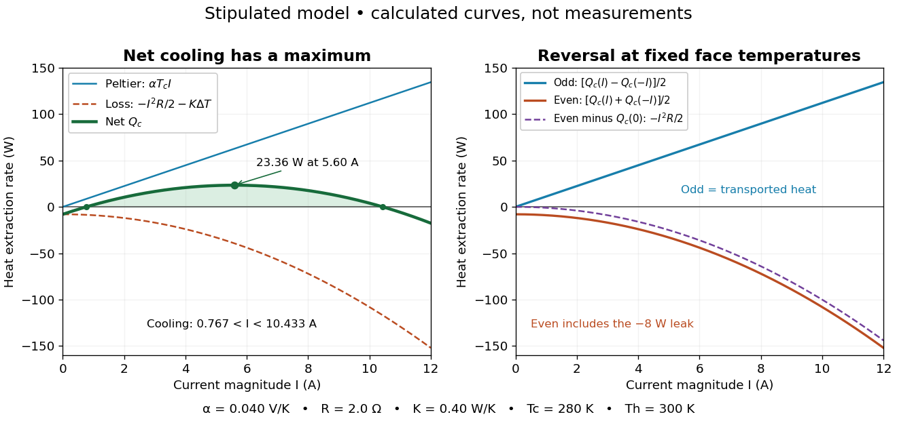

# Thermoelectric cooling current limit

↑ **Parent:** [Thermoelectric cooling](thermoelectric-cooling.md)

At fixed face [temperatures](temperature-split.md), [differentiation](differentiation.md) of the [thermoelectric cooler energy balance](thermoelectric-cooler-energy-balance.md) gives

$$
\frac{dQ_c}{dI}=\alpha T_c-RI,\qquad
\frac{d^2Q_c}{dI^2}=-R<0,\qquad
I_* =\frac{\alpha T_c}{R},\qquad
Q_{c,\max}=\frac{\alpha^2T_c^2}{2R}-K\Delta T.
$$

Thus current chosen for maximum cooling [power](power.md) is not automatically current for maximum [coefficient of performance](coefficient-of-performance.md). Cooling exists only when $(\alpha T_c)^2>2RK\Delta T$, and then only between the two positive roots

$$
I_-<I<I_+,\qquad
I_\pm=\frac{\alpha T_c\pm\sqrt{(\alpha T_c)^2-2RK\Delta T}}{R}.
$$

At equality the parabola merely touches $Q_c=0$. For the toy module the interval is approximately $0.767<I<10.433\,\mathrm A$, with $I_*=5.60\,\mathrm A$ and $Q_{c,\max}=23.36\,\mathrm W$. At $12\,\mathrm A$, the object is heated even in the nominal cooling polarity: $Q_c=-17.6\,\mathrm W$. This mathematical interval supplies no permission to exceed an actual device's current or [temperature](temperature-split.md) ratings.

**[Figure 8](#image-chosen-thermoelectric-cooling-model-useful-cooling-and-current-reversal-separation). Chosen thermoelectric cooling model: useful cooling and current-reversal separation**. Original calculated curves, not experimental data. Left: positive [Peltier effect](peltier-effect.md) transport competes with [Joule heating](joule-heating.md) and the fixed leak, leaving a bounded cooling interval. Right: holding the same two face [temperatures](temperature-split.md), the half-difference of $Q_c(+I)$ and $Q_c(-I)$ isolates $\alpha T_c I$; the half-sum is $-I^2R/2-K\Delta T$. Subtracting $Q_c(0)$ isolates $-I^2R/2$. The toy parameters are those in [thermoelectric cooler energy balance](thermoelectric-cooler-energy-balance.md).

The fixed-face constraint matters. With fixed $T_h$ but a freely cooling object, $T_c$ must be solved from its [heat](heat-split.md) load and leaks rather than held at $280\,\mathrm K$ while claiming an arbitrary [temperature](temperature-split.md) drop. For zero load and optimal current, the same model gives

$$
\frac{\alpha^2T_c^2}{2R}=K(T_h-T_c),\qquad
T_{c,\min}=\frac{\sqrt{1+2ZT_h}-1}{Z},\qquad
Z=\frac{\alpha^2}{RK}.
$$

Here $Z$ has units $\mathrm{K^{-1}}$ and is a module parameter. The toy model gives $Z=0.0020\,\mathrm{K^{-1}}$ and $T_{c,\min}\approx241.62\,\mathrm K$ when $T_h=300\,\mathrm K$. This is an ideal zero-load limit with stipulated constant properties; cooling a real load requires $Q_c$ above zero and reduces the attainable drop. Contact [thermal resistance](thermal-resistance.md), a warming [heat sink](heat-sink.md), external leaks and temperature-dependent coefficients further change the result. Electrical control is convenient, but [conservation of energy](conservation-of-energy.md) still requires a thermal path that removes the extracted [heat](heat-split.md) plus the electrical input.

## ↑ Ancestors (7)

1. [Thermoelectric cooling](thermoelectric-cooling.md)
2. [Peltier effect](peltier-effect.md)
3. [Thermoelectric effect](thermoelectric-effect-split.md)
4. [Electromagnetism](electromagnetism-split.md)
5. [Branches of physics](branches-of-physics.md)
6. [Physics](physics-split.md)
7. [Codex Wiki](split.md)
