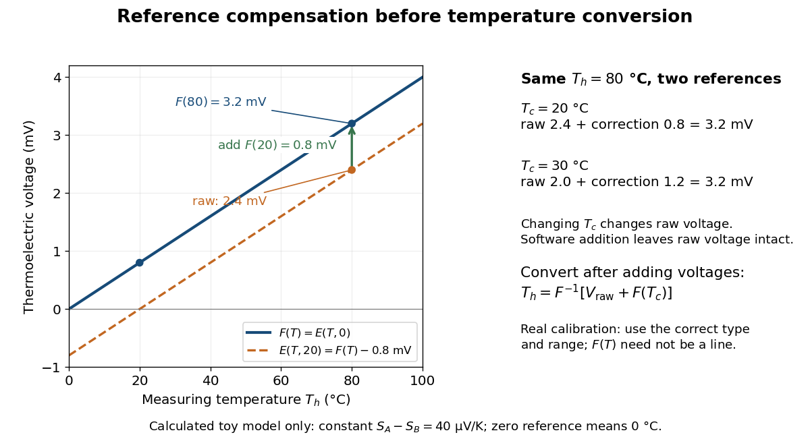

# Thermoelectric effect

↑ **Parent:** [Electromagnetism](electromagnetism.md)  
ⓦ [Wiki](https://en.wikipedia.org/wiki/Thermoelectric_effect)

A [thermoelectric effect](thermoelectric-effect.md) couples [heat transfer](heat.md#heat-transfer) and the transport of [electric charge](electric-charge.md): a [temperature gradient](heat.md#temperature-gradient) can generate an [electromotive force](electric-charge.md#electromotive-force), while an [electric current](electric-charge.md#electric-current) can carry [heat](heat.md) and cause heating or cooling at a junction of different materials. This coupling makes electrical measurement of [temperature](temperature.md) possible through a [thermocouple](#thermocouple), and permits conversion of a sustained flow of [heat](heat.md) into electrical [work](energy.md#work). A finite open-circuit voltage does not itself deliver [power](energy.md#power): electrical [power](energy.md#power) requires an [electric current](electric-charge.md#electric-current) through a load. Thermoelectric conversion therefore involves both [electromagnetism](electromagnetism.md) and [thermodynamics](thermodynamics.md). [Northwestern thermoelectrics research group: thermoelectric effects and applications](https://thermoelectrics.matsci.northwestern.edu/thermoelectrics/history.html).

**Table of contents**

- [Thermoelectric figure of merit](#thermoelectric-figure-of-merit)
  - [Thermoelectric couple figure of merit](#thermoelectric-couple-figure-of-merit)
  - [Band convergence](#band-convergence)
  - [Thermoelectric power factor](#thermoelectric-power-factor)
- [Thomson effect](#thomson-effect)
- [Thermoelectric module](#thermoelectric-module)
  - [Thermoelectric generator](#thermoelectric-generator)
    - [Radioisotope thermoelectric generator](#radioisotope-thermoelectric-generator)
- [Seebeck effect](#seebeck-effect)
  - [Seebeck coefficient](#seebeck-coefficient)
  - [Thermocouple](#thermocouple)
    - [Thermopile](#thermopile)
      - [Thermopile series voltage](#thermopile-series-voltage)
      - [Thermopile absorber](#thermopile-absorber)
      - [Thermopile thermal response](#thermopile-thermal-response)
      - [Thermopile radiative measurement](#thermopile-radiative-measurement)
    - [Thermocouple measuring junction](#thermocouple-measuring-junction)
    - [Thermocouple reference junction](#thermocouple-reference-junction)
      - [Isothermal terminal block](#isothermal-terminal-block)
      - [Cold-junction compensation](#cold-junction-compensation)
    - [Thermocouple voltage calibration](#thermocouple-voltage-calibration)
      - [Thermocouple reference function](#thermocouple-reference-function)
- [Peltier effect](#peltier-effect)
  - [Peltier coefficient](#peltier-coefficient)
    - [Kelvin thermoelectric relation](#kelvin-thermoelectric-relation)
  - [Peltier current-reversal experiment](#peltier-current-reversal-experiment)
  - [Thermoelectric cooling](#thermoelectric-cooling)
    - [Thermoelectric cooler energy balance](#thermoelectric-cooler-energy-balance)
    - [Thermoelectric cooling current limit](#thermoelectric-cooling-current-limit)

## Thermoelectric figure of merit

↑ **Parent:** [Thermoelectric effect](thermoelectric-effect.md)

The dimensionless material figure of merit is $ZT=S^2\sigma T/(\kappa_e+\kappa_l)$. Device efficiency depends on its temperature dependence and parasitic losses, not only on one peak value.

### Thermoelectric couple figure of merit

↑ **Parent:** [Thermoelectric figure of merit](#thermoelectric-figure-of-merit)

For a constant-property pair with Seebeck difference $\alpha_{np}$, electrical resistance $R$ and thermal conductance $K$, $Z_{\rm pair}=\alpha_{np}^2/(RK)$. With identical legs of individual resistivity $\rho$ and thermal conductivity $\kappa$, this is $\alpha_{np}^2/(4\rho\kappa)$, not $\alpha_{np}^2/(\rho\kappa)$.

### Band convergence

↑ **Parent:** [Thermoelectric figure of merit](#thermoelectric-figure-of-merit)

Bringing several electronic valleys close in energy to increase useful valley degeneracy. Its transport benefit must be assessed together with mobility and scattering.

### Thermoelectric power factor

↑ **Parent:** [Thermoelectric figure of merit](#thermoelectric-figure-of-merit)

The combination $S^2\sigma$ of Seebeck coefficient and electrical conductivity. Increasing it alone need not increase ZT if thermal conductivity rises as well.

## Thomson effect

↑ **Parent:** [Thermoelectric effect](thermoelectric-effect.md)

The [Thomson effect](#thomson-effect) is distributed reversible heating or cooling when an [electric current](electric-charge.md#electric-current) flows through a homogeneous material with a [temperature gradient](heat.md#temperature-gradient). It is distinct from junction [Peltier effect](#peltier-effect) heating and even-in-current [Joule heating](electric-charge.md#joule-heating).

## Thermoelectric module

↑ **Parent:** [Thermoelectric effect](thermoelectric-effect.md)

A [thermoelectric module](#thermoelectric-module) connects thermoelectric material pairs between thermal faces. Electrical series connections and thermal parallel connections combine their transport responses for [thermoelectric cooling](#thermoelectric-cooling) or electrical generation.

### Thermoelectric generator

↑ **Parent:** [Thermoelectric module](#thermoelectric-module)

A generator using the [Seebeck effect](#seebeck-effect) to convert a [temperature](temperature.md) difference into electrical output.

#### Radioisotope thermoelectric generator

↑ **Parent:** [Thermoelectric generator](#thermoelectric-generator)

A [thermoelectric generator](#thermoelectric-generator) whose heat supply comes from [radioactive decay](physics.md#radioactive-decay). The [Seebeck effect](#seebeck-effect) converts part of a temperature-driven heat flow into electrical output. The source's thermal [power](energy.md#power) and the electrical [power](energy.md#power) delivered by the converter are distinct quantities.

## Seebeck effect

↑ **Parent:** [Thermoelectric effect](thermoelectric-effect.md)

The [Seebeck effect](#seebeck-effect) is the generation of a thermoelectric [electromotive force](electric-charge.md#electromotive-force) by a [temperature](temperature.md) difference. In a [thermocouple](#thermocouple), two different homogeneous [electrical conductors](electric-charge.md#electrical-conductor) A and B connect a measuring junction at $T_h$ to two reference connections at a common $T_c$. With negligible [electric current](electric-charge.md#electric-current), the measured terminal voltage is determined by the difference of their [Seebeck coefficients](#seebeck-coefficient). A hot junction alone does not specify the reading: the reference [temperature](temperature.md), the second material, and the terminal order matter.

**[Figure 1](#image-two-material-thermocouple-junction-temperatures-and-the-voltage-sign). Two-material thermocouple: junction temperatures and the voltage sign**. An idealized open-circuit [Seebeck effect](#seebeck-effect) experiment. The A and B wires meet at the measuring junction; each reference connection meets an identical meter lead at the same $T_c$. The positive meter input connects to A. The shown $20\,{}^\circ\mathrm C$, $70\,{}^\circ\mathrm C$, and $+2\,\mathrm{mV}$ belong to the explicitly toy constant-[Seebeck coefficient](#seebeck-coefficient) example below, not measured data.

For a motivating experiment, join one end of A to one end of B, insulating the wires elsewhere. Connect their free ends to identical meter leads at reference [temperature](temperature.md) $T_c$, for example in an ice-water [heat bath](thermal-equilibrium.md#heat-bath). A meter with input [electrical resistance](electric-charge.md#electrical-resistance) much larger than the [thermocouple](#thermocouple)'s [electrical resistance](electric-charge.md#electrical-resistance) approximates an open circuit, meaning $I\approx0$. Keep the measuring junction in a separately controlled [heat bath](thermal-equilibrium.md#heat-bath) at $T_h$ and wait for stable junction [temperatures](temperature.md). Both reference connections must share $T_c$; identical leads with identical endpoint [temperatures](temperature.md) have cancelling thermoelectric contributions, allowing the meter to be elsewhere. [Marx, Link and Scott, Economic Assessment of the NIST Thermocouple Calibration Program (1997), §2.1](https://www.nist.gov/system/files/documents/director/planning/report97-1.pdf).

Define the reading as $V_{AB}=V_A-V_B$, with the positive input on the A reference terminal and the negative input on B. Use the [Seebeck coefficient](#seebeck-coefficient) convention in which the voltage change along a homogeneous wire at zero [electric current](electric-charge.md#electric-current) is $dV=-S(T)\,dT$. Following the path from A at $T_c$ to the common junction at $T_h$, then back along B to $T_c$, gives

$$
V_{AB}(T_h,T_c)=\int_{T_c}^{T_h}\bigl[S_A(T)-S_B(T)\bigr]\,dT.
$$

This formula assumes homogeneous materials whose [Seebeck coefficients](#seebeck-coefficient) depend only on the local [temperature](temperature.md), and no additional uncompensated lead contributions. Here voltage is the electrical transport voltage associated with [electrochemical potential](chemical-potential.md#electrochemical-potential), rather than a direct measurement of an isolated equilibrium contact [electric potential](electric-field.md#electric-potential).

Start with $T_h=T_c$, then increase $T_h$ while holding $T_c$ fixed and record $V_{AB}$ at each stable setting. In the ideal model the equal-[temperature](temperature.md) reading is zero. If $S_A-S_B>0$ throughout the interval, A reads positive when $T_h>T_c$. Exchanging meter inputs reverses the reading; exchanging the two junction [temperatures](temperature.md) reverses the oriented [integral](integral.md). Repeating the run with identical homogeneous materials gives zero because $S_A=S_B$. These controls test the stated model; a nonzero experimental baseline should be measured rather than silently removed by assuming it is zero.

For an explicitly toy linear example, stipulate constant [Seebeck coefficients](#seebeck-coefficient) $S_A=25\,\mu\mathrm{V/K}$ and $S_B=-15\,\mu\mathrm{V/K}$. Choose reference [temperature](temperature.md) $T_c=20\,{}^\circ\mathrm C$ and measuring-junction [temperature](temperature.md) $T_h=70\,{}^\circ\mathrm C$. A [temperature](temperature.md) difference has the same numerical size in [kelvins](temperature.md#kelvin) and on the [degree Celsius](temperature.md#degree-celsius) scale, so

$$
S_A-S_B=40\,\mu\mathrm{V/K},\qquad \Delta T=50\,\mathrm K,
\qquad V_{AB}=(40\,\mu\mathrm{V/K})(50\,\mathrm K)=+2.00\,\mathrm{mV}.
$$

Swapping the inputs gives $-2.00\,\mathrm{mV}$. Bringing both junction regions to the same [temperature](temperature.md) gives zero. With [temperature](temperature.md)-dependent [Seebeck coefficients](#seebeck-coefficient), shifting both junction [temperatures](temperature.md) equally while keeping their difference fixed can change the reading. No actual material pair is claimed to have the stipulated coefficients over this interval.

**[Figure 2](#image-toy-seebeck-effect-calibration-voltage-slope-and-reversed-inputs). Toy Seebeck effect calibration: voltage slope and reversed inputs**. Calculated lines, not measured data. The solid line is $V_{AB}=(40\,\mu\mathrm{V/K})\Delta T$; the dashed line shows the same device with reversed meter inputs. The [slope](euclidean-geometry.md#slope) is the difference of the two [Seebeck coefficients](#seebeck-coefficient), not either coefficient separately. The reference [temperature](temperature.md) is fixed at $20\,{}^\circ\mathrm C$; negative $\Delta T$ means the measuring junction is colder than the reference connections.

Real [thermocouples](#thermocouple) need a calibrated voltage-versus-[temperature](temperature.md) relation: the constant-[Seebeck coefficient](#seebeck-coefficient) approximation is useful only where the coefficient difference changes little. Wire inhomogeneity can make the result depend on where the [temperature gradient](heat.md#temperature-gradient) lies, and reference connections at unequal or unknown [temperatures](temperature.md) introduce errors. An electronic reference correction uses a measured reference [temperature](temperature.md) in place of an ice bath. [Marx, Link and Scott (1997), §2.1: reference correction and wire homogeneity](https://www.nist.gov/system/files/documents/director/planning/report97-1.pdf). Burns and colleagues provide the standardized reference functions for common letter-designated [thermocouple](#thermocouple) types; the toy line above is not a replacement for them. [Burns et al., Temperature-electromotive force reference functions and tables (1993), NIST Monograph 175](https://www.nist.gov/publications/temperature-electromotive-force-reference-functions-and-tables-letter-designated).

The historical experiment used a different detector. In his 1821–1823 investigations, Seebeck found that a closed [electrical circuit](electrical-circuit.md) of two dissimilar materials with junctions at different [temperatures](temperature.md) deflected a compass needle. The modern explanation is that thermoelectric [electromotive force](electric-charge.md#electromotive-force) drives an [electric current](electric-charge.md#electric-current), whose [magnetic field](magnetic-field.md) deflects the needle. The open-circuit experiment above detects voltage while drawing negligible [electric current](electric-charge.md#electric-current). The striking connection is that a thermal imbalance can become an electrical signal and then a magnetic response. [Northwestern thermoelectrics research group: Seebeck's compass experiment](https://thermoelectrics.matsci.northwestern.edu/thermoelectrics/history.html).

### Seebeck coefficient

↑ **Parent:** [Seebeck effect](#seebeck-effect)

The [Seebeck coefficient](#seebeck-coefficient) $S(T)$ quantifies the thermoelectric voltage response per small [temperature](temperature.md) difference at zero [electric current](electric-charge.md#electric-current). Use $S=-dV/dT$ along a homogeneous material, with voltage understood through [electrochemical potential](chemical-potential.md#electrochemical-potential). Its units are [volts](physics.md#volt) per [kelvin](temperature.md#kelvin), commonly $\mu\mathrm{V/K}$. The word [thermopower](#seebeck-coefficient) is also used, despite this being a voltage response rather than [power](energy.md#power); some authors use that word for $|S|$, so check their convention. [Northwestern thermoelectrics research group: Seebeck coefficient and thermopower convention](https://thermoelectrics.matsci.northwestern.edu/thermoelectrics/).

For the A-minus-B terminal order in the [Seebeck effect](#seebeck-effect) experiment,

$$
\frac{\partial V_{AB}}{\partial T_h}=S_A(T_h)-S_B(T_h),\qquad
\frac{\partial V_{AB}}{\partial T_c}=-\bigl[S_A(T_c)-S_B(T_c)\bigr].
$$

Thus a small [temperature](temperature.md) difference around $T_0$ gives $V_{AB}\approx[S_A(T_0)-S_B(T_0)]\Delta T$. The finite-interval ratio $V_{AB}/\Delta T$ is an average of the coefficient difference, not necessarily its value at either endpoint. Ordinary two-material measurements determine a relative [Seebeck coefficient](#seebeck-coefficient): to recover $S_A$ from the measured difference, add a separately known $S_B$. Neither the choice of a zero for voltage nor the use of a familiar reference material makes $S_B$ identically zero.

A concrete research example is Martin and colleagues' 2021 certification experiment. They measured small [temperature](temperature.md) differences and voltages on six [silicon](chemical-substance.md#silicon)–germanium specimens at 13 base [temperatures](temperature.md) between $295$ and $900\,\mathrm K$. At each setting they acquired 40 voltage-and-[temperature](temperature.md)-difference pairs and used [linear regression](linear-regression.md) with a free intercept, so a constant voltage offset did not become part of the [slope](euclidean-geometry.md#slope). Platinum voltage leads required a reference-material correction; their terminal order gave $S_{\rm measured}=S_{\rm Pt}-S_{\rm specimen}$, hence $S_{\rm specimen}=S_{\rm Pt}-S_{\rm measured}$. This is an actual measurement protocol, unlike the toy plot above. [Martin et al., Development of a high-temperature (295–900 K) Seebeck coefficient Standard Reference Material (2021), certification measurements and Eq. (1)](https://tsapps.nist.gov/publication/get_pdf.cfm?pub_id=932592).

Microscopically, a [temperature gradient](heat.md#temperature-gradient) changes [charge carrier](electric-charge.md#charge-carrier) transport until an opposing electrical response balances it at zero net [electric current](electric-charge.md#electric-current). In the usual simple [semiconductor](semiconductor.md) picture, [electrons](physics.md#electron) and [electron holes](quantum-mechanics.md#electron-hole) give opposite [Seebeck coefficient](#seebeck-coefficient) signs, and their contributions are weighted by their [electrical conductivities](electric-charge.md#electrical-conductivity). The [Seebeck coefficient](#seebeck-coefficient) is a transport property: [density of states](quantum-ideal-gas-statistics.md#density-of-states) alone does not determine it, since carrier motion and scattering also matter. Its usefulness extends beyond [temperature](temperature.md) sensing to diagnosing which carriers transport [electric charge](electric-charge.md). [Northwestern thermoelectrics research group: Seebeck coefficient, scattering contributions, and bipolar transport](https://thermoelectrics.matsci.northwestern.edu/thermoelectrics/).

### Thermocouple

↑ **Parent:** [Seebeck effect](#seebeck-effect)  
ⓦ [Wiki](https://en.wikipedia.org/wiki/Thermocouple)

A [thermocouple](#thermocouple) uses two different [electrical conductors](electric-charge.md#electrical-conductor) and the [Seebeck effect](#seebeck-effect) to infer a measuring-junction [temperature](temperature.md) from a voltage and a known reference [temperature](temperature.md). The reference material and the reference [temperature](temperature.md) are distinct choices: B specifies the comparison [Seebeck coefficient](#seebeck-coefficient), while $T_c$ specifies the lower limit of the [integral](integral.md). The two-material experiment in [Seebeck effect](#seebeck-effect) gives the geometry, sign convention, and calibration limitations.

The useful measurement is a pair: the raw terminal [electric potential difference](electric-field.md#electric-potential-difference) and the [thermocouple reference junction](#thermocouple-reference-junction) [temperature](temperature.md). For the A-positive terminal order and homogeneous-wire assumptions of [Seebeck effect](#seebeck-effect), write the open-circuit [electromotive force](electric-charge.md#electromotive-force) as

$$
E(T_h,T_c)=\int_{T_c}^{T_h}[S_A(T)-S_B(T)]\,dT.
$$

Here $T_h$ is the [thermocouple measuring junction](#thermocouple-measuring-junction) [temperature](temperature.md) and $T_c$ is the common [temperature](temperature.md) of the reference connections. The subscript $h$ names the measuring end; it need not be hotter. A [voltmeter](electric-field.md#voltmeter) senses the complete connected thermoelectric path through the wires and its leads, in the [electrochemical potential](chemical-potential.md#electrochemical-potential) convention already described under [Seebeck effect](#seebeck-effect). It does not measure an absolute [temperature](temperature.md), the individual [Seebeck coefficient](#seebeck-coefficient) of A, or an isolated contact [electric potential](electric-field.md#electric-potential).

**[Figure 3](#image-thermocouple-wiring-with-two-copper-lead-junctions-at-a-common-reference-temperature). Thermocouple wiring with two copper-lead junctions at a common reference temperature**. Original schematic. The [isothermal terminal block](#isothermal-terminal-block) contains electrically separate A–Cu and B–Cu transitions and a local [temperature](temperature.md) sensor. Both homogeneous [copper](chemical-substance.md#copper) leads end at the same meter-input [temperature](temperature.md) $T_m$, so their thermoelectric contributions cancel. The displayed $+2.4\,\mathrm{mV}$ is calculated from a stipulated constant difference of [Seebeck coefficients](#seebeck-coefficient), not measured data or a calibration of actual materials.

#### Thermopile

↑ **Parent:** [Thermocouple](#thermocouple)

A [thermopile](#thermopile) connects multiple [thermocouples](#thermocouple) in series to turn a [temperature](temperature.md) difference into a larger electrical signal. Absorbed [thermal radiation](electromagnetic-radiation.md#thermal-radiation) can heat its sensing junctions while reference junctions remain cooler; the signal depends on the thermal and optical design.

A [thermopile](#thermopile) is an array of [thermocouples](#thermocouple) connected as a [series circuit](electrical-circuit.md#series-circuit) with their [electromotive forces](electric-charge.md#electromotive-force) adding in the chosen terminal order. It measures a collective [temperature](temperature.md) difference through the [Seebeck effect](#seebeck-effect). An open-circuit [electric potential difference](electric-field.md#electric-potential-difference) requires no externally supplied [electric current](electric-charge.md#electric-current) through the array: a high-input-[electrical resistance](electric-charge.md#electrical-resistance) [voltmeter](electric-field.md#voltmeter) reads the [signal](electrical-engineering.md#signal). The [heat](heat.md) that maintains the junction [temperature](temperature.md) difference still comes from somewhere, such as absorbed [electromagnetic radiation](electromagnetic-radiation.md).

In a membrane detector, an absorbing film heats the measuring junctions while reference junctions lie on the surrounding support. Actual junction [temperatures](temperature.md) can differ across the membrane.[p. 2, §2 Structure, Figs. 2-1–2-2: absorbing film, membrane, junction locations and nonuniform temperature](physics-bibliography.md#thermopile-detectors-by-hamamatsu-photonics-k-k) This converts difficult-to-observe [heat transfer](heat.md#heat-transfer) into an accessible electrical [signal](electrical-engineering.md#signal); the series connection combines many small contributions without requiring every [thermocouple](#thermocouple) to have a separate meter.

##### Thermopile series voltage

↑ **Parent:** [Thermopile](#thermopile)

Use the A-positive terminal order of [Seebeck effect](#seebeck-effect) for each [thermocouple](#thermocouple). Its [thermocouple measuring junction](#thermocouple-measuring-junction) has [temperature](temperature.md) $T_{h,i}$ and its reference connections have [temperature](temperature.md) $T_{c,i}$. Define the difference of [Seebeck coefficients](#seebeck-coefficient) as $\alpha_i(T)=S_{A,i}(T)-S_{B,i}(T)$. Connect the B reference end of one [thermocouple](#thermocouple) to the A reference end of the next at a common local [temperature](temperature.md), so the terminal [electric potential differences](electric-field.md#electric-potential-difference) add:

$$
E_i=\int_{T_{c,i}}^{T_{h,i}}\alpha_i(T)\,dT,
\qquad V_{\rm oc}=\sum_{i=1}^{N} E_i.
$$

The first A reference terminal is the positive meter input; the final B reference terminal is the negative input. Following this connected path and adding the individual [Seebeck effect](#seebeck-effect) [integrals](integral.md) proves the result. Matched meter leads with common endpoint [temperatures](temperature.md) cancel as in an [isothermal terminal block](#isothermal-terminal-block). The manufacturer's sum formula also allows unequal individual contributions.[p. 2, Eq. (2-1): total output is the sum of individual thermocouple outputs](physics-bibliography.md#thermopile-detectors-by-hamamatsu-photonics-k-k)

**[Figure 4](#image-thermopile-geometry-series-junctions-absorber-and-reference-support). Thermopile geometry: series junctions, absorber and reference support**. Original idealized wiring, showing three of $N$ [thermocouples](#thermocouple). Each A leg rises from reference [temperature](temperature.md) $T_c$ to absorber [temperature](temperature.md) $T_h$, and each B leg returns. B-to-A connections at $T_c$ join adjacent pairs; the thermally shared absorber and support do not short the electrically distinct junctions. A-positive and B-negative meter connections match the [Seebeck effect](#seebeck-effect) convention. Arrows indicate absorbed [electromagnetic radiation](electromagnetic-radiation.md) and escaping [heat](heat.md), not [electric current](electric-charge.md#electric-current).

If all pairs share $T_h,T_c$ and the same nearly constant difference $\alpha$ of [Seebeck coefficients](#seebeck-coefficient) throughout that [temperature](temperature.md) [interval](real-analysis.md#interval-mathematics), then

$$
V_{\rm oc}\approx N\alpha\Delta T,\qquad \Delta T=T_h-T_c.
$$

This $\alpha$ is the pair's relative [Seebeck coefficient](#seebeck-coefficient), not either material's individual coefficient or a universal device constant. As an original constructed example, choose $N=20$, $\alpha=40\,\mu\mathrm{V\,K^{-1}}$ and $\Delta T=5\,\mathrm K$. Each [thermocouple](#thermocouple) contributes $0.20\,\mathrm{mV}$ and

$$
V_{\rm oc}=20(40\times10^{-6}\,\mathrm{V\,K^{-1}})(5\,\mathrm K)=4.0\,\mathrm{mV}.
$$

Reversing the meter connections changes the sign. Exchanging $T_h$ and $T_c$ reverses the [integrals](integral.md) and hence the [electromotive force](electric-charge.md#electromotive-force); this reversible sign response does not make a detector with [heat conduction](heat.md#thermal-conduction) a reversible thermodynamic process. Reversing the wiring of one pair instead gives $(N-2)\alpha\Delta T$, because one contribution is subtracted rather than added. For this example the result is $3.6\,\mathrm{mV}$, and at equal junction [temperatures](temperature.md) every contribution vanishes.

The open-circuit condition matters. If the array's total [electrical resistance](electric-charge.md#electrical-resistance) is $R_{\rm pile}$ and the meter input has [electrical resistance](electric-charge.md#electrical-resistance) $R_m$, the elementary [voltage divider](electrical-engineering.md#voltage-divider) model gives $V_m=V_{\rm oc}R_m/(R_m+R_{\rm pile})$. Thus $R_m\gg R_{\rm pile}$ is needed to suppress [voltmeter loading](electric-field.md#voltmeter-loading). Appreciable [electric current](electric-charge.md#electric-current) also permits [Joule heating](electric-charge.md#joule-heating) and the thermoelectric [heat transfer](heat.md#heat-transfer) to disturb the assumed junction [temperatures](temperature.md).

##### Thermopile absorber

↑ **Parent:** [Thermopile](#thermopile)

A [thermopile absorber](#thermopile-absorber) converts incident [electromagnetic radiation](electromagnetic-radiation.md) into [heat](heat.md) near the [thermocouple measuring junctions](#thermocouple-measuring-junction). Electrically separate junctions can share its [temperature](temperature.md) through thermal contact. The reference support provides a path for [heat transfer](heat.md#heat-transfer) and a comparison [temperature](temperature.md); “cold” denotes this reference role, even if it is warmer than the absorber.

Distinguish incident [power](energy.md#power) from absorbed [power](energy.md#power). A window, the illuminated [area](differential-geometry.md#surface-area), and the absorption of the coating determine their relation. A detector's measured voltage sensitivity can depend on where a small illuminated spot lies.[p. 3, §3-1 Sensitivity, Eq. (3-1) and following paragraph: uniform illumination versus a localized spot](physics-bibliography.md#thermopile-detectors-by-hamamatsu-photonics-k-k) The model in [thermopile thermal response](#thermopile-thermal-response) takes absorbed [power](energy.md#power) as its input, so an optical calibration is a separate step.

##### Thermopile thermal response

↑ **Parent:** [Thermopile](#thermopile)

A useful original model treats the [thermopile absorber](#thermopile-absorber) as one approximately uniform [temperature](temperature.md) $T_h(t)$ with [heat capacity](heat.md#heat-capacity) $C_{\rm th}$, connected to a fixed reference [temperature](temperature.md) $T_c$ by [thermal conductance](heat.md#thermal-conductance) $G_{\rm th}$. Both parameters are positive constants here. Let $P_{\rm abs}(t)$ be an added absorbed [power](energy.md#power) above the initial background. Linearize the outgoing [heat transfer](heat.md#heat-transfer) about that background. With $\Delta T=T_h-T_c$ measured from an initial state having $\Delta T=0$, [conservation of energy](mathematical-physics.md#conservation-of-energy) gives the [first-order linear differential equation](linear-ordinary-differential-equation.md#first-order-linear-differential-equation)

$$
C_{\rm th}\frac{d\Delta T}{dt}=P_{\rm abs}(t)-G_{\rm th}\Delta T.
$$

The left side is the rate of stored [energy](energy.md); the two terms on the right are added [power](energy.md#power) and outgoing [heat transfer](heat.md#heat-transfer). The effective [thermal conductance](heat.md#thermal-conductance) can include several paths, rather than just [heat conduction](heat.md#thermal-conduction) along the wires. The model assumes a stable reference, negligible electrical loading, a common absorber [temperature](temperature.md), and changes small enough for constant parameters.

For a step from zero to constant $P_0$ at $t=0$, subtract the steady solution $\Delta T_\infty=P_0/G_{\rm th}$. The difference obeys [exponential decay](analysis.md#exponential-decay), so the initial condition fixes

$$
\tau=\frac{C_{\rm th}}{G_{\rm th}},\qquad
\Delta T(t)=\frac{P_0}{G_{\rm th}}\left(1-e^{-t/\tau}\right),\qquad
V_{\rm oc}(t)\approx N\alpha\frac{P_0}{G_{\rm th}}\left(1-e^{-t/\tau}\right).
$$

The [time constant](analysis.md#time-constant) has units $(\mathrm{J\,K^{-1}})/(\mathrm{W\,K^{-1}})=\mathrm s$. With the same constructed $N=20$ and $\alpha=40\,\mu\mathrm{V\,K^{-1}}$, choose $C_{\rm th}=0.02\,\mathrm{J\,K^{-1}}$, $G_{\rm th}=0.01\,\mathrm{W\,K^{-1}}$ and $P_0=0.03\,\mathrm W$. Then

$$
\tau=2\,\mathrm s,\qquad \Delta T_\infty=3\,\mathrm K,\qquad
V_\infty=2.4\,\mathrm{mV}.
$$

At one [time constant](analysis.md#time-constant), the response is $1-e^{-1}\approx0.632$ of its final value: $V_{\rm oc}(2\,\mathrm s)\approx1.52\,\mathrm{mV}$. Reaching $95\%$ requires $t=-\tau\ln(0.05)\approx5.99\,\mathrm s$. A [voltmeter](electric-field.md#voltmeter) read too soon therefore underestimates the steady [signal](electrical-engineering.md#signal) even when its electrical calibration is perfect.

**[Figure 5](#image-calculated-thermopile-step-response-heat-capacity-thermal-conductance-and-settling). Calculated thermopile step response: heat capacity, thermal conductance and settling**. Original model curves for added absorbed [power](energy.md#power) $P_0=0.03\,\mathrm W$, $N=20$ and relative [Seebeck coefficient](#seebeck-coefficient) $\alpha=40\,\mu\mathrm{V\,K^{-1}}$. The solid curve uses $C_{\rm th}=0.02\,\mathrm{J\,K^{-1}}$ and $G_{\rm th}=0.01\,\mathrm{W\,K^{-1}}$, giving [time constant](analysis.md#time-constant) $2\,\mathrm s$ and final voltage $2.4\,\mathrm{mV}$. The dashed comparison halves only $G_{\rm th}$: final voltage doubles, but so does the [time constant](analysis.md#time-constant). Neither curve is an experimental observation.

The steady ratio $V_\infty/P_0=N\alpha/G_{\rm th}$ is $0.080\,\mathrm{V\,W^{-1}}$ in this constructed model. Halving [thermal conductance](heat.md#thermal-conductance) doubles this ratio but also doubles the [time constant](analysis.md#time-constant) if [heat capacity](heat.md#heat-capacity) stays fixed. Reducing [heat capacity](heat.md#heat-capacity) alone speeds the response without changing its steady value. Increasing $N$ gives a larger [signal](electrical-engineering.md#signal) only at fixed individual [temperature](temperature.md) differences: adding legs can also change [thermal conductance](heat.md#thermal-conductance), [heat capacity](heat.md#heat-capacity) and [electrical resistance](electric-charge.md#electrical-resistance). The algebra identifies coupled design choices, rather than predicting a particular manufactured detector.

A finite [electrical resistance](electric-charge.md#electrical-resistance) produces [Thermal electrical noise](electrical-engineering.md#thermal-electrical-noise). For nearly uniform absolute [temperature](temperature.md) $T$ and effective measurement [signal bandwidth](electrical-engineering.md#signal-bandwidth) $B$, its [root mean square](analysis.md#root-mean-square) open-circuit voltage is

$$
v_{n,\rm rms}=\sqrt{4k_{\rm B}TR_{\rm pile}B}.
$$

Here $k_{\rm B}$ is the [Boltzmann constant](thermodynamics.md#boltzmann-constant). Thermal electrical [noise](electrical-engineering.md#noise-signal-processing) in the sensing element is an important contribution, and the [signal bandwidth](electrical-engineering.md#signal-bandwidth) enters its voltage variance.[p. 3, §3-2 Noise, Eq. (3-2): element resistance, absolute temperature and measurement bandwidth](physics-bibliography.md#thermopile-detectors-by-hamamatsu-photonics-k-k) If identical pairs have fixed [electrical resistance](electric-charge.md#electrical-resistance) $r$ and fixed $\Delta T$, then $R_{\rm pile}=Nr$: the [signal](electrical-engineering.md#signal) grows as $N$ while this [noise](electrical-engineering.md#noise-signal-processing) grows as $\sqrt N$. The resulting [signal-to-noise ratio](electrical-engineering.md#signal-to-noise-ratio) grows only as $\sqrt N$ under those assumptions. Reference [temperature](temperature.md) drift, environmental [electromagnetic radiation](electromagnetic-radiation.md), and meter [noise](electrical-engineering.md#noise-signal-processing) remain separate limits; reducing [signal bandwidth](electrical-engineering.md#signal-bandwidth) trades fast information for less integrated electrical [noise](electrical-engineering.md#noise-signal-processing).

##### Thermopile radiative measurement

↑ **Parent:** [Thermopile](#thermopile)

PASCO's documented lamp experiment connects a TD-8553 [thermopile](#thermopile) sensor to a millivoltmeter and places it level with a lamp filament along a meter stick. Lamp and detector axes are aligned. With the lamp off, readings at several positions establish an average ambient [thermal radiation](electromagnetic-radiation.md#thermal-radiation) background. With the lamp on at a fixed supply setting, detector readings at different distances are compared after background subtraction. Between readings, a reflective shield prevents the detector warming; its shutter also protects the reference junction when idle. Moving the shutter can move the sensor, so fixed geometry matters. The manual's lamp limits must be followed.[p. 1, Radiation Sensor; pp. 9–11, Experiment 2, Fig. 2.1, procedure and calculations: alignment, lamp-off ambient readings, heat shield and distance comparison](physics-bibliography.md#thermal-radiation-system-instruction-manual-and-experiment-guide-td-8553-td-8554a-and-td-8555-by-pasco-scientific)

This protocol tests whether the background-corrected [electric potential difference](electric-field.md#electric-potential-difference) approximately follows the [inverse-square law](physics.md#inverse-square-law) over a suitable distance range. It is a relative [electromagnetic radiation](electromagnetic-radiation.md) measurement; those readings alone do not calibrate absorbed [power](energy.md#power) in [watts](electric-charge.md#watt). The manual treats the filament as an approximate [point source](fluid-mechanics.md#point-source).[p. 3, Stefan-Boltzmann Lamp; p. 11, Experiment 2 calculations: point-source approximation and comparison against inverse squared distance](physics-bibliography.md#thermal-radiation-system-instruction-manual-and-experiment-guide-td-8553-td-8554a-and-td-8555-by-pasco-scientific)

For an absolute calibration, independently known absorbed [power](energy.md#power) and a monitored reference [temperature](temperature.md) would be needed. A useful additional control is to repeat a fixed detector position before and after a distance sweep: disagreement reveals possible drift. These additions test the measurement chain rather than assuming that background subtraction fixes every error. A finite source, changing illuminated [area](differential-geometry.md#surface-area), reflections, changing reference [temperature](temperature.md), and insufficient settling can alter the measured dependence. In particular, the [time constant](analysis.md#time-constant) in [thermopile thermal response](#thermopile-thermal-response) explains why a quick reading and a settled reading may differ. The detector infers its own absorber [temperature](temperature.md) difference; inferring the source's [temperature](temperature.md) additionally requires its [emissivity](heat.md#emissivity), optical geometry and an appropriate [thermal radiation](electromagnetic-radiation.md#thermal-radiation) model.

#### Thermocouple measuring junction

↑ **Parent:** [Thermocouple](#thermocouple)

The [thermocouple measuring junction](#thermocouple-measuring-junction) joins A and B at the location whose [temperature](temperature.md) is to be inferred. Its own [temperature](temperature.md) is what the electrical measurement estimates. To infer a surrounding object's [temperature](temperature.md), the junction must approach [thermal equilibrium](thermal-equilibrium.md) with that object: insufficient immersion, [heat conduction](heat.md#thermal-conduction) along the wires, or a changing environment can keep the junction at another [temperature](temperature.md). A stable electrical display alone does not establish that this thermal condition holds. The two-[heat bath](thermal-equilibrium.md#heat-bath) procedure and terminal-reversal controls under [Seebeck effect](#seebeck-effect) provide the starting experiment; the practical issue here is the reference and conversion chain.

#### Thermocouple reference junction

↑ **Parent:** [Thermocouple](#thermocouple)

The [thermocouple reference junction](#thermocouple-reference-junction) is the connection region where the two thermoelements meet the measurement leads. In ordinary [copper](chemical-substance.md#copper)-lead wiring there are two material transitions, A–Cu and B–Cu, rather than a second welded A–B junction. They must have a common known [temperature](temperature.md) $T_c$ for the simple expression $E(T_h,T_c)$ to apply. An ice-water [heat bath](thermal-equilibrium.md#heat-bath) can establish a nominal $0\,{}^\circ\mathrm C$ reference; [cold-junction compensation](#cold-junction-compensation) instead measures $T_c$ locally. The word “cold” describes the reference role and imposes no requirement that $T_c<T_h$.

##### Isothermal terminal block

↑ **Parent:** [Thermocouple reference junction](#thermocouple-reference-junction)

An [isothermal terminal block](#isothermal-terminal-block) keeps the two reference transitions and the reference [thermometer](temperature.md#thermometer) at approximately the same [temperature](temperature.md), while maintaining electrical insulation between the terminals. Thermal contact is required; an electrical short between A and B would bypass the signal. Merely using [copper](chemical-substance.md#copper) does not eliminate the [Seebeck effect](#seebeck-effect) in the meter leads. If both homogeneous [copper](chemical-substance.md#copper) leads start at $T_c$ and end at a common meter-input [temperature](temperature.md) $T_m$, their contributions have equal magnitude and opposite sign around the measurement path:

$$
\int_{T_c}^{T_m}S_{\rm Cu}(T)\,dT-\int_{T_c}^{T_m}S_{\rm Cu}(T)\,dT=0.
$$

This cancellation uses matched endpoint [temperatures](temperature.md) and homogeneous lead material, rather than $S_{\rm Cu}=0$. A [temperature gradient](heat.md#temperature-gradient) along each lead is allowed under these assumptions. If the two transitions are at different [temperatures](temperature.md), one measured $T_c$ cannot generally correct both; unmatched connectors or wire inhomogeneity can introduce additional [electromotive forces](electric-charge.md#electromotive-force). The FP-TC-120 documentation explicitly locates the reference sensing in the terminal base or connector block and specifies isothermal versions of these assemblies.[p. 7, Cold-Junction Compensation: terminal sensors and isothermal terminal assemblies](physics-bibliography.md#fp-tc-120-and-cfp-tc-120-operating-instructions-by-national-instruments)

##### Cold-junction compensation

↑ **Parent:** [Thermocouple reference junction](#thermocouple-reference-junction)

[Cold-junction compensation](#cold-junction-compensation) converts a reading with reference [temperature](temperature.md) $T_c$ into the equivalent reading for a chosen standard reference. Define the [thermocouple reference function](#thermocouple-reference-function) $F(T)=E(T,0)$, where $0$ means $0\,{}^\circ\mathrm C$, not absolute zero. Additivity of the [definite integral](integral.md#definite-integral) gives

$$
E(T_h,T_c)=F(T_h)-F(T_c),\qquad
F(T_h)=V_{\rm raw}+F(T_c),\qquad
T_h=F^{-1}\!\bigl(V_{\rm raw}+F(T_c)\bigr).
$$

The final [inverse function](function.md#inverse-function) requires a suitable one-to-one calibration interval. A terminal [thermometer](temperature.md#thermometer) supplies $T_c$ independently; the raw [thermocouple](#thermocouple) [electric potential difference](electric-field.md#electric-potential-difference) supplies only the difference of the two reference-function values. In general, first converting $V_{\rm raw}$ to a [temperature](temperature.md) and then adding $T_c$ is wrong, because the [thermocouple reference function](#thermocouple-reference-function) need not be linear. The SCC-TC manual explicitly adds the reference-equivalent voltage before its final voltage-to-[temperature](temperature.md) conversion.[pp. 5–6, Scaling Voltage Measurements, steps 1–5](physics-bibliography.md#scc-tc-series-thermocouple-input-modules-user-guide-by-national-instruments)

For a stipulated model only, take $S_A-S_B=40\,\mu\mathrm{V/K}$ throughout the interval. No actual material pair is assigned this constant. Because [degree Celsius](temperature.md#degree-celsius) differences have the same numerical size as [kelvin](temperature.md#kelvin) differences,

$$
T_h=80\,{}^\circ\mathrm C,\quad T_c=20\,{}^\circ\mathrm C
\quad\Longrightarrow\quad
V_{\rm raw}=(40\,\mu\mathrm{V/K})(60\,\mathrm K)=2.4\,\mathrm{mV}.
$$

In this model $F(20)=0.8\,\mathrm{mV}$ and $F(80)=3.2\,\mathrm{mV}$. Adding the $0.8\,\mathrm{mV}$ correction produces $3.2\,\mathrm{mV}$, whose inverse calibration gives $80\,{}^\circ\mathrm C$. Applying the zero-reference calibration directly to $2.4\,\mathrm{mV}$ would instead display $60\,{}^\circ\mathrm C$.

Now physically change only the reference [temperature](temperature.md) to $30\,{}^\circ\mathrm C$, leaving the measuring junction at $80\,{}^\circ\mathrm C$. The raw reading becomes $2.0\,\mathrm{mV}$; the correction becomes $F(30)=1.2\,\mathrm{mV}$, so the corrected total stays $3.2\,\mathrm{mV}$. Physically changing the reference changes the measured [electric potential difference](electric-field.md#electric-potential-difference). Adding a software correction changes its interpretation and leaves the raw reading intact. If the actual reference is $30\,{}^\circ\mathrm C$ but the software still assumes $20\,{}^\circ\mathrm C$, this model displays $70\,{}^\circ\mathrm C$.

**[Figure 6](#image-adding-the-reference-equivalent-voltage-before-inverting-the-thermocouple-reference-function). Adding the reference-equivalent voltage before inverting the thermocouple reference function**. Calculated constant-[Seebeck coefficient](#seebeck-coefficient)-difference example only. The zero-reference line $F(T)=E(T,0)$ and the $20\,{}^\circ\mathrm C$ raw-reading line differ by $F(20)=0.8\,\mathrm{mV}$. At $T_h=80\,{}^\circ\mathrm C$, adding that correction takes $2.4$ to $3.2\,\mathrm{mV}$. Changing the reference to $30\,{}^\circ\mathrm C$ changes the raw reading and the correction in opposite directions. Real calibration curves need not be straight.

An actual implementation in [FP-TC-120 and cFP-TC-120 Operating Instructions by National Instruments](physics-bibliography.md#fp-tc-120-and-cfp-tc-120-operating-instructions-by-national-instruments) (p. 7, Cold-Junction Compensation) uses terminal-mounted [temperature](temperature.md) sensors, reports their reading as “CJ Temperature”, and enables compensation in [temperature](temperature.md) mode but not voltage mode. This makes the distinction between a raw voltage readout and a compensated [temperature](temperature.md) readout observable. The specified reference-sensor range also produces an out-of-range indication: a calculated number outside a supported range is not a validated measurement.[p. 7, Cold-Junction Compensation: mode selection, CJ Temperature and out-of-range reporting](physics-bibliography.md#fp-tc-120-and-cfp-tc-120-operating-instructions-by-national-instruments)

#### Thermocouple voltage calibration

↑ **Parent:** [Thermocouple](#thermocouple)

[Thermocouple voltage calibration](#thermocouple-voltage-calibration) relates an actual assembled sensor's [electromotive force](electric-charge.md#electromotive-force) to independently established junction [temperatures](temperature.md). It must be distinguished from selecting a nominal letter-type conversion curve. In [Thermocouples Calibrations Services by National Institute of Standards and Technology](physics-bibliography.md#thermocouples-calibrations-services-by-national-institute-of-standards-and-technology) (opening method description and bath-calibration table), NIST describes comparison with a maintained reference [thermocouple](#thermocouple), comparison with a standard platinum [resistance thermometer](temperature.md#resistance-thermometer) in controlled [heat baths](thermal-equilibrium.md#heat-bath), and fixed-point calibration at the freezing points of zinc, aluminum, silver and gold on the [International Temperature Scale of 1990](temperature.md#international-temperature-scale-of-1990). These are independent thermal references, unlike a test that checks only a voltage-input circuit.[method description; table for base-metal thermocouples compared with an SPRT in a temperature-controlled bath](physics-bibliography.md#thermocouples-calibrations-services-by-national-institute-of-standards-and-technology)

For a concrete electrical check, the SCC-TC guide describes shorting the input after 30 minutes of powered operation and adjusting its offset to a zero-voltage readout. Its separate calibrator procedure requires equal connection [temperatures](temperature.md) at the calibrator and module, measures the supplied voltage, converts it to [temperature](temperature.md), and compares with the calibrator setting. Such an injected-signal test checks the readout chain; it does not expose a real measuring junction to an independently known bath [temperature](temperature.md).[p. 9, Calibrating System Offsets; Calibrating the SCC-TC0X Using a Thermocouple Calibrator](physics-bibliography.md#scc-tc-series-thermocouple-input-modules-user-guide-by-national-instruments)

Useful additional checks follow from the model: log the raw voltage, the reference [temperature](temperature.md), and the final inferred [temperature](temperature.md) separately; hold $T_h$ stable while changing $T_c$ and test whether [cold-junction compensation](#cold-junction-compensation) preserves the inferred $T_h$; compare against an independent [thermometer](temperature.md#thermometer) at several stable [heat bath](thermal-equilibrium.md#heat-bath) settings. Check immersion and repeatability instead of assuming a steady display establishes [thermal equilibrium](thermal-equilibrium.md). These are proposed diagnostic checks, not new experimental results. The equal-[temperature](temperature.md) and polarity controls are already described under [Seebeck effect](#seebeck-effect).

Limits arise separately from the [thermocouple reference function](#thermocouple-reference-function), sensor-wire changes, thermal contact, terminal [temperature](temperature.md) differences, and the voltage-input circuit. In particular, the SCC-TC guide warns of connector-to-module [temperature gradients](heat.md#temperature-gradient) and voltage drops caused by the fault-detection [electric current](electric-charge.md#electric-current) flowing through lead [electrical resistance](electric-charge.md#electrical-resistance).[p. 6, Uncompensated Connectors and Accuracy; p. 7, Errors Due to Open-Thermocouple Detection Circuitry](physics-bibliography.md#scc-tc-series-thermocouple-input-modules-user-guide-by-national-instruments) A fitted curve or compensation algorithm cannot make all these errors vanish. No single accuracy is assigned to every [thermocouple](#thermocouple).

##### Thermocouple reference function

↑ **Parent:** [Thermocouple voltage calibration](#thermocouple-voltage-calibration)

A [thermocouple reference function](#thermocouple-reference-function) gives the nominal thermoelectric [electromotive force](electric-charge.md#electromotive-force) versus [temperature](temperature.md) for a specified material pair and reference [temperature](temperature.md), conventionally $0\,{}^\circ\mathrm C$. Real [Seebeck coefficients](#seebeck-coefficient) vary with [temperature](temperature.md), so

$$
F'(T)=S_A(T)-S_B(T)
$$

is generally nonconstant. A lookup calibration can use [interpolation](interpolation.md) between tabulated values; a fitted calibration can use [polynomials](polynomial.md) over stated intervals. Use the correct material type, units, reference and validity interval in both the forward and inverse conversions. The FP-TC-120 manual specifically requires the channel's [thermocouple](#thermocouple) type to be configured and describes its use of NIST-175 reference characteristics.[p. 6, Connecting Thermocouple Input Signals: channel type and NIST-175 linearization](physics-bibliography.md#fp-tc-120-and-cfp-tc-120-operating-instructions-by-national-instruments) A nominal reference curve is not evidence that an aged or inhomogeneous wire still follows it.

A local error estimate explains why the reference [thermometer](temperature.md#thermometer) matters. If $\delta V$ is an additive voltage error and $\delta T_c$ is the error in the supplied reference [temperature](temperature.md), [differentiation](calculus.md#differentiation) of the compensation equation gives, for $F'(T_h)\ne0$,

$$
\delta T_h\approx\frac{\delta V+F'(T_c)\,\delta T_c}{F'(T_h)}.
$$

A small [slope](euclidean-geometry.md#slope) $F'(T_h)$ magnifies voltage errors. In the stipulated $40\,\mu\mathrm{V/K}$ model, a $40\,\mu\mathrm V$ offset gives a $1\,\mathrm K$ inferred-[temperature](temperature.md) error, and a $1\,\mathrm K$ reference error gives a $1\,\mathrm K$ inferred-[temperature](temperature.md) error. These are sensitivities of the chosen model, not universal performance figures for real sensors.

## Peltier effect

↑ **Parent:** [Thermoelectric effect](thermoelectric-effect.md)

The [Peltier effect](#peltier-effect) is [heat transfer](heat.md#heat-transfer) associated with an [electric current](electric-charge.md#electric-current) crossing a junction between materials with different [Peltier coefficients](#peltier-coefficient). At fixed junction [temperature](temperature.md), its contribution changes sign when the [conventional current](electric-charge.md#conventional-current) reverses. A junction can absorb [heat](heat.md) from its surroundings for one direction and release it for the other. [Joule heating](electric-charge.md#joule-heating), proportional to the square of the [electric current](electric-charge.md#electric-current), accompanies this transport but does not reverse sign. Consequently, observing a warm device alone does not identify the [Peltier effect](#peltier-effect).

This makes the [Peltier effect](#peltier-effect) useful as an electrically controlled [heat pump](thermodynamics.md#heat-pump): reversing the supply can switch an object's thermal role without changing any plumbing. In [thermoelectric cooling](#thermoelectric-cooling), however, the useful cooling is the junction's absorbed [heat](heat.md) minus returning [heat conduction](heat.md#thermal-conduction) and its share of [Joule heating](electric-charge.md#joule-heating). Increasing [electric current](electric-charge.md#electric-current) eventually makes cooling worse. The distinction between transported [heat](heat.md) and net cooling is the central practical lesson of the [thermoelectric cooler energy balance](#thermoelectric-cooler-energy-balance).

### Peltier coefficient

↑ **Parent:** [Peltier effect](#peltier-effect)

At uniform [temperature](temperature.md), define the material [Peltier coefficient](#peltier-coefficient) by transported [heat current](heat.md#heat-current) along positive [conventional current](electric-charge.md#conventional-current):

$$
\dot Q_{\rm tr}=\Pi I.
$$

Its units are $\mathrm{W/A}=\mathrm{J/C}=\mathrm V$. In one dimension, $q=\Pi j-\kappa\,dT/dx$, with [electric current density](electric-charge.md#current-density) $j$ and [thermal conductivity](heat.md#thermal-conductivity) $\kappa$. Here [heat](heat.md) excludes the [electrochemical potential](chemical-potential.md#electrochemical-potential) contribution to total [energy flux](mathematical-physics.md#energy-flux).[A.11.1; A.11.4, Eq. (A.34): heat-flux convention](physics-bibliography.md#thermoelectric-effects-by-leon-van-dommelen)

Now orient positive [conventional current](electric-charge.md#conventional-current) $I$ from material A into material B, at a common junction [temperature](temperature.md) $T$. Define $\dot Q_{\rm abs}>0$ as [heat](heat.md) taken from the junction's thermal surroundings. The outgoing transported [heat](heat.md) minus the incoming transported [heat](heat.md) gives

$$
\Pi_{A\to B}^{\rm abs}=\Pi_B-\Pi_A,\qquad
\dot Q_{\rm abs}=(\Pi_B-\Pi_A)I.
$$

The local released [heat](heat.md) is $\dot Q_{\rm rel}=-\dot Q_{\rm abs}$. Authors defining a junction coefficient by released [heat](heat.md) therefore use the opposite sign. Exchanging A and B reverses the coefficient; reversing $I$ at fixed A and B reverses the junction's thermal response. An individual material coefficient and a junction difference are different quantities.

For an original stipulated example, choose $S_A=-100\,\mu\mathrm{V/K}$ and $S_B=+150\,\mu\mathrm{V/K}$ at $T=300\,\mathrm K$. The [Kelvin thermoelectric relation](#kelvin-thermoelectric-relation) gives $\Pi_A=-0.030\,\mathrm V$, $\Pi_B=+0.045\,\mathrm V$. A positive $2\,\mathrm A$ flowing A to B absorbs $(0.075\,\mathrm V)(2\,\mathrm A)=0.150\,\mathrm W$. A separate $0.010\,\Omega$ junction [electrical resistance](electric-charge.md#electrical-resistance) would dissipate $0.040\,\mathrm W$ for either direction. If all that dissipation heats the junction, its net absorbed [power](energy.md#power) is $0.110\,\mathrm W$ forwards and $-0.190\,\mathrm W$ backwards. These numbers illustrate a chosen thermal accounting boundary, not measured material data or a universal allocation of contact heating.

#### Kelvin thermoelectric relation

↑ **Parent:** [Peltier coefficient](#peltier-coefficient)

With the [Seebeck coefficient](#seebeck-coefficient) convention $dV=-S\,dT$ at zero [electric current](electric-charge.md#electric-current), and the transported-[heat](heat.md) convention of [Peltier coefficient](#peltier-coefficient), the [Kelvin thermoelectric relation](#kelvin-thermoelectric-relation) is

$$
\Pi(T)=T S(T),\qquad
\Pi_{A\to B}^{\rm abs}(T)=T\bigl[S_B(T)-S_A(T)\bigr].
$$

$T$ is absolute [temperature](temperature.md) in [kelvins](temperature.md#kelvin); use consistent material references. This scalar [linear response](statistical-physics.md#linear-response-theory) relation assumes local [thermal equilibrium](thermal-equilibrium.md) and reciprocal transport without time-reversal-breaking fields or order. [Onsager reciprocal relations](statistical-physics.md#onsager-reciprocal-relation) supply the symmetry; [conservation of energy](mathematical-physics.md#conservation-of-energy) alone is insufficient. A [magnetic field](magnetic-field.md) requires a reversed-field reciprocity comparison.[A.11.6: reciprocity and the Peltier–Seebeck relation](physics-bibliography.md#thermoelectric-effects-by-leon-van-dommelen)

In particular, the A-minus-B [thermocouple](#thermocouple) coefficient in [Seebeck effect](#seebeck-effect) is $S_A-S_B$, whereas absorbed junction [heat](heat.md) for [conventional current](electric-charge.md#conventional-current) A to B uses $S_B-S_A$. There is no contradiction: terminal voltage order and crossing direction are separate choices. Multiplying a measured voltage by an absolute [temperature](temperature.md) without specifying these choices does not determine junction heating.

A short reciprocity calculation makes the factor $T$ visible. At a common reference [temperature](temperature.md), write the local [linear response](statistical-physics.md#linear-response-theory) with electrical driving field $\mathcal E=-\nabla V$ and [heat flux](heat.md#heat-flux-density) $q$ as

$$
j=L_{11}\frac{\mathcal E}{T}+L_{12}\frac{-\nabla T}{T^2},\qquad
q=L_{21}\frac{\mathcal E}{T}+L_{22}\frac{-\nabla T}{T^2}.
$$

At $j=0$, the [Seebeck coefficient](#seebeck-coefficient) convention gives $S=L_{12}/(T L_{11})$. At $\nabla T=0$, the [Peltier coefficient](#peltier-coefficient) is $q/j=L_{21}/L_{11}$. Thus $L_{21}=L_{12}$ gives $\Pi=TS$. The chosen forces are conjugate to the fluxes in the local [entropy production](stochastic-thermodynamics.md#entropy-production), $j\mathcal E/T+q(-\nabla T)/T^2$; arbitrary rescaling of just one force would spoil this argument.

The relation is local. Varying $S(T)$ permits distributed [Thomson effect](#thomson-effect) heating, with $\tau=T\,dS/dT$; the constant-coefficient model below omits it. Endpoint substitutions into a constant-property formula can therefore break its [energy](energy.md) accounting.

### Peltier current-reversal experiment

↑ **Parent:** [Peltier effect](#peltier-effect)

An actual institutional protocol is CTU's _Measurement of characteristics of a Peltier cell_. Its cooling run uses a water container, an insulating cap and a current-limited supply; both face [temperatures](temperature.md) are recorded every minute while [electric current](electric-charge.md#electric-current) is monitored. The apparatus includes a water-cooled exchanger, [copper](chemical-substance.md#copper) blocks and brass containers. The heating run resets the water near room [temperature](temperature.md) before reversing polarity. The handout specifies no [thermometer](temperature.md#thermometer) type and reports no dataset. Its modular junction geometry is shown separately from the external thermal assembly.[pp. 3–4, Figs. 1.4–1.5; pp. 5–7, §§1.5.2–1.5.3 and Appendix](physics-bibliography.md#measurement-of-characteristics-of-a-peltier-cell-by-milan-cervenka-and-ladislav-sieger)

**[Figure 7](#image-peltier-effect-apparatus-and-a-junction-s-conventional-current-direction). Peltier effect apparatus and a junction's conventional current direction**. Original explanatory schematic, not an apparatus photograph. The external water assembly follows the CTU protocol qualitatively; readout locations are schematic because sensor construction is unspecified. The inset is an idealized material pair, not a reconstruction of that cell's internal fabrication. Dashed arrows mark proposed parasitic [heat transfer](heat.md#heat-transfer) controls.

The following is a proposed quantitative extension. Keep the physical face labels fixed throughout reversal: c denotes the observed object's side and h the exchanger side, even if their actual [temperatures](temperature.md) change order. Use an independently read [thermometer](temperature.md#thermometer) at each thermal contact and log the actual signed [electric current](electric-charge.md#electric-current) and terminal [electric potential difference](electric-field.md#electric-potential-difference). Maintain reproducible contact pressure and contact layers. A sensor in water measures water [temperature](temperature.md), which need not equal the face [temperature](temperature.md) during a transient; verify mixing and contact equilibration before using it as a face reading. Do not interchange sensor leads when reversing the supply.

The strongest separation compares runs at the same $T_c,T_h$, water mass, contact conditions and environment, rather than subtracting arbitrary final [temperatures](temperature.md). One option is short initial-rate runs after resetting the whole assembly to a reproducible state. Define $H(I)$ as the net [power](energy.md#power) entering the monitored object, inferred from its calibrated effective [heat capacity](heat.md#heat-capacity) $C$ and initial [temperature](temperature.md) [slope](euclidean-geometry.md#slope). In a simple symmetric model, let $H_0$ include background [heat transfer](heat.md#heat-transfer) at that state and $bI^2$ the dissipated [power](energy.md#power) reaching the object. Then

$$
H(I)=C\frac{dT_c}{dt}=H_0-aI+bI^2,\qquad a>0,
$$

where $a=\alpha T_c$ in the [thermoelectric cooling](#thermoelectric-cooling) model below. The half-difference and baseline-subtracted half-sum are

$$
H_{\rm odd}(I)=\frac{H(+I)-H(-I)}{2}=-aI,\qquad
H_{\rm even}(I)=\frac{H(+I)+H(-I)}{2}-H(0)=bI^2.
$$

The minus sign in the odd part means positive [electric current](electric-charge.md#electric-current) cools the object. The even part has to subtract the zero-current baseline: otherwise [heat conduction](heat.md#thermal-conduction) and ambient exchange remain mixed with [Joule heating](electric-charge.md#joule-heating). Independently measured [heat capacity](heat.md#heat-capacity) is essential for converting a thermal [slope](euclidean-geometry.md#slope) into [watts](electric-charge.md#watt); include the blocks, container and water that actually equilibrate on the measurement timescale.

Useful controls are zero-current drift at several matched [temperature](temperature.md) differences, equal-magnitude positive and negative [electric currents](electric-charge.md#electric-current), and repetition of a sequence such as $0,+I,-I,0,-I,+I,0$ with thermal resets. A calibrated small heater on the object can test the [heat capacity](heat.md#heat-capacity) and lost-[heat](heat.md) correction independently. Check [Joule heating](electric-charge.md#joule-heating) in supply leads and contacts, bypass [heat conduction](heat.md#thermal-conduction) through supports and wiring, and ambient [convection](convection.md) and [thermal radiation](electromagnetic-radiation.md#thermal-radiation). Insulation reduces a leak; it does not establish that it is zero. Measure terminal [power](energy.md#power) at the module boundary so lead losses are not mistaken for module heating.

An odd thermal response supports a reversible current-coupled contribution, but does not by itself locate all of it at one junction: the [Thomson effect](#thomson-effect) in nonuniform leads can also be odd. Sensor offsets, unequal current magnitudes, drifting thermal contacts and different junction [temperatures](temperature.md) during the two runs can contaminate both parts. In particular, heating proportional to $I^2R(T)$ is even only when the compared [electrical resistance](electric-charge.md#electrical-resistance) is the same. CTU's qualitative reversal illustrates switching heating and cooling; the matched-state controls above would be needed for a coefficient measurement.

### Thermoelectric cooling

↑ **Parent:** [Peltier effect](#peltier-effect)  
ⓦ [Wiki](https://en.wikipedia.org/wiki/Thermoelectric_cooling)

[Thermoelectric cooling](#thermoelectric-cooling) uses the [Peltier effect](#peltier-effect) to remove [heat](heat.md) from a load using electrical [work](energy.md#work). A typical [thermoelectric module](#thermoelectric-module) connects many pairs of different [semiconductors](semiconductor.md) electrically in a [series circuit](electrical-circuit.md#series-circuit) and thermally in parallel between two faces. For an idealized pair with $S_p>S_n$, positive [conventional current](electric-charge.md#conventional-current) crosses n to p at the cold bridge and p to n at the hot return. With common bridge material and isothermal contacts, the intervening metal contributions telescope: the net pair coefficient is $S_p-S_n$. For $N$ identical pairs define the module [Seebeck coefficient](#seebeck-coefficient) $\alpha=N(S_p-S_n)>0$.

Choose fixed face [temperatures](temperature.md) $T_h\ge T_c>0$, $\Delta T=T_h-T_c$, module [electrical resistance](electric-charge.md#electrical-resistance) $R>0$ and open-circuit [thermal conductance](heat.md#thermal-conductance) $K>0$. All three module parameters $\alpha,R,K$ are constants over the chosen operating range. Positive $I$ is the orientation absorbing [Peltier effect](#peltier-effect) [heat](heat.md) at c. Define $Q_c$ as net [heat](heat.md) extracted from the cold reservoir per unit time, $Q_h$ as net [heat](heat.md) delivered to the hot reservoir per unit time, and $P_{\rm in}$ as electrical [power](energy.md#power) entering the module. Despite the conventional letters $Q_c,Q_h$, both denote [power](energy.md#power) in [watts](electric-charge.md#watt), not accumulated [energy](energy.md). Ferrotec gives the corresponding single-stage equations and distinguishes module performance from bypass leaks.[§11.4(a–f), single-stage equations; §11.7, surrounding air and clamping-screw heat leaks](physics-bibliography.md#mathematical-modeling-of-modules-by-ferrotec)

#### Thermoelectric cooler energy balance

↑ **Parent:** [Thermoelectric cooling](#thermoelectric-cooling)

The chosen steady-state model is

$$
Q_c=\alpha T_c I-\frac12 I^2R-K\Delta T,\qquad
Q_h=\alpha T_h I+\frac12 I^2R-K\Delta T,
$$

$$
U=\alpha\Delta T+IR,\qquad
P_{\rm in}=UI=\alpha\Delta T I+I^2R,\qquad
Q_h-Q_c=P_{\rm in}.
$$

Here $U$ is the terminal voltage drop along positive [electric current](electric-charge.md#electric-current) through the module. Its [Seebeck effect](#seebeck-effect) term opposes the cooling supply. The cold [Peltier effect](#peltier-effect) term removes [heat](heat.md); [Joule heating](electric-charge.md#joule-heating) and returning [heat conduction](heat.md#thermal-conduction) reduce the available cooling. At zero [electric current](electric-charge.md#electric-current), $Q_c=Q_h=-K\Delta T$: the passive leak warms c and removes [heat](heat.md) from h, consistent with the stated signs. Subtracting the two face equations cancels [heat conduction](heat.md#thermal-conduction) and gives the electrical [power](energy.md#power), an independent [conservation of energy](mathematical-physics.md#conservation-of-energy) check.

The factor one half is an ideal-model result, not a universal rule for every contact. To see its origin, let $x$ run from cold to hot along a uniform equivalent leg of length $L$, cross-sectional [area](differential-geometry.md#surface-area) $A$, [electrical resistivity](electric-charge.md#electrical-resistivity) $\rho$ and [thermal conductivity](heat.md#thermal-conductivity) $\kappa$. With constant coefficients, insulated sides and no [Thomson effect](#thomson-effect), steady [conservation of energy](mathematical-physics.md#conservation-of-energy) gives

$$
\kappa A T''=-\frac{I^2\rho}{A},\qquad
T(x)=T_c+\frac{\Delta T}{L}x+\frac{I^2\rho}{2\kappa A^2}x(L-x).
$$

The [Fourier's law](heat.md#fourier-s-law) [heat current](heat.md#heat-current) in the positive $x$ direction is $-\kappa A T'$. At $x=0$ it equals $-K\Delta T-I^2R/2$, and at $x=L$ it equals $-K\Delta T+I^2R/2$, using $K=\kappa A/L$ and $R=\rho L/A$. Adding the local transported [heat current](heat.md#heat-current) $\alpha T I$ gives the two face equations. Summing equivalent legs preserves this accounting. Nonuniform material properties, side losses or asymmetric contact dissipation require a revised model.

For an original toy module, stipulate $\alpha=0.040\,\mathrm{V/K}$, $R=2.0\,\Omega$, $K=0.40\,\mathrm{W/K}$, $T_c=280\,\mathrm K$ and $T_h=300\,\mathrm K$. At $I=3.0\,\mathrm A$,

$$
Q_c=33.6-9.0-8.0=16.6\,\mathrm W,\qquad
Q_h=36.0+9.0-8.0=37.0\,\mathrm W,
$$

$$
U=0.8+6.0=6.8\,\mathrm V,\qquad P_{\rm in}=20.4\,\mathrm W,
\qquad \mathrm{COP}=\frac{Q_c}{P_{\rm in}}\approx0.814.
$$

The [coefficient of performance](thermodynamics.md#coefficient-of-performance) is defined here only for refrigeration with $Q_c>0$ and $P_{\rm in}>0$. The hot-side assembly must remove $37.0\,\mathrm W$, not just the extracted $16.6\,\mathrm W$. These are stipulated calculations, not measurements or a commercial module specification.

At the same fixed face [temperatures](temperature.md) but $I=-3.0\,\mathrm A$, the same boundary definitions give $Q_c=-50.6\,\mathrm W$, $Q_h=-35.0\,\mathrm W$, $U=-5.2\,\mathrm V$ and $P_{\rm in}=15.6\,\mathrm W$. The formerly cold face is now heated; the formerly hot reservoir supplies $35.0\,\mathrm W$. Still $Q_h-Q_c=15.6\,\mathrm W$. Reversal changes the linear terms, while $I^2R$ and the leak at fixed [temperatures](temperature.md) remain unchanged. Holding the old labels fixed makes this check meaningful.

The corresponding steady [entropy production](stochastic-thermodynamics.md#entropy-production) of the module is the outgoing reservoir [entropy](entropy.md) minus the incoming reservoir [entropy](entropy.md):

$$
\dot S_{\rm gen}=\frac{Q_h}{T_h}-\frac{Q_c}{T_c}
=\frac{I^2R}{2}\left(\frac1{T_h}+\frac1{T_c}\right)
+\frac{K(\Delta T)^2}{T_hT_c}\ge0.
$$

The [Peltier effect](#peltier-effect) terms cancel because they carry the same [entropy](entropy.md) $\alpha I$ at each end. This cancellation explains the reversible coupling; it does not make finite-resistance operation reversible. In the toy example the two positive contributions are approximately $0.06214$ and $0.001905\,\mathrm{W/K}$, giving $\dot S_{\rm gen}=0.06405\,\mathrm{W/K}$ for either current direction. In cooling operation, combining this inequality with the [energy](energy.md) balance gives the [Carnot refrigerator](thermodynamics.md#carnot-refrigerator) limit $\mathrm{COP}\le T_c/(T_h-T_c)$, equal to $14$ for these reservoir [temperatures](temperature.md). A [coefficient of performance](thermodynamics.md#coefficient-of-performance) above one would describe transported [heat](heat.md) per electrical [work](energy.md#work), not the creation of [energy](energy.md).

#### Thermoelectric cooling current limit

↑ **Parent:** [Thermoelectric cooling](#thermoelectric-cooling)

At fixed face [temperatures](temperature.md), [differentiation](calculus.md#differentiation) of the [thermoelectric cooler energy balance](#thermoelectric-cooler-energy-balance) gives

$$
\frac{dQ_c}{dI}=\alpha T_c-RI,\qquad
\frac{d^2Q_c}{dI^2}=-R<0,\qquad
I_* =\frac{\alpha T_c}{R},\qquad
Q_{c,\max}=\frac{\alpha^2T_c^2}{2R}-K\Delta T.
$$

Thus current chosen for maximum cooling [power](energy.md#power) is not automatically current for maximum [coefficient of performance](thermodynamics.md#coefficient-of-performance). Cooling exists only when $(\alpha T_c)^2>2RK\Delta T$, and then only between the two positive roots

$$
I_-<I<I_+,\qquad
I_\pm=\frac{\alpha T_c\pm\sqrt{(\alpha T_c)^2-2RK\Delta T}}{R}.
$$

At equality the parabola merely touches $Q_c=0$. For the toy module the interval is approximately $0.767<I<10.433\,\mathrm A$, with $I_*=5.60\,\mathrm A$ and $Q_{c,\max}=23.36\,\mathrm W$. At $12\,\mathrm A$, the object is heated even in the nominal cooling polarity: $Q_c=-17.6\,\mathrm W$. This mathematical interval supplies no permission to exceed an actual device's current or [temperature](temperature.md) ratings.

**[Figure 8](#image-chosen-thermoelectric-cooling-model-useful-cooling-and-current-reversal-separation). Chosen thermoelectric cooling model: useful cooling and current-reversal separation**. Original calculated curves, not experimental data. Left: positive [Peltier effect](#peltier-effect) transport competes with [Joule heating](electric-charge.md#joule-heating) and the fixed leak, leaving a bounded cooling interval. Right: holding the same two face [temperatures](temperature.md), the half-difference of $Q_c(+I)$ and $Q_c(-I)$ isolates $\alpha T_c I$; the half-sum is $-I^2R/2-K\Delta T$. Subtracting $Q_c(0)$ isolates $-I^2R/2$. The toy parameters are those in [thermoelectric cooler energy balance](#thermoelectric-cooler-energy-balance).

The fixed-face constraint matters. With fixed $T_h$ but a freely cooling object, $T_c$ must be solved from its [heat](heat.md) load and leaks rather than held at $280\,\mathrm K$ while claiming an arbitrary [temperature](temperature.md) drop. For zero load and optimal current, the same model gives

$$
\frac{\alpha^2T_c^2}{2R}=K(T_h-T_c),\qquad
T_{c,\min}=\frac{\sqrt{1+2ZT_h}-1}{Z},\qquad
Z=\frac{\alpha^2}{RK}.
$$

Here $Z$ has units $\mathrm{K^{-1}}$ and is a module parameter. The toy model gives $Z=0.0020\,\mathrm{K^{-1}}$ and $T_{c,\min}\approx241.62\,\mathrm K$ when $T_h=300\,\mathrm K$. This is an ideal zero-load limit with stipulated constant properties; cooling a real load requires $Q_c$ above zero and reduces the attainable drop. Contact [thermal resistance](heat.md#thermal-resistance), a warming [heat sink](heat.md#heat-sink), external leaks and temperature-dependent coefficients further change the result. Electrical control is convenient, but [conservation of energy](mathematical-physics.md#conservation-of-energy) still requires a thermal path that removes the extracted [heat](heat.md) plus the electrical input.

## ↑ Ancestors (4)

1. [Electromagnetism](electromagnetism.md)
2. [Branches of physics](physics.md#branches-of-physics)
3. [Physics](physics.md)
4. [Codex Wiki](README.md)

## ← Incoming links (7)

- [Ångström periodic heating method](heat.md#angstrom-periodic-heating-method)
- [Electrical calorimetry of a resistor](electric-charge.md#electrical-calorimetry-of-a-resistor)
- [Four-terminal sensing](superconductivity.md#four-terminal-sensing)
- [Platinum resistance thermometer lead resistance error](temperature.md#platinum-resistance-thermometer-lead-resistance-error)
- [Resistance-versus-temperature experiment for superconductivity](superconductivity.md#resistance-versus-temperature-experiment-for-superconductivity)
- [Thermoelectric effect](thermoelectric-effect.md)
- [Transport and magnetic tests of superconducting ceramics](superconductivity.md#transport-and-magnetic-tests-of-superconducting-ceramics)
