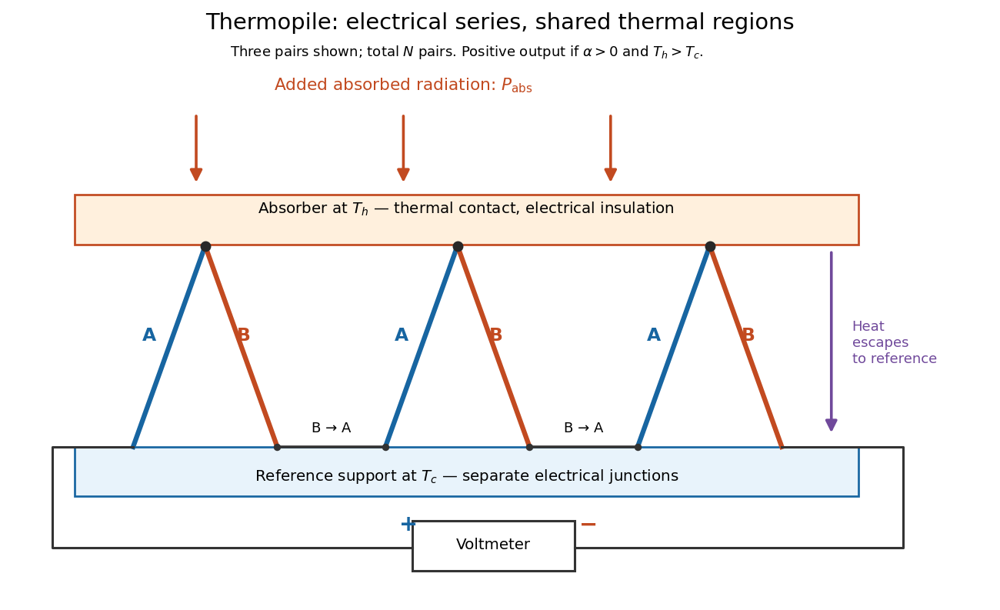

# Thermopile series voltage

↑ **Parent:** [Thermopile](thermopile.md)

Use the A-positive terminal order of [Seebeck effect](seebeck-effect.md) for each [thermocouple](thermocouple.md). Its [thermocouple measuring junction](thermocouple-measuring-junction.md) has [temperature](temperature-split.md) $T_{h,i}$ and its reference connections have [temperature](temperature-split.md) $T_{c,i}$. Define the difference of [Seebeck coefficients](seebeck-coefficient.md) as $\alpha_i(T)=S_{A,i}(T)-S_{B,i}(T)$. Connect the B reference end of one [thermocouple](thermocouple.md) to the A reference end of the next at a common local [temperature](temperature-split.md), so the terminal [electric potential differences](electric-potential-difference.md) add:

$$
E_i=\int_{T_{c,i}}^{T_{h,i}}\alpha_i(T)\,dT,
\qquad V_{\rm oc}=\sum_{i=1}^{N} E_i.
$$

The first A reference terminal is the positive meter input; the final B reference terminal is the negative input. Following this connected path and adding the individual [Seebeck effect](seebeck-effect.md) [integrals](integral-split.md) proves the result. Matched meter leads with common endpoint [temperatures](temperature-split.md) cancel as in an [isothermal terminal block](isothermal-terminal-block.md). The manufacturer's sum formula also allows unequal individual contributions.[p. 2, Eq. (2-1): total output is the sum of individual thermocouple outputs](thermopile-detectors-by-hamamatsu-photonics-k-k.md)

**[Figure 4](#image-thermopile-geometry-series-junctions-absorber-and-reference-support). Thermopile geometry: series junctions, absorber and reference support**. Original idealized wiring, showing three of $N$ [thermocouples](thermocouple.md). Each A leg rises from reference [temperature](temperature-split.md) $T_c$ to absorber [temperature](temperature-split.md) $T_h$, and each B leg returns. B-to-A connections at $T_c$ join adjacent pairs; the thermally shared absorber and support do not short the electrically distinct junctions. A-positive and B-negative meter connections match the [Seebeck effect](seebeck-effect.md) convention. Arrows indicate absorbed [electromagnetic radiation](electromagnetic-radiation-split.md) and escaping [heat](heat-split.md), not [electric current](electric-current.md).

If all pairs share $T_h,T_c$ and the same nearly constant difference $\alpha$ of [Seebeck coefficients](seebeck-coefficient.md) throughout that [temperature](temperature-split.md) [interval](interval-mathematics.md), then

$$
V_{\rm oc}\approx N\alpha\Delta T,\qquad \Delta T=T_h-T_c.
$$

This $\alpha$ is the pair's relative [Seebeck coefficient](seebeck-coefficient.md), not either material's individual coefficient or a universal device constant. As an original constructed example, choose $N=20$, $\alpha=40\,\mu\mathrm{V\,K^{-1}}$ and $\Delta T=5\,\mathrm K$. Each [thermocouple](thermocouple.md) contributes $0.20\,\mathrm{mV}$ and

$$
V_{\rm oc}=20(40\times10^{-6}\,\mathrm{V\,K^{-1}})(5\,\mathrm K)=4.0\,\mathrm{mV}.
$$

Reversing the meter connections changes the sign. Exchanging $T_h$ and $T_c$ reverses the [integrals](integral-split.md) and hence the [electromotive force](electromotive-force.md); this reversible sign response does not make a detector with [heat conduction](thermal-conduction.md) a reversible thermodynamic process. Reversing the wiring of one pair instead gives $(N-2)\alpha\Delta T$, because one contribution is subtracted rather than added. For this example the result is $3.6\,\mathrm{mV}$, and at equal junction [temperatures](temperature-split.md) every contribution vanishes.

The open-circuit condition matters. If the array's total [electrical resistance](electrical-resistance.md) is $R_{\rm pile}$ and the meter input has [electrical resistance](electrical-resistance.md) $R_m$, the elementary [voltage divider](voltage-divider.md) model gives $V_m=V_{\rm oc}R_m/(R_m+R_{\rm pile})$. Thus $R_m\gg R_{\rm pile}$ is needed to suppress [voltmeter loading](voltmeter-loading.md). Appreciable [electric current](electric-current.md) also permits [Joule heating](joule-heating.md) and the thermoelectric [heat transfer](heat-transfer.md) to disturb the assumed junction [temperatures](temperature-split.md).

## ↑ Ancestors (8)

1. [Thermopile](thermopile.md)
2. [Thermocouple](thermocouple.md)
3. [Seebeck effect](seebeck-effect.md)
4. [Thermoelectric effect](thermoelectric-effect-split.md)
5. [Electromagnetism](electromagnetism-split.md)
6. [Branches of physics](branches-of-physics.md)
7. [Physics](physics-split.md)
8. [Codex Wiki](split.md)
