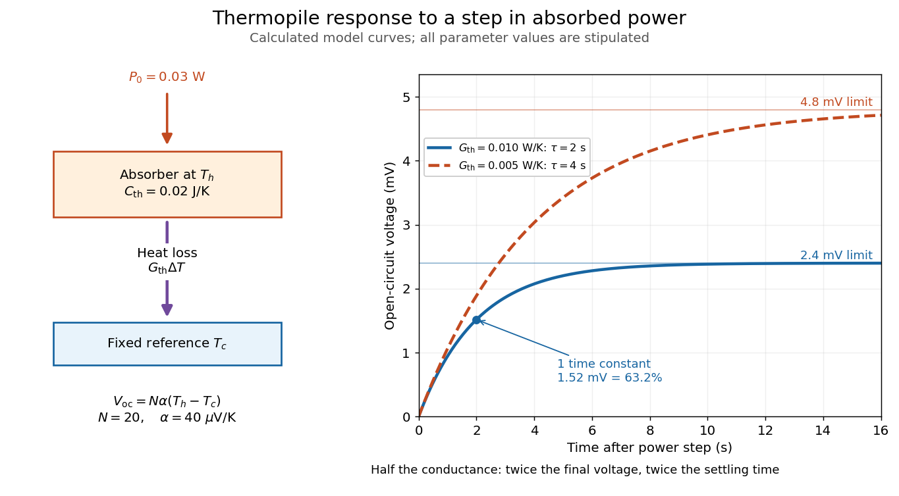

# Thermopile thermal response

↑ **Parent:** [Thermopile](thermopile.md)

A useful original model treats the [thermopile absorber](thermopile-absorber.md) as one approximately uniform [temperature](temperature-split.md) $T_h(t)$ with [heat capacity](heat-capacity.md) $C_{\rm th}$, connected to a fixed reference [temperature](temperature-split.md) $T_c$ by [thermal conductance](thermal-conductance.md) $G_{\rm th}$. Both parameters are positive constants here. Let $P_{\rm abs}(t)$ be an added absorbed [power](power.md) above the initial background. Linearize the outgoing [heat transfer](heat-transfer.md) about that background. With $\Delta T=T_h-T_c$ measured from an initial state having $\Delta T=0$, [conservation of energy](conservation-of-energy.md) gives the [first-order linear differential equation](first-order-linear-differential-equation.md)

$$
C_{\rm th}\frac{d\Delta T}{dt}=P_{\rm abs}(t)-G_{\rm th}\Delta T.
$$

The left side is the rate of stored [energy](energy-split.md); the two terms on the right are added [power](power.md) and outgoing [heat transfer](heat-transfer.md). The effective [thermal conductance](thermal-conductance.md) can include several paths, rather than just [heat conduction](thermal-conduction.md) along the wires. The model assumes a stable reference, negligible electrical loading, a common absorber [temperature](temperature-split.md), and changes small enough for constant parameters.

For a step from zero to constant $P_0$ at $t=0$, subtract the steady solution $\Delta T_\infty=P_0/G_{\rm th}$. The difference obeys [exponential decay](exponential-decay.md), so the initial condition fixes

$$
\tau=\frac{C_{\rm th}}{G_{\rm th}},\qquad
\Delta T(t)=\frac{P_0}{G_{\rm th}}\left(1-e^{-t/\tau}\right),\qquad
V_{\rm oc}(t)\approx N\alpha\frac{P_0}{G_{\rm th}}\left(1-e^{-t/\tau}\right).
$$

The [time constant](time-constant.md) has units $(\mathrm{J\,K^{-1}})/(\mathrm{W\,K^{-1}})=\mathrm s$. With the same constructed $N=20$ and $\alpha=40\,\mu\mathrm{V\,K^{-1}}$, choose $C_{\rm th}=0.02\,\mathrm{J\,K^{-1}}$, $G_{\rm th}=0.01\,\mathrm{W\,K^{-1}}$ and $P_0=0.03\,\mathrm W$. Then

$$
\tau=2\,\mathrm s,\qquad \Delta T_\infty=3\,\mathrm K,\qquad
V_\infty=2.4\,\mathrm{mV}.
$$

At one [time constant](time-constant.md), the response is $1-e^{-1}\approx0.632$ of its final value: $V_{\rm oc}(2\,\mathrm s)\approx1.52\,\mathrm{mV}$. Reaching $95\%$ requires $t=-\tau\ln(0.05)\approx5.99\,\mathrm s$. A [voltmeter](voltmeter.md) read too soon therefore underestimates the steady [signal](signal.md) even when its electrical calibration is perfect.

**[Figure 5](#image-calculated-thermopile-step-response-heat-capacity-thermal-conductance-and-settling). Calculated thermopile step response: heat capacity, thermal conductance and settling**. Original model curves for added absorbed [power](power.md) $P_0=0.03\,\mathrm W$, $N=20$ and relative [Seebeck coefficient](seebeck-coefficient.md) $\alpha=40\,\mu\mathrm{V\,K^{-1}}$. The solid curve uses $C_{\rm th}=0.02\,\mathrm{J\,K^{-1}}$ and $G_{\rm th}=0.01\,\mathrm{W\,K^{-1}}$, giving [time constant](time-constant.md) $2\,\mathrm s$ and final voltage $2.4\,\mathrm{mV}$. The dashed comparison halves only $G_{\rm th}$: final voltage doubles, but so does the [time constant](time-constant.md). Neither curve is an experimental observation.

The steady ratio $V_\infty/P_0=N\alpha/G_{\rm th}$ is $0.080\,\mathrm{V\,W^{-1}}$ in this constructed model. Halving [thermal conductance](thermal-conductance.md) doubles this ratio but also doubles the [time constant](time-constant.md) if [heat capacity](heat-capacity.md) stays fixed. Reducing [heat capacity](heat-capacity.md) alone speeds the response without changing its steady value. Increasing $N$ gives a larger [signal](signal.md) only at fixed individual [temperature](temperature-split.md) differences: adding legs can also change [thermal conductance](thermal-conductance.md), [heat capacity](heat-capacity.md) and [electrical resistance](electrical-resistance.md). The algebra identifies coupled design choices, rather than predicting a particular manufactured detector.

A finite [electrical resistance](electrical-resistance.md) produces [Thermal electrical noise](thermal-electrical-noise.md). For nearly uniform absolute [temperature](temperature-split.md) $T$ and effective measurement [signal bandwidth](signal-bandwidth.md) $B$, its [root mean square](root-mean-square.md) open-circuit voltage is

$$
v_{n,\rm rms}=\sqrt{4k_{\rm B}TR_{\rm pile}B}.
$$

Here $k_{\rm B}$ is the [Boltzmann constant](boltzmann-constant.md). Thermal electrical [noise](noise-signal-processing.md) in the sensing element is an important contribution, and the [signal bandwidth](signal-bandwidth.md) enters its voltage variance.[p. 3, §3-2 Noise, Eq. (3-2): element resistance, absolute temperature and measurement bandwidth](thermopile-detectors-by-hamamatsu-photonics-k-k.md) If identical pairs have fixed [electrical resistance](electrical-resistance.md) $r$ and fixed $\Delta T$, then $R_{\rm pile}=Nr$: the [signal](signal.md) grows as $N$ while this [noise](noise-signal-processing.md) grows as $\sqrt N$. The resulting [signal-to-noise ratio](signal-to-noise-ratio.md) grows only as $\sqrt N$ under those assumptions. Reference [temperature](temperature-split.md) drift, environmental [electromagnetic radiation](electromagnetic-radiation-split.md), and meter [noise](noise-signal-processing.md) remain separate limits; reducing [signal bandwidth](signal-bandwidth.md) trades fast information for less integrated electrical [noise](noise-signal-processing.md).

## ↑ Ancestors (8)

1. [Thermopile](thermopile.md)
2. [Thermocouple](thermocouple.md)
3. [Seebeck effect](seebeck-effect.md)
4. [Thermoelectric effect](thermoelectric-effect-split.md)
5. [Electromagnetism](electromagnetism-split.md)
6. [Branches of physics](branches-of-physics.md)
7. [Physics](physics-split.md)
8. [Codex Wiki](split.md)

## ← Incoming links (2)

- [Thermopile absorber](thermopile-absorber.md)
- [Thermopile radiative measurement](thermopile-radiative-measurement.md)
