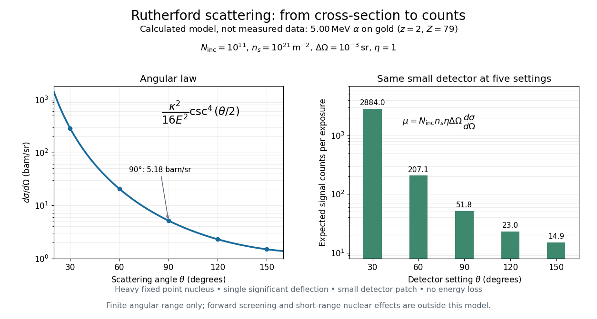

# Thin-foil scattering counts

↑ **Parent:** [Rutherford scattering](rutherford-scattering.md)

Let $N_{\rm inc}$ be the number of projectiles actually incident on the foil during an exposure, $n_s$ its [foil areal number density](foil-areal-number-density.md), and $\eta$ the probability of detecting an accepted particle. For a sufficiently small detector patch of [area](surface-area.md) $A$ at distance $R$ from the scattering point, with its normal at [angle](angle.md) $\psi$ to the line of sight,

$$
\Delta\Omega\simeq\frac{A\cos\psi}{R^2},\qquad
\mu(\theta)\simeq N_{\rm inc}\,n_s\,\eta\,\Delta\Omega\,
\frac{d\sigma}{d\Omega}(\theta).
$$

The product $n_s(d\sigma/d\Omega)\Delta\Omega$ is a dimensionless scattering probability in this approximation; $\mu$ is an [expected value](expected-value-split.md) of counts, so it need not be an integer. The approximation requires a nearly constant [differential scattering cross-section](differential-scattering-cross-section.md) and efficiency across the patch and incident beam. For finite acceptance use $\mu=N_{\rm inc}n_s\int_{\rm detector}\eta(\Omega)(d\sigma/d\Omega)\,d\Omega$, including the incident beam's spread if appreciable. A screen facing the foil has $\psi=0$.

For an original numerical model, stipulate monoenergetic [alpha particles](alpha-particle.md) with $z=2$, $E=5.00\,\mathrm{MeV}$, and a [gold](gold.md) target with $Z=79$. Use the rounded model constant $e^2/(4\pi\varepsilon_0)=1.440\,\mathrm{MeV\,fm}$, where $1\,\mathrm{MeV}=10^6$ [electronvolts](electronvolt.md) and $1\,\mathrm{fm}=10^{-15}\,\mathrm m$. Thus $\kappa=227.52\,\mathrm{MeV\,fm}$ and $a=22.752\,\mathrm{fm}$. Choose $N_{\rm inc}=10^{11}$, $n_s=10^{21}\,\mathrm{m^{-2}}$, $\eta=1$, and $\Delta\Omega=10^{-3}\,\mathrm{sr}$. For example, $A=1\,\mathrm{mm^2}$ facing the foil at $R\simeq31.6\,\mathrm{mm}$ gives this small-patch [solid angle](solid-angle.md).

At $\theta=90^\circ$, $b=a$ and $d\sigma/d\Omega=a^2=517.654\,\mathrm{fm^2\,sr^{-1}}=5.17654\,\mathrm{b\,sr^{-1}}$, using $1$ [barn](barn-unit.md) $=100\,\mathrm{fm^2}=10^{-28}\,\mathrm{m^2}$. The expected signal is $\mu\simeq51.8$ counts. At $60^\circ$ it is four times larger, about $207$ counts. Doubling [foil areal number density](foil-areal-number-density.md) or detector [solid angle](solid-angle.md) doubles these expected signals as long as the approximations continue to hold.

**[Figure 18](#image-calculated-rutherford-angular-cross-section-and-finite-detector-counts). Calculated Rutherford angular cross-section and finite-detector counts**. Original calculation for the stated ideal monoenergetic alpha beam and thin gold foil. The curve is a differential cross-section; the bars are expected counts for the specified small detector solid angle at separate settings. They are not measured 1909 or 1913 data, and do not sum to a total scattering probability. The curve is shown only from 20 to 160 degrees.

An observation also contains backgrounds. For a stable source and matched geometry, an estimator is $C_{\rm net}=C_{\rm foil}-(T_{\rm foil}/T_{\rm blank})C_{\rm blank}$, where $T$ denotes exposure duration. If source activity changes, normalize by incident exposure as well. [Background subtraction](background-subtraction.md) removes an estimated background; it does not make finite counting fluctuations disappear.

**Table of contents**

- [Foil areal number density](foil-areal-number-density.md)

## ↑ Ancestors (4)

1. [Rutherford scattering](rutherford-scattering.md)
2. [Atomic physics](atomic-physics-split.md)
3. [Physics](physics-split.md)
4. [Codex Wiki](split.md)

## ← Incoming links (1)

- [Rutherford model](rutherford-model.md)
