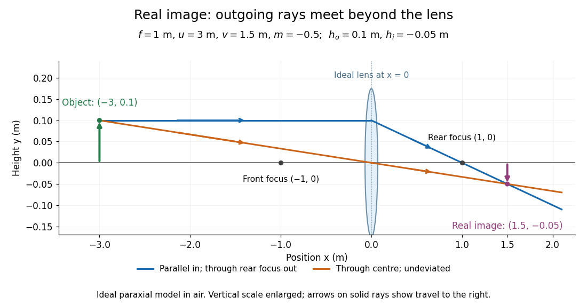
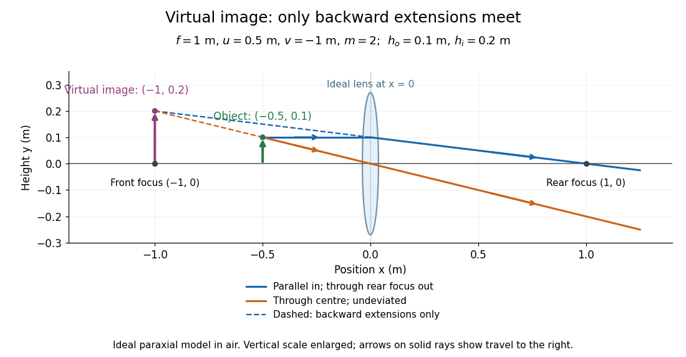

# Thin lens

↑ **Parent:** [Lens (optics)](lens-optics.md)  
ⓦ [Wiki](https://en.wikipedia.org/wiki/Thin_lens)

A [thin lens](thin-lens.md) models an [optical lens](lens-optics.md) by collapsing its refracting surfaces into one plane, neglecting thickness relative to the relevant [radius of curvature](radius-of-curvature.md) values and object and image distances. Here use an ideal converging [thin lens](thin-lens.md) in air and the [paraxial approximation](paraxial-approximation.md): [light rays](light-ray.md) make small [angles](angle.md) with the [optical axis](optical-axis.md), so [Snell's law](snell-s-law.md) can be linearized using the [small-angle approximation](small-angle-approximation.md). Equal surrounding [refractive indices](refractive-index.md) on both sides give the familiar symmetric equation.[§§E–G](mit-2-71-and-2-710-optics-spring-2014-by-nicholas-x-fang/lecture-notes-on-geometrical-optics.md)

Put the [thin lens](thin-lens.md) at $x=0$, with incident [light](light.md) travelling to the right. An object at $x=-u$ has $u>0$. The image coordinate is $x=v$: $v>0$ for a [real image](real-image.md) and $v<0$ for a [virtual image](virtual-image.md). The converging [thin lens](thin-lens.md) has [focal length](focal-length.md) $f>0$, and heights $h_o,h_i$ are signed relative to the [optical axis](optical-axis.md). The [thin lens](thin-lens.md) equation and [transverse magnification](transverse-magnification.md) are

$$
\frac1f=\frac1u+\frac1v,\qquad v=\frac{fu}{u-f},\qquad m=\frac{h_i}{h_o}=-\frac vu.
$$

The expression for $v$ requires $u\ne f$. Negative [transverse magnification](transverse-magnification.md) means inverted; positive [transverse magnification](transverse-magnification.md) means upright. Remember that the positive distance $u$ differs in sign from the object's coordinate $-u$. [Ling, Sanny and Moebs, OpenStax University Physics Volume 3, §2.4: Sign conventions](https://openstax.org/books/university-physics-volume-3/pages/2-4-thin-lenses).

For [focal length](focal-length.md) $f=1\,\mathrm m$, object distance $u=3\,\mathrm m$, and object height $h_o=0.1\,\mathrm m$, calculation gives

$$
\frac1v=\left(1-\frac13\right)\,\mathrm{m^{-1}}=\frac23\,\mathrm{m^{-1}},\qquad v=1.5\,\mathrm m,\qquad m=-0.5,\qquad h_i=-0.05\,\mathrm m.
$$

The [real image](real-image.md) is inverted, half as tall, and located $1.5\,\mathrm m$ to the right of the [thin lens](thin-lens.md). A screen at that position receives the image because the outgoing [light rays](light-ray.md) actually meet there.

**[Figure 6](#image-a-converging-thin-lens-forms-a-real-image-f-1-mathrm-m-u-3-mathrm-m-v-1-5-mathrm-m-m-0-5). A converging thin lens forms a real image: $f=1\,\mathrm m$, $u=3\,\mathrm m$, $v=1.5\,\mathrm m$, $m=-0.5$**. The object height is exactly $0.1\,\mathrm m$ and the image height is $-0.05\,\mathrm m$ in the ideal [thin lens](thin-lens.md) model. Both outgoing [light rays](light-ray.md) travel to the right and intersect at the image tip. The vertical scale is enlarged for visibility; the drawing is a schematic of [geometrical optics](geometrical-optics-split.md).

For the same [focal length](focal-length.md) $f=1\,\mathrm m$ and object height $h_o=0.1\,\mathrm m$, move the object inside the front [optical focus](focus-optics.md), to $u=0.5\,\mathrm m$. Then

$$
\frac1v=(1-2)\,\mathrm{m^{-1}}=-1\,\mathrm{m^{-1}},\qquad v=-1\,\mathrm m,\qquad m=2,\qquad h_i=0.2\,\mathrm m.
$$

The [virtual image](virtual-image.md) is upright, twice as tall, and apparently $1\,\mathrm m$ to the left of the [thin lens](thin-lens.md). Outgoing [light rays](light-ray.md) still travel to the right; only their backward extensions intersect at the [virtual image](virtual-image.md). A screen there cannot collect that image from the outgoing bundle. This geometry explains why a converging [optical lens](lens-optics.md) can act as a magnifier when held close to an object. [Urone and Hinrichs, OpenStax College Physics 2e, §25.6: Virtual images inside the focus](https://openstax.org/books/college-physics-2e/pages/25-6-image-formation-by-lenses).

**[Figure 7](#image-a-converging-thin-lens-forms-a-virtual-image-f-1-mathrm-m-u-0-5-mathrm-m-v-1-mathrm-m-m-2). A converging thin lens forms a virtual image: $f=1\,\mathrm m$, $u=0.5\,\mathrm m$, $v=-1\,\mathrm m$, $m=2$**. The object height is exactly $0.1\,\mathrm m$ and the image height is $0.2\,\mathrm m$ in the ideal [thin lens](thin-lens.md) model. Solid outgoing [light rays](light-ray.md) have arrows to the right. Dashed backward extensions meet at the image tip; they are not transmitted [light rays](light-ray.md). The vertical scale is enlarged for visibility.

Both diagrams use two rules for [ray tracing](ray-tracing.md). A [light ray](light-ray.md) from the object's tip parallel to the [optical axis](optical-axis.md) reaches the [thin lens](thin-lens.md) at $(0,h_o)$ and exits along the [straight line](straight-line.md) through the rear [optical focus](focus-optics.md) $(f,0)$. Another [light ray](light-ray.md) through the centre $(0,0)$ continues undeviated in the ideal [thin lens](thin-lens.md) model. Their intersection, or the intersection of their backward extensions, locates the image tip. [Ling, Sanny and Moebs, OpenStax University Physics Volume 3, §2.4: Ray tracing](https://openstax.org/books/university-physics-volume-3/pages/2-4-thin-lenses).

A short geometric proof outline makes the signs transparent. The two outgoing [straight lines](straight-line.md) are

$$
y_{\rm parallel}(x)=h_o\left(1-\frac xf\right),\qquad y_{\rm centre}(x)=-\frac{h_o}{u}x.
$$

For nonzero $h_o$, equating their heights at $x=v$ gives $1-v/f=-v/u$, hence the [thin lens](thin-lens.md) equation; the centre [light ray](light-ray.md) gives $h_i/h_o=-v/u$, hence the [transverse magnification](transverse-magnification.md). This derives the image equations from the ideal [ray tracing](ray-tracing.md) rules, whose physical justification comes from [Snell's law](snell-s-law.md) in the [paraxial approximation](paraxial-approximation.md).

At $u=f$, the two outgoing [straight lines](straight-line.md) are parallel: there is no finite image position. For $u>f$ the [real image](real-image.md) has $m<0$; for $0<u<f$ the [virtual image](virtual-image.md) has $m>0$. These cases let an [optical camera](optical-camera.md) designer choose a receiving position and let a user understand a magnifier. An actual [optical lens](lens-optics.md) has finite [apertures](aperture.md), which cause [diffraction](diffraction.md) and impose [diffraction-limited resolution](diffraction-limited-resolution.md); [optical aberrations](optical-aberration.md) can further blur the image. The diagrams are ideal [geometrical optics](geometrical-optics-split.md), with exact coordinates within that model, rather than exact predictions of [Maxwell's equations](maxwell-equations-split.md). [Feynman, Leighton and Sands, The Feynman Lectures on Physics I, §§27-6–27-7: Aberrations and resolving power](https://www.feynmanlectures.caltech.edu/I_27.html).

**Table of contents**

- [Two equal lenses with a virtual intermediate object](two-equal-lenses-with-a-virtual-intermediate-object.md)
- [Virtual object](virtual-object.md)
- [Newton's lens formula](newton-s-lens-formula.md)
- [Bessel lens displacement method](bessel-lens-displacement-method.md)
  - [Bessel two focus positions](bessel-two-focus-positions.md)
  - [Bessel lens displacement experiment](bessel-lens-displacement-experiment.md)
  - [Bessel focal length uncertainty](bessel-focal-length-uncertainty.md)
- [Lensmaker's equation](lensmaker-s-equation.md)

## ↑ Ancestors (6)

1. [Lens (optics)](lens-optics.md)
2. [Geometrical optics](geometrical-optics-split.md)
3. [Optics](optics-split.md)
4. [Branches of physics](branches-of-physics.md)
5. [Physics](physics-split.md)
6. [Codex Wiki](split.md)

## ← Incoming links (45)

- [Achromatic doublet](achromatic-doublet.md)
- [Achromatic doublet power balance](achromatic-doublet-power-balance.md)
- [Angular magnification](angular-magnification.md)
- [Axial chromatic aberration](axial-chromatic-aberration.md)
- [Bessel focal length uncertainty](bessel-focal-length-uncertainty.md)
- [Bessel lens displacement experiment](bessel-lens-displacement-experiment.md)
- [Bessel lens displacement method](bessel-lens-displacement-method.md)
- [Bessel two focus positions](bessel-two-focus-positions.md)
- [Chromatic aberration](chromatic-aberration.md)
- [Conjugate optical plane](conjugate-optical-plane.md)
- [Demagnifying a distant diffraction pattern](demagnifying-a-distant-diffraction-pattern.md)
- [Electron lens](electron-lens.md)
- [Field of view](field-of-view.md)
- [Finite-conjugate microscope](finite-conjugate-microscope.md)
- [Focal length](focal-length.md)
- [Focal ratio](focal-ratio.md)
- [Focus (optics)](focus-optics.md)
- [Geometrical optics](geometrical-optics-split.md)
- [Image formation](image-formation.md)
- [Lagrange optical invariant](lagrange-optical-invariant.md)
- [Lens (optics)](lens-optics.md)
- [Lensmaker's equation](lensmaker-s-equation.md)
- [Magnetic electron lens](magnetic-electron-lens.md)
- [Magnification](magnification.md)
- [Microscope eyepiece](microscope-eyepiece.md)
- [Newton's lens formula](newton-s-lens-formula.md)
- [Optical microscope](optical-microscope.md)
- [Optical power](optical-power.md)
- [Optics](optics-split.md)
- [Parallax localization of a virtual image](parallax-localization-of-a-virtual-image.md)
- [Solution](past-exam-of-the-mathematics-course-of-the-university-of-cambridge/2019/iii/paper-338/3/a/solution.md)
- [Solution](past-exam-of-the-mphil-in-micro-and-nanotechnology-enterprise-course-of-the-university-of-cambridge/2020/paper-1/section-a-i/2/i/solution.md)
- [Solution](past-exam-of-the-physics-a-course-of-the-university-of-cambridge/2016/paper-2/section-b/b8/solution.md)
- [Solution](past-exam-of-the-physics-course-of-the-year-1-of-the-natural-sciences-course-of-the-university-of-cambridge/2013/paper-1/section-d/d12/solution.md)
- [Solution](past-exam-of-the-physics-course-of-the-year-1-of-the-natural-sciences-course-of-the-university-of-cambridge/2014/paper-1/a5/solution.md)
- [Solution](past-exam-of-the-physics-course-of-the-year-1-of-the-natural-sciences-course-of-the-university-of-cambridge/2017/section-a/3/solution.md)
- [Solution](past-exam-of-the-physics-course-of-the-year-1-of-the-natural-sciences-course-of-the-university-of-cambridge/2021/section-b/9/b/solution.md)
- [Solution](past-exam-of-the-physics-course-of-the-year-1-of-the-natural-sciences-course-of-the-university-of-cambridge/2021/section-b/9/c/solution.md)
- [Solution](past-exam-of-the-physics-course-of-the-year-1-of-the-natural-sciences-course-of-the-university-of-cambridge/2021/section-b/9/d/solution.md)
- [Solution](past-exam-of-the-physics-course-of-the-year-1-of-the-natural-sciences-course-of-the-university-of-cambridge/2022/section-a/4/solution.md)
- [Real image](real-image.md)
- [Refraction at a spherical surface](refraction-at-a-spherical-surface.md)
- [Thin lens](thin-lens.md)
- [Transverse magnification](transverse-magnification.md)
- [Virtual image](virtual-image.md)
