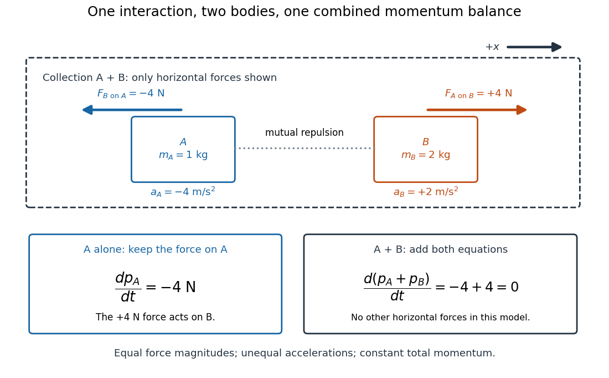

# Third-law interaction pair

↑ **Parent:** [Newton's third law](newton-s-third-law.md)

A [third-law interaction pair](third-law-interaction-pair.md) consists of the two [forces](force-split.md) belonging to the same mutual interaction, with their agent and recipient exchanged. The names [action-reaction pair](third-law-interaction-pair.md) do not imply a delay: in the instantaneous model, the two [forces](force-split.md) occur together. Test a proposed pair by naming both bodies and the interaction, rather than merely noticing equal magnitudes and opposite directions.

For a book resting on a table, the table's upward [normal force](normal-force.md) and [Earth](earth.md)'s downward [gravitational weight](weight-physics.md) both act on the book. They can balance in the book's [free-body diagram](free-body-diagram.md), but they are not a [third-law interaction pair](third-law-interaction-pair.md). The partner of the table's [normal force](normal-force.md) on the book is the book's downward contact [force](force-split.md) on the table. The partner of [Earth](earth.md)'s gravitational [force](force-split.md) on the book is the book's gravitational [force](force-split.md) on [Earth](earth.md). Their equality does not require equal [accelerations](acceleration.md): [Earth](earth.md)'s much greater [mass](mass.md) makes its response correspondingly smaller for a given net [force](force-split.md).

Similarly, [friction](friction.md) on a sliding block from a surface is paired with [friction](friction.md) on that surface from the block. For the collection containing only the block, that [friction](friction.md) is an [external force](external-force.md); including the contacting surface makes both members [internal forces](internal-force.md). Changing the collection changes the bookkeeping of [momentum](momentum-split.md), not the physical interaction.

**[Figure 5](#image-equal-opposite-interaction-forces-act-on-different-bodies-and-cancel-only-in-the-combined-momentum-balance). Equal opposite interaction forces act on different bodies and cancel only in the combined momentum balance**. Original one-dimensional model with right positive, $m_A=1\,\mathrm{kg}$ and $m_B=2\,\mathrm{kg}$. The upper arrows are the mutual [forces](force-split.md); the lower panels retain the [force](force-split.md) on $A$ alone and add both bodies' [momentum](momentum-split.md) equations. Only horizontal [forces](force-split.md) are shown; balanced vertical support is omitted.

## ↑ Ancestors (7)

1. [Newton's third law](newton-s-third-law.md)
2. [Newton's laws of motion](newton-s-laws-of-motion.md)
3. [Force](force-split.md)
4. [Classical mechanics](classical-mechanics-split.md)
5. [Branches of physics](branches-of-physics.md)
6. [Physics](physics-split.md)
7. [Codex Wiki](split.md)

## ← Incoming links (6)

- [Free-body diagram](free-body-diagram.md)
- [Internal force](internal-force.md)
- [Internal-force cancellation in system momentum](internal-force-cancellation-in-system-momentum.md)
- [Newton's first law](newton-s-first-law.md)
- [Newton's third law](newton-s-third-law.md)
- [Third-law interaction pair](third-law-interaction-pair.md)
