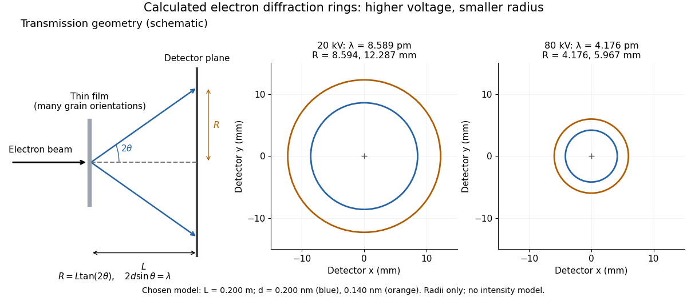

# Thomson electron transmission diffraction experiment

↑ **Parent:** [Matter wave](matter-wave.md)

Alongside the 1927 [Davisson–Germer experiment](davisson-germer-experiment.md), [George Paget Thomson](george-paget-thomson.md) developed an independent transmission test. [Alexander Reid](alexander-reid.md) first used celluloid; Thomson used thin metal films. A narrow [electron](electron.md) beam crossed a film about $10^{-6}\,\mathrm{cm}$ thick, reaching a [photographic plate](photographic-plate.md) perpendicular to the beam. Rings appeared. Accelerating [voltages](voltage.md) of $20$–$60\,\mathrm{kV}$ set the [de Broglie wavelengths](de-broglie-wavelength.md); metal structures known from [X-ray diffraction](x-ray-diffraction.md) allowed quantitative comparison. A downstream [magnetic field](magnetic-field-split.md) deflected ring-forming [electrons](electron.md) like those passing through holes, identifying the carriers as [electrons](electron.md) rather than [X-rays](x-ray.md). Celluloid's uncertain structure limited its quantitative interpretation.[Nobel Lectures, Physics 1922–1941; Electronic waves, delivered 7 June 1938, printed pp. 398–400: films, plate, voltage range, metal comparison and magnetic control](nobel-lectures-physics-1922-1941/electronic-waves-by-george-paget-thomson.md)

The [Davisson–Germer experiment](davisson-germer-experiment.md) uses crystal reflection and angular [electric current](electric-current.md) scans; this transmission camera records a spatial pattern behind the specimen. Both probe [interference](interference-wave-propagation.md) in [electron diffraction](electron-diffraction.md), with different specimen preparations and readouts. A developed [photographic plate](photographic-plate.md) records accumulated detections, not a direct image of the [wavefunction](wave-function-split.md).

Why rings? In an ideal film containing many small [crystals](crystal.md) with uniformly distributed orientations, a family of [lattice planes](lattice-plane.md) with spacing $d$ can satisfy [Bragg's law](bragg-s-law.md) at every azimuth about the incident beam. First-order [elastic scattering](elastic-scattering.md) then forms a cone of opening half-angle $2\theta$, where $2d\sin\theta=\lambda$. A flat detector a distance $L$ downstream cuts this cone in a circle:

$$
R=L\tan(2\theta)
=L\tan\!\left[2\arcsin\!\left(\frac{\lambda}{2d}\right)\right]
\simeq\frac{L\lambda}{d}.
$$

The last expression requires small [scattering angles](scattering-angle.md). It explains a useful control: hold the specimen and camera distance fixed, increase accelerating [voltage](voltage.md), and the ring radii should shrink with the [electron accelerating-voltage wavelength](electron-accelerating-voltage-wavelength.md). It predicts positions, not intensities: preferred crystal orientations, film thickness and repeated [quantum scattering](quantum-scattering-split.md) can alter a real pattern.

For a chosen example, take $L=0.200\,\mathrm m$ and $d=0.200\,\mathrm{nm}$. The exact relativistic [electron accelerating-voltage wavelength](electron-accelerating-voltage-wavelength.md) gives $\lambda=8.589\,\mathrm{pm}$ at $20\,\mathrm{kV}$ and $4.176\,\mathrm{pm}$ at $80\,\mathrm{kV}$. The corresponding exact ring radii are $8.594\,\mathrm{mm}$ and $4.176\,\mathrm{mm}$. These are calculated examples with chosen spacings and camera distance, not Thomson's measurements. The higher [voltage](voltage.md) lies outside the range quoted from his lecture, deliberately illustrating a prediction rather than reconstructing his data.

**[Figure 2](#image-calculated-electron-diffraction-rings-shrink-as-accelerating-voltage-increases). Calculated electron diffraction rings shrink as accelerating voltage increases**. [Source](electron-transmission-diffraction-rings.py). Original transmission geometry and calculated first-order ring positions for chosen plane spacings $0.200\,\mathrm{nm}$ and $0.140\,\mathrm{nm}$ at camera distance $L=0.200\,\mathrm m$. Both detector views have identical scales. Exact relativistic [de Broglie wavelengths](de-broglie-wavelength.md) and $R=L\tan(2\theta)$ determine the radii; ring brightness and width are drawing choices. The geometry sketch exaggerates the [scattering angles](scattering-angle.md). No experimental data or borrowed diffraction photograph is plotted.

## ↑ Ancestors (6)

1. [Matter wave](matter-wave.md)
2. [Wave function](wave-function-split.md)
3. [Quantum mechanics](quantum-mechanics-split.md)
4. [Branches of physics](branches-of-physics.md)
5. [Physics](physics-split.md)
6. [Codex Wiki](split.md)

## ← Incoming links (2)

- [Matter wave](matter-wave.md)
- [Nobel Prize in Physics in 1937](nobel-prize-in-physics-in-1937.md)
