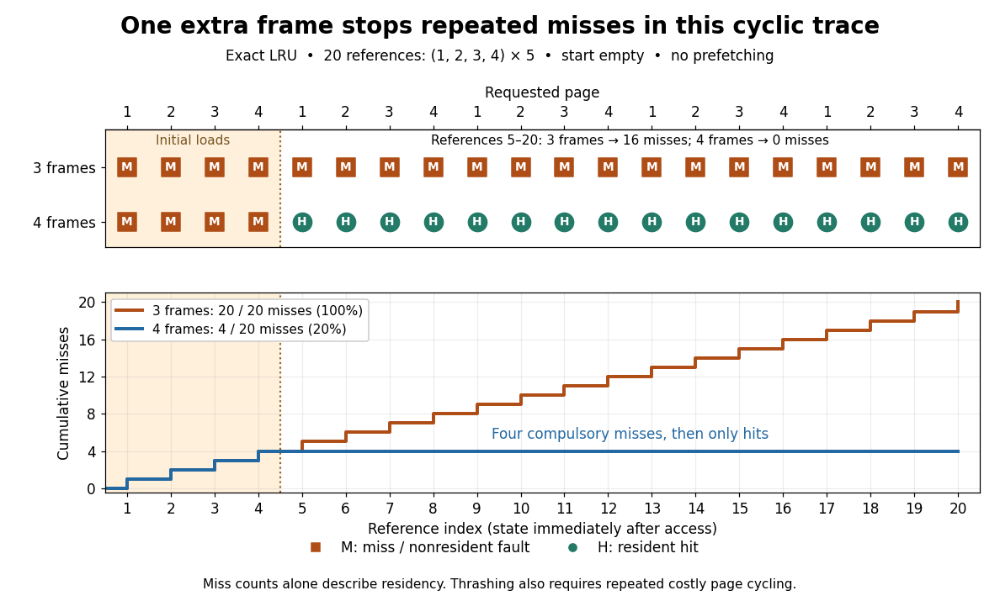

# Thrashing (computer science)

↑ **Parent:** [Virtual memory](virtual-memory.md)  
ⓦ [Wiki](https://en.wikipedia.org/wiki/Thrashing_(computer_science))

[Memory thrashing](thrashing-computer-science.md) is repeated costly cycling of [memory pages](memory-page.md) out of and back into [computer memory](computer-memory.md), leaving little useful computation between [page faults](page-fault.md). Active demand can exceed the available [page frames](page-frame.md), especially when [multiprogramming](multiprogramming.md) admits too many [operating-system processes](process-computing.md). A high [page fault rate](page-fault-rate.md) during initial loading alone does not establish [memory thrashing](thrashing-computer-science.md). [Arpaci-Dusseau and Arpaci-Dusseau, OSTEP chapter 22, section 22.11: Thrashing](operating-systems-three-easy-pieces-by-remzi-h-arpaci-dusseau-and-others/beyond-physical-memory-policies.md)

Consider one [operating-system process](process-computing.md) making the 20 [memory references](memory-reference.md) $1,2,3,4,1,2,3,4,\ldots,1,2,3,4$: five repetitions of four [memory pages](memory-page.md). Start with an empty [resident set](resident-set.md), use [demand paging](demand-paging.md) and exact [LRU replacement](lru-replacement.md), and assume no prefetching or competing [operating-system processes](process-computing.md). A hit finds the requested [memory page](memory-page.md) resident; a miss requires a nonresident [page fault](page-fault.md). With three [page frames](page-frame.md), references 1–3 load pages 1–3. Reference 4 evicts page 1, reference 5 reloads page 1 and evicts page 2, and the cycle continues: every return finds its [memory page](memory-page.md) evicted. With four [page frames](page-frame.md), only the first four references miss; all four [memory pages](memory-page.md) then remain resident.

| Available [page frames](page-frame.md) | Misses in all 20 [memory references](memory-reference.md) | Overall [page fault rate](page-fault-rate.md) | Misses in references 5–20 | [Page fault rate](page-fault-rate.md) in references 5–20 | 3 | 20 | 100% | 16 | 100% | 4 | 4 | 20% | 0 | 0% |
| --- | --- | --- | --- | --- | --- | --- | --- | --- | --- | --- | --- | --- | --- | --- |

The four initial misses with four [page frames](page-frame.md) are compulsory first-use misses from the empty [resident set](resident-set.md). They are startup work; the three-[page frame](page-frame.md) case keeps faulting after startup. This makes the difference between [memory thrashing](thrashing-computer-science.md) and loading a new [working set](working-set.md) visible. For the three-[page frame](page-frame.md) trace, each reused [memory page](memory-page.md) has three distinct intervening [memory pages](memory-page.md), so [LRU replacement](lru-replacement.md) has already evicted it before its next use.

**[Figure 33](#image-the-same-20-memory-references-under-lru-replacement-three-page-frames-miss-every-time-four-miss-only-during-startup). The same 20 memory references under LRU replacement: three page frames miss every time, four miss only during startup**.

To quantify the cost, assume each hit takes 100 nanoseconds and each miss incurs an additional 1 millisecond of [page fault](page-fault.md) service, followed by the same 100-nanosecond memory access. These are toy latencies, not measurements. With miss [probability](probability.md) $p$, the [expected value](expected-value.md) of access time is

$$
E[T]=100\,\mathrm{ns}+p\,(1\,\mathrm{ms}).
$$

The service cost is additional: it does not include the final 100 nanoseconds. Thus $p=1$ gives $1{,}000{,}100\,\mathrm{ns}$ and $p=0.2$ gives $200{,}100\,\mathrm{ns}$, approximately a fivefold ratio over the complete trace. Over references 5–20, the corresponding ratio is $1{,}000{,}100/100=10{,}001$: repeated [page faults](page-fault.md) dominate the useful accesses. The [expected value](expected-value.md) model follows the additive miss-penalty convention of OSTEP chapter 22, section 22.1. [Arpaci-Dusseau and Arpaci-Dusseau, OSTEP chapter 22, equation 22.1: average memory access time](operating-systems-three-easy-pieces-by-remzi-h-arpaci-dusseau-and-others/beyond-physical-memory-policies.md)

Not every [page fault](page-fault.md) performs disk [input-output](input-output.md): [demand paging](demand-paging.md) can allocate zero-filled [memory pages](memory-page.md), and [copy-on-write](copy-on-write.md) can copy an existing [page frame](page-frame.md). The toy service cost models expensive misses; the miss trace alone establishes residency behavior, while [memory thrashing](thrashing-computer-science.md) additionally concerns repeated costly cycling. [Arpaci-Dusseau and Arpaci-Dusseau, OSTEP chapter 23, section 23.1, Other Neat Tricks: demand zeroing and copy-on-write](https://pages.cs.wisc.edu/~remzi/OSTEP/vm-complete.pdf)

Possible remedies are more resident [page frames](page-frame.md), less [multiprogramming](multiprogramming.md), or reorganizing accesses to improve [temporal locality](temporal-locality.md). For this toy [sequence](sequence.md), one extra [page frame](page-frame.md) suffices under [LRU replacement](lru-replacement.md); that is not a universal threshold or policy. [Page replacement](page-replacement.md) alone cannot make every simultaneously needed [memory page](memory-page.md) fit.

// Target: computer-science.bigb

## ↑ Ancestors (4)

1. [Virtual memory](virtual-memory.md)
2. [Operating system](operating-system.md)
3. [Computer science](computer-science-split.md)
4. [Codex Wiki](split.md)
