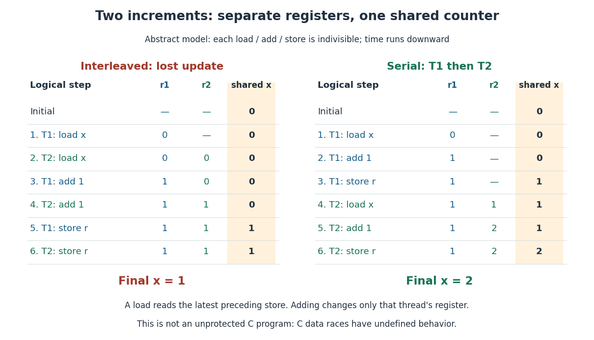

# Thread (computing)

↑ **Parent:** [Process (computing)](process-computing.md)  
ⓦ [Wiki](https://en.wikipedia.org/wiki/Thread_(computing))

A [software thread](thread-computing.md) is an execution stream within a [operating-system process](process-computing.md). Each [software thread](thread-computing.md) has its own [execution context](execution-context.md), including [processor registers](processor-register.md), an [instruction pointer](instruction-pointer.md), and a [call stack](call-stack.md) selected by its [stack pointer](stack-pointer.md). [Software threads](thread-computing.md) in the same [operating-system process](process-computing.md) share its [address space](address-space.md), global variables, dynamically allocated storage (the memory heap), and resources such as [file descriptors](file-descriptor.md). Separate register states let two [software threads](thread-computing.md) pause at different instructions and later resume correctly. A [context switch](context-switch.md) saves and restores those states; it does not copy the entire shared [address space](address-space.md). [Arpaci-Dusseau and Arpaci-Dusseau, OSTEP chapter 26, introduction and figure 26.1: thread contexts and shared address space](https://pages.cs.wisc.edu/~remzi/OSTEP/threads-intro.pdf)[The Open Group, POSIX.1-2024, sections 3.189–3.190: Live Process and Live Thread, shared resources and addressable storage](https://pubs.opengroup.org/onlinepubs/9799919799/basedefs/V1_chap03.html#tag_03_189)

In the right half of the diagram under [operating-system process](process-computing.md), T1 and T2 access the same counter `x` at [virtual address](virtual-address.md) `0x1234`. Their [call stacks](call-stack.md) occupy separate regions of the same [address space](address-space.md), and their saved [processor registers](processor-register.md) can contain different values. A [software thread](thread-computing.md)'s own [call stack](call-stack.md) means the stack used for its calls, not a hardware protection boundary against another [software thread](thread-computing.md). Another [software thread](thread-computing.md) with a suitable address can access that stack's live data, subject to the program's lifetime and [synchronization](synchronization-computing.md) rules. Sharing an [address space](address-space.md) enables easy communication and makes accidental interference possible.

Concurrency means that several activities can make progress over overlapping intervals; parallel execution means that several activities execute at the same instant. On one [CPU](central-processing-unit.md) execution slot, [process scheduling](process-scheduling.md) can interleave [software threads](thread-computing.md) without simultaneous execution. Multiple processor cores can run eligible [software threads](thread-computing.md) in parallel, but merely creating [software threads](thread-computing.md) does not ensure parallel execution or a speedup.

Consider an explicitly abstract interleaving model: shared `x` starts at $0$, and each of T1 and T2 performs three indivisible logical steps in its own order: load `x` into its own register `r`, add $1$ to `r`, then store `r` into `x`. Each load sees the latest preceding store in the displayed order. These model assumptions specify the example; they do not describe every programming language or every hardware memory model. In serial order T1 finishes all three steps before T2 starts, so T2 loads $1$ and stores $2$.

An overlapping order instead gives T1 load $0$, T2 load $0$, T1 add to get `r1 = 1`, T2 add to get `r2 = 1`, T1 store $1$, and T2 store $1$. The load/store subsequence is therefore T1 load $0$, T2 load $0$, T1 store $1$, T2 store $1$: final $x=1$, although each [software thread](thread-computing.md) incremented its register correctly. The second store replaces the first with the same value, losing one intended update. This [race condition](race-condition.md) is possible even with interleaving on a single [CPU](central-processing-unit.md).

**[Figure 48](#image-two-abstract-load-add-store-increments-retain-separate-registers-but-can-leave-the-shared-counter-at-1-instead-of-the-serial-result-2). Two abstract load/add/store increments retain separate registers but can leave the shared counter at $1$ instead of the serial result $2$**.

This is not an unprotected C implementation example. Conflicting unsynchronized accesses to an ordinary non-atomic C object from different [software threads](thread-computing.md) can constitute a data race, which has undefined behavior; the abstract trace is not a prediction of that program's allowed outcomes. [ISO/IEC JTC1/SC22/WG14, committee draft N1570, 12 April 2011, section 5.1.2.4 paragraph 25: data races and undefined behavior](https://www.open-std.org/jtc1/sc22/wg14/www/docs/n1570.pdf)

The repair explains why [synchronization](synchronization-computing.md) matters: [mutual exclusion](mutual-exclusion.md) around the whole load/add/store sequence prevents the other [software thread](thread-computing.md) from starting an increment halfway through it. Alternatively, an appropriate [atomic operation](atomic-operation.md) can make the complete increment one indivisible read-modify-write. In the toy model, either repair makes the two increments take effect in an order, producing $0+1+1=2$. Making only each load and each store an [atomic operation](atomic-operation.md) still permits the displayed lost update. [Arpaci-Dusseau and Arpaci-Dusseau, OSTEP chapter 28, sections 28.1–28.2 and 28.11: locks around updates and atomic fetch-and-add](https://pages.cs.wisc.edu/~remzi/OSTEP/threads-locks.pdf)

The attraction is independently progressing activities with direct access to shared data: a user-interface [software thread](thread-computing.md) can handle input while another waits for [input-output](input-output.md), and workers can divide independent pieces of a large calculation among available cores. The first benefit can exist on one [CPU](central-processing-unit.md); the second requires suitable work and execution resources. [Context switches](context-switch.md), [synchronization](synchronization-computing.md), register-state records and extra [call stacks](call-stack.md) consume time or [computer memory](computer-memory.md), so the useful partition depends on the workload. [Arpaci-Dusseau and Arpaci-Dusseau, OSTEP chapter 26, section 26.1: parallel work and overlapping input-output with other activity](https://pages.cs.wisc.edu/~remzi/OSTEP/threads-intro.pdf)

**Table of contents**

- [Race condition](race-condition.md)
- [Synchronization (computing)](synchronization-computing.md)
  - [Mutual exclusion](mutual-exclusion.md)
    - [Critical section](critical-section.md)
    - [Mutex](mutex.md)
      - [Spinlock](spinlock.md)
        - [Test-and-set](test-and-set.md)
    - [Thread interleaving](thread-interleaving.md)
      - [Lost update](lost-update.md)
  - [Safety property](safety-property.md)
  - [Liveness property](liveness-property.md)
    - [Starvation freedom](starvation-freedom.md)
  - [Deadlock](deadlock.md)
    - [Deadlock freedom](deadlock-freedom.md)
    - [Lock ordering](lock-ordering.md)
  - [Memory model](memory-model.md)
    - [Sequential consistency](sequential-consistency.md)
    - [Data race](data-race.md)
    - [Happens-before](happens-before.md)
      - [Acquire-release synchronization](acquire-release-synchronization.md)
  - [Atomic operation](atomic-operation.md)
    - [Atomic read-modify-write](atomic-read-modify-write.md)

## ↑ Ancestors (4)

1. [Process (computing)](process-computing.md)
2. [Operating system](operating-system.md)
3. [Computer science](computer-science-split.md)
4. [Codex Wiki](split.md)
