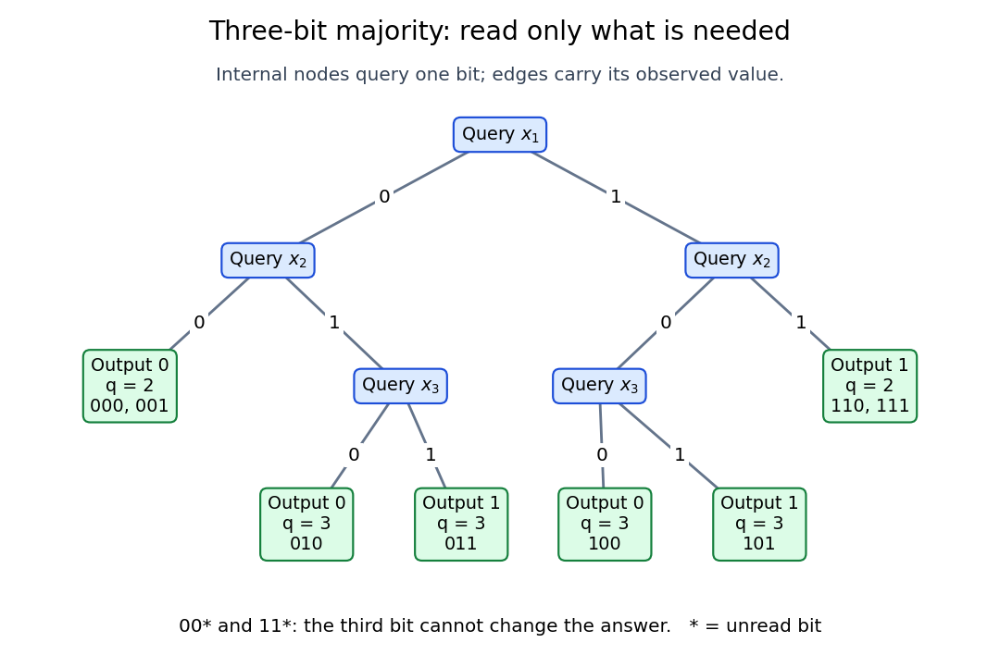

# Three-bit majority decision tree

↑ **Parent:** [Decision tree](decision-tree.md)

Three votes give a small but revealing [majority function](majority-function.md):

$$
m(x_1,x_2,x_3)=\begin{cases}1,&x_1+x_2+x_3\geq2,\\0,&x_1+x_2+x_3<2.\end{cases}
$$

Our [decision tree](decision-tree.md) queries $x_1$, then $x_2$. If these [bits](bit.md) agree, return their common value: two equal votes already force the [majority function](majority-function.md). If they disagree, query $x_3$ and return its value. The first two queries have a fixed order, but whether a third query occurs is adaptive.

**[Figure 3](#image-an-exact-three-bit-majority-decision-tree-equal-first-answers-stop-after-two-queries). An exact three-bit majority decision tree: equal first answers stop after two queries**.

Each internal label in the diagram names the next [bit](bit.md) to inspect. Each leaf lists its [output](output-computing.md), [decision-tree query cost](decision-tree-query-cost.md) $q$, and compatible [inputs](input-computer-science.md); an asterisk denotes an unread [bit](bit.md). The two shallow leaves each cover two [inputs](input-computer-science.md), while each deeper leaf covers one. Reading every [bit](bit.md) would also compute the [majority function](majority-function.md), but would miss these exact shortcuts.

All eight [inputs](input-computer-science.md) give the following exhaustive check. The [parity](parity.md) column is the [parity](parity.md) of $x_1+x_2+x_3$, computed by [exclusive or](exclusive-or.md); its [decision-tree query cost](decision-tree-query-cost.md) is justified under [parity lower bound for Boolean queries](parity-lower-bound-for-boolean-queries.md).

| $x_1x_2x_3$ | [Majority function](majority-function.md) [output](output-computing.md) | Queried coordinates for the [majority function](majority-function.md) | [Majority function](majority-function.md) query count | [Parity](parity.md) [output](output-computing.md) | [Parity](parity.md) query count | 000 | 0 | $1,2$ | 2 | 0 | 3 | 001 | 0 | $1,2$ | 2 | 1 | 3 | 010 | 0 | $1,2,3$ | 3 | 1 | 3 | 011 | 1 | $1,2,3$ | 3 | 0 | 3 | 100 | 0 | $1,2,3$ | 3 | 1 | 3 | 101 | 1 | $1,2,3$ | 3 | 0 | 3 | 110 | 1 | $1,2$ | 2 | 0 | 3 | 111 | 1 | $1,2$ | 2 | 1 | 3 |
| --- | --- | --- | --- | --- | --- | --- | --- | --- | --- | --- | --- | --- | --- | --- | --- | --- | --- | --- | --- | --- | --- | --- | --- | --- | --- | --- | --- | --- | --- | --- | --- | --- | --- | --- | --- | --- | --- | --- | --- | --- | --- | --- | --- | --- | --- | --- | --- | --- | --- | --- | --- | --- | --- |

The worst [inputs](input-computer-science.md) for this [decision tree](decision-tree.md) are $010,011,100,101$, exactly those with $x_1\ne x_2$. Its actual depth is three. Every exact [decision tree](decision-tree.md) for this [majority function](majority-function.md) has depth at least three: after the first query, an adversary can answer the second distinct query with the opposite [bit](bit.md), leaving the last [bit](bit.md) decisive. Consequently its optimal [decision-tree depth](decision-tree-depth.md) is $D(m)=3$, even though some [inputs](input-computer-science.md) finish sooner. Every [input](input-computer-science.md) has a two-[bit](bit.md) [query certificate](query-certificate.md), namely two agreeing votes; locating those votes can require a third query. This separates having a short [query certificate](query-certificate.md) from finding one.

## ↑ Ancestors (6)

1. [Decision tree](decision-tree.md)
2. [Decision tree model](decision-tree-model.md)
3. [Computational complexity theory](computational-complexity-theory.md)
4. [Theoretical computer science](theoretical-computer-science-split.md)
5. [Computer science](computer-science-split.md)
6. [Codex Wiki](split.md)

## ← Incoming links (5)

- [Coordinate revealment](coordinate-revealment.md)
- [Decision-tree depth](decision-tree-depth.md)
- [Decision-tree query cost](decision-tree-query-cost.md)
- [Expected query cost](expected-query-cost.md)
- [Parity lower bound for Boolean queries](parity-lower-bound-for-boolean-queries.md)
