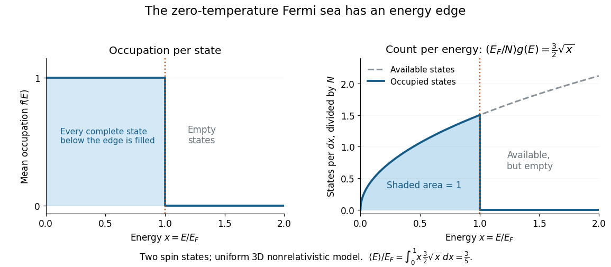

# Three-dimensional free-electron density of states

↑ **Parent:** [Fermi sea](fermi-sea.md)

For the uniform noninteracting [electron](electron.md) model with two [spin](spin.md) states and [kinetic energy](kinetic-energy.md) of [nonrelativistic particles](nonrelativistic-particle.md) $E=p^2/(2m_e)$, count all available one-particle states up to an [energy](energy-split.md) $E\geq0$:

$$
\mathcal N(E)=\frac{V}{3\pi^2}\left(\frac{2m_eE}{\hbar^2}\right)^{3/2},\qquad
g(E)=\frac{d\mathcal N}{dE}=\frac{V}{2\pi^2}\left(\frac{2m_e}{\hbar^2}\right)^{3/2}\sqrt E.
$$

This extensive [density of states](density-of-states.md) has units of inverse [energy](energy-split.md); $g(E)/V$ is the [density of states](density-of-states.md) per unit [volume](volume.md). Availability and occupation are different: $g(E)$ is positive above $E_F$, but at zero [temperature](temperature-split.md) those states are empty. The occupied [energy](energy-split.md) distribution is $g(E)f(E)$, with the [Fermi-Dirac distribution](fermi-dirac-distribution.md) reduced to $f(E)=1$ below $E_F$ and $f(E)=0$ above it. The convention at the exact boundary does not affect a continuum [integral](integral-split.md).

**[Figure 4](#image-at-zero-temperature-occupation-cuts-off-at-the-fermi-energy-although-the-density-of-available-states-keeps-growing). At zero temperature occupation cuts off at the Fermi energy although the density of available states keeps growing**.

With the [dimensionless quantity](dimensionless-quantity.md) $x=E/E_F$, the occupied count per $dx$, divided by the total particle number, is $3\sqrt x/2$ for $0<x<1$. Its area is one. Weighting this by $E$ gives the [internal energy](internal-energy-split.md) and its [mean](expected-value-split.md) per particle:

$$
N=\int_0^{E_F}g(E)\,dE,\qquad
U=\int_0^{E_F}Eg(E)\,dE=\frac35NE_F,\qquad
\frac UN=\frac35E_F.
$$

Thus the highest occupied [energy](energy-split.md) and the [mean](expected-value-split.md) [energy](energy-split.md) differ. For the [Fermi energy of a model electron gas](fermi-energy-of-a-model-electron-gas.md), $U/N\simeq1.0155\,\mathrm{eV}$. At fixed $N$, $E_F\propto V^{-2/3}$, so the [derivative](derivative.md) $P=-(\partial U/\partial V)_N$ gives the [electron degeneracy pressure](electron-degeneracy-pressure.md) $P=2nE_F/5$. The same state-counting geometry therefore predicts a nonzero [pressure](pressure-split.md) at zero [temperature](temperature-split.md).

## ↑ Ancestors (9)

1. [Fermi sea](fermi-sea.md)
2. [Fermi energy](fermi-energy.md)
3. [Fermi gas](fermi-gas.md)
4. [Fermi-Dirac distribution](fermi-dirac-distribution.md)
5. [Quantum ideal-gas statistics](quantum-ideal-gas-statistics-split.md)
6. [Statistical physics](statistical-physics-split.md)
7. [Branches of physics](branches-of-physics.md)
8. [Physics](physics-split.md)
9. [Codex Wiki](split.md)

## ← Incoming links (2)

- [Solution](past-exam-of-the-physics-a-course-of-the-university-of-cambridge/2018/paper-2/section-c/c10/b/solution.md)
- [Solution](past-exam-of-the-physics-a-course-of-the-university-of-cambridge/2022/paper-2/section-c/c8/b/iii/solution.md)
