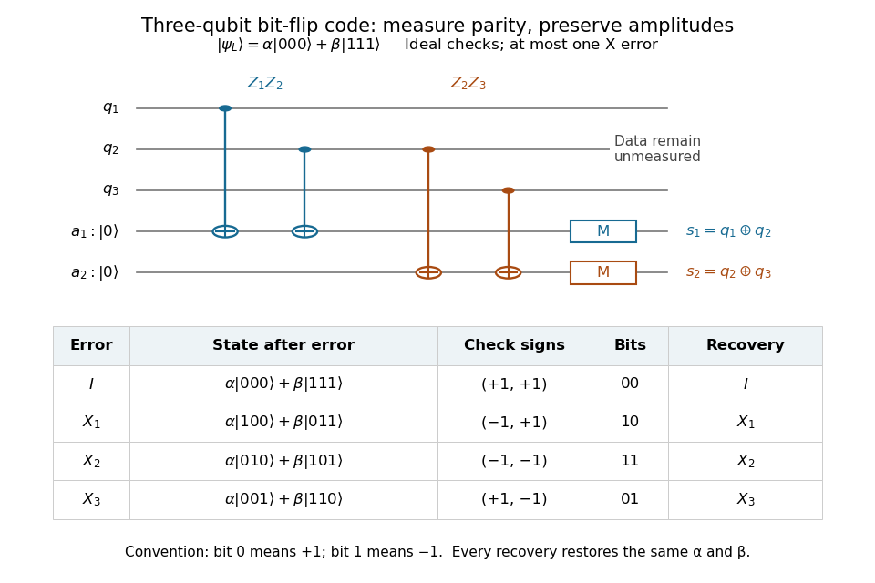

# Three-qubit bit-flip syndrome table

↑ **Parent:** [Bit-flip repetition code](bit-flip-repetition-code.md)

Measure the commuting [stabilizer generators](stabilizer-generator.md) $g_1=Z_1Z_2$ and $g_2=Z_2Z_3$ in that order. Use [error syndrome](error-syndrome.md) bit $0$ for [eigenvalue](eigenvalue.md) $+1$ and bit $1$ for [eigenvalue](eigenvalue.md) $-1$. For $X_j$ the [Pauli X gate](pauli-x-gate.md) on physical [qubit](qubit.md) $j$, every row holds for arbitrary normalized $\alpha,\beta$. This ordered parity-check convention follows [Preskill, §7.1](https://www.preskill.caltech.edu/ph229/notes/chap7.pdf):

| Error | State before recovery | $(g_1,g_2)$ [eigenvalues](eigenvalue.md) | [Error syndrome](error-syndrome.md) | Recovery |
| --- | --- | --- | --- | --- |
| $I$ | $\alpha|000\rangle+\beta|111\rangle$ | $(+1,+1)$ | $00$ | $I$ |
| $X_1$ | $\alpha|100\rangle+\beta|011\rangle$ | $(-1,+1)$ | $10$ | $X_1$ |
| $X_2$ | $\alpha|010\rangle+\beta|101\rangle$ | $(-1,-1)$ | $11$ | $X_2$ |
| $X_3$ | $\alpha|001\rangle+\beta|110\rangle$ | $(+1,-1)$ | $01$ | $X_3$ |

Each pair of [computational basis](computational-basis.md) words within a row has the same two parities. Consequently the [projective measurement](projective-measurement.md) reveals the row without distinguishing its two amplitudes. For example, $|\psi_L\rangle=(\sqrt3/2)|000\rangle+(i/2)|111\rangle$ becomes $(\sqrt3/2)|010\rangle+(i/2)|101\rangle$ under $X_2$. Both checks give $-1$ with [probability](probability.md) one, and applying $X_2$ restores both coefficients exactly, including the relative phase $i$.

One implementation uses two [quantum ancillas](quantum-ancilla.md) initialized to $|00\rangle$. Two [controlled-NOT gates](controlled-not-gate.md) from data [qubits](qubit.md) 1 and 2 to the first [quantum ancilla](quantum-ancilla.md) write their parity; two more from data [qubits](qubit.md) 2 and 3 to the second [quantum ancilla](quantum-ancilla.md) write the other parity. Measuring only the [quantum ancillas](quantum-ancilla.md) in the [computational basis](computational-basis.md) gives $(s_1,s_2)$. Measuring the individual data [qubits](qubit.md) instead would reveal the encoded [computational basis](computational-basis.md) value and destroy the unknown [quantum superposition](quantum-superposition.md). The existing [coherent syndrome extraction for the three-qubit repetition code](coherent-syndrome-extraction-for-the-three-qubit-repetition-code.md) uses the alternative ordered checks $(Z_2Z_3,Z_1Z_3)$, so its bit labels differ from this table.

**[Figure 1](#image-parity-checks-identify-a-bit-flip-without-reading-the-logical-amplitudes). Parity checks identify a bit flip without reading the logical amplitudes**.

The recovery also handles coherent errors. Put $E_0=I,E_1=X_1,E_2=X_2,E_3=X_3$. Their images of the code are mutually [orthogonal](orthogonal-vectors.md), giving $PE_a^\dagger E_bP=\delta_{ab}P$, the [Knill--Laflamme condition](knill-laflamme-condition.md) for this family. For any [linear combination](linear-combination.md) $E=\sum_{a=0}^3c_aE_a$, its component in sector $s(E_a)$ is $c_aE_a|\psi_L\rangle$. Measuring that [error syndrome](error-syndrome.md) has [probability](probability.md) $|c_a|^2/\sum_b|c_b|^2$ on the normalized erroneous state, and recovery $E_a$ returns $|\psi_L\rangle$. More generally one recovery [quantum channel](quantum-channel.md) corrects every noise [quantum channel](quantum-channel.md) whose [Kraus operators](kraus-operator.md) belong to this span. The assumption concerns the whole jointly correctable family; it does not extend to the span of arbitrary single-site [Pauli errors](pauli-operator.md). [Preskill, §7.2: correction of an error span](https://www.preskill.caltech.edu/ph229/notes/chap7.pdf).

A fully computed coherent example is the [unitary operator](unitary-operator.md) $U=\exp(-i\theta X_2)=\cos\theta\,I-i\sin\theta\,X_2$. At $\theta=\pi/6$ it gives

$$
U|\psi_L\rangle=\frac{\sqrt3}{2}|\psi_L\rangle-\frac{i}{2}X_2|\psi_L\rangle.
$$

The [error syndromes](error-syndrome.md) $00$ and $11$ occur with [probabilities](probability.md) $3/4$ and $1/4$, independently of $\alpha,\beta$. Doing nothing for $00$ and applying $X_2$ for $11$ restores the same [logical qubit](logical-qubit.md) in both branches; the scalar $-i$ in the second branch is an irrelevant [global phase](global-phase.md). This is an example of [linearity of coherent quantum error correction](linearity-of-coherent-quantum-error-correction.md), rather than an assumption that the original error was a classical random bit flip.

## ↑ Ancestors (7)

1. [Bit-flip repetition code](bit-flip-repetition-code.md)
2. [Stabilizer code](stabilizer-code.md)
3. [Quantum error correction](quantum-error-correction-split.md)
4. [Quantum theory](quantum-theory-split.md)
5. [Branches of physics](branches-of-physics.md)
6. [Physics](physics-split.md)
7. [Codex Wiki](split.md)

## ← Incoming links (3)

- [Bit-flip repetition code](bit-flip-repetition-code.md)
- [Error syndrome](error-syndrome.md)
- [Logical failure of the three-qubit bit-flip repetition code](logical-failure-of-the-three-qubit-bit-flip-repetition-code.md)
