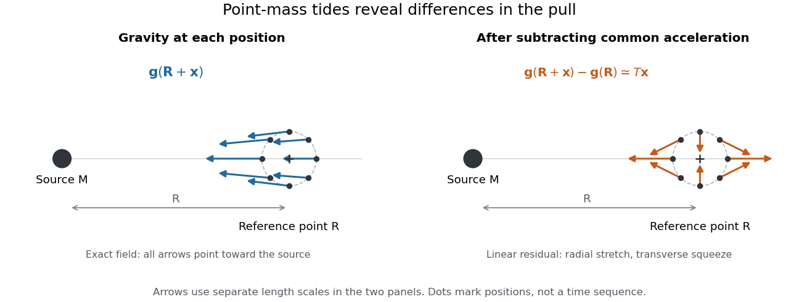

# Tidal force

↑ **Parent:** [Tidal tensor](tidal-tensor.md)  
ⓦ [Wiki](https://en.wikipedia.org/wiki/Tidal_force)

Differential gravitational [acceleration](acceleration.md), multiplied by the affected [mass](mass.md), across a spatially extended body. In the linear approximation the [acceleration](acceleration.md) difference is $T\Delta\boldsymbol r$, where $T$ is the [tidal tensor](tidal-tensor.md). Stellar [tidal forces](tidal-force.md) limit the domain of a [circumplanetary orbit](circumplanetary-orbit.md); sufficiently strong ones can produce [tidal disruption](tidal-disruption.md).

To isolate a [tidal force](tidal-force.md), subtract the [gravitational acceleration](gravitational-acceleration.md) shared by the body as a whole. Let a reference [test particle](test-particle.md) follow $\ddot{\mathbf R}=\mathbf g(\mathbf R)$, and let another have [position](position.md) $\mathbf R+\mathbf x$. In a [translating accelerated reference frame](translating-accelerated-reference-frame.md) with parallel, nonrotating axes,

$$
\ddot{\mathbf x}=\mathbf g(\mathbf R+\mathbf x)-\mathbf g(\mathbf R)=T(\mathbf R)\mathbf x+O\!\left(\frac{\mu|\mathbf x|^2}{R^4}\right)
$$

for a source [point mass](point-mass.md), when $|\mathbf x|/R\ll1$. Here $\mu=GM$ is its [standard gravitational parameter](standard-gravitational-parameter.md) and the last term uses [Big O notation](big-o-notation.md). This [Taylor expansion](taylor-expansion.md) removes the common inward pull and keeps the spatial variation. The near side has an excess pull toward the source; the far side has a deficit of inward pull, which is an outward relative [acceleration](acceleration.md). Both sides can stretch apart while both still accelerate toward the source.[§7–4, discussion of stronger near-side and weaker far-side attraction](the-feynman-lectures-on-physics-volume-i-by-richard-feynman-and-others/chapter-7-the-theory-of-gravitation.md)

**[Figure 3](#image-subtracting-common-gravitational-acceleration-reveals-radial-stretching-and-transverse-squeezing). Subtracting common gravitational acceleration reveals radial stretching and transverse squeezing**. Blue arrows show the exact [Newtonian gravitational field](newtonian-gravitational-field.md) at several [positions](position.md) near a reference point. Orange arrows show its linear residual, calculated with the [tidal tensor](tidal-tensor.md). Arrow lengths use separate scales in the two panels; this is a comparison of direction and spatial variation, not two equal-magnitude fields.

For a material element of [mass](mass.md) $m$, the residual external [force](force-split.md) in this [translating accelerated reference frame](translating-accelerated-reference-frame.md) is $m[\mathbf g(\mathbf R+\mathbf x)-\mathbf g(\mathbf R)]$. Actual deformation also depends on [elasticity](elasticity-physics-split.md), [pressure](pressure-split.md) and [self-gravity](self-gravity.md). A [rigid body](rigid-body-dynamics-split.md) approximation suppresses deformation but can still have internal [forces](force-split.md) that resist the [tidal force](tidal-force.md). The [point-mass tidal stretching and squeezing](point-mass-tidal-stretching-and-squeezing.md) pattern describes freely falling, noninteracting [test particles](test-particle.md), rather than promising the same shape for every solid, star or ocean. A [rotating reference frame](rotating-reference-frame.md) introduces [centrifugal acceleration](centrifugal-acceleration.md) and [Coriolis acceleration](coriolis-acceleration.md), which must be included separately.

**Table of contents**

- [Corotating tidal-disruption estimate for a uniform sphere](corotating-tidal-disruption-estimate-for-a-uniform-sphere.md)
- [Tide](tide.md)
  - [Bay of Fundy](bay-of-fundy.md)
  - [Semidiurnal tide](semidiurnal-tide.md)
  - [Spring tide](spring-tide.md)
  - [Neap tide](neap-tide.md)
- [Exact tidal acceleration between separated masses](exact-tidal-acceleration-between-separated-masses.md)
- [Gravity magnitude versus tidal gradient](gravity-magnitude-versus-tidal-gradient.md)
- [Love number](love-number.md)

## ↑ Ancestors (7)

1. [Tidal tensor](tidal-tensor.md)
2. [Newtonian gravitational field](newtonian-gravitational-field.md)
3. [Newton's law of universal gravitation](newton-s-law-of-universal-gravitation-split.md)
4. [Classical mechanics](classical-mechanics-split.md)
5. [Branches of physics](branches-of-physics.md)
6. [Physics](physics-split.md)
7. [Codex Wiki](split.md)

## ← Incoming links (32)

- [Einstein field equations](einstein-field-equations-split.md)
- [Equivalence principle](equivalence-principle.md)
- [Falling bodies and lunar motion as tests of gravity](falling-bodies-and-lunar-motion-as-tests-of-gravity.md)
- [Fermi coordinates](fermi-coordinates.md)
- [General relativity](general-relativity-split.md)
- [Gravitational field](gravitational-field.md)
- [Gravity magnitude versus tidal gradient](gravity-magnitude-versus-tidal-gradient.md)
- [Light curve](light-curve.md)
- [Newtonian potential of a point mass](newtonian-potential-of-a-point-mass.md)
- [Solution](past-exam-of-the-formation-of-structure-in-the-universe-course-of-the-university-of-cambridge/2016/paper-1/3/b/solution.md)
- [Solution](past-exam-of-the-mathematics-course-of-the-university-of-cambridge/2005/iii/paper-60/2/solution.md)
- [Solution](past-exam-of-the-mathematics-course-of-the-university-of-cambridge/2008/iii/paper-63/2/solution.md)
- [Solution](past-exam-of-the-mathematics-course-of-the-university-of-cambridge/2014/iii/paper-59/1/solution.md)
- [Solution](past-exam-of-the-mathematics-course-of-the-university-of-cambridge/2016/iii/paper-321/3/a/solution.md)
- [Solution](past-exam-of-the-mathematics-course-of-the-university-of-cambridge/2017/iii/paper-316/2/vi/solution.md)
- [Solution](past-exam-of-the-mathematics-course-of-the-university-of-cambridge/2017/iii/paper-316/4/ii/solution.md)
- [Solution](past-exam-of-the-physics-b-course-of-the-university-of-cambridge/2011/paper-1/section-b/b8/c/solution.md)
- [Solution](past-exam-of-the-physics-b-course-of-the-university-of-cambridge/2017/paper-2/section-b/b8/b/solution.md)
- [Solution](past-exam-of-the-physics-b-course-of-the-university-of-cambridge/2018/paper-1/section-c/c11/solution.md)
- [Solution](past-exam-of-the-physics-b-course-of-the-university-of-cambridge/2019/paper-2/section-b/b8/d/solution.md)
- [Solution](past-exam-of-the-relativistic-astrophysics-and-cosmology-course-of-the-university-of-cambridge/2012/paper-1/3/d/solution.md)
- [Solution](past-exam-of-the-relativity-course-of-the-university-of-cambridge/2012/paper-1/2/b/solution.md)
- [Solution](past-exam-of-the-relativity-course-of-the-university-of-cambridge/2015/paper-1/2/a/solution.md)
- [Solution](past-exam-of-the-relativity-course-of-the-university-of-cambridge/2017/2/b/solution.md)
- [Solution](past-exam-of-the-relativity-course-of-the-university-of-cambridge/2018/section-b/b4/solution.md)
- [Solution](past-exam-of-the-relativity-course-of-the-university-of-cambridge/2021/section-b/6/b/solution.md)
- [Tidal deformation](tidal-deformation.md)
- [Tidal force](tidal-force.md)
- [Tidal locking](tidal-locking.md)
- [Tide](tide.md)
- [Virial mass estimate](virial-mass-estimate.md)
- [Weightlessness](weightlessness.md)
