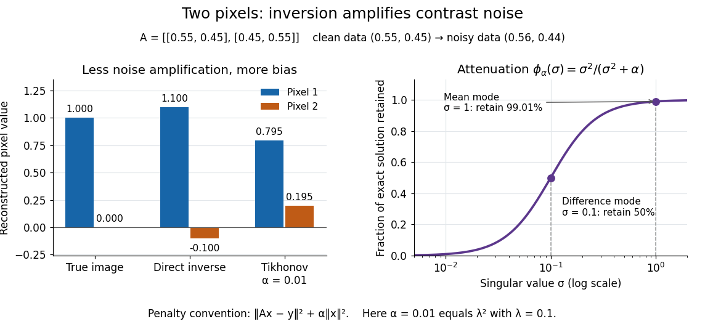

# Tikhonov regularization

↑ **Parent:** [Regularization of an inverse problem](regularization-of-an-inverse-problem.md)

For a [bounded linear operator](continuous-linear-operator.md) between [Hilbert spaces](hilbert-space-split.md) and $\alpha>0$, Tikhonov regularization minimizes

$$
\lVert Ax-y^\delta\rVert^2+\alpha\lVert x\rVert^2.
$$

The [quadratic norm penalty](quadratic-norm-penalty.md) makes this functional a [strictly convex](strictly-convex-function.md), [coercive function](coercive-function.md), yielding the unique minimizer displayed in the title. Here $A^*$ is the [adjoint operator](adjoint-operator.md) and $I$ the [identity operator](identity-operator.md). Our [regularization parameter](regularization-parameter.md) $\alpha$ multiplies the squared [norm](norm.md) directly. Hansen's notes instead write $\lambda^2\|x\|^2$: the same reconstruction requires $\alpha=\lambda^2$, not $\alpha=\lambda$.[Per Christian Hansen, Regularization Tools, §§2.4 and 2.7.1](https://www.imm.dtu.dk/~pcha/Regutools/RTv4manual.pdf)

For a real [matrix](matrix.md) with [singular value decomposition](singular-value-decomposition.md) $Av_j=\sigma_j u_j$, the exact reconstruction is

$$
x_\alpha^\delta=\sum_{\sigma_j>0}\underbrace{\frac{\sigma_j}{\sigma_j^2+\alpha}}_{g_\alpha(\sigma_j)}(u_j^Ty^\delta)v_j,\qquad
\phi_\alpha(\sigma)=\sigma g_\alpha(\sigma)=\frac{\sigma^2}{\sigma^2+\alpha}.
$$

The [singular-system Tikhonov filter](singular-system-tikhonov-filter.md) $g_\alpha$ is the data-to-solution gain; $\phi_\alpha$ is the fraction of an exact solution mode retained. If $y^\delta=Ax_{\mathrm{true}}+e$, a positive [singular value](singular-value.md) mode has error

$$
v_j^T(x_\alpha^\delta-x_{\mathrm{true}})
=-\frac{\alpha}{\sigma_j^2+\alpha}v_j^Tx_{\mathrm{true}}
+\frac{\sigma_j}{\sigma_j^2+\alpha}u_j^Te.
$$

The first term is approximation bias; the second is transmitted [measurement noise](measurement-noise.md). Suppressing a weak mode suppresses its true signal too.

For the two-pixel [matrix](matrix.md) in the [inverse problem](inverse-problem-split.md) example and $\alpha=0.01$ ($\lambda=0.1$), the mean and difference attenuation factors are $100/101$ and $1/2$. Since $y^\delta=q_+/\sqrt2+0.12q_-/\sqrt2$, the reconstruction is

$$
x_{0.01}^\delta=\frac{100}{101}\frac{q_+}{\sqrt2}+\frac35\frac{q_-}{\sqrt2}
=\begin{pmatrix}803/1010\\197/1010\end{pmatrix}
\approx\begin{pmatrix}0.79505\\0.19505\end{pmatrix}.
$$

Its noise contribution is $(0.05,-0.05)^T$, half the direct inverse's, but its exact-data reconstruction is $(0.74505,0.24505)^T$. Consequently its total error [Euclidean norm](euclidean-norm.md), about $0.28293$, exceeds the direct inverse's $0.14142$: this parameter sacrifices too much contrast. Taking $\alpha=0.001$ instead gives $(1.04496,-0.04595)^T$ and error about $0.06429$. [Regularization parameter choice](regularization-parameter-choice.md) matters; attenuation alone does not guarantee accuracy.

**[Figure 2](#image-tikhonov-attenuation-reduces-difference-mode-noise-while-biasing-the-reconstructed-contrast). Tikhonov attenuation reduces difference-mode noise while biasing the reconstructed contrast**.

**Table of contents**

- [Tikhonov regularization of spherical far-field continuation](tikhonov-regularization-of-spherical-far-field-continuation.md)
- [Tikhonov reconstruction from two-plane scattering data](tikhonov-reconstruction-from-two-plane-scattering-data.md)
- [Truncated Tikhonov resolvent](truncated-tikhonov-resolvent.md)
- [Quadratic norm penalty](quadratic-norm-penalty.md)
- [Singular-system Tikhonov filter](singular-system-tikhonov-filter.md)
- [Tikhonov stability bound](tikhonov-stability-bound.md)
- [Tikhonov filter norm bound](tikhonov-filter-norm-bound.md)
- [Tikhonov regularization with a coercive penalty operator](tikhonov-regularization-with-a-coercive-penalty-operator.md)
  - [Approximate source bound for coercive Tikhonov regularization](approximate-source-bound-for-coercive-tikhonov-regularization.md)
  - [Normal equation for coercive Tikhonov regularization](normal-equation-for-coercive-tikhonov-regularization.md)
- [Source condition for quadratic regularization](source-condition-for-quadratic-regularization.md)
- [Tikhonov normal equation](tikhonov-normal-equation.md)
- [Spectral filter](spectral-filter.md)
  - [Evenization of a nonnegative bandlimited filter](evenization-of-a-nonnegative-bandlimited-filter.md)
- [Regularization parameter choice](regularization-parameter-choice.md)
  - [Balancing noise and approximation bias](balancing-noise-and-approximation-bias.md)
  - [A priori regularization parameter choice](a-priori-regularization-parameter-choice.md)
- [Iterated Tikhonov regularization](iterated-tikhonov-regularization.md)
  - [Iterated Tikhonov spectral filter](iterated-tikhonov-spectral-filter.md)

## ↑ Ancestors (6)

1. [Regularization of an inverse problem](regularization-of-an-inverse-problem.md)
2. [Inverse problem](inverse-problem-split.md)
3. [Analysis](analysis-split.md)
4. [Area of mathematics](area-of-mathematics.md)
5. [Mathematics](mathematics-split.md)
6. [Codex Wiki](split.md)

## ← Incoming links (28)

- [Landweber iteration with a Tikhonov initial value](landweber-iteration-with-a-tikhonov-initial-value.md)
- [Solution](past-exam-of-the-mathematics-course-of-the-university-of-cambridge/2007/iii/paper-80/4/c/solution.md)
- [Solution](past-exam-of-the-mathematics-course-of-the-university-of-cambridge/2008/iii/paper-88/5/d/solution.md)
- [Solution](past-exam-of-the-mathematics-course-of-the-university-of-cambridge/2009/iii/paper-78/5/b/solution.md)
- [Solution](past-exam-of-the-mathematics-course-of-the-university-of-cambridge/2010/iii/paper-70/4/b/solution.md)
- [Solution](past-exam-of-the-mathematics-course-of-the-university-of-cambridge/2012/iii/paper-78/4/b/solution.md)
- [Solution](past-exam-of-the-mathematics-course-of-the-university-of-cambridge/2012/iii/paper-78/4/c/ii/solution.md)
- [Solution](past-exam-of-the-mathematics-course-of-the-university-of-cambridge/2016/iii/paper-326/1/iv/solution.md)
- [Solution](past-exam-of-the-mathematics-course-of-the-university-of-cambridge/2016/iii/paper-335/2/c/solution.md)
- [Solution](past-exam-of-the-mathematics-course-of-the-university-of-cambridge/2016/iii/paper-335/3/a/solution.md)
- [Solution](past-exam-of-the-mathematics-course-of-the-university-of-cambridge/2016/iii/paper-335/3/b/solution.md)
- [Solution](past-exam-of-the-mathematics-course-of-the-university-of-cambridge/2016/iii/paper-335/3/c/solution.md)
- [Solution](past-exam-of-the-mathematics-course-of-the-university-of-cambridge/2017/iii/paper-326/2/1/solution.md)
- [Solution](past-exam-of-the-mathematics-course-of-the-university-of-cambridge/2018/iii/paper-326/2/1/a/solution.md)
- [Solution](past-exam-of-the-mathematics-course-of-the-university-of-cambridge/2018/iii/paper-326/2/1/b/solution.md)
- [Solution](past-exam-of-the-mathematics-course-of-the-university-of-cambridge/2019/iii/paper-326/1/a/solution.md)
- [Solution](past-exam-of-the-mathematics-course-of-the-university-of-cambridge/2022/iii/paper-326/2/b/iv/solution.md)
- [Solution](past-exam-of-the-mathematics-course-of-the-university-of-cambridge/2023/iii/paper-335/3/ii/solution.md)
- [Solution](past-exam-of-the-mathematics-course-of-the-university-of-cambridge/2025/iii/paper-335/3/i/solution.md)
- [Quadratic norm penalty](quadratic-norm-penalty.md)
- [Regularization of an inverse problem](regularization-of-an-inverse-problem.md)
- [Singular-system Tikhonov filter](singular-system-tikhonov-filter.md)
- [Small singular values in the Moore-Penrose inverse](small-singular-values-in-the-moore-penrose-inverse.md)
- [Spectral Tikhonov differentiation for the Volterra operator](spectral-tikhonov-differentiation-for-the-volterra-operator.md)
- [Tikhonov filter norm bound](tikhonov-filter-norm-bound.md)
- [Tikhonov reconstruction from two-plane scattering data](tikhonov-reconstruction-from-two-plane-scattering-data.md)
- [Tikhonov regularization of spherical far-field continuation](tikhonov-regularization-of-spherical-far-field-continuation.md)
- [Tikhonov stability bound](tikhonov-stability-bound.md)
