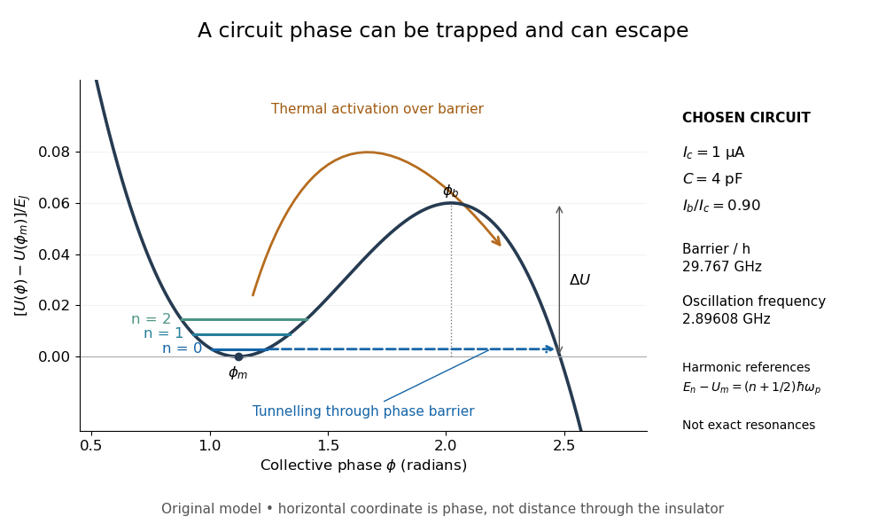

# Tilted Josephson washboard potential

↑ **Parent:** [Current-biased Josephson phase dynamics](current-biased-josephson-phase-dynamics.md)

At fixed positive bias ratio $s=I_b/I_c$ with $0<s<1$, the [Josephson coupling energy](josephson-coupling-energy.md) and work of the ideal bias source combine into

$$
U(\phi)=-E_J(\cos\phi+s\phi),\qquad E_J=\frac{\hbar I_c}{2e}.
$$

This is the effective [potential energy](potential-energy.md) for an unwrapped [Gauge-invariant Josephson phase](gauge-invariant-josephson-phase.md); it includes the bias source and decreases by $2\pi sE_J$ on advancing one period. A local minimum and the adjacent downhill barrier are

$$
\phi_m=\arcsin s,\qquad \phi_b=\pi-\arcsin s,\qquad
\Delta U=U(\phi_b)-U(\phi_m)=2E_J\left[\sqrt{1-s^2}-s\arccos s\right].
$$

To verify the barrier, solve $U'=E_J(\sin\phi-s)=0$, select $U''(\phi_m)>0$ and $U''(\phi_b)<0$, and subtract their [potential energies](potential-energy.md). The small-oscillation angular [frequency](frequency.md) is fixed by the curvature:

$$
U''(\phi_m)=E_J\sqrt{1-s^2},\qquad
\omega_p^2=\frac{U''(\phi_m)}{M_\phi},\qquad
\omega_p=\sqrt{\frac{2eI_c}{\hbar C}}(1-s^2)^{1/4}.
$$

Thus the barrier and oscillation [frequency](frequency.md) both vanish as $s\to1^-$, but with different powers. For $\epsilon=1-s\ll1$, expanding $\arccos(1-\epsilon)$ and $\sqrt{2\epsilon-\epsilon^2}$ gives

$$
\Delta U\simeq\frac{4\sqrt2}{3}E_J\epsilon^{3/2},\qquad
\omega_p\simeq\sqrt{\frac{2eI_c}{\hbar C}}(2\epsilon)^{1/4}.
$$

The first approximation is for a nearly critical bias. At $s=0$ the exact downhill barrier is $2E_J$; at $s\geq1$ there is no confining local minimum in this model.

**[Figure 7](#image-a-tilted-phase-potential-confines-low-energy-levels-and-permits-escape). A tilted phase potential confines low energy levels and permits escape**. Original chosen model with $I_c=1\,\mathrm{\mu A}$, $C=4\,\mathrm{pF}$ and $I_b=0.90I_c$. Three horizontal lines are [quantum harmonic oscillator](quantum-harmonic-oscillator-split.md) approximations $E_n-U(\phi_m)=(n+1/2)\hbar\omega_p$, for $n=0,1,2$; they are not exact [energy levels](energy-level.md) or measured data. The horizontal axis is a [quantum phase](quantum-phase.md), not distance through an insulator. Arrows distinguish over-barrier [thermal activation](thermal-activation.md) and below-barrier [quantum tunnelling](quantum-tunnelling.md).

For those stipulated parameters, direct evaluation gives $E_J/h=496.684\,\mathrm{GHz}$, $\Delta U/h=29.7670\,\mathrm{GHz}$, and $\omega_p/(2\pi)=2.89608\,\mathrm{GHz}$. Hence $\Delta U/(\hbar\omega_p)=10.2784$. The nearly critical barrier approximation gives $29.6165\,\mathrm{GHz}$, about $0.51\%$ below the exact result. These are original circuit calculations, not parameters assigned to the historical samples.

## ↑ Ancestors (7)

1. [Current-biased Josephson phase dynamics](current-biased-josephson-phase-dynamics.md)
2. [Josephson junction](josephson-junction.md)
3. [Superconductivity](superconductivity-split.md)
4. [Statistical physics](statistical-physics-split.md)
5. [Branches of physics](branches-of-physics.md)
6. [Physics](physics-split.md)
7. [Codex Wiki](split.md)

## ← Incoming links (2)

- [Current-biased Josephson phase dynamics](current-biased-josephson-phase-dynamics.md)
- [Quantum escape of a current-biased Josephson junction](quantum-escape-of-a-current-biased-josephson-junction.md)
